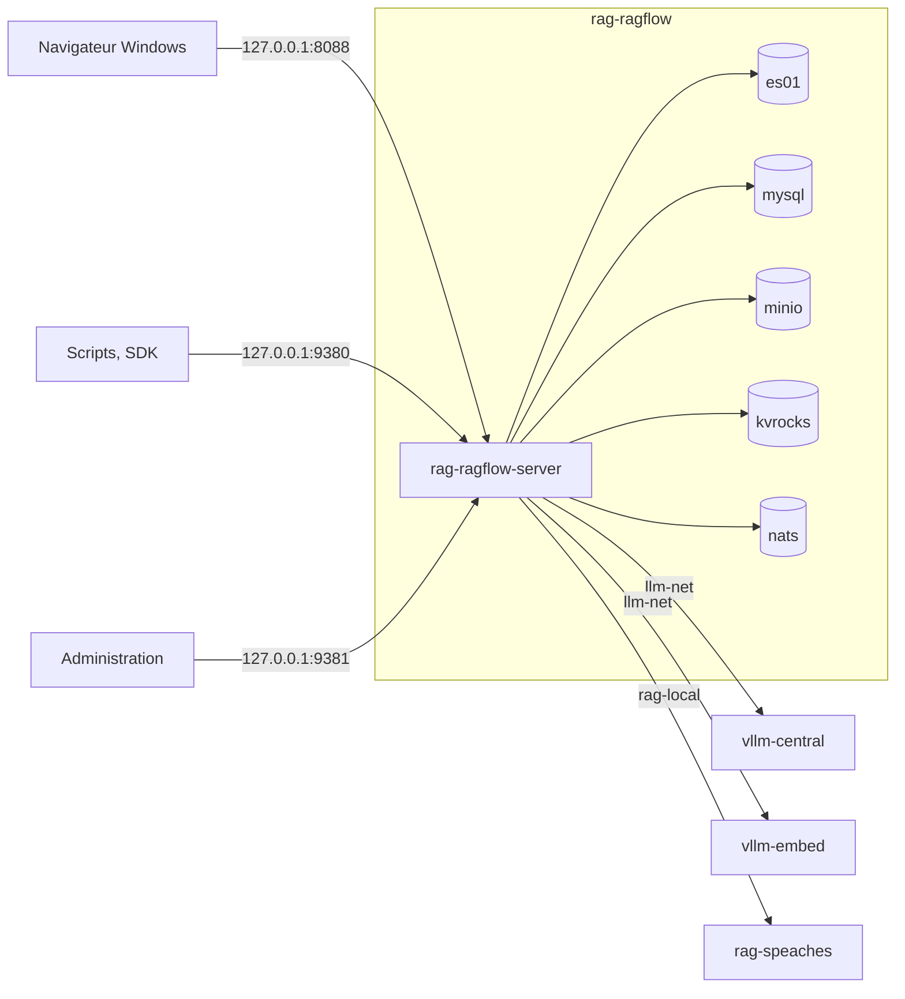

# RAGFlow — banc d'essai et manuels vérifiés

**Interroger ses propres documents, scans compris, avec une IA qui cite le passage et la page, sur sa machine et sans service en ligne : RAGFlow 1.0.0 installé, mesuré sur 38 questions et documenté en un manuel utilisateur de 16 parties, avec 164 captures d'écran annotées.**


RAGFlow v1.0.0 branché sur un service de modèles local (LLM-Service, vLLM sur
carte graphique), le corpus d'entreprise fictive de la série avec ses pièges
(scan, tableaux, audio, document en anglais), un banc de 38 questions dont les
réponses sont connues, et des manuels écrits à partir de ce qui a réellement
tourné. Chaque commande a été exécutée, chaque chiffre renvoie à un résultat
brut dans `outils/resultats/`.

Deuxième banc de la série, après Open Notebook : mêmes documents, mêmes
questions, même modèle sur la même machine ; le comparatif est dans
[docs/README.md](docs/README.md).

## Sommaire

- [Architecture](#architecture)
- [Démarrage](#démarrage)
- [Configuration](#configuration)
- [API / Endpoints](#api--endpoints)
- [Tests](#tests)
- [Structure du projet](#structure-du-projet)
- [Licences & composants](#licences--composants)
- [Le parcours](#le-parcours)
- [Commandes utiles](#commandes-utiles)
- [Données du banc](#données-du-banc)
- [Les pièges que ce banc documente](#les-pièges-que-ce-banc-documente)
- [Résultats](#résultats)
- [Versions](#versions)
- [Ressources](#ressources)

## Architecture

| Service | Conteneur | Image | Rôle |
|---|---|---|---|
| RAGFlow | `rag-ragflow-server` | `infiniflow/ragflow:v1.0.0` | interface web (nginx), API, administration, ingestion et DeepDoc |
| Moteur documentaire | `rag-ragflow-es01` | `elasticsearch:8.11.3` | index des passages (mots-clés et vecteurs) |
| Base de données | `rag-ragflow-mysql` | `mysql:8.0.40` | comptes, bases, documents, assistants |
| Stockage | `rag-ragflow-minio` | `pgsty/silo:RELEASE.2026-08-06T00-00-00Z` | fichiers téléversés (fork de MinIO) |
| Cache | `rag-ragflow-kvrocks` | `apache/kvrocks:2.16.0` | cache |
| File de tâches | `rag-ragflow-nats` | `nats:2.14.2` | tâches d'analyse |
| Modèle de réponse | `vllm-central` (LLM-Service, hors de ce dépôt) | `vllm/vllm-openai:v0.29.0` | `gemma4:e4b` |
| Embedding | `vllm-embed` (LLM-Service) | `vllm/vllm-openai:v0.29.0` | `bge-m3` |
| Voix | `rag-speaches` (socle de la série) | `ghcr.io/speaches-ai/speaches:0.8.3-cpu` | transcription audio |

Toutes les images sont figées par empreinte `@sha256` (`outils/ragflow/compose.override.yml`).



Réseaux : `rag-ragflow` (interne à la pile), `llm-net` (LLM-Service, externe), `rag-local` (voix et captures, externe).

## Démarrage

Prérequis : WSL2 (Ubuntu), Docker et Compose, LLM-Service démarré (`outils/communs/llm_service_vllm.sh` avec GPU, `outils/communs/llm_service.sh` sans), uv. Mesures de la machine : [diagnostic](outils/resultats/machine/diagnostic-2026-11-09.json).

```bash
outils/ragflow/installer.sh
python3 outils/ragflow/configurer.py
uv sync
uv run python outils/ragflow/verif_minimale.py
```

| Service | URL | Note |
|---|---|---|
| Interface web | http://127.0.0.1:8088 | identifiants dans `donnees/IDENTIFIANTS-LOCAUX.txt` ; langue : sélecteur de l'en-tête |
| API | http://127.0.0.1:9380/api/v1 | clé d'API `Bearer` |
| Administration | http://127.0.0.1:9381/api/v1/admin | compte `admin@ragflow.io` |
| Santé | http://127.0.0.1:9380/api/v1/system/healthz | sans authentification |

Installation complète, mémoire et désinstallation : [manuel 01](docs/ragflow/01-installation.md).

## Configuration

| Réglage | Valeur | Où |
|---|---|---|
| Mots de passe (Elasticsearch, MySQL, MinIO, Kvrocks, administration) | générés aléatoirement | `donnees/ragflow/ragflow.env` (droits 600, ignoré par git) |
| Port de l'interface | 8088 (8080 déjà occupé sur la machine d'essai) | `SVR_WEB_HTTP_PORT` |
| Mémoire d'Elasticsearch | 4 Gio (`MEM_LIMIT`, 8 Go dans le compose officiel) | `ragflow.env` |
| Fuseau horaire | `Europe/Paris` | `ragflow.env` |
| Adresses privées | `ALLOW_ANY_HOST=0` (défaut) | `ragflow.env` |

Écarts au compose officiel (fichier `outils/ragflow/compose.override.yml`) : ports sur `127.0.0.1` ou retirés, conteneurs `rag-ragflow-*`, images figées, volumes liés à `donnees/ragflow/`, réseaux `llm-net` et `rag-local`, réglages hors du `docker/.env` suivi.

LLM-Service (dépôt séparé, branche `service-vllm`) : `gemma4:e4b` (`--max-model-len 32768`, `--gpu-memory-utilization 0.8`, `--kv-cache-dtype fp8`, relevés dans [le journal de vLLM](outils/resultats/ragflow/preuves-2026-11-09/vllm-extrait.log)) et `bge-m3`. Dans RAGFlow : fournisseur `VLLM`, contexte déclaré 16 384 jetons ; transcription par `OpenAI-API-Compatible` (`rag-speaches`).

## API / Endpoints

| Besoin | Appel |
|---|---|
| Santé | `GET /api/v1/system/healthz` |
| Bases | `POST /api/v1/datasets`, `POST /api/v1/datasets/{id}/documents`, `POST /api/v1/datasets/{id}/chunks` |
| Recherche seule | `POST /api/v1/retrieval` |
| Assistants et questions | `POST /api/v1/chats`, `POST /api/v1/chat/completions` |
| Agents | `POST /api/v1/agents`, `POST /api/v1/agents/chat/completions` |
| Modèles | `POST /api/v1/providers/{fournisseur}/instances`, `PATCH /api/v1/models/default` |
| Administration | `POST /api/v1/admin/login`, `GET /api/v1/admin/users` (port 9381) |

SDK `ragflow-sdk` 1.0.0 (Python 3.13) : deux défauts et leurs contournements dans le [manuel 10](docs/ragflow/10-api-et-sdk.md).

## Tests

```bash
uv run python outils/ragflow/verif_minimale.py
exemples/ragflow/lancer.sh
uv run python outils/ragflow/banc.py --etiquette defaut --reindexer
python3 outils/communs/verifier_docs.py
```

Sorties obtenues : vérification minimale, réponse citée en 4,0 s ([journal](outils/resultats/ragflow/installation-2026-11-09-verif.log)) ; six exemples en code 0 ([sorties vérifiées](exemples/ragflow/sorties_verifiees.txt)) ; banc 33/34 ([résultat](outils/resultats/ragflow/banc-2026-11-09-defaut.md)) ; documentation à 0 point ([sortie du vérificateur](outils/resultats/ragflow/verifier-docs-2026-11-09.txt)).

## Structure du projet

```text
.
├── README.md, LICENSE, JOURNAL.md, RAPPORT-ragflow.md
├── pyproject.toml, uv.lock          # SDK ragflow-sdk 1.0.0 (Python 3.13)
├── corpus/                          # 9 documents fictifs et 38 questions de référence
├── docs/
│   ├── README.md                    # index de la série et comparatif du banc
│   ├── glossaire.md
│   └── ragflow/                     # présentation, plan, manuels 00 à 14, images
├── exemples/ragflow/                # six exemples et leurs sorties vérifiées
├── outils/
│   ├── communs/                     # diagnostic, LLM-Service, banc, captures, vérification, nettoyage
│   ├── ragflow/                     # installation, configuration, essais, banc, captures
│   └── resultats/                   # résultats bruts (machine, socle, open-notebook, ragflow)
├── sources/                         # dépôt RAGFlow au tag v1.0.0 (ignoré par git)
└── donnees/                         # volumes, secrets, sauvegardes (ignoré par git)
```

## Licences & composants

| Composant | Rôle | Licence |
|---|---|---|
| RAGFlow | application testée | Apache License 2.0 |
| `ragflow-sdk` | SDK Python | Apache License 2.0 |
| Elasticsearch 8.11.3 | moteur documentaire | Elastic License 2.0 ou SSPL |
| MySQL 8.0.40 | base de données | GPL v2 |
| `pgsty/silo` (fork de MinIO) | stockage | GNU AGPL v3 |
| Apache Kvrocks | cache | Apache License 2.0 |
| NATS | file de tâches | Apache License 2.0 |
| vLLM | service de modèles | Apache License 2.0 |
| Gemma 4 E4B | modèle de réponse | conditions de Google, voir la fiche du modèle |
| bge-m3 | modèle d'embedding | MIT |
| Speaches, faster-whisper-small | transcription | MIT |
| Playwright | captures d'écran | Apache License 2.0 |
| **Ce projet** | manuels, scripts, corpus, banc | MIT — Copyright (c) 2026 floSa |

## Le parcours

| N° | Manuel | Ce qu'on saura faire |
|---|---|---|
| 00 | [Notions fondamentales](docs/ragflow/00-notions-fondamentales.md) | comprendre le RAG et l'architecture de RAGFlow |
| 01 | [Installation](docs/ragflow/01-installation.md) | installer sans exposition réseau, mesurer, désinstaller |
| 02 | [Prise en main](docs/ragflow/02-prise-en-main.md) | obtenir une première réponse citée |
| 03 | [Datasets et découpage](docs/ragflow/03-datasets-et-decoupage.md) | choisir un gabarit de découpage |
| 04 | [DeepDoc](docs/ragflow/04-deepdoc.md) | lire un scan, corriger un passage |
| 05 | [Assistants et citations](docs/ragflow/05-assistants-et-citations.md) | régler la recherche, vérifier les sources |
| 06 | [Agentic RAG](docs/ragflow/06-agentic-rag.md) | savoir quand le mode agentique aide |
| 07 | [Knowledge Compilation](docs/ragflow/07-knowledge-compilation.md) | produire un graphe, un arbre, une frise, une carte mentale à la souris |
| 08 | [Agents](docs/ragflow/08-agents.md) | construire, essayer, publier un agent ; mémoire, MCP |
| 09 | [Sources externes](docs/ragflow/09-sources-externes.md) | déclarer une source, la lier à une base ; canaux de chat |
| 10 | [API et SDK](docs/ragflow/10-api-et-sdk.md) | automatiser |
| 11 | [Recettes](docs/ragflow/11-recettes.md) | assistant d'entreprise, ingestion quotidienne |
| 12 | [Qualité et performances](docs/ragflow/12-qualite-et-performances.md) | lire le banc, dimensionner la machine |
| 13 | [Exploitation](docs/ragflow/13-exploitation.md) | sauvegarder, mettre à jour, sécuriser |
| 14 | [Dépannage](docs/ragflow/14-depannage.md) | résoudre les problèmes rencontrés |
| 15 | [Applications de recherche](docs/ragflow/15-recherche.md) | chercher dans une base, lire le résumé et la carte mentale, intégrer la recherche |

Parcours conseillés : découvrir ([présentation](docs/ragflow/presentation.md), 00, 01, 02) ; améliorer les réponses (03, 04, 05, 12) ; automatiser (10, 11, 08).

## Commandes utiles

```bash
outils/ragflow/etat.sh
outils/ragflow/arreter.sh
outils/ragflow/demarrer.sh
outils/ragflow/sauvegarder.sh
outils/ragflow/ressources.sh repos
outils/communs/nettoyer.sh ragflow
```

## Données du banc

Entreprise fictive Vélanor (vélos électriques), 9 documents, 1 Mo, empreintes dans `corpus/MANIFEST.json` : rapport annuel PDF de 10 pages avec tableaux, contrat PDF scanné, audit en anglais, procédure DOCX, présentation PPTX, classeur XLSX, FAQ HTML, compte rendu Markdown, message vocal MP3. 38 questions de référence (`corpus/questions.json`) : faits simples, tableaux, scan, anglais, multi-documents, audio et 4 pièges sans réponse.

## Les pièges que ce banc documente

- Le compose officiel publie bases de données et stockage sur toutes les interfaces, avec des mots de passe connus.
- Un compte créé par l'API avec un mot de passe en clair ne peut pas se connecter dans le navigateur (le serveur compare `base64(mot de passe)`).
- `Session.ask` du SDK 1.0.0 répond 404 pour un assistant ; `parse_documents` peut rendre la main avant la fin.
- `reference.chunks` liste tous les passages fournis au modèle, pas seulement ceux qu'il cite (`[ID:n]`).
- À 3 072 jetons de contexte, 12 réponses sur 38 deviennent des messages d'erreur, avec un code d'API 0 ; 4 096 suffit.
- Un site interne est refusé par la synchronisation sitemap (protection contre les adresses privées).
- L'interface reste en anglais tant que le sélecteur de langue n'est pas utilisé.

## Résultats

| Banc | Exactes (34) | Refus pièges (4) | Bon document cité | Médiane | Pic RAM application |
|---|---|---|---|---|---|
| Défaut | 33 | 4 | 34 | 1,28 s | 5,3 Gio |
| Vecteurs 0,7, `top_n` 8 | 34 | 4 | 34 | 1,36 s | 4,9 Gio |
| Mode agentique | 30 | 4 | 29 | 4,52 s | 5,2 Gio |

Détail et variantes : [manuel 12](docs/ragflow/12-qualite-et-performances.md) ; comparaison avec Open Notebook : [docs/README.md](docs/README.md).

## Versions

| Composant | Version | Dernière stable au 9 novembre 2026 |
|---|---|---|
| RAGFlow, `ragflow-sdk` | v1.0.0 | v1.0.0 |
| Elasticsearch | 8.11.3 (imposée par le compose) | 9.5.6 |
| Kvrocks | 2.16.0 (imposée) | 2.17.0 |
| NATS | 2.14.2 (imposée) | 2.15.2 |
| MinIO (`pgsty/silo`) | RELEASE.2026-08-06 (imposée) | RELEASE.2026-10-26 |
| vLLM (LLM-Service) | 0.29.0 | 0.32.0 (décision en attente) |
| Playwright (captures) | 1.64.1 | 1.64.1 |

Relevé brut : [versions-2026-11-09.json](outils/resultats/ragflow/versions-2026-11-09.json).

## Ressources

- RAGFlow : https://github.com/infiniflow/ragflow, documentation https://ragflow.io/docs/
- Bilan de la mission : [RAPPORT-ragflow.md](RAPPORT-ragflow.md) ; avancement : [JOURNAL.md](JOURNAL.md)
- Banc précédent : https://github.com/floSa/Open-Notebook-Test-Bench
