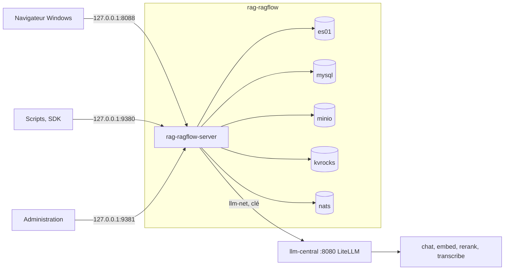

# RAGFlow — banc d'essai et manuels vérifiés

**Interroger ses propres documents, scans compris, avec une IA qui cite le passage et la page, sur sa machine et sans service en ligne : RAGFlow 1.0.0 installé, mesuré sur 38 questions et documenté en un manuel utilisateur de 16 chapitres suivis de 6 annexes, avec 196 captures d'écran annotées.**

**Le manuel utilisateur commence ici : [docs/ragflow/README.md](docs/ragflow/README.md).**


RAGFlow v1.0.0 branché sur le service LLM central (LLM-Service, LiteLLM : chat, embed, rerank, transcribe),
le corpus d'entreprise fictive de la série avec ses pièges
(scan, tableaux, audio, document en anglais), un banc de 38 questions dont les
réponses sont connues, et des manuels écrits à partir de ce qui a réellement
tourné. Chaque commande a été exécutée, chaque chiffre renvoie à un résultat
brut dans `outils/resultats/`.

Deuxième banc de la série, après Open Notebook : mêmes documents, mêmes
questions, même modèle sur la même machine ; le comparatif est dans
[docs/README.md](docs/README.md).

## Sommaire

- [Le parcours](#le-parcours)
- [Architecture](#architecture)
- [Démarrage](#démarrage)
- [Configuration](#configuration)
- [API / Endpoints](#api--endpoints)
- [Tests](#tests)
- [Structure du projet](#structure-du-projet)
- [Licences & composants](#licences--composants)
- [Commandes utiles](#commandes-utiles)
- [Données du banc](#données-du-banc)
- [Les pièges que ce banc documente](#les-pièges-que-ce-banc-documente)
- [Résultats](#résultats)
- [Versions](#versions)
- [Ressources](#ressources)

## Le parcours

Le manuel se lit depuis sa page d'accueil, [docs/ragflow/README.md](docs/ragflow/README.md). Partie 1 : manuel utilisateur, à lire dans l'ordre, pour un lecteur à l'aise avec un terminal.

| N° | Chapitre | Ce qu'on saura faire |
|---|---|---|
| 01 | [Découvrir RAGFlow](docs/ragflow/manuel/01-decouvrir-ragflow.md) | dire à quoi sert RAGFlow, pour qui et avec quelle machine |
| 02 | [Installer RAGFlow](docs/ragflow/manuel/02-installer-ragflow.md) | installer sans exposition réseau, démarrer, arrêter, désinstaller |
| 03 | [Premiers pas](docs/ragflow/manuel/03-premiers-pas.md) | se connecter, passer en français, se repérer, brancher les modèles d'un serveur existant, connaître les traitements intégrés |
| 04 | [Première question en dix minutes](docs/ragflow/manuel/04-premiere-question.md) | obtenir une première réponse citée |
| 05 | [Ajouter et organiser ses documents](docs/ragflow/manuel/05-ajouter-et-organiser-ses-documents.md) | gérer bases et fichiers, métadonnées, journaux |
| 06 | [Régler la lecture des documents](docs/ragflow/manuel/06-regler-la-lecture-des-documents.md) | choisir un gabarit, lire un scan, corriger un passage |
| 07 | [Poser des questions et lire les sources](docs/ragflow/manuel/07-poser-des-questions-et-lire-les-sources.md) | converser, vérifier les sources, « Naive » ou « Agentic », publier |
| 08 | [Régler un assistant](docs/ragflow/manuel/08-regler-un-assistant.md) | appliquer les réglages qui améliorent les réponses |
| 09 | [Rechercher dans ses documents](docs/ragflow/manuel/09-rechercher.md) | page de recherche avec résumé et carte mentale |
| 10 | [Construire un agent](docs/ragflow/manuel/10-agents.md) | agent depuis un modèle, essai, publication, mémoire, MCP |
| 11 | [Produire des synthèses automatiques](docs/ragflow/manuel/11-syntheses-automatiques.md) | graphe, arbre, frise, carte mentale à la souris |
| 12 | [Alimenter une base depuis une source externe](docs/ragflow/manuel/12-sources-externes.md) | source « Sitemap », journal de synchronisation, canaux de chat |
| 13 | [Gérer son compte, son équipe et ses clés](docs/ragflow/manuel/13-comptes-equipe-et-cles.md) | équipe, profil, clés d'accès, console d'administration |
| 14 | [Cas pratiques](docs/ragflow/manuel/14-cas-pratiques.md) | assistant documentaire d'entreprise, base alimentée chaque jour |
| 15 | [En cas de problème](docs/ragflow/manuel/15-en-cas-de-probleme.md) | reconnaître une erreur et appliquer le remède |
| 16 | [Glossaire](docs/ragflow/manuel/16-glossaire.md) | retrouver la définition simple de chaque terme |

Partie 2 : évaluation et compléments.

| Annexe | Contenu |
|---|---|
| [A1. Évaluation : qualité et performances](docs/ragflow/annexes/A1-evaluation-qualite-et-performances.md) | banc de 38 questions, réglages qui changent le résultat, préconisations |
| [A2. Choisir son matériel et ses modèles](docs/ragflow/annexes/A2-choisir-son-materiel-et-ses-modeles.md) | configurations sans et avec carte graphique, contexte, temps d'attente |
| [A3. Automatiser par l'API](docs/ragflow/annexes/A3-automatiser-par-l-api.md) | API HTTP, SDK Python, exemples exécutés, défauts contournés |
| [A4. Exploitation](docs/ragflow/annexes/A4-exploitation.md) | installation détaillée, sauvegarde, mise à jour, journaux, sécurité, administration |
| [A5. Fonctionnement interne](docs/ragflow/annexes/A5-fonctionnement-interne.md) | RAG, architecture, services, DeepDoc |
| [A6. Rapport d'essais](docs/ragflow/annexes/A6-rapport-d-essais.md) | méthode, étiquettes, preuves par chapitre, défauts rencontrés |
| [Carte de l'interface](docs/ragflow/annexes/carte-interface.md) | chaque page et réglage de l'interface, avec son chapitre |
| [A7. Bascule vers le service LLM central](docs/ragflow/annexes/A7-bascule-vers-le-service-llm-central.md) | fournisseur, modèles par défaut, réindexation, réflexion de `chat` |

Parcours conseillés : essayer en une heure (chapitres 01 à 04) ; mettre en service pour une équipe (05 à 08, puis 13 et 14) ; améliorer les réponses (06, 08, annexe A1) ; automatiser et exploiter (annexes A3, A4, A5).

## Architecture

| Service | Conteneur | Image | Rôle |
|---|---|---|---|
| RAGFlow | `rag-ragflow-server` | `infiniflow/ragflow:v1.0.0` | interface web (nginx), API, administration, ingestion et DeepDoc |
| Moteur documentaire | `rag-ragflow-es01` | `elasticsearch:8.11.3` | index des passages (mots-clés et vecteurs) |
| Base de données | `rag-ragflow-mysql` | `mysql:8.0.40` | comptes, bases, documents, assistants |
| Stockage | `rag-ragflow-minio` | `pgsty/silo:RELEASE.2026-08-06T00-00-00Z` | fichiers téléversés (fork de MinIO) |
| Cache | `rag-ragflow-kvrocks` | `apache/kvrocks:2.16.0` | cache |
| File de tâches | `rag-ragflow-nats` | `nats:2.14.2` | tâches d'analyse |
| Service LLM central | `llm-central` (LiteLLM, LLM-Service, géré à part, hors de ce dépôt) | LiteLLM | `chat` (Qwen3.5-4B), `embed` (bge-m3), `rerank` (bge-reranker-v2-m3), `transcribe` (faster-whisper-small) |
| Voix (ancienne) | `rag-speaches` (socle de la série) | `ghcr.io/speaches-ai/speaches:0.8.3-cpu` | transcription audio, remplacée par `transcribe` du service central |

Toutes les images sont figées par empreinte `@sha256` (`outils/ragflow/compose.override.yml`).



Réseaux : `rag-ragflow` (interne à la pile), `llm-net` (LLM-Service, externe), `rag-local` (voix et captures, externe).

## Démarrage

Prérequis : WSL2 (Ubuntu), Docker et Compose, le service LLM central (LLM-Service, géré à part : ce dépôt ne le démarre ni ne l'arrête), une clé du service dans `.env` (copie de `.env.example`), uv. Vérification : `outils/communs/llm_central_sante.sh --essai`. Les scripts `llm_service*.sh` sont historiques (annexe A2). Mesures de la machine : [diagnostic](outils/resultats/machine/diagnostic-2026-11-09.json).

```bash
outils/ragflow/installer.sh
python3 outils/ragflow/configurer.py
uv sync
uv run python outils/ragflow/verif_minimale.py
```

| Service | URL | Note |
|---|---|---|
| Interface web | http://127.0.0.1:8088 | identifiants dans `donnees/IDENTIFIANTS-LOCAUX.txt` ; langue : sélecteur de l'en-tête |
| API | http://127.0.0.1:9380/api/v1 | clé d'API `Bearer` |
| Administration | http://127.0.0.1:9381/api/v1/admin | compte `admin@ragflow.io` |
| Santé | http://127.0.0.1:9380/api/v1/system/healthz | sans authentification |

Installation complète, mémoire et désinstallation : [chapitre 02](docs/ragflow/manuel/02-installer-ragflow.md) et [annexe A4](docs/ragflow/annexes/A4-exploitation.md).

## Configuration

| Réglage | Valeur | Où |
|---|---|---|
| Mots de passe (Elasticsearch, MySQL, MinIO, Kvrocks, administration) | générés aléatoirement | `donnees/ragflow/ragflow.env` (droits 600, ignoré par git) |
| Port de l'interface | 8088 (8080 déjà occupé sur la machine d'essai) | `SVR_WEB_HTTP_PORT` |
| Mémoire d'Elasticsearch | 4 Gio (`MEM_LIMIT`, 8 Go dans le compose officiel) | `ragflow.env` |
| Fuseau horaire | `Europe/Paris` | `ragflow.env` |
| Adresses privées | `ALLOW_ANY_HOST=0` (défaut) | `ragflow.env` |

Écarts au compose officiel (fichier `outils/ragflow/compose.override.yml`) : ports sur `127.0.0.1` ou retirés, conteneurs `rag-ragflow-*`, images figées, volumes liés à `donnees/ragflow/`, réseaux `llm-net` et `rag-local`, réglages hors du `docker/.env` suivi.

Service LLM central (LLM-Service, dépôt séparé, géré à part) : un seul point d'entrée LiteLLM, `http://llm-central:8080/v1` depuis les conteneurs du réseau `llm-net` (`http://127.0.0.1:8080/v1` depuis l'hôte), clé obligatoire (`LLM_CENTRAL_KEY` dans `.env`, jamais commitée). Modèles fixes :

| Nom | Modèle | Usage |
|---|---|---|
| `chat` | Qwen3.5-4B, vision, réflexion activée par défaut | réponses, agents, synthèses (contexte 16 384 jetons par requête) |
| `embed` | bge-m3 (GGUF Q8_0), 1024 dimensions | recherche par le sens |
| `rerank` | bge-reranker-v2-m3 | reclassement, scores bruts non bornés |
| `transcribe` | faster-whisper-small | `/v1/audio/transcriptions` |

Dans RAGFlow : fournisseur `OpenAI-API-Compatible` pour les quatre usages (voir la [bascule](docs/ragflow/annexes/A7-bascule-vers-le-service-llm-central.md)). Les résultats mesurés avec l'ancienne pile (`gemma4:e4b` sur vLLM) restent dans `outils/resultats/` comme preuves historiques.

### Bascule vers le service LLM central (dans l'interface de RAGFlow)

Procédure complète et justification : [annexe A7](docs/ragflow/annexes/A7-bascule-vers-le-service-llm-central.md). Résumé :

1. Menu du compte › « Fournisseurs de modèles » › ajouter `OpenAI-API-Compatible` : nom d'instance `llm-central`, URL `http://llm-central:8080/v1`, clé = `LLM_CENTRAL_KEY` ; modèles `chat` (type chat, 16 384), `embed` (embedding), `rerank` (rerank), `transcribe` (speech2text).
2. Modèles par défaut du compte : chat `chat`, embedding `embed`, rerank `rerank`, transcription `transcribe`.
3. Réindexer chaque base de connaissances (changer son modèle d'embedding, puis relancer l'analyse) : `bge-m3` est maintenant en Q8_0 GGUF au lieu de bf16, vecteurs proches mais pas identiques.
4. Réflexion de `chat` : activée par défaut, elle consomme des jetons et de la latence ; RAGFlow n'a pas de champ de paramètres supplémentaires par instance (voir A7).

## API / Endpoints

| Besoin | Appel |
|---|---|
| Santé | `GET /api/v1/system/healthz` |
| Bases | `POST /api/v1/datasets`, `POST /api/v1/datasets/{id}/documents`, `POST /api/v1/datasets/{id}/chunks` |
| Recherche seule | `POST /api/v1/retrieval` |
| Assistants et questions | `POST /api/v1/chats`, `POST /api/v1/chat/completions` |
| Agents | `POST /api/v1/agents`, `POST /api/v1/agents/chat/completions` |
| Modèles | `POST /api/v1/providers/{fournisseur}/instances`, `PATCH /api/v1/models/default` |
| Administration | `POST /api/v1/admin/login`, `GET /api/v1/admin/users` (port 9381) |

SDK `ragflow-sdk` 1.0.0 (Python 3.13) : deux défauts et leurs contournements dans l'[annexe A3](docs/ragflow/annexes/A3-automatiser-par-l-api.md).

## Tests

```bash
uv run python outils/ragflow/verif_minimale.py
exemples/ragflow/lancer.sh
uv run python outils/ragflow/banc.py --etiquette defaut --reindexer
python3 outils/communs/verifier_docs.py
```

Sorties obtenues : vérification minimale, réponse citée en 4,0 s ([journal](outils/resultats/ragflow/installation-2026-11-09-verif.log)) ; six exemples en code 0 ([sorties vérifiées](exemples/ragflow/sorties_verifiees.txt)) ; banc 33/34 ([résultat](outils/resultats/ragflow/banc-2026-11-09-defaut.md)) ; documentation à 0 point ([sortie du vérificateur](outils/resultats/ragflow/verifier-docs-2026-11-09.txt)).

## Structure du projet

```text
.
├── README.md, LICENSE, JOURNAL.md, RAPPORT-ragflow.md
├── pyproject.toml, uv.lock          # SDK ragflow-sdk 1.0.0 (Python 3.13)
├── corpus/                          # 9 documents fictifs et 38 questions de référence
├── docs/
│   ├── README.md                    # index de la série et comparatif du banc
│   ├── glossaire.md
│   └── ragflow/                     # manuel : accueil, manuel/ (chapitres 01 à 16), annexes/ (A1 à A7), images
├── exemples/ragflow/                # six exemples et leurs sorties vérifiées
├── outils/
│   ├── communs/                     # diagnostic, LLM-Service, banc, captures, vérification, nettoyage
│   ├── ragflow/                     # installation, configuration, essais, banc, captures
│   └── resultats/                   # résultats bruts (machine, socle, open-notebook, ragflow)
├── sources/                         # dépôt RAGFlow au tag v1.0.0 (ignoré par git)
└── donnees/                         # volumes, secrets, sauvegardes (ignoré par git)
```

## Licences & composants

| Composant | Rôle | Licence |
|---|---|---|
| RAGFlow | application testée | Apache License 2.0 |
| `ragflow-sdk` | SDK Python | Apache License 2.0 |
| Elasticsearch 8.11.3 | moteur documentaire | Elastic License 2.0 ou SSPL |
| MySQL 8.0.40 | base de données | GPL v2 |
| `pgsty/silo` (fork de MinIO) | stockage | GNU AGPL v3 |
| Apache Kvrocks | cache | Apache License 2.0 |
| NATS | file de tâches | Apache License 2.0 |
| LiteLLM | passerelle du service LLM central (géré à part) | MIT (noyau) |
| Gemma 4 E4B | modèle de réponse | conditions de Google, voir la fiche du modèle |
| bge-m3 | modèle d'embedding | MIT |
| Speaches, faster-whisper-small | transcription | MIT |
| Playwright | captures d'écran | Apache License 2.0 |
| **Ce projet** | manuels, scripts, corpus, banc | MIT — Copyright (c) 2026 floSa |

## Commandes utiles

```bash
outils/ragflow/etat.sh
outils/ragflow/arreter.sh
outils/ragflow/demarrer.sh
outils/ragflow/sauvegarder.sh
outils/ragflow/ressources.sh repos
outils/communs/nettoyer.sh ragflow
```

## Données du banc

Entreprise fictive Vélanor (vélos électriques), 9 documents, 1 Mo, empreintes dans `corpus/MANIFEST.json` : rapport annuel PDF de 10 pages avec tableaux, contrat PDF scanné, audit en anglais, procédure DOCX, présentation PPTX, classeur XLSX, FAQ HTML, compte rendu Markdown, message vocal MP3. 38 questions de référence (`corpus/questions.json`) : faits simples, tableaux, scan, anglais, multi-documents, audio et 4 pièges sans réponse.

## Les pièges que ce banc documente

- Le compose officiel publie bases de données et stockage sur toutes les interfaces, avec des mots de passe connus.
- Un compte créé par l'API avec un mot de passe en clair ne peut pas se connecter dans le navigateur (le serveur compare `base64(mot de passe)`).
- `Session.ask` du SDK 1.0.0 répond 404 pour un assistant ; `parse_documents` peut rendre la main avant la fin.
- `reference.chunks` liste tous les passages fournis au modèle, pas seulement ceux qu'il cite (`[ID:n]`).
- À 3 072 jetons de contexte, 12 réponses sur 38 deviennent des messages d'erreur, avec un code d'API 0 ; 4 096 suffit.
- Un site interne est refusé par la synchronisation sitemap (protection contre les adresses privées).
- L'interface reste en anglais tant que le sélecteur de langue n'est pas utilisé.

## Résultats

| Banc | Exactes (34) | Refus pièges (4) | Bon document cité | Médiane | Pic RAM application |
|---|---|---|---|---|---|
| Défaut | 33 | 4 | 34 | 1,28 s | 5,3 Gio |
| Vecteurs 0,7, `top_n` 8 | 34 | 4 | 34 | 1,36 s | 4,9 Gio |
| Mode agentique | 30 | 4 | 29 | 4,52 s | 5,2 Gio |

Détail et variantes : [annexe A1](docs/ragflow/annexes/A1-evaluation-qualite-et-performances.md) ; comparaison avec Open Notebook : [docs/README.md](docs/README.md).

## Versions

| Composant | Version |
|---|---|
| RAGFlow, `ragflow-sdk` | v1.0.0 |
| Elasticsearch | 8.11.3 |
| MySQL | 8.0.40 |
| Kvrocks | 2.16.0 |
| NATS | 2.14.2 |
| MinIO (`pgsty/silo`) | RELEASE.2026-08-06 |
| Playwright (captures) | 1.64.1 |

## Ressources

- RAGFlow : https://github.com/infiniflow/ragflow, documentation https://ragflow.io/docs/
- Bilan de la mission : [RAPPORT-ragflow.md](RAPPORT-ragflow.md) ; avancement : [JOURNAL.md](JOURNAL.md)
- Banc précédent : https://github.com/floSa/Open-Notebook-Test-Bench
