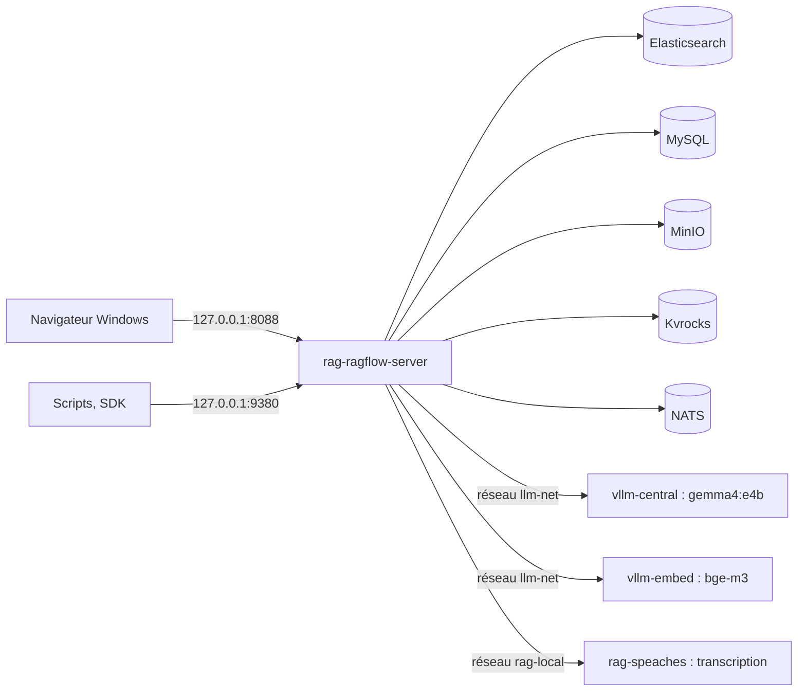

# 00. Notions fondamentales

> **Objet** : comprendre ce qu'est un RAG et comment RAGFlow 1.0 l'organise en services, avant de l'installer.
> **Prérequis** : aucun ; le [glossaire](../glossaire.md) définit les termes techniques.
> **Version décrite** : RAGFlow v1.0.0 (image `infiniflow/ragflow:v1.0.0`), Windows 11 + WSL2 (Ubuntu 24.04), LLM-Service branche `service-vllm` (vLLM 0.29.0 : `gemma4:e4b` pour les réponses, `bge-m3` pour l'embedding), contexte déclaré de 16 384 jetons.
> **Statut des informations** : [Vérifié] observé ou mesuré le 9 novembre 2026 sur la machine d'essai (Ryzen 5 9600X, 32 Go, RTX 4060 Ti 16 Go) ; [Source] documentation officielle ou code source au tag v1.0.0 ; [Estimation] calcul non mesuré ; [À tester] non documenté et non essayé.
> **Précautions** : aucune commande dans ce manuel ; les chiffres cités viennent des essais des manuels suivants.

## Sommaire

1. [Le RAG en bref](#1-le-rag-en-bref)
2. [Découpage, embeddings et recherche hybride](#2-découpage-embeddings-et-recherche-hybride)
3. [Reranking et citations](#3-reranking-et-citations)
4. [Architecture de RAGFlow 1.0](#4-architecture-de-ragflow-10)
5. [Où vivent les modèles](#5-où-vivent-les-modèles)
6. [Dépannage](#dépannage)
7. [Sources](#sources)

## 1. Le RAG en bref

### Essentiel

Un RAG (génération augmentée par la recherche) répond à une question en deux temps : il retrouve d'abord les passages utiles dans des documents, puis il les donne à un modèle de langage qui rédige la réponse en s'appuyant sur eux. Le modèle n'a pas besoin d'avoir appris les documents : il les lit au moment de répondre.

Dans RAGFlow, les documents sont rangés dans des **datasets** (bases de connaissances). Un **assistant de chat** est relié à un ou plusieurs datasets et répond avec des renvois numérotés vers les passages utilisés. [Vérifié] (manuel [02](02-prise-en-main.md))

### Pour aller plus loin

Le RAG limite les inventions du modèle sans les supprimer : la qualité dépend de ce que la recherche ramène. Le banc de ce dépôt mesure les deux à la fois (bonne réponse et bon document cité) sur 38 questions de référence ; voir [Qualité et performances](12-qualite-et-performances.md).

## 2. Découpage, embeddings et recherche hybride

### Essentiel

- **Découpage (chunking)** : chaque document est coupé en passages (chunks). RAGFlow propose des **gabarits de découpage** adaptés au type de document (General, Q&A, Manual, Table, Paper, Book, Laws, Presentation, Picture, One, Audio, Email). [Source] (`docs/references/http_api_reference.md` au tag v1.0.0)
- **Embedding** : un modèle transforme chaque passage en vecteur de nombres ; deux textes de sens proche ont des vecteurs proches. Ici, `bge-m3`, servi par LLM-Service.
- **Recherche hybride** : RAGFlow combine une recherche par mots-clés et une recherche par vecteurs. Par défaut, un assistant pondère les mots-clés à 0,7 et les vecteurs à 0,3, garde les 6 meilleurs passages (`top_n`) au-dessus d'un seuil de similarité de 0,1. [Vérifié] (réglages relevés à la création d'un assistant, `outils/resultats/ragflow/banc-2026-11-09-defaut.json`)

### Pour aller plus loin

L'analyse des documents (OCR, tableaux, mise en page) est faite par **DeepDoc**, embarqué dans l'image et exécuté sur CPU ; voir le manuel [04](04-deepdoc.md). Le corpus de test (9 documents, dont un PDF scanné, un fichier audio et un document en anglais) donne 26 passages et 2 236 jetons avec le gabarit General. [Vérifié] (`outils/resultats/ragflow/banc-2026-11-09-essai-adaptateur.json`)

## 3. Reranking et citations

### Essentiel

- **Reranking** : un second modèle peut reclasser les passages retrouvés avant la réponse. RAGFlow 1.0 n'en embarque aucun : il faut un service externe qui expose une route `/rerank`. Le socle de ce banc n'en fournit pas ; le reranking est donc [À tester]. [Source] (`internal/entity/models/builtin.go`)
- **Citations** : la réponse contient des marqueurs `[ID:n]` ; l'interface les affiche comme renvois cliquables. Par l'API, chaque passage cité arrive avec le nom du document et ses positions (page et coordonnées). [Vérifié] (`outils/resultats/ragflow/installation-2026-11-09-verif.log`)

### Pour aller plus loin

Pour une question sans réponse dans les documents, l'assistant répond « The answer you are looking for is not found in the dataset! », suivi d'un renvoi `[ID:n]` [Vérifié] (`outils/resultats/ragflow/banc-2026-11-09-defaut.json`, questions Q35 à Q38). C'est la phrase du « message de réponse vide » de l'assistant, en anglais par défaut et réglable ; le renvoi montre que c'est le modèle qui la reproduit [Estimation]. Voir le manuel [05](05-assistants-et-citations.md).

## 4. Architecture de RAGFlow 1.0

### Essentiel

RAGFlow 1.0 est une réécriture en Go de l'ancien serveur Python. [Source] (`docs/release_notes.md`) La pile installée par ce banc compte six conteneurs :

| Service | Conteneur | Rôle | Port publié |
|---|---|---|---|
| RAGFlow | `rag-ragflow-server` | interface web (nginx), API, administration, ingestion, synchronisation, DeepDoc | `127.0.0.1:8088` (web), `127.0.0.1:9380` (API), `127.0.0.1:9381` (administration) |
| Elasticsearch 8.11.3 | `rag-ragflow-es01` | moteur documentaire : index des passages, mots-clés et vecteurs | aucun |
| MySQL 8.0.40 | `rag-ragflow-mysql` | métadonnées : comptes, datasets, documents, assistants | aucun |
| MinIO (`pgsty/silo`) | `rag-ragflow-minio` | stockage des fichiers téléversés | aucun |
| Kvrocks 2.16.0 | `rag-ragflow-kvrocks` | cache | aucun |
| NATS 2.14.2 | `rag-ragflow-nats` | file des tâches d'analyse | aucun |

[Vérifié] (`outils/resultats/ragflow/ports-2026-11-09.txt`)

### Pour aller plus loin

Le compose officiel publie tous ces ports sur toutes les interfaces réseau (`0.0.0.0`) et utilise des mots de passe par défaut connus. Le banc les ramène sur `127.0.0.1` ou les retire, et génère des secrets ; voir le manuel [01](01-installation.md). Au repos, la pile seule occupe 3,7 Gio de RAM, dont 2,5 Gio pour Elasticsearch. [Vérifié] (`outils/resultats/ragflow/ressources-2026-11-09-repos.txt`)

## 5. Où vivent les modèles

### Essentiel

RAGFlow ne contient aucun modèle de langage. Les modèles sont déclarés dans « Model providers » et servis par LLM-Service, un service commun à toutes les applications de la série :

| Usage | Modèle | Serveur | Adresse vue par RAGFlow |
|---|---|---|---|
| Réponses (chat) | `gemma4:e4b` (Gemma 4 E4B, quantifié 4 bits) | `vllm-central` | `http://vllm-central:8000/v1` |
| Embedding | `bge-m3` | `vllm-embed` | `http://vllm-embed:8000/v1` |
| Transcription audio | `Systran/faster-whisper-small` | `rag-speaches` | `http://rag-speaches:8000/v1` |

[Vérifié] (`outils/resultats/ragflow/configuration-2026-11-09.log`)

### Pour aller plus loin

RAGFlow borne la longueur de la réponse à « contexte déclaré du modèle − jetons du prompt ». Les consignes et les passages occupent 1 841 à 3 301 jetons selon la question ; un contexte déclaré trop petit produit une erreur visible dans la réponse. [Vérifié] (`outils/resultats/ragflow/essai-2026-11-09-contexte-depassement.log`, `outils/resultats/ragflow/banc-2026-11-09-ctx3072.json`, `outils/resultats/ragflow/preuves-2026-11-09/textes-captures/02-conversation.txt`)

## Dépannage

| Symptôme | Cause probable | Action |
|---|---|---|
| Réponse « **ERROR**: prompt uses N tokens, leaving no completion capacity… » | contexte déclaré du modèle de chat plus petit que le prompt | remonter le contexte déclaré (16 384 ici), voir [Qualité et performances](12-qualite-et-performances.md) |
| Réponse « The answer you are looking for is not found in the dataset! » | rien de pertinent trouvé dans les passages retrouvés | normal pour une question hors corpus ; sinon baisser le seuil, voir [05](05-assistants-et-citations.md) |

## Sources

- Dépôt officiel : https://github.com/infiniflow/ragflow (tag `v1.0.0`, commit `db1cd5929a7885a3074547791f5ecc4d2f891739`) ; documentation : https://ragflow.io/docs/
- Relecture du compose et du code : [`outils/resultats/ragflow/relecture.md`](../../outils/resultats/ragflow/relecture.md)
- Versions : [`outils/resultats/ragflow/versions-2026-11-09.json`](../../outils/resultats/ragflow/versions-2026-11-09.json)
