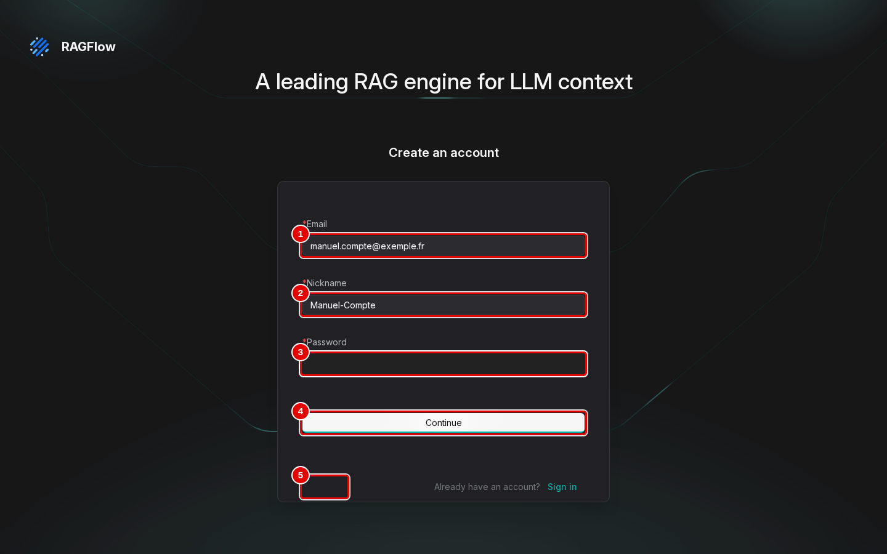
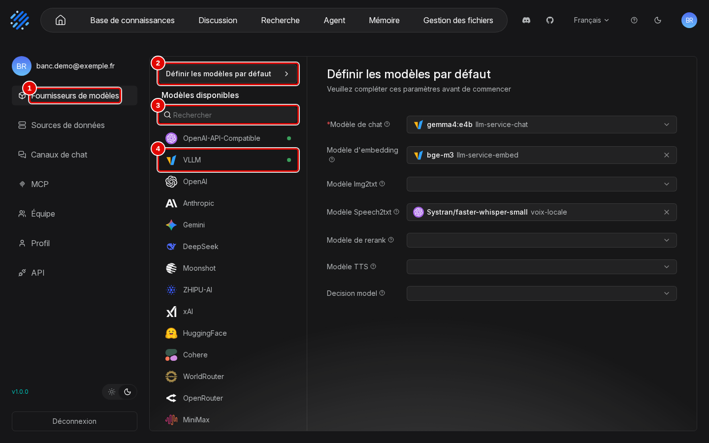
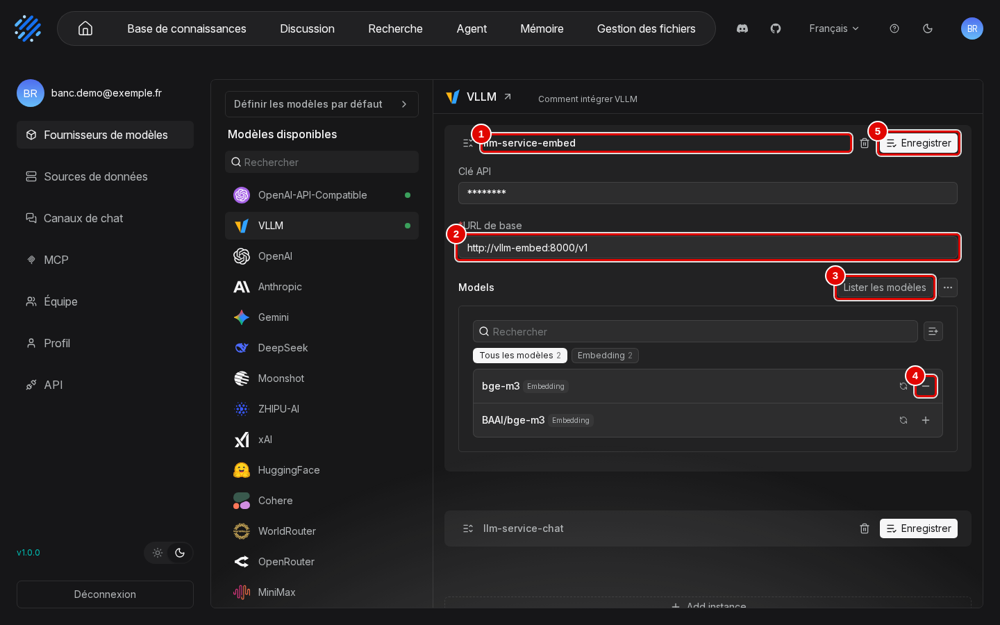
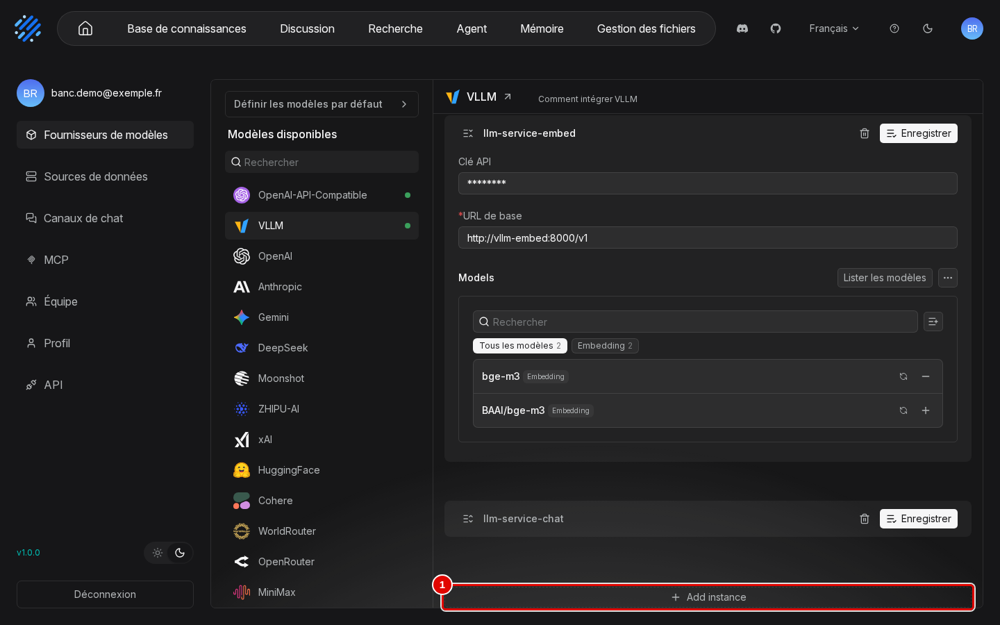
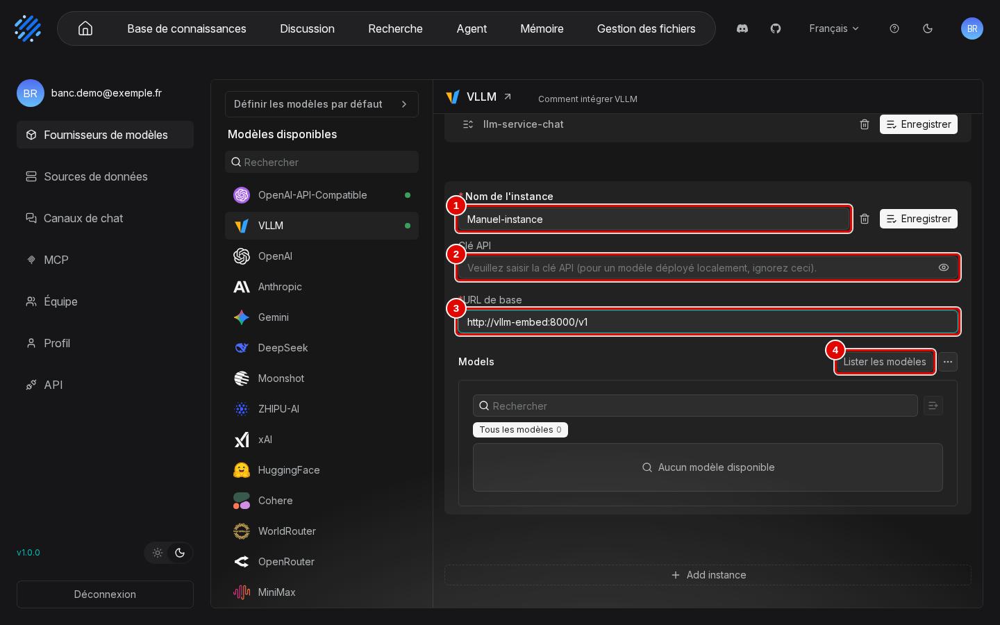
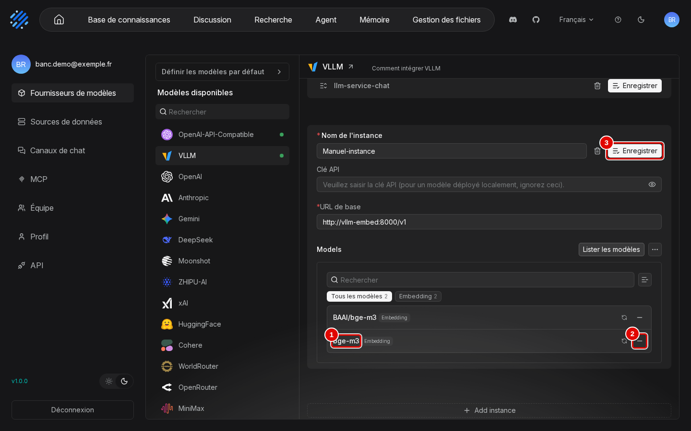
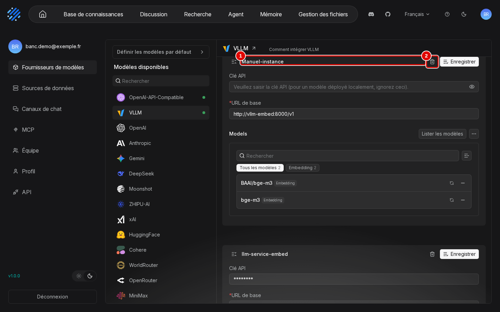
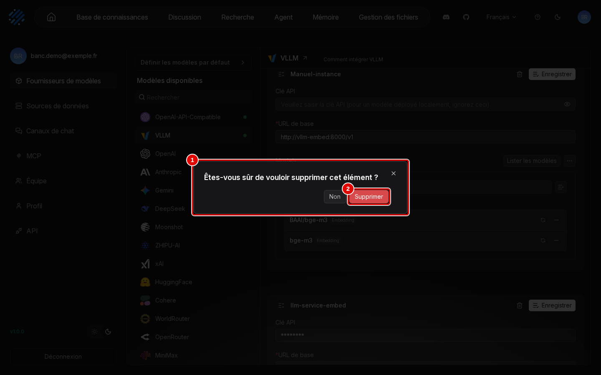
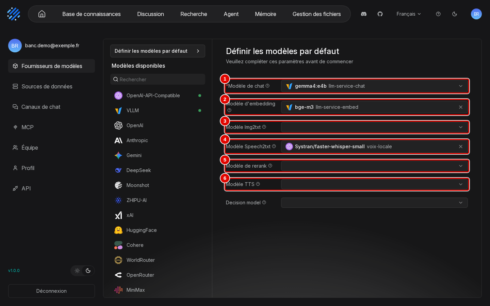
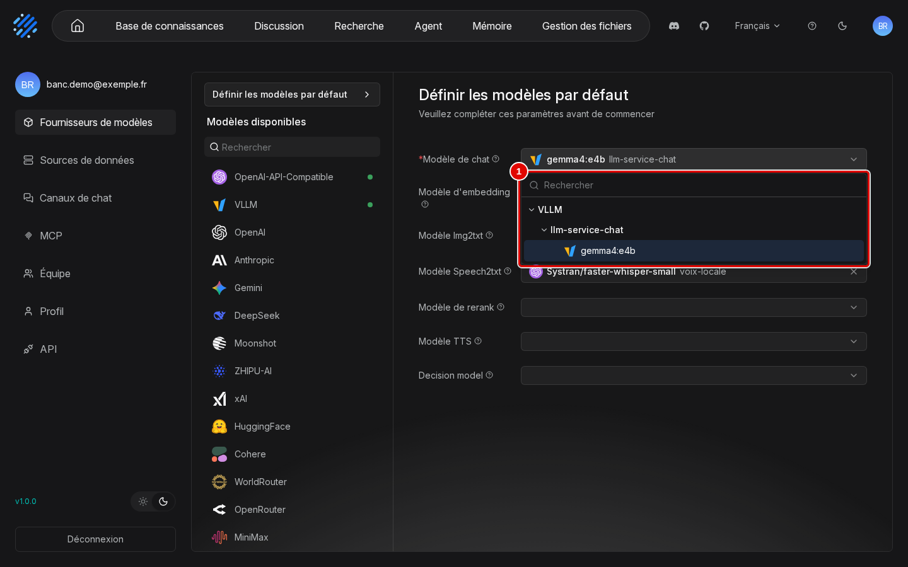

# 01. Installation sous Windows et WSL2

> **Objet** : installer RAGFlow v1.0.0 dans WSL2, branché sur LLM-Service, sans rien exposer au réseau, puis le désinstaller entièrement.
> **Prérequis** : [notions fondamentales](00-notions-fondamentales.md) ; machine préparée (WSL2, Docker, LLM-Service), voir `kit/LANCEMENT.md` du kit de la série.
> **Version décrite** : RAGFlow v1.0.0 (tag `v1.0.0`, commit `db1cd59`), Windows 11 + WSL2 (Ubuntu 24.04.5, Docker 29.9.3, Compose 5.7.0), LLM-Service branche `service-vllm` (vLLM 0.29.0 : `gemma4:e4b`, `bge-m3`), contexte déclaré de 16 384 jetons.
> **Statut des informations** : [Vérifié] observé ou mesuré les 9 et 11 novembre 2026 sur la machine d'essai (Ryzen 5 9600X, 32 Go de RAM dans WSL, RTX 4060 Ti 16 Go) ; [Source] documentation officielle ou code source au tag v1.0.0 ; [Estimation] calcul non mesuré ; [À tester] non documenté et non essayé.
> **Précautions** : compose officiel, scripts et code relus avant tout lancement ([relecture](../../outils/resultats/ragflow/relecture.md)) ; données fictives ; aucun `sudo`, aucun réglage de Windows ni de WSL.

**Risque — exposition réseau et mots de passe par défaut.** Le `docker-compose.yml` officiel publie l'interface, l'API, l'administration, Elasticsearch, MySQL, MinIO, Kvrocks et NATS sur toutes les interfaces réseau (`0.0.0.0`), avec des mots de passe connus (`infini_rag_flow`, `admin`). Lancé tel quel sur un portable connecté à un réseau partagé, il ouvre la base de données et les fichiers à n'importe quel voisin. L'installation décrite ici corrige les deux points. [Source] (`docker/docker-compose.yml`, `docker/docker-compose-base.yml`, `docker/.env`)

## Sommaire

1. [Prérequis mesurés](#1-prérequis-mesurés)
2. [Ce que change l'installation du banc](#2-ce-que-change-linstallation-du-banc)
3. [Installer](#3-installer)
4. [Créer le compte et brancher les modèles](#4-créer-le-compte-et-brancher-les-modèles)
5. [Vérifier](#5-vérifier)
6. [Mémoire et disque consommés](#6-mémoire-et-disque-consommés)
7. [Démarrer, arrêter, mettre à jour, désinstaller](#7-démarrer-arrêter-mettre-à-jour-désinstaller)
8. [Dépannage](#dépannage)
9. [Sources](#sources)

## 1. Prérequis mesurés

### Essentiel

| Élément | Valeur relevée sur la machine d'essai | Besoin de RAGFlow seul |
|---|---|---|
| RAM visible dans WSL | 32 096 Mo | 3,6 Gio au repos, 5,3 Gio en pointe (voir section 6) |
| Disque libre | 525 Go | 3,1 Go d'images + 1,2 Go de données à vide |
| `vm.max_map_count` de la VM de Docker | 1 048 576 | 262 144 au moins pour Elasticsearch |
| Docker et Compose | 29.9.3 et 5.7.0 | Compose avec les balises `!override` et `!reset` |
| LLM-Service | `vllm-central` et `vllm-embed` en marche, réseau `llm-net` | réseau `llm-net` présent |
| Serveur de voix | `rag-speaches`, réseau `rag-local` | pour les fichiers audio seulement |

[Vérifié] (`outils/resultats/machine/diagnostic-2026-11-09.json`, `outils/resultats/ragflow/ressources-2026-11-09-*.txt`)

Commande de diagnostic [Testée] :

```bash
outils/communs/diagnostic.sh
```

### Pour aller plus loin

`vm.max_map_count` est lu sans rien modifier, dans un conteneur jetable. S'il est inférieur à 262 144, Elasticsearch ne démarre pas ; la correction demande un réglage de la VM de Docker, hors du périmètre de ce banc (aucun `sysctl`). Sur la machine d'essai, Docker tourne directement dans Ubuntu (`/var/lib/docker`), pas dans Docker Desktop. [Vérifié] (`outils/resultats/machine/diagnostic-2026-11-09.json`)

Avant d'installer, arrêter les autres solutions de la série pour libérer la mémoire, par exemple Open Notebook avec le script `~/mes_projets/Tutoriels/Open-Notebook-Test-Bench/outils/open-notebook/arreter.sh` de son dépôt. LLM-Service reste en marche : toutes les solutions le partagent.

## 2. Ce que change l'installation du banc

### Essentiel

Les fichiers officiels ne sont pas modifiés. Un fichier d'override, `outils/ragflow/compose.override.yml`, applique les écarts :

| Point | Compose officiel | Banc |
|---|---|---|
| Interface web | `0.0.0.0:80` | `127.0.0.1:8088` |
| API et administration | `0.0.0.0:9380`, `0.0.0.0:9381` | `127.0.0.1:9380`, `127.0.0.1:9381` |
| HTTPS, Elasticsearch, MySQL, MinIO, Kvrocks, NATS | publiés sur `0.0.0.0` | non publiés |
| Mots de passe | `infini_rag_flow`, `admin` | aléatoires, dans `donnees/ragflow/ragflow.env` (droits 600) |
| Données | volumes Docker anonymes du projet | volumes `rag-ragflow_*` liés à `donnees/ragflow/` |
| Conteneurs | `docker-ragflow-cpu-1`… | `rag-ragflow-server`, `rag-ragflow-es01`… |
| Images | étiquettes | étiquettes et empreintes `@sha256` |
| Réseaux | `ragflow` | `rag-ragflow`, plus `llm-net` et `rag-local` pour le serveur |
| Mémoire d'Elasticsearch | 8 Go (`MEM_LIMIT`) | 4 Gio |

[Vérifié] (`outils/resultats/ragflow/ports-2026-11-09.txt`)

### Pour aller plus loin

Le port 8080 prévu par la fiche était déjà occupé sur la machine d'essai (`outils/resultats/ragflow/preuves-2026-11-09/port-8080.txt`) : l'interface est publiée sur 8088. Les fichiers compose sont appelés avec des chemins absolus, car Compose résout les chemins relatifs par rapport au premier fichier (`sources/ragflow/docker/`). Le profil `tei-cpu` (serveur d'embedding intégré) et le profil `sandbox` (conteneur privilégié avec accès au socket Docker) ne sont pas activés. [Source] (`docker/docker-compose-base.yml`)

## 3. Installer

### Essentiel

Une seule commande, rejouable [Testée] :

```bash
outils/ragflow/installer.sh
```

Le script :

1. clone le dépôt officiel au tag `v1.0.0` dans `sources/ragflow/` et vérifie le commit ;
2. génère `donnees/ragflow/ragflow.env` (copie du `docker/.env` officiel, puis ports, mots de passe, fuseau horaire et mémoire d'Elasticsearch) ;
3. démarre le projet compose `rag-ragflow` ;
4. attend que `http://127.0.0.1:9380/api/v1/system/healthz` réponde HTTP 200.

Durées mesurées : téléchargement des six images en 57 s, premier démarrage sain en 39 s. [Vérifié] (`outils/resultats/ragflow/installation-2026-11-09-pull.log`, `outils/resultats/ragflow/installation-2026-11-09.log`)

### Pour aller plus loin

Sortie de l'état sain [Vérifié] :

```text
healthz (9380) : HTTP 200 après 39 s
{"db":"ok","redis":"ok","doc_engine":"ok","storage":"ok","message_queue":"ok","status":"ok"}
```

Aucun modèle n'est téléchargé à l'installation : les modèles DeepDoc (OCR, mise en page, tableaux) sont dans l'image. [Source] (`Dockerfile`, lignes 25 à 50) Le journal complet du serveur ne contient aucune ligne mentionnant `hf-mirror`, `huggingface.co` ou un téléchargement [Vérifié] (`outils/resultats/ragflow/preuves-2026-11-09/acces-sortants.txt`) ; aucune capture du trafic réseau n'a été faite.

## 4. Créer le compte et brancher les modèles

### Essentiel

RAGFlow 1.0 ne lit pas de modèles par défaut dans sa configuration : il faut un compte, puis déclarer les modèles dans « Fournisseurs de modèles ». Deux chemins mènent au même résultat : le script du banc, par l'API, ou l'interface, à la souris.

**Par le script du banc** [Testée] :

```bash
python3 outils/ragflow/configurer.py
```

| Étape | Appel | Résultat |
|---|---|---|
| Compte local fictif | `POST /api/v1/users` | `banc.demo@exemple.fr`, mot de passe aléatoire |
| Connexion | `POST /api/v1/auth/login` | jeton dans l'en-tête `Authorization` |
| Clé d'API | `POST /api/v1/system/keys` | clé rangée dans `donnees/IDENTIFIANTS-LOCAUX.txt` |
| Fournisseur `VLLM`, instance `llm-service-chat` | `POST /api/v1/providers/VLLM/instances` | `gemma4:e4b`, `http://vllm-central:8000/v1`, contexte 16 384 |
| Fournisseur `VLLM`, instance `llm-service-embed` | idem | `bge-m3`, `http://vllm-embed:8000/v1` |
| Fournisseur `OpenAI-API-Compatible`, instance `voix-locale` | idem | `Systran/faster-whisper-small`, `http://rag-speaches:8000/v1` (transcription) |
| Modèles par défaut | `PATCH /api/v1/models/default` | chat, embedding, transcription |

[Vérifié] (`outils/resultats/ragflow/configuration-2026-11-09.log`)

**Dans l'interface**, la même chose se fait en trois temps : créer le compte, déclarer une instance de fournisseur, choisir les modèles par défaut. Les captures viennent du scénario `installation` de `outils/ragflow/captures/captures.py` ; l'instance d'exemple, nommée « Manuel-instance », est créée puis supprimée à la souris par ce scénario. [Vérifié] (textes des pages dans `outils/resultats/ragflow/captures/01-installation/`)

1. Ouvrir `http://127.0.0.1:8088` dans le navigateur Windows, cliquer sur « Sign up », remplir le formulaire « Create an account », puis « Continue ». La page de connexion reste en anglais tant que la langue n'a pas été choisie (voir la [prise en main](02-prise-en-main.md)). Le formulaire montré ici est rempli avec un compte fictif et n'a pas été validé : le compte du banc existe déjà.



| N° | Élément | Rôle |
|---|---|---|
| 1 | « Email » | adresse du compte, sert d'identifiant ; une adresse fictive suffit pour un compte local |
| 2 | « Nickname » | nom affiché dans l'interface |
| 3 | « Password » | mot de passe du compte (masqué sur la capture) |
| 4 | « Continue » | crée le compte |
| 5 | « Sign in » | revient au formulaire de connexion |

2. Une fois connecté, cliquer sur la pastille du compte (en haut à droite), puis sur « Fournisseurs de modèles ».



| N° | Élément | Rôle |
|---|---|---|
| 1 | « Fournisseurs de modèles » | entrée du menu du compte qui ouvre cette page |
| 2 | « Définir les modèles par défaut » | modèles utilisés par défaut par les bases et les assistants (étape 9) |
| 3 | « Rechercher » | filtre la liste des fournisseurs, une centaine |
| 4 | « VLLM » | fournisseur choisi pour LLM-Service ; le point vert signale un fournisseur déjà configuré |

3. Cliquer sur « VLLM ». Chaque instance déclarée a sa carte ; celle de l'embedding, « llm-service-embed », est dépliée ici.



| N° | Élément | Rôle |
|---|---|---|
| 1 | « llm-service-embed » | nom de l'instance, choisi à sa création |
| 2 | « URL de base » | adresse du serveur vue depuis le conteneur RAGFlow (réseau `llm-net`) |
| 3 | « Lister les modèles » | interroge le serveur et affiche les modèles qu'il sert |
| 4 | signe « − » de `bge-m3` | retire ce modèle de l'instance ; le signe « + » d'un modèle non retenu l'ajoute |
| 5 | « Enregistrer » | enregistre les changements de la carte |

4. Descendre en bas de la liste des instances et cliquer sur « Add instance ».



| N° | Élément | Rôle |
|---|---|---|
| 1 | « Add instance » | ajoute une carte d'instance vide en bas de la liste |

5. Remplir la nouvelle carte : nom de l'instance, adresse du serveur (ici `http://vllm-embed:8000/v1`), puis cliquer sur « Lister les modèles ». La clé reste vide pour un serveur local sans clé.



| N° | Élément | Rôle |
|---|---|---|
| 1 | « Nom de l'instance » | nom libre, repris dans les listes de modèles (« modèle nom-de-l'instance ») |
| 2 | « Clé API » | clé du serveur ; vide pour LLM-Service |
| 3 | « URL de base » | adresse compatible OpenAI du serveur, terminée par `/v1` |
| 4 | « Lister les modèles » | récupère les modèles servis à cette adresse |

6. Les modèles servis apparaissent, déjà retenus (signe « − »). Retirer ceux qui ne servent pas, puis cliquer sur « Enregistrer ».



| N° | Élément | Rôle |
|---|---|---|
| 1 | `bge-m3` | modèle servi par `vllm-embed`, avec son type (« Embedding ») ; `BAAI/bge-m3` est le même modèle sous son nom complet |
| 2 | signe « − » | retire le modèle de l'instance |
| 3 | « Enregistrer » | crée l'instance |

7. Résultat : l'instance enregistrée apparaît en tête de la liste. La corbeille de sa carte la supprime.



| N° | Élément | Rôle |
|---|---|---|
| 1 | « Manuel-instance » | instance créée, désormais proposée dans les listes de modèles |
| 2 | corbeille | supprime l'instance (étape 8) |

8. Pour supprimer une instance d'essai : corbeille de sa carte, puis « Supprimer » dans la confirmation.



| N° | Élément | Rôle |
|---|---|---|
| 1 | « Êtes-vous sûr de vouloir supprimer cet élément ? » | confirmation ; « Non » annule |
| 2 | « Supprimer » | supprime l'instance |

9. Cliquer sur « Définir les modèles par défaut » et choisir un modèle par usage. Sans « Modèle de chat », aucune discussion n'est possible (champ marqué obligatoire).



| N° | Élément | Rôle |
|---|---|---|
| 1 | « Modèle de chat » | rédige les réponses (`gemma4:e4b`, instance `llm-service-chat`) ; obligatoire |
| 2 | « Modèle d'embedding » | vectorise les passages et les questions (`bge-m3`) |
| 3 | « Modèle Img2txt » | décrit les images (vide ici) |
| 4 | « Modèle Speech2txt » | transcrit l'audio (`Systran/faster-whisper-small`, instance `voix-locale`) |
| 5 | « Modèle de rerank » | reclasse les passages (vide : aucun reranker dans le socle) |
| 6 | « Modèle TTS » | lit les réponses à voix haute (vide ici) ; la ligne suivante, « Decision model », reste vide aussi |

10. Chaque liste regroupe les modèles par fournisseur puis par instance ; cliquer sur le modèle voulu.



| N° | Élément | Rôle |
|---|---|---|
| 1 | liste « VLLM », « llm-service-chat », `gemma4:e4b` | modèles de chat disponibles, avec un champ « Rechercher » |

### Pour aller plus loin

- Le compte `admin@ragflow.io`, créé au premier démarrage par l'option `--init-superuser`, sert à l'administration (port 9381). Il reçoit un refus sur l'API ordinaire : le travail se fait avec un compte inscrit normalement. Son mot de passe est la valeur `ADMIN_DEFAULT_PASSWORD` générée dans `donnees/ragflow/ragflow.env`. [Source] (`internal/handler/auth.go`)
- Piège relevé : l'interface envoie le mot de passe sous la forme `RSA(base64(mot de passe))`, et le serveur garde `base64(mot de passe)` après déchiffrement. Un compte créé par l'API avec le mot de passe en clair fonctionne par l'API mais refuse la connexion dans le navigateur (« email and password do not match »). Le script envoie donc `base64(mot de passe)`. [Vérifié] (`internal/common/password.go` ; essai dans `outils/ragflow/captures/captures.py`, scénario `diag_connexion`)
- Le contexte déclaré (16 384) est volontairement inférieur à celui de vLLM (32 768) : c'est la taille commune de la série. RAGFlow ne fixe pas `num_ctx` ; il borne la réponse à « contexte déclaré − jetons du prompt ». [Source] (`internal/service/chat_pipeline.go`)

## 5. Vérifier

### Essentiel

Vérification fonctionnelle minimale [Testée] : import d'un document, analyse, question, citation, puis suppression des objets d'essai.

```bash
uv run python outils/ragflow/verif_minimale.py
```

Résultat : réponse citée en 4,0 s par l'API HTTP (le SDK répond 404, voir le manuel [10](10-api-et-sdk.md)), quatre passages de `cse-2025-10-14.md` en référence. [Vérifié] (`outils/resultats/ragflow/installation-2026-11-09-verif.log`)

Ports publiés [Testée] :

```bash
docker ps --format '{{.Names}} {{.Ports}}' | grep rag-ragflow
```

```text
rag-ragflow-server 127.0.0.1:9380-9381->9380-9381/tcp, 127.0.0.1:8088->80/tcp
rag-ragflow-minio 9000/tcp
rag-ragflow-kvrocks 6666/tcp
rag-ragflow-nats 4222/tcp, 6222/tcp, 8222/tcp
rag-ragflow-es01 9200/tcp, 9300/tcp
rag-ragflow-mysql 3306/tcp, 33060/tcp
```

[Vérifié] (`outils/resultats/ragflow/ports-2026-11-09.txt`)

L'interface s'ouvre ensuite dans le navigateur Windows à l'adresse `http://127.0.0.1:8088` ; voir la [prise en main](02-prise-en-main.md).

### Pour aller plus loin

Le SDK `ragflow-sdk` 1.0.0 exige Python 3.13. Le dépôt l'installe dans `.venv/` avec uv (`pyproject.toml`, `uv.lock`). Deux défauts du SDK sont contournés par `outils/ragflow/client.py` ; voir le manuel [10](10-api-et-sdk.md).

## 6. Mémoire et disque consommés

### Essentiel

| Conteneur | RAM au repos | RAM en pointe (banc par défaut, indexation comprise) |
|---|---|---|
| `rag-ragflow-es01` (Elasticsearch) | 2 532 Mio | 2 749 Mio |
| `rag-ragflow-server` (RAGFlow, DeepDoc compris) | 581 Mio | 1 980 Mio |
| `rag-ragflow-mysql` | 513 Mio | 529 Mio |
| `rag-ragflow-minio` | 79 Mio | 103 Mio |
| `rag-ragflow-kvrocks` | 20 Mio | 24 Mio |
| `rag-ragflow-nats` | 8 Mio | 9 Mio |
| **Total de l'application** | **3 730 Mio** | **5 394 Mio** |

Hors application : `vllm-central` 6,5 Gio de RAM, `vllm-embed` 4,1 Gio, 15,2 Go de VRAM occupés sur 16 Go. [Vérifié] (`outils/resultats/ragflow/ressources-2026-11-09-repos.txt`, `outils/resultats/ragflow/banc-2026-11-09-defaut.json`)

| Disque | Taille |
|---|---|
| Images (RAGFlow 773 Mo, Elasticsearch 1,41 Go, MySQL 591 Mo, MinIO 159 Mo, Kvrocks 152 Mo, NATS 18 Mo) | 3,1 Go |
| `donnees/ragflow/` juste après installation | 1,2 Go |

[Vérifié] (`outils/resultats/ragflow/ressources-2026-11-09-apres-reinstallation.txt`)

### Pour aller plus loin

- Elasticsearch pèse le plus : son tas Java est réglé par défaut à la moitié de `MEM_LIMIT`. Avec 4 Gio, il reste vers 2,5 Gio.
- Le serveur RAGFlow passe de 0,6 à 2,0 Gio pendant l'analyse : les modèles DeepDoc (OCR, mise en page) tournent dans son processus, sur CPU.
- Sur le disque, MySQL préalloue 1 Go de journal de reprise (`#innodb_redo`) dès le premier démarrage ; la base `rag_flow` elle-même occupe 46 Mo en fin de mission. [Vérifié] (`outils/resultats/ragflow/preuves-2026-11-09/mysql-disque.txt`)

## 7. Démarrer, arrêter, mettre à jour, désinstaller

### Essentiel

| Action | Commande [Testée] | Effet |
|---|---|---|
| État | `outils/ragflow/etat.sh` | conteneurs, ports, santé, LLM-Service (sortie : `outils/resultats/ragflow/preuves-2026-11-09/etat.txt`) |
| Arrêter | `outils/ragflow/arreter.sh` | conteneurs arrêtés, données conservées |
| Démarrer | `outils/ragflow/demarrer.sh` | redémarrage et attente de l'état sain |
| Désinstaller | `outils/communs/nettoyer.sh ragflow` | conteneurs, volumes, réseau et `donnees/ragflow/` supprimés ; images gardées |

Le cycle complet désinstallation, réinstallation, configuration et vérification a été chronométré : 14 s, 39 s, moins d'une seconde, 7 s. Après désinstallation, aucun conteneur ni volume `rag-ragflow` ne reste. [Vérifié] (`outils/resultats/ragflow/essai-2026-11-09-reinstallation.log`)

### Pour aller plus loin

- LLM-Service n'est jamais arrêté ni supprimé par ces scripts.
- Les images restent en cache ; les supprimer à la main avec `docker rmi` si besoin [Aide].
- Mise à jour : changer le tag et le commit dans `installer.sh`, relancer. Les notes de version préviennent qu'une montée depuis la v0.27.2 vers la 1.0 migre la base de façon irréversible : sauvegarder avant (manuel [13](13-exploitation.md)). Aucune version plus récente que v1.0.0 n'existait le jour des essais : mise à jour [À tester]. [Source] (`docs/release_notes.md`)

## Dépannage

| Symptôme | Cause probable | Action |
|---|---|---|
| Connexion refusée dans le navigateur (« email and password do not match ») alors que l'API accepte le compte | compte créé par l'API avec le mot de passe en clair | recréer le compte avec `base64(mot de passe)`, comme `configurer.py` |
| `nettoyer.sh` sort avec le code 126 et ne supprime rien | droits d'exécution perdus à l'extraction de l'archive du kit | `chmod +x outils/communs/*.sh` (`outils/resultats/ragflow/essai-2026-11-09-reinstallation-essai1.log`) |
| `du` refuse de lire `donnees/ragflow/mysql` | dossiers créés par les utilisateurs des conteneurs | mesurer par un conteneur, comme `outils/ragflow/ressources.sh` |
| Le port 8080 est déjà pris | autre programme sur `127.0.0.1:8080` | publier l'interface sur un autre port (`SVR_WEB_HTTP_PORT` dans `donnees/ragflow/ragflow.env`) |
| Création d'un assistant refusée : « doesn't own parsed file » | analyse pas encore terminée, compteurs du document à 0 | attendre que le document ait des passages (`client.attendre_analyse`) |

## Sources

- Dépôt : https://github.com/infiniflow/ragflow (tag `v1.0.0`) ; documentation : https://ragflow.io/docs/
- Captures : `outils/ragflow/captures/captures.py` (scénario `installation`), images dans `docs/ragflow/img/01-installation/`, textes dans `outils/resultats/ragflow/captures/01-installation/`
- Scripts : `outils/ragflow/installer.sh`, `outils/ragflow/compose.override.yml`, `outils/ragflow/configurer.py`, `outils/ragflow/verif_minimale.py`, `outils/ragflow/essai_reinstallation.sh`, `outils/ragflow/ressources.sh`, `outils/communs/nettoyer.sh`
- Résultats : [installation](../../outils/resultats/ragflow/installation-2026-11-09.log), [vérification](../../outils/resultats/ragflow/installation-2026-11-09-verif.log), [réinstallation](../../outils/resultats/ragflow/essai-2026-11-09-reinstallation.log), [versions](../../outils/resultats/ragflow/versions-2026-11-09.json), [relecture](../../outils/resultats/ragflow/relecture.md)
- Images : `infiniflow/ragflow:v1.0.0@sha256:ed8dff41…`, `elasticsearch:8.11.3@sha256:58a3a280…`, `mysql:8.0.40@sha256:d58ac933…`, `pgsty/silo:RELEASE.2026-08-06T00-00-00Z@sha256:29a498b2…`, `apache/kvrocks:2.16.0@sha256:9e632c31…`, `nats:2.14.2@sha256:bbfbb6c4…`
