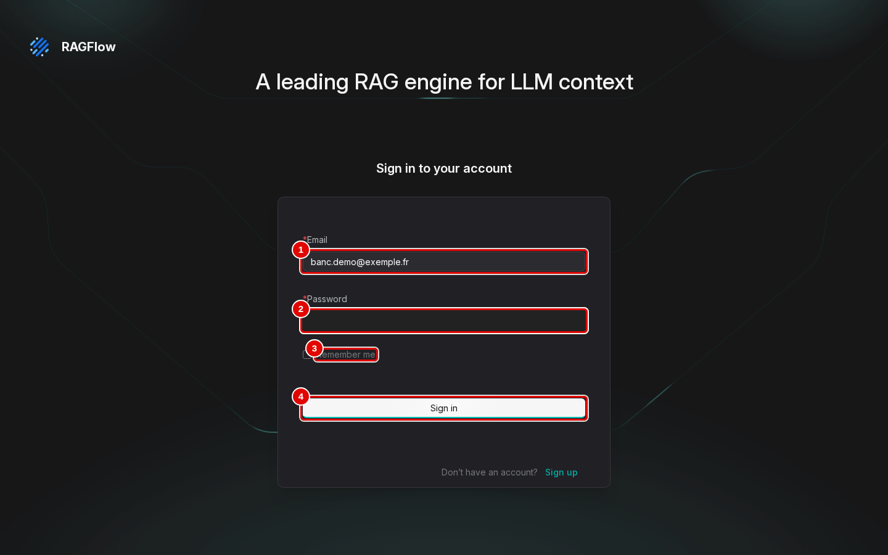
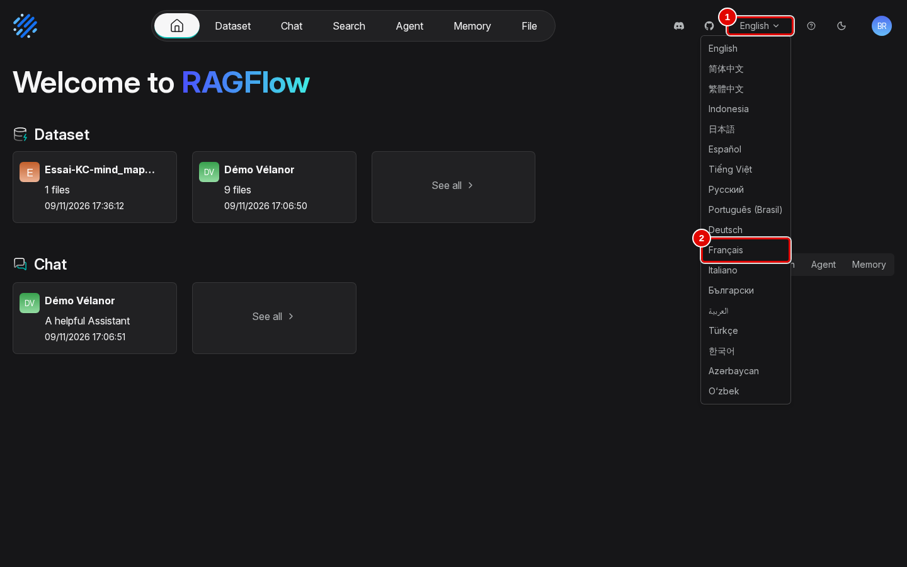
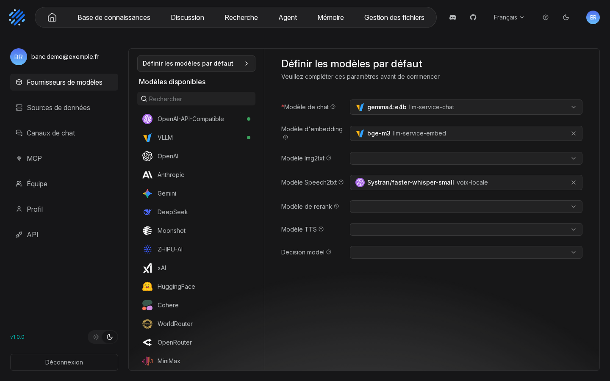
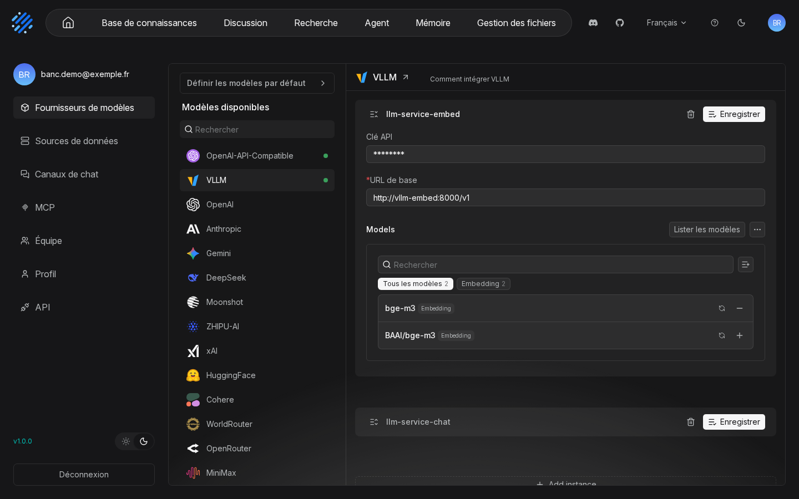
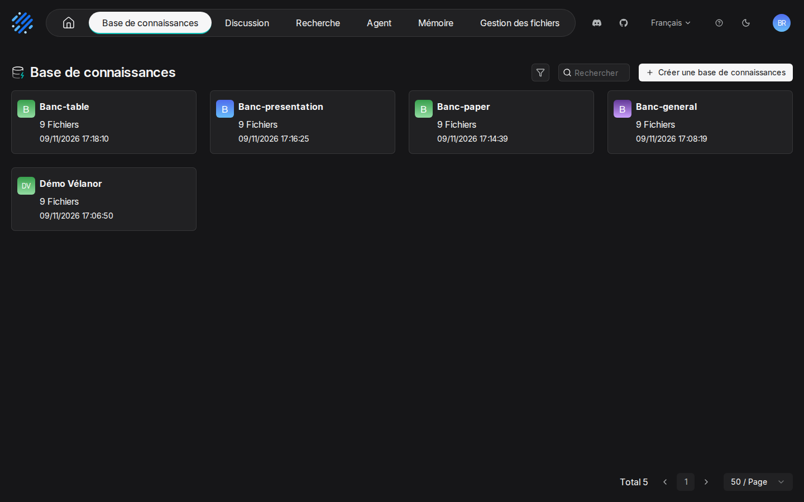
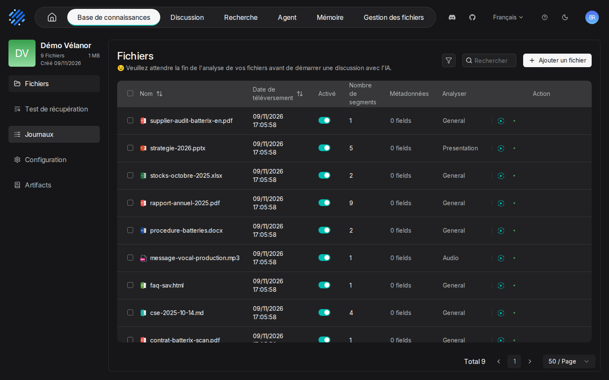
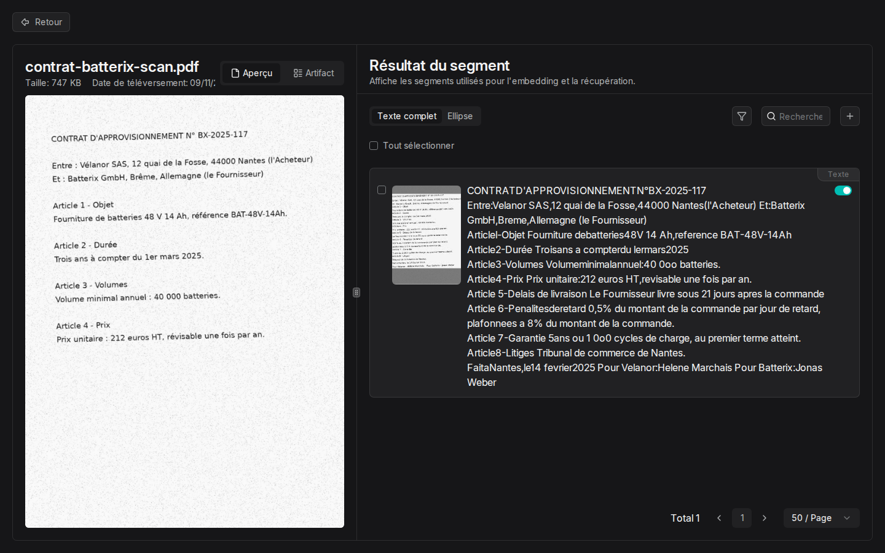
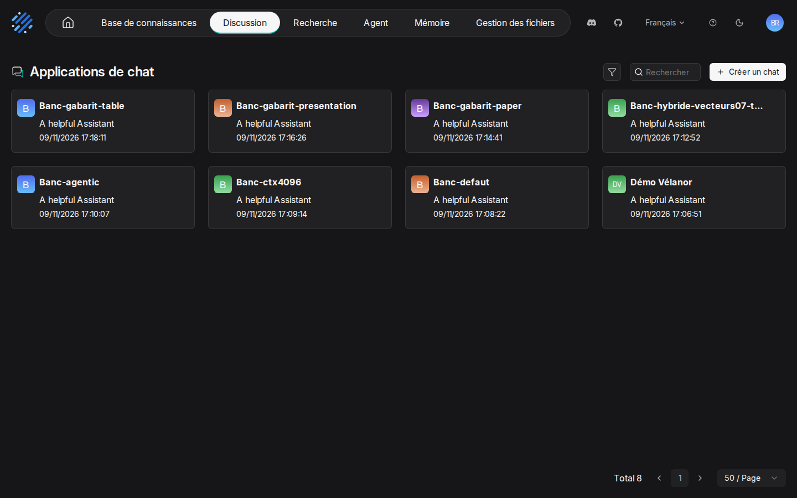
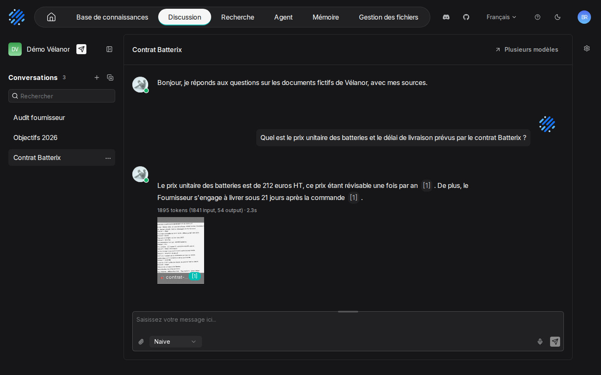

# 02. Prise en main

> **Objet** : aller du premier document importé à la première réponse citée, dans l'interface web.
> **Prérequis** : [notions fondamentales](00-notions-fondamentales.md), [installation](01-installation.md) (compte créé, modèles déclarés).
> **Version décrite** : RAGFlow v1.0.0 (image `infiniflow/ragflow:v1.0.0`), Windows 11 + WSL2 (Ubuntu 24.04), LLM-Service branche `service-vllm` (vLLM 0.29.0 : `gemma4:e4b`, `bge-m3`), contexte déclaré de 16 384 jetons.
> **Statut des informations** : [Vérifié] observé ou mesuré le 9 novembre 2026 sur la machine d'essai (Ryzen 5 9600X, 32 Go, RTX 4060 Ti 16 Go) ; [Source] documentation officielle ou code source au tag v1.0.0 ; [Estimation] calcul non mesuré ; [À tester] non documenté et non essayé.
> **Précautions** : documents fictifs de l'entreprise Vélanor (`corpus/documents/`) ; identifiants locaux dans `donnees/IDENTIFIANTS-LOCAUX.txt`, jamais saisis à l'écran avant une capture.

## Sommaire

1. [Se connecter et passer l'interface en français](#1-se-connecter-et-passer-linterface-en-français)
2. [Vérifier les modèles par défaut](#2-vérifier-les-modèles-par-défaut)
3. [Créer une base de connaissances et importer](#3-créer-une-base-de-connaissances-et-importer)
4. [Lire les passages produits](#4-lire-les-passages-produits)
5. [Créer un assistant et poser une question](#5-créer-un-assistant-et-poser-une-question)
6. [Dépannage](#dépannage)
7. [Sources](#sources)

## 1. Se connecter et passer l'interface en français

### Essentiel

1. Ouvrir `http://127.0.0.1:8088` dans le navigateur Windows.
2. Saisir le courriel et le mot de passe du compte local (`donnees/IDENTIFIANTS-LOCAUX.txt`), puis « Sign in ».
3. Dans l'en-tête, cliquer sur « English » et choisir « Français ».

[Vérifié] (`outils/ragflow/captures/captures.py`, scénario `prise_en_main`)

### Pour aller plus loin

La page de connexion reste en anglais : la langue est mémorisée par le navigateur (stockage local, clé `lng`), pas par le compte. Changer la langue du compte par l'API (`PATCH /api/v1/users/me`) ne traduit pas l'interface au chargement ; seul le sélecteur de l'en-tête le fait. [Vérifié] (`web/src/locales/config.ts` au tag v1.0.0 ; essais des captures) La barre de navigation propose ensuite « Base de connaissances », « Discussion », « Recherche », « Agent », « Mémoire » et « Gestion des fichiers ».

## 2. Vérifier les modèles par défaut

### Essentiel

Page `http://127.0.0.1:8088/user-setting/model` (menu du compte, « Fournisseurs de modèles ») : la page « Définir les modèles par défaut » doit montrer `gemma4:e4b` en « Modèle de chat » et `bge-m3` en « Modèle d'embedding ». Sans modèle de chat, aucune discussion n'est possible.

| N° | Élément | Rôle |
|---|---|---|
| 1 | « Modèle de chat » | rédige les réponses (`gemma4:e4b`, instance `llm-service-chat`) |
| 2 | « Modèle d'embedding » | vectorise les passages et les questions (`bge-m3`) |
| 3 | « Modèle Img2txt » | décrit les images (vide ici) |
| 4 | « Modèle Speech2txt » | transcrit l'audio (`Systran/faster-whisper-small`, instance `voix-locale`) |
| 5 | « Modèle de rerank » | reclasse les passages (vide : aucun reranker dans le socle) |

[Vérifié] (`docs/ragflow/img/01-installation/01-modeles-par-defaut.png`)

### Pour aller plus loin

La liste de gauche, « Modèles disponibles », marque d'un point vert les fournisseurs configurés (« OpenAI-API-Compatible », « VLLM »). Les modèles ont été déclarés par `outils/ragflow/configurer.py` ; la même déclaration se fait à la main en cliquant sur un fournisseur, puis en ajoutant une instance (adresse `http://vllm-central:8000/v1`, nom du modèle, type, contexte).

## 3. Créer une base de connaissances et importer

### Essentiel

1. « Base de connaissances », puis créer une base (nom, gabarit de découpage « General » par défaut).
2. Onglet « Fichiers », « Ajouter un fichier », choisir les documents.
3. Lancer l'analyse : la colonne « Nombre de segments » se remplit quand elle est terminée.

Ces trois gestes sont décrits d'après l'interface [Source] : la base « Démo Vélanor » montrée ci-dessous a été créée et remplie par l'API (`outils/ragflow/demo.py`), ce qui donne le même résultat à l'écran [Vérifié].

Sur la machine d'essai, les 9 documents du corpus (1 Mo) donnent 26 passages en 52 à 61 s, OCR du PDF scanné compris. [Vérifié] (`outils/resultats/ragflow/demo-2026-11-09.log`, `outils/resultats/ragflow/banc-2026-11-09-defaut.json`)

### Pour aller plus loin

- Même dans une base réglée sur « General », RAGFlow choisit un gabarit adapté pour certains formats : la présentation `strategie-2026.pptx` apparaît avec le gabarit « Presentation ». [Vérifié] (texte de la page relevé par `captures.py`)
- Un bandeau rappelle d'attendre la fin de l'analyse avant de discuter : un assistant ne peut pas être relié à une base dont les documents n'ont encore aucun passage (« doesn't own parsed file »). [Vérifié] (`outils/resultats/ragflow/installation-2026-11-09-verif-essai1.log`)
- Les onglets « Test de récupération », « Journaux », « Configuration » et « Artifacts » sont décrits dans les manuels [03](03-datasets-et-decoupage.md), [05](05-assistants-et-citations.md) et [07](07-knowledge-compilation.md).

## 4. Lire les passages produits

### Essentiel

Cliquer sur un document ouvre « Résultat du segment » : à gauche l'aperçu du fichier, à droite le texte de chaque passage tel qu'il sera retrouvé.

### Pour aller plus loin

Pour le contrat scanné, l'OCR de DeepDoc lit l'essentiel mais colle des mots et confond certains caractères : « Volumeminimalannuel:40 0oo batteries » pour « Volume minimal annuel : 40 000 batteries ». Les quatre questions du banc sur ce scan obtiennent pourtant la bonne réponse. [Vérifié] (texte relevé par `captures.py` ; `outils/resultats/ragflow/banc-2026-11-09-defaut.json`, questions Q15 à Q18) La correction d'un passage est traitée dans le manuel [04](04-deepdoc.md).

## 5. Créer un assistant et poser une question

### Essentiel

1. « Discussion », créer un assistant, choisir la base de connaissances.
2. « Nouvelle conversation », taper la question, envoyer.
3. Lire la réponse : chaque affirmation porte un renvoi `[1]`, `[2]`… ; la vignette sous la réponse ouvre le document source.

L'assistant « Démo Vélanor » et ses trois conversations ont été créés par l'API (`outils/ragflow/demo.py`) ; les captures montrent leur affichage dans l'interface [Vérifié], les gestes de création à la souris sont décrits d'après l'interface [Source].

| N° | Élément | Rôle |
|---|---|---|
| 1 | liste « Conversations » | une conversation par sujet ; l'historique d'une conversation est repris dans les questions suivantes |
| 2 | message d'accueil | texte réglable de l'assistant (ici en français) |
| 3 | renvois `[1]` | passage qui justifie la phrase ; survol pour lire l'extrait |
| 4 | ligne « 1895 tokens (1841 input, 54 output) · 2.3s » | coût et durée de la réponse |
| 5 | vignette `contrat-ba…an.pdf` | document cité, ouvert au clic |
| 6 | sélecteur « Naive » | mode de réponse (réponse directe ou agentique, voir [06](06-agentic-rag.md)) |

Réponse obtenue : « Le prix unitaire des batteries est de 212 euros HT, ce prix étant révisable une fois par an [1]. De plus, le Fournisseur s'engage à livrer sous 21 jours après la commande [1]. » en 2,3 s. [Vérifié] (`outils/resultats/ragflow/demo-2026-11-09.log`)

### Pour aller plus loin

La question coûte environ 1 840 jetons d'entrée pour 54 de sortie : l'essentiel est fait des consignes et des passages retrouvés. C'est ce budget qui doit tenir dans le contexte déclaré ; voir [Qualité et performances](12-qualite-et-performances.md). Les réglages de l'assistant (nombre de passages, poids des mots-clés et des vecteurs, message en cas d'absence de réponse) sont détaillés dans le manuel [05](05-assistants-et-citations.md).

## Dépannage

| Symptôme | Cause probable | Action |
|---|---|---|
| Interface en anglais après connexion | langue mémorisée par le navigateur, anglais par défaut | sélecteur de l'en-tête, « Français » |
| « email and password do not match » alors que le compte existe | compte créé par l'API avec un mot de passe en clair | voir [installation](01-installation.md), section 4 |
| Assistant impossible à relier à la base | analyse pas terminée | attendre que « Nombre de segments » soit rempli |
| Réponse « The answer you are looking for is not found in the dataset! » | aucun passage assez proche de la question | reformuler, vérifier la base reliée, voir [05](05-assistants-et-citations.md) |

## Sources

- Captures : `outils/ragflow/captures/captures.py` (scénarios `installation` et `prise_en_main`), images dans `docs/ragflow/img/02-prise-en-main/`
- Jeu de démonstration : `outils/ragflow/demo.py`, [journal](../../outils/resultats/ragflow/demo-2026-11-09.log)
- Documentation officielle : https://ragflow.io/docs/
