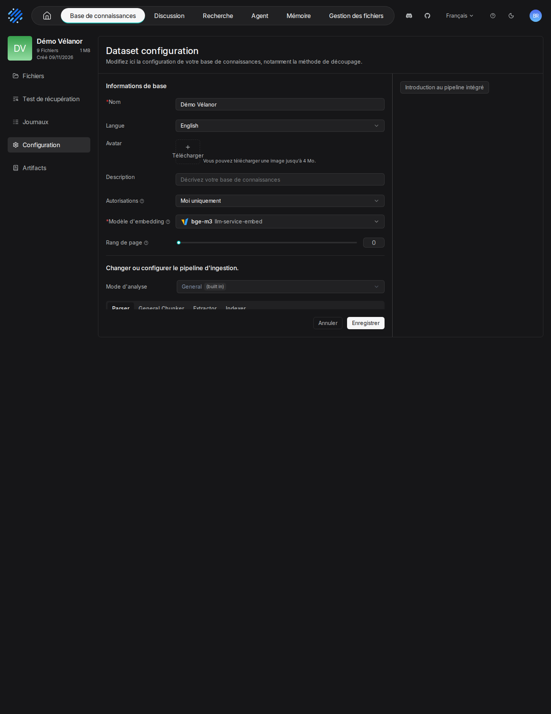

# 03. Datasets et découpage

> **Objet** : choisir le gabarit de découpage d'une base de connaissances et mesurer son effet sur les passages et sur les réponses.
> **Prérequis** : [prise en main](02-prise-en-main.md).
> **Version décrite** : RAGFlow v1.0.0 (image `infiniflow/ragflow:v1.0.0`), Windows 11 + WSL2 (Ubuntu 24.04), LLM-Service branche `service-vllm` (vLLM 0.29.0 : `gemma4:e4b`, `bge-m3`), contexte déclaré de 16 384 jetons.
> **Statut des informations** : [Vérifié] observé ou mesuré le 9 novembre 2026 sur la machine d'essai (Ryzen 5 9600X, 32 Go, RTX 4060 Ti 16 Go) ; [Source] documentation officielle ou code source au tag v1.0.0 ; [Estimation] calcul non mesuré ; [À tester] non documenté et non essayé.
> **Précautions** : une base par gabarit essayé (« Banc-general », « Banc-paper »…), corpus fictif ; changer le gabarit d'une base existante oblige à réanalyser ses documents.

## Sommaire

1. [Les gabarits de RAGFlow 1.0](#1-les-gabarits-de-ragflow-10)
2. [Régler une base](#2-régler-une-base)
3. [Gabarits comparés sur le corpus](#3-gabarits-comparés-sur-le-corpus)
4. [Effet sur le banc](#4-effet-sur-le-banc)
5. [Dépannage](#dépannage)
6. [Sources](#sources)

## 1. Les gabarits de RAGFlow 1.0

### Essentiel

Un gabarit (« Mode d'analyse », ou `parser_id` par l'API) décide comment un document est lu et coupé en passages. RAGFlow 1.0 en propose douze [Source] (`docs/references/http_api_reference.md`) :

| Gabarit | `parser_id` | Usage prévu |
|---|---|---|
| General | `general` | tout document ; découpage par taille et par structure |
| Q&A | `qa` | paires question-réponse (tableur, texte) |
| Manual | `manual` | manuels techniques à sections numérotées |
| Table | `table` | tableurs : une ligne devient un passage |
| Paper | `paper` | articles et rapports structurés |
| Book | `book` | livres, chapitres longs |
| Laws | `laws` | textes juridiques à articles |
| Presentation | `presentation` | diaporamas : une diapositive ou une page par passage |
| Picture | `picture` | images (OCR, description par un modèle de vision) |
| One | `one` | document entier en un seul passage |
| Audio | `audio` | transcription d'un fichier audio |
| Email | `email` | courriels |

### Pour aller plus loin

En 1.0, chaque gabarit est un « pipeline intégré » : Parser, Chunker, Extractor, Indexer. Un pipeline personnalisé (`parse_type=2`) peut remplacer le gabarit ; c'est le chemin de la Knowledge Compilation (manuel [07](07-knowledge-compilation.md)). Les anciens gabarits `tag` et `knowledge_graph` de la branche 0.x ne figurent plus dans la liste. [Source] (`docs/references/http_api_reference.md`)

## 2. Régler une base

### Essentiel

Onglet « Configuration » d'une base : « Informations de base » (nom, langue, autorisations, « Modèle d'embedding »), puis « Mode d'analyse » et les options par format (PDF, DOCX, HTML, tableur, image…).

| N° | Élément | Rôle |
|---|---|---|
| 1 | « Langue » | langue de la base, « English » par défaut même pour un corpus français |
| 2 | « Modèle d'embedding » | `bge-m3`, instance `llm-service-embed` |
| 3 | « Mode d'analyse » | gabarit, ici « General (built in) », avec son pipeline Parser, General Chunker, Extractor, Indexer |
| 4 | « Analyseur PDF » | « DeepDOC » (OCR, mise en page, tableaux) |
| 5 | options PDF | « Détecter la mise en page multi-colonnes », « Supprimer la table des matières d'origine », « Supprimer en-tête et pied de page » |
| 6 | « Enable vision enhancement » | description des images par un modèle de vision (aucun déclaré ici) |
| 7 | « Lier une source de données » | synchronisation avec une source externe (manuel [09](09-sources-externes.md)) |

[Vérifié] (texte et capture relevés par `outils/ragflow/captures/captures.py`, scénario `decoupage`)

Par l'API, le gabarit se choisit à la création : `rag.create_dataset(name="…", parser_id="paper")` [Testée] (`outils/ragflow/banc.py`).

### Pour aller plus loin

La langue « English » par défaut a été laissée telle quelle dans tous les essais ; son effet sur la recherche par mots-clés en français est [À tester].

## 3. Gabarits comparés sur le corpus

### Essentiel

Le corpus a été indexé quatre fois, une base par gabarit. Nombre de passages (et de jetons) par document [Vérifié] :

| Document | General | Paper | Presentation | Table |
|---|---|---|---|---|
| `rapport-annuel-2025.pdf` (10 pages, tableaux) | 9 (871) | 13 (879) | 27 (907) | 9 (871) |
| `contrat-batterix-scan.pdf` (2 pages scannées) | 1 (258) | 1 (258) | 11 (278) | 1 (258) |
| `supplier-audit-batterix-en.pdf` | 1 (123) | 1 (123) | 6 (133) | 1 (123) |
| `stocks-octobre-2025.xlsx` | 2 (177) | 2 (177) | 2 (177) | 10 (345) |
| `strategie-2026.pptx` | 5 (149) | 5 (149) | 5 (149) | 5 (149) |
| `procedure-batteries.docx` | 2 (235) | 2 (235) | 2 (235) | 2 (235) |
| `cse-2025-10-14.md`, `faq-sav.html`, `message-vocal-production.mp3` | 4, 1, 1 | idem | idem | idem |
| **Total** | **26** | **30** | **59** | **34** |

Indexation du corpus complet : 53 à 56 s quel que soit le gabarit. [Vérifié] (`outils/resultats/ragflow/banc-2026-11-09-{defaut,gabarit-paper,gabarit-presentation,gabarit-table}.json`, champ `indexation`)

### Pour aller plus loin

- Un gabarit n'agit que sur les formats qu'il sait traiter : Paper et Presentation redécoupent les PDF, Table redécoupe le tableur ; Markdown, HTML, DOCX, PPTX et audio gardent leur découpage. Dans une base « General », le diaporama est même traité d'office par le gabarit Presentation. [Vérifié] (même source ; liste des documents relevée par `captures.py`)
- Presentation coupe un PDF page par page, même un rapport : 27 passages plus courts pour le rapport annuel.
- Table fait d'une ligne de tableur un passage : 10 passages et deux fois plus de jetons pour le classeur de stocks ; l'écart de jetons viendrait de la répétition des en-têtes de colonnes dans chaque passage [Estimation].

## 4. Effet sur le banc

### Essentiel

Mêmes 38 questions, même modèle, réglages d'assistant par défaut [Vérifié] :

| Gabarit | Exactes (34) | Refus corrects (4) | Bon document cité | Médiane | Résultat brut |
|---|---|---|---|---|---|
| General | 33 | 4 | 34 | 1,28 s | [banc défaut](../../outils/resultats/ragflow/banc-2026-11-09-defaut.md) |
| Paper | 33 | 4 | 34 | 1,19 s | [banc Paper](../../outils/resultats/ragflow/banc-2026-11-09-gabarit-paper.md) |
| Table | 33 | 4 | 34 | 1,26 s | [banc Table](../../outils/resultats/ragflow/banc-2026-11-09-gabarit-table.md) |
| Presentation | 32 | 4 | 33 | 1,18 s | [banc Presentation](../../outils/resultats/ragflow/banc-2026-11-09-gabarit-presentation.md) |

Sur ce corpus court, le gabarit change peu le résultat : General suffit. Presentation perd la question en anglais Q29 (taux de défaut des cellules) : l'assistant répond « not found » ; le découpage de l'audit en six morceaux en est la cause probable [Estimation].

### Pour aller plus loin

La seule question manquée avec General, Paper et Table est Q30 (délai contractuel de Batterix croisé avec le délai constaté) : le modèle trouve le délai constaté mais déclare le délai contractuel absent, alors qu'il figure dans le contrat scanné. Ce n'est pas un problème de découpage : le réglage de la recherche le corrige (manuel [05](05-assistants-et-citations.md)).

## Dépannage

| Symptôme | Cause probable | Action |
|---|---|---|
| Une question sur un document court en anglais ne trouve plus rien après passage à Presentation | passages trop petits, page par page | revenir à General ou Paper pour ce type de document |
| Le gabarit choisi ne change rien pour un fichier | le gabarit ne traite pas ce format (Markdown, HTML, DOCX, PPTX, audio) | normal ; voir le tableau de la section 3 |

## Sources

- Résultats : `outils/resultats/ragflow/banc-2026-11-09-*.json` ; script `outils/ragflow/serie_banc.sh`, adaptateur `outils/ragflow/banc.py`
- Capture : `outils/ragflow/captures/captures.py`, scénario `decoupage`
- Référence de l'API : `docs/references/http_api_reference.md` au tag v1.0.0 ; https://ragflow.io/docs/
