# 03. Datasets et découpage

> **Objet** : gérer une base de connaissances à la souris (création, fichiers, gabarit de découpage par base et par fichier, onglet « Configuration » réglage par réglage, onglet « Journaux », page « Gestion des fichiers »), puis choisir un gabarit d'après sa mesure sur le corpus.
> **Prérequis** : [prise en main](02-prise-en-main.md) (base créée, fichiers importés, passages lus).
> **Version décrite** : RAGFlow v1.0.0 (image `infiniflow/ragflow:v1.0.0`), Windows 11 + WSL2 (Ubuntu 24.04), LLM-Service branche `service-vllm` (vLLM 0.29.0 : `gemma4:e4b`, `bge-m3`), contexte déclaré de 16 384 jetons.
> **Statut des informations** : [Vérifié] observé ou mesuré les 9 et 11 novembre 2026 sur la machine d'essai (Ryzen 5 9600X, 32 Go, RTX 4060 Ti 16 Go) ; [Source] documentation officielle ou code source au tag v1.0.0 ; [Estimation] calcul non mesuré ; [À tester] non documenté et non essayé.
> **Précautions** : documents fictifs de Vélanor (`corpus/documents/`) ; la base « Manuel-Decoupage » et le dossier « Manuel-dossier » sont créés par le scénario de captures puis supprimés (dossier à la souris, base par `outils/ragflow/nettoyer_manuel.py`) ; la base de démonstration « Démo Vélanor » n'est ouverte qu'en lecture. Changer le gabarit d'un fichier déjà analysé efface ses passages et les recalcule.

Toutes les captures viennent d'un seul passage du scénario `decoupage` de `outils/ragflow/captures/manuels_03_06.py`, joué à la souris dans l'ordre des sections. Le texte de chaque page capturée et la liste de ses éléments visibles sont dans `outils/resultats/ragflow/captures/03-datasets-et-decoupage/` (même nom que l'image), le déroulé et les durées dans `scenario.log`. [Vérifié]

## Sommaire

1. [Créer une base et choisir son gabarit](#1-créer-une-base-et-choisir-son-gabarit)
2. [La page « Fichiers »](#2-la-page--fichiers-)
3. [Changer le gabarit d'un seul fichier et relancer une analyse](#3-changer-le-gabarit-dun-seul-fichier-et-relancer-une-analyse)
4. [Métadonnées, sélection, filtre et fichier vide](#4-métadonnées-sélection-filtre-et-fichier-vide)
5. [L'onglet « Configuration », réglage par réglage](#5-longlet--configuration--réglage-par-réglage)
6. [L'onglet « Journaux »](#6-longlet--journaux-)
7. [La page « Gestion des fichiers »](#7-la-page--gestion-des-fichiers-)
8. [Les gabarits de RAGFlow 1.0](#8-les-gabarits-de-ragflow-10)
9. [Gabarits comparés sur le corpus](#9-gabarits-comparés-sur-le-corpus)
10. [Effet sur le banc](#10-effet-sur-le-banc)
11. [Dépannage](#dépannage)
12. [Sources](#sources)

## 1. Créer une base et choisir son gabarit

### Essentiel

But : créer une base « Manuel-Decoupage » en choisissant son gabarit de découpage dès la création. Le gabarit (« Mode d'analyse ») décide comment chaque document est lu et coupé en passages ; il s'applique à tous les fichiers de la base, sauf réglage particulier d'un fichier (section 3).

1. Cliquer sur « Base de connaissances » dans la barre du haut. La liste des bases s'affiche.

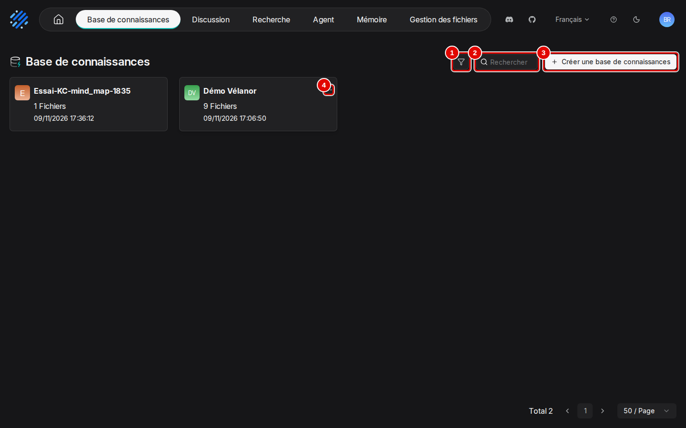

| N° | Élément | Rôle |
|---|---|---|
| 1 | filtre (entonnoir) | restreint la liste des bases (par propriétaire) |
| 2 | « Rechercher » | filtre les bases par nom |
| 3 | « Créer une base de connaissances » | ouvre la fenêtre de création (étape 3) |
| 4 | menu « … » de la carte | menu de la base (étape 2), visible au survol de la carte |

2. Le menu « … » d'une carte propose deux actions. Il sert à renommer une base sans l'ouvrir, ou à la supprimer avec ses fichiers et ses passages. Appuyer sur Échap pour le refermer.

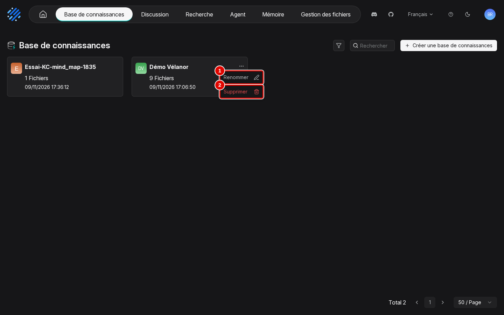

| N° | Élément | Rôle |
|---|---|---|
| 1 | « Renommer » | change le nom de la base |
| 2 | « Supprimer » | supprime la base, après confirmation ; irréversible |

3. Cliquer sur « Créer une base de connaissances », saisir le nom, puis ouvrir la liste du gabarit.

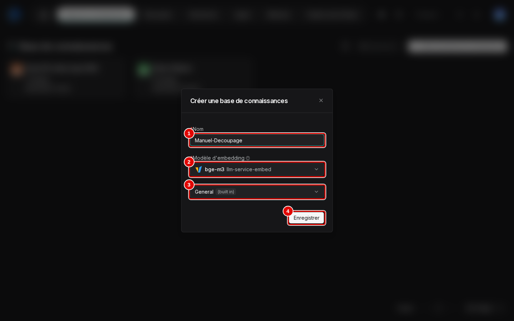

| N° | Élément | Rôle |
|---|---|---|
| 1 | « Nom » | nom de la base, ici « Manuel-Decoupage » |
| 2 | « Modèle d'embedding » | modèle qui vectorise les passages ; `bge-m3` de l'instance `llm-service-embed` (modèle par défaut, manuel [01](01-installation.md)) |
| 3 | gabarit | gabarit de découpage de la base, « General (built in) » par défaut |
| 4 | « Enregistrer » | crée la base et l'ouvre |

4. La liste propose les pipelines d'ingestion créés dans « Agent » (ici « Essai-KC-mind_map-1835 », manuel [07](07-knowledge-compilation.md)) puis les douze gabarits intégrés, marqués « (built in) ». Choisir « General », puis cliquer sur « Enregistrer ».

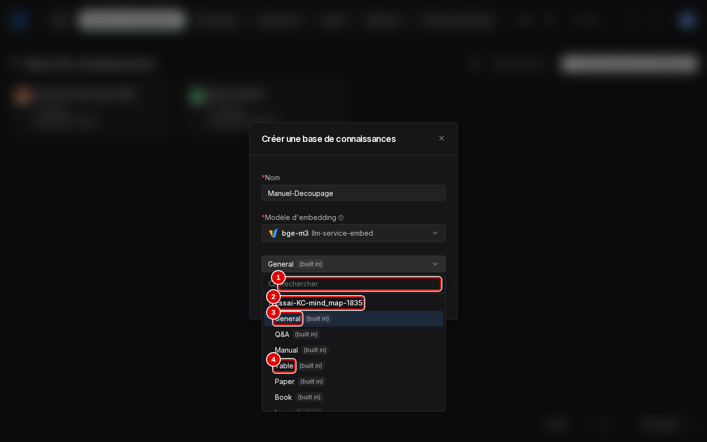

| N° | Élément | Rôle |
|---|---|---|
| 1 | « Rechercher » | filtre la liste par nom |
| 2 | « Essai-KC-mind_map-1835 » | pipeline personnalisé ; la flèche le déplie pour choisir sa version |
| 3 | « General » | gabarit généraliste, choisi ici |
| 4 | « Table » | gabarit des tableurs (une ligne par passage), essayé en section 3 |

### Pour aller plus loin

Le choix du gabarit est décrit en section 8 et mesuré en sections 9 et 10. Sur ce corpus, « General » suffit ; un autre gabarit se justifie pour un format précis (tableur, diaporama, questions-réponses), et se règle alors fichier par fichier (section 3) plutôt que pour toute la base.

## 2. La page « Fichiers »

### Essentiel

But : importer trois fichiers avec analyse immédiate, lire le tableau des fichiers, et utiliser les actions de chaque ligne.

1. Dans la base, cliquer sur « Ajouter un fichier », puis « Téléverser un fichier ». Choisir les fichiers, activer « Analyser à la création », puis cliquer sur « Enregistrer ». L'exemple importe `stocks-octobre-2025.xlsx`, `procedure-batteries.docx` et `cse-2025-10-14.md`.

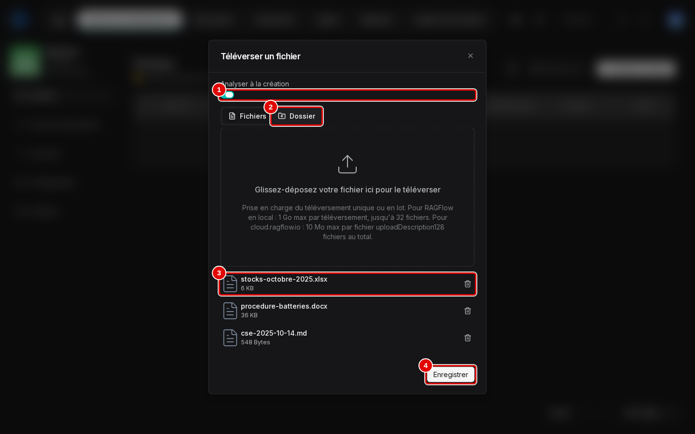

| N° | Élément | Rôle |
|---|---|---|
| 1 | « Analyser à la création » | activé, chaque fichier est analysé dès son arrivée, sans clic supplémentaire |
| 2 | « Dossier » | onglet qui envoie tout le contenu d'un dossier du poste au lieu de fichiers choisis un par un |
| 3 | fichier choisi | nom et taille ; la corbeille le retire de l'envoi |
| 4 | « Enregistrer » | téléverse les fichiers |

2. Les fichiers apparaissent et s'analysent seuls : les trois fichiers ont leurs passages en moins de 6 s (relevé toutes les 3 s environ). Le tableau résume chaque fichier. [Vérifié] (`outils/resultats/ragflow/captures/03-datasets-et-decoupage/scenario.log`)

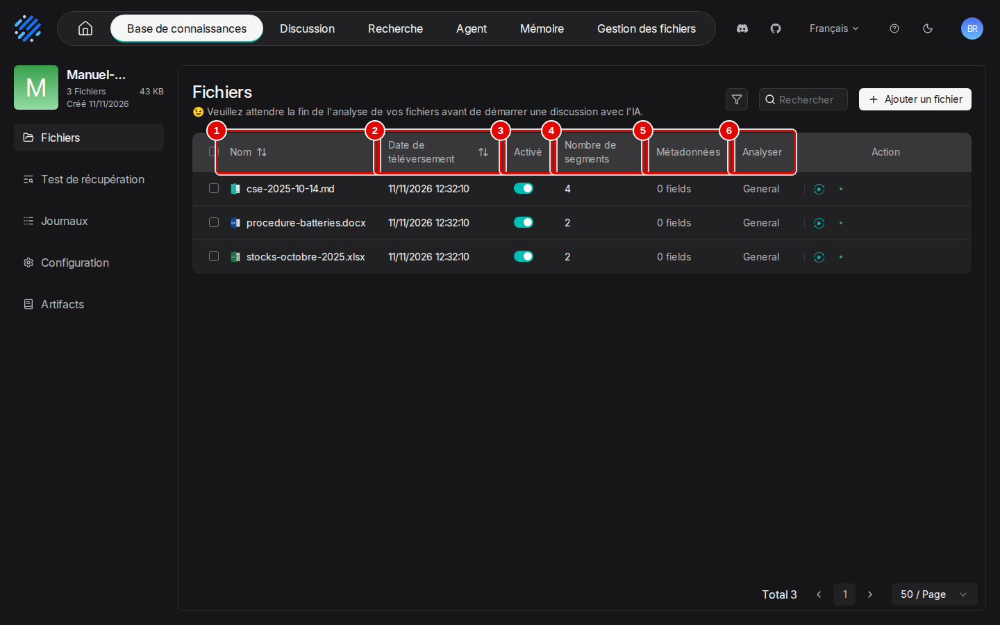

| N° | Élément | Rôle |
|---|---|---|
| 1 | « Nom » | nom du fichier ; un clic sur le nom ouvre ses passages (manuel [04](04-deepdoc.md)), les flèches de l'en-tête trient |
| 2 | « Date de téléversement » | date d'arrivée dans la base ; triable |
| 3 | « Activé » | un fichier désactivé reste dans la base mais n'est plus interrogé (étape 5) |
| 4 | « Nombre de segments » | nombre de passages produits par l'analyse |
| 5 | « Métadonnées » | nombre de champs de métadonnées du fichier (« 0 fields »), modifiables (section 4) |
| 6 | « Analyser » | gabarit du fichier, bouton de lancement ou de relance, et état de l'analyse (section 3) |

3. Survoler une ligne fait apparaître ses actions dans la colonne « Action » ; survoler l'œil affiche les propriétés du fichier.

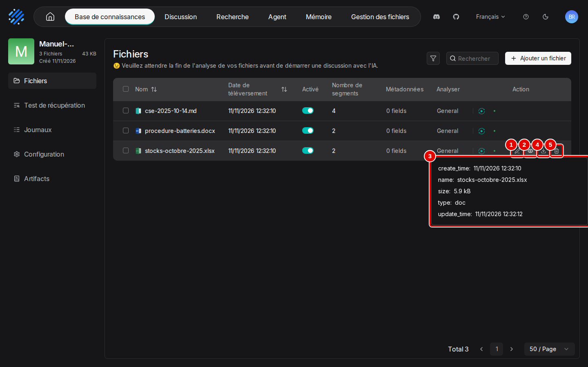

| N° | Élément | Rôle |
|---|---|---|
| 1 | crayon | renomme le fichier (étape 4) |
| 2 | œil | affiche les propriétés au survol |
| 3 | propriétés du fichier | date de création, nom, taille, type, date de mise à jour |
| 4 | flèche vers le bas | télécharge le fichier d'origine |
| 5 | corbeille | supprime le fichier et ses passages, après confirmation (section 4) |

4. Cliquer sur le crayon, saisir le nouveau nom, puis « Enregistrer ». Ici le tableur devient `stocks-octobre-2025-manuel.xlsx`. Garder l'extension : elle indique le format du fichier.

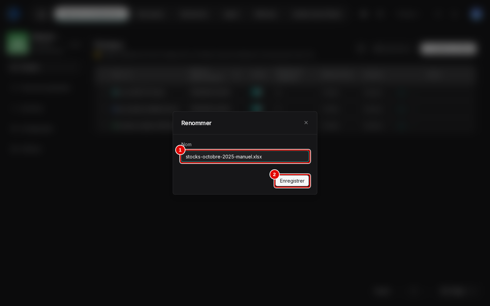

| N° | Élément | Rôle |
|---|---|---|
| 1 | « Nom » | nouveau nom du fichier |
| 2 | « Enregistrer » | applique le nom ; les passages ne sont pas recalculés |

5. Cliquer sur l'interrupteur « Activé » d'un fichier pour l'écarter des réponses sans le supprimer, par exemple un document périmé en attente de sa nouvelle version. Le message « Modifié » confirme. Un second clic le réactive.

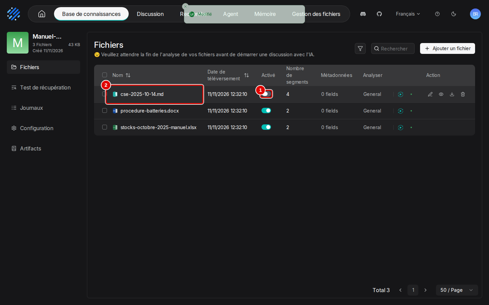

| N° | Élément | Rôle |
|---|---|---|
| 1 | interrupteur « Activé » | désactivé (gris) : le fichier n'est plus interrogé |
| 2 | « cse-2025-10-14.md » | fichier concerné ; ses passages restent stockés |

### Pour aller plus loin

- « Analyser à la création » évite le clic sur le triangle de lancement de chaque fichier (manuel [02](02-prise-en-main.md)) ; le laisser désactivé permet de régler le gabarit d'un fichier avant sa première analyse.
- Le téléversement local accepte jusqu'à 32 fichiers et 1 Go par envoi, d'après le texte de la fenêtre. [Vérifié] (`outils/resultats/ragflow/captures/03-datasets-et-decoupage/05-televersement-analyse.txt`)

## 3. Changer le gabarit d'un seul fichier et relancer une analyse

### Essentiel

But : passer le tableur au gabarit « Table » (une ligne de tableur par passage) sans changer le reste de la base, puis relancer l'analyse d'un autre fichier.

1. Dans la colonne « Analyser », cliquer sur le nom du gabarit du fichier (« General »). Un menu à une entrée s'ouvre.

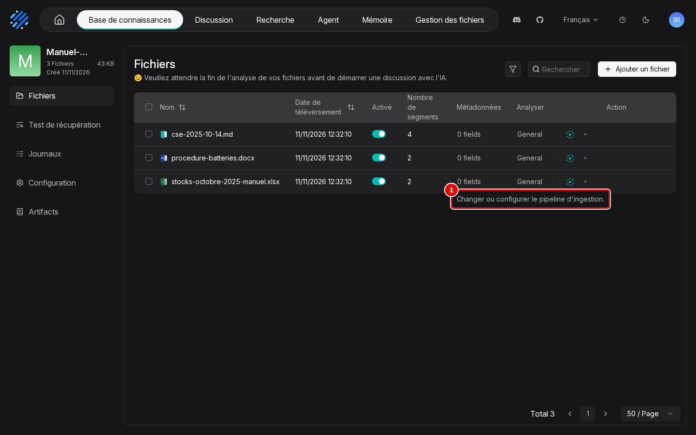

| N° | Élément | Rôle |
|---|---|---|
| 1 | « Changer ou configurer le pipeline d'ingestion. » | ouvre la fenêtre de gabarit propre à ce fichier |

2. La fenêtre « Mode d'analyse » reprend les réglages de l'onglet « Configuration » (section 5), mais pour ce fichier seulement. Ouvrir la liste du gabarit.

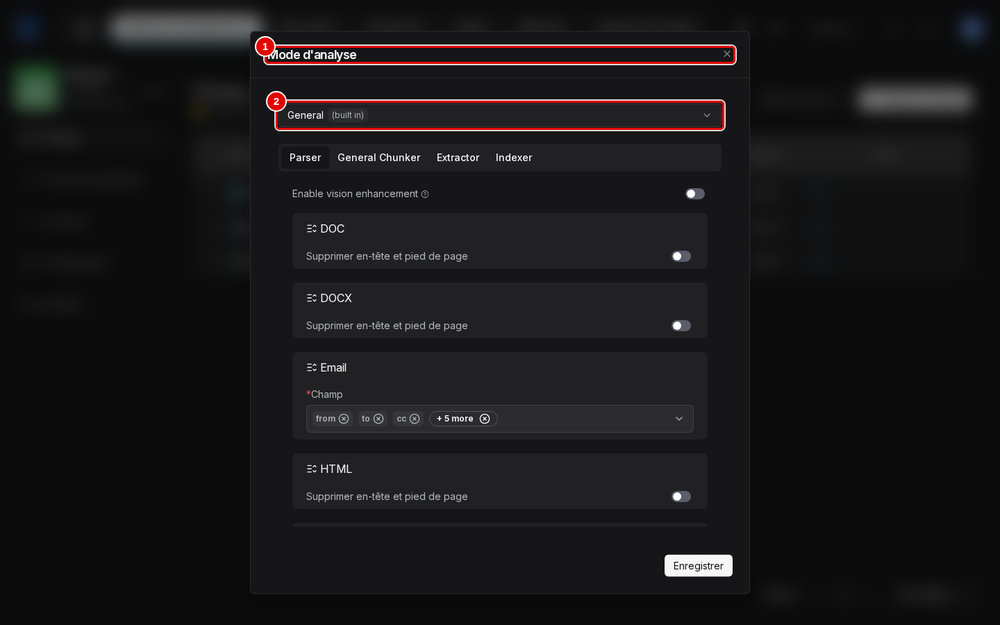

| N° | Élément | Rôle |
|---|---|---|
| 1 | « Mode d'analyse » | fenêtre de réglage du fichier |
| 2 | gabarit du fichier | gabarit actuel, « General (built in) » |

3. Choisir « Table ».

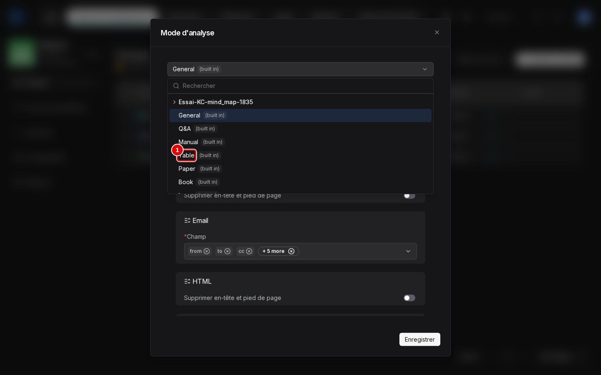

| N° | Élément | Rôle |
|---|---|---|
| 1 | « Table » | gabarit des tableurs : chaque ligne devient un passage, avec les en-têtes de colonnes |

4. Les onglets s'adaptent au gabarit (« Parser », « Table Chunker », « Indexer »). Cliquer sur « Enregistrer ».

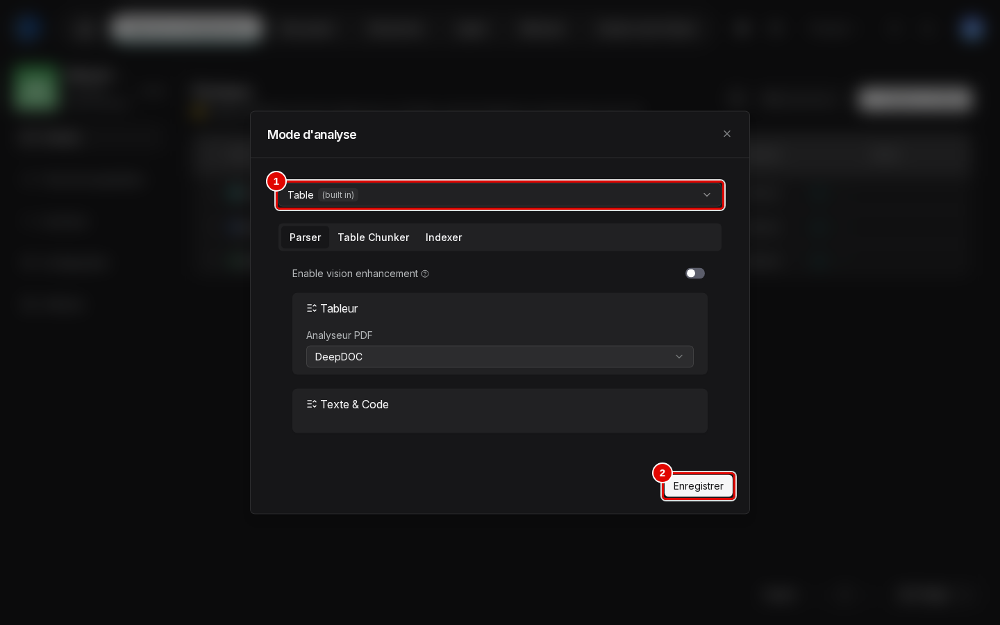

| N° | Élément | Rôle |
|---|---|---|
| 1 | « Table (built in) » | gabarit retenu pour ce fichier |
| 2 | « Enregistrer » | enregistre le gabarit du fichier |

5. Comme le fichier a déjà des passages, RAGFlow propose de les effacer et de réanalyser le fichier avec le nouveau gabarit. Cliquer sur « Oui ». « Non » garde le gabarit enregistré sans réanalyser : les anciens passages restent jusqu'à la prochaine analyse.

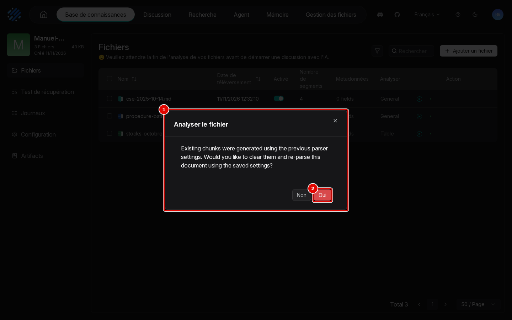

| N° | Élément | Rôle |
|---|---|---|
| 1 | « Analyser le fichier » | fenêtre de confirmation (texte en anglais : les passages existants seront effacés) |
| 2 | « Oui » | efface les passages et relance l'analyse avec le nouveau gabarit |

6. Le tableur passe de 2 passages avec « General » à 10 avec « Table », relevé 3 s après la confirmation. [Vérifié] (`outils/resultats/ragflow/captures/03-datasets-et-decoupage/scenario.log`)

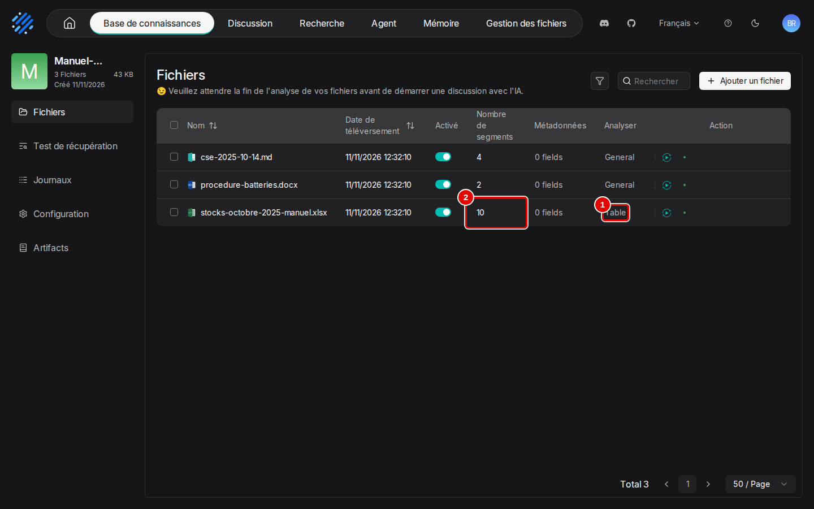

| N° | Élément | Rôle |
|---|---|---|
| 1 | « Table » | gabarit propre à ce fichier ; les autres restent en « General » |
| 2 | « Nombre de segments » | 10 passages, un par ligne du classeur |

7. Pour relancer l'analyse d'un fichier avec le même gabarit (après un changement de réglage de la base, par exemple), cliquer sur son icône de relance.

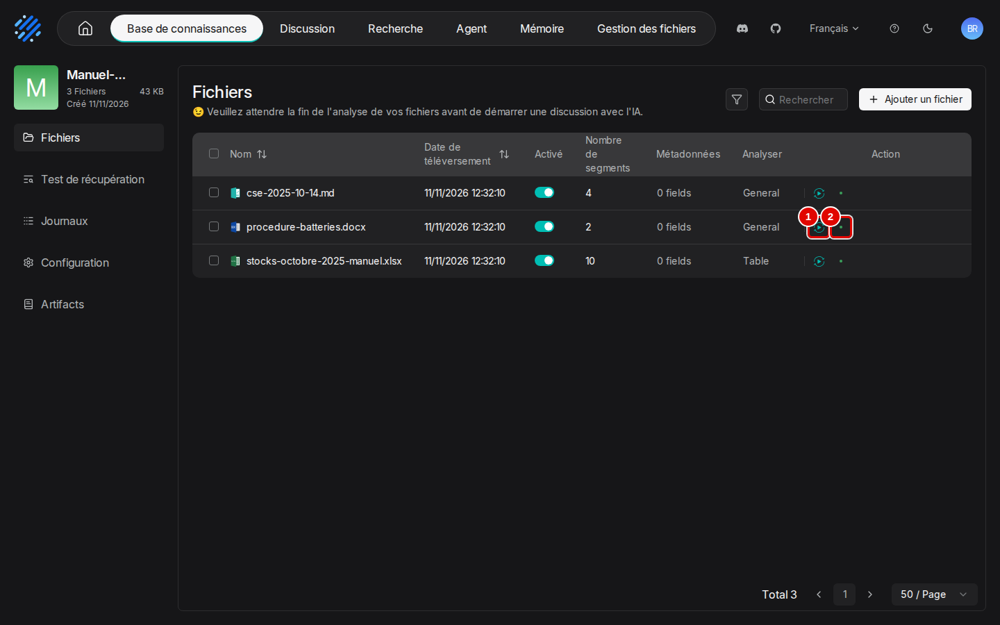

| N° | Élément | Rôle |
|---|---|---|
| 1 | icône de relance | relance l'analyse du fichier |
| 2 | point d'état | vert : analyse réussie ; un clic ouvre le journal de l'analyse (même fenêtre qu'en section 6, étape 2) |

8. Confirmer. Les passages existants sont effacés puis recalculés ; pour ce document court, l'analyse est finie en moins de 3 s. [Vérifié] (même journal)

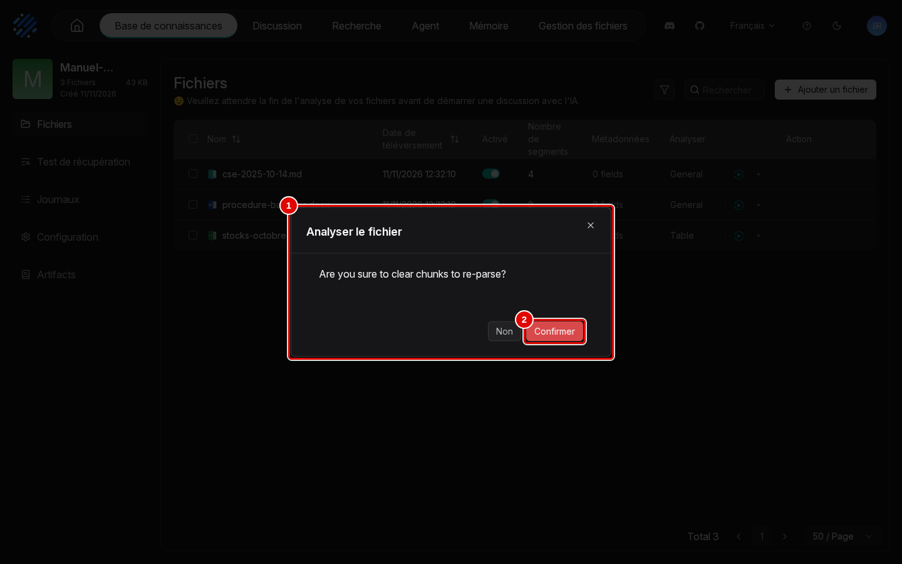

| N° | Élément | Rôle |
|---|---|---|
| 1 | « Analyser le fichier » | confirmation (« Are you sure to clear chunks to re-parse? ») |
| 2 | « Confirmer » | efface les passages et relance l'analyse |

### Pour aller plus loin

- Une relance efface aussi les corrections faites à la main dans les passages (manuel [04](04-deepdoc.md)) : la fenêtre annonce l'effacement des passages existants. [Source] (`web/src/locales/fr.ts`, clé `redo`)
- Pendant une analyse, le bouton « Cancel parsing tasks » de l'en-tête annule les tâches en cours (manuel [02](02-prise-en-main.md)).

## 4. Métadonnées, sélection, filtre et fichier vide

### Essentiel

But : connaître les autres gestes de la page « Fichiers ».

1. Cliquer sur « 0 fields » d'un fichier ouvre « Modifier les métadonnées ». Une métadonnée est un couple champ-valeur (auteur, service, date de validité…) qui sert ensuite à filtrer la recherche d'un assistant (« Métadonnées » des « Paramètres avancés », manuel [05](05-assistants-et-citations.md)). Cliquer sur « Annuler » pour refermer sans rien changer.

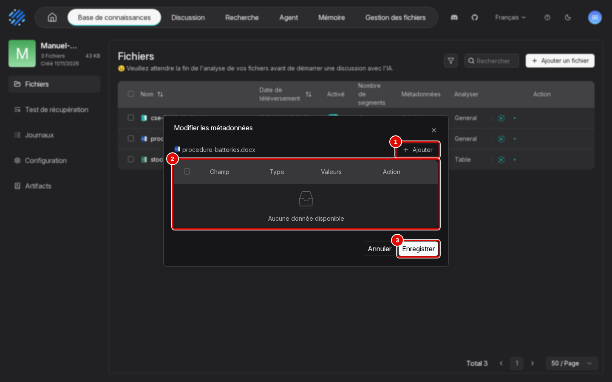

| N° | Élément | Rôle |
|---|---|---|
| 1 | « Ajouter » | ajoute un champ |
| 2 | tableau des champs | « Champ », « Type », « Valeurs », « Action » ; vide ici (« Aucune donnée disponible ») |
| 3 | « Enregistrer » | enregistre les métadonnées du fichier |

2. Cocher plusieurs fichiers fait apparaître une barre d'actions groupées, utile pour traiter un lot d'un coup.

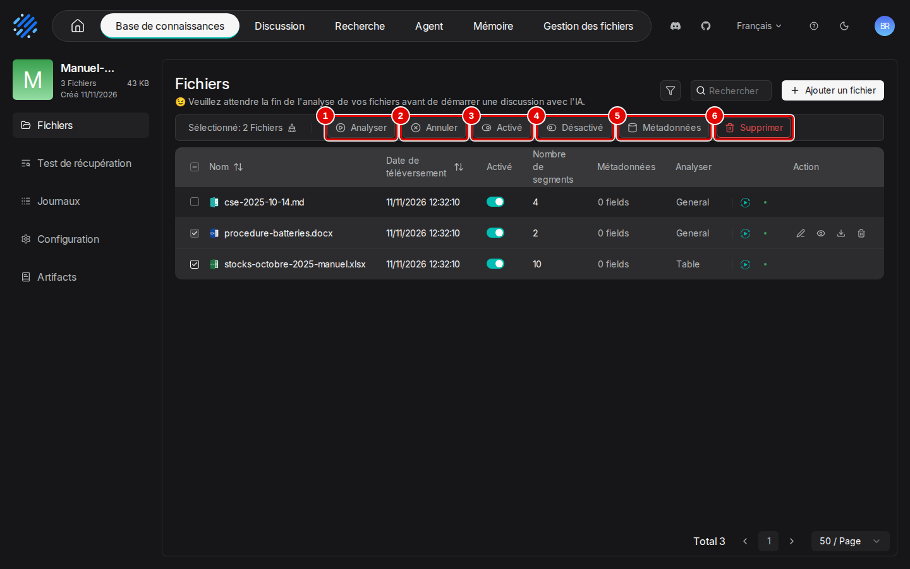

| N° | Élément | Rôle |
|---|---|---|
| 1 | « Analyser » | lance l'analyse des fichiers cochés |
| 2 | « Annuler » | annule leurs analyses en cours |
| 3 | « Activé » | active les fichiers cochés |
| 4 | « Désactivé » | les désactive |
| 5 | « Métadonnées » | modifie leurs métadonnées en une fois |
| 6 | « Supprimer » | les supprime, après confirmation |

3. Le filtre (entonnoir) restreint le tableau, utile dans une grande base pour retrouver les fichiers en échec ou d'un type donné. Appuyer sur Échap pour le refermer.

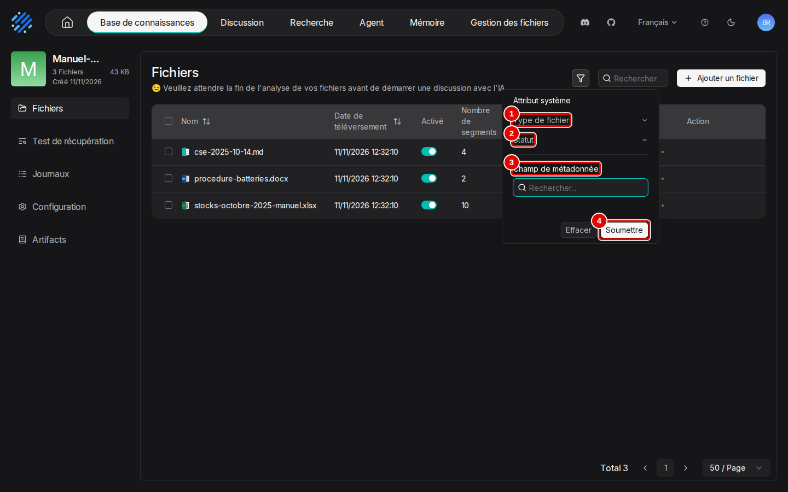

| N° | Élément | Rôle |
|---|---|---|
| 1 | « Type de fichier » | ne garde qu'un format |
| 2 | « Statut » | ne garde qu'un état d'analyse (réussi, en échec…) |
| 3 | « Champ de métadonnée » | ne garde que les fichiers portant un champ donné |
| 4 | « Soumettre » | applique le filtre ; « Effacer » le retire |

4. « Ajouter un fichier », puis « Créer un fichier vide » crée un document sans contenu, à remplir ensuite de passages saisis à la main (« + » de la page des passages, manuel [04](04-deepdoc.md)). Saisir un nom, puis « Enregistrer ».

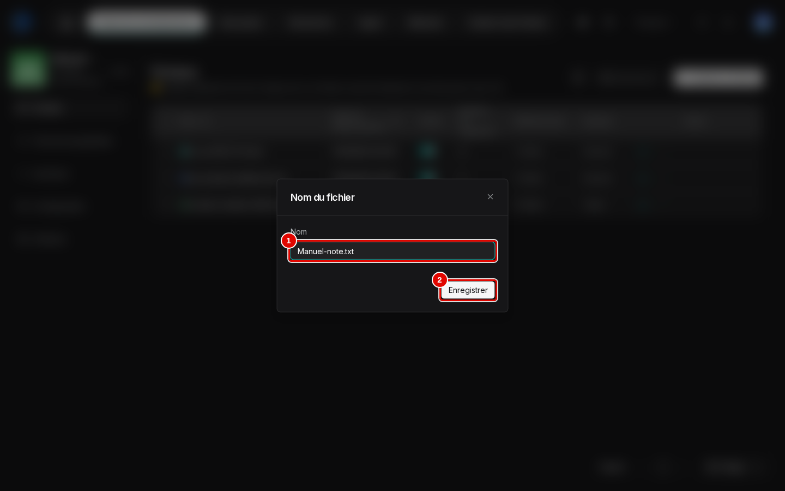

| N° | Élément | Rôle |
|---|---|---|
| 1 | « Nom » | nom du document, ici « Manuel-note.txt » |
| 2 | « Enregistrer » | crée le document vide |

5. Le document apparaît avec 0 segment et sans bouton d'analyse (rien à analyser). Pour le supprimer, survoler sa ligne et cliquer sur la corbeille.

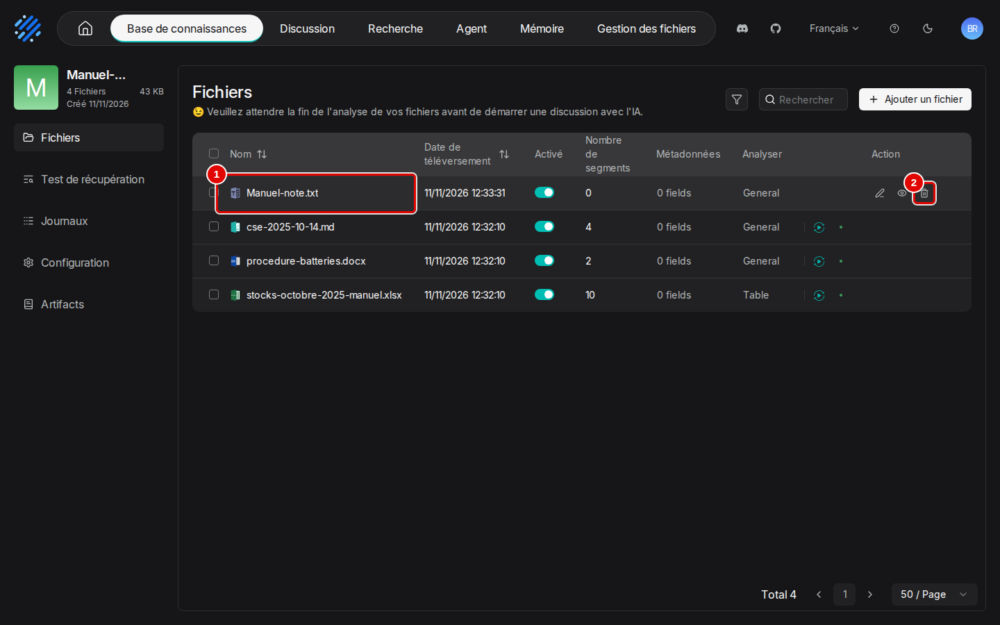

| N° | Élément | Rôle |
|---|---|---|
| 1 | « Manuel-note.txt » | document vide créé |
| 2 | corbeille | supprime le document |

6. Confirmer la suppression.

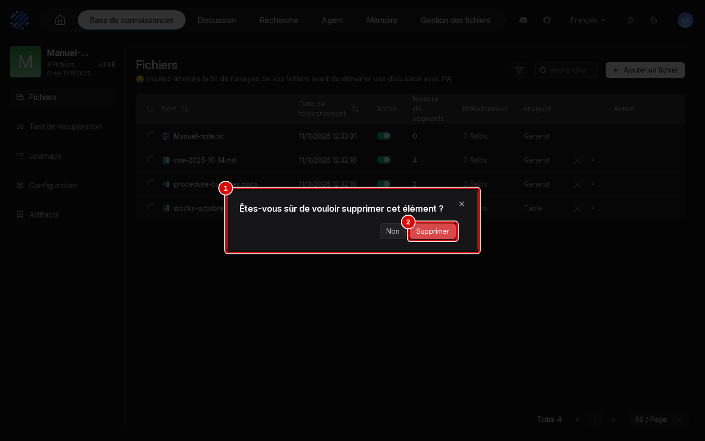

| N° | Élément | Rôle |
|---|---|---|
| 1 | fenêtre de confirmation | rappelle le fichier visé |
| 2 | « Supprimer » | supprime le fichier et ses passages ; irréversible |

## 5. L'onglet « Configuration », réglage par réglage

### Essentiel

But : comprendre chaque réglage de la base, et en modifier deux (langue et description) à titre d'exemple. Les réglages de découpage ne s'appliquent qu'aux analyses suivantes : relancer l'analyse des fichiers déjà traités pour qu'ils en tiennent compte (section 3, étape 7).

1. Cliquer sur « Configuration » dans le menu de gauche de la base. La partie « Informations de base » s'affiche en premier.

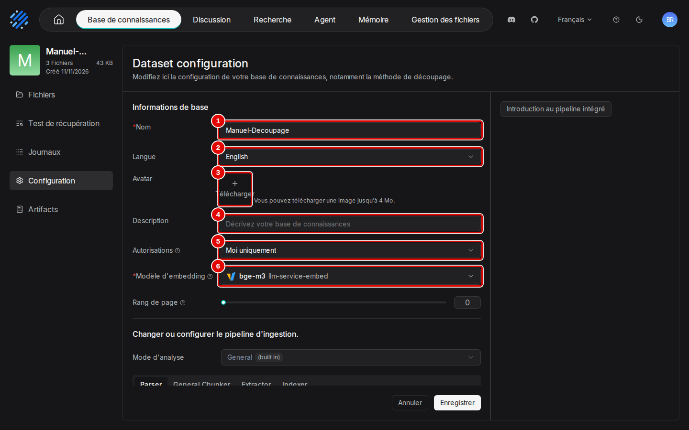

| N° | Élément | Rôle |
|---|---|---|
| 1 | « Nom » | nom de la base |
| 2 | « Langue » | langue des documents, « English » par défaut ; sert au traitement des mots-clés de la recherche plein texte |
| 3 | « Télécharger » (« Avatar ») | image de la base, 4 Mo au plus |
| 4 | « Description » | texte libre affiché avec la base |
| 5 | « Autorisations » | qui peut gérer la base (étape 3) |
| 6 | « Modèle d'embedding » | modèle de vectorisation ; changeable tant que la base n'a pas de passages, ou si l'ancien et le nouveau modèle donnent des vecteurs assez proches (similarité moyenne d'au moins 0,9 sur un échantillon) [Source] (`web/src/locales/fr.ts`, clé `embeddingModelTip`) |

2. Ouvrir « Langue » et choisir « French » pour un corpus français.

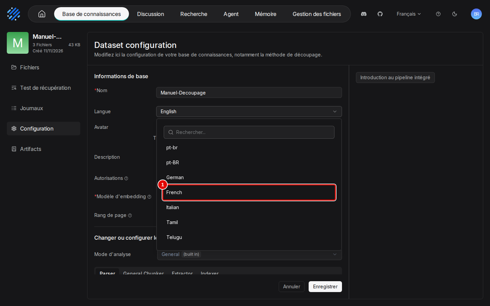

| N° | Élément | Rôle |
|---|---|---|
| 1 | « French » | langue des documents de la base |

3. « Autorisations » propose deux valeurs. Garder « Moi uniquement » sur un poste personnel ; « Équipe » sert quand plusieurs comptes partagent l'instance (manuel [13](13-exploitation.md)).

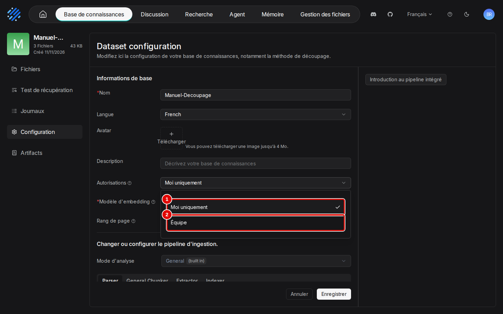

| N° | Élément | Rôle |
|---|---|---|
| 1 | « Moi uniquement » | seul le propriétaire gère la base |
| 2 | « Équipe » | tous les membres de l'équipe peuvent gérer la base |

4. Plus bas, « Rang de page » et le pipeline d'ingestion. Le « Mode d'analyse » est le gabarit de la base ; ses quatre onglets détaillent ses étapes.

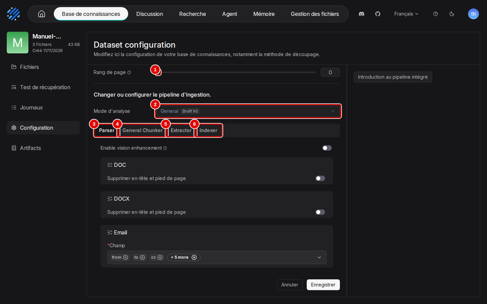

| N° | Élément | Rôle |
|---|---|---|
| 1 | « Rang de page » | bonus ajouté au score des passages de cette base quand un assistant interroge plusieurs bases ; 0 par défaut |
| 2 | « Mode d'analyse » | gabarit de la base (étape 6) |
| 3 | « Parser » | lecture des documents, format par format (étapes 7 à 9) |
| 4 | « General Chunker » | découpage en passages (étapes 10 et 11) |
| 5 | « Extractor » | enrichissement des passages par le modèle de chat (étapes 12 à 14) |
| 6 | « Indexer » | ce qui est indexé et comment (étape 15) |

5. « Introduction au pipeline intégré » affiche à droite la description du gabarit choisi : formats acceptés et façon de découper, avec des exemples.

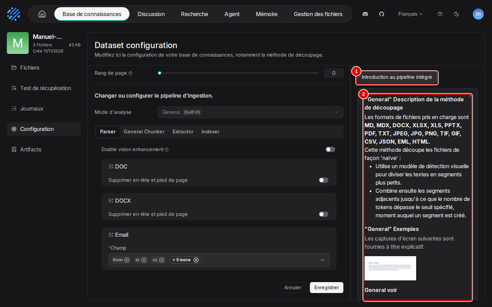

| N° | Élément | Rôle |
|---|---|---|
| 1 | « Introduction au pipeline intégré » | affiche ou masque la description |
| 2 | description du gabarit | pour « General » : MD, MDX, DOCX, XLSX, XLS, PPTX, PDF, TXT, images, CSV, JSON, EML, HTML ; découpage par un modèle de mise en page puis regroupement jusqu'au seuil de jetons |

6. La liste « Mode d'analyse » est la même qu'à la création (section 1, étape 4). Appuyer sur Échap pour la refermer sans changer de gabarit.

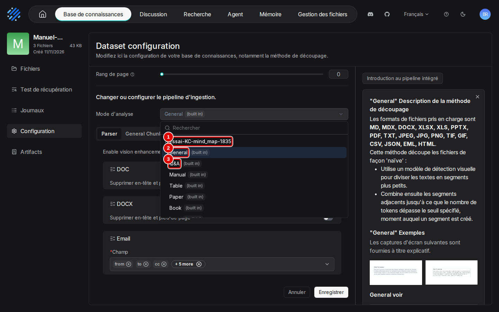

| N° | Élément | Rôle |
|---|---|---|
| 1 | « Essai-KC-mind_map-1835 » | pipeline personnalisé (manuel [07](07-knowledge-compilation.md)) |
| 2 | « General » | gabarit actuel |
| 3 | « Q&A » | premier des autres gabarits intégrés (liste en section 8) |

7. Onglet « Parser » : un bloc par format, avec ses options.

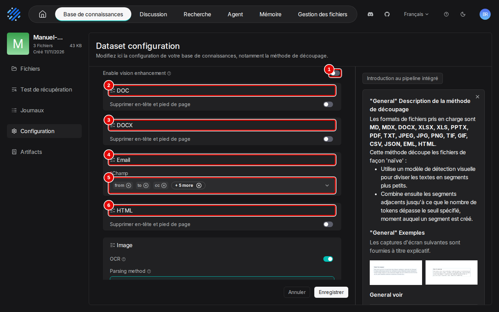

| N° | Élément | Rôle |
|---|---|---|
| 1 | « Enable vision enhancement » | confie images et tableaux à un modèle de vision ; désactivé, ils sont lus comme du texte ; demande un « Modèle Img2txt », absent du banc |
| 2 | « DOC » | ancien format Word ; option « Supprimer en-tête et pied de page » |
| 3 | « DOCX » | Word ; même option |
| 4 | « Email » | courriels |
| 5 | « Champ » | champs du courriel gardés (« from », « to », « cc » et 5 autres) |
| 6 | « HTML » | pages web ; option « Supprimer en-tête et pied de page » |

8. Le bloc « Image » règle la lecture des images.

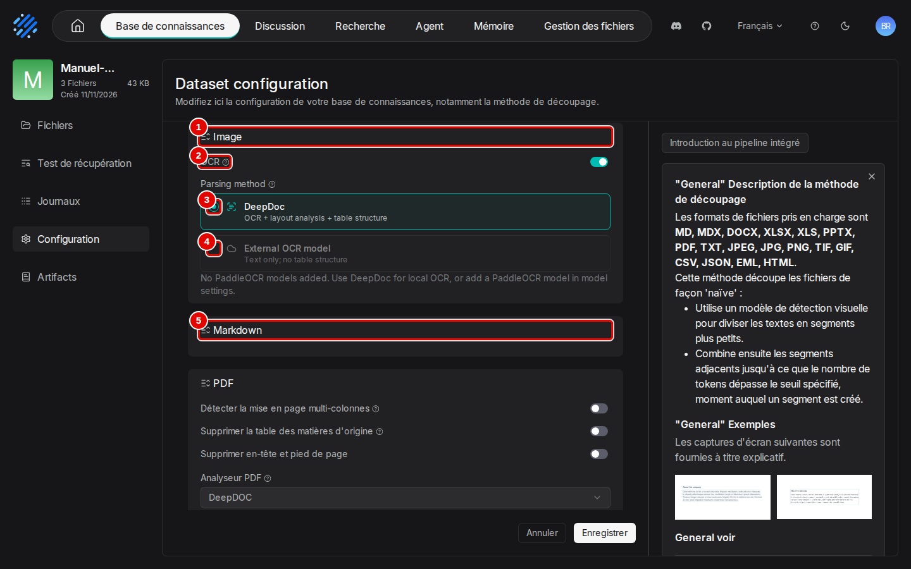

| N° | Élément | Rôle |
|---|---|---|
| 1 | « Image » | bloc des images (JPEG, PNG…) |
| 2 | « OCR » | reconnaissance du texte des images, activée par défaut |
| 3 | « DeepDoc » | OCR, mise en page et structure des tableaux, en local (manuel [04](04-deepdoc.md)) |
| 4 | « External OCR model » | OCR par un modèle PaddleOCR déclaré ; texte seul, sans tableaux ; grisé ici, aucun modèle déclaré |
| 5 | « Markdown » | bloc des fichiers Markdown, sans option |

9. Le bloc « PDF » règle la lecture des PDF ; « Tableur » et « Texte & Code » suivent.

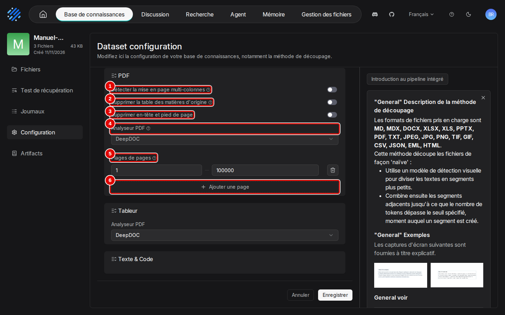

| N° | Élément | Rôle |
|---|---|---|
| 1 | « Détecter la mise en page multi-colonnes » | rétablit l'ordre de lecture des pages en colonnes (journal, article) |
| 2 | « Supprimer la table des matières d'origine » | écarte le sommaire du PDF, qui sinon devient un passage |
| 3 | « Supprimer en-tête et pied de page » | écarte les lignes répétées en haut et en bas de page |
| 4 | « Analyseur PDF » | moteur de lecture, « DeepDOC » par défaut (liste complète au manuel [04](04-deepdoc.md)) |
| 5 | « Plages de pages » | pages à analyser, de 1 à 100000 par défaut ; les autres sont ignorées |
| 6 | « Ajouter une page » | ajoute une autre plage |

10. Onglet « General Chunker » : la taille des passages.

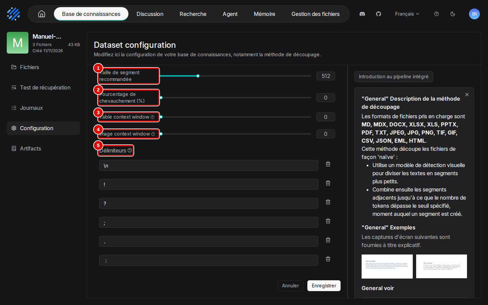

| N° | Élément | Rôle |
|---|---|---|
| 1 | « Taille de segment recommandée » | seuil en jetons (512 par défaut) : les textes courts sont regroupés jusqu'à le dépasser, sauf délimiteur |
| 2 | « Pourcentage de chevauchement (%) » | part de texte répétée entre deux passages voisins, 0 par défaut |
| 3 | « Table context window » | nombre de jetons de texte autour d'un tableau ajoutés à son passage, 0 par défaut |
| 4 | « Image context window » | même chose pour une image |
| 5 | « Délimiteurs » | caractères où couper le texte (retour à la ligne, « ! », « ? », « ; » et leurs équivalents chinois) |

11. Sous la liste des délimiteurs :

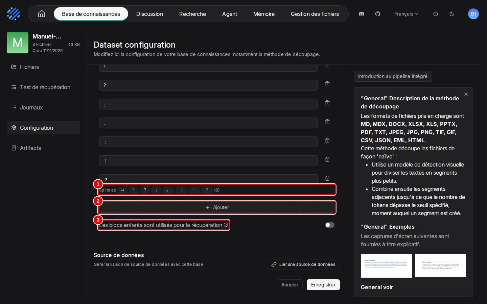

| N° | Élément | Rôle |
|---|---|---|
| 1 | « Splits at: » | récapitulatif des 8 délimiteurs actifs |
| 2 | « Ajouter » | ajoute un délimiteur ; une suite de caractères entre accents graves forme un seul délimiteur [Source] (`web/src/locales/en.ts`, clé `delimiterTip`) |
| 3 | « Les blocs enfants sont utilisés pour la récupération » | découpe chaque passage en sous-blocs, utilisés pour la recherche, le passage entier étant donné au modèle |

12. Onglet « Extractor » : enrichissements calculés par le modèle de chat pendant l'analyse. Chacun consomme des jetons et allonge l'analyse ; tous sont désactivés par défaut.

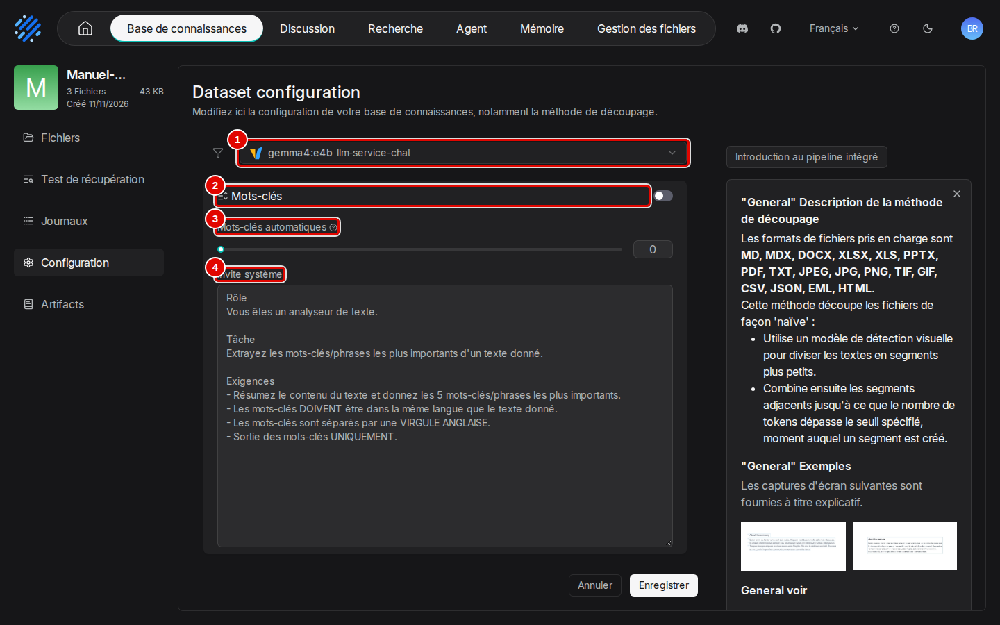

| N° | Élément | Rôle |
|---|---|---|
| 1 | « Modèle » | modèle qui fait les extractions, ici `gemma4:e4b` |
| 2 | « Mots-clés » | interrupteur de l'extraction de mots-clés |
| 3 | « Mots-clés automatiques » | nombre de mots-clés extraits par passage (0 : aucun) ; ils font remonter le passage pour les questions qui les contiennent |
| 4 | « Invite système » | consigne donnée au modèle pour cette extraction, modifiable |

13. Suite de l'onglet :

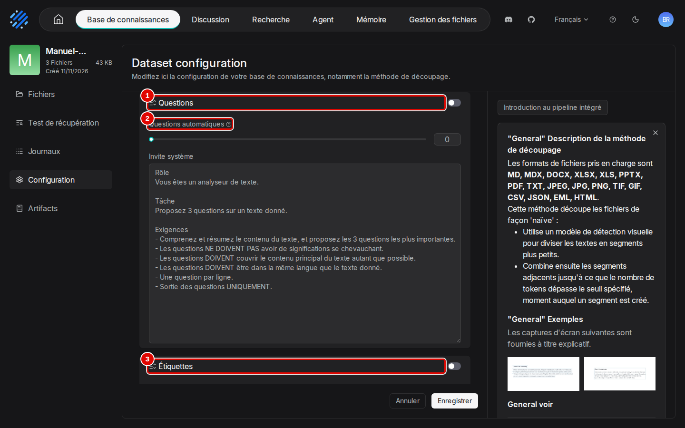

| N° | Élément | Rôle |
|---|---|---|
| 1 | « Questions » | interrupteur de la génération de questions |
| 2 | « Questions automatiques » | nombre de questions générées par passage ; elles servent au rapprochement avec les questions posées |
| 3 | « Étiquettes » | étiquetage automatique à partir d'une base d'étiquettes (« Auto-tags », « Tag file ») |

14. Fin de l'onglet :

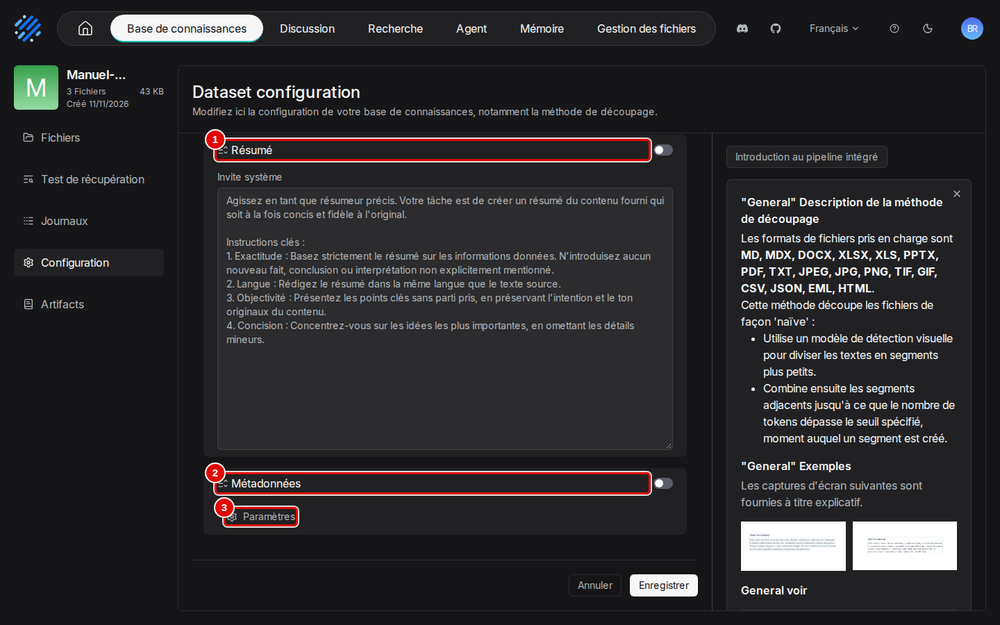

| N° | Élément | Rôle |
|---|---|---|
| 1 | « Résumé » | résumé de chaque passage par le modèle, avec son « Invite système » |
| 2 | « Métadonnées » | génération automatique de métadonnées pour les nouveaux fichiers |
| 3 | « Paramètres » | champs de métadonnées à extraire |

15. Onglet « Indexer » : ce qui est rangé dans les index de recherche.

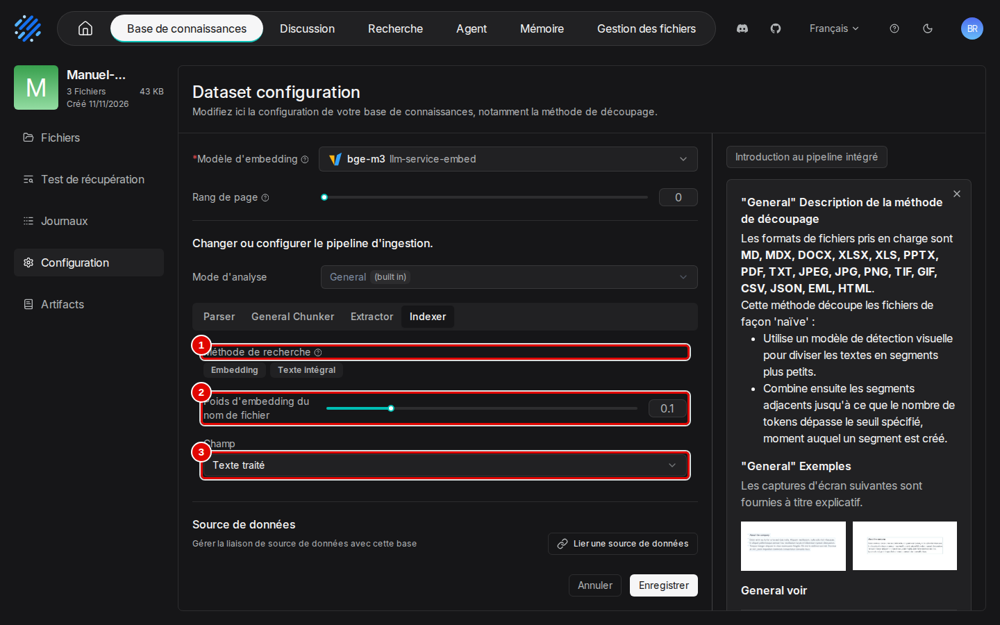

| N° | Élément | Rôle |
|---|---|---|
| 1 | « Méthode de recherche » | « Embedding » (vecteurs) et « Texte intégral » (mots-clés), les deux par défaut, pour la recherche hybride |
| 2 | « Poids d'embedding du nom de fichier » | part du nom de fichier dans le vecteur d'un passage, 0,1 par défaut |
| 3 | « Champ » | texte indexé, « Texte traité » par défaut |

16. Au bas de la page :

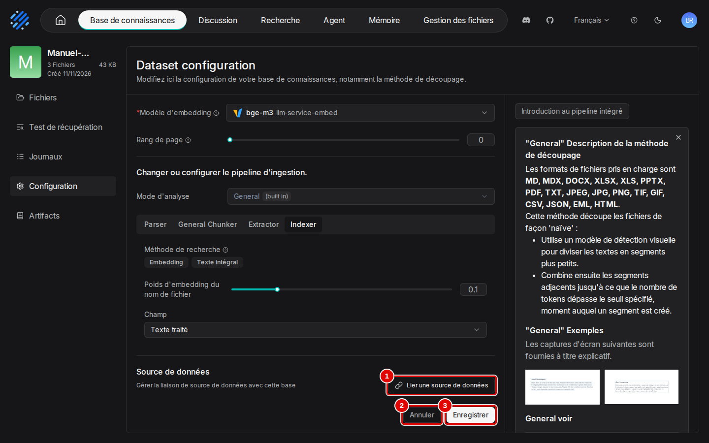

| N° | Élément | Rôle |
|---|---|---|
| 1 | « Lier une source de données » | synchronise la base avec une source externe (manuel [09](09-sources-externes.md)) |
| 2 | « Annuler » | abandonne les modifications |
| 3 | « Enregistrer » | enregistre la configuration |

17. Après « Enregistrer », le message « Mis à jour » confirme. Après rechargement de la page, la langue relue est « French » et la description est conservée. [Vérifié] (`outils/resultats/ragflow/captures/03-datasets-et-decoupage/scenario.log`)

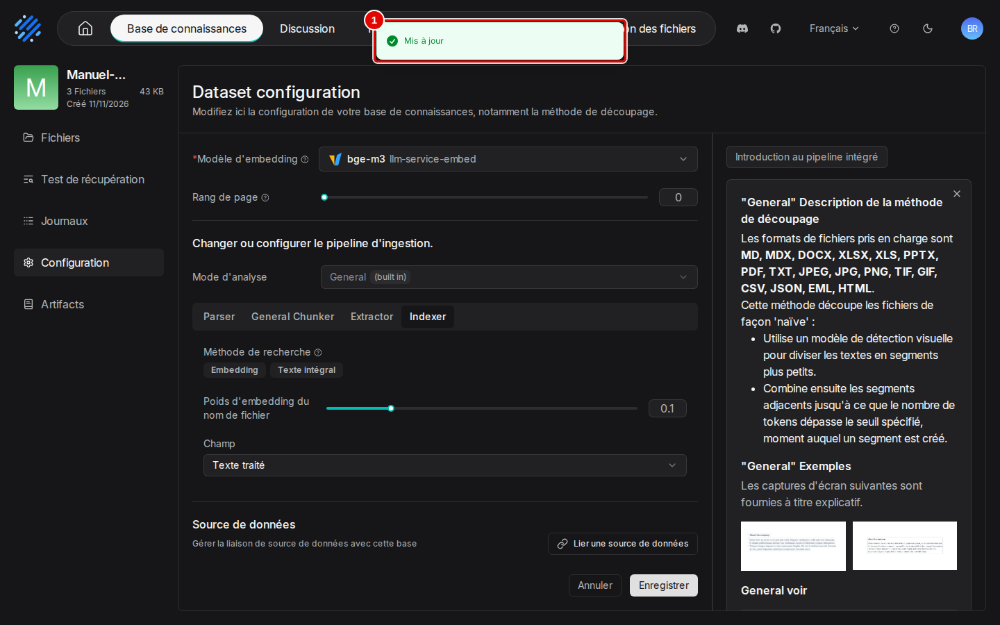

| N° | Élément | Rôle |
|---|---|---|
| 1 | « Mis à jour » | confirmation de l'enregistrement |

### Pour aller plus loin

- La langue « English » par défaut a été gardée dans tous les essais du banc ; son effet sur la recherche par mots-clés d'un corpus français est [À tester].
- Par l'API, le gabarit se choisit à la création : `rag.create_dataset(name="…", parser_id="paper")` [Testée] (`outils/ragflow/banc.py`).

## 6. L'onglet « Journaux »

### Essentiel

But : suivre les analyses d'une base et lire le détail d'une tâche, notamment pour comprendre un échec.

1. Cliquer sur « Journaux » dans le menu de gauche de la base.

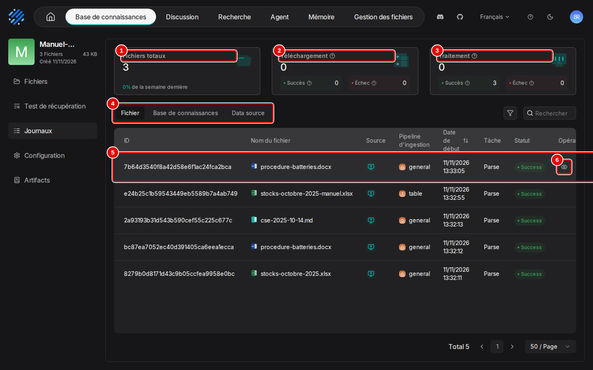

| N° | Élément | Rôle |
|---|---|---|
| 1 | « Fichiers totaux » | nombre de fichiers de la base |
| 2 | « Téléchargement » | fichiers en cours de récupération depuis une source de données, avec succès et échecs |
| 3 | « Traitement » | fichiers traités par le pipeline d'ingestion : succès et échecs |
| 4 | « Fichier », « Base de connaissances », « Data source » | journaux par fichier, des traitements portant sur toute la base (vide ici), ou des sources liées |
| 5 | ligne d'une tâche | identifiant, fichier, source, pipeline (« general », « table »), date, tâche « Parse », statut « Success » |
| 6 | œil | ouvre le détail de la tâche (au survol de la ligne) |

2. Le détail donne la durée et chaque étape du pipeline (Parser, GeneralChunker, Extractor, Tokenizer) avec son heure.

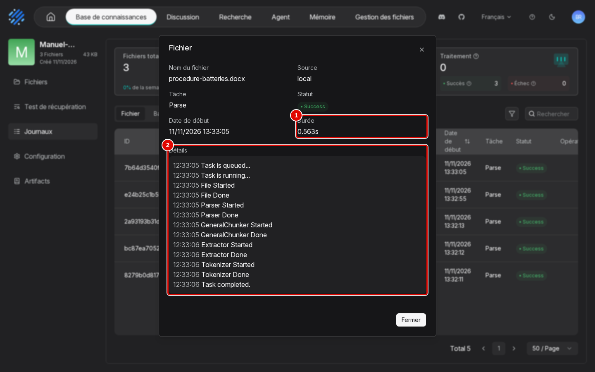

| N° | Élément | Rôle |
|---|---|---|
| 1 | « Durée » | durée totale de l'analyse du fichier |
| 2 | « Détails » | étapes horodatées ; en cas d'échec, le message d'erreur y figure |

## 7. La page « Gestion des fichiers »

### Essentiel

But : comprendre l'espace de fichiers commun à toutes les bases, y déposer un fichier dans un dossier et le relier à une base. Un même fichier peut ainsi alimenter plusieurs bases sans être téléversé plusieurs fois.

1. Cliquer sur « Gestion des fichiers » dans la barre du haut.

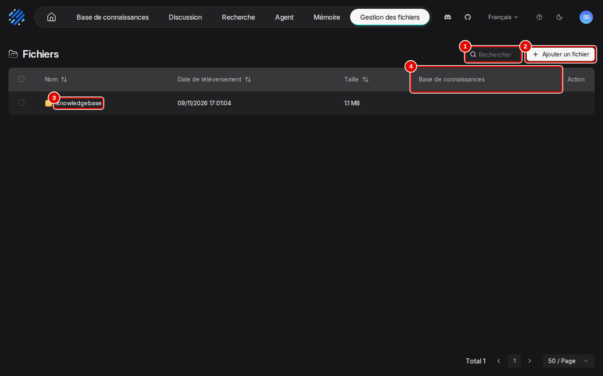

| N° | Élément | Rôle |
|---|---|---|
| 1 | « Rechercher » | filtre par nom |
| 2 | « Ajouter un fichier » | téléverse un fichier ou crée un dossier (étape 2) |
| 3 | « .knowledgebase » | dossier système qui contient les fichiers téléversés dans les bases |
| 4 | « Base de connaissances » | colonne des bases auxquelles chaque fichier est relié |

2. « Ajouter un fichier » propose deux entrées. Choisir « Nouveau dossier ».

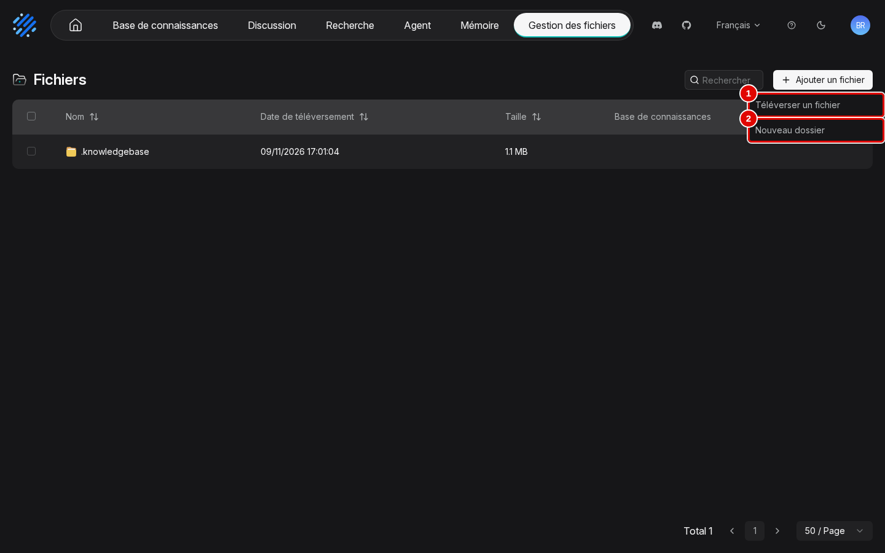

| N° | Élément | Rôle |
|---|---|---|
| 1 | « Téléverser un fichier » | dépose des fichiers dans le dossier courant |
| 2 | « Nouveau dossier » | crée un dossier |

3. Saisir le nom du dossier, puis « Enregistrer ».

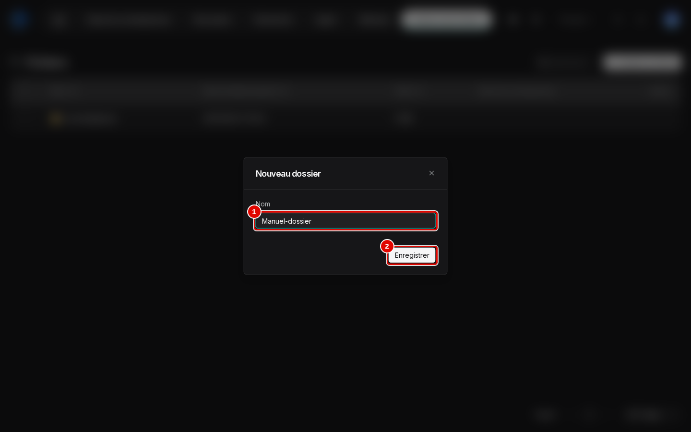

| N° | Élément | Rôle |
|---|---|---|
| 1 | « Nom » | nom du dossier, ici « Manuel-dossier » |
| 2 | « Enregistrer » | crée le dossier |

4. Ouvrir le dossier, puis « Ajouter un fichier », « Téléverser un fichier » ; choisir `faq-sav.html` et cliquer sur « Enregistrer ».

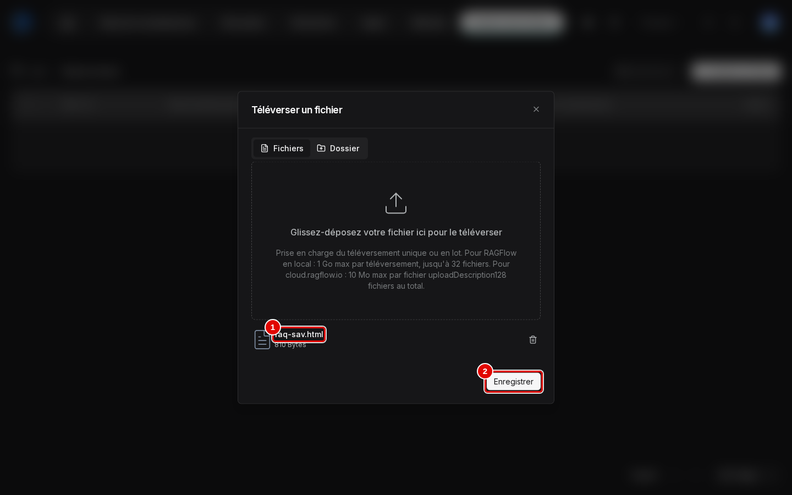

| N° | Élément | Rôle |
|---|---|---|
| 1 | « faq-sav.html » | fichier choisi |
| 2 | « Enregistrer » | dépose le fichier dans le dossier |

5. Survoler la ligne du fichier pour afficher ses actions.

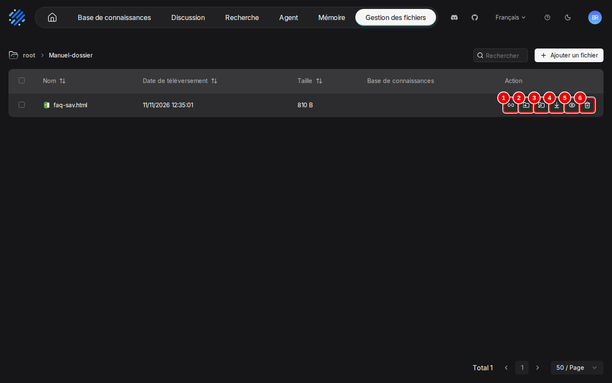

| N° | Élément | Rôle |
|---|---|---|
| 1 | maillon | « Lier à la base de connaissances » (étape 6) |
| 2 | dossier à flèche | « Déplacer » vers un autre dossier |
| 3 | dossier à crayon | « Renommer » |
| 4 | flèche vers le bas | télécharger |
| 5 | œil | aperçu du fichier |
| 6 | corbeille | supprimer |

6. Cliquer sur le maillon, ouvrir la liste « Nom », cocher la base « Manuel-Decoupage », puis « Fermer ».

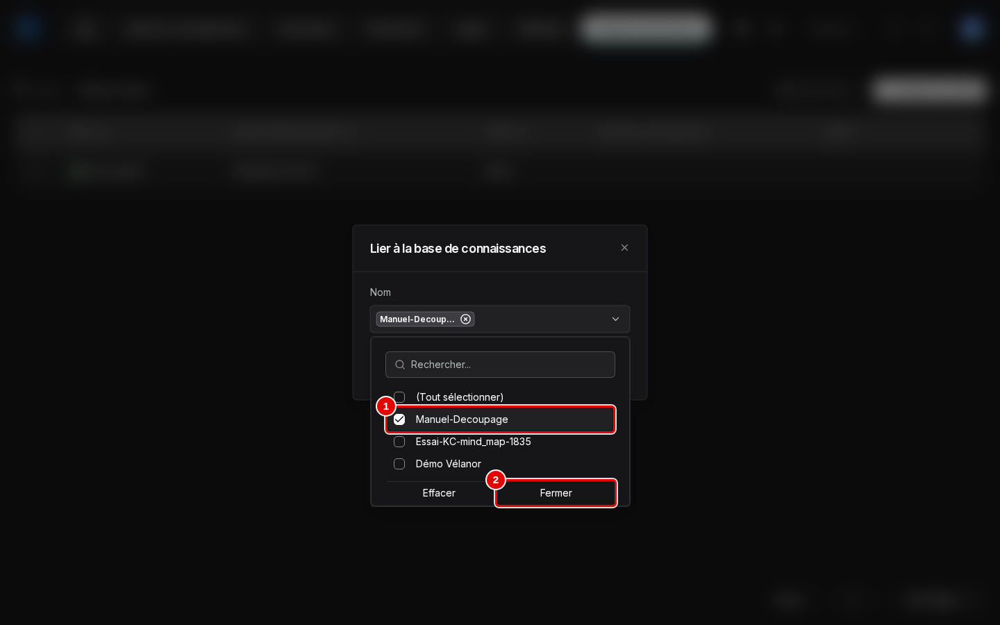

| N° | Élément | Rôle |
|---|---|---|
| 1 | « Manuel-Decoupage » | base à relier ; plusieurs bases peuvent être cochées |
| 2 | « Fermer » | referme la liste |

7. Cliquer sur « Save ».

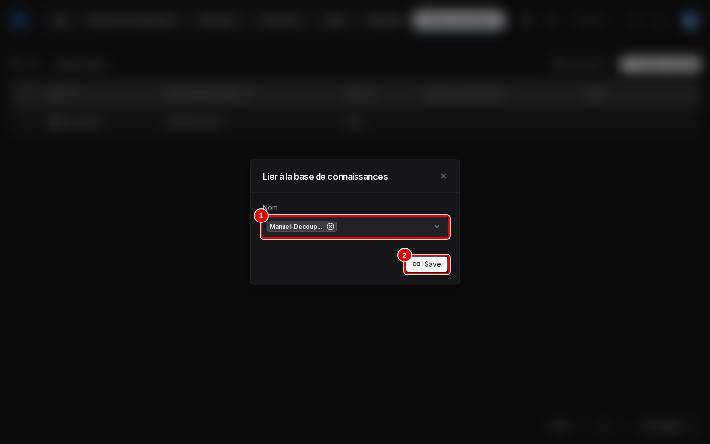

| N° | Élément | Rôle |
|---|---|---|
| 1 | « Manuel-Decoupage » | base choisie ; la croix la retire |
| 2 | « Save » | relie le fichier (libellé non traduit) |

8. La colonne « Base de connaissances » montre la liaison ; le fichier figure désormais aussi dans la page « Fichiers » de la base, à analyser comme les autres.

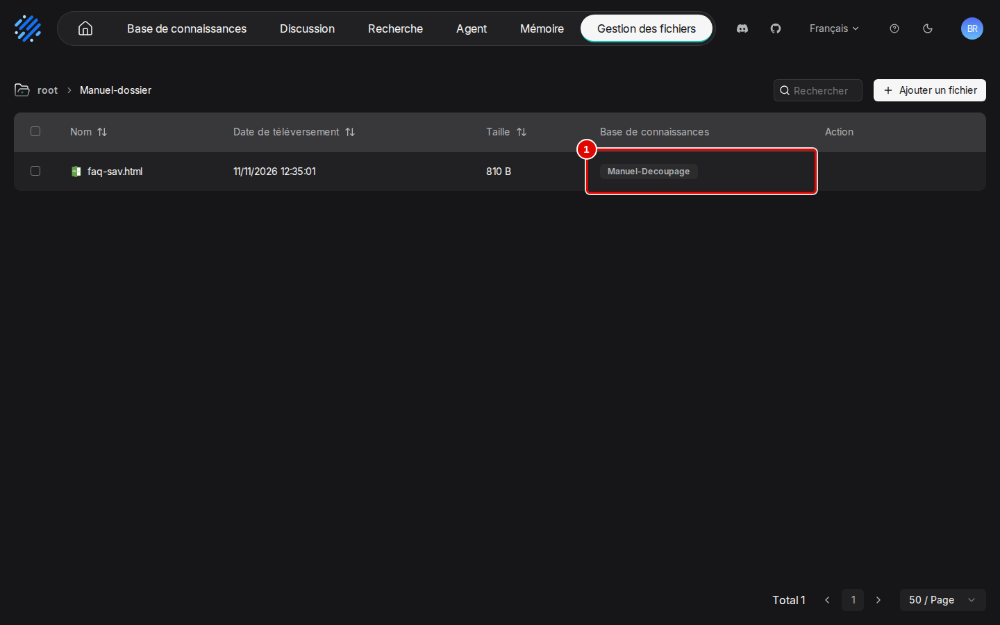

| N° | Élément | Rôle |
|---|---|---|
| 1 | « Manuel-Decoupage » | base reliée au fichier |

9. Pour finir, revenir à la racine, survoler « Manuel-dossier », cliquer sur sa corbeille et confirmer.

| N° | Élément | Rôle |
|---|---|---|
| 1 | fenêtre de confirmation | rappelle le dossier visé |
| 2 | « Supprimer » | supprime le dossier et son contenu |

### Pour aller plus loin

Le dossier `.knowledgebase` contient un sous-dossier par base, avec les fichiers téléversés depuis la page « Fichiers » de chaque base. [Vérifié] (`outils/resultats/ragflow/captures/carte/27-gestion-des-fichiers.txt` ; repérage du 11 novembre)

## 8. Les gabarits de RAGFlow 1.0

### Essentiel

Les douze gabarits intégrés sont aussi visibles, en lecture, dans « Agent », onglet « Ingestion pipeline », sous « Built-in pipelines ». Chacun y est un pipeline (Parser, Chunker, Extractor, Indexer) qui peut servir de modèle à un pipeline personnalisé (manuel [07](07-knowledge-compilation.md)).

| N° | Élément | Rôle |
|---|---|---|
| 1 | « Ingestion pipeline » | onglet des pipelines d'ingestion de la page « Agent » |
| 2 | « Built-in pipelines » | les douze gabarits intégrés ; l'icône de copie en fait un pipeline modifiable |
| 3 | « Table » | carte d'un gabarit, avec le début de sa description |

[Source] (`docs/references/http_api_reference.md` au tag v1.0.0) :

| Gabarit | `parser_id` | Usage prévu |
|---|---|---|
| General | `general` | tout document ; découpage par taille et par structure |
| Q&A | `qa` | paires question-réponse (tableur, texte) |
| Manual | `manual` | manuels techniques à sections numérotées |
| Table | `table` | tableurs : une ligne devient un passage |
| Paper | `paper` | articles et rapports structurés |
| Book | `book` | livres, chapitres longs |
| Laws | `laws` | textes juridiques à articles |
| Presentation | `presentation` | diaporamas : une diapositive ou une page par passage |
| Picture | `picture` | images (OCR, description par un modèle de vision) |
| One | `one` | document entier en un seul passage |
| Audio | `audio` | transcription d'un fichier audio |
| Email | `email` | courriels |

### Pour aller plus loin

Les anciens gabarits `tag` et `knowledge_graph` de la branche 0.x ne figurent plus dans la liste. Un pipeline personnalisé (`parse_type=2` par l'API) remplace le gabarit ; c'est le chemin de la Knowledge Compilation. [Source] (`docs/references/http_api_reference.md`)

## 9. Gabarits comparés sur le corpus

### Essentiel

Le corpus a été indexé quatre fois, une base par gabarit. Nombre de passages (et de jetons) par document [Vérifié] :

| Document | General | Paper | Presentation | Table |
|---|---|---|---|---|
| `rapport-annuel-2025.pdf` (10 pages, tableaux) | 9 (871) | 13 (879) | 27 (907) | 9 (871) |
| `contrat-batterix-scan.pdf` (2 pages scannées) | 1 (258) | 1 (258) | 11 (278) | 1 (258) |
| `supplier-audit-batterix-en.pdf` | 1 (123) | 1 (123) | 6 (133) | 1 (123) |
| `stocks-octobre-2025.xlsx` | 2 (177) | 2 (177) | 2 (177) | 10 (345) |
| `strategie-2026.pptx` | 5 (149) | 5 (149) | 5 (149) | 5 (149) |
| `procedure-batteries.docx` | 2 (235) | 2 (235) | 2 (235) | 2 (235) |
| `cse-2025-10-14.md`, `faq-sav.html`, `message-vocal-production.mp3` | 4, 1, 1 | idem | idem | idem |
| **Total** | **26** | **30** | **59** | **34** |

Indexation du corpus complet : 53 à 56 s quel que soit le gabarit. [Vérifié] (`outils/resultats/ragflow/banc-2026-11-09-{defaut,gabarit-paper,gabarit-presentation,gabarit-table}.json`, champ `indexation`) Le passage du tableur de 2 à 10 passages avec « Table » se retrouve à la souris en section 3.

### Pour aller plus loin

- Un gabarit n'agit que sur les formats qu'il sait traiter : Paper et Presentation redécoupent les PDF, Table redécoupe le tableur ; Markdown, HTML, DOCX, PPTX et audio gardent leur découpage. Dans une base « General », le diaporama est même traité d'office par le gabarit Presentation. [Vérifié] (même source ; `outils/resultats/ragflow/captures/carte/05-base-fichiers.txt`)
- Presentation coupe un PDF page par page, même un rapport : 27 passages plus courts pour le rapport annuel.
- Table fait d'une ligne de tableur un passage : 10 passages et deux fois plus de jetons pour le classeur de stocks ; l'écart de jetons viendrait de la répétition des en-têtes de colonnes dans chaque passage [Estimation].

## 10. Effet sur le banc

### Essentiel

Mêmes 38 questions, même modèle, réglages d'assistant par défaut [Vérifié] :

| Gabarit | Exactes (34) | Refus corrects (4) | Bon document cité | Médiane | Résultat brut |
|---|---|---|---|---|---|
| General | 33 | 4 | 34 | 1,28 s | [banc défaut](../../outils/resultats/ragflow/banc-2026-11-09-defaut.md) |
| Paper | 33 | 4 | 34 | 1,19 s | [banc Paper](../../outils/resultats/ragflow/banc-2026-11-09-gabarit-paper.md) |
| Table | 33 | 4 | 34 | 1,26 s | [banc Table](../../outils/resultats/ragflow/banc-2026-11-09-gabarit-table.md) |
| Presentation | 32 | 4 | 33 | 1,18 s | [banc Presentation](../../outils/resultats/ragflow/banc-2026-11-09-gabarit-presentation.md) |

Sur ce corpus court, le gabarit change peu le résultat : General suffit. Presentation perd la question en anglais Q29 (taux de défaut des cellules) : l'assistant répond « not found » ; le découpage de l'audit en six morceaux en est la cause probable [Estimation].

### Pour aller plus loin

La seule question manquée avec General, Paper et Table est Q30 (délai contractuel de Batterix croisé avec le délai constaté) : le modèle trouve le délai constaté mais déclare le délai contractuel absent, alors qu'il figure dans le contrat scanné. Ce n'est pas un problème de découpage : le réglage de la recherche le corrige (manuel [05](05-assistants-et-citations.md)).

## Dépannage

| Symptôme | Cause probable | Action |
|---|---|---|
| Une question sur un document court en anglais ne trouve plus rien après passage à Presentation | passages trop petits, page par page | revenir à General ou Paper pour ce type de document |
| Le gabarit choisi ne change rien pour un fichier | le gabarit ne traite pas ce format (Markdown, HTML, DOCX, PPTX, audio) | normal ; voir la section 9 |
| Un réglage de « Configuration » n'a pas d'effet sur les passages existants | les réglages ne s'appliquent qu'aux analyses suivantes | relancer l'analyse des fichiers (section 3, étape 7) |
| Les corrections manuelles de passages ont disparu | analyse relancée ou gabarit changé : passages effacés puis recalculés | refaire les corrections après la relance, ou ne pas relancer |
| La fenêtre de liaison d'un fichier affiche « Save » au lieu d'« Enregistrer » | libellé non traduit en v1.0.0 | sans conséquence |

## Sources

- Scénario : `outils/ragflow/captures/manuels_03_06.py` (scénario `decoupage`, phases `base`, `fichiers`, `gabarit`, `groupe`, `config`, `journaux`, `gestion`, `pipelines`), lancé par `outils/communs/captures/lancer.sh` ; nettoyage : `outils/ragflow/nettoyer_manuel.py`
- Images : `docs/ragflow/img/03-datasets-et-decoupage/` ; textes des pages et déroulé : `outils/resultats/ragflow/captures/03-datasets-et-decoupage/`
- Bancs : `outils/resultats/ragflow/banc-2026-11-09-*.json` ; script `outils/ragflow/serie_banc.sh`, adaptateur `outils/ragflow/banc.py`
- Libellés et bulles d'aide : `web/src/locales/fr.ts` et `en.ts` au tag v1.0.0 ; référence de l'API : `docs/references/http_api_reference.md` ; https://ragflow.io/docs/
