# 04. DeepDoc et correction des passages

> **Objet** : savoir ce que DeepDoc lit dans un scan et dans un tableau, ce que cela coûte, et, à la souris, lire, désactiver, compléter et corriger les passages d'un document dans la vue « Résultat du segment ».
> **Prérequis** : [prise en main](02-prise-en-main.md), [datasets et découpage](03-datasets-et-decoupage.md).
> **Version décrite** : RAGFlow v1.0.0 (image `infiniflow/ragflow:v1.0.0`), Windows 11 + WSL2 (Ubuntu 24.04), LLM-Service branche `service-vllm` (vLLM 0.29.0 : `gemma4:e4b`, `bge-m3`), contexte déclaré de 16 384 jetons.
> **Statut des informations** : [Vérifié] observé ou mesuré les 9 et 11 novembre 2026 sur la machine d'essai (Ryzen 5 9600X, 32 Go, RTX 4060 Ti 16 Go) ; [Source] documentation officielle ou code source au tag v1.0.0 ; [Estimation] calcul non mesuré ; [À tester] non documenté et non essayé.
> **Précautions** : essais dans une base dédiée « Manuel-DeepDoc » créée à la souris par le scénario de captures, puis supprimée (`outils/ragflow/nettoyer_manuel.py`) ; la base de démonstration n'est pas modifiée. Une nouvelle analyse d'un document efface ses passages, corrections et ajouts manuels compris.

**Défaut observé** : dans RAGFlow v1.0.0, modifier le texte d'un passage issu du PDF scanné puis cliquer sur « Confirmer » reste sans effet : la fenêtre « Modifier le segment » reste ouverte et aucune requête n'est envoyée au serveur. Le même geste sur un passage issu d'un fichier Markdown est enregistré. Contournements : ajouter un passage corrigé (section 4) ou corriger par l'API (section 5). [Vérifié] (`outils/resultats/ragflow/captures/04-deepdoc/scenario.log`)

Toutes les captures viennent d'un seul passage du scénario `deepdoc` de `outils/ragflow/captures/manuels_03_06.py`. Le texte de chaque page capturée est dans `outils/resultats/ragflow/captures/04-deepdoc/` (même nom que l'image), le déroulé, les durées et les requêtes observées dans `scenario.log`. [Vérifié]

## Sommaire

1. [Ce que fait DeepDoc](#1-ce-que-fait-deepdoc)
2. [Analyser un scan et lire son journal](#2-analyser-un-scan-et-lire-son-journal)
3. [Lire les passages](#3-lire-les-passages)
4. [Corriger, désactiver, ajouter un passage](#4-corriger-désactiver-ajouter-un-passage)
5. [Effet mesuré d'une correction](#5-effet-mesuré-dune-correction)
6. [Les tableaux](#6-les-tableaux)
7. [Analyseurs PDF, images et modèle de vision](#7-analyseurs-pdf-images-et-modèle-de-vision)
8. [Dépannage](#dépannage)
9. [Sources](#sources)

## 1. Ce que fait DeepDoc

### Essentiel

DeepDoc est l'analyseur de documents de RAGFlow : OCR des pages image, reconnaissance de la mise en page (titres, paragraphes, colonnes), structure des tableaux. Ses modèles (format ONNX) sont dans l'image et tournent sur CPU, dans le conteneur `rag-ragflow-server` ; aucun téléchargement n'a lieu au premier usage. [Source] (`Dockerfile`, lignes 25 à 50) Il est choisi dans l'onglet « Configuration » de la base, bloc « PDF », « Analyseur PDF » : « DeepDOC » (section 7).

### Pour aller plus loin

Pendant l'analyse du corpus complet, la RAM du serveur monte de 0,6 à 2,0 Gio : c'est surtout DeepDoc. [Vérifié] (`outils/resultats/ragflow/banc-2026-11-09-defaut.json`, `pic_ram_mo`)

## 2. Analyser un scan et lire son journal

### Essentiel

But : importer le contrat scanné `contrat-batterix-scan.pdf` (2 pages rendues en image, légère rotation et bruit) dans la base « Manuel-DeepDoc », avec le compte rendu `cse-2025-10-14.md` qui sert de point de comparaison en section 4. L'import se fait comme au manuel [03](03-datasets-et-decoupage.md), section 2, avec « Analyser à la création » activé.

1. Juste après l'envoi, les deux fichiers sont en file d'attente.

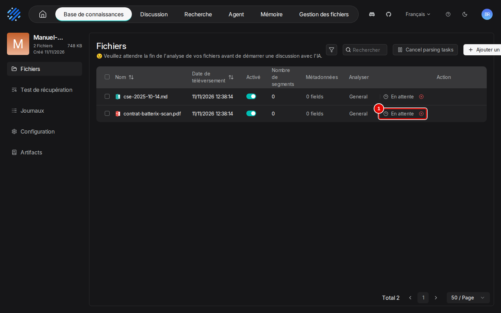

| N° | Élément | Rôle |
|---|---|---|
| 1 | « En attente » | tâche en file ; devient une barre de progression pendant l'analyse ; la croix rouge annule la tâche |

2. L'analyse terminée, le scan donne un seul passage. Cliquer sur le point d'état ouvre le journal de l'analyse.

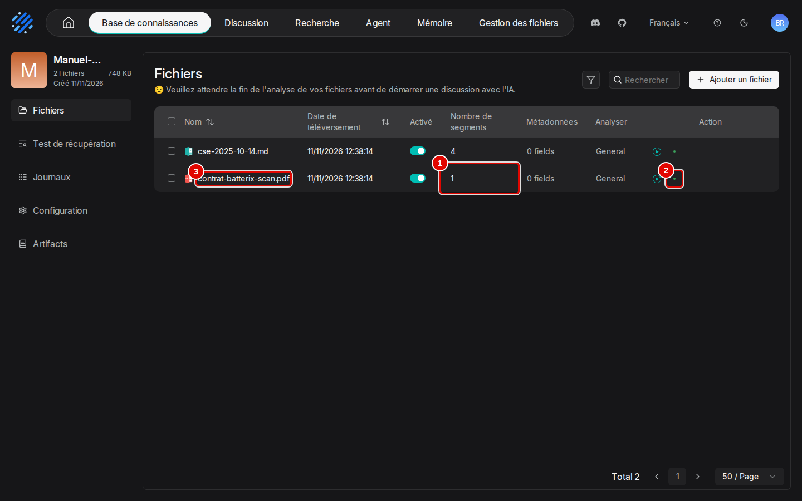

| N° | Élément | Rôle |
|---|---|---|
| 1 | « Nombre de segments » | 1 passage pour les 2 pages du contrat |
| 2 | point d'état | vert : réussite ; ouvre le journal (étape 3) |
| 3 | « contrat-batterix-scan.pdf » | nom du fichier ; un clic ouvre ses passages (section 3) |

3. Le journal donne la durée et le détail des étapes : ici 10,8 s, dont 10 s pour la lecture (« Parser Started » à 12:38:14, « Parser Done » à 12:38:24), soit environ 5 s par page. [Vérifié] (`outils/resultats/ragflow/captures/04-deepdoc/scenario.log`)

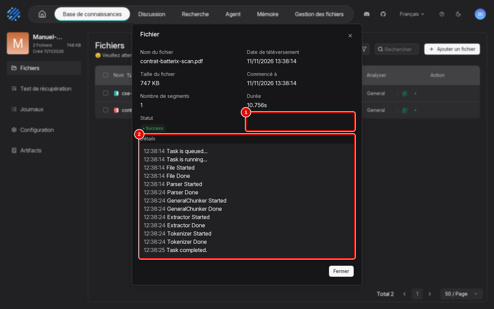

| N° | Élément | Rôle |
|---|---|---|
| 1 | « Durée » | durée totale de la tâche |
| 2 | « Détails » | étapes horodatées du pipeline : lecture (Parser), découpage (GeneralChunker), enrichissement (Extractor), indexation (Tokenizer) |

### Pour aller plus loin

| Mesure | Valeur | Source |
|---|---|---|
| Durée d'analyse du scan, seul dans sa base, par l'API (9 novembre) | 9,3 s, soit 4,7 s par page | `outils/resultats/ragflow/essai-2026-11-09-passages.log` |
| Même scan importé à la souris (11 novembre) | 10,8 s, dont 10 s de lecture | `outils/resultats/ragflow/captures/04-deepdoc/scenario.log` |
| Passages produits | 1 (258 jetons) | `outils/resultats/ragflow/banc-2026-11-09-defaut.json` |
| Questions du banc sur ce scan (Q15 à Q18) | 4 bonnes réponses sur 4, bonne page citée | même fichier |

L'OCR tourne sur CPU : compter environ 5 s par page scannée sur cette machine, davantage si d'autres analyses tournent en même temps. Pour comparaison, Open Notebook 1.15.1 ne lisait pas ce scan (0 question sur 4) : voir le [comparatif](../README.md).

## 3. Lire les passages

### Essentiel

But : vérifier ce que l'OCR a lu, avant de s'y fier.

1. Dans « Fichiers », cliquer sur `contrat-batterix-scan.pdf`. La vue « Résultat du segment » s'ouvre en plein écran : le document à gauche, ses passages à droite.

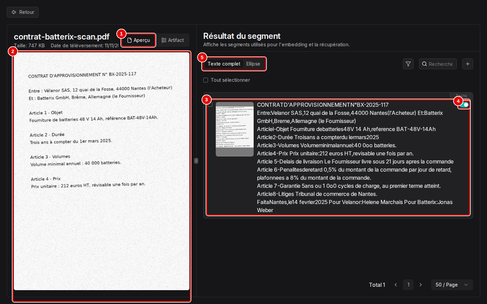

| N° | Élément | Rôle |
|---|---|---|
| 1 | « Aperçu » | affiche le document d'origine ; « Artifact », à côté, est décrit au manuel [07](07-knowledge-compilation.md) |
| 2 | page du document | image de la page ; un clic sur un passage surligne sa zone dans la page |
| 3 | passage | texte lu par l'OCR, avec la vignette de sa page ; le type (« Texte ») est indiqué en haut à droite |
| 4 | interrupteur du passage | active ou désactive ce seul passage (section 4) |
| 5 | « Texte complet », « Ellipse » | affiche les passages en entier ou abrégés |

2. Les outils au-dessus des passages :

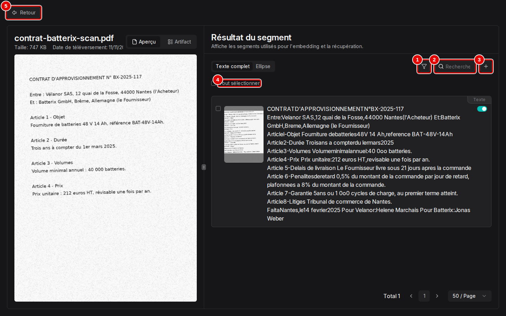

| N° | Élément | Rôle |
|---|---|---|
| 1 | filtre (entonnoir) | « Tous », « Activé », « Désactivé » (section 4, étape 5) |
| 2 | « Recherche » | cherche un texte dans les passages du document |
| 3 | « + » | ajoute un passage à la main (section 4, étape 6) |
| 4 | « Tout sélectionner » | coche tous les passages pour une action groupée |
| 5 | « Retour » | revient à la liste des fichiers |

### Pour aller plus loin

L'OCR est exploitable mais imparfait : espaces perdus (« CONTRATD'APPROVISIONNEMENTN° », « debatteries48V »), « l » lu à la place de « 1 » (« Articlel »), « o » à la place de « 0 » (« 40 0oo batteries », « 1 0o0 cycles »). Le modèle de réponse rétablit souvent le sens (« 40 000 unités » est bien répondu), mais une recherche qui dépend du nombre exact est pénalisée (section 5). [Vérifié] (`outils/resultats/ragflow/essai-2026-11-09-passages.log`, `outils/resultats/ragflow/captures/04-deepdoc/05-resultat-du-segment.txt`)

## 4. Corriger, désactiver, ajouter un passage

### Essentiel

But : remettre au propre une information mal lue. Avant toute correction, le « Test de récupération » de la base (manuel [05](05-assistants-et-citations.md)) mesure à quel point le passage remonte pour la question visée.

1. Onglet « Test de récupération », question « volume minimal annuel de 40 000 batteries », bouton « Test ». Le passage OCR obtient 34,55 en similarité hybride (15,07 en mots-clés, 80,01 en vecteurs) : les mots collés par l'OCR ne correspondent pas aux mots de la question. [Vérifié] (`outils/resultats/ragflow/captures/04-deepdoc/scenario.log`)

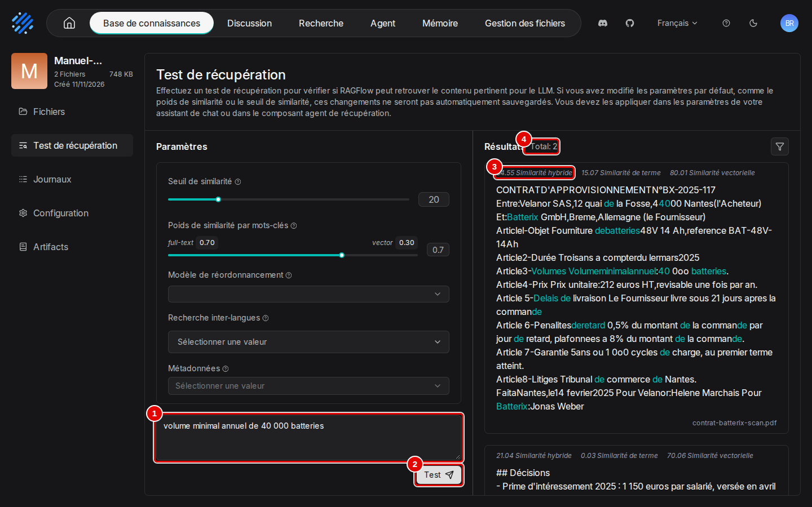

| N° | Élément | Rôle |
|---|---|---|
| 1 | question | texte cherché |
| 2 | « Test » | lance la recherche, sans le modèle de chat |
| 3 | « Similarité hybride » | score du passage du contrat, 34,55, suivi des scores de mots-clés et de vecteurs |
| 4 | « Total » | nombre de passages au-dessus du seuil |

2. Revenir aux passages du scan et double-cliquer sur le texte du passage : la fenêtre « Modifier le segment » s'ouvre.

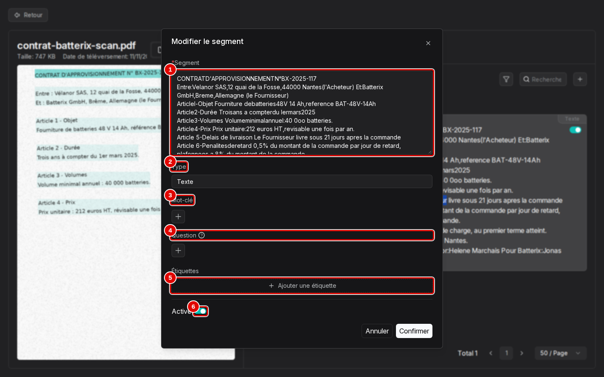

| N° | Élément | Rôle |
|---|---|---|
| 1 | « Segment » | texte du passage, modifiable |
| 2 | « Type » | type du passage (« Texte », « Tableau », « Image »), non modifiable |
| 3 | « Mot-clé » | mots-clés ajoutés à la main ; le « + » en ajoute un ; ils font remonter le passage pour les questions qui les contiennent |
| 4 | « Question » | questions associées ; s'il y en a, l'embedding du passage se fonde sur elles |
| 5 | « Étiquettes » | étiquettes du passage (« Ajouter une étiquette ») |
| 6 | « Activé » | active ou désactive le passage |

3. Sélectionner « Volumeminimalannuel:40 0oo » dans le texte et taper « Volume minimal annuel : 40 000 », puis cliquer sur « Confirmer ».

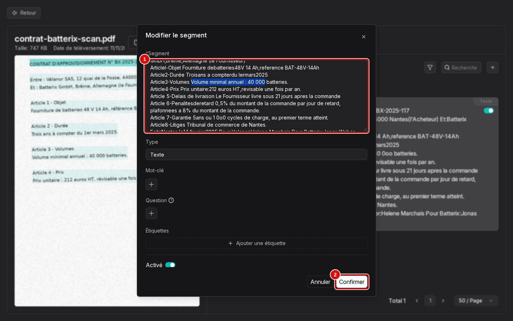

| N° | Élément | Rôle |
|---|---|---|
| 1 | « Segment » | texte corrigé, sélectionné |
| 2 | « Confirmer » | doit enregistrer la modification |

4. Dans RAGFlow v1.0.0, pour ce passage du PDF, la fenêtre reste ouverte et rien n'est enregistré (défaut signalé en tête du manuel). Cliquer sur « Annuler », puis passer par l'étape 6 (passage ajouté) ou par l'API (section 5). [Vérifié] (`outils/resultats/ragflow/captures/04-deepdoc/scenario.log` : « requêtes après « Confirmer » (passage du PDF modifié) : [] ; fenêtre encore ouverte : True »)

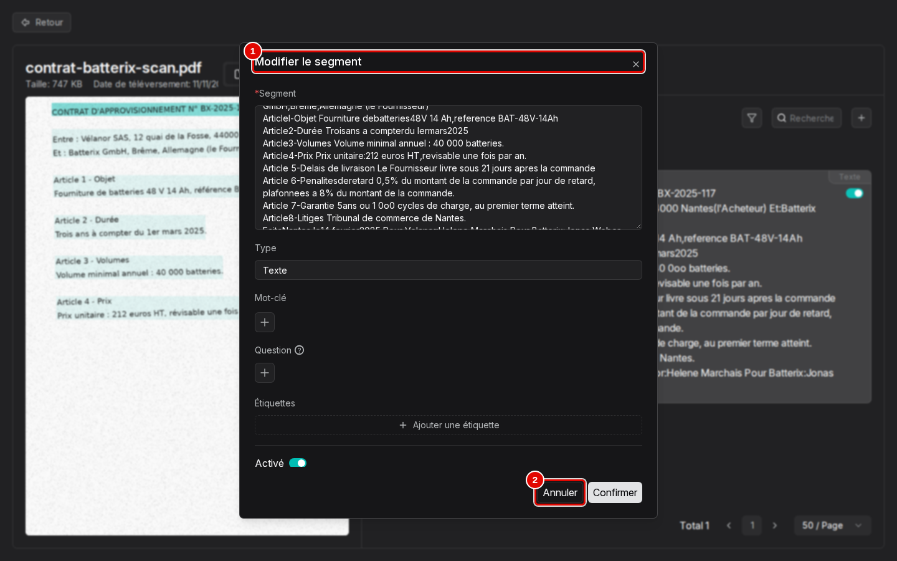

| N° | Élément | Rôle |
|---|---|---|
| 1 | « Modifier le segment » | fenêtre restée ouverte après « Confirmer » |
| 2 | « Annuler » | referme la fenêtre sans rien changer |

5. Pour écarter un passage faux des réponses sans le supprimer, cliquer sur son interrupteur. Le filtre retrouve ensuite les passages désactivés. Le scénario réactive le passage juste après.

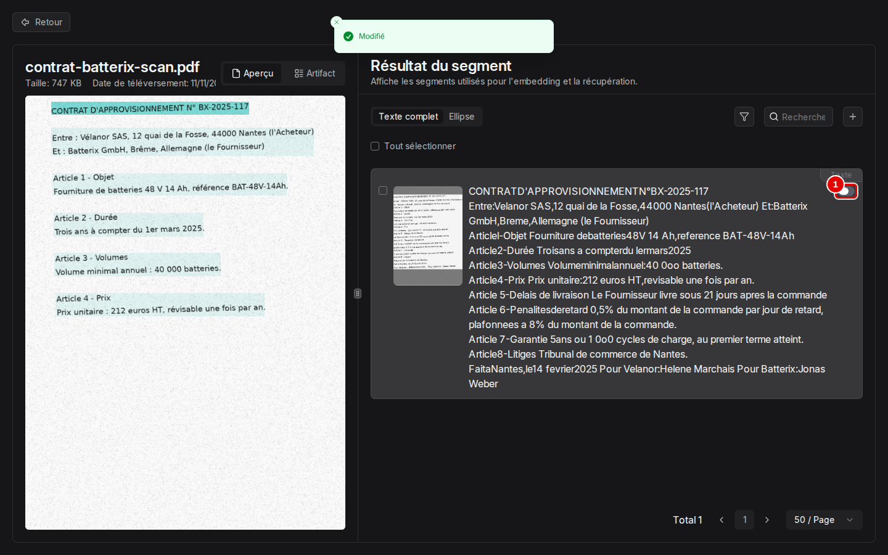

| N° | Élément | Rôle |
|---|---|---|
| 1 | interrupteur du passage | gris : passage désactivé, absent des recherches |

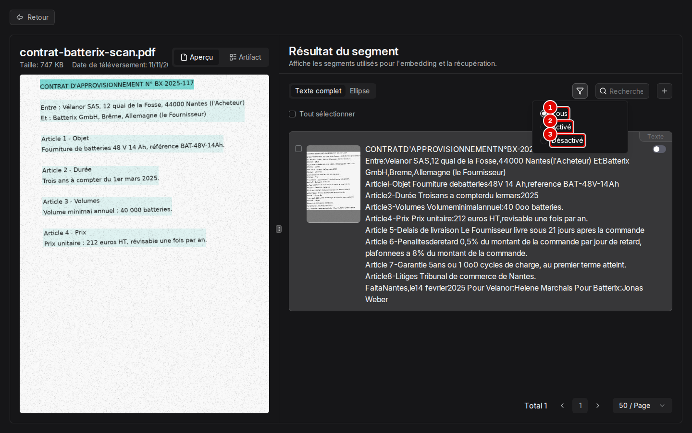

| N° | Élément | Rôle |
|---|---|---|
| 1 | « Tous » | tous les passages |
| 2 | « Activé » | seulement les passages actifs |
| 3 | « Désactivé » | seulement les passages écartés, pour les retrouver et les réactiver |

6. Cliquer sur « + » pour ajouter un passage écrit à la main, avec la bonne information, un mot-clé et une question. Cliquer sur « Confirmer ».

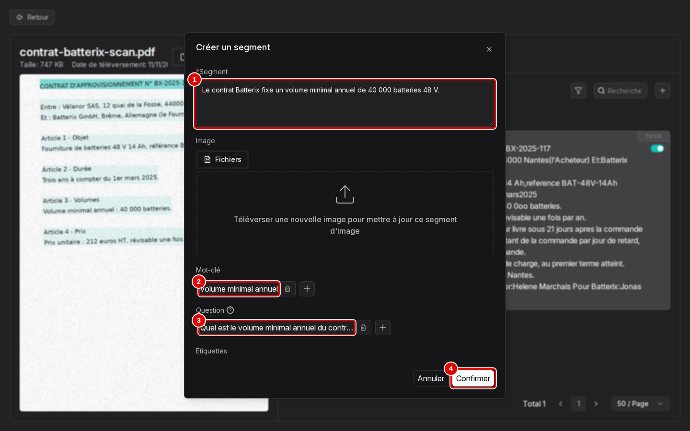

| N° | Élément | Rôle |
|---|---|---|
| 1 | « Segment » | texte du passage : « Le contrat Batterix fixe un volume minimal annuel de 40 000 batteries 48 V. » |
| 2 | « volume minimal annuel » | mot-clé ajouté par le « + » de « Mot-clé », validé par Entrée |
| 3 | « Quel est le volume minimal annuel du contrat Batterix ? » | question associée |
| 4 | « Confirmer » | crée le passage ; la zone « Image » au-dessus permet d'y joindre une image |

7. Le passage s'ajoute au document : 2 passages au total.

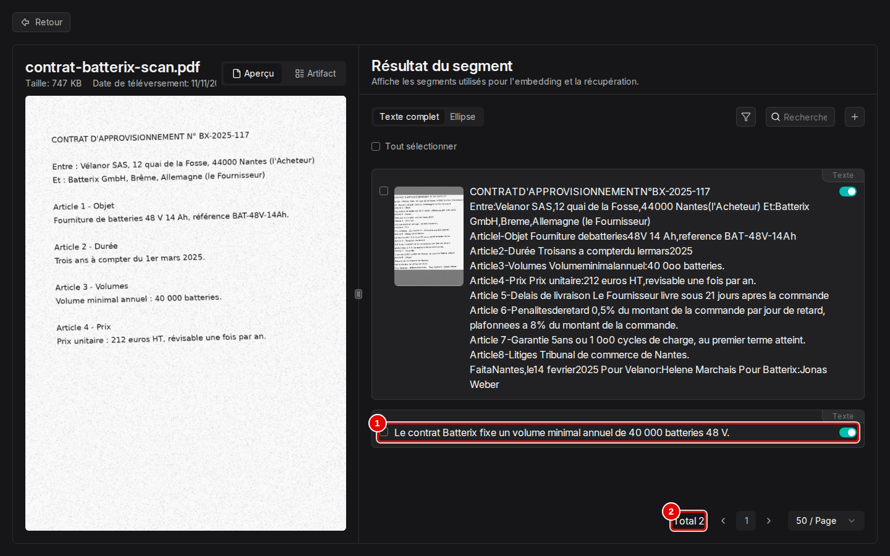

| N° | Élément | Rôle |
|---|---|---|
| 1 | passage ajouté | texte saisi, rattaché au même document |
| 2 | « Total 2 » | nombre de passages du document |

8. « Tout sélectionner » fait apparaître les actions groupées sur les passages cochés.

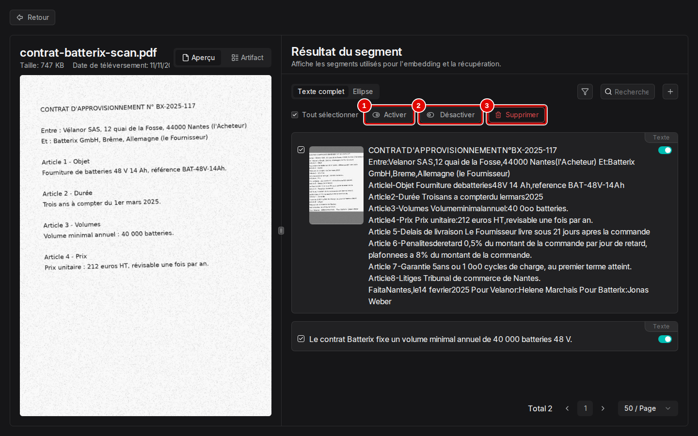

| N° | Élément | Rôle |
|---|---|---|
| 1 | « Activer » | active les passages cochés |
| 2 | « Désactiver » | les désactive |
| 3 | « Supprimer » | les supprime |

9. « Recherche » retrouve les passages contenant un texte, ici « 40 000 » : les deux passages répondent (le texte OCR contient « 40 »).

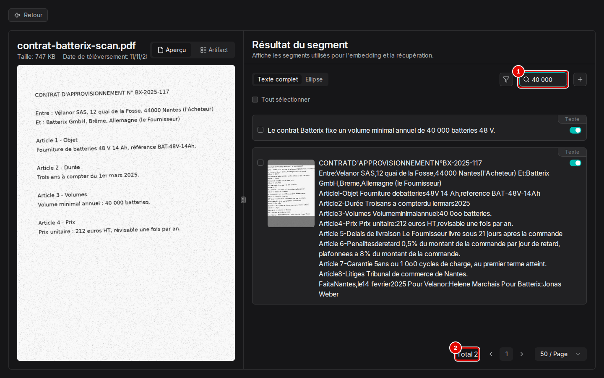

| N° | Élément | Rôle |
|---|---|---|
| 1 | « Recherche » | texte cherché |
| 2 | « Total 2 » | passages trouvés |

10. « Ellipse » abrège chaque passage à ses premières lignes, pour parcourir un document long.

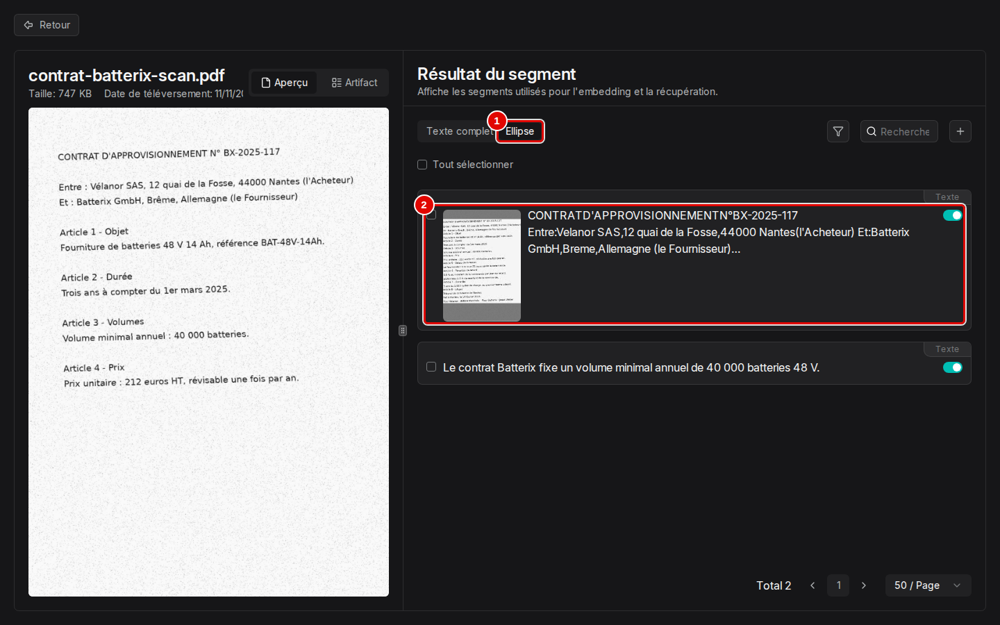

| N° | Élément | Rôle |
|---|---|---|
| 1 | « Ellipse » | affichage abrégé ; « Texte complet » rétablit l'affichage entier |
| 2 | passage abrégé | passage du contrat réduit à ses premières lignes |

11. Revenir au « Test de récupération » avec la même question : le passage ajouté arrive en tête avec 83,17 en similarité hybride (82,28 en mots-clés, 85,24 en vecteurs), devant le passage OCR inchangé à 34,55. [Vérifié] (`outils/resultats/ragflow/captures/04-deepdoc/scenario.log`)

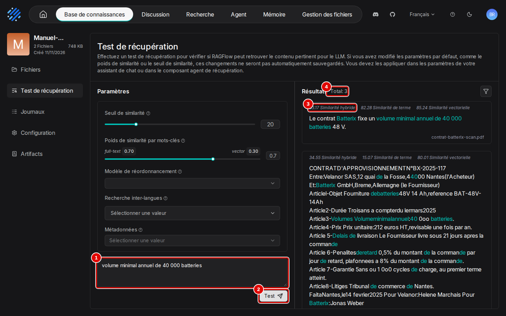

| N° | Élément | Rôle |
|---|---|---|
| 1 | question | même question qu'à l'étape 1 |
| 2 | « Test » | relance la recherche |
| 3 | « Similarité hybride » | 83,17 pour le passage ajouté, rattaché à `contrat-batterix-scan.pdf` |
| 4 | « Total: 3 » | passages au-dessus du seuil |

12. Pour comparaison, la même modification sur un passage du fichier Markdown est enregistrée : double-clic sur le passage « Décisions » de `cse-2025-10-14.md`, ajout du mot-clé « prime d'intéressement », « Confirmer ». La fenêtre se ferme, une requête `PATCH …/chunks/…` part au serveur et le mot-clé est relu après rechargement. [Vérifié] (même journal)

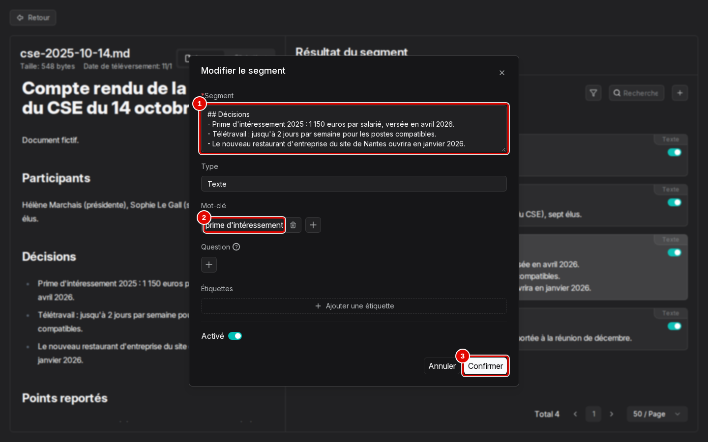

| N° | Élément | Rôle |
|---|---|---|
| 1 | « Segment » | texte du passage Markdown |
| 2 | « prime d'intéressement » | mot-clé ajouté |
| 3 | « Confirmer » | enregistre la modification (ici avec succès) |

### Pour aller plus loin

Un passage ajouté à la main appartient au document : une nouvelle analyse du document l'efface, comme les corrections, d'après la confirmation de relance (« Are you sure to clear chunks to re-parse? », manuel [03](03-datasets-et-decoupage.md), section 3). [Source] (`web/src/locales/fr.ts`, clé `redo`)

## 5. Effet mesuré d'une correction

### Essentiel

La correction du texte même du passage OCR a été faite par l'API le 9 novembre [Testée] :

| Action | Appel |
|---|---|
| Lister | `GET /api/v1/datasets/{base}/documents/{doc}/chunks` |
| Corriger le texte | `PATCH …/chunks/{passage}` avec `{"content": "…"}` |
| Désactiver, réactiver | `PATCH …/chunks` avec `{"chunk_ids": […], "available_int": 0}` (ou 1) |
| Ajouter un passage manuel | `POST …/chunks` avec `{"content": "…", "important_keywords": […]}` |

Effet mesuré sur la recherche « volume minimal annuel de 40 000 batteries » [Vérifié] :

| État du passage | Similarité du passage du contrat |
|---|---|
| texte OCR d'origine (« Volumeminimalannuel:40 0oo ») | 0,346 (34,55 affiché à la souris le 11 novembre) |
| texte corrigé (« Volume minimal annuel : 40 000 ») | 0,607 |
| passage désactivé | absent des résultats |
| passage ajouté à la souris, avec mot-clé et question (section 4) | 83,17 sur 100 pour le passage ajouté |

(`outils/resultats/ragflow/essai-2026-11-09-passages.log`, script `outils/ragflow/essai_passages.py` ; `outils/resultats/ragflow/captures/04-deepdoc/scenario.log`)

### Pour aller plus loin

La correction est relue immédiatement par l'API et prise en compte par la recherche sans réanalyse. Un passage ajouté par l'API s'ajoute au document (2 passages ensuite). [Vérifié] (`outils/resultats/ragflow/essai-2026-11-09-passages.log`)

## 6. Les tableaux

### Essentiel

Les tableaux du rapport annuel sont restitués sous forme de tableau (lignes et colonnes) dans le passage, avec leur titre. Le test de récupération montre par exemple le tableau « 5. Effectifs par site » (Nantes 268, Cholet 97, Lyon 31, Bruxelles 16, total 412). Les dix questions de type tableau du banc obtiennent la bonne réponse. [Vérifié] (`outils/resultats/ragflow/banc-2026-11-09-defaut.json` ; texte de la page archivé dans `outils/resultats/ragflow/preuves-2026-11-09/textes-captures/`)

### Pour aller plus loin

L'affichage du test de récupération laisse voir des restes de balises autour des titres de tableaux (« ption>7. Fournisseurs principaux », « r>d>Batterix GmbHd>d>Batteriesd>d>24d>r> ») : le passage contient du HTML, mal rendu à l'écran. Sans effet observé sur les réponses. [Vérifié] (même source ; `outils/resultats/ragflow/captures/05-assistants-et-citations/20-test-resultats.txt`)

## 7. Analyseurs PDF, images et modèle de vision

### Essentiel

Dans l'onglet « Configuration » de la base, bloc « PDF », la liste « Analyseur PDF » propose six moteurs. Seul « DeepDOC » a été essayé ; « Naïf » lit le texte du PDF sans analyse de mise en page (inutilisable sur un scan) ; les autres demandent un service ou un modèle externe non installé sur le banc [À tester].

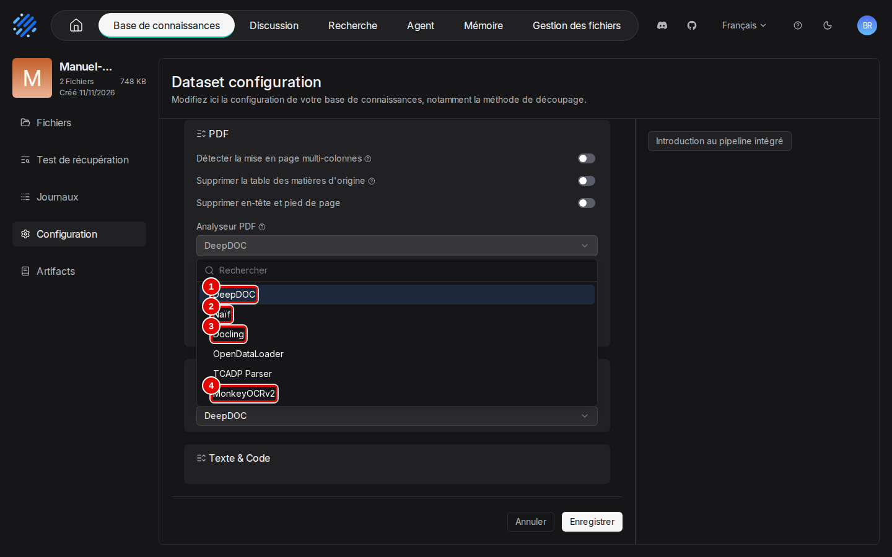

| N° | Élément | Rôle |
|---|---|---|
| 1 | « DeepDOC » | OCR, mise en page et tableaux en local (par défaut) |
| 2 | « Naïf » | texte brut du PDF seulement [Source] (`web/src/locales/en.ts`, clé `layoutRecognizeTip`) |
| 3 | « Docling » | analyseur externe Docling ; « OpenDataLoader » et « TCADP Parser » suivent |
| 4 | « MonkeyOCRv2 » | OCR externe MonkeyOCR |

La liste a été refermée par Échap et la configuration abandonnée par « Annuler » : rien n'est enregistré.

### Pour aller plus loin

- Pour les images, le bloc « Image » propose « DeepDoc » ou « External OCR model » (PaddleOCR, grisé faute de modèle déclaré) : manuel [03](03-datasets-et-decoupage.md), section 5.
- Le gabarit Picture et l'option « Enable vision enhancement » demandent un modèle de type `image2text` (« Modèle Img2txt »). Aucun n'est déclaré dans ce banc : [À tester]. Le modèle de réponse du socle, Gemma 4 E4B, accepte des images dans vLLM (jusqu'à 4 par requête selon son lancement), et RAGFlow envoie les images au fournisseur VLLM sous forme de blocs `image_url` : le déclarer aussi en type `image2text` serait donc possible sans nouveau modèle. [Source] (journal de `vllm-central` ; `internal/entity/models/vllm.go`)

## Dépannage

| Symptôme | Cause probable | Action |
|---|---|---|
| « Confirmer » ne ferme pas « Modifier le segment » après modification d'un passage de PDF | défaut de l'interface v1.0.0 : aucune requête envoyée | « Annuler », puis ajouter un passage corrigé (« + ») ou corriger par l'API (`PATCH …/chunks/{passage}`) |
| Chiffres faux dans un passage issu d'un scan (« 0oo ») | confusions de l'OCR | passage corrigé ajouté, ou correction par l'API |
| Une recherche exacte ne remonte pas le bon passage | mots collés par l'OCR | passage ajouté avec mots-clés et question |
| Passages corrigés ou ajoutés disparus | document réanalysé | refaire les corrections ; éviter de relancer l'analyse d'un document corrigé |
| Analyse d'un gros PDF scanné très longue | OCR sur CPU, environ 5 s par page mesuré | prévoir le temps ; une seule analyse à la fois |

## Sources

- Scénario : `outils/ragflow/captures/manuels_03_06.py` (scénario `deepdoc`, phases `base`, `test`, `passages`, `test_apres`, `config`, `markdown`) ; images : `docs/ragflow/img/04-deepdoc/` ; textes et déroulé : `outils/resultats/ragflow/captures/04-deepdoc/`
- Essai par l'API : `outils/ragflow/essai_passages.py`, [essai des passages](../../outils/resultats/ragflow/essai-2026-11-09-passages.log)
- Banc : [banc par défaut](../../outils/resultats/ragflow/banc-2026-11-09-defaut.md)
- Code au tag v1.0.0 : `Dockerfile`, `internal/handler/chunk.go`, `web/src/pages/chunk/` ; documentation : https://ragflow.io/docs/
