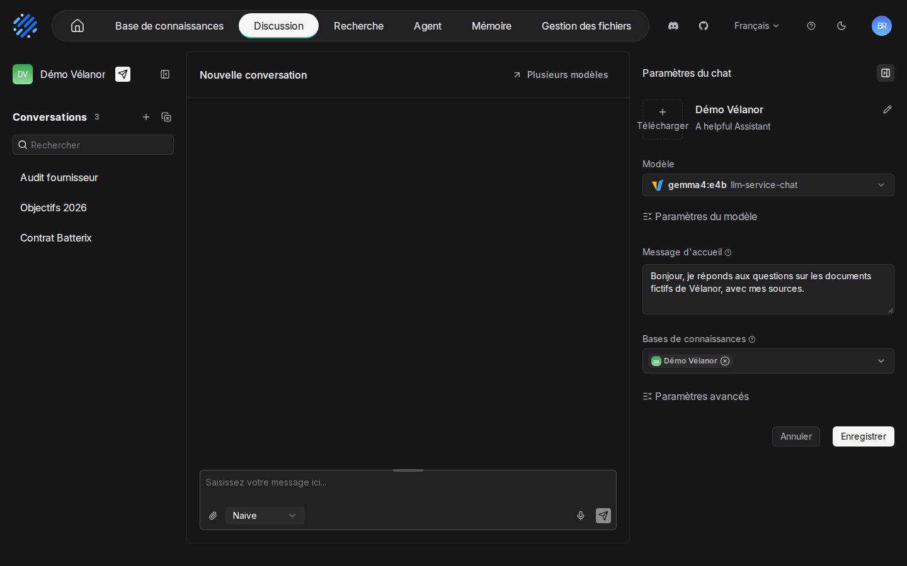
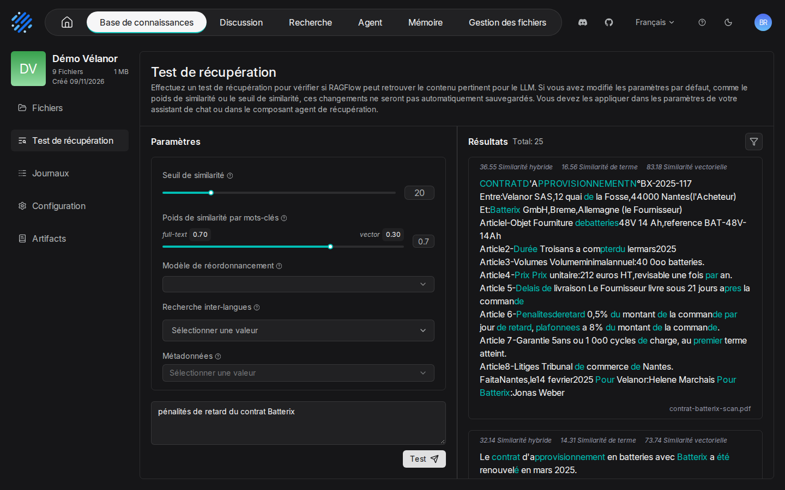

# 05. Assistants de chat et citations

> **Objet** : régler la recherche d'un assistant (nombre de passages, seuil, poids des mots-clés et des vecteurs, reranker, message sans réponse) et vérifier ses citations.
> **Prérequis** : [prise en main](02-prise-en-main.md), [datasets et découpage](03-datasets-et-decoupage.md).
> **Version décrite** : RAGFlow v1.0.0 (image `infiniflow/ragflow:v1.0.0`), Windows 11 + WSL2 (Ubuntu 24.04), LLM-Service branche `service-vllm` (vLLM 0.29.0 : `gemma4:e4b`, `bge-m3`), contexte déclaré de 16 384 jetons.
> **Statut des informations** : [Vérifié] observé ou mesuré le 9 novembre 2026 sur la machine d'essai (Ryzen 5 9600X, 32 Go, RTX 4060 Ti 16 Go) ; [Source] documentation officielle ou code source au tag v1.0.0 ; [Estimation] calcul non mesuré ; [À tester] non documenté et non essayé.
> **Précautions** : un assistant par réglage essayé (« Banc-defaut », « Banc-hybride-vecteurs07-top8 »…) ; corpus fictif.

## Sommaire

1. [Les réglages d'un assistant](#1-les-réglages-dun-assistant)
2. [Tester la recherche sans le modèle](#2-tester-la-recherche-sans-le-modèle)
3. [Effet mesuré des réglages](#3-effet-mesuré-des-réglages)
4. [Lire les citations](#4-lire-les-citations)
5. [Question sans réponse dans les documents](#5-question-sans-réponse-dans-les-documents)
6. [Reranker](#6-reranker)
7. [Dépannage](#dépannage)
8. [Sources](#sources)

## 1. Les réglages d'un assistant

### Essentiel

Icône de réglage en haut à droite d'une discussion : panneau « Paramètres du chat » (« Modèle », « Paramètres du modèle », « Message d'accueil », « Bases de connaissances », « Paramètres avancés »).

Valeurs par défaut relevées à la création d'un assistant [Vérifié] (`outils/resultats/ragflow/banc-2026-11-09-defaut.json`, champ `config`) :

| Réglage | API | Défaut | Rôle |
|---|---|---|---|
| Nombre de passages donnés au modèle | `top_n` | 6 | plus de passages, plus de contexte et de jetons |
| Candidats examinés | `top_k` | 1024 | passages évalués avant sélection |
| Seuil de similarité | `similarity_threshold` | 0,1 | sous ce score, un passage est écarté |
| Poids des mots-clés | `keywords_similarity_weight` | 0,7 | part de la recherche plein texte |
| Poids des vecteurs | `vector_similarity_weight` | 0,3 | part de la recherche sémantique (= 1 − poids des mots-clés) |
| Reranker | `rerank_id` | vide | aucun |

### Pour aller plus loin

Par l'API, seul `vector_similarity_weight` se règle ; le serveur renvoie `keywords_similarity_weight` = 1 − cette valeur (`internal/handler/chat.go`, ligne 339). Assistant créé avec `vector_similarity_weight=0.7` : l'objet `Chat` du SDK affiche 0,3 pour les vecteurs et 0,3 pour les mots-clés, le serveur renvoie `keywords_similarity_weight` 0,3 et pas de poids des vecteurs. Se fier à `keywords_similarity_weight`. [Vérifié] (`outils/resultats/ragflow/essai-2026-11-09-sdk-defauts.log`)

## 2. Tester la recherche sans le modèle

### Essentiel

Onglet « Test de récupération » d'une base : taper une question, « Test ». Chaque passage retrouvé affiche trois scores : « Similarité hybride », « Similarité de terme », « Similarité vectorielle ». Les réglages modifiés ici ne sont pas enregistrés : il faut les reporter dans l'assistant (l'interface le rappelle).

Exemple relevé pour « pénalités de retard du contrat Batterix » : un passage du compte rendu du CSE obtient 25,45 en similarité hybride (3,72 terme, 76,14 vecteur). [Vérifié] (`outils/resultats/ragflow/preuves-2026-11-09/textes-captures/05-test-recuperation.txt`)

### Pour aller plus loin

Le même test par l'API : `POST /api/v1/retrieval` avec `question`, `dataset_ids`, `similarity_threshold` [Testée] (`outils/ragflow/essai_passages.py`, exemple `exemples/ragflow/05_recherche_seule.py`).

## 3. Effet mesuré des réglages

### Essentiel

Banc de 38 questions, gabarit General, même base [Vérifié] :

| Réglage | Exactes (34) | Refus corrects (4) | Bon document cité | Médiane | p95 |
|---|---|---|---|---|---|
| Défaut (`top_n` 6, vecteurs 0,3) | 33 | 4 | 34 | 1,28 s | 1,88 s |
| Vecteurs 0,7, `top_n` 8 | **34** | 4 | 34 | 1,36 s | 1,83 s |

(`outils/resultats/ragflow/banc-2026-11-09-defaut.json`, `outils/resultats/ragflow/banc-2026-11-09-hybride-vecteurs07-top8.json`)

Réglage conseillé sur ce type de corpus : poids des vecteurs 0,7 et 8 passages ; c'est celui de l'assistant de démonstration « Démo Vélanor ».

### Pour aller plus loin

La question gagnée est Q30 (délai contractuel de Batterix et délai constaté, deux documents) : avec plus de poids aux vecteurs et deux passages de plus, le contrat scanné, dont le texte OCR colle les mots et gêne la recherche par mots-clés, entre dans le contexte. Le coût en latence est négligeable (+0,08 s en médiane). [Vérifié] (mêmes fichiers, question Q30)

## 4. Lire les citations

### Essentiel

Dans l'interface, chaque phrase de la réponse porte un renvoi `[1]`, `[2]`… et la vignette du document cité apparaît sous la réponse (manuel [02](02-prise-en-main.md)). Par l'API, la réponse contient des marqueurs `[ID:n]`, et `reference.chunks` liste les passages : `[ID:n]` désigne le n-ième passage de cette liste.

### Pour aller plus loin

`reference.chunks` contient **tous** les passages donnés au modèle, pas seulement ceux qu'il cite : pour une question sur le contrat Batterix, six documents y figurent alors que la réponse ne cite que le contrat. Pour savoir quel document justifie la réponse, il faut garder les seuls passages dont l'indice apparaît dans `[ID:n]`. C'est ce que fait le banc. Chaque passage porte aussi ses `positions` (`[page, x1, x2, y1, y2]`, pages numérotées à partir de 1) : la bonne page est citée pour les 24 questions dont la source est un PDF ou un document paginé. [Vérifié] (`outils/resultats/ragflow/demo-2026-11-09.log` ; `outils/ragflow/banc.py` ; `banc-2026-11-09-defaut.json`)

## 5. Question sans réponse dans les documents

### Essentiel

La phrase du « message de réponse vide » de l'assistant, en anglais par défaut, est : « The answer you are looking for is not found in the dataset! ». Les quatre questions pièges du banc (sans réponse dans le corpus) sont toutes correctement refusées par cette phrase. [Vérifié] (`banc-2026-11-09-defaut.json`, Q35 à Q38)

La phrase arrive suivie d'un renvoi (« …not found in the dataset! [ID:2] ») : des passages ont bien été retrouvés, et c'est le modèle qui l'écrit, sans doute parce que les consignes de l'assistant la lui fournissent [Estimation]. Un renvoi accompagne donc parfois un refus : il ne prouve pas qu'une réponse a été trouvée.

### Pour aller plus loin

Le message se change dans les réglages de l'assistant (`prompt_config.empty_response` par l'API). L'assistant de démonstration répond « Aucune information pertinente n'a été trouvée dans les documents. » [Vérifié] (`outils/ragflow/demo.py`)

## 6. Reranker

### Essentiel

RAGFlow 1.0 n'embarque aucun reranker ; « Modèle de rerank » reste vide tant qu'aucun service de reranking (route `/rerank`) n'est déclaré. Le socle Ollama ou vLLM de la série n'en fournit pas : reranking [À tester].

### Pour aller plus loin

Avec la branche `service-vllm`, un conteneur vLLM de reranking pourrait être ajouté à LLM-Service et déclaré par le fournisseur `VLLM` en type `rerank`. Non fait : il aurait fallu modifier LLM-Service, partagé avec d'autres applications. [Source] (`internal/entity/models/builtin.go` ; `kit/PROMPT.md` du kit, §4 phase B)

## Dépannage

| Symptôme | Cause probable | Action |
|---|---|---|
| Réponse « The answer you are looking for is not found in the dataset! » à une question légitime | aucun passage au-dessus du seuil, souvent un texte OCR peu lisible | « Test de récupération » ; augmenter le poids des vecteurs ou baisser le seuil |
| Un document « cité » par l'API n'apparaît pas dans la réponse | lecture de tout `reference.chunks` au lieu des seuls `[ID:n]` | filtrer les passages par les indices `[ID:n]` |
| Poids des vecteurs lu à 0,3 par le SDK malgré un réglage à 0,7 | valeur par défaut de l'objet `Chat` du SDK | lire `keywords_similarity_weight` (vecteurs = 1 − mots-clés) |

## Sources

- Bancs : [défaut](../../outils/resultats/ragflow/banc-2026-11-09-defaut.md), [vecteurs 0,7 et `top_n` 8](../../outils/resultats/ragflow/banc-2026-11-09-hybride-vecteurs07-top8.md)
- Scripts : `outils/ragflow/banc.py`, `outils/ragflow/demo.py`, `outils/ragflow/captures/captures.py`
- Documentation : https://ragflow.io/docs/ ; référence de l'API au tag v1.0.0 (`docs/references/http_api_reference.md`)
