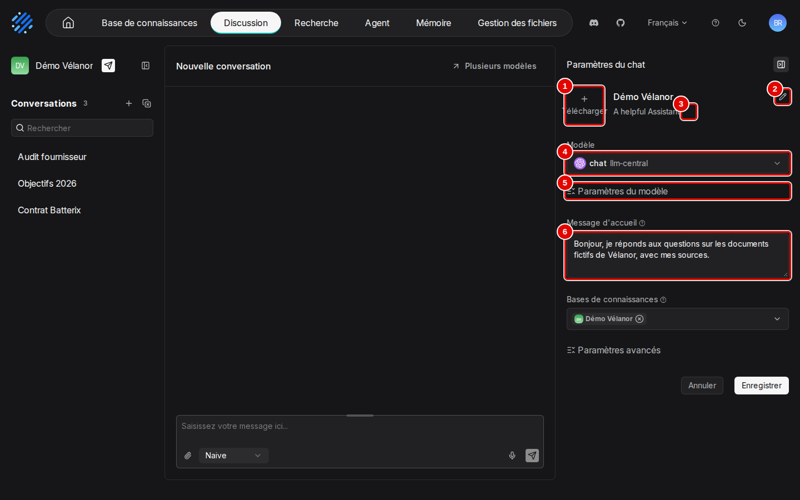
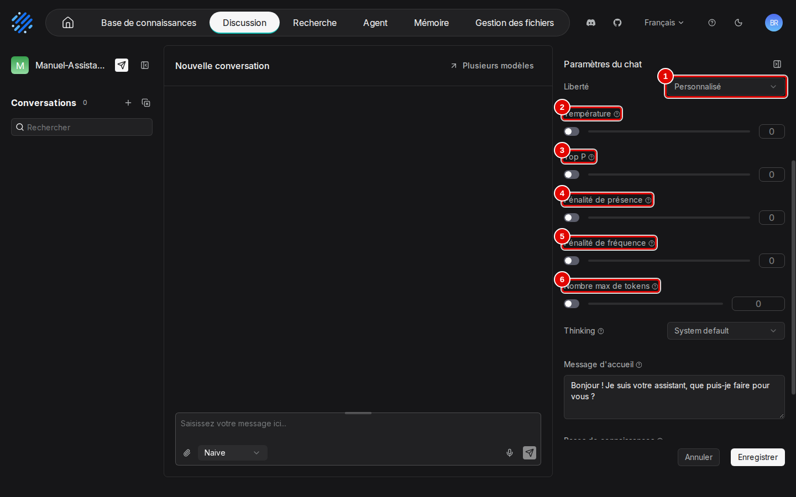
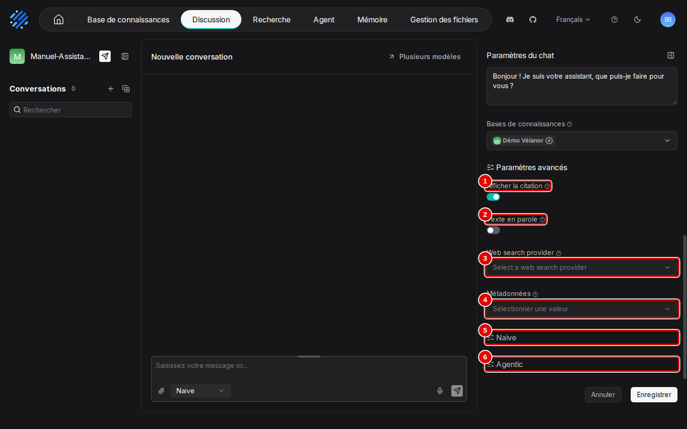
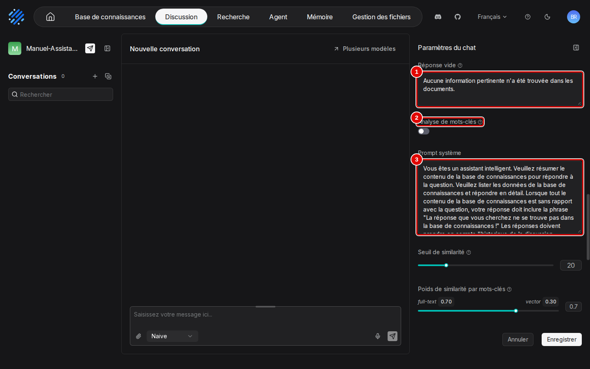
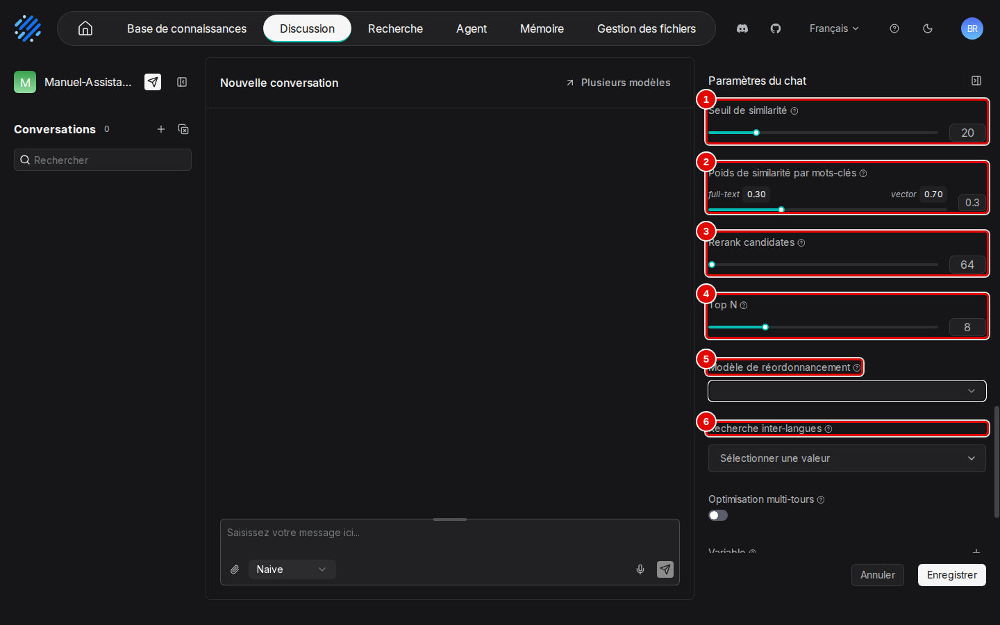
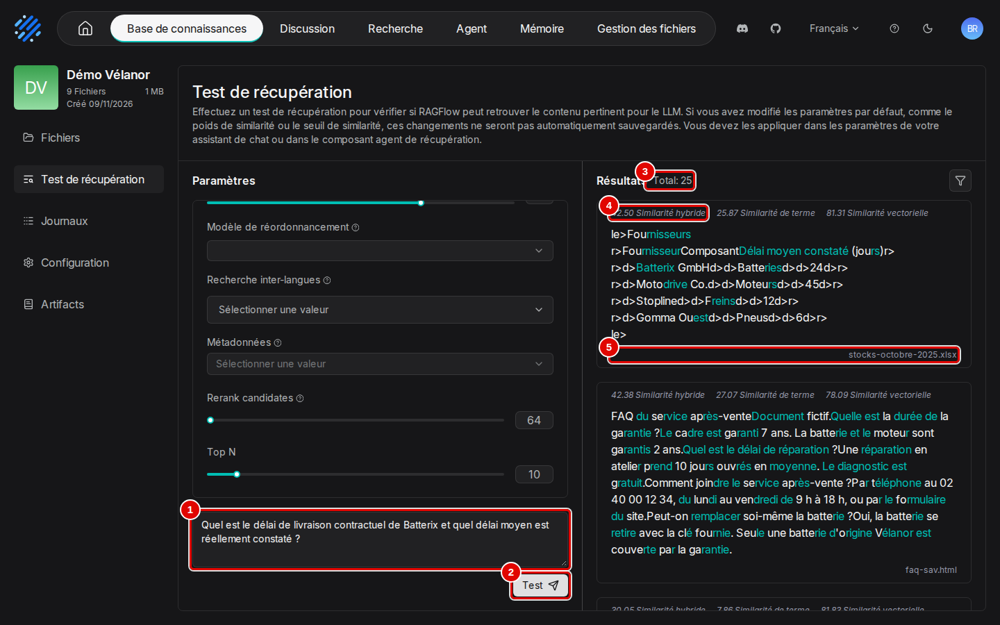

# 05. Assistants de chat et citations

> **Objet** : créer et régler un assistant de chat à la souris (panneau « Paramètres du chat » réglage par réglage), tester la recherche d'une base sans le modèle (« Test de récupération »), poser des questions, lire et vérifier les citations, gérer les conversations, et connaître les autres fonctions de l'écran de discussion.
> **Prérequis** : [prise en main](02-prise-en-main.md), [datasets et découpage](03-datasets-et-decoupage.md).
> **Version décrite** : RAGFlow v1.0.0 (image `infiniflow/ragflow:v1.0.0`), Windows 11 + WSL2 (Ubuntu 24.04), LLM-Service branche `service-vllm` (vLLM 0.29.0 : `gemma4:e4b`, `bge-m3`), contexte déclaré de 16 384 jetons.
> **Statut des informations** : [Vérifié] observé ou mesuré les 9 et 11 novembre 2026 sur la machine d'essai (Ryzen 5 9600X, 32 Go, RTX 4060 Ti 16 Go) ; [Source] documentation officielle ou code source au tag v1.0.0 ; [Estimation] calcul non mesuré ; [À tester] non documenté et non essayé.
> **Précautions** : l'assistant « Manuel-Assistant-05 » est créé à la souris par le scénario de captures, relié à la base de démonstration « Démo Vélanor » (lue, jamais modifiée), puis supprimé (`outils/ragflow/nettoyer_manuel.py`) ; le code d'intégration contient un jeton d'accès, masqué sur les captures et retiré des textes archivés.

**Risque** : le code d'intégration de « Intégrer dans la page web » (section 5) contient un jeton d'accès (`auth=…`) qui ouvre l'assistant à quiconque possède le lien. Ne pas le publier hors du poste ; le banc ne l'a pas utilisé.

Les captures viennent du scénario `assistants` de `outils/ragflow/captures/manuels_03_06.py` (phases `creation`, `parametres`, `test`, puis `conversation` et `ecran` ; la phase `conversation` a été rejouée trois fois pour corriger des annotations, chaque reprise est datée dans le journal). Textes des pages et déroulé : `outils/resultats/ragflow/captures/05-assistants-et-citations/` (`scenario.log`). [Vérifié]

## Sommaire

1. [Créer et ouvrir un assistant](#1-créer-et-ouvrir-un-assistant)
2. [Le panneau « Paramètres du chat »](#2-le-panneau--paramètres-du-chat-)
3. [Tester la recherche sans le modèle](#3-tester-la-recherche-sans-le-modèle)
4. [Conversations et citations](#4-conversations-et-citations)
5. [Autres fonctions de l'écran de discussion](#5-autres-fonctions-de-lécran-de-discussion)
6. [Effet mesuré des réglages](#6-effet-mesuré-des-réglages)
7. [Citations et refus vus par l'API](#7-citations-et-refus-vus-par-lapi)
8. [Reranker](#8-reranker)
9. [Dépannage](#dépannage)
10. [Sources](#sources)

## 1. Créer et ouvrir un assistant

### Essentiel

But : créer « Manuel-Assistant-05 » et repérer l'écran de discussion. La création elle-même (« Créer un chat », « Nom », « Enregistrer ») est détaillée au manuel [02](02-prise-en-main.md), section 5.

1. Cliquer sur « Discussion » dans la barre du haut.

| N° | Élément | Rôle |
|---|---|---|
| 1 | filtre (entonnoir) | restreint la liste des assistants |
| 2 | « Rechercher » | filtre par nom |
| 3 | « Créer un chat » | crée un assistant |
| 4 | carte d'un assistant | nom et date ; un clic ouvre l'assistant |
| 5 | menu « … » de la carte | menu de l'assistant (étape 2) |

2. Le menu « … » d'une carte propose « Renommer » (change le nom de l'assistant) et « Supprimer » (supprime l'assistant et ses conversations, après confirmation), comme celui d'une base (manuel [03](03-datasets-et-decoupage.md), section 1, étape 2).

3. Créer l'assistant puis cliquer sur sa carte. La colonne de gauche liste ses conversations.

| N° | Élément | Rôle |
|---|---|---|
| 1 | avion en papier | « Intégrer dans la page web » (section 5, étape 3) |
| 2 | icône de repli | replie la colonne des conversations |
| 3 | « + » | ouvre une nouvelle conversation |
| 4 | icône de suppression groupée | passe la liste en mode sélection (section 4, étape 6) |
| 5 | « Rechercher » | filtre les conversations par titre |
| 6 | engrenage | ouvre le panneau « Paramètres du chat » (section 2) |

4. La zone de saisie occupe le bas de la même page. Elle contient la zone de la question (la poignée au-dessus l'agrandit), « Attach file » (trombone, joint un fichier à la question, section 5, étape 1), le mode de réponse « Naive » ou « Agentic » (manuel [06](06-agentic-rag.md)), le micro (dictée vocale, section 5) et « Send message » (envoie la question). « Plusieurs modèles », en haut à droite de la discussion, compare les réponses de plusieurs modèles (section 5, étape 2).

## 2. Le panneau « Paramètres du chat »

### Essentiel

But : régler l'assistant et le relier à la base « Démo Vélanor » avec les réglages conseillés par le banc (poids des vecteurs 0,7, 8 passages), puis enregistrer.

1. Cliquer sur l'engrenage. Le haut du panneau :

| N° | Élément | Rôle |
|---|---|---|
| 1 | « Télécharger » | avatar de l'assistant |
| 2 | crayon du nom | renomme l'assistant |
| 3 | crayon de la description | description (« Saisir une description ») |
| 4 | « Modèle » | modèle qui rédige les réponses (étape 2) |
| 5 | « Paramètres du modèle » | réglages de génération, repliés (étapes 3 à 5) |
| 6 | « Message d'accueil » | premier message de chaque conversation |

2. La liste « Modèle » propose les modèles de chat déclarés, groupés par fournisseur et instance ; ici un seul, `gemma4:e4b`, de l'instance `llm-service-chat` du fournisseur VLLM (manuel [01](01-installation.md)).

3. Déplier « Paramètres du modèle ». Chaque réglage a un interrupteur : désactivé, la valeur du fournisseur s'applique. Tous sont désactivés à la création. [Vérifié] (`outils/resultats/ragflow/captures/05-assistants-et-citations/07-parametres-du-modele.txt`)

| N° | Élément | Rôle |
|---|---|---|
| 1 | « Liberté » | raccourci qui règle les quatre réglages suivants d'un coup (étape 4) |
| 2 | « Température » | aléa des réponses : basse, réponses stables ; haute, réponses variées |
| 3 | « Top P » | ne garde que les mots les plus probables jusqu'à ce seuil de probabilité cumulée |
| 4 | « Pénalité de présence » | décourage la reprise de mots déjà apparus |
| 5 | « Pénalité de fréquence » | décourage la répétition fréquente des mêmes mots |
| 6 | « Nombre max de tokens » | longueur maximale de la réponse ; trop bas, la réponse est coupée |

4. « Liberté » propose quatre préréglages : « Improviser » (réponses plus créatives), « Précis » (réponses plus conservatrices), « Équilibre » (compromis entre les deux) et « Personnalisé » (valeurs réglées à la main ; valeur affichée à la création). « Précis » convient à un assistant documentaire ; « Personnalisé » laisse les curseurs tels qu'ils sont.

5. « Thinking », sous ces réglages, règle la réflexion préalable du modèle, pour les modèles qui la proposent : « System default » (comportement par défaut du modèle, valeur à la création), « Enabled » (force la réflexion : réponses plus lentes) ou « Disabled » (la désactive).

6. Replier « Paramètres du modèle », ouvrir « Bases de connaissances » et cocher « Démo Vélanor » ; « Rechercher... » filtre la liste, et plusieurs bases peuvent être cochées. Une base sans fichier analysé n'apparaît pas dans la liste.

7. Déplier « Paramètres avancés ».

| N° | Élément | Rôle |
|---|---|---|
| 1 | « Afficher la citation » | affiche les renvois et les documents cités sous la réponse ; activé par défaut |
| 2 | « Texte en parole » | lecture audio des réponses ; demande un « Modèle TTS », absent du banc [À tester] |
| 3 | « Web search provider » | complète la recherche par une recherche web (étape 8) |
| 4 | « Métadonnées » | filtre les documents interrogés selon leurs métadonnées (étape 9) |
| 5 | « Naive » | réglages du mode de réponse direct (étapes 10 à 12) |
| 6 | « Agentic » | réglages du mode agentique (étape 13 et manuel [06](06-agentic-rag.md)) |

8. « Web search provider » liste douze services de recherche web à utiliser en plus des bases (AnySearch, Brave Search, Exa, Firecrawl, Linkup, Parallel, Querit, Search1API, SearchApi, Serply, Tavily, You.com). Chacun demande une clé chez le service : non couvert, compte en ligne exigé. Appuyer sur Échap.

9. « Métadonnées » choisit comment filtrer les documents d'après leurs métadonnées (manuel [03](03-datasets-et-decoupage.md), section 4) : « Désactivé » (aucun filtre, par défaut), « Automatique » (le modèle déduit le filtre de la question), « Semi-automatique » (le modèle propose, parmi des champs choisis) ou « Manuel » (conditions fixées à la main).

10. Déplier « Naive ». Saisir dans « Réponse vide » : « Aucune information pertinente n'a été trouvée dans les documents. »

| N° | Élément | Rôle |
|---|---|---|
| 1 | « Réponse vide » | texte renvoyé quand aucun passage n'est retrouvé ; vide, le modèle improvise |
| 2 | « Analyse de mots-clés » | fait extraire par le modèle les mots-clés de la question ; utile pour les longues questions, plus lent |
| 3 | « Prompt système » | consignes données au modèle ; `{knowledge}` y insère les passages retrouvés ; il contient aussi la phrase de refus (section 4, étape 5) |

11. Plus bas, les réglages de la recherche. Porter « Poids de similarité par mots-clés » à 0,3 (soit 0,7 pour les vecteurs) et « Top N » à 8. Valeurs affichées avant modification, pour cet assistant créé à la souris : seuil 20, poids des mots-clés 0,7, « Rerank candidates » 64, « Top N » 8. [Vérifié] (`outils/resultats/ragflow/captures/05-assistants-et-citations/scenario.log`)

| N° | Élément | Rôle |
|---|---|---|
| 1 | « Seuil de similarité » | score minimal (sur 100) pour qu'un passage soit retenu ; 20 ici |
| 2 | « Poids de similarité par mots-clés » | part des mots-clés (« full-text ») dans le score hybride, le reste allant aux vecteurs (« vector ») |
| 3 | « Rerank candidates » | nombre de passages soumis au reranker, s'il y en a un |
| 4 | « Top N » | nombre de passages donnés au modèle ; plus de contexte, plus de jetons |
| 5 | « Modèle de réordonnancement » | reranker ; vide, aucun n'étant déclaré (section 8) |
| 6 | « Recherche inter-langues » | traduit la question dans les langues choisies avant de chercher |

12. Fin de la partie « Naive » : « Optimisation multi-tours » reformule la question avec l'historique de la conversation (consomme des jetons en plus) ; « Variable » liste les variables du prompt système, renseignées par l'API, et son « + » en ajoute ; « knowledge » est la variable réservée des passages retrouvés, « date », en dessous, une variable optionnelle.

13. Déplier « Agentic » : « Decision model » choisit le modèle qui décide des recherches en mode agentique (vide, le modèle de chat s'en charge) ; « Agentic template » contient les consignes du mode agentique (rôle, mission, outils), modifiables ; « Reset to default » rétablit les consignes d'origine.

14. Cliquer sur « Enregistrer » (« Annuler » abandonne les modifications), en bas du panneau. Le message « Modifié » confirme ; après rechargement, « Top N » vaut 8, le poids des mots-clés 0,3, la réponse vide est conservée et la base est reliée. [Vérifié] (même journal)

## 3. Tester la recherche sans le modèle

### Essentiel

But : voir quels passages une question retrouve, et avec quels scores, avant de régler un assistant. Le test ne fait pas appel au modèle de chat ; ses réglages ne sont pas enregistrés (l'onglet le rappelle) : les reporter ensuite dans l'assistant.

1. Ouvrir la base « Démo Vélanor », onglet « Test de récupération ». Les réglages, à gauche, sont ceux de la section 2, étape 11, plus « Métadonnées » (filtre par métadonnées). Valeurs par défaut de cet onglet : « Seuil de similarité » 20, « Poids de similarité par mots-clés » full-text 0,70 et vector 0,30, « Rerank candidates » 64 et « Top N » 10.

2. Saisir la question Q30 du banc (« Quel est le délai de livraison contractuel de Batterix et quel délai moyen est réellement constaté ? ») et cliquer sur « Test ». 25 passages dépassent le seuil ; le premier est le tableau des fournisseurs du classeur de stocks (42,50 en similarité hybride, 25,87 en mots-clés, 81,31 en vecteurs). [Vérifié] (`outils/resultats/ragflow/captures/05-assistants-et-citations/20-test-resultats.txt`)

| N° | Élément | Rôle |
|---|---|---|
| 1 | question | texte cherché |
| 2 | « Test » | lance la recherche |
| 3 | « Total: 25 » | passages au-dessus du seuil |
| 4 | « Similarité hybride » | score combiné du premier passage, suivi des scores « de terme » (mots-clés) et « vectorielle » |
| 5 | document | fichier d'origine du passage |

3. Porter le poids des mots-clés à 0,3 (full-text 0,30, vector 0,70) et relancer : le total passe à 26 passages, le premier monte à 64,68 en similarité hybride. Le score vectoriel pèse davantage, ce qui aide les textes mal lus par l'OCR, comme le contrat scanné. [Vérifié] (`outils/resultats/ragflow/captures/05-assistants-et-citations/21-test-vecteurs-07.txt`)

### Pour aller plus loin

Le même test par l'API : `POST /api/v1/retrieval` avec `question`, `dataset_ids`, `similarity_threshold` [Testée] (`outils/ragflow/essai_passages.py`, exemple `exemples/ragflow/05_recherche_seule.py`).

## 4. Conversations et citations

### Essentiel

But : poser une question, vérifier ses sources, puis gérer les conversations.

1. Cliquer sur « + » à côté de « Conversations », taper la question Q30, puis « Send message ». La réponse donne les deux délais attendus, 21 jours (contrat) et 24 jours (constaté), chacun avec son renvoi ; elle est apparue 3,9 s après le clic. [Vérifié] (`outils/resultats/ragflow/captures/05-assistants-et-citations/22-reponse-citee.txt`, `scenario.log`)

| N° | Élément | Rôle |
|---|---|---|
| 1 | renvoi « [1] » | numéro du passage qui justifie la phrase ; le survol affiche le passage (étape 3) |
| 2 | « 2088 tokens (1893 input, 195 output) · 3.6s » | jetons consommés et durée de génération |
| 3 | document cité | vignette du document ; un clic l'ouvre (étape 4) |
| 4 | conversation | nommée d'après la première question |

2. Survoler une réponse ou une question affiche ses actions, en petites icônes au-dessus du message : copier ; régénérer (relance la question, sur la question) ; supprimer (retire la question et sa réponse de la conversation) ; lire à voix haute (demande un modèle TTS [À tester]) ; pouce haut et pouce bas (notent la réponse comme bonne ou mauvaise).

3. Survoler un renvoi affiche le passage cité, avec la vignette de sa page et le nom du document : c'est le moyen de vérifier la réponse.

| N° | Élément | Rôle |
|---|---|---|
| 1 | extrait cité | texte du passage (ici le contrat scanné, tel que lu par l'OCR) et nom du fichier |

4. Cliquer sur la vignette du document ouvre son aperçu.

| N° | Élément | Rôle |
|---|---|---|
| 1 | « contrat-batterix-scan.pdf » | document cité, affiché en entier |
| 2 | croix | referme l'aperçu |

5. Une question sans réponse dans les documents (Q35, chiffre d'affaires 2022) est refusée par la phrase du « Prompt système » (« La réponse que vous cherchez ne se trouve pas dans la base de connaissances ! »), pas par la « Réponse vide » : des passages ont été retrouvés, c'est le modèle qui conclut. Selon les essais, la phrase est suivie ou non de la liste des passages consultés. Le refus s'affiche comme une réponse ordinaire (capture de l'étape 1), suivi d'un renvoi : un renvoi ne prouve donc pas qu'une réponse a été trouvée. [Vérifié] (`outils/resultats/ragflow/captures/05-assistants-et-citations/26-question-sans-reponse.txt`, `scenario.log`)

6. Le menu « … » d'une conversation (au survol) ne propose que « Supprimer » : le titre d'une conversation ne se renomme pas dans l'interface v1.0.0. [Vérifié] (même journal ; `web/src/pages/next-chats/chat/conversation-dropdown.tsx`) Pour supprimer plusieurs conversations, cliquer sur l'icône de suppression groupée (section 1, étape 3) : une case apparaît devant chaque conversation et une flèche de retour permet de quitter le mode sélection. Cocher les conversations, cliquer sur la corbeille, puis sur « Supprimer » dans la fenêtre « Suppression en masse » ; la suppression est irréversible.

## 5. Autres fonctions de l'écran de discussion

### Essentiel

1. « Attach file » joint un fichier (5 au plus, 5 Mo chacun, d'après le texte de la zone) que le modèle lit avec la question, sans l'ajouter à une base. Le fichier joint (nom et taille) s'affiche au-dessus de la zone de saisie, à envoyer avec la prochaine question. Joindre un fichier ouvre une conversation nommée d'après le fichier. [Vérifié] (`outils/resultats/ragflow/captures/05-assistants-et-citations/30-piece-jointe.txt` ; texte « Upload max 5 files each up to 5MB » relevé par la carte)

2. « Plusieurs modèles » ouvre une page de comparaison : la même question part vers chaque colonne, avec son propre modèle et ses propres réglages.

| N° | Élément | Rôle |
|---|---|---|
| 1 | « Retour » | revient à la discussion |
| 2 | modèle de la colonne 1 | modèle de cette colonne |
| 3 | « Appliquer la configuration du modèle » | reporte les réglages de la colonne dans l'assistant |
| 4 | « + » | ajoute une colonne, jusqu'à 3 |

Avec deux colonnes, le titre devient « Plusieurs modèles (2/3) » et une seule zone de saisie, commune, envoie la question à toutes les colonnes. Utile pour comparer deux modèles ou deux réglages sur les mêmes questions ; le banc n'a qu'un modèle de chat, la comparaison n'a donc pas été lancée.

3. L'avion en papier, à côté du nom de l'assistant, ouvre « Intégrer dans la page web » : un code à coller dans un site pour y publier l'assistant. Le code est masqué sur la capture (jeton d'accès).

| N° | Élément | Rôle |
|---|---|---|
| 1 | « Type d'intégration » | « Chat plein écran (iframe traditionnel) » ou « Widget flottant (style Intercom) » |
| 2 | « Thème » | « Clair » ou « Sombre » |
| 3 | « Cacher l'avatar » | masque l'avatar dans la page intégrée |
| 4 | « Paramètres régionaux » | langue de la page intégrée |
| 5 | « Code d'intégration » | code `iframe` à copier ; contient l'adresse du serveur et le jeton (masqués) |
| 6 | « Ouvrir dans un nouvel onglet » | ouvre la page de discussion publique ; « Discussion ID », en dessous, sert à l'API |

L'onglet « Widget Customization » de la même fenêtre règle l'apparence du widget flottant : « Widget title », « Subtitle », « Footer text », « Footer redirect link », couleurs d'accent, de fond et de texte ; le code d'intégration suit, comme dans le premier onglet.

### Pour aller plus loin

- Le micro enregistre la voix et l'envoie au serveur pour transcription (`/transcriptions`), ce qui demande un « Modèle Speech2txt » ; aucun n'est déclaré dans le banc : [À tester]. [Source] (`web/src/components/ui/audio-button.tsx`)
- La page intégrée est servie par RAGFlow lui-même, à l'adresse du serveur : sur ce banc, `127.0.0.1` seulement, donc invisible depuis un autre poste. [Vérifié] (ports du manuel [01](01-installation.md))

## 6. Effet mesuré des réglages

### Essentiel

Valeurs par défaut relevées par l'API à la création d'un assistant par le banc [Vérifié] (`outils/resultats/ragflow/banc-2026-11-09-defaut.json`, champ `config`) :

| Réglage | Dans l'interface | API | Défaut (API) | Rôle |
|---|---|---|---|---|
| Nombre de passages donnés au modèle | « Top N » | `top_n` | 6 | plus de passages, plus de contexte et de jetons |
| Candidats examinés | (non affiché) | `top_k` | 1024 | passages évalués avant sélection |
| Seuil de similarité | « Seuil de similarité » | `similarity_threshold` | 0,1 | sous ce score, un passage est écarté |
| Poids des mots-clés | « Poids de similarité par mots-clés » | `keywords_similarity_weight` | 0,7 | part de la recherche plein texte |
| Poids des vecteurs | « vector » | `vector_similarity_weight` | 0,3 | part de la recherche sémantique (= 1 − poids des mots-clés) |
| Reranker | « Modèle de réordonnancement » | `rerank_id` | vide | aucun |

Un assistant créé à la souris affichait, lui, un seuil de 20 (0,2) et « Top N » 8 (section 2, étape 11).

Banc de 38 questions, gabarit General, même base [Vérifié] :

| Réglage | Exactes (34) | Refus corrects (4) | Bon document cité | Médiane | p95 |
|---|---|---|---|---|---|
| Défaut (`top_n` 6, vecteurs 0,3) | 33 | 4 | 34 | 1,28 s | 1,88 s |
| Vecteurs 0,7, `top_n` 8 | **34** | 4 | 34 | 1,36 s | 1,83 s |

(`outils/resultats/ragflow/banc-2026-11-09-defaut.json`, `outils/resultats/ragflow/banc-2026-11-09-hybride-vecteurs07-top8.json`)

Réglage conseillé sur ce type de corpus : poids des vecteurs 0,7 et 8 passages ; c'est celui de l'assistant de démonstration « Démo Vélanor » et de « Manuel-Assistant-05 ».

### Pour aller plus loin

- La question gagnée est Q30 (délai contractuel de Batterix et délai constaté, deux documents) : avec plus de poids aux vecteurs et deux passages de plus, le contrat scanné, dont le texte OCR colle les mots et gêne la recherche par mots-clés, entre dans le contexte. Le coût en latence est négligeable (+0,08 s en médiane). [Vérifié] (mêmes fichiers, question Q30) À la souris, « Manuel-Assistant-05 », réglé ainsi, répond juste à Q30 (section 4).
- Par l'API, seul `vector_similarity_weight` se règle ; le serveur renvoie `keywords_similarity_weight` = 1 − cette valeur (`internal/handler/chat.go`, ligne 339). Assistant créé avec `vector_similarity_weight=0.7` : l'objet `Chat` du SDK affiche 0,3 pour les vecteurs et 0,3 pour les mots-clés, le serveur renvoie `keywords_similarity_weight` 0,3. Se fier à `keywords_similarity_weight`. [Vérifié] (`outils/resultats/ragflow/essai-2026-11-09-sdk-defauts.log`)

## 7. Citations et refus vus par l'API

### Essentiel

Par l'API, la réponse contient des marqueurs `[ID:n]`, et `reference.chunks` liste les passages : `[ID:n]` désigne le n-ième passage de cette liste.

### Pour aller plus loin

- `reference.chunks` contient **tous** les passages donnés au modèle, pas seulement ceux qu'il cite : pour une question sur le contrat Batterix, six documents y figurent alors que la réponse ne cite que le contrat. Pour savoir quel document justifie la réponse, garder les seuls passages dont l'indice apparaît dans `[ID:n]` ; c'est ce que fait le banc. Chaque passage porte aussi ses `positions` (`[page, x1, x2, y1, y2]`, pages numérotées à partir de 1) : la bonne page est citée pour les 24 questions dont la source est un PDF ou un document paginé. [Vérifié] (`outils/resultats/ragflow/demo-2026-11-09.log` ; `outils/ragflow/banc.py` ; `banc-2026-11-09-defaut.json`)
- Les quatre questions pièges du banc (Q35 à Q38) sont toutes correctement refusées, par la phrase anglaise du prompt système par défaut d'un assistant créé par l'API (« The answer you are looking for is not found in the dataset! »), suivie d'un renvoi. [Vérifié] (`banc-2026-11-09-defaut.json`) Le message se change par `prompt_config.empty_response` ; l'assistant de démonstration répond « Aucune information pertinente n'a été trouvée dans les documents. » [Vérifié] (`outils/ragflow/demo.py`)

## 8. Reranker

### Essentiel

RAGFlow 1.0 n'embarque aucun reranker ; « Modèle de réordonnancement » reste vide tant qu'aucun service de reranking (route `/rerank`) n'est déclaré. Le socle Ollama ou vLLM de la série n'en fournit pas : reranking [À tester].

### Pour aller plus loin

Avec la branche `service-vllm`, un conteneur vLLM de reranking pourrait être ajouté à LLM-Service et déclaré par le fournisseur `VLLM` en type `rerank`. Non fait : il aurait fallu modifier LLM-Service, partagé avec d'autres applications. [Source] (`internal/entity/models/builtin.go` ; `kit/PROMPT.md` du kit, §4 phase B)

## Dépannage

| Symptôme | Cause probable | Action |
|---|---|---|
| Refus (« …ne se trouve pas dans la base de connaissances ! ») à une question légitime | passage utile absent du contexte, souvent un texte OCR peu lisible | « Test de récupération » ; augmenter le poids des vecteurs ou « Top N », ou baisser le seuil |
| La « Réponse vide » réglée n'apparaît jamais | elle ne sert que si aucun passage ne dépasse le seuil ; sinon le modèle répond selon le prompt système | modifier aussi la phrase de refus du « Prompt système » |
| Une base n'apparaît pas dans « Bases de connaissances » | base sans fichier analysé | analyser au moins un fichier |
| Les réglages du « Test de récupération » sont perdus | l'onglet ne les enregistre pas | les reporter dans « Paramètres du chat », puis « Enregistrer » |
| Pas de « Renommer » dans le menu d'une conversation | absent de l'interface v1.0.0 | le titre reprend la première question |
| Un document « cité » par l'API n'apparaît pas dans la réponse | lecture de tout `reference.chunks` au lieu des seuls `[ID:n]` | filtrer les passages par les indices `[ID:n]` |
| Poids des vecteurs lu à 0,3 par le SDK malgré un réglage à 0,7 | valeur par défaut de l'objet `Chat` du SDK | lire `keywords_similarity_weight` (vecteurs = 1 − mots-clés) |

## Sources

- Scénario : `outils/ragflow/captures/manuels_03_06.py` (scénario `assistants`) ; images : `docs/ragflow/img/05-assistants-et-citations/` ; textes et déroulé : `outils/resultats/ragflow/captures/05-assistants-et-citations/`
- Bancs : [défaut](../../outils/resultats/ragflow/banc-2026-11-09-defaut.md), [vecteurs 0,7 et `top_n` 8](../../outils/resultats/ragflow/banc-2026-11-09-hybride-vecteurs07-top8.md)
- Scripts : `outils/ragflow/banc.py`, `outils/ragflow/demo.py`
- Libellés et bulles d'aide : `web/src/locales/fr.ts` au tag v1.0.0 ; code : `web/src/pages/next-chats/` ; documentation : https://ragflow.io/docs/ ; référence de l'API (`docs/references/http_api_reference.md`)
