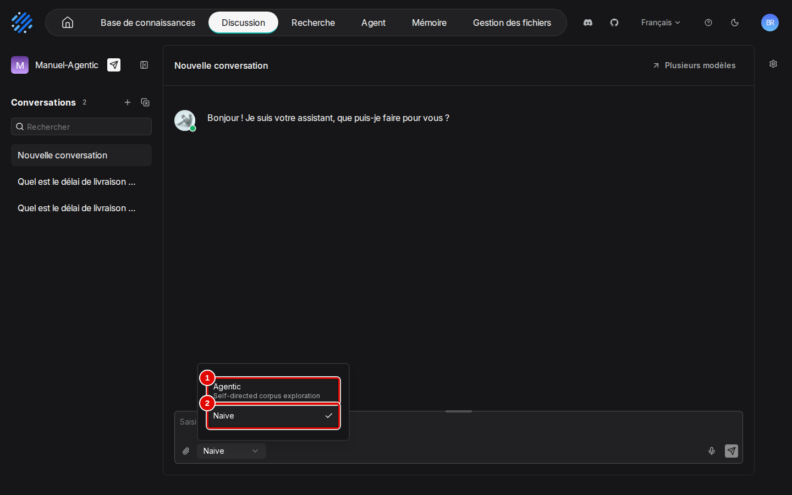
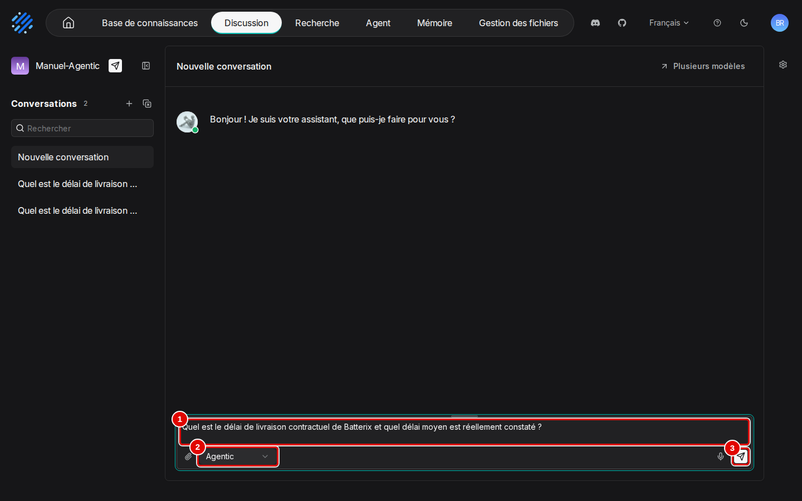
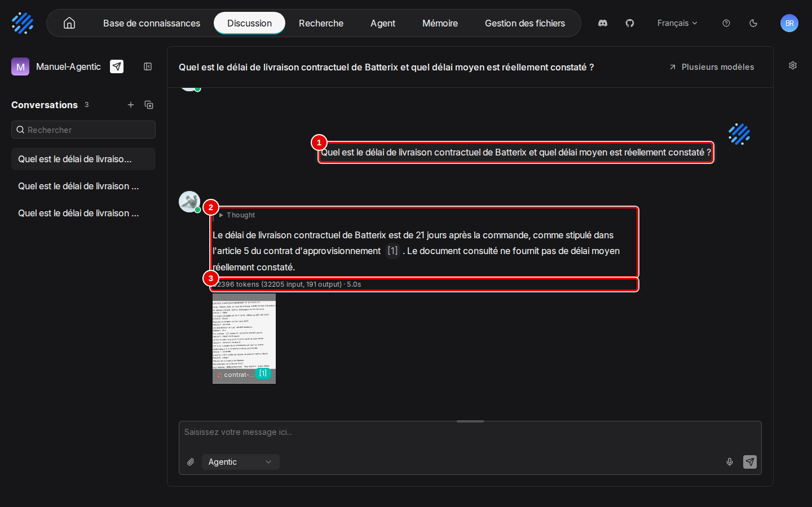
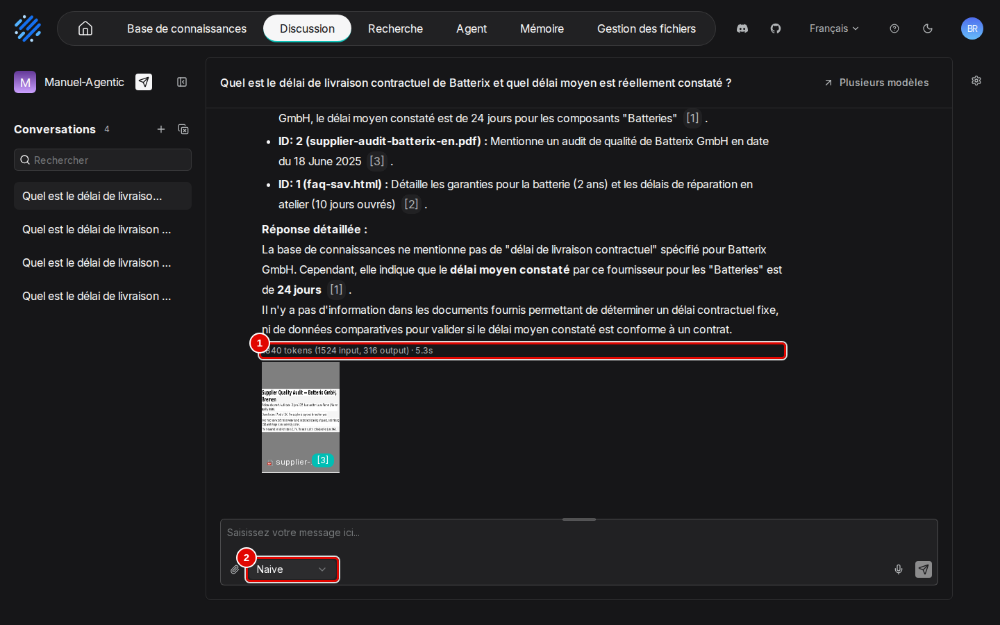

# 06. Agentic RAG

> **Objet** : choisir entre la réponse directe (« Naive ») et le mode agentique (« Agentic ») à la souris, et comparer les deux sur une même question : qualité, citations, jetons, latence.
> **Prérequis** : [assistants de chat et citations](05-assistants-et-citations.md).
> **Version décrite** : RAGFlow v1.0.0 (image `infiniflow/ragflow:v1.0.0`), Windows 11 + WSL2 (Ubuntu 24.04), LLM-Service branche `service-vllm` (vLLM 0.29.0 : `gemma4:e4b`, `bge-m3`), contexte déclaré de 16 384 jetons.
> **Statut des informations** : [Vérifié] observé ou mesuré les 9 et 11 novembre 2026 sur la machine d'essai (Ryzen 5 9600X, 32 Go, RTX 4060 Ti 16 Go) ; [Source] documentation officielle ou code source au tag v1.0.0 ; [Estimation] calcul non mesuré ; [À tester] non documenté et non essayé.
> **Précautions** : assistant « Manuel-Agentic » créé à la souris par le scénario de captures, relié à la base de démonstration « Démo Vélanor » avec ses réglages par défaut, puis supprimé (`outils/ragflow/nettoyer_manuel.py`) ; banc mené avec un assistant d'essai « Banc-agentic » ; corpus fictif.

Les captures viennent du scénario `agentique` de `outils/ragflow/captures/manuels_03_06.py`, joué deux fois (la seconde pour stabiliser une annotation ; les deux passages sont datés dans le journal). Textes des pages et déroulé : `outils/resultats/ragflow/captures/06-agentic-rag/` (`scenario.log`). [Vérifié]

## Sommaire

1. [Les deux modes](#1-les-deux-modes)
2. [Poser une question en mode « Agentic »](#2-poser-une-question-en-mode--agentic-)
3. [Comparer avec « Naive »](#3-comparer-avec--naive-)
4. [Résultats du banc](#4-résultats-du-banc)
5. [Ce qui se passe quand l'agent échoue](#5-ce-qui-se-passe-quand-lagent-échoue)
6. [Dépannage](#dépannage)
7. [Sources](#sources)

## 1. Les deux modes

### Essentiel

Sous la zone de saisie d'une discussion, un sélecteur propose deux modes. « Naive » (par défaut) fait une recherche puis une réponse, en une passe. « Agentic » (« Self-directed corpus exploration ») laisse le modèle décider lui-même des recherches à lancer, en plusieurs tours, selon les consignes de « Agentic template » (« Paramètres avancés », « Agentic », manuel [05](05-assistants-et-citations.md), section 2, étape 13). Le mode se choisit à chaque question.

1. Ouvrir l'assistant, cliquer sur « + » pour une nouvelle conversation, puis sur le sélecteur « Naive ».

| N° | Élément | Rôle |
|---|---|---|
| 1 | « Agentic » | exploration du corpus pilotée par le modèle, en plusieurs recherches |
| 2 | « Naive » | recherche unique puis réponse ; coché par défaut |

### Pour aller plus loin

Par l'API, le mode agentique se demande en ajoutant `"reasoning": 5` au corps de `POST /api/v1/chat/completions` [Testée] (`outils/ragflow/banc.py`, option `--agentic`). Il remplace les « niveaux de réflexion » des versions 0.x ; son déroulé suit un gabarit d'agent, `smart-reasoning` par défaut (`conf/agentic_rag.yaml`), surchargeable par `prompt_config.agentic_rag`, c'est-à-dire le champ « Agentic template ». [Source] (`internal/service/chat_pipeline.go`, `docs/release_notes.md`)

## 2. Poser une question en mode « Agentic »

### Essentiel

But : poser la question Q30 du banc, qui croise deux documents (délai de livraison contractuel du contrat scanné, délai moyen constaté du classeur de stocks), à un assistant laissé à ses réglages par défaut. Réponse attendue : 21 jours et 24 jours.

1. Choisir « Agentic », taper la question, puis cliquer sur « Send message ».

| N° | Élément | Rôle |
|---|---|---|
| 1 | zone de saisie | « Quel est le délai de livraison contractuel de Batterix et quel délai moyen est réellement constaté ? » |
| 2 | « Agentic » | mode choisi pour cette question |
| 3 | « Send message » | envoie la question |

2. La réponse arrive 5,4 s après le clic. Un bloc « Thought » repliable la précède (raisonnement du modèle). Ici elle trouve le délai contractuel, 21 jours, dans le contrat scanné, mais déclare absent le délai constaté. Elle a consommé 32 396 jetons, dont 32 205 en entrée : les passages lus pendant l'exploration s'ajoutent au contexte. [Vérifié] (`outils/resultats/ragflow/captures/06-agentic-rag/scenario.log`, `03-reponse-agentic.txt`)

| N° | Élément | Rôle |
|---|---|---|
| 1 | question | question posée |
| 2 | réponse | bloc « Thought » repliable, puis réponse citée (« [1] » renvoie au contrat) |
| 3 | « 32396 tokens (32205 input, 191 output) · 5.0s » | jetons et durée de génération |

### Pour aller plus loin

Le premier passage du scénario, quelques minutes plus tôt, avait donné une réponse agentique complète (21 jours [1], 24 jours [2]), en 5,4 s également et avec 32 198 jetons dont 31 988 en entrée. Le mode agentique n'est donc pas stable sur cette question avec ce modèle. [Vérifié] (même journal, premier bloc)

À 32 000 jetons d'entrée, une seule question agentique dépasse le contexte de 16 384 jetons déclaré pour le modèle ; le serveur vLLM l'accepte ici, car il est lancé avec une longueur maximale de 32 768 jetons (`max_model_len`, relevé le 9 novembre dans `outils/resultats/ragflow/preuves-2026-11-09/vllm-extrait.log`) : la limite de 16 384 jetons déclarée dans RAGFlow ne s'applique pas à cette exploration. Sur un service de modèles limité à 16 384 jetons, ce mode serait à essayer avant usage [À tester]. Voir [Qualité et performances](12-qualite-et-performances.md) pour les tailles de contexte.

## 3. Comparer avec « Naive »

### Essentiel

1. Ouvrir une nouvelle conversation (« + »), repasser le sélecteur sur « Naive », et poser la même question. Avec les réglages par défaut de l'assistant (poids des mots-clés 0,7), la réponse ne donne que le délai constaté, 24 jours, et déclare le délai contractuel absent des documents. Elle arrive en 5,9 s pour 1 840 jetons (1 524 en entrée). Au premier passage du scénario : même conclusion, 3,9 s, 1 710 jetons. [Vérifié] (`outils/resultats/ragflow/captures/06-agentic-rag/scenario.log`, `04-reponse-naive.txt`)

| N° | Élément | Rôle |
|---|---|---|
| 1 | « 1840 tokens (1524 input, 316 output) · 5.3s » | jetons et durée : environ 20 fois moins de jetons d'entrée qu'en mode agentique |
| 2 | « Naive » | mode utilisé pour cette question |

Le même assistant, réglé comme au manuel [05](05-assistants-et-citations.md) (vecteurs 0,7, « Top N » 8), répond juste en « Naive » à cette question, avec les deux délais. [Vérifié] (`outils/resultats/ragflow/captures/05-assistants-et-citations/22-reponse-citee.txt`)

| Essai à la souris, question Q30 | Délai contractuel (21 j) | Délai constaté (24 j) | Jetons d'entrée | Délai d'affichage |
|---|---|---|---|---|
| « Agentic », réglages par défaut, passage 1 | oui | oui | 31 988 | 5,4 s |
| « Agentic », réglages par défaut, passage 2 | oui | non | 32 205 | 5,4 s |
| « Naive », réglages par défaut, passages 1 et 2 | non | oui | 1 524 | 3,9 et 5,9 s |
| « Naive », vecteurs 0,7 et « Top N » 8 (manuel 05) | oui | oui | 1 893 | 3,9 s |

Pour cette question, régler la recherche de l'assistant donne la bonne réponse à coup sûr pour un coût bien moindre que le mode agentique.

## 4. Résultats du banc

### Essentiel

Même base, même assistant, mêmes 38 questions [Vérifié] :

| Mode | Exactes (34) | Refus corrects (4) | Bon document cité | Réponses sans citation | Médiane | p95 |
|---|---|---|---|---|---|---|
| Naive (défaut) | 33 | 4 | 34 | 0 | 1,28 s | 1,88 s |
| Agentic | 30 | 4 | 29 | 5 | 4,52 s | 7,22 s |

(`outils/resultats/ragflow/banc-2026-11-09-defaut.json`, `outils/resultats/ragflow/banc-2026-11-09-agentic.json`)

Sur ce corpus et avec ce petit modèle, le mode agentique est moins juste et 3,5 fois plus lent. La réponse directe reste le bon choix.

### Pour aller plus loin

Le mode agentique gagne pourtant sur les questions multi-documents (3 sur 3, contre 2 sur 3) : il trouve seul le délai contractuel de Batterix dans le contrat scanné (Q30), comme à la souris en section 2. Il perd quatre questions pourtant directes : deux de tableau (Q06, Q07) et deux faits simples (Q26, Q27) ; il répond juste à Q24 mais sans citation. [Vérifié] (même fichier, `par_type`)

## 5. Ce qui se passe quand l'agent échoue

### Essentiel

Dans les échecs du banc, le modèle ne lance pas de recherche et répond comme s'il n'avait accès à aucun document, par exemple pour Q26 : « Je suis désolé, mais je n'ai accès à aucun document ou base de données contenant des numéros de téléphone de service après-vente. » La réponse est alors donnée sans citation. [Vérifié] (`banc-2026-11-09-agentic.json`, Q06, Q07, Q26, Q27)

### Pour aller plus loin

Par l'API, toutes les réponses agentiques commencent par un bloc `<think>…</think>`, qui répète ou prépare la réponse (38 réponses sur 38) ; un programme qui affiche la réponse doit retirer ce bloc. L'interface l'affiche replié sous « Thought » (section 2). Un modèle plus grand, plus habitué à l'appel d'outils, suivrait sans doute mieux le déroulé agentique [Estimation] ; non essayé, le socle ne servant qu'un modèle de réponse. « Decision model » permettrait de confier les décisions de recherche à un autre modèle [À tester].

## Dépannage

| Symptôme | Cause probable | Action |
|---|---|---|
| Réponse agentique « je n'ai pas accès à… » sans citation | le modèle n'a pas lancé de recherche | repasser en « Naive », ou reposer la question |
| Deux réponses agentiques différentes à la même question | exploration non déterministe avec ce modèle | préférer « Naive » avec une recherche bien réglée (manuel [05](05-assistants-et-citations.md)) |
| Bloc « Thought » ou `<think>…</think>` dans la réponse | sortie du mode agentique | le replier dans l'interface ; le retirer par programme avec l'API |
| Réponse 3 à 4 fois plus lente, plus de 30 000 jetons d'entrée | plusieurs tours de recherche et de génération | normal en mode agentique ; vérifier que le contexte du service de modèles le permet |

## Sources

- Scénario : `outils/ragflow/captures/manuels_03_06.py` (scénario `agentique`) ; images : `docs/ragflow/img/06-agentic-rag/` ; textes et déroulé : `outils/resultats/ragflow/captures/06-agentic-rag/`
- Bancs : [Naive](../../outils/resultats/ragflow/banc-2026-11-09-defaut.md), [Agentic](../../outils/resultats/ragflow/banc-2026-11-09-agentic.md) ; script `outils/ragflow/banc.py` (`--agentic`)
- Code au tag v1.0.0 : `internal/service/chat_pipeline.go`, `conf/agentic_rag.yaml` ; https://ragflow.io/docs/
