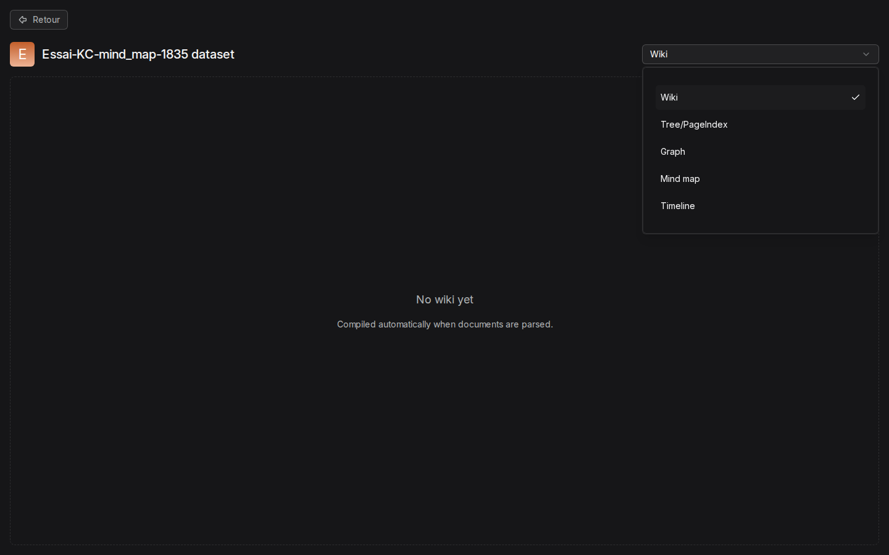
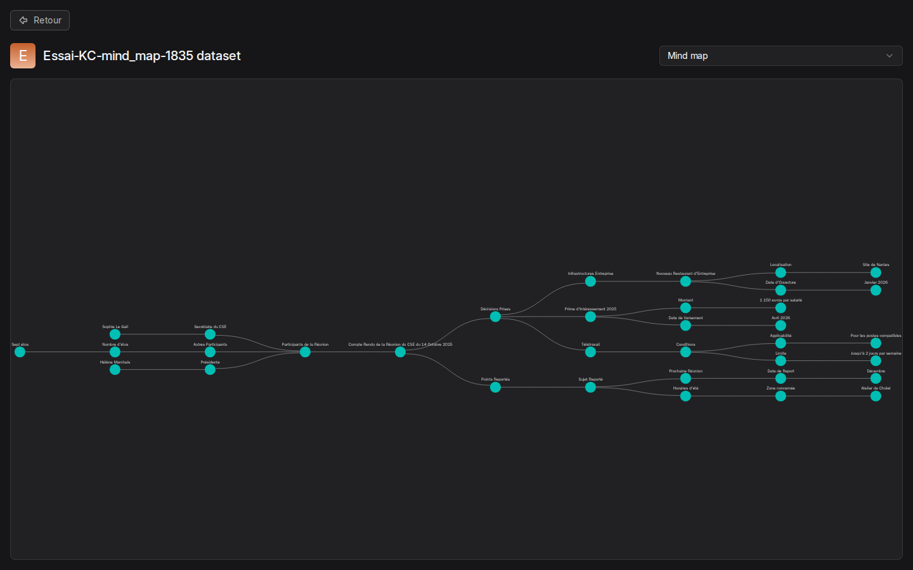

# 07. Knowledge Compilation

> **Objet** : faire produire à RAGFlow des artefacts de synthèse (carte mentale, graphe de connaissances…) à partir des documents d'une base, et savoir ce que coûte chacun.
> **Prérequis** : [datasets et découpage](03-datasets-et-decoupage.md), [API HTTP et SDK Python](10-api-et-sdk.md).
> **Version décrite** : RAGFlow v1.0.0 (image `infiniflow/ragflow:v1.0.0`), Windows 11 + WSL2 (Ubuntu 24.04), LLM-Service branche `service-vllm` (vLLM 0.29.0 : `gemma4:e4b`, `bge-m3`), contexte déclaré de 16 384 jetons.
> **Statut des informations** : [Vérifié] observé ou mesuré le 9 novembre 2026 sur la machine d'essai (Ryzen 5 9600X, 32 Go, RTX 4060 Ti 16 Go) ; [Source] documentation officielle ou code source au tag v1.0.0 ; [Estimation] calcul non mesuré ; [À tester] non documenté et non essayé.
> **Précautions** : essais sur un document court (`cse-2025-10-14.md`, 159 jetons), une base par artefact ; la base « Essai-KC-mind_map-1835 » est gardée pour montrer le résultat.

## Sommaire

1. [Principe en 1.0](#1-principe-en-10)
2. [Mettre en place une compilation](#2-mettre-en-place-une-compilation)
3. [Résultats sur le corpus](#3-résultats-sur-le-corpus)
4. [Dépannage](#dépannage)
5. [Sources](#sources)

## 1. Principe en 1.0

### Essentiel

La compilation n'est pas un bouton : elle s'exécute pendant l'ingestion, quand le pipeline d'une base contient un composant **Compiler** relié à un groupe de gabarits de compilation. Les résultats apparaissent ensuite dans l'onglet « Artifacts » de la base, avec un sélecteur « Wiki », « Tree/PageIndex », « Graph », « Mind map », « Timeline ». [Vérifié] (texte relevé par `captures.py`, scénario `compilation`) [Source] (`docs/guides/knowledge_compilation/`)

Gabarits intégrés, relevés par `GET /api/v1/compilation-templates/builtins` [Vérifié] (`outils/resultats/ragflow/essai-2026-11-09-compilation-mind_map.log`) :

| `kind` | Libellé | Produit |
|---|---|---|
| `knowledge_graph` | Knowledge graph | entités et relations |
| `mind_map` | Mind map - Radial concept hierarchy | carte mentale autour d'un sujet central |
| `timeline` | List (Timeline) — Chronological events / Graph | frise chronologique |
| `page_index` | PageIndex — Hierarchical table of contents | table des matières |
| `tree` | Tree — RAPTOR-based document tree | arbre de résumés (remplace RAPTOR) |
| `wiki` | Wiki — Graph-based wiki | pages de wiki |
| `session_essence`, `session_graph` | Session Essence, Session Graph | synthèses tirées des conversations |

### Pour aller plus loin

Le modèle utilisé est celui du composant Compiler, sinon le modèle de chat par défaut. Chaque appel au modèle a une limite de 20 minutes, non réglable ; les variables `WIKI_*` et `STRUCTURE_*` du `docker/.env` officiel ne sont lues par aucun code Go et sont des restes de la version Python. [Source] (`internal/ingestion/knowledge_compile/`, synthèse de lecture du code)

## 2. Mettre en place une compilation

### Essentiel

Séquence suivie par `outils/ragflow/essai_compilation.py` [Testée] :

| Étape | Appel |
|---|---|
| Groupe de gabarits | `POST /api/v1/compilation-template-groups` avec un gabarit intégré (`kind`, `config`) |
| Pipeline | DSL du pipeline intégré `general` (`GET /api/v1/pipelines/general`) + nœud `Compiler` entre `Extractor` et `Tokenizer` ; `POST /api/v1/agents` avec `canvas_category: "dataflow_canvas"` |
| Publication | `POST /api/v1/agents/{pipeline}/publish` (donne la version) |
| Base en mode pipeline | `POST /api/v1/datasets` avec `parse_type: 2`, `pipeline_id`, `pipeline_version_id` |
| Ingestion | téléversement puis `POST /api/v1/datasets/{base}/documents/parse` |
| Suivi | `GET /api/v1/datasets/{base}/compilation/status?kind=mindmap` |
| Lecture | `GET /api/v1/datasets/{base}/artifacts/structure?kind=mindmap` (ou `graph`, `timeline`) |

Dans l'interface, la même chose se fait par « Agent », onglet « Ingestion pipeline », puis « Configuration » de la base (« Changer ou configurer le pipeline d'ingestion ») [Source].

### Pour aller plus loin

Piège du suivi : l'état passe de « idle » à « idle » ; la fin se lit au champ `last_completed_at` avec une file vide (`backlog` et `inflight` à 0). Le premier script attendait un état « completed » qui n'arrive jamais et a dû être arrêté à la main. [Vérifié] (`outils/resultats/ragflow/essai-2026-11-09-compilation-mind_map-essai1.log`)

## 3. Résultats sur le corpus

### Essentiel

Document : compte rendu du CSE (4 passages) [Vérifié] :

| Artefact | Durée totale (ingestion et compilation) | Résultat |
|---|---|---|
| Carte mentale, 1er essai | environ 25 s | 23 entités, 22 relations |
| Carte mentale, 2e essai | 40 s | 35 entités, 34 relations |
| Graphe de connaissances | 15 s | 5 entités, 4 relations (« CSE »…) |

(`outils/resultats/ragflow/essai-2026-11-09-compilation-{mind_map-essai1,mind_map,knowledge_graph}.log`)

La carte mentale part du compte rendu et se ramifie en « Participants de la Réunion » (présidente Hélène Marchais, secrétaire Sophie Le Gall, sept élus), « Décisions Prises » (prime d'intéressement de 1 150 euros versée en avril 2026, télétravail jusqu'à deux jours par semaine, restaurant d'entreprise de Nantes en janvier 2026) et « Points Reportés » (horaires d'été de l'atelier de Cholet, en décembre). Tout y est exact par rapport au document. [Vérifié] (capture ; `corpus/documents/cse-2025-10-14.md`)

### Pour aller plus loin

- Le résultat varie d'un passage à l'autre (23 puis 35 entités) : le modèle découpe plus ou moins finement.
- Sur un document court et avec le modèle sur GPU, la compilation coûte quelques dizaines de secondes. Sur le corpus complet, ou sur CPU (environ 16 jetons/s contre 40 à 60 ici), le temps grandit avec le nombre de passages : plusieurs minutes à plusieurs dizaines de minutes [Estimation].
- Wiki, Tree, PageIndex et Timeline n'ont pas été essayés : [À tester].

## Dépannage

| Symptôme | Cause probable | Action |
|---|---|---|
| Onglet « Artifacts » vide (« No wiki yet ») | sélecteur sur « Wiki » alors que la base compile un autre type | choisir le type dans le sélecteur |
| Script de suivi qui ne s'arrête jamais | attente d'un état « completed » | lire `last_completed_at` avec `backlog` et `inflight` à 0 |
| Création de la base refusée en mode pipeline | version du pipeline absente | publier le pipeline et passer `pipeline_version_id` |

## Sources

- Script : `outils/ragflow/essai_compilation.py` ; journaux dans `outils/resultats/ragflow/essai-2026-11-09-compilation-*.log`
- Capture : `outils/ragflow/captures/captures.py`, scénario `compilation`
- Code et documentation au tag v1.0.0 : `docs/guides/knowledge_compilation/`, `internal/agent/templates/compiler.json` ; https://ragflow.io/docs/
