# 07. Knowledge Compilation

> **Objet** : faire produire à RAGFlow, à la souris, des artefacts de synthèse (graphe de connaissances, wiki, arbre, table des matières, frise, carte mentale) à partir des documents d'une base : opérateur de compilation, pipeline d'ingestion avec composant « Compiler », base reliée à ce pipeline, lecture de l'onglet « Artifacts » ; savoir ce que coûte chaque artefact.
> **Prérequis** : [datasets et découpage](03-datasets-et-decoupage.md) (base, « Configuration », « Mode d'analyse ») ; [API HTTP et SDK Python](10-api-et-sdk.md) pour la partie programmée.
> **Version décrite** : RAGFlow v1.0.0 (image `infiniflow/ragflow:v1.0.0`), Windows 11 + WSL2 (Ubuntu 24.04), LLM-Service branche `service-vllm` (vLLM 0.29.0 : `gemma4:e4b`, `bge-m3`), contexte déclaré de 16 384 jetons.
> **Statut des informations** : [Vérifié] observé ou mesuré les 9 et 11 novembre 2026 sur la machine d'essai (Ryzen 5 9600X, 32 Go, RTX 4060 Ti 16 Go) ; [Source] documentation officielle ou code source au tag v1.0.0 ; [Estimation] calcul non mesuré ; [À tester] non documenté et non essayé.
> **Précautions** : essais sur un document court (`cse-2025-10-14.md`, compte rendu fictif du CSE, 548 octets), une base par type d'artefact ; opérateurs, pipelines et bases « Manuel-… » créés par le scénario de captures puis supprimés (`outils/ragflow/nettoyer_manuel.py`) ; la base et le pipeline « Essai-KC-mind_map-1835 » du jeu de démonstration ne sont ouverts qu'en lecture (base) ou pas du tout (pipeline, voir l'avertissement ci-dessous).

**Risque — pipeline créé par l'API puis ouvert dans le canevas.** Le canevas n'affiche pas un composant Compiler ajouté par l'API sans position dans le graphe, et l'enregistrement automatique du canevas, quelques secondes après l'ouverture, écrit le brouillon sans ce composant. La version publiée, celle qu'utilise la base, reste intacte ; le brouillon perd la compilation. Constaté sur « Essai-KC-mind_map-1835 » le 11 novembre 2026, brouillon remis à partir de la version publiée par `PUT /api/v1/agents/{id}`. Un pipeline créé à la souris (section 3) n'a pas ce défaut. [Vérifié] (`outils/resultats/ragflow/captures/07-knowledge-compilation/incident-pipeline-demo.txt`)

Toutes les captures de ce manuel viennent du scénario `compilation` de `outils/ragflow/captures/manuels_07_15.py`, qui fait chaque geste à la souris, dans l'ordre des sections. Le texte de chaque page capturée et la liste de ses éléments visibles sont dans `outils/resultats/ragflow/captures/07-knowledge-compilation/` (même nom que l'image), le déroulé et les durées dans `scenario.log`. [Vérifié]

## Sommaire

1. [Principe](#1-principe)
2. [Créer un opérateur de compilation](#2-créer-un-opérateur-de-compilation)
3. [Créer le pipeline d'ingestion avec un composant Compiler](#3-créer-le-pipeline-dingestion-avec-un-composant-compiler)
4. [Appliquer le pipeline à une base et importer un document](#4-appliquer-le-pipeline-à-une-base-et-importer-un-document)
5. [Lire les artefacts](#5-lire-les-artefacts)
6. [Les autres types d'artefacts](#6-les-autres-types-dartefacts)
7. [Mesures](#7-mesures)
8. [Par l'API](#8-par-lapi)
9. [Dépannage](#dépannage)
10. [Sources](#sources)

## 1. Principe

### Essentiel

La compilation n'est pas un bouton : elle s'exécute pendant l'ingestion d'un document. Trois objets sont nécessaires, tous créés dans la page « Agent » puis dans la base :

| Objet | Où | Rôle |
|---|---|---|
| opérateur de compilation | « Agent », onglet « Compilation operator » | dit quoi produire : un gabarit (« Template ») parmi Graph, Mindmap, PageIndex, Timeline, Tree, Wiki, avec ses consignes |
| pipeline d'ingestion | « Agent », onglet « Ingestion pipeline » | chaîne de traitement d'un document : lecture (« Parser »), découpage (« Chunker »), compilation (« Compiler », qui appelle l'opérateur), indexation (« Indexeur ») |
| base de connaissances | « Configuration », « Mode d'analyse » | reçoit le pipeline publié à la place d'un gabarit intégré ; chaque document importé passe par lui |

Les résultats apparaissent ensuite dans l'onglet « Artifacts » de la base, avec un sélecteur « Wiki », « Tree/PageIndex », « Graph », « Mind map », « Timeline ». Un composant « Compiler » n'appelle qu'un opérateur, et un opérateur n'a qu'un gabarit : une base produit donc un seul type d'artefact. [Vérifié] (captures de ce manuel) [Source] (`docs/guides/knowledge_compilation/`)

Gabarits intégrés, relevés par `GET /api/v1/compilation-templates/builtins` [Vérifié] (`outils/resultats/ragflow/preuves-2026-11-09/compilation-builtins.json`) :

| `kind` | Libellé dans l'interface | Produit |
|---|---|---|
| `knowledge_graph` | Graph | entités et relations |
| `mind_map` | Mindmap | carte mentale autour d'un sujet central |
| `timeline` | Timeline | frise chronologique |
| `page_index` | PageIndex | table des matières hiérarchique |
| `tree` | Tree | arbre de résumés (remplace RAPTOR) |
| `wiki` | Wiki | pages de wiki reliées entre elles |
| `session_essence`, `session_graph` | absents de la liste « Template » | synthèses tirées des conversations |

### Pour aller plus loin

Le modèle utilisé est celui du composant « Compiler » (par défaut le modèle de chat par défaut). Chaque appel au modèle a une limite de 20 minutes, non réglable ; les variables `WIKI_*` et `STRUCTURE_*` du `docker/.env` officiel ne sont lues par aucun code Go et sont des restes de la version Python. [Source] (`internal/ingestion/knowledge_compile/`, synthèse de lecture du code)

## 2. Créer un opérateur de compilation

### Essentiel

But : créer l'opérateur « Manuel-Operateur-Graphe », qui fera extraire un graphe de connaissances (personnes, organisations, lieux…) de chaque document.

1. Cliquer sur « Agent » dans la barre du haut, puis sur l'onglet « Compilation operator », puis sur « + ».

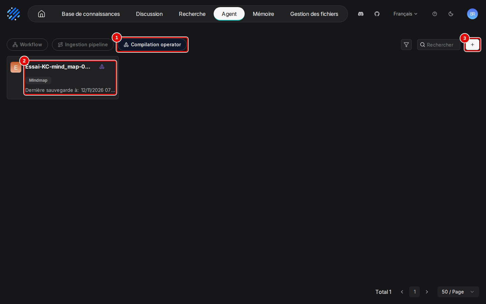

| N° | Élément | Rôle |
|---|---|---|
| 1 | « Compilation operator » | liste des opérateurs de compilation |
| 2 | carte « Essai-KC-mind_map-1835 » | opérateur existant (jeu de démonstration) : nom, gabarit « Mindmap », date ; un clic l'ouvre en modification |
| 3 | « + » | ouvre la page « Add template » de création d'un opérateur |

2. La page « Add template » s'ouvre. Saisir le nom et une description, puis ouvrir la liste « Template ».

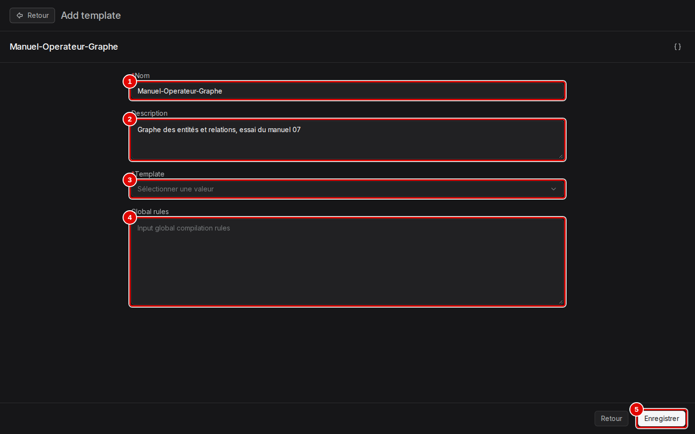

| N° | Élément | Rôle |
|---|---|---|
| 1 | « Nom » | nom de l'opérateur, ici « Manuel-Operateur-Graphe » ; obligatoire |
| 2 | « Description » | texte libre, affiché sur la carte |
| 3 | « Template » | type d'artefact à produire ; obligatoire |
| 4 | « Global rules » | consignes ajoutées à toutes les demandes faites au modèle (langue, style, ce qu'il faut ignorer) ; laissé vide ici |
| 5 | « Enregistrer » | crée l'opérateur |

3. La liste propose six gabarits : « Graph » (graphe de connaissances : entités et relations entre elles), « Mindmap » (carte mentale : un sujet central et ses branches), « PageIndex » (table des matières hiérarchique du document), « Timeline » (frise des événements datés), « Tree » (arbre de résumés, des passages vers un résumé général) et « Wiki » (pages de wiki par sujet, reliées entre elles). Choisir « Graph ».

4. Le gabarit choisi affiche ses réglages propres, sous « Global rules » : « Re-chunk parser output » redécoupe la sortie du Parser avant la compilation, au lieu de reprendre les passages du Chunker ; laissé désactivé.

5. Plus bas, les types d'entités et de relations que le modèle doit chercher. Chaque carte se modifie (crayon) ou se supprime (corbeille) au survol. Cliquer sur « Enregistrer ».

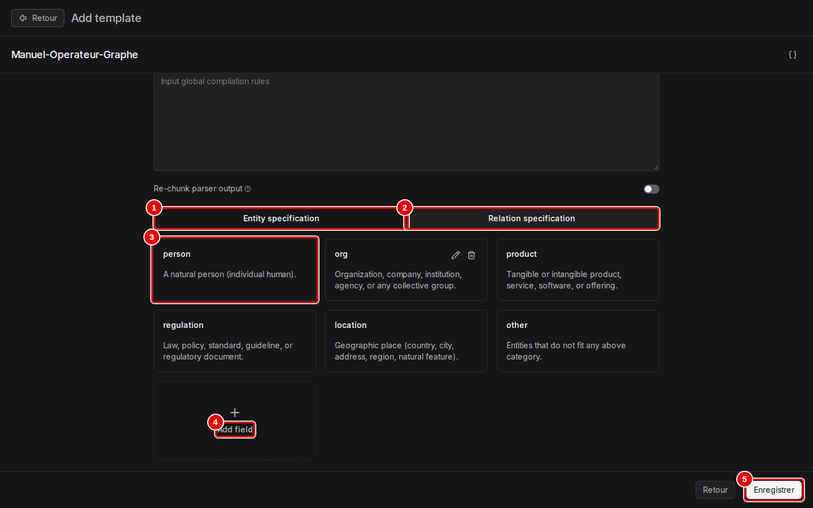

| N° | Élément | Rôle |
|---|---|---|
| 1 | « Entity specification » | types d'entités : `person`, `org`, `product`, `regulation`, `location`, `other`, chacun avec sa définition en anglais |
| 2 | « Relation specification » | types de relations : `owns`, `part_of`, `caused_by`, `regulates`, `located_in`, `other` |
| 3 | carte « person » | un type d'entité : nom et définition donnée au modèle |
| 4 | « Add field » | ajoute un type d'entité ou de relation (par exemple `contrat` pour des documents juridiques) |
| 5 | « Enregistrer » | crée l'opérateur et revient à la liste |

6. L'opérateur apparaît dans la liste de l'étape 1, sous la forme d'une carte « Manuel-Operateur-Graphe » : nom, description, gabarit « Graph », date de dernière sauvegarde.

### Pour aller plus loin

- L'icône d'accolades en haut à droite de la page « Add template » montre la configuration de l'opérateur en JSON. Les autres gabarits ont leurs propres réglages : par exemple « Mindmap » décrit les niveaux `central_topic`, `branch`, `sub_branch`, `keyword` (page de l'opérateur de démonstration ouverte en lecture, `outils/resultats/ragflow/captures/07-knowledge-compilation/reperage-operateur-mindmap.txt`). [Vérifié]
- Les définitions des types sont en anglais ; les noms extraits restent dans la langue du document (« Sophie Le Gall », « Nantes », section 5).

## 3. Créer le pipeline d'ingestion avec un composant Compiler

### Essentiel

But : créer le pipeline « Manuel-Pipeline-Graphe » (lecture, découpage, compilation, indexation) et le publier. Un pipeline d'ingestion se construit dans un canevas : chaque étape est un bloc (nœud), et le « + » à droite d'un bloc propose les étapes qui peuvent suivre.

1. Dans « Agent », cliquer sur l'onglet « Ingestion pipeline », puis sur « + ». Le menu propose trois façons de créer. Choisir « Créer depuis un blanc ».

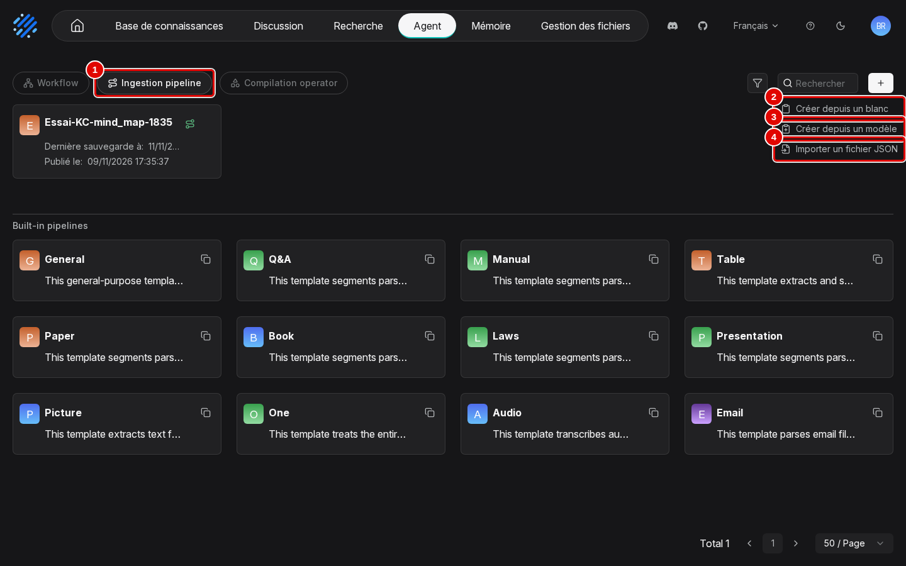

| N° | Élément | Rôle |
|---|---|---|
| 1 | « Ingestion pipeline » | liste des pipelines créés, puis des douze pipelines intégrés (« Built-in pipelines ») |
| 2 | « Créer depuis un blanc » | canevas réduit à « Commencer » et « Parser » |
| 3 | « Créer depuis un modèle » | part d'un gabarit (par exemple « Title Chunker », « Chunk Summary », manuel [08](08-agents.md)) |
| 4 | « Importer un fichier JSON » | recrée un pipeline exporté (même fenêtre que pour un agent, manuel [08](08-agents.md)) |

2. La fenêtre « Create ingestion pipeline » demande un « Nom » (ici « Manuel-Pipeline-Graphe ») : le saisir, puis cliquer sur « Confirmer », qui crée le pipeline et ouvre son canevas.

3. Le canevas s'ouvre avec deux blocs reliés.

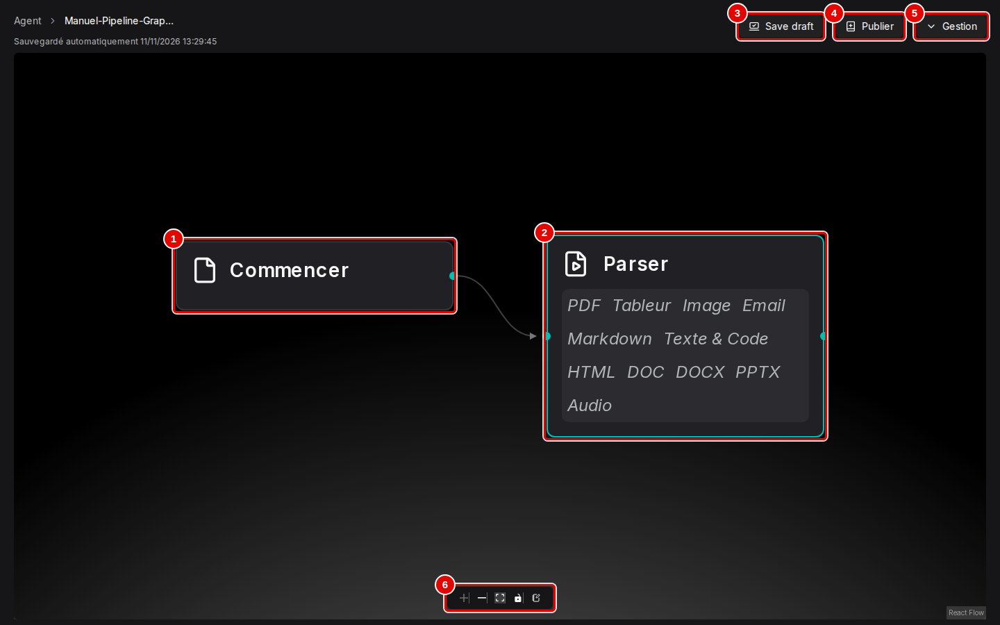

| N° | Élément | Rôle |
|---|---|---|
| 1 | « Commencer » | point d'entrée : le fichier importé dans la base |
| 2 | « Parser » | lit le fichier selon son format (PDF, tableur, image, courriel, Markdown, texte et code, HTML, DOC, DOCX, PPTX, audio) |
| 3 | « Save draft » | enregistre le brouillon (le canevas s'enregistre aussi tout seul, « Sauvegardé automatiquement ») |
| 4 | « Publier » | crée une version utilisable par une base (étape 11) |
| 5 | « Gestion » | menu du pipeline (importer, exporter, réglages ; décrit au manuel [08](08-agents.md)) |
| 6 | commandes du canevas | zoom avant, zoom arrière, « Fit View » (tout afficher), verrouillage du déplacement des blocs |

4. Un clic sur un bloc ouvre son panneau de réglages à droite ; le titre du bloc s'y renomme par le crayon, et la croix en haut à droite ferme le panneau. Celui du « Parser » règle la lecture de chaque format (« PDF » avec « Analyseur PDF » : « DeepDOC » et « Plages de pages », puis « Tableur », « Image » et les autres formats, chacun supprimable par sa corbeille) ; les réglages sont ceux de l'onglet « Parser » de la « Configuration » d'une base, détaillés au manuel [03](03-datasets-et-decoupage.md), section 5, étape 7.

5. Survoler le bloc « Parser » : un « + » apparaît sur son bord droit. Le cliquer : le menu « Étape suivante » propose les découpeurs. Choisir « Découpeur par tokens ».

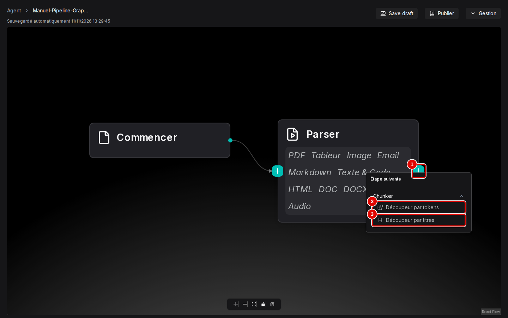

| N° | Élément | Rôle |
|---|---|---|
| 1 | « + » | ajoute une étape après ce bloc |
| 2 | « Découpeur par tokens » | coupe le texte en passages d'une taille donnée (512 jetons par défaut) |
| 3 | « Découpeur par titres » | coupe aux titres du document |

6. Cliquer sur « Save draft », puis sur le « + » du bloc « Chunker ». Le même menu « Étape suivante » propose alors « Indexeur » (indexe les passages, vecteurs et texte intégral : fin d'un pipeline sans compilation), « Compiler » (compile les passages en artefacts avec un opérateur) et « Transformateur » (fait réécrire ou enrichir les passages par un modèle avant l'indexation). Choisir « Compiler ».

7. Cliquer sur « Save draft », puis sur le bloc « Compiler » pour ouvrir son panneau.

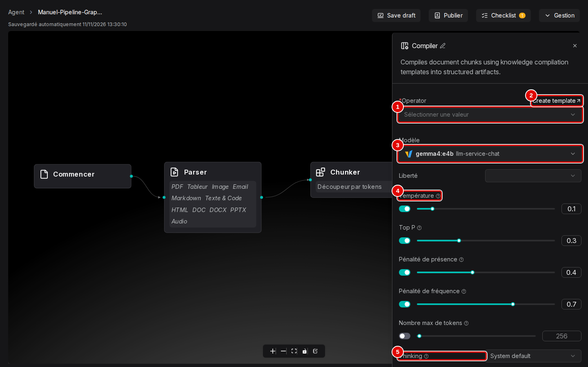

| N° | Élément | Rôle |
|---|---|---|
| 1 | « Operator » | opérateur de compilation à appliquer ; obligatoire (tant qu'il est vide, « Checklist » signale 1 problème) |
| 2 | « Create template » | ouvre la page « Add template » (section 2) dans un nouvel onglet |
| 3 | « Modèle » | modèle de chat qui compile, ici `gemma4:e4b` de l'instance `llm-service-chat` |
| 4 | « Température » | réglages du modèle : « Liberté », « Température » (0,1), « Top P », pénalités, « Nombre max de tokens », comme pour un assistant (manuel [05](05-assistants-et-citations.md)) |
| 5 | « Thinking » | raisonnement du modèle : « System default », « Enabled », « Disabled » |

8. Ouvrir la liste « Operator » et choisir « Manuel-Operateur-Graphe », l'opérateur créé à la section 2 ; la liste propose aussi « Essai-KC-mind_map-1835 », l'opérateur du jeu de démonstration (carte mentale).

9. Cliquer sur « Save draft », puis sur le « + » du bloc « Compiler ». Le menu « Étape suivante » ne propose plus que « Indexeur » et « Transformateur » (voir l'étape 6). Choisir « Indexeur » : c'est la dernière étape, sans laquelle aucun passage n'est cherchable.

10. Le pipeline est complet. Cliquer sur « Save draft ».

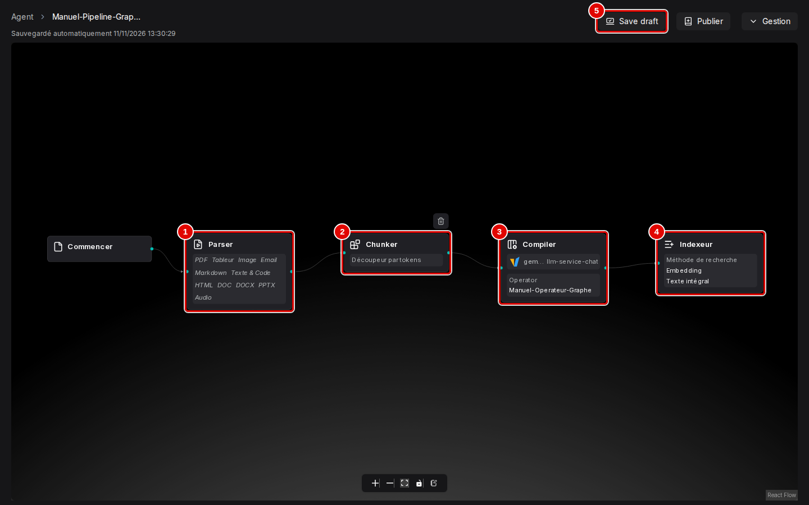

| N° | Élément | Rôle |
|---|---|---|
| 1 | « Parser » | lecture du fichier |
| 2 | « Chunker » | « Découpeur par tokens » |
| 3 | « Compiler » | modèle `gemma4:e4b`, « Operator » « Manuel-Operateur-Graphe » |
| 4 | « Indexeur » | « Méthode de recherche », « Embedding », « Texte intégral » (réglages de l'onglet « Indexer » du manuel [03](03-datasets-et-decoupage.md)) |
| 5 | « Save draft » | enregistre le brouillon |

11. Cliquer sur « Publier ». Saisir un alias de version, puis cliquer sur « Confirmer ».

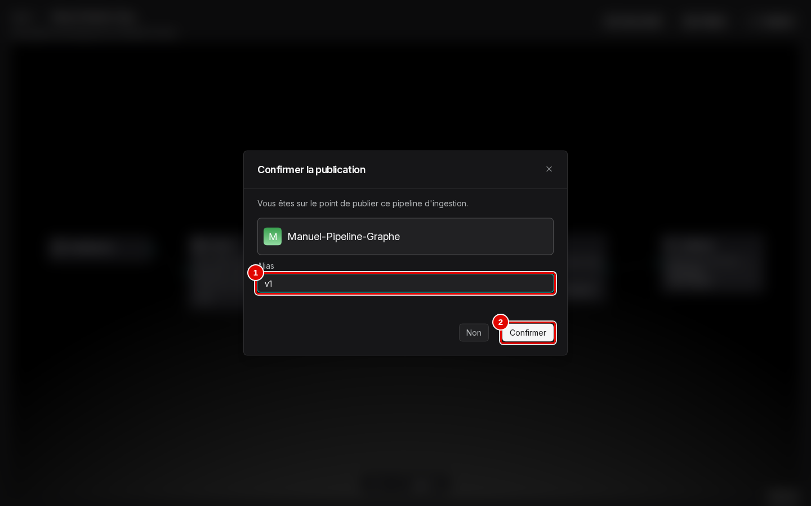

| N° | Élément | Rôle |
|---|---|---|
| 1 | « Alias » | nom court de la version, ici « v1 » |
| 2 | « Confirmer » | publie : la version devient choisissable dans une base |

12. Revenir à « Agent », onglet « Ingestion pipeline » (capture de l'étape 1) : la carte « Manuel-Pipeline-Graphe » porte « Dernière sauvegarde à » et une date « Publié le » ; un clic rouvre le canevas.

### Pour aller plus loin

- Le « + » d'un bloc n'ouvre le menu « Étape suivante » que si ce bloc n'a pas encore d'étape suivante ; pour insérer un bloc au milieu, supprimer d'abord le bloc suivant (corbeille au survol). Après un « Compiler », le menu ne propose plus de second « Compiler » : un pipeline compile un seul type d'artefact. [Vérifié] (`scenario.log`, repérages)
- Modifier un pipeline publié ne change pas la base tant qu'une nouvelle version n'est pas publiée et choisie dans sa « Configuration ».

## 4. Appliquer le pipeline à une base et importer un document

### Essentiel

But : créer la base « Manuel-KC-Graphe », remplacer son gabarit par le pipeline publié, puis importer le compte rendu du CSE.

1. « Base de connaissances », « Créer une base de connaissances » : saisir le nom (« Manuel-KC-Graphe ») et cliquer sur « Enregistrer », dans la fenêtre décrite au manuel [03](03-datasets-et-decoupage.md), section 1, étape 3 (le gabarit proposé, « General », est remplacé à l'étape suivante).

2. Cliquer sur « Configuration » dans le menu de gauche, puis ouvrir la liste « Mode d'analyse ». Les pipelines créés dans « Agent » sont en tête, avant les gabarits « (built in) » (« General » est le gabarit intégré actuel de la base). Cliquer sur « Manuel-Pipeline-Graphe » pour déplier ses versions publiées, puis choisir la version publiée.

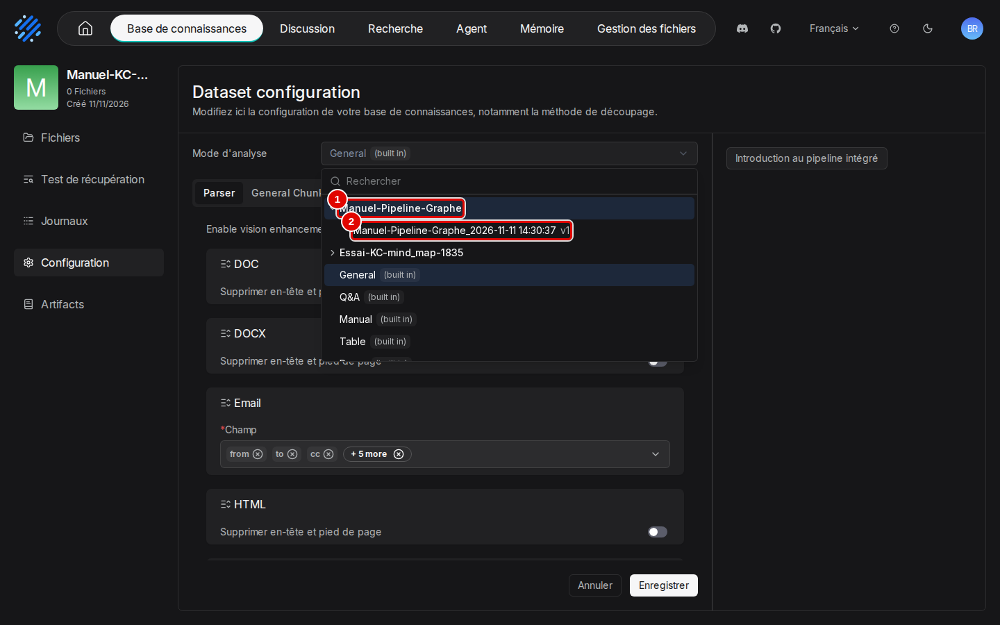

| N° | Élément | Rôle |
|---|---|---|
| 1 | « Manuel-Pipeline-Graphe » | pipeline déplié |
| 2 | « Manuel-Pipeline-Graphe_2026-11-11 14:30:37 v1 » | version publiée : nom, date de publication, alias |

3. « Mode d'analyse » affiche alors « Manuel-Pipeline-Graphe_2026-11-11 14:30:37 v1 », et les onglets en dessous deviennent les étapes du pipeline (« Parser », « Découpeur par tokens », « Compiler », « Indexeur ») ; l'onglet « Compiler » reprend les réglages du canevas, modifiables pour cette base. Cliquer sur « Enregistrer » : le pipeline s'applique aux prochaines analyses, et le choix est relu tel quel après rechargement de la page.

4. Cliquer sur « Fichiers », « Ajouter un fichier », « Téléverser un fichier ». Choisir `cse-2025-10-14.md` (compte rendu fictif du CSE de Vélanor : présidente, secrétaire, décisions, points reportés), activer « Analyser à la création », puis cliquer sur « Enregistrer » (fenêtre du manuel [03](03-datasets-et-decoupage.md), section 2, étape 1) : le pipeline se lance dès le téléversement.

5. Attendre la fin de l'analyse. Dans le tableau des fichiers, « Nombre de segments » indique 1 passage (le document, 159 jetons, tient dans un passage de 512 jetons) et la colonne « Analyser » affiche le pipeline et sa version, « Manuel-Pipeline-Graphe_2026-11-11 14:30:37 v1 », au lieu d'un gabarit.

Ingestion et compilation ont pris 8 s en tout (relevé toutes les 5 s par l'API de suivi). [Vérifié] (`scenario.log`, ligne « ingestion et compilation »)

### Pour aller plus loin

Le même choix se fait fichier par fichier : dans la colonne « Analyser », un clic sur le nom du gabarit ouvre « Changer ou configurer le pipeline d'ingestion. » (manuel [03](03-datasets-et-decoupage.md), section 3). La base de démonstration « Essai-KC-mind_map-1835 » a été réglée à la création, par l'API, avec `parse_type: 2` (section 8).

## 5. Lire les artefacts

### Essentiel

But : lire le graphe produit, puis voir ce qu'affiche une vue dont le type n'a pas été compilé.

1. Dans la base, cliquer sur « Artifacts » dans le menu de gauche. La page des artefacts compilés de la base s'ouvre en plein écran (bouton « Retour » pour revenir).

2. Ouvrir le sélecteur en haut à droite et choisir « Graph ».

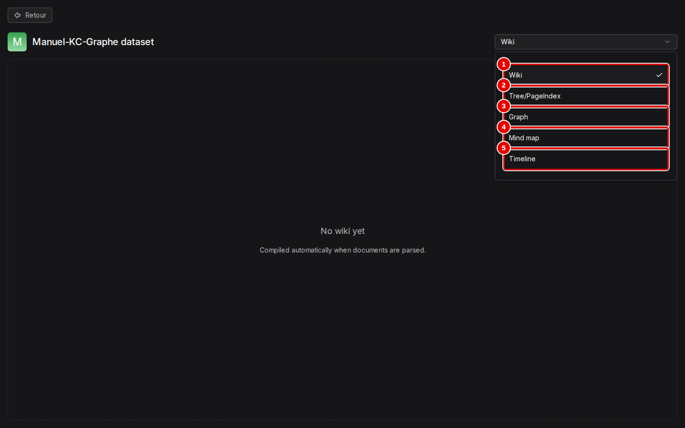

| N° | Élément | Rôle |
|---|---|---|
| 1 | « Wiki » | pages de wiki (gabarit « Wiki ») |
| 2 | « Tree/PageIndex » | arbre de navigation (gabarits « Tree » et « PageIndex ») |
| 3 | « Graph » | graphe de connaissances (gabarit « Graph ») |
| 4 | « Mind map » | carte mentale (gabarit « Mindmap ») |
| 5 | « Timeline » | frise chronologique (gabarit « Timeline ») |

3. La vue « Graph » dessine une pastille par entité, colorée par type, et les relations en traits. La molette zoome, le glisser déplace.

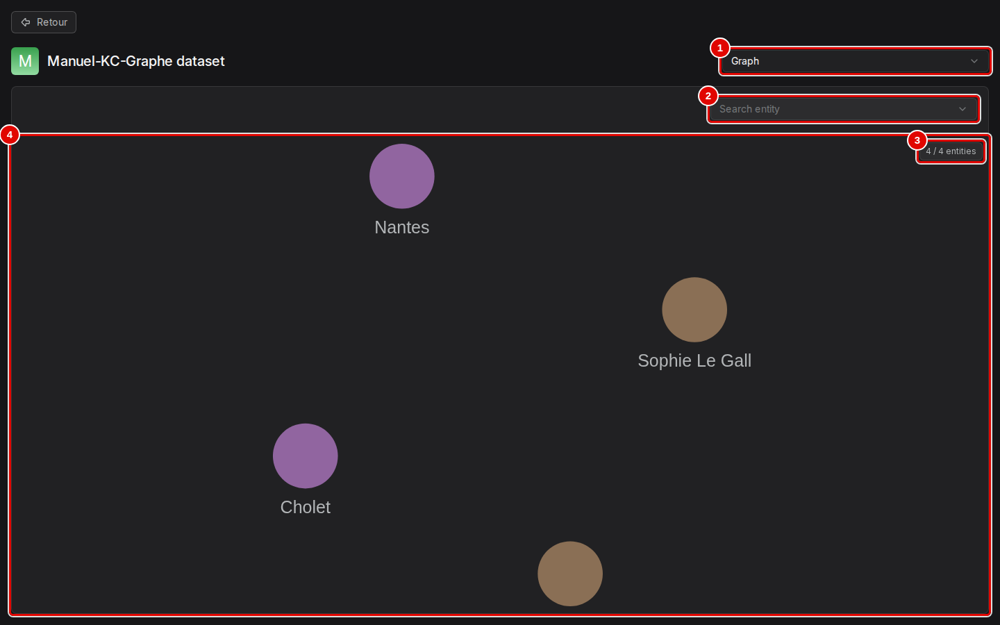

| N° | Élément | Rôle |
|---|---|---|
| 1 | « Graph » | vue choisie |
| 2 | « Search entity » | liste des entités, pour en retrouver une |
| 3 | « 4 / 4 entities » | entités affichées sur le total |
| 4 | graphe | les entités : « Nantes », « Cholet » (lieux), « Sophie Le Gall », « Hélène Marchais » (personnes) |

4. La liste « Search entity » donne les entités par leur nom : « Sophie Le Gall », « Cholet », « Nantes », « Hélène Marchais » ; un choix centre le graphe sur l'entité.

5. Choisir « Wiki » dans le sélecteur : la base n'a pas de wiki, la vue l'indique par « No wiki yet » (visible derrière la liste, capture de l'étape 2), avec « Compiled automatically when documents are parsed. », qui rappelle que la compilation se fait à l'analyse.

Le graphe est exact par rapport au document (présidente Hélène Marchais, secrétaire Sophie Le Gall, sites de Nantes et Cholet) mais pauvre : 4 entités, 0 relation, d'après la même structure lue par l'API. Les élus, la prime d'intéressement et le restaurant d'entreprise n'y figurent pas. [Vérifié] (`scenario.log`, ligne « artefact graph (API) »)

### Pour aller plus loin

Le graphe obtenu le 9 novembre par l'API avec le gabarit intégré `knowledge_graph` comptait 5 entités et 4 relations sur le même document (section 7) : le résultat varie d'un passage à l'autre avec un petit modèle. Pour un graphe plus riche, ajouter des consignes dans « Global rules » (par exemple « relier chaque personne à sa fonction et chaque décision à son montant ») [À tester].

## 6. Les autres types d'artefacts

### Essentiel

Pour montrer chaque vue remplie, la procédure des sections 2 à 4 a été rejouée à la souris pour quatre autres gabarits, une base par gabarit, avec le même document (bases « Manuel-KC-Wiki », « Manuel-KC-Tree », « Manuel-KC-PageIndex », « Manuel-KC-Timeline »). La carte mentale vient de la base de démonstration. [Vérifié] (`scenario.log`, phases `autres` et `vues`)

Résultat : deux gabarits sur quatre ont produit un artefact (« Tree », « Timeline ») ; « Wiki » et « PageIndex » ont échoué, le modèle `gemma4:e4b` ne rendant pas un JSON lisible par RAGFlow. Les deux échecs sont décrits ci-dessous, puis les vues remplies.

But : repérer une compilation en échec et en lire la cause. Les écrans sont ceux de la page « Fichiers » et de l'onglet « Journaux » d'une base (manuel [03](03-datasets-et-decoupage.md), sections 2 et 6) ; seul leur contenu change.

1. Dans la base « Manuel-KC-Wiki », le fichier reste à 0 passage dans « Nombre de segments » : un échec du « Compiler » arrête tout le pipeline, l'« Indexeur » ne tourne pas et le document n'est pas cherchable. La colonne « Analyser » montre un point rouge (échec) et le triangle de relance, qui relance le pipeline sur ce fichier sans fenêtre de confirmation pour un fichier en échec.

2. Cliquer sur « Journaux » : chaque analyse est une tâche, avec son statut. Dans le cadre « Traitement », le compteur « Échec » compte 1 fichier (deux tentatives) ; la colonne « Pipeline d'ingestion » indique « Manuel-Pipeline-Wiki » ; le statut est « Failed », la tâche du dessous étant la première tentative et celle du dessus la relance. L'œil d'une ligne ouvre la fenêtre « Fichier » de la tâche.

3. La fenêtre « Fichier » donne la durée et, sous « Détails », chaque étape horodatée : étapes du pipeline (« Parser », « TokenChunker », « Compiler: Wiki MAP Started ») puis, en orange, « LLM call failed (attempt 1/6): knowledge_compiler: LLM response is not parseable JSON » ; six tentatives, puis « Task failed ».

La tâche a duré 3 min 0 s la première fois et 3 min 3 s à la relance, avec la même erreur. « PageIndex » a échoué de la même façon en 2 min environ. Les heures des « Détails » sont en temps universel (13:39 pour une tâche lancée à 14:39, heure de Paris). [Vérifié] (`outils/resultats/ragflow/captures/07-knowledge-compilation/echec-wiki.log`, `echec-pageindex.log`, `scenario.log`)

But : lire les vues remplies.

4. Base « Manuel-KC-Tree », vue « Tree/PageIndex » : un arbre de navigation à gauche, le détail du nœud choisi à droite.

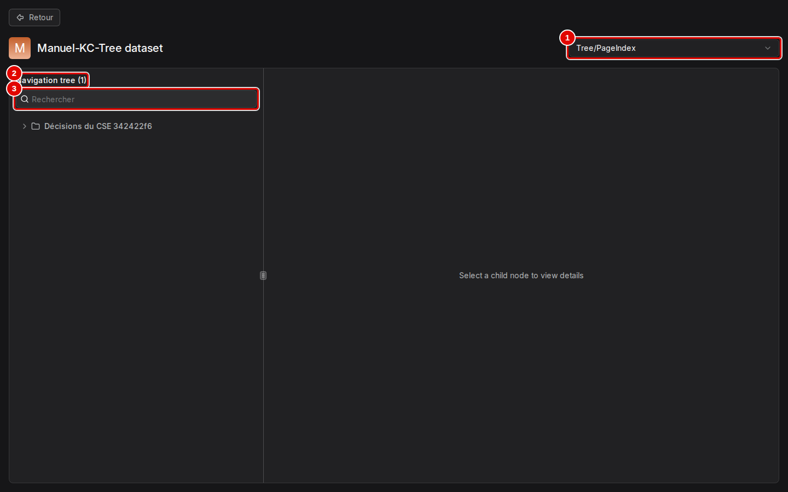

| N° | Élément | Rôle |
|---|---|---|
| 1 | « Tree/PageIndex » | vue choisie |
| 2 | « Navigation tree (1) » | arbre des résumés ; le nombre donne les nœuds de premier niveau |
| 3 | « Rechercher » | filtre les nœuds par leur titre |

5. Cliquer sur un nœud affiche son résumé à droite. Le nœud « Décisions du CSE 342422f6 » porte un titre produit par le modèle et un identifiant ; sa flèche déplie les nœuds enfants. Le détail donne le titre, le nombre de documents résumés (« 1 documents ») et la « Description » : « Ce compte-rendu détaille les décisions prises lors de la réunion du CSE, incluant l'attribution d'une prime d'intéressement, l'autorisation du télétravail, l'ouverture d'un restaurant d'entreprise et le report d'une discussion sur les horaires d'été. »

6. Base « Manuel-KC-Timeline », vue « Timeline » : les événements reliés à leur date.

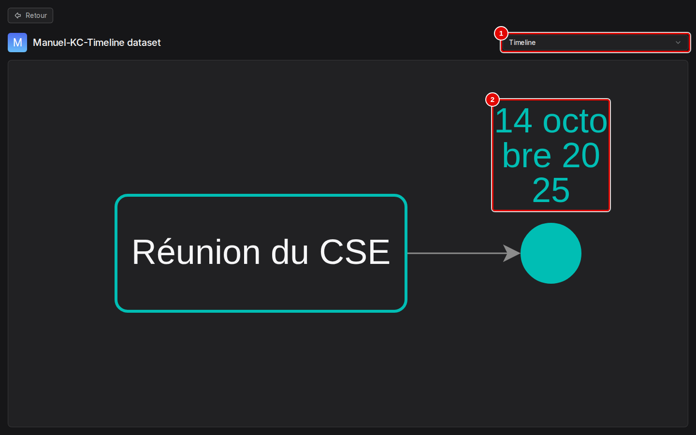

| N° | Élément | Rôle |
|---|---|---|
| 1 | « Timeline » | vue choisie |
| 2 | « 14 octobre 2025 » | date reliée à l'événement « Réunion du CSE » par une flèche |

7. Base de démonstration « Essai-KC-mind_map-1835 », vue « Mind map » : le sujet central à gauche, les branches vers la droite.

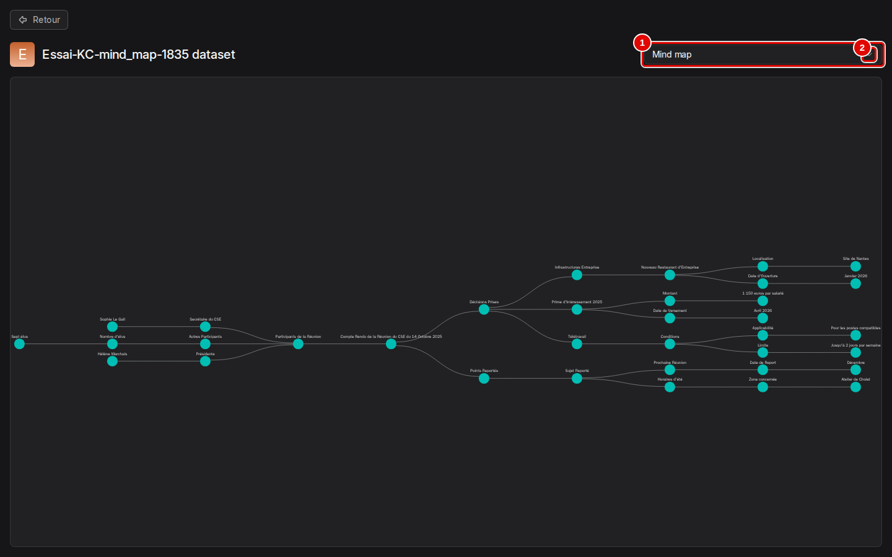

| N° | Élément | Rôle |
|---|---|---|
| 1 | « Mind map » | vue choisie |
| 2 | carte mentale | « Compte Rendu de la Réunion du CSE du 14 Octobre 2025 » au centre, puis « Participants de la Réunion », « Décisions Prises », « Points Reportés » et leurs détails |

La carte mentale est exacte et complète : présidente Hélène Marchais, secrétaire Sophie Le Gall, sept élus ; prime d'intéressement de 1 150 euros versée en avril 2026 ; télétravail jusqu'à deux jours par semaine ; restaurant d'entreprise de Nantes en janvier 2026 ; horaires d'été de l'atelier de Cholet reportés en décembre. La frise, elle, ne garde que la date de la réunion (2 éléments, 1 relation d'après l'API) et oublie avril 2026, janvier 2026 et décembre. [Vérifié] (captures ; `scenario.log`, lignes « artefact timeline (API) » ; `corpus/documents/cse-2025-10-14.md`)

### Pour aller plus loin

- Les échecs « not parseable JSON » viennent de la réponse du modèle, pas du document : un modèle plus grand, ou des consignes « Global rules » qui exigent un JSON strict, seraient à essayer [À tester]. Le gabarit « Tree » a lui aussi reçu une réponse illisible pour une étape secondaire (« tree: claim extraction skipped for batch »), sans faire échouer la tâche. [Vérifié] (`echec-pageindex.log`, première ligne)
- La relance d'un fichier en échec repart de zéro (lecture, découpage, compilation) ; elle n'a pas suffi ici.

## 7. Mesures

### Essentiel

Document : compte rendu du CSE (159 jetons) [Vérifié] :

| Artefact | Chemin | Durée totale (ingestion et compilation) | Résultat |
|---|---|---|---|
| Carte mentale, 1er essai | API, 9 novembre | environ 25 s (`last_completed_at`) | artefact lu à la main, non archivé |
| Carte mentale, 2e essai | API, 9 novembre | 40 s | 35 entités, 34 relations |
| Graphe de connaissances | API, 9 novembre | 15 s | 5 entités, 4 relations (« CSE »…) |
| Graphe de connaissances | souris, 11 novembre | 8 s | 4 entités, 0 relation |
| Arbre (Tree) | souris, 11 novembre | 142 s | 1 nœud résumé, exact |
| Frise (Timeline) | souris, 11 novembre | 5 s | 2 éléments, 1 relation |
| Wiki | souris, 11 novembre | échec après 3 min, deux fois | « LLM response is not parseable JSON » |
| Table des matières (PageIndex) | souris, 11 novembre | échec après 2 min environ | même erreur |

(`outils/resultats/ragflow/essai-2026-11-09-compilation-{mind_map-essai1,mind_map,knowledge_graph}.log` ; `outils/resultats/ragflow/captures/07-knowledge-compilation/scenario.log`)

### Pour aller plus loin

- Le résultat varie d'un passage à l'autre : 5 entités et 4 relations le 9 novembre, 4 entités et aucune relation le 11 pour le même document et le même gabarit [Vérifié].
- Les durées « souris » vont du clic sur « Enregistrer » du téléversement à la fin de la compilation lue par l'API de suivi, relevée toutes les 5 s.
- Sur un document court et avec le modèle sur GPU, la compilation coûte quelques secondes à quelques minutes. Sur le corpus complet, ou sur CPU (environ 15 à 17 jetons/s contre 30 à 62 relevés ici, `outils/resultats/ragflow/preuves-2026-11-09/vllm-extrait.log`), le temps grandit avec le nombre de passages : plusieurs minutes à plusieurs dizaines de minutes [Estimation].

## 8. Par l'API

### Essentiel

Séquence suivie par `outils/ragflow/essai_compilation.py` [Testée] :

| Étape | Appel |
|---|---|
| Opérateur (groupe de gabarits) | `POST /api/v1/compilation-template-groups` avec un gabarit intégré (`kind`, `config`) |
| Pipeline | DSL du pipeline intégré `general` (`GET /api/v1/pipelines/general`) + nœud `Compiler` entre `Extractor` et `Tokenizer` ; `POST /api/v1/agents` avec `canvas_category: "dataflow_canvas"` |
| Publication | `POST /api/v1/agents/{pipeline}/publish` (donne la version) |
| Base en mode pipeline | `POST /api/v1/datasets` avec `parse_type: 2`, `pipeline_id`, `pipeline_version_id` |
| Ingestion | téléversement puis `POST /api/v1/datasets/{base}/documents/parse` |
| Suivi | `GET /api/v1/datasets/{base}/compilation/status?kind=mindmap` (ou `graph`, `timeline`) |
| Lecture | `GET /api/v1/datasets/{base}/artifacts/structure?kind=mindmap` (ou `graph`, `timeline`) |

### Pour aller plus loin

- Piège du suivi : l'état passe de « idle » à « idle » ; la fin se lit au champ `last_completed_at` avec une file vide (`backlog` et `inflight` à 0). Le premier script attendait un état « completed » qui n'arrive jamais et a dû être arrêté à la main. [Vérifié] (`outils/resultats/ragflow/essai-2026-11-09-compilation-mind_map-essai1.log`)
- Un pipeline créé ainsi n'a pas de position pour le nœud `Compiler` dans le graphe du canevas : voir l'avertissement en tête de manuel. Ajouter le nœud aussi dans `dsl.graph.nodes` et `dsl.graph.edges` l'éviterait [À tester].

## Dépannage

| Symptôme | Cause probable | Action |
|---|---|---|
| Onglet « Artifacts » vide (« No wiki yet ») | le sélecteur montre un autre type que celui que la base compile | choisir dans le sélecteur le type de l'opérateur du pipeline |
| « Checklist » signale 1 problème dans le canevas | « Operator » du bloc « Compiler » vide | choisir un opérateur (section 3, étape 8) |
| Le « + » d'un bloc n'ouvre pas « Étape suivante » | le bloc a déjà une étape suivante | supprimer le bloc suivant, ou partir du dernier bloc |
| Le pipeline n'apparaît pas dans « Mode d'analyse » ou sans version | pipeline jamais publié | « Publier » dans le canevas (section 3, étape 11) |
| Le brouillon d'un pipeline créé par l'API a perdu son « Compiler » | canevas ouvert puis enregistré automatiquement sans ce nœud | ne pas ouvrir ce pipeline dans le canevas, ou remettre le DSL de la version publiée (`PUT /api/v1/agents/{id}`) |
| Fichier à 0 passage, point rouge, « Failed » dans « Journaux » ; « LLM response is not parseable JSON » dans le détail | le modèle n'a pas rendu un JSON valide (gabarits « Wiki », « PageIndex » avec `gemma4:e4b`) | relancer une fois ; sinon autre gabarit ou modèle plus grand ; le document n'est pas cherchable tant que le pipeline échoue |
| Script de suivi qui ne s'arrête jamais | attente d'un état « completed » | lire `last_completed_at` avec `backlog` et `inflight` à 0 |
| Création de la base refusée en mode pipeline (API) | version du pipeline absente | publier le pipeline et passer `pipeline_version_id` |

## Sources

- Scénario : `outils/ragflow/captures/manuels_07_15.py` (scénario `compilation`, phases `operateur`, `pipeline`, `base`, `configuration`, `import`, `artefacts`, `autres`, `echec`, `vues`), lancé par `outils/communs/captures/lancer.sh` ; nettoyage : `outils/ragflow/nettoyer_manuel.py`
- Images : `docs/ragflow/img/07-knowledge-compilation/` ; textes des pages et déroulé : `outils/resultats/ragflow/captures/07-knowledge-compilation/`
- Échecs de compilation : `outils/resultats/ragflow/captures/07-knowledge-compilation/echec-wiki.log`, `echec-pageindex.log` (extraits de `/ragflow/logs/ingestor_server.log`) ; incident du canevas : `incident-pipeline-demo.txt`
- Script d'essai par l'API : `outils/ragflow/essai_compilation.py` ; journaux dans `outils/resultats/ragflow/essai-2026-11-09-compilation-*.log`
- Code et documentation au tag v1.0.0 : `docs/guides/knowledge_compilation/`, `internal/agent/templates/compiler.json` ; https://ragflow.io/docs/
