# 08. Agents et gabarits

> **Objet** : construire un agent à la souris à partir d'un gabarit, le relier à une base de connaissances, comprendre chaque bloc du canevas et son panneau de réglages, l'essayer (« Exécuter »), converser avec lui (« Lancer »), le publier, l'exporter et le réimporter, partir d'un canevas vide ; lui donner une mémoire (page « Mémoire ») ; connaître la page « MCP » ; l'interroger enfin par l'API.
> **Prérequis** : [assistants de chat et citations](05-assistants-et-citations.md) (réglages de recherche) ; [Knowledge Compilation](07-knowledge-compilation.md) (canevas d'un pipeline, même principe) ; [API HTTP et SDK Python](10-api-et-sdk.md) pour la partie programmée.
> **Version décrite** : RAGFlow v1.0.0 (image `infiniflow/ragflow:v1.0.0`), Windows 11 + WSL2 (Ubuntu 24.04), LLM-Service branche `service-vllm` (vLLM 0.29.0 : `gemma4:e4b`, `bge-m3`), contexte déclaré de 16 384 jetons.
> **Statut des informations** : [Vérifié] observé ou mesuré les 9 et 11 novembre 2026 sur la machine d'essai (Ryzen 5 9600X, 32 Go, RTX 4060 Ti 16 Go) ; [Source] documentation officielle ou code source au tag v1.0.0 ; [Estimation] calcul non mesuré ; [À tester] non documenté et non essayé.
> **Précautions** : agents « Manuel-Agent-Documentaire », « Manuel-Agent-Importe », « Manuel-Agent-Vierge » et mémoire « Manuel-Memoire » créés par le scénario de captures puis supprimés (`outils/ragflow/nettoyer_manuel.py`) ; la base « Démo Vélanor » est seulement lue par l'outil de recherche ; l'agent « Agent démo Vélanor » du jeu de démonstration n'est pas modifié ; aucun outil en ligne (recherche web, courriel) ni serveur MCP n'est branché.

**Risque — croix des panneaux.** Dans le panneau d'un bloc agent, la croix à droite d'un outil (« Retrieval ») retire l'outil de l'agent, sans confirmation, et l'enregistrement automatique le rend définitif. Seule la croix de l'en-tête du panneau, en haut à droite, ferme le panneau. Observé pendant la mise au point du scénario (outil retiré, agent recréé). [Vérifié] (`outils/resultats/ragflow/captures/08-agents/scenario.log`, et commentaire de `fermer_panneau` dans le scénario)

Toutes les captures de ce manuel viennent du scénario `agents` de `outils/ragflow/captures/manuels_07_15.py`, qui fait chaque geste à la souris, dans l'ordre des sections. Le texte de chaque page capturée et la liste de ses éléments visibles sont dans `outils/resultats/ragflow/captures/08-agents/` (même nom que l'image), le déroulé et les durées dans `scenario.log`. [Vérifié]

## Sommaire

1. [La page « Agent »](#1-la-page--agent-)
2. [Créer un agent depuis un gabarit](#2-créer-un-agent-depuis-un-gabarit)
3. [Le canevas, bloc par bloc](#3-le-canevas-bloc-par-bloc)
4. [Essayer, converser, publier](#4-essayer-converser-publier)
5. [Le menu « Gestion » : variables, paramètres, intégration, export](#5-le-menu--gestion---variables-paramètres-intégration-export)
6. [Importer un fichier JSON](#6-importer-un-fichier-json)
7. [Créer depuis un blanc et ajouter un bloc](#7-créer-depuis-un-blanc-et-ajouter-un-bloc)
8. [Donner une mémoire à l'agent](#8-donner-une-mémoire-à-lagent)
9. [Serveurs MCP](#9-serveurs-mcp)
10. [Interroger l'agent par l'API](#10-interroger-lagent-par-lapi)
11. [Dépannage](#dépannage)
12. [Sources](#sources)

## 1. La page « Agent »

### Essentiel

Un agent est un flux : des blocs reliés, dont au moins un bloc qui interroge un modèle et décide lui-même d'appeler des outils (recherche dans une base, recherche web, code…). Il sert quand une question demande plusieurs étapes ou des outils ; pour des questions simples sur une base, un assistant de « Discussion » (manuel [05](05-assistants-et-citations.md)) suffit.

1. Cliquer sur « Agent » dans la barre du haut. L'onglet « Workflow » liste les agents ; les deux autres onglets servent à l'ingestion (manuel [07](07-knowledge-compilation.md)). Cliquer sur « + ».

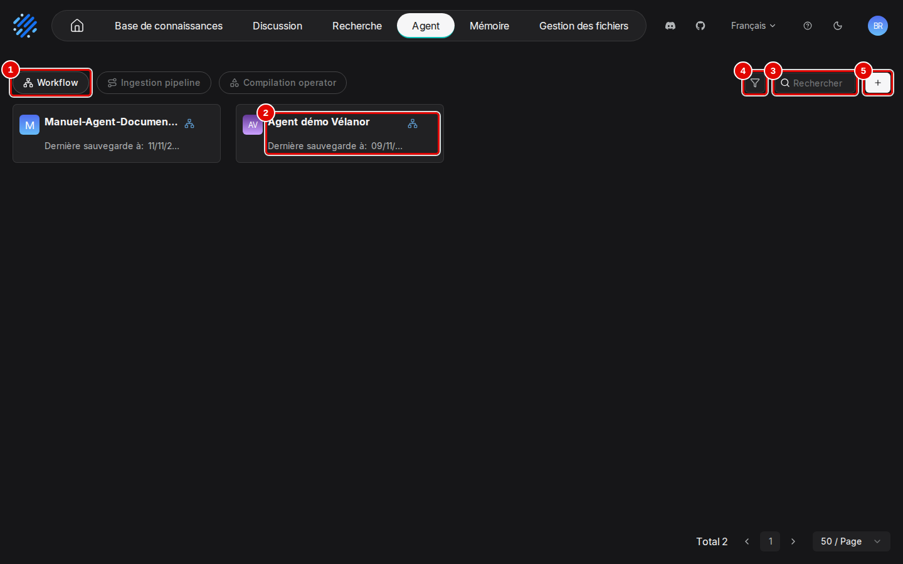

| N° | Élément | Rôle |
|---|---|---|
| 1 | « Workflow » | liste des agents |
| 2 | carte « Agent démo Vélanor » | agent du jeu de démonstration : nom, « Dernière sauvegarde à » ; un clic ouvre son canevas |
| 3 | « Rechercher » | filtre les agents par nom |
| 4 | filtre | entonnoir : filtre la liste |
| 5 | « + » | ouvre le menu de création |

2. Le menu propose trois façons de créer un agent.

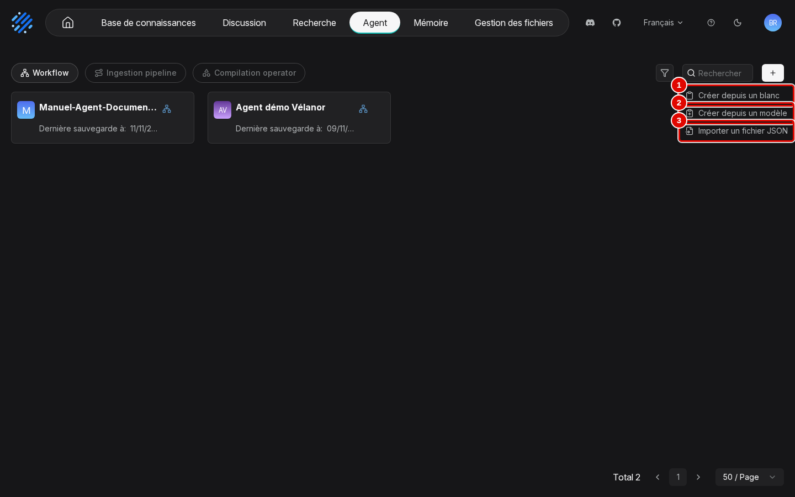

| N° | Élément | Rôle |
|---|---|---|
| 1 | « Créer depuis un blanc » | canevas réduit au bloc « Commencer » (section 7) |
| 2 | « Créer depuis un modèle » | part d'un gabarit prêt à l'emploi (section 2) |
| 3 | « Importer un fichier JSON » | recrée un agent exporté (section 6) |

## 2. Créer un agent depuis un gabarit

### Essentiel

But : créer « Manuel-Agent-Documentaire », un agent qui répond aux questions à partir de la base « Démo Vélanor », depuis le gabarit « Your starter dataset chatbot ».

1. Cliquer sur « Créer depuis un modèle ». La page des gabarits s'ouvre, rangée par catégories. Survoler la carte « Your starter dataset chatbot », puis cliquer sur « Utiliser ».

| N° | Élément | Rôle |
|---|---|---|
| 1 | « Recommandé » | gabarits mis en avant (questions sur une base, recherche approfondie, rédaction…) |
| 2 | « Agent » | gabarits multi-agents ; viennent ensuite « Support client », « Marketing », « Application grand public » |
| 3 | « Autre » | gabarits divers |
| 4 | carte « Your starter dataset chatbot » | « système de questions et réponses fondé sur une base de connaissances » (description en anglais) |
| 5 | « Utiliser » | apparaît au survol ; ouvre la fenêtre de création |

2. La fenêtre « Create workflow » demande un nom, un modèle et, parce que le gabarit contient une étape de recherche sans base, la base à interroger. Saisir le nom, puis ouvrir la liste « Modèle ».

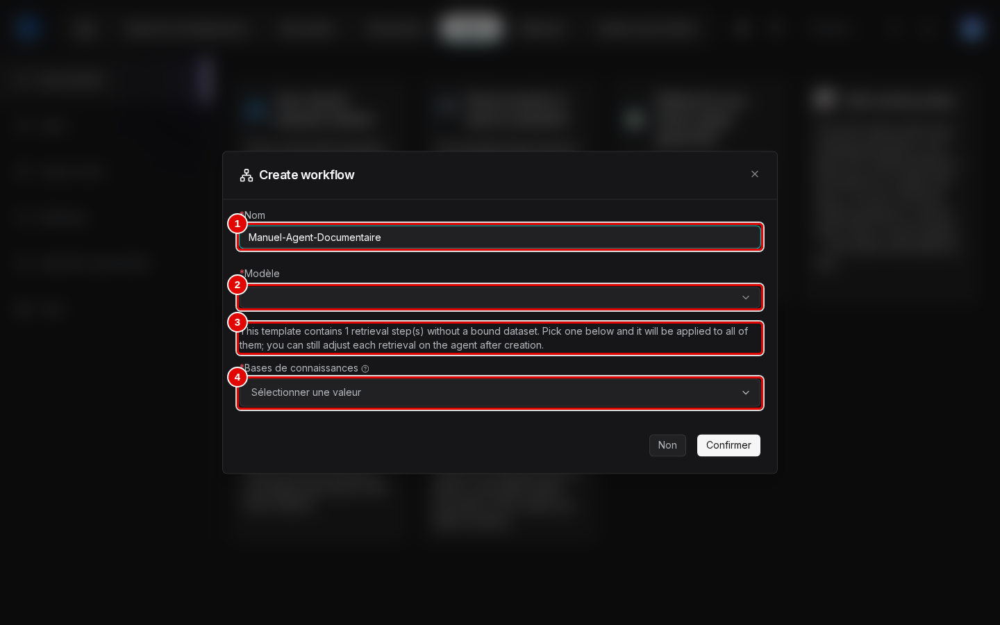

| N° | Élément | Rôle |
|---|---|---|
| 1 | « Nom » | ici « Manuel-Agent-Documentaire » |
| 2 | « Modèle » | modèle de chat de tous les blocs agents du gabarit ; obligatoire |
| 3 | message du gabarit | « This template contains 1 retrieval step(s) without a bound dataset… » : la base choisie sera appliquée à chaque étape de recherche, modifiable ensuite |
| 4 | « Bases de connaissances » | base(s) à interroger ; obligatoire |

3. Choisir `gemma4:e4b`.

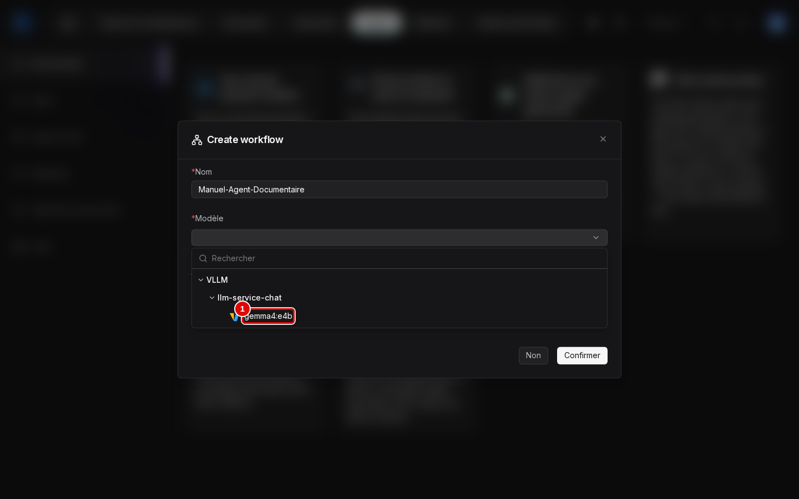

| N° | Élément | Rôle |
|---|---|---|
| 1 | `gemma4:e4b` | modèle de chat de l'instance `llm-service-chat` (manuel [01](01-installation.md)) |

4. Ouvrir la liste « Bases de connaissances » et choisir « Démo Vélanor ».

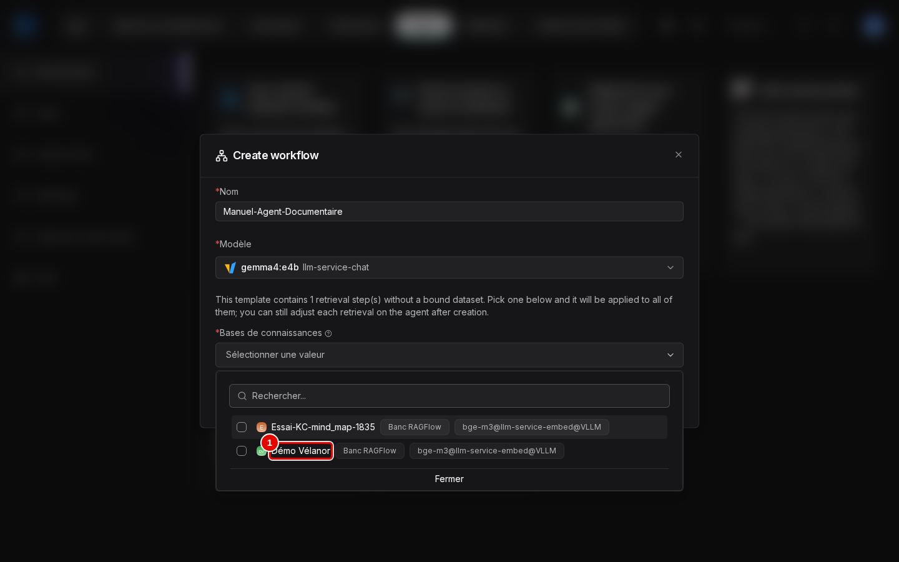

| N° | Élément | Rôle |
|---|---|---|
| 1 | « Démo Vélanor » | base du jeu de démonstration (documents fictifs de l'entreprise Vélanor) |

5. Cliquer sur « Confirmer ».

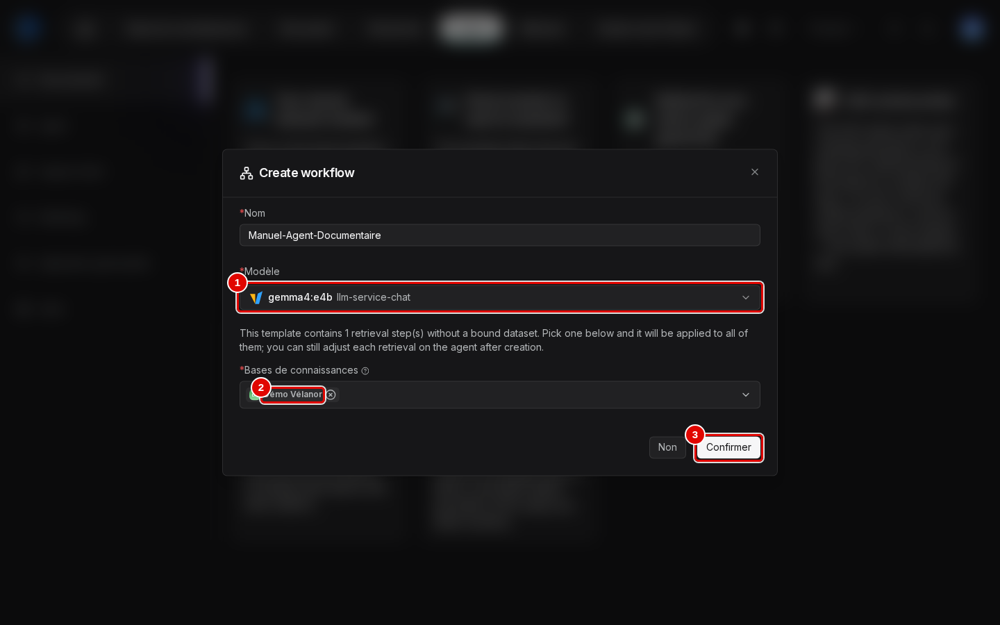

| N° | Élément | Rôle |
|---|---|---|
| 1 | « Modèle » | `gemma4:e4b`, `llm-service-chat` |
| 2 | « Bases de connaissances » | « Démo Vélanor » ; la croix retire la base |
| 3 | « Confirmer » | crée l'agent et ouvre son canevas |

### Pour aller plus loin

La page des gabarits en compte 19, en anglais, dont plusieurs supposent un service en ligne (recherche web Tavily, bourse, courriel) et deux sont des pipelines d'ingestion (« Title Chunker », « Chunk Summary »). La liste se lit aussi par l'API : `GET /api/v1/agents/templates` [Testée]. [Vérifié] (`outils/resultats/ragflow/essai-2026-11-09-agent.log` ; catégories relevées dans `scenario.log`)

## 3. Le canevas, bloc par bloc

### Essentiel

But : comprendre ce que fait chaque bloc de l'agent et où se règle chaque chose.

1. Le canevas montre le flux du gabarit : une question entre par « Commencer », passe par l'agent, qui appelle l'outil de recherche, puis la réponse sort par « Message_0 ».

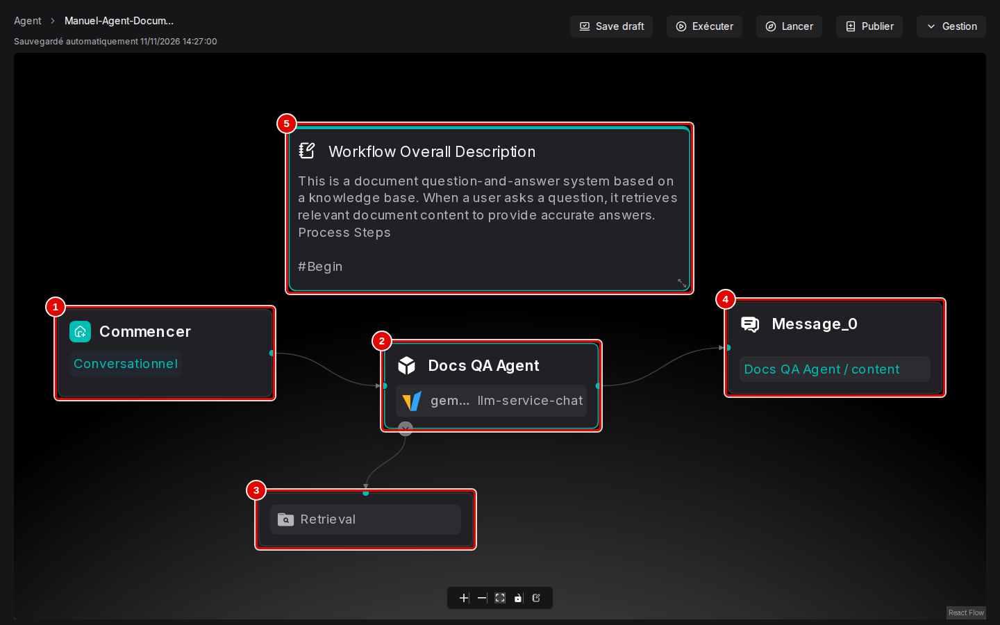

| N° | Élément | Rôle |
|---|---|---|
| 1 | « Commencer » | point d'entrée, mode « Conversationnel » |
| 2 | « Docs QA Agent » | bloc agent : modèle `gemma4:e4b` et consignes |
| 3 | « Retrieval » | outil de l'agent (relié sous lui) : recherche dans la base |
| 4 | « Message_0 » | renvoie la sortie de l'agent (« Docs QA Agent / content ») |
| 5 | note | « Workflow Overall Description » : texte libre, sans effet sur l'exécution |

2. La barre du haut agit sur tout l'agent.

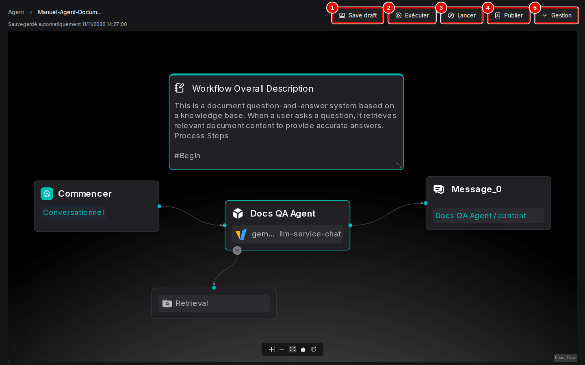

| N° | Élément | Rôle |
|---|---|---|
| 1 | « Save draft » | enregistre le brouillon (le canevas s'enregistre aussi tout seul) |
| 2 | « Exécuter » | essai dans un panneau, sans quitter le canevas (section 4) |
| 3 | « Lancer » | page de conversation avec sessions (section 4) |
| 4 | « Publier » | crée une version (section 4) |
| 5 | « Gestion » | variables, versions, export, paramètres, intégration (section 5) |

3. Cliquer sur « Commencer » : son panneau règle l'accueil et les entrées.

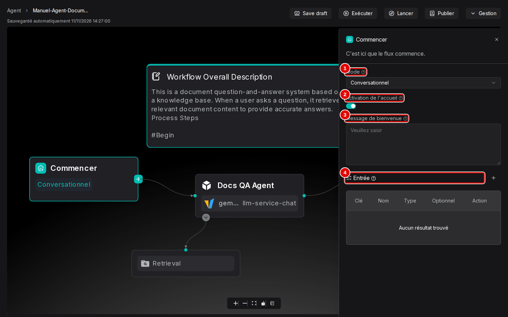

| N° | Élément | Rôle |
|---|---|---|
| 1 | « Mode » | « Conversationnel » : l'agent répond à des messages successifs |
| 2 | « Activation de l'accueil » | affiche un message au début de chaque session |
| 3 | « Message de bienvenue » | texte de ce message |
| 4 | « Entrée » | variables demandées à l'utilisateur avant la conversation (« Clé », « Nom », « Type », « Optionnel ») ; aucune ici |

4. Fermer le panneau par la croix de son en-tête, puis cliquer sur « Docs QA Agent ».

| N° | Élément | Rôle |
|---|---|---|
| 1 | « Modèle » | modèle du bloc ; l'entonnoir filtre la liste par type |
| 2 | « Invite système » | consignes du bloc, en anglais dans le gabarit (« Answer questions EXCLUSIVELY based on information retrieved from the connected knowledge base… ») ; les variables s'insèrent par `/` ou par l'icône « (x) » |
| 3 | essai du bloc | triangle de l'en-tête : exécute ce bloc seul |

5. Plus bas dans le même panneau :

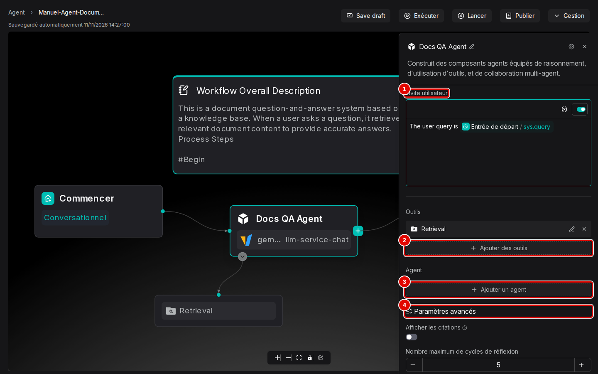

| N° | Élément | Rôle |
|---|---|---|
| 1 | « Invite utilisateur » | message transmis au modèle : « The user query is » suivi de la variable « Entrée de départ / sys.query » (la question posée) |
| 2 | « Ajouter des outils » | ajoute un outil à l'agent ; « Retrieval » est déjà là, avec son crayon (réglages) et sa croix (retrait immédiat) |
| 3 | « Ajouter un agent » | ajoute un sous-agent que cet agent peut appeler (agents en équipe) |
| 4 | « Paramètres avancés » | dépliant ouvert par défaut (étape 6) |

6. Les « Paramètres avancés » de l'agent :

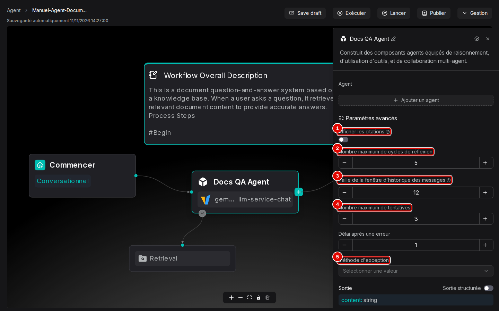

| N° | Élément | Rôle |
|---|---|---|
| 1 | « Afficher les citations » | ajoute les renvois aux passages dans la réponse |
| 2 | « Nombre maximum de cycles de réflexion » | nombre de tours appel d'outil puis réflexion avant de répondre (5) |
| 3 | « Taille de la fenêtre d'historique des messages » | messages précédents de la session gardés dans le contexte |
| 4 | « Nombre maximum de tentatives » | nouvelles tentatives après une erreur du modèle ; « Délai après une erreur » règle l'attente |
| 5 | « Méthode d'exception » | conduite en cas d'échec ; sous la liste, « Sortie » décrit la variable produite (`content: string`) et « Sortie structurée » impose un format JSON |

7. Cliquer sur « Ajouter des outils » : la liste propose les outils intégrés et ceux des serveurs MCP. Appuyer sur Échap pour la refermer sans rien ajouter.

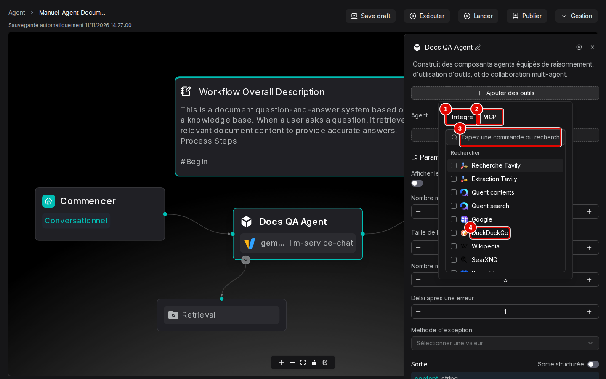

| N° | Élément | Rôle |
|---|---|---|
| 1 | « Intégré » | outils livrés : « Rechercher » (Tavily, Querit, Google, DuckDuckGo, Wikipedia, SearXNG, Keenable, You.com, Sofya, Search1API, YahooFinance, PubMed, BGPT, Google Scholar, ArXiv, WenCai), « Communication » (Email), « Développeur » (GitHub, ExeSQL, Code), « Récupération » |
| 2 | « MCP » | outils des serveurs MCP déclarés (section 9) ; aucun ici |
| 3 | recherche | filtre la liste |
| 4 | « DuckDuckGo » | exemple d'outil web ; la case l'ajoute à l'agent |

8. Fermer le panneau, puis cliquer sur l'outil « Retrieval » sous l'agent.

| N° | Élément | Rôle |
|---|---|---|
| 1 | « Récupération depuis » | « Ensemble de données » (une base) ou « Mémoire » (une mémoire, section 8) |
| 2 | « Démo Vélanor » | base interrogée, reprise de la fenêtre de création ; « Description » au-dessus dit au modèle quand utiliser l'outil |
| 3 | « Paramètres avancés » | réglages de la recherche (étape 9) |

9. Les « Paramètres avancés » de l'outil sont ceux de la recherche d'un assistant (manuel [05](05-assistants-et-citations.md)).

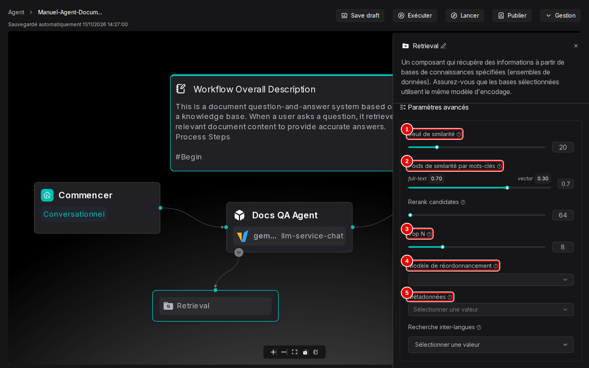

| N° | Élément | Rôle |
|---|---|---|
| 1 | « Seuil de similarité » | score minimal d'un passage (20 %) |
| 2 | « Poids de similarité par mots-clés » | part des mots-clés (full-text 0,70) et des vecteurs (vector 0,30) |
| 3 | « Top N » | nombre de passages transmis au modèle (8) ; « Rerank candidates » (64) au-dessus |
| 4 | « Modèle de réordonnancement » | modèle de reranking, aucun dans le banc |
| 5 | « Métadonnées » | filtre par métadonnées ; « Recherche inter-langues » en dessous |

10. Fermer le panneau, puis cliquer sur « Message_0 ».

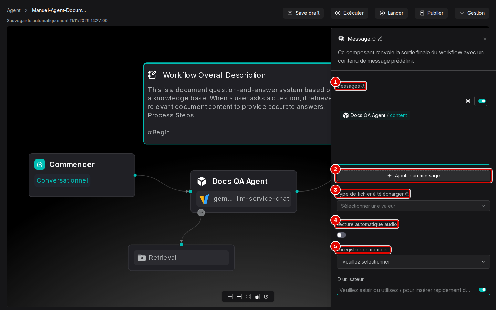

| N° | Élément | Rôle |
|---|---|---|
| 1 | « Messages » | contenu renvoyé : la variable « Docs QA Agent / content » |
| 2 | « Ajouter un message » | ajoute un autre contenu de sortie (texte fixe ou variable) |
| 3 | « Type de fichier à télécharger » | format de fichier dans lequel proposer la réponse au téléchargement [À tester] |
| 4 | « Lecture automatique audio » | lit la réponse à voix haute (demande un « Modèle TTS », absent du banc) |
| 5 | « Enregistrer en mémoire » | mémoire où archiver l'échange (section 8) ; « ID utilisateur » en dessous |

11. Cliquer sur « Save draft ».

## 4. Essayer, converser, publier

### Essentiel

But : vérifier que l'agent répond juste, puis le rendre utilisable.

1. Cliquer sur « Exécuter ». Le panneau « Discussion » s'ouvre à droite. Saisir la question et cliquer sur l'avion en papier.

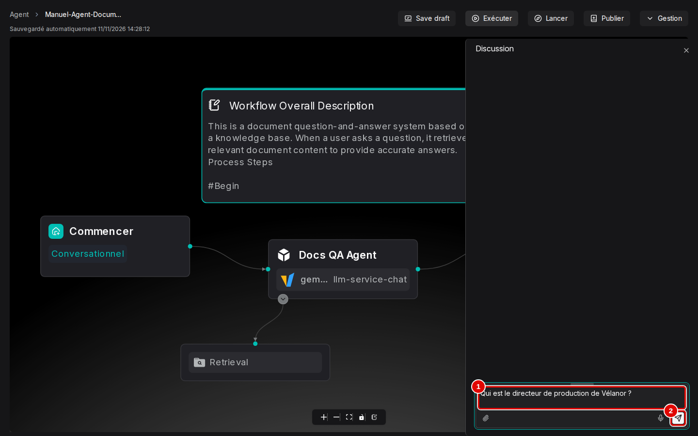

| N° | Élément | Rôle |
|---|---|---|
| 1 | question | « Qui est le directeur de production de Vélanor ? » |
| 2 | « Send message » | lance le flux sur cette question |

2. La réponse s'affiche en 5,4 s ; les icônes au-dessus copient, lisent à voix haute ou affichent le détail de l'exécution.

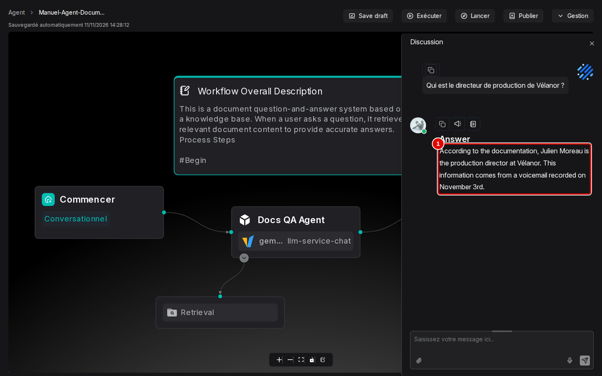

| N° | Élément | Rôle |
|---|---|---|
| 1 | réponse | « According to the documentation, Julien Moreau is the production director at Vélanor. This information comes from a voicemail recorded on November 3rd. » : juste, tirée du message vocal transcrit, mais en anglais |

3. Fermer le panneau, puis cliquer sur « Lancer ». La page de conversation s'ouvre, avec ses sessions.

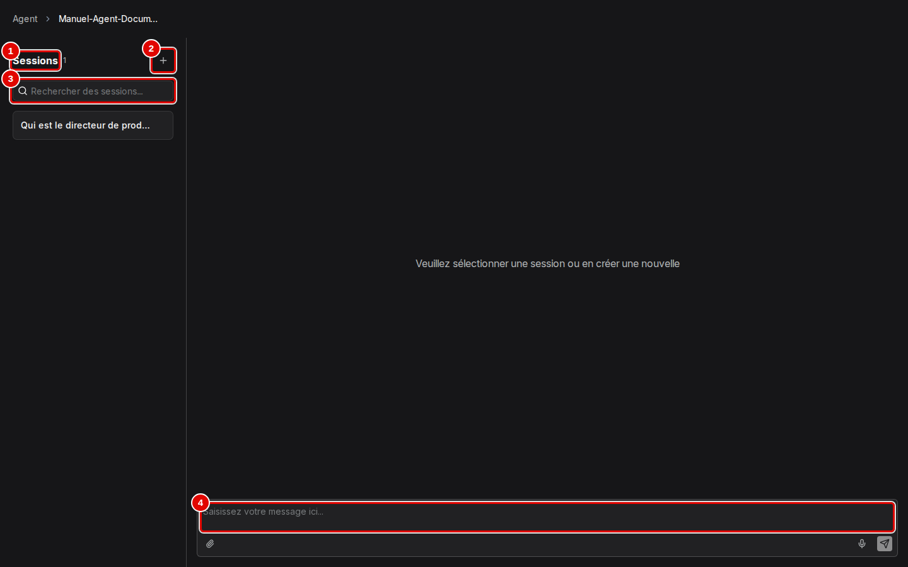

| N° | Élément | Rôle |
|---|---|---|
| 1 | « Sessions » | conversations de l'agent, avec leur nombre |
| 2 | « + » | nouvelle session |
| 3 | « Rechercher des sessions » | filtre les sessions |
| 4 | zone de saisie | question ; trombone (pièce jointe), micro, envoi |

4. Saisir « Quel est le plafond des pénalités de retard du contrat Batterix ? » et appuyer sur Entrée. La réponse arrive en 6,3 s ; la session prend le texte de la question.

| N° | Élément | Rôle |
|---|---|---|
| 1 | session | « Quel est le plafond des pénalités… » ; l'essai de l'étape 1 apparaît aussi comme session |
| 2 | réponse | « …0.5% of the order amount per day of delay, capped at 8% of the order amount », avec la source (« Article 6 » du contrat BX-2025-117) |

5. Revenir au canevas, cliquer sur « Publier », saisir un alias, puis cliquer sur « Confirmer ».

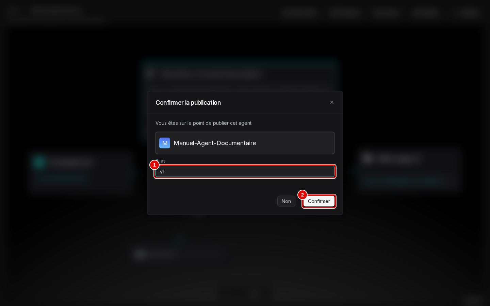

| N° | Élément | Rôle |
|---|---|---|
| 1 | « Alias » | nom court de la version, ici « v1 » |
| 2 | « Confirmer » | publie la version ; l'intégration web et l'API servent la version publiée |

6. « Gestion », « Historique des versions » liste les versions publiées.

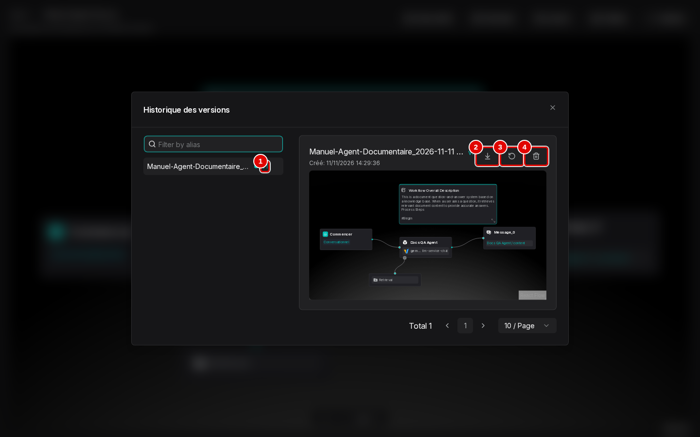

| N° | Élément | Rôle |
|---|---|---|
| 1 | version v1 | « Manuel-Agent-Documentaire_2026-11-11 15:29:36 v1 » et l'aperçu de son canevas |
| 2 | télécharger | exporte cette version en JSON |
| 3 | restaurer | remet cette version dans le brouillon |
| 4 | supprimer | supprime la version |

Les deux réponses sont justes, en anglais, comme le 9 novembre par l'API (section 10). [Vérifié] (`scenario.log`, lignes « réponse dans »)

### Pour aller plus loin

- Pour des réponses en français, traduire l'« Invite système » et l'« Invite utilisateur » du bloc agent [À tester].
- Les heures ne sont pas homogènes : le nom de la version porte l'heure de Paris (15:29:36), la mention « Créé » et « Sauvegardé automatiquement » l'heure universelle (14:29:36). [Vérifié] (`23-historique-des-versions.txt`)

## 5. Le menu « Gestion » : variables, paramètres, intégration, export

### Essentiel

1. Cliquer sur « Gestion ».

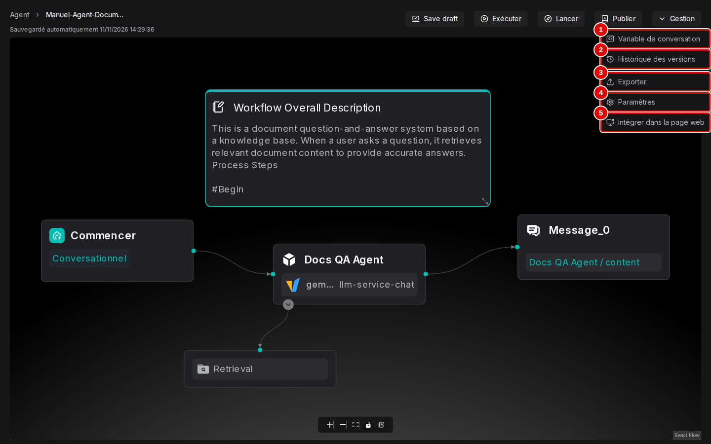

| N° | Élément | Rôle |
|---|---|---|
| 1 | « Variable de conversation » | variables partagées par toute la session |
| 2 | « Historique des versions » | versions publiées (section 4, étape 6) |
| 3 | « Exporter » | télécharge l'agent en JSON (étape 5) |
| 4 | « Paramètres » | titre, photo, description, autorisations |
| 5 | « Intégrer dans la page web » | code à coller dans un site |

2. « Variable de conversation » ouvre une fenêtre vide avec « Ajouter » : une variable déclarée ici se lit et s'écrit dans tous les blocs (par exemple un compteur ou une préférence de l'utilisateur).

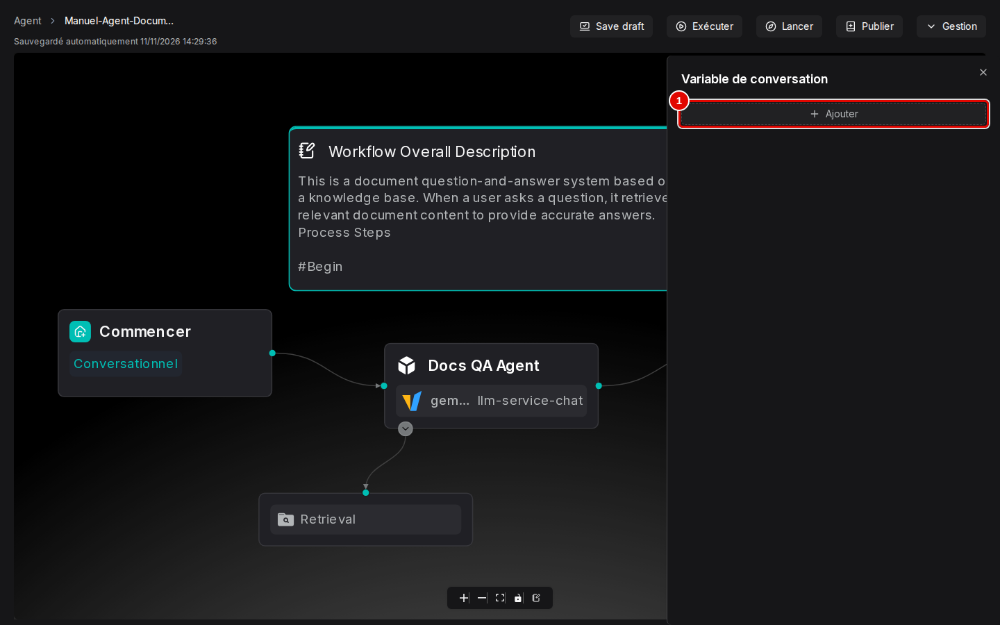

| N° | Élément | Rôle |
|---|---|---|
| 1 | « Ajouter » | déclare une variable |

3. « Paramètres » règle la fiche de l'agent.

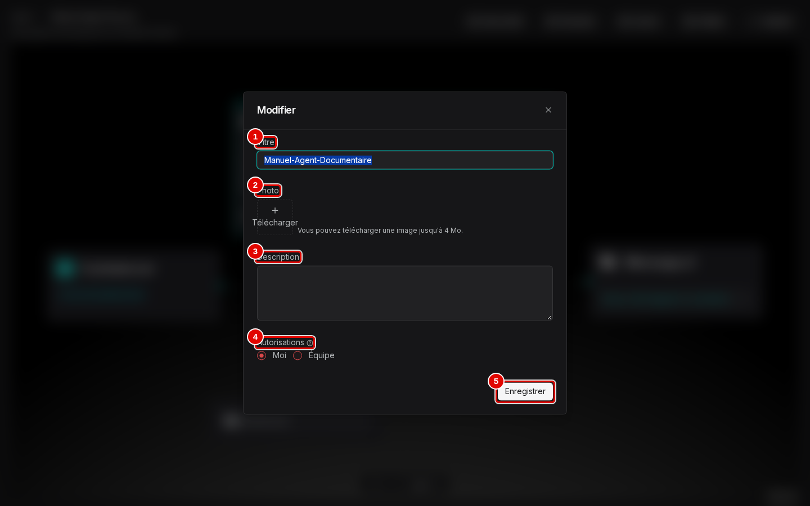

| N° | Élément | Rôle |
|---|---|---|
| 1 | « Titre » | nom de l'agent |
| 2 | « Photo » | « Télécharger » : image de 4 Mo au plus |
| 3 | « Description » | texte libre |
| 4 | « Autorisations » | « Moi » ou « Équipe » (membres de l'équipe, manuel [13](13-exploitation.md)) |
| 5 | « Enregistrer » | applique |

4. « Intégrer dans la page web » donne le code d'intégration ; le jeton d'accès qu'il contient est masqué sur la capture.

| N° | Élément | Rôle |
|---|---|---|
| 1 | « Embed Setup » | réglages : « Type d'intégration » (« Chat plein écran (iframe traditionnel) » ou « Widget flottant (style Intercom) »), « Thème », « Cacher l'avatar », « Publié » |
| 2 | « Widget Customization » | titre, textes et couleurs du widget |
| 3 | « Type d'intégration » | iframe ou widget |
| 4 | « Paramètres régionaux » | langue du widget ; « ID utilisateur » en dessous, puis « Code d'intégration » (masqué) et « Agent ID » |
| 5 | « Ouvrir dans un nouvel onglet » | ouvre la page de conversation partagée |

5. « Gestion », « Exporter » télécharge `Manuel-Agent-Documentaire.json` (13 549 octets : `components`, `globals`, `graph`, `history`, `memory`, `messages`, `path`, `retrieval`, `variables`). [Vérifié] (`scenario.log`, ligne « export »)

### Pour aller plus loin

Le code d'intégration contient un jeton `auth=` qui donne accès à l'agent sans compte : ne le publier que sur un site de confiance, servi en `127.0.0.1` dans ce banc. Les mêmes réglages existent pour un assistant (manuel [05](05-assistants-et-citations.md)).

## 6. Importer un fichier JSON

### Essentiel

But : recréer un agent à partir d'un export, par exemple pour le copier vers une autre installation.

1. « Agent », « + », « Importer un fichier JSON ». Saisir un nom, déposer le fichier exporté dans « DSL », puis cliquer sur « Enregistrer ».

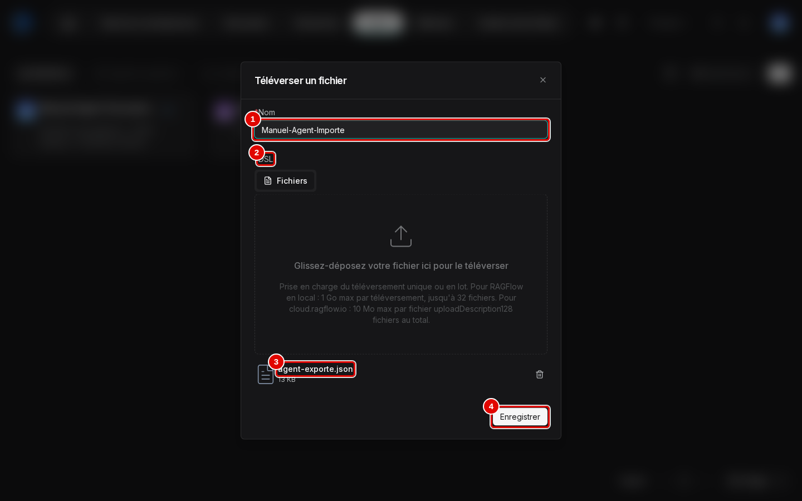

| N° | Élément | Rôle |
|---|---|---|
| 1 | « Nom » | ici « Manuel-Agent-Importe » |
| 2 | « DSL » | le fichier JSON de l'agent (onglet « Fichiers ») |
| 3 | `agent-exporte.json` | fichier exporté à la section 5, étape 5 |
| 4 | « Enregistrer » | crée l'agent et ouvre son canevas |

2. L'agent importé apparaît dans la liste.

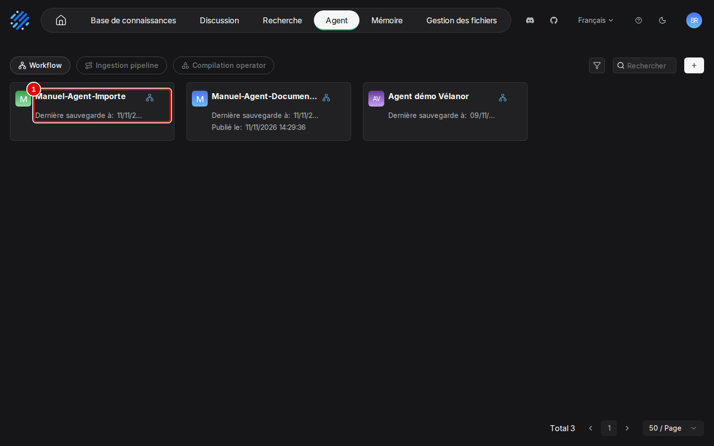

| N° | Élément | Rôle |
|---|---|---|
| 1 | carte « Manuel-Agent-Importe » | copie de « Manuel-Agent-Documentaire » (mêmes blocs, même base) |

## 7. Créer depuis un blanc et ajouter un bloc

### Essentiel

But : partir d'un canevas vide et ajouter un bloc.

1. « Agent », « + », « Créer depuis un blanc », saisir « Manuel-Agent-Vierge » et cliquer sur « Confirmer ». Le canevas ne contient que « Commencer ». Survoler ce bloc et cliquer sur le « + » de son bord droit : le menu « Étape suivante » liste les blocs.

| N° | Élément | Rôle |
|---|---|---|
| 1 | « + » | ajoute un bloc après « Commencer » |
| 2 | « Fondation » | « Agent », « Récupération », « Dialogue », « Message », « En attente de réponse » |
| 3 | « Agent » | bloc agent (modèle, consignes, outils) |
| 4 | « Flux » | « Interrupteur », « Itération », « Boucle », « Catégoriser » : branches et répétitions |
| 5 | « Manipulation des données » | « Code », « Traitement du texte », « Opérations sur les données », « Assignateur de variables », « Opérations sur les listes », « Agrégateur de variables » |
| 6 | « Outils » | outils en blocs : recherche web, ExeSQL, Email, GitHub, « Requête HTTP », « Générateur de Documents »… |

2. Choisir « Récupération », puis cliquer sur « Save draft ». Le bloc est relié à « Commencer ».

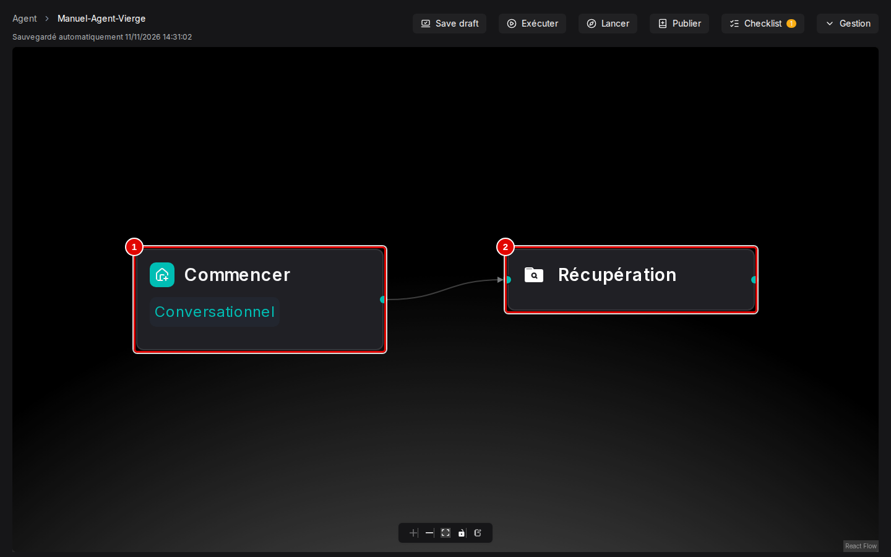

| N° | Élément | Rôle |
|---|---|---|
| 1 | « Commencer » | entrée |
| 2 | « Récupération » | bloc de recherche dans une base, à régler comme l'outil « Retrieval » (section 3, étape 8) ; « Checklist » signale le réglage manquant |

### Pour aller plus loin

Le « + » n'ouvre le menu que sur un bloc sans suite ; les blocs se relient aussi en tirant un trait d'une poignée à l'autre. Le même canevas sert aux pipelines d'ingestion (manuel [07](07-knowledge-compilation.md)).

## 8. Donner une mémoire à l'agent

### Essentiel

Une mémoire garde les échanges d'un agent d'une session à l'autre, vectorisés pour être retrouvés ensuite (par l'outil « Retrieval » réglé sur « Mémoire »). But : créer « Manuel-Memoire » et y enregistrer les échanges de l'agent.

1. Cliquer sur « Mémoire » dans la barre du haut, puis sur « + ».

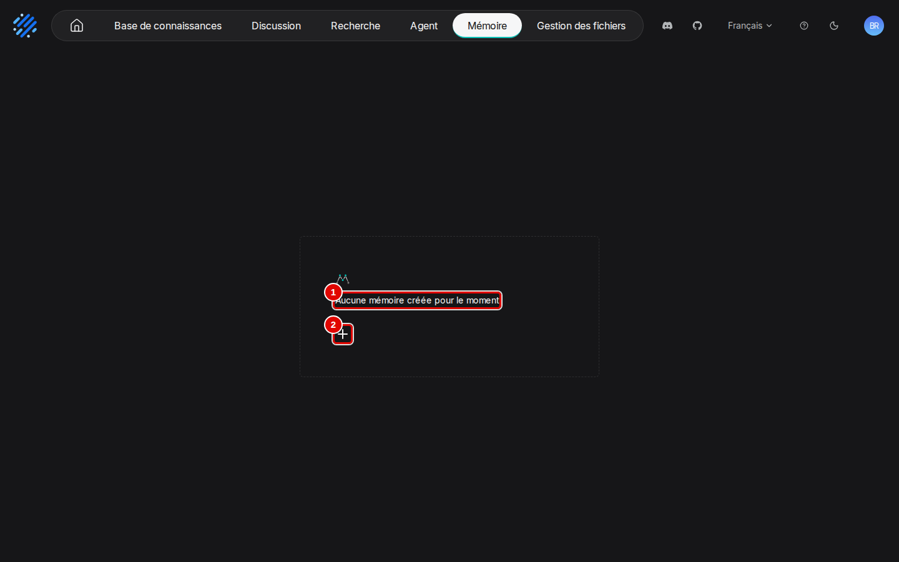

| N° | Élément | Rôle |
|---|---|---|
| 1 | « Aucune mémoire créée pour le moment » | liste des mémoires, vide |
| 2 | « + » | ouvre « Créer une mémoire » |

2. Saisir le nom, garder les modèles proposés, puis ouvrir « Type de mémoire ».

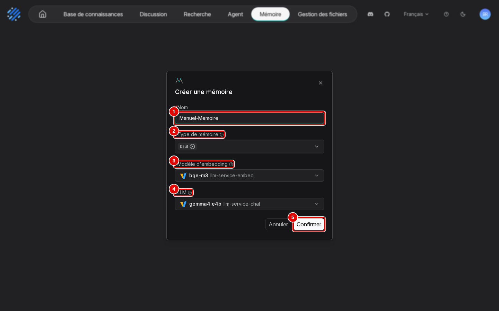

| N° | Élément | Rôle |
|---|---|---|
| 1 | « Nom » | ici « Manuel-Memoire » |
| 2 | « Type de mémoire » | ce qui est gardé (étape 3) |
| 3 | « Modèle d'embedding » | `bge-m3` : vectorise les souvenirs |
| 4 | « LLM » | `gemma4:e4b` : extrait les souvenirs des échanges |
| 5 | « Confirmer » | crée la mémoire |

3. La liste des types permet plusieurs choix. Garder « brut », puis cliquer sur « Fermer » (Échap fermerait toute la fenêtre) et sur « Confirmer ».

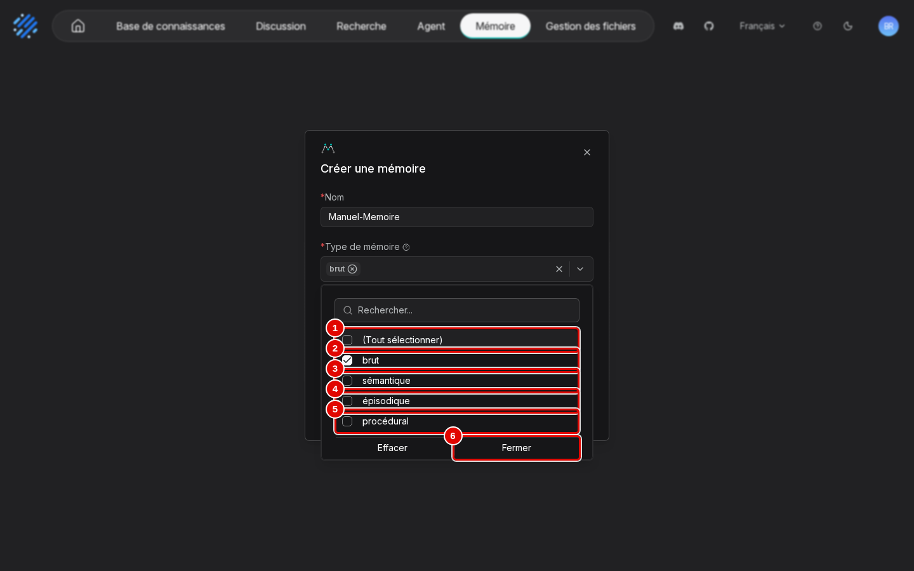

| N° | Élément | Rôle |
|---|---|---|
| 1 | « (Tout sélectionner) » | coche tous les types |
| 2 | « brut » | échanges gardés tels quels |
| 3 | « sémantique » | faits extraits par le modèle |
| 4 | « épisodique » | événements datés |
| 5 | « procédural » | façons de faire |
| 6 | « Fermer » | referme la liste sans fermer la fenêtre |

4. La mémoire apparaît dans la liste. Cliquer dessus.

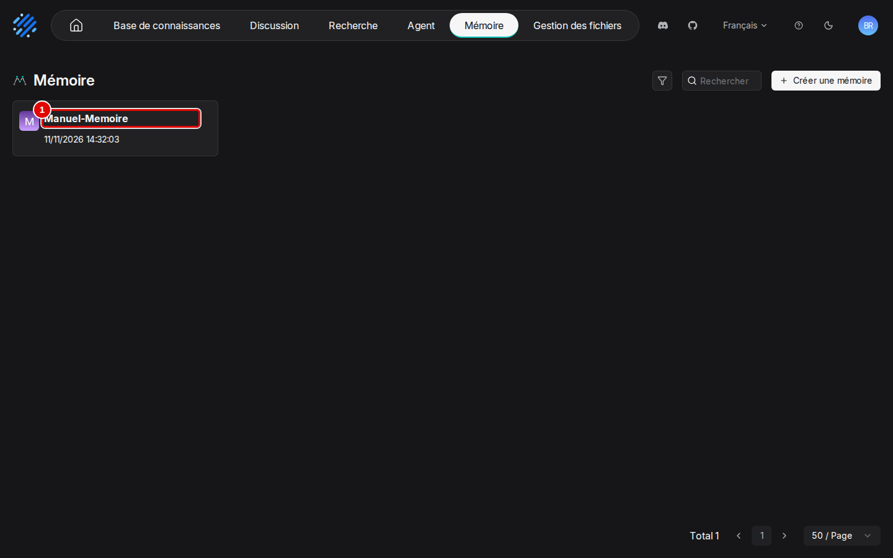

| N° | Élément | Rôle |
|---|---|---|
| 1 | « Manuel-Memoire » | nom et date ; un clic ouvre la mémoire |

5. La page de la mémoire a deux onglets.

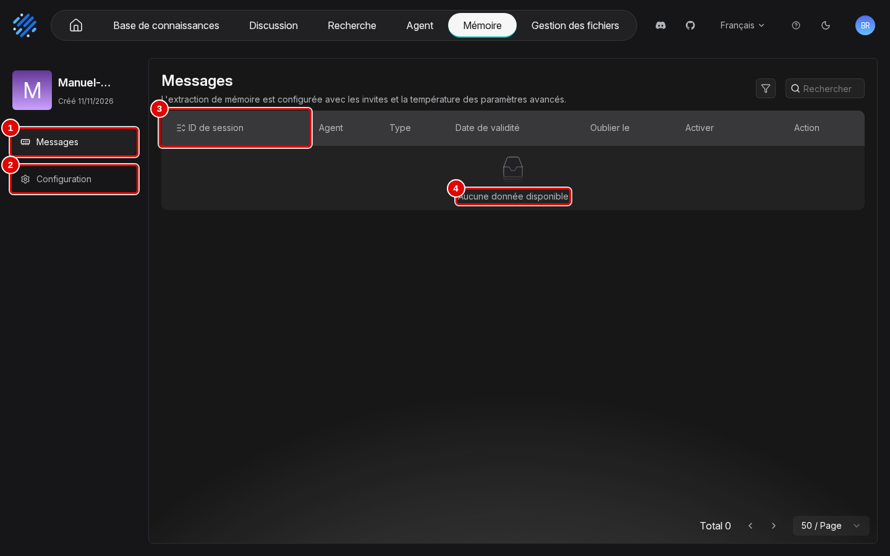

| N° | Élément | Rôle |
|---|---|---|
| 1 | « Messages » | souvenirs enregistrés |
| 2 | « Configuration » | réglages de la mémoire (étape 6) |
| 3 | « ID de session » | colonnes « ID de session », « Agent », « Type », « Date de validité », « Oublier le », « Activer », « Action » |
| 4 | « Aucune donnée disponible » | rien d'enregistré pour l'instant |

6. Cliquer sur « Configuration ».

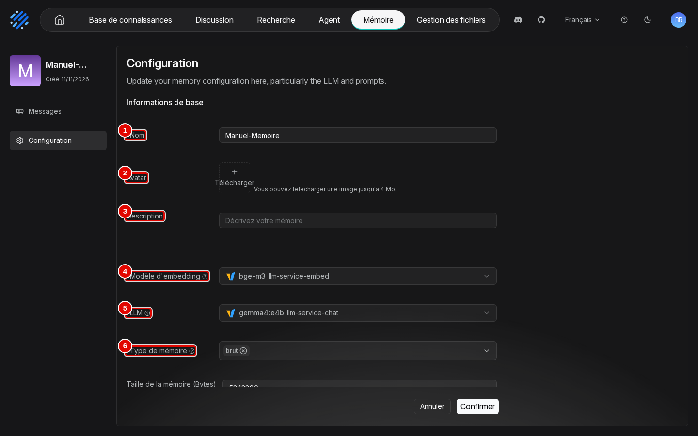

| N° | Élément | Rôle |
|---|---|---|
| 1 | « Nom » | nom de la mémoire |
| 2 | « Avatar » | image |
| 3 | « Description » | texte libre |
| 4 | « Modèle d'embedding » | modèle de vectorisation |
| 5 | « LLM » | modèle d'extraction |
| 6 | « Type de mémoire » | types gardés ; plus bas « Taille de la mémoire (Bytes) » et « Paramètres avancés » (invites et température de l'extraction) |

7. Ouvrir le canevas de « Manuel-Agent-Documentaire », cliquer sur « Message_0 », ouvrir « Enregistrer en mémoire » et choisir « Manuel-Memoire ». Fermer le panneau et cliquer sur « Save draft ».

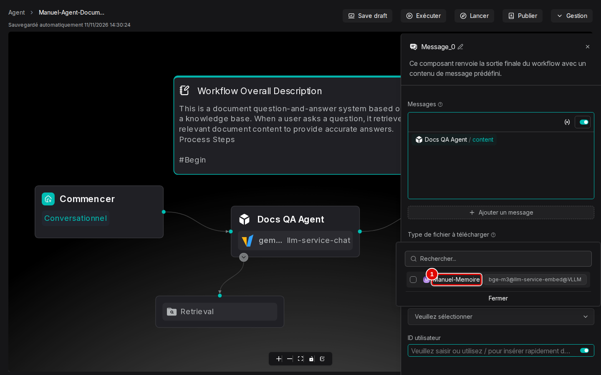

| N° | Élément | Rôle |
|---|---|---|
| 1 | « Manuel-Memoire » | mémoire qui recevra chaque échange de l'agent |

8. « Lancer », « + » (nouvelle session), puis la question « Combien de salariés compte Vélanor au 31 décembre 2025 ? ». L'agent répond 412 salariés, avec le détail par site. Revenir à la mémoire : l'échange y figure.

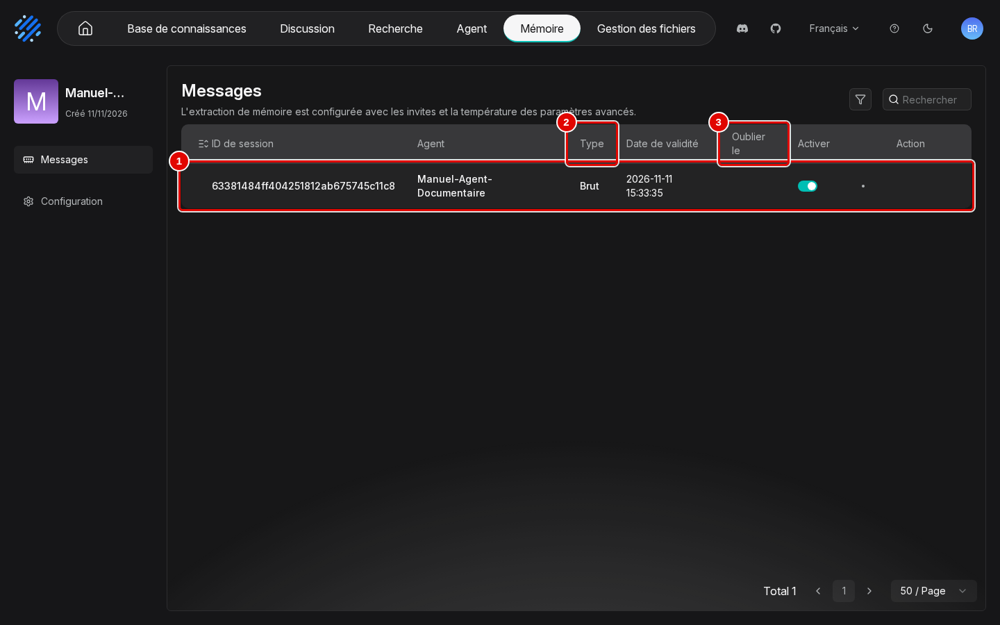

| N° | Élément | Rôle |
|---|---|---|
| 1 | message mémorisé | session, agent « Manuel-Agent-Documentaire », type, date ; l'interrupteur « Activer » le met de côté sans l'effacer |
| 2 | « Type » | « Brut » |
| 3 | « Oublier le » | date d'oubli, vide : gardé sans limite |

Le souvenir est apparu moins de 10 s après la réponse. [Vérifié] (`scenario.log`, lignes « réponse avec mémoire » et « messages de la mémoire »)

### Pour aller plus loin

Relire la mémoire dans une session suivante demande un outil « Retrieval » réglé sur « Récupération depuis » « Mémoire » (section 3, étape 8) : non essayé, [À tester].

## 9. Serveurs MCP

### Essentiel

MCP (Model Context Protocol) est un protocole qui expose des outils (lire un agenda, interroger un logiciel métier…) à un modèle. Un serveur MCP déclaré ici ajoute ses outils à l'onglet « MCP » de « Ajouter des outils » (section 3, étape 7).

1. Cliquer sur l'avatar du compte (pastille aux initiales), puis sur « MCP ».

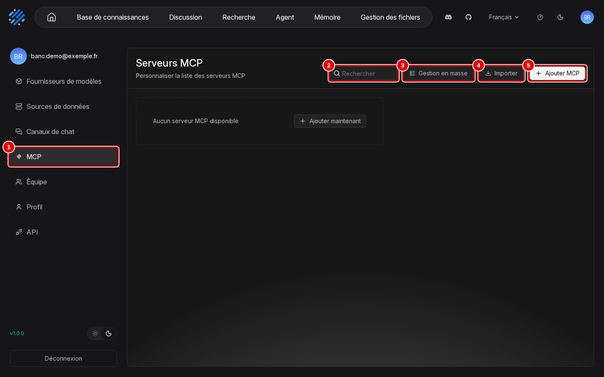

| N° | Élément | Rôle |
|---|---|---|
| 1 | « MCP » | page « Serveurs MCP » : « Aucun serveur MCP disponible » |
| 2 | « Rechercher » | filtre les serveurs |
| 3 | « Gestion en masse » | agit sur plusieurs serveurs à la fois |
| 4 | « Importer » | importe des serveurs déclarés ailleurs |
| 5 | « Ajouter MCP » | ouvre la fenêtre d'ajout (aussi « Ajouter maintenant ») |

2. « Ajouter MCP » demande l'adresse du serveur. La fenêtre est refermée sans enregistrer : le banc n'a pas de serveur MCP.

| N° | Élément | Rôle |
|---|---|---|
| 1 | « Nom » | nom du serveur |
| 2 | « URL » | adresse du serveur MCP |
| 3 | « Type de serveur » | protocole de transport, « sse » par défaut |
| 4 | « Authorization Token » | jeton d'accès au serveur, s'il en demande un |
| 5 | « Enregistrer » | enregistre ; « 0 outils disponibles » se remplit quand le serveur répond |

### Pour aller plus loin

Brancher un vrai serveur MCP et l'utiliser dans un agent : [À tester]. Comme pour les sources de données (manuel [09](09-sources-externes.md)), une adresse privée est probablement refusée tant que `ALLOW_ANY_HOST` vaut 0 [À tester].

## 10. Interroger l'agent par l'API

### Essentiel

L'agent « Agent démo Vélanor » du jeu de démonstration a été créé le 9 novembre par l'API, depuis le même gabarit, par `outils/ragflow/essai_agent.py` (le script renseigne la base et le modèle du gabarit, deux `dataset_ids` et deux `llm_id`).

| Étape | Appel [Testée] |
|---|---|
| Créer l'agent | `POST /api/v1/agents` avec `{"title": "…", "dsl": …}` |
| Ouvrir une session | `POST /api/v1/agents/{agent}/sessions` avec `{}` |
| Poser une question | `POST /api/v1/agents/chat/completions` avec `{"agent_id", "session_id", "question", "stream": false}` |

Résultats [Vérifié] (`outils/resultats/ragflow/essai-2026-11-09-agent.log`) :

| Question | Durée | Réponse (début) |
|---|---|---|
| Qui est le directeur de production de Vélanor ? | 3,0 s | « According to the knowledge base, Julien Moreau is the production director at Vélanor. » |
| Quel est le plafond des pénalités de retard du contrat Batterix ? | 3,6 s | « …0.5% of the order amount per day of delay, capped at 8% of the order amount » |
| Combien de salariés compte Vélanor au 31 décembre 2025 ? (SDK) | 5,2 s | « …is **412 employees** (412 salariés) » |

### Pour aller plus loin

- La réponse est dans `data.data.content`, les passages dans `data.data.reference`.
- Le SDK fonctionne pour les agents : `agent.create_session()` puis `next(iter(session.ask(question, stream=False)))`. C'est l'inverse des assistants de chat, pour lesquels `Session.ask` répond 404 (manuel [10](10-api-et-sdk.md)). [Vérifié] (même journal)
- `RAGFlow.create_agent` du SDK renvoie `None` : retrouver l'agent par `list_agents()`. [Source] (`sdk/python/ragflow_sdk/ragflow.py`)

## Dépannage

| Symptôme | Cause probable | Action |
|---|---|---|
| L'agent répond en anglais à une question en français | consignes du gabarit en anglais | traduire « Invite système » et « Invite utilisateur » du bloc agent |
| L'agent ne trouve rien dans les documents | aucune base dans l'outil « Retrieval » | choisir la base (section 3, étape 8) ou à la création (section 2) |
| L'outil « Retrieval » a disparu de l'agent | croix à droite de l'outil cliquée dans le panneau de l'agent | « Ajouter des outils », « Récupération », puis régler la base ; ou « Historique des versions », restaurer |
| La fenêtre « Créer une mémoire » se ferme en choisissant le type | Échap ferme toute la fenêtre | refermer la liste par « Fermer » |
| « Checklist » signale un problème | bloc sans réglage obligatoire (base, modèle) | ouvrir le bloc signalé et compléter |
| `create_agent` du SDK ne rend pas l'agent | la méthode renvoie `None` | `list_agents()` puis filtrer par titre |

## Sources

- Scénario : `outils/ragflow/captures/manuels_07_15.py` (scénario `agents`, phases `liste`, `modele`, `canevas`, `essai`, `conversation`, `gestion`, `json`, `blanc`, `memoire`, `memoire_page`, `memoire_agent`, `mcp`), lancé par `outils/communs/captures/lancer.sh` ; nettoyage : `outils/ragflow/nettoyer_manuel.py`
- Images : `docs/ragflow/img/08-agents/` ; textes des pages et déroulé : `outils/resultats/ragflow/captures/08-agents/` (jeton du code d'intégration remplacé par `<masqué>`)
- Script et journal de l'API : `outils/ragflow/essai_agent.py`, [essai de l'agent](../../outils/resultats/ragflow/essai-2026-11-09-agent.log)
- Code au tag v1.0.0 : `internal/handler/agent.go`, `sdk/python/ragflow_sdk/` ; https://ragflow.io/docs/
