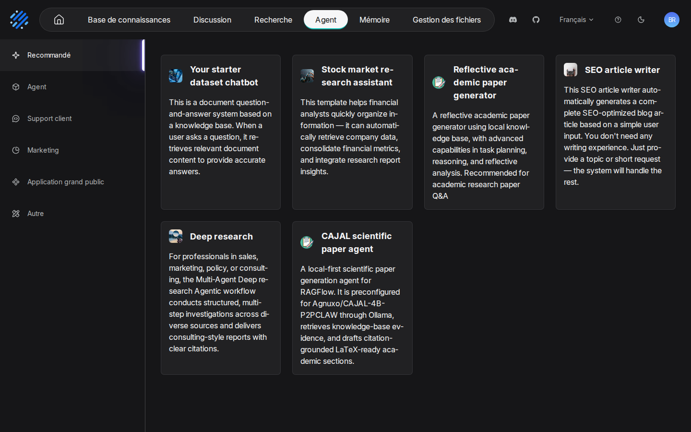
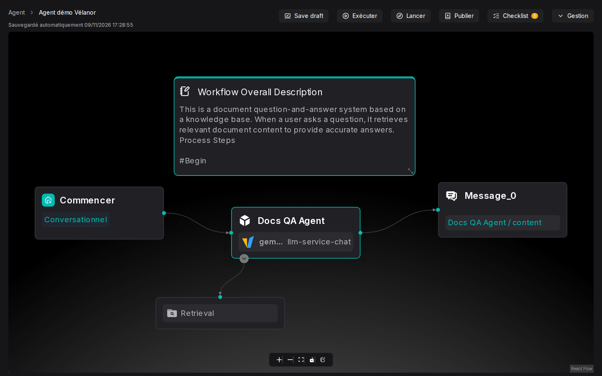

# 08. Agents et gabarits

> **Objet** : construire un agent à partir d'un gabarit, le relier à une base de connaissances et l'interroger par l'interface et par l'API.
> **Prérequis** : [assistants de chat et citations](05-assistants-et-citations.md), [API HTTP et SDK Python](10-api-et-sdk.md) pour la partie programmée.
> **Version décrite** : RAGFlow v1.0.0 (image `infiniflow/ragflow:v1.0.0`), Windows 11 + WSL2 (Ubuntu 24.04), LLM-Service branche `service-vllm` (vLLM 0.29.0 : `gemma4:e4b`, `bge-m3`), contexte déclaré de 16 384 jetons.
> **Statut des informations** : [Vérifié] observé ou mesuré le 9 novembre 2026 sur la machine d'essai (Ryzen 5 9600X, 32 Go, RTX 4060 Ti 16 Go) ; [Source] documentation officielle ou code source au tag v1.0.0 ; [Estimation] calcul non mesuré ; [À tester] non documenté et non essayé.
> **Précautions** : agent « Agent démo Vélanor », relié à la base de démonstration, gardé dans le jeu de démonstration ; gabarits utilisant le web ou des services en ligne non essayés.

## Sommaire

1. [Gabarits disponibles](#1-gabarits-disponibles)
2. [Un agent documentaire complet](#2-un-agent-documentaire-complet)
3. [Interroger l'agent par l'API](#3-interroger-lagent-par-lapi)
4. [Dépannage](#dépannage)
5. [Sources](#sources)

## 1. Gabarits disponibles

### Essentiel

« Agent », puis « Créer depuis un modèle » : 19 gabarits, rangés par catégorie (« Recommandé », « Agent », « Support client », « Marketing », « Application grand public », « Autre »). Exemples : « Your starter dataset chatbot » (questions sur une base), « Deep research », « Text-to-SQL data expert », « WebSearch Assistant », « Trip planner », ainsi que des pipelines d'ingestion (« Title Chunker », « Chunk Summary »). [Vérifié] (`outils/resultats/ragflow/essai-2026-11-09-agent.log`)

### Pour aller plus loin

Les gabarits sont livrés avec des consignes en anglais. Plusieurs supposent un accès au web ou à des services en ligne (recherche web, bourse) : hors du périmètre de ce banc, qui reste local, donc [À tester]. La liste s'obtient aussi par l'API : `GET /api/v1/agents/templates` [Testée].

## 2. Un agent documentaire complet

### Essentiel

Le gabarit « Your starter dataset chatbot » forme un flux en trois blocs : « Commencer » (« Conversationnel »), un agent « Docs QA Agent » équipé de l'outil « Retrieval », puis « Message_0 ». Il suffit de choisir le modèle et la base de connaissances de l'outil « Retrieval ».

| N° | Élément | Rôle |
|---|---|---|
| 1 | « Commencer » | point d'entrée, mode « Conversationnel » |
| 2 | « Docs QA Agent » | modèle `gemma4:e4b` (instance `llm-service-chat`) et ses consignes |
| 3 | « Retrieval » | outil de recherche dans la base « Démo Vélanor » |
| 4 | « Message_0 » | renvoie le contenu produit par l'agent |
| 5 | « Save draft », « Exécuter », « Lancer », « Publier » | brouillon, essai, conversation, version publiée |

[Vérifié] (texte et capture relevés par `outils/ragflow/captures/captures.py`, scénario `agents`)

L'agent a été créé par l'API (`outils/ragflow/essai_agent.py`) ; le même résultat s'obtient à la souris depuis le gabarit [Source].

### Pour aller plus loin

Dans le gabarit, la base de l'outil « Retrieval » et le modèle sont vides : le script les renseigne (deux `dataset_ids`, deux `llm_id`) avant la création. [Vérifié] (`outils/resultats/ragflow/essai-2026-11-09-agent.log`)

## 3. Interroger l'agent par l'API

### Essentiel

| Étape | Appel [Testée] |
|---|---|
| Créer l'agent | `POST /api/v1/agents` avec `{"title": "…", "dsl": …}` |
| Ouvrir une session | `POST /api/v1/agents/{agent}/sessions` avec `{}` |
| Poser une question | `POST /api/v1/agents/chat/completions` avec `{"agent_id", "session_id", "question", "stream": false}` |

Résultats [Vérifié] (`outils/resultats/ragflow/essai-2026-11-09-agent.log`) :

| Question | Durée | Réponse (début) |
|---|---|---|
| Qui est le directeur de production de Vélanor ? | 3,0 s | « According to the knowledge base, Julien Moreau is the production director at Vélanor. » |
| Quel est le plafond des pénalités de retard du contrat Batterix ? | 3,6 s | « …0.5% of the order amount per day of delay, capped at 8% of the order amount » |
| Combien de salariés compte Vélanor au 31 décembre 2025 ? (SDK) | 5,2 s | « …is **412 employees** (412 salariés) » |

Les trois réponses sont justes, mais en anglais : les consignes du gabarit sont en anglais. Les traduire dans le bloc « Docs QA Agent » est nécessaire pour un usage en français [À tester].

### Pour aller plus loin

- La réponse est dans `data.data.content`, les passages dans `data.data.reference`.
- Le SDK fonctionne pour les agents : `agent.create_session()` puis `next(iter(session.ask(question, stream=False)))`. C'est l'inverse des assistants de chat, pour lesquels `Session.ask` répond 404 (manuel [10](10-api-et-sdk.md)). [Vérifié] (même journal)
- `RAGFlow.create_agent` du SDK renvoie `None` : retrouver l'agent par `list_agents()`. [Source] (`sdk/python/ragflow_sdk/ragflow.py`)

## Dépannage

| Symptôme | Cause probable | Action |
|---|---|---|
| L'agent répond en anglais à une question en français | consignes du gabarit en anglais | traduire les consignes du bloc agent |
| L'agent ne trouve rien dans les documents | aucune base choisie dans l'outil « Retrieval » | renseigner la base (`dataset_ids`) |
| `create_agent` du SDK ne rend pas l'agent | la méthode renvoie `None` | `list_agents()` puis filtrer par titre |

## Sources

- Script et journal : `outils/ragflow/essai_agent.py`, [essai de l'agent](../../outils/resultats/ragflow/essai-2026-11-09-agent.log)
- Captures : `outils/ragflow/captures/captures.py`, scénario `agents`
- Code au tag v1.0.0 : `internal/handler/agent.go`, `sdk/python/ragflow_sdk/` ; https://ragflow.io/docs/
