# 09. Sources externes

> **Objet** : déclarer une source de données à la souris (page « Sources de données » du menu du compte), la tester, la lier à une base par « Lier une source de données », lire son journal de synchronisation ; comprendre la protection qui refuse les adresses privées et comment l'essai autorisé s'est passé ; connaître la page « Canaux de chat ».
> **Prérequis** : [datasets et découpage](03-datasets-et-decoupage.md) (onglets « Configuration » et « Journaux » d'une base).
> **Version décrite** : RAGFlow v1.0.0 (image `infiniflow/ragflow:v1.0.0`), Windows 11 + WSL2 (Ubuntu 24.04), LLM-Service branche `service-vllm` (vLLM 0.29.0 : `gemma4:e4b`, `bge-m3`), contexte déclaré de 16 384 jetons.
> **Statut des informations** : [Vérifié] observé ou mesuré les 9 et 11 novembre 2026 sur la machine d'essai (Ryzen 5 9600X, 32 Go, RTX 4060 Ti 16 Go) ; [Source] documentation officielle ou code source au tag v1.0.0 ; [Estimation] calcul non mesuré ; [À tester] non documenté et non essayé.
> **Précautions** : site de test fictif servi localement (conteneur `rag-site-test`, image `nginx:alpine`, pages de `outils/ragflow/site-test/`), supprimé après l'essai ; source « Manuel-Source-Sitemap » et base « Manuel-Sources » créées par le scénario de captures puis supprimées (`outils/ragflow/nettoyer_manuel.py`) ; `ALLOW_ANY_HOST` laissé à 0 pendant les captures ; connecteurs et canaux qui exigent un compte en ligne hors périmètre.

**Risque — réglage `ALLOW_ANY_HOST`.** Pour ingérer un site interne, il faut autoriser les adresses privées (`ALLOW_ANY_HOST=1`). Ce réglage vaut pour tout le serveur : les agents et leurs outils web peuvent alors joindre les machines du réseau local (attaque dite SSRF). Il n'a été activé que le temps d'un essai, le 9 novembre, puis remis à 0 ; il vaut 0 le 11 novembre (`docker exec rag-ragflow-server printenv ALLOW_ANY_HOST`). [Vérifié] (`outils/resultats/ragflow/essai-2026-11-09-sitemap-autorise.log`, `outils/resultats/ragflow/captures/09-sources-externes/scenario.log`) [Source] (`internal/common/allow_private_host.go`)

Une capture par écran nouveau ; les étapes qui reviennent sur un écran déjà montré sont décrites sans nouvelle capture. Toutes les captures de ce manuel viennent du scénario `sources` de `outils/ragflow/captures/manuels_07_15.py`, qui fait chaque geste à la souris, dans l'ordre des sections. Le texte de chaque page capturée et la liste de ses éléments visibles sont dans `outils/resultats/ragflow/captures/09-sources-externes/` (même nom que l'image), le déroulé et la correspondance avec les noms de capture d'origine dans `scenario.log`. [Vérifié]

## Sommaire

1. [Déclarer une source de données](#1-déclarer-une-source-de-données)
2. [Lier la source à une base et suivre la synchronisation](#2-lier-la-source-à-une-base-et-suivre-la-synchronisation)
3. [Pourquoi un site local est refusé](#3-pourquoi-un-site-local-est-refusé)
4. [Sitemap avec adresses privées autorisées](#4-sitemap-avec-adresses-privées-autorisées)
5. [Canaux de chat](#5-canaux-de-chat)
6. [Par l'API](#6-par-lapi)
7. [Dépannage](#dépannage)
8. [Sources](#sources)

## 1. Déclarer une source de données

### Essentiel

Une source de données (connecteur) est un système externe que RAGFlow relit à intervalle régulier pour garder une base à jour : un wiki, un espace de stockage, une messagerie, un site web. Elle se déclare une fois dans le menu du compte, puis se lie à une ou plusieurs bases. But : déclarer le site de test par son plan de site (`sitemap.xml`, la liste des pages d'un site).

1. Cliquer sur l'avatar du compte (pastille aux initiales, en haut à droite), puis sur « Sources de données ». La page affiche en haut les sources déjà déclarées (« Aucune source de données ajoutée. Sélectionnez-en une ci-dessous pour vous connecter. »), puis « Sources disponibles » : une carte par connecteur, avec son nom, sa description et « Ajouter » au survol.

2. Les connecteurs proposés sont : Confluence, Notion, Google Drive, Feishu Wiki, Gmail, Google Cloud Storage, Oracle Storage, S3, R2, Jira, Box, Dropbox, Bitbucket, Azure DevOps, GitLab, GitHub, Moodle, Discord, Xquik, Zendesk, Zotero, WebDAV, Airtable, Asana, IMAP, Dingtalk AI Table, SeaFile, MySQL, PostgreSQL, BigQuery, REST API, RSS, Sitemap, OneDrive, Outlook, Salesforce, Azure Blob Storage, Microsoft Teams, Slack, SharePoint. Faire défiler jusqu'à « Sitemap », la survoler et cliquer sur « Ajouter ».

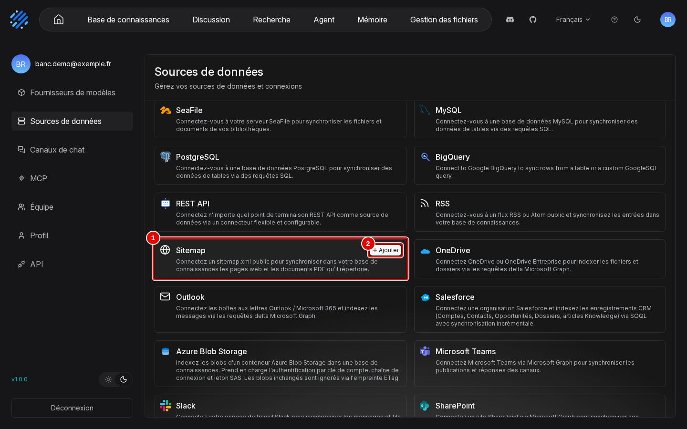

| N° | Élément | Rôle |
|---|---|---|
| 1 | « Sitemap » | « Connectez un sitemap.xml public pour synchroniser dans votre base de connaissances les pages web et les documents PDF qu'il répertorie. » |
| 2 | « Ajouter » | ouvre « Créer votre connecteur Sitemap » |

3. Saisir le nom et l'adresse du plan de site, puis cliquer sur « Test connection ».

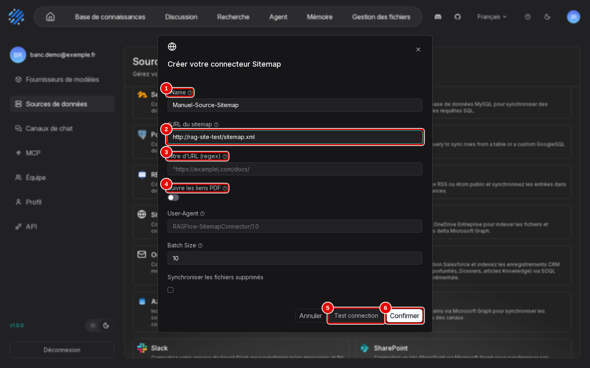

| N° | Élément | Rôle |
|---|---|---|
| 1 | « Name » | ici « Manuel-Source-Sitemap » |
| 2 | « URL du sitemap » | ici `http://rag-site-test/sitemap.xml` (site de test, sur le réseau Docker du banc) |
| 3 | « Filtre d'URL (regex) » | ne garde que les pages dont l'adresse correspond (par exemple `^https://example\.com/docs/`) |
| 4 | « Suivre les liens PDF » | ingère aussi les PDF liés depuis les pages ; plus bas, « User-Agent », « Batch Size » (pages par lot, 10) et « Synchroniser les fichiers supprimés » |
| 5 | « Test connection » | vérifie que le plan de site est joignable, sans enregistrer |
| 6 | « Confirmer » | enregistre la source |

4. Le test est refusé : un message rouge apparaît quelques secondes en haut à droite.

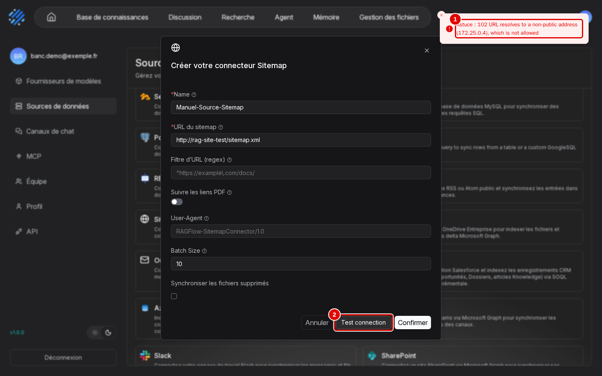

| N° | Élément | Rôle |
|---|---|---|
| 1 | message de refus | « Astuce : 102 URL resolves to a non-public address (172.25.0.4), which is not allowed » : l'adresse du site est privée (section 3) |
| 2 | « Test connection » | bouton du test ; l'API a répondu `{"code":102,"message":"URL resolves to a non-public address (172.25.0.4), which is not allowed"}` |

5. Cliquer quand même sur « Confirmer » : la source est enregistrée malgré l'échec du test (le test n'est pas obligatoire). Elle apparaît en tête de page, sous son type.

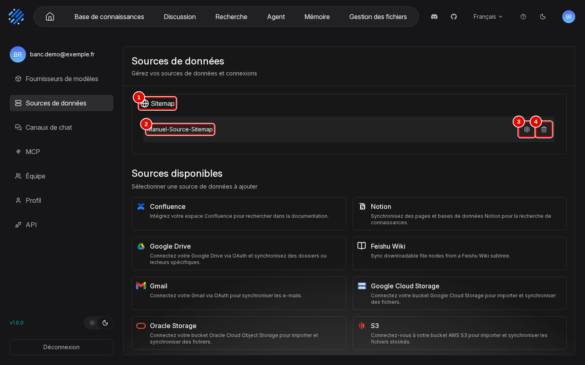

| N° | Élément | Rôle |
|---|---|---|
| 1 | « Sitemap » | type de connecteur |
| 2 | « Manuel-Source-Sitemap » | source déclarée |
| 3 | réglages | roue dentée : page de la source (étape 6) |
| 4 | supprimer | corbeille : supprime la source |

6. Cliquer sur la roue dentée. La page de la source reprend les champs de création (« Name », « URL du sitemap », « Filtre d'URL (regex) », « Suivre les liens PDF », « User-Agent », qui est le nom sous lequel RAGFlow se présente au site, `RAGFlow-SitemapConnector/1.0`, et « Batch Size »), puis, plus bas, la fréquence de relecture et le journal des synchronisations.

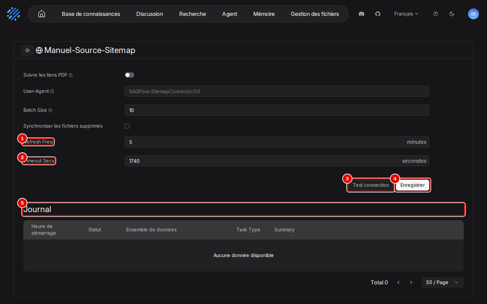

| N° | Élément | Rôle |
|---|---|---|
| 1 | « Refresh Freq » | relecture toutes les N minutes (5 par défaut) |
| 2 | « Timeout Secs » | durée maximale d'une synchronisation (1 740 s par défaut) |
| 3 | « Test connection » | même test qu'à la création |
| 4 | « Enregistrer » | enregistre les modifications ; après l'échec de synchronisation de la section 2, ce bouton est devenu « Resume » (reprise) |
| 5 | « Journal » | une ligne par synchronisation (section 2, étape 4) |

## 2. Lier la source à une base et suivre la synchronisation

### Essentiel

But : relier la source à une base, pour que les pages du site y deviennent des documents. La base « Manuel-Sources » a d'abord été créée vide, comme au manuel [02](02-prise-en-main.md), section 2.

1. Dans la base, ouvrir « Configuration » et descendre en bas de la page, à « Source de données » (« Gérer la liaison de source de données avec cette base »). Cliquer sur « Lier une source de données » (au-dessus de « Annuler » et « Enregistrer »). La fenêtre « Lier une source de données » liste les sources déclarées, rangées par type. Choisir la source, puis cliquer sur « Confirmer ».

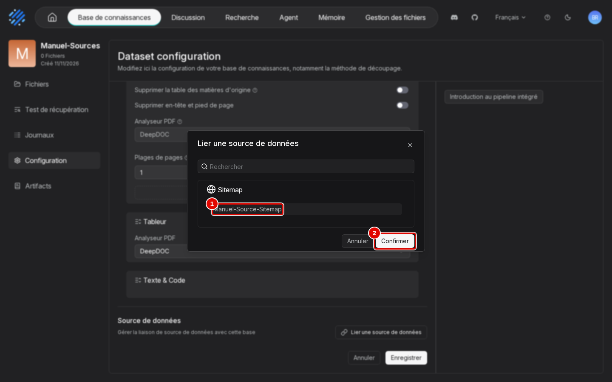

| N° | Élément | Rôle |
|---|---|---|
| 1 | « Manuel-Source-Sitemap » | source à lier, rangée sous son type « Sitemap » |
| 2 | « Confirmer » | ajoute la liaison (pas encore enregistrée) |

2. La source apparaît sous « Source de données ». Cliquer sur « Enregistrer ».

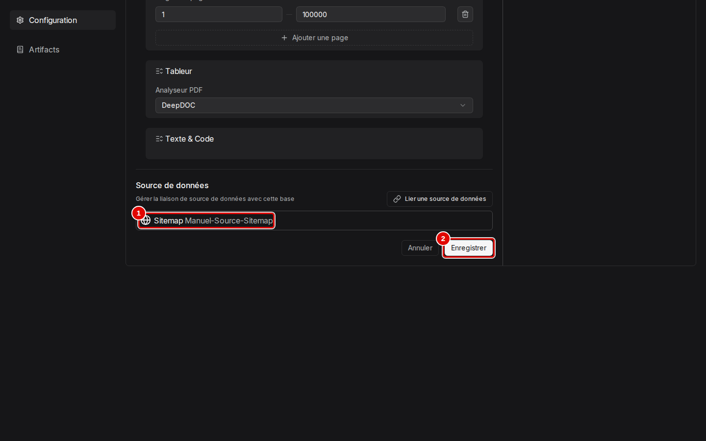

| N° | Élément | Rôle |
|---|---|---|
| 1 | « Manuel-Source-Sitemap » | source liée à la base |
| 2 | « Enregistrer » | enregistre et lance une première synchronisation |

3. Ouvrir « Journaux », puis l'onglet « Data source » : la synchronisation a échoué.

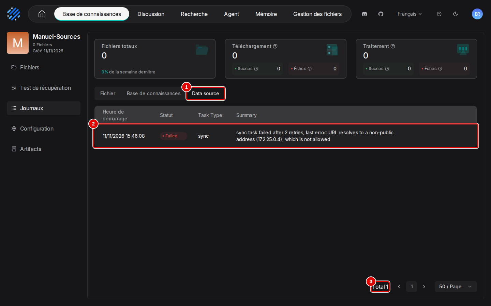

| N° | Élément | Rôle |
|---|---|---|
| 1 | « Data source » | synchronisations des sources liées (à côté de « Fichier » et « Base de connaissances ») |
| 2 | tâches | « 11/11/2026 15:46:08 », « Failed », « sync », « sync task failed after 2 retries, last error: URL resolves to a non-public address (172.25.0.4), which is not allowed » |
| 3 | « Total » | nombre de synchronisations |

4. Le même échec figure dans le « Journal » de la source (roue dentée de la section 1, étape 6).

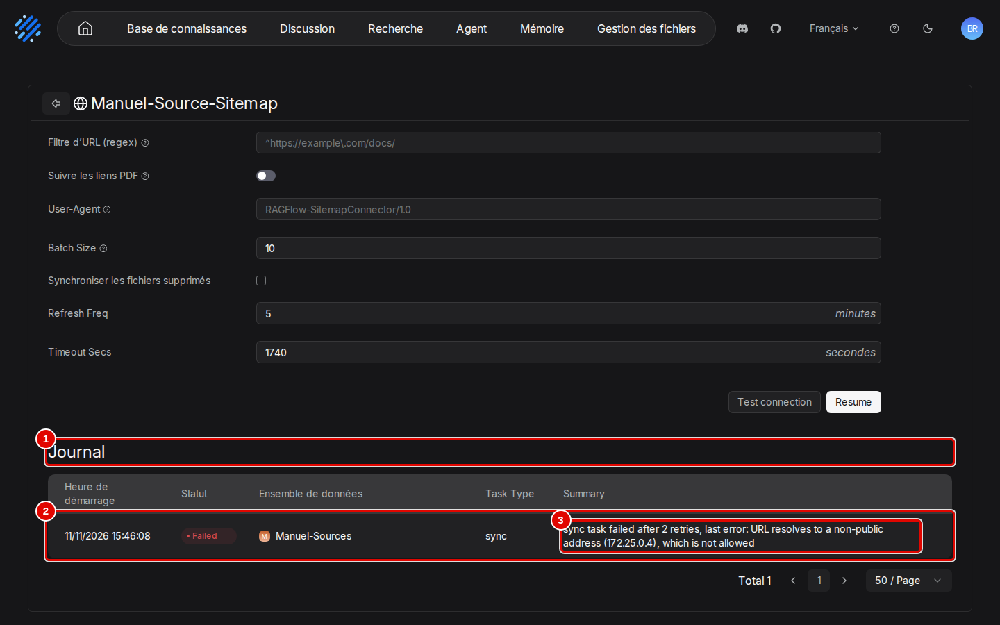

| N° | Élément | Rôle |
|---|---|---|
| 1 | « Journal » | synchronisations de la source, toutes bases confondues |
| 2 | synchronisation | « Heure de démarrage », « Statut » (« Failed »), « Ensemble de données » (« Manuel-Sources »), « Task Type » (« sync ») |
| 3 | « Summary » | cause de l'échec |

5. La base reste vide : « 0 Fichiers », « Aucune donnée disponible » dans l'onglet « Fichiers ».

Le journal de l'API donne `error_count` 2 et `total_docs_indexed` 0. La première synchronisation est partie dès l'enregistrement (journal lu 12 s après). [Vérifié] (`scenario.log`)

### Pour aller plus loin

- La source est relue selon « Refresh Freq » ; une synchronisation en échec est retentée deux fois (« sync task failed after 2 retries »).
- `POST /api/v1/connectors/{id}/rebuild` relance une synchronisation complète en supprimant d'abord les documents liés. [Source] (`internal/service/connector.go`) Non essayé : [À tester].

## 3. Pourquoi un site local est refusé

### Essentiel

Le site de test répond bien depuis le conteneur RAGFlow (HTTP 200 sur `http://rag-site-test/sitemap.xml`), mais RAGFlow refuse toute adresse non publique, dans le test comme dans la synchronisation :

```text
{"code": 102, "message": "URL resolves to a non-public address (172.25.0.4), which is not allowed"}
```

Le 9 novembre, par l'API, la synchronisation a échoué de même après trois tentatives, et la base est restée vide. [Vérifié] (`outils/resultats/ragflow/essai-2026-11-09-sitemap-refus.log` ; captures de ce manuel)

### Pour aller plus loin

RAGFlow résout le nom d'hôte et refuse toute adresse non publique : boucle locale (`127.0.0.1`), réseaux privés (dont les réseaux Docker en `172.x`), adresses de lien local. Un site de l'intranet est donc refusé comme un site sur la même machine. La garde est volontaire : elle empêche un utilisateur de faire lire à RAGFlow les services internes du réseau. [Source] (`internal/common/http.go`, `AssertURLSafe`)

## 4. Sitemap avec adresses privées autorisées

### Essentiel

Avec `ALLOW_ANY_HOST=1` dans `donnees/ragflow/ragflow.env` puis redémarrage du serveur [Testée] :

| Mesure | Résultat |
|---|---|
| Test du connecteur | `{"code": 0, "message": "success"}` |
| Documents après synchronisation | `rag-site-test_index.html.md`, `rag-site-test_salon-2026.html.md` |
| Passages | 2 par page |
| Journal de synchronisation | `total_docs_indexed` 2, `error_msg` vide |

[Vérifié] (`outils/resultats/ragflow/essai-2026-11-09-sitemap-autorise.log`, script `outils/ragflow/essai_sitemap_autorise.sh`)

### Pour aller plus loin

Chaque page est convertie en Markdown avant analyse (suffixe `.html.md`). Le script remet `ALLOW_ANY_HOST` à 0 et redémarre le serveur à la fin de l'essai ; la valeur relue ensuite dans le conteneur est 0. Pour un usage durable, préférer un site joignable par une adresse publique, ou déposer les pages dans la base par « Ajouter un fichier ». [Vérifié] (même journal)

## 5. Canaux de chat

### Essentiel

Un canal de chat publie un assistant ou un agent dans une messagerie : les utilisateurs lui écrivent depuis Telegram, Discord… sans ouvrir RAGFlow. Chaque canal demande un bot créé chez l'éditeur de la messagerie, donc un compte en ligne : aucun n'est branché dans ce banc, la page est seulement décrite.

1. Avatar du compte, « Canaux de chat ».

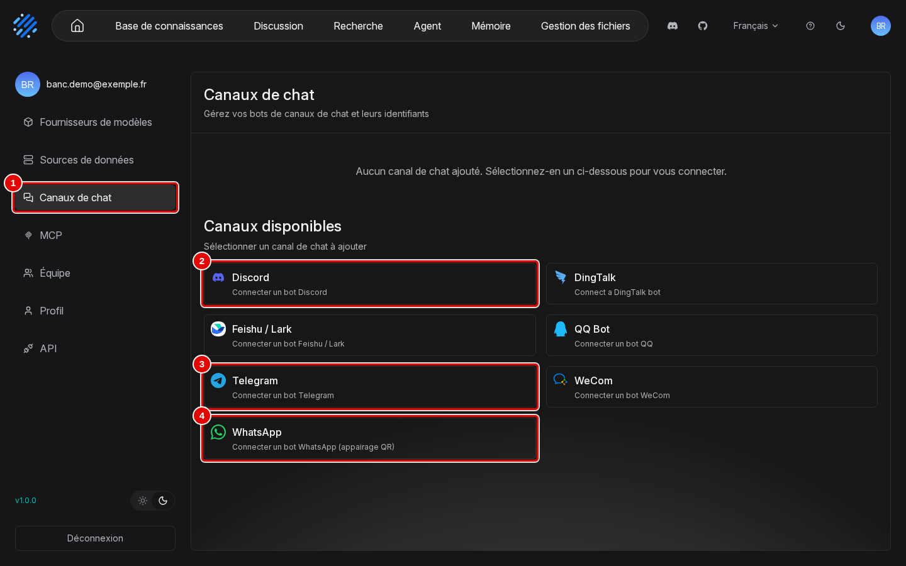

| N° | Élément | Rôle |
|---|---|---|
| 1 | « Canaux de chat » | page des canaux ; les canaux disponibles sont Discord, DingTalk, Feishu / Lark, QQ Bot, Telegram, WeCom, WhatsApp |
| 2 | « Discord » | « Connecter un bot Discord » |
| 3 | « Telegram » | « Connecter un bot Telegram » |
| 4 | « WhatsApp » | « Connecter un bot WhatsApp (appairage QR) » |

2. Survoler « Telegram » et cliquer sur « Ajouter » : la fenêtre « Ajouter un bot Telegram » demande le jeton du bot. Elle est refermée par « Annuler », sans rien enregistrer.

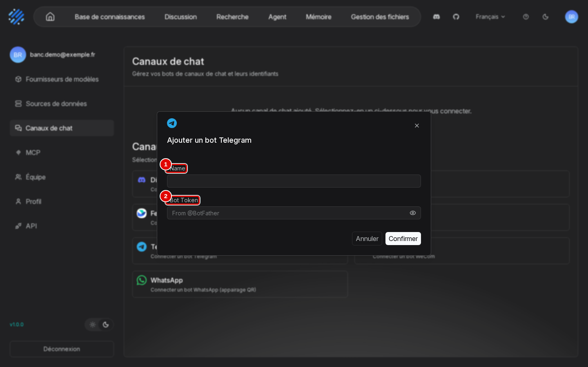

| N° | Élément | Rôle |
|---|---|---|
| 1 | « Name » | nom du canal |
| 2 | « Bot Token » | jeton délivré par Telegram à la création du bot (compte Telegram nécessaire) |

### Pour aller plus loin

Brancher un canal : non couvert (compte en ligne chez un tiers, hors du périmètre du banc). Le bot doit aussi pouvoir joindre RAGFlow, alors que ce banc n'écoute que sur `127.0.0.1` (manuel [01](01-installation.md)).

## 6. Par l'API

### Essentiel

Séquence suivie par `outils/ragflow/essai_sitemap.py` [Testée] :

| Étape | Appel |
|---|---|
| Créer le connecteur | `POST /api/v1/connectors` avec `{"name", "source": "sitemap", "config": {"sitemap_url": …}, "refresh_freq": 30}` |
| Le tester | `POST /api/v1/connectors/{id}/test` (l'interface appelle `POST /api/v1/connectors/sitemap/test` avant l'enregistrement) |
| Le lier à une base | `PUT /api/v1/datasets/{base}` avec `{"connectors": [{"id": …, "auto_parse": "1"}]}` |
| Suivre la synchronisation | `GET /api/v1/connectors/{id}/logs` (champs `error_msg`, `error_count`, `total_docs_indexed`) |

## Dépannage

| Symptôme | Cause probable | Action |
|---|---|---|
| « URL resolves to a non-public address (…), which is not allowed » | garde contre les adresses privées | site public, ou `ALLOW_ANY_HOST=1` en connaissant le risque (section 4) |
| Le message du test disparaît avant d'être lu | message temporaire, quelques secondes | relancer « Test connection » ; ou lire le « Journal » de la source |
| Base vide après liaison d'une source | synchronisation en échec | « Journaux », « Data source » de la base, ou « Journal » de la source |
| « Resume » à la place d'« Enregistrer » sur la page de la source | source suspendue après l'échec (statut « 5 » dans `GET /api/v1/connectors`) [Estimation] | corriger l'adresse, puis « Resume » [À tester] |
| Documents supprimés après une resynchronisation complète | `rebuild` vide d'abord la base liée | préférer la synchronisation périodique |

## Sources

- Scénario : `outils/ragflow/captures/manuels_07_15.py` (scénario `sources`, phases `ajout`, `detail`, `liaison`, `journaux`, `canaux`), lancé par `outils/communs/captures/lancer.sh` ; nettoyage : `outils/ragflow/nettoyer_manuel.py`
- Images : `docs/ragflow/img/09-sources-externes/` ; textes des pages et déroulé : `outils/resultats/ragflow/captures/09-sources-externes/`
- Scripts d'essai : `outils/ragflow/essai_sitemap.py`, `outils/ragflow/essai_sitemap_autorise.sh`, site `outils/ragflow/site-test/`
- Journaux : [refus](../../outils/resultats/ragflow/essai-2026-11-09-sitemap-refus.log), [autorisé](../../outils/resultats/ragflow/essai-2026-11-09-sitemap-autorise.log)
- Code au tag v1.0.0 : `internal/syncer/connector/sitemap.go`, `internal/common/http.go`, `docs/guides/.../data_source_configuration.md` ; https://ragflow.io/docs/
