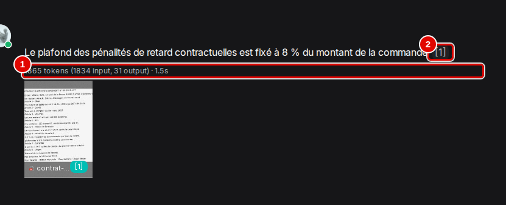
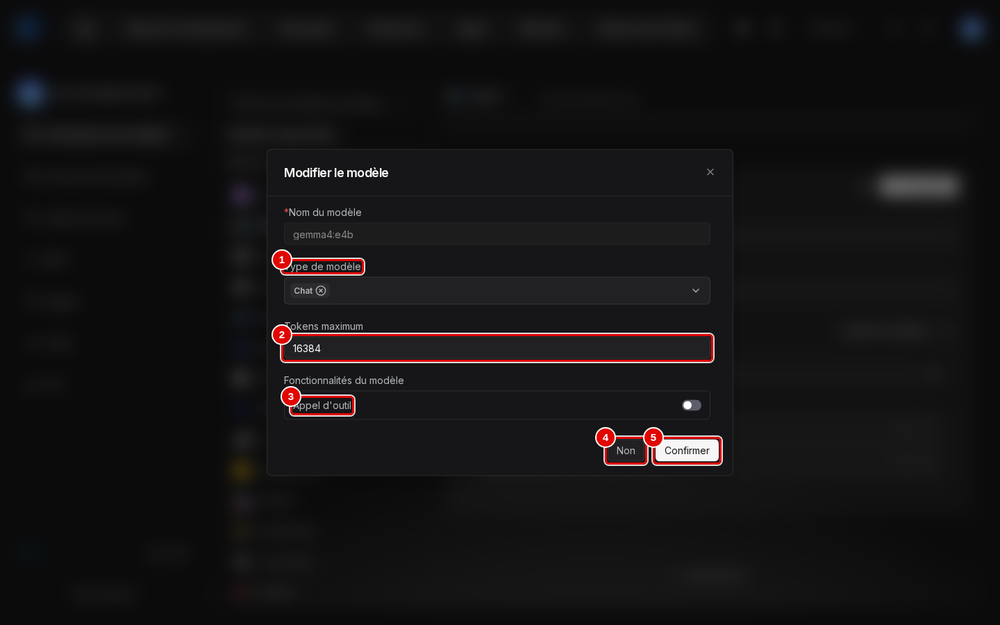

# 12. Qualité et performances

> **Objet** : résultats du banc de 38 questions, où lire dans l'interface les jetons et la durée d'une réponse, où régler la taille de contexte, réglages qui changent le résultat, matériel nécessaire avec et sans GPU, et préconisations d'usage.
> **Prérequis** : [datasets et découpage](03-datasets-et-decoupage.md), [assistants de chat et citations](05-assistants-et-citations.md).
> **Version décrite** : RAGFlow v1.0.0 (image `infiniflow/ragflow:v1.0.0`), Windows 11 + WSL2 (Ubuntu 24.04), LLM-Service branche `service-vllm` (vLLM 0.29.0 : `gemma4:e4b` quantifié w4a16, `bge-m3`), contexte déclaré de 16 384 jetons sauf mention contraire.
> **Statut des informations** : [Vérifié] observé ou mesuré les 9 et 11 novembre 2026 sur la machine d'essai (profil B : Ryzen 5 9600X, 32 Go, RTX 4060 Ti 16 Go) ; [Source] documentation officielle ou code source au tag v1.0.0 ; [Estimation] calcul non mesuré, avec son raisonnement ; [À tester] non documenté et non essayé.
> **Précautions** : corpus fictif de 9 documents (1 Mo), questions de `corpus/questions.json` ; un seul banc à la fois, `free -m` relevé avant chacun ; jugement par mots-clés, sans juge LLM (comme le banc GPU d'Open Notebook) ; captures faites avec l'assistant d'essai « Manuel-Reglages » (réglages conseillés), supprimé ensuite ; la fenêtre « Modifier le modèle » est refermée par « Non », sans rien changer.

Une capture par écran nouveau ; les écrans de réglage déjà montrés ailleurs sont renvoyés à leur manuel. Captures du scénario `qualite` de `outils/ragflow/captures/manuels_10_14.py` ; textes des pages et déroulé dans `outils/resultats/ragflow/captures/12-qualite-et-performances/`. [Vérifié]

## Sommaire

1. [Le banc](#1-le-banc)
2. [Résultats](#2-résultats)
3. [Lire les jetons et la durée d'une réponse](#3-lire-les-jetons-et-la-durée-dune-réponse)
4. [Taille de contexte](#4-taille-de-contexte)
5. [Mémoire et temps](#5-mémoire-et-temps)
6. [Profils matériels](#6-profils-matériels)
7. [Préconisations d'usage](#7-préconisations-dusage)
8. [Dépannage](#dépannage)
9. [Sources](#sources)

## 1. Le banc

### Essentiel

- 38 questions : 34 avec réponse (13 faits simples, 10 tableaux, 4 sur le PDF scanné, 2 en anglais, 3 multi-documents, 2 sur le fichier audio) et 4 pièges sans réponse dans le corpus.
- Exactitude : la réponse contient les valeurs attendues ; pour un piège, la réponse doit signaler l'absence d'information.
- Citation : le bon document figure parmi les passages marqués `[ID:n]` dans la réponse ; page vérifiée quand RAGFlow l'expose.
- Une session neuve par question ; questions par `POST /api/v1/chat/completions`.

Commande [Testée] :

```bash
uv run python outils/ragflow/banc.py --etiquette defaut --reindexer
```

### Pour aller plus loin

Variantes enchaînées par `outils/ragflow/serie_banc.sh`. Une première série notait comme citée toute source fournie au modèle ; elle a été rejouée avec la notation stricte, sans changement de résultat (journaux `essai-2026-11-09-serie-banc-notation-large.log` et `essai-2026-11-09-serie-banc.log` ; JSON de la première série dans l'historique git). Le banc n'utilise pas de juge LLM : le banc GPU d'Open Notebook non plus, ce qui garde la comparaison.

## 2. Résultats

### Essentiel

| Banc | Exactes (34) | Refus pièges (4) | Bon document cité | Bonne page | Médiane | p95 | Indexation | Pic RAM application |
|---|---|---|---|---|---|---|---|---|
| Défaut (General, `top_n` 6, vecteurs 0,3) | 33 | 4 | 34 | 24/24 | 1,28 s | 1,88 s | 53 s | 5 394 Mo |
| Vecteurs 0,7, `top_n` 8 | **34** | 4 | 34 | 24/24 | 1,36 s | 1,83 s | — | 5 041 Mo |
| Gabarit Paper | 33 | 4 | 34 | 24/24 | 1,19 s | 2,31 s | 56 s | 5 575 Mo |
| Gabarit Table | 33 | 4 | 34 | 24/24 | 1,26 s | 2,16 s | 53 s | 5 646 Mo |
| Gabarit Presentation | 32 | 4 | 33 | 23/23 | 1,18 s | 1,86 s | 53 s | 5 503 Mo |
| Mode Agentic | 30 | 4 | 29 | 21/21 | 4,52 s | 7,22 s | — | 5 331 Mo |
| Contexte 4 096 | 33 | 4 | 34 | 24/24 | 1,28 s | 1,83 s | — | 5 318 Mo |
| Contexte 3 072 | 21 | 4 | 22 | — | 1,09 s | 1,56 s | — | — |

[Vérifié] (`outils/resultats/ragflow/banc-2026-11-09-*.json`) « — » : base déjà indexée, ou mesure sans objet.

Résultats en cinq lignes :

1. 33 bonnes réponses sur 34 avec les réglages par défaut, 34 sur 34 avec la recherche orientée vecteurs.
2. Le PDF scanné est lu (4 sur 4) grâce à l'OCR de DeepDoc.
3. Les 4 questions pièges sont refusées dans toutes les variantes.
4. Réponse en 1,3 s en médiane, 1,9 s au 95e centile.
5. L'application seule demande 3,6 Gio de RAM au repos et 5,3 Gio en pointe.

### Pour aller plus loin

- Comparaison avec Open Notebook 1.15.1 sur le même socle GPU (même modèle `gemma4:e4b`, même machine) : 27/34, médiane 1,86 s, 0,6 Go de RAM ; voir l'[index de la série](../README.md).
- Second modèle : la fiche prévoit `ministral-3:3b` ; LLM-Service en branche `service-vllm` ne sert qu'un modèle de réponse par serveur et il est partagé : non essayé, [À tester].

## 3. Lire les jetons et la durée d'une réponse

### Essentiel

Chaque réponse d'un assistant affiche, sous son texte, les jetons consommés et la durée. C'est la mesure à surveiller pour juger d'un réglage : le nombre de jetons d'entrée dit ce que coûte la recherche (consignes et passages envoyés au modèle), la durée ce que l'utilisateur attend.

1. Dans « Discussion », ouvrir un assistant, cliquer sur « + » à côté de « Conversations », poser une question (procédure au manuel [05](05-assistants-et-citations.md), section 4). Ici, « Quel est le plafond des pénalités de retard du contrat Batterix ? » à « Manuel-Reglages » (« Top N » 8, poids des vecteurs 0,7), en gros plan :



| N° | Élément | Rôle |
|---|---|---|
| 1 | « 1865 tokens (1834 input, 31 output) · 1.5s » | jetons au total, dont 1 834 d'entrée (prompt : consignes, passages, question) et 31 de sortie (la réponse), puis durée de génération |
| 2 | renvoi « [1] » | passage cité ; plus il y a de passages retenus, plus le nombre de jetons d'entrée monte |

La réponse (8 % du montant de la commande) est juste. Le scénario a relevé 1,9 s entre le clic et l'affichage complet, contre 1,5 s indiquées : la durée affichée ne compte que la génération, pas la recherche ni l'affichage. [Vérifié] (`outils/resultats/ragflow/captures/12-qualite-et-performances/scenario.log`)

### Pour aller plus loin

- Ordres de grandeur relevés : 1 834 à 1 893 jetons d'entrée en mode « Naive » sur ce corpus (ici et au manuel [05](05-assistants-et-citations.md)) ; environ 32 000 en mode « Agentic » pour la même question (manuel [06](06-agentic-rag.md)). Si l'entrée approche la taille de contexte déclarée (section 4), la réponse échoue.
- Les réglages qui font varier ces chiffres sont dans le panneau « Paramètres du chat » (« Top N », « Poids de similarité par mots-clés », « Seuil de similarité », mode « Naive » ou « Agentic ») : manuel [05](05-assistants-et-citations.md), section 2, captures 15 et 17. Le « Test de récupération » d'une base montre l'effet de la recherche seule, sans le modèle : manuel [05](05-assistants-et-citations.md), section 3.

## 4. Taille de contexte

### Essentiel

La taille de contexte déclarée est le nombre maximal de jetons (prompt et réponse) que RAGFlow suppose au modèle. Elle se règle dans l'interface, par modèle.

1. Avatar du compte, « Fournisseurs de modèles », « VLLM », carte de l'instance `llm-service-chat` (manuel [01](01-installation.md), section 4) ; survoler la ligne `gemma4:e4b` et cliquer sur le crayon « Modifier le modèle » qui apparaît à droite du badge « LLM ».



| N° | Élément | Rôle |
|---|---|---|
| 1 | « Type de modèle » | « Chat » : modèle de réponse |
| 2 | « Tokens maximum » | taille de contexte déclarée : 16384 dans ce banc ; à régler sur la taille réellement servie, ou moins |
| 3 | « Appel d'outil » | indique que le modèle sait appeler des outils (agents) ; désactivé ici |
| 4 | « Non » | referme sans rien changer |
| 5 | « Confirmer » | enregistre ; prend effet à la question suivante |

[Vérifié] (`outils/resultats/ragflow/captures/12-qualite-et-performances/02-tokens-maximum.txt`, `scenario.log` : « Tokens maximum = 16384 ») Le même réglage se change par l'API, ce que fait `outils/ragflow/contexte.py` [Testée].

RAGFlow ne fixe pas `num_ctx` : il borne la réponse à « contexte déclaré du modèle − jetons du prompt ». Le prompt d'une question (consignes et 6 passages) fait de 1 841 jetons (question type, capture du manuel 02) à 3 301 jetons (plus grand relevé dans les erreurs à 3 072) sur ce corpus.

| Contexte déclaré | Résultat |
|---|---|
| 16 384 (référence de la série) | 33/34 |
| 4 096 | 33/34, identique : suffit sur ce corpus |
| 3 072 | 21/34 : 12 réponses remplacées par « **ERROR**: prompt uses 3089 à 3301 tokens, leaving no completion capacity… » |
| 512 (essai de dépassement, `top_n` 12) | erreur immédiate : « prompt uses 2210 tokens » |

[Vérifié] (`banc-2026-11-09-ctx4096.json`, `banc-2026-11-09-ctx3072.json`, `essai-2026-11-09-contexte-depassement.log`). Entre 3 072 et 4 096, rien n'a été essayé : 4 096 suffit, 3 072 échoue.

### Pour aller plus loin

Avant d'échouer, RAGFlow retire des passages pour faire tenir le prompt (journal du serveur : « Not all the retrieval into prompt », 3 passages gardés sur 12) ; il ne descend pas sous les consignes elles-mêmes. L'erreur arrive dans le texte de la réponse, avec un code d'API 0 : un programme doit la détecter dans `answer`. Pour le juge du banc, la question ne se pose pas (pas de juge LLM). Avec Ollama, la taille réelle est le `OLLAMA_CONTEXT_LENGTH` du serveur, puisque RAGFlow n'envoie pas `num_ctx`. [Source] (`internal/service/chat_pipeline.go`)

## 5. Mémoire et temps

### Essentiel

| Mesure | Valeur |
|---|---|
| RAM de l'application au repos / en pointe | 3 730 Mio / 5 394 Mio, soit 3,6 / 5,3 Gio (Elasticsearch 2,7 Gio, serveur et DeepDoc 1,9 Gio) |
| RAM de LLM-Service (hors application) | `vllm-central` 6,5 Gio, `vllm-embed` 4,1 Gio |
| VRAM | 15 247 Mio occupés sur 16 380 (deux serveurs vLLM : `vllm-central` réserve 80 %, `vllm-embed` 5 %) |
| Indexation du corpus (9 documents, 1 Mo, 26 passages) | 52 à 56 s (71 s au premier essai de l'adaptateur) |
| OCR d'un scan | 4,7 s par page |
| Question | 1,3 s en médiane ; 1 841 jetons d'entrée et 54 de sortie pour une question type |
| Débit de génération de vLLM | 30 à 62 jetons/s selon la charge (journal de `vllm-central`) |

[Vérifié] (`outils/resultats/ragflow/ressources-2026-11-09-*.txt`, `banc-2026-11-09-defaut.json`, `essai-2026-11-09-passages.log`, `outils/resultats/ragflow/preuves-2026-11-09/vllm-extrait.log`, `outils/resultats/ragflow/preuves-2026-11-09/textes-captures/02-conversation.txt`)

### Pour aller plus loin

Le volume de documents n'est pas limité par le contexte : seuls les `top_n` passages retenus vont au modèle. La limite est le temps d'indexation et la mémoire d'Elasticsearch. À 53 s pour 1 Mo et 13 pages, un fonds de 1 000 pages de PDF texte demanderait de l'ordre d'une heure d'indexation sur cette machine, davantage s'il est scanné (4,7 s par page d'OCR, soit environ 80 minutes pour 1 000 pages) [Estimation].

## 6. Profils matériels

### Essentiel

**Profil B, avec GPU NVIDIA (mesuré)** :

| Rubrique | Valeur |
|---|---|
| Carte | RTX 4060 Ti 16 Go ; minimum estimé 12 Go de VRAM pour les deux serveurs vLLM [Estimation] |
| Processeur, RAM, disque | 6 cœurs (12 fils) ; 32 Go dans WSL, dont environ 16 Gio utilisés (application 5,3 Gio, vLLM 10,6 Go) ; 4,3 Go pour l'application (images et données) plus les modèles |
| Modèles | `gemma4:e4b` (Gemma 4 E4B, w4a16) pour les réponses, `bge-m3` pour l'embedding |
| Contexte | 16 384 déclaré ; 4 096 suffit sur ce corpus |
| Réglages du service | `--max-model-len 32768`, `--gpu-memory-utilization 0.8`, `--kv-cache-dtype fp8`, `--max-num-seqs 8` |
| Réglages de RAGFlow | gabarit General, `top_n` 8, poids des vecteurs 0,7 |
| Résultat | 34/34, médiane 1,36 s |

[Vérifié] (`outils/resultats/ragflow/preuves-2026-11-09/vllm-extrait.log` : arguments de lancement des deux serveurs ; bancs ci-dessus)

**Profil A, sans GPU (estimé)** : portable Intel Core Ultra 7 255H, 15,3 Go dans WSL, LLM-Service `service-ollama` sur CPU.

| Rubrique | Valeur | Calcul |
|---|---|---|
| Processeur | 8 fils de calcul pour Ollama (`LLAMA_ARG_THREADS=8`) | mesure du socle de la série |
| RAM | 16 Go dans WSL au minimum : application 5,3 Gio en pointe + Ollama (`qwen3:4b-instruct` chargé : 3,9 Go à 4 096 jetons, 7,5 Go à 16 384 ; plus `bge-m3`) + système | somme des mesures ; à 16 384 jetons, 15,3 Go dans WSL ne suffisent plus : garder 4 096 ou réduire `MEM_LIMIT` d'Elasticsearch [À tester] |
| Disque | 3,1 Go d'images + 1,2 Go de données + environ 4 Go de modèles | mesures |
| Modèles | `qwen3:4b-instruct` (réponses), `bge-m3` (embedding) | modèles de la série sur CPU |
| Contexte | 4 096 conseillé sur ce profil (`OLLAMA_CONTEXT_LENGTH`) | prompt de 1 841 à 3 301 jetons |
| Temps par question | 30 à 50 s à 4 096 jetons ; 55 à 95 s à 16 384 | lecture du prompt de `qwen3:4b-instruct` sur CPU : 67 jetons/s à 4 096, 36 jetons/s à 16 384 ; 1 841 à 3 301 jetons, soit 27 à 49 s (51 à 92 s) ; plus 60 jetons générés à 15 à 17 jetons/s (environ 4 s) ; moins quand Ollama réutilise le début du prompt |
| Indexation du corpus | plusieurs minutes | embedding sur CPU au lieu du GPU ; OCR inchangé (déjà sur CPU) |

[Estimation] (mesures CPU du socle : `outils/resultats/socle/mesures-2026-11-08-passe1.log` pour `qwen3:4b-instruct`)

### Pour aller plus loin

- Un modèle plus léger que le modèle principal (moins de 3 milliards de paramètres) n'a pas pu être essayé : il aurait fallu changer le modèle servi par LLM-Service, partagé avec d'autres applications. Plancher de qualité [À tester].
- Sur 16 Go, il faut arrêter les autres solutions de la série avant de démarrer RAGFlow : Elasticsearch seul occupe 2,5 à 2,7 Gio [Vérifié] ; le reste est [Estimation].

## 7. Préconisations d'usage

### Essentiel

Ce qui suit résume les mesures des sections précédentes en règles pratiques. Chaque règle renvoie à sa mesure.

**Réglages conseillés d'un assistant** (panneau « Paramètres du chat », manuel [05](05-assistants-et-citations.md), section 2) :

| Réglage | Valeur conseillée | Pourquoi |
|---|---|---|
| Mode | « Naive » | 34/34 en 1,4 s ; « Agentic » donne 30/34 en 4,5 s et envoie une vingtaine de fois plus de jetons (section 2, section 3) |
| « Top N » | 8 | une question à deux documents trouve ses deux sources (section 2, ligne « Vecteurs 0,7, `top_n` 8 ») |
| « Poids de similarité par mots-clés » | 0,3 (soit 0,7 pour les vecteurs) | retrouve les passages mal lus d'un scan, que les mots-clés ratent |
| « Seuil de similarité » | 20 (défaut) | non modifié dans le banc ; le monter écarte des passages utiles et fait apparaître des refus à tort [Estimation] |
| « Réponse vide » et phrase de refus du « Prompt système » | en français | un assistant créé par l'API refuse en anglais (« The answer you are looking for is not found in the dataset! », manuel [14](14-depannage.md), section 3) ; créé à la souris, son prompt est en français (manuel [05](05-assistants-et-citations.md), section 4) |
| Gabarit de la base | « General » | aucun gabarit spécialisé n'a fait mieux sur ce corpus (32 à 33/34) |

**Taille de contexte** (section 4) : 16 384 jetons déclarés quand le matériel le permet ; jamais moins de 4 096 (le prompt monte à 3 301 jetons avec 6 passages, davantage avec « Top N » 8) ; à 3 072, une réponse sur trois est une erreur. Sur un profil sans GPU, 4 096 est le bon compromis : la lecture du prompt est deux fois plus rapide qu'à 16 384.

**Matériel** (section 6) : avec un GPU de 12 à 16 Go, la réponse arrive en 1 à 2 s ; sans GPU, compter 30 à 50 s par question à 4 096 jetons [Estimation] : utilisable pour des questions ponctuelles, pas pour une conversation. Prévoir 6 Gio de RAM pour RAGFlow seul en pointe, plus le service de modèles.

**Ce qui rend l'outil lent ou inutilisable, et comment l'éviter** :

| Situation | Effet constaté ou calculé | Prévention |
|---|---|---|
| Contexte déclaré trop petit | réponses remplacées par « **ERROR**: prompt uses N tokens… » (section 4) | 4 096 au minimum dans « Tokens maximum » |
| Contexte déclaré plus grand que celui du serveur de modèles | erreur du serveur de modèles quand le prompt dépasse [Estimation] | « Tokens maximum » inférieur ou égal à la taille servie (ici 16 384 déclarés pour 32 768 servis) |
| Mode « Agentic » | 3 à 4 fois plus lent, environ 32 000 jetons d'entrée : sur CPU, plusieurs minutes par question [Estimation] | « Naive » par défaut ; « Agentic » seulement pour une question qui demande plusieurs recherches |
| Gros fonds scanné | OCR à 4,7 s par page : environ 80 minutes pour 1 000 pages [Estimation] | indexer hors des heures d'usage ; préférer les PDF texte |
| Moins de 16 Go de RAM dans WSL | Elasticsearch (2,7 Gio) et le modèle se disputent la mémoire | arrêter les autres solutions ; garder 4 096 jetons |
| Compilation de connaissances (« Graph », « Tree »…) | jusqu'à 142 s pour un seul document (manuel [07](07-knowledge-compilation.md)) | la réserver aux bases où elle sert |

### Pour aller plus loin

Le nombre de documents d'une base ne ralentit pas les réponses de façon visible sur ce corpus : seuls les « Top N » passages vont au modèle. Ce qui grandit avec le fonds, c'est le temps d'indexation et la mémoire d'Elasticsearch (section 5).

## Dépannage

| Symptôme | Cause probable | Action |
|---|---|---|
| Réponses « **ERROR**: prompt uses N tokens… » | contexte déclaré trop petit (3 072 ou moins) | 4 096 au minimum, 16 384 conseillé |
| Bonne réponse manquée sur une question à deux documents | un document peu lisible par mots-clés (scan) | poids des vecteurs 0,7 et `top_n` 8 |
| Réponses lentes en mode agentique | plusieurs tours de recherche | mode « Naive » |
| Durée affichée sous la réponse plus courte que l'attente réelle | la durée ne compte que la génération | mesurer de bout en bout (banc, `banc.py`) |

## Sources

- Bancs : `outils/resultats/ragflow/banc-2026-11-09-*.json` et `.md` ; [banc par défaut](../../outils/resultats/ragflow/banc-2026-11-09-defaut.md)
- Captures : `outils/ragflow/captures/manuels_10_14.py` (scénario `qualite`), assistant d'essai créé par `outils/ragflow/manuels_10_14_preparer.py assistant` ; images `docs/ragflow/img/12-qualite-et-performances/` ; textes et déroulé `outils/resultats/ragflow/captures/12-qualite-et-performances/`
- Scripts : `outils/ragflow/banc.py`, `outils/ragflow/serie_banc.sh`, `outils/ragflow/contexte.py`, `outils/ragflow/essai_contexte.py`, `outils/communs/banc/commun.py`
- Socle : `outils/resultats/socle/` ; diagnostic : `outils/resultats/machine/diagnostic-2026-11-09.json`
