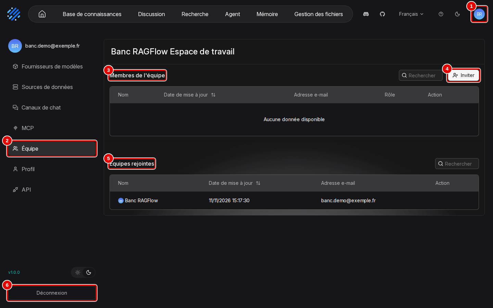
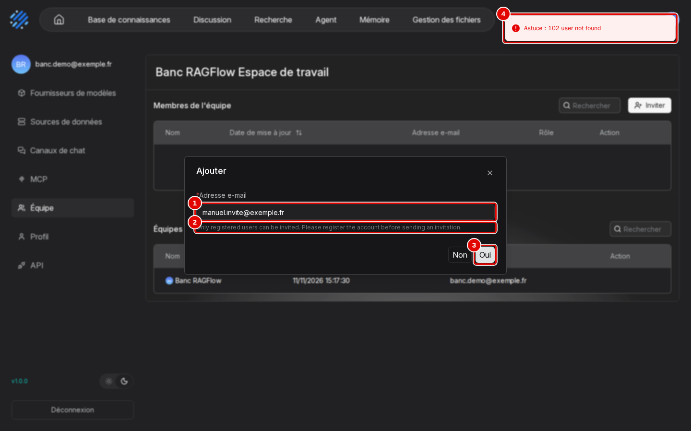
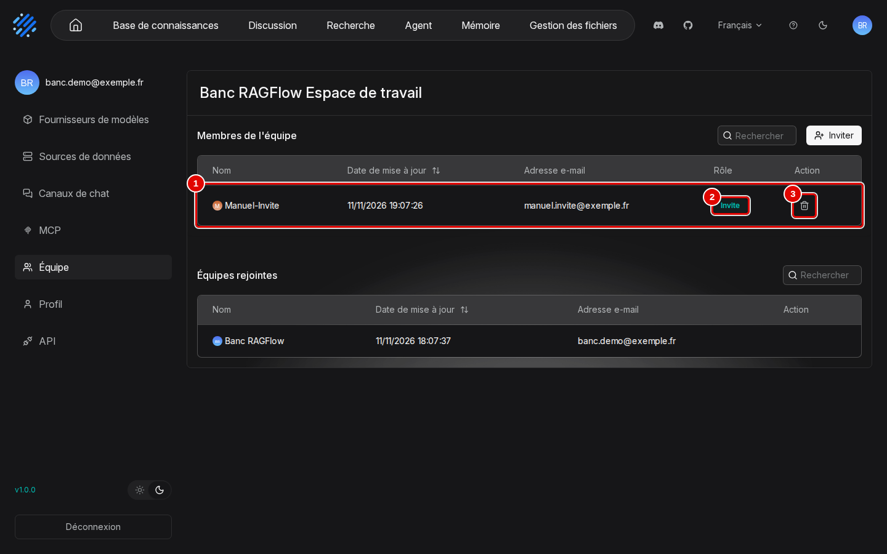
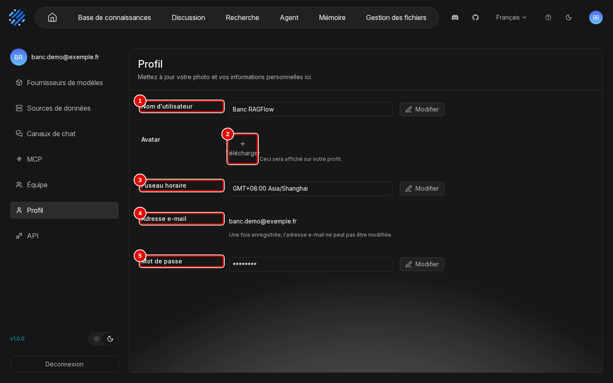
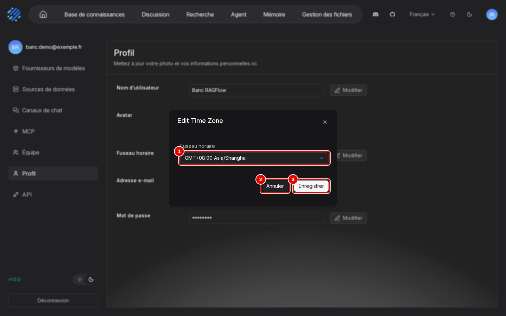
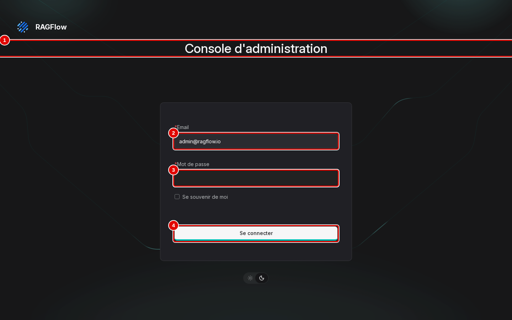
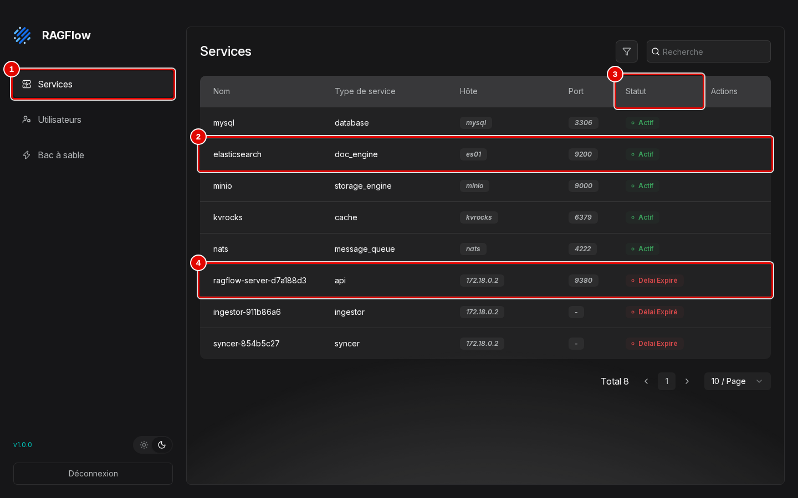
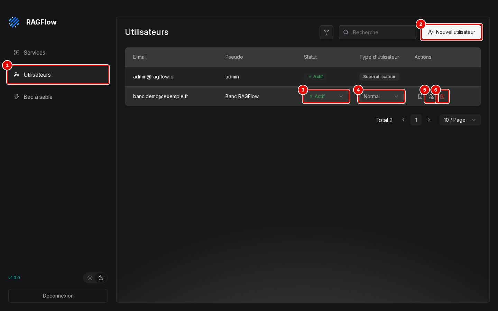
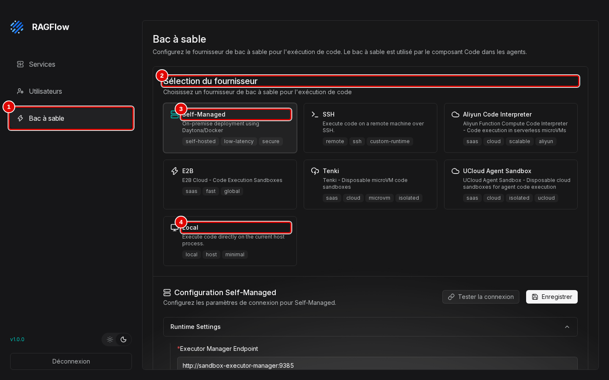

# 13. Exploitation

> **Objet** : sauvegarder et restaurer, mettre à jour, lire les journaux, sécuriser une installation RAGFlow ; gérer son compte à la souris (menu du compte, « Équipe », « Profil ») et administrer l'installation par la console d'administration et par son API.
> **Prérequis** : [installation](01-installation.md).
> **Version décrite** : RAGFlow v1.0.0 (image `infiniflow/ragflow:v1.0.0`), Windows 11 + WSL2 (Ubuntu 24.04), LLM-Service branche `service-vllm` (vLLM 0.29.0 : `gemma4:e4b`, `bge-m3`), contexte déclaré de 16 384 jetons.
> **Statut des informations** : [Vérifié] observé ou mesuré les 9 et 11 novembre 2026 sur la machine d'essai (Ryzen 5 9600X, 32 Go, RTX 4060 Ti 16 Go) ; [Source] documentation officielle ou code source au tag v1.0.0 ; [Estimation] calcul non mesuré ; [À tester] non documenté et non essayé.
> **Précautions** : la restauration remplace toutes les données ; essai fait avec une base témoin créée après la sauvegarde ; archives dans `donnees/sauvegardes/` (ignoré par git, contient les secrets) ; pour les captures, une invitation est envoyée au compte d'administration local puis retirée, les fenêtres « Edit Time Zone » et « Edit Password » sont refermées par « Annuler », la console d'administration est seulement lue (mot de passe masqué sur la capture).

Une capture par écran nouveau. Captures du scénario `exploitation` de `outils/ragflow/captures/manuels_10_14.py` (phases `equipe`, `profil`, `admin`) ; textes des pages et déroulé dans `outils/resultats/ragflow/captures/13-exploitation/`. Les sections 1 à 4 se font en ligne de commande et n'ont pas d'écran dans l'interface. [Vérifié]

**Risque — console d'administration ouverte à tout navigateur local.** La console `/admin` de l'interface (section 5) permet de supprimer un compte ou de changer son type ; elle n'est protégée que par le mot de passe du compte `admin@ragflow.io`, généré à l'installation (`ADMIN_DEFAULT_PASSWORD` de `donnees/ragflow/ragflow.env`). Ne pas exposer le port de l'interface hors de `127.0.0.1`. [Vérifié] (`outils/resultats/ragflow/captures/13-exploitation/08-utilisateurs.txt`)

**Risque — perte de données à la mise à jour.** Les notes de version préviennent qu'une montée depuis la v0.27.2 vers la 1.0 migre la base de façon irréversible. Toujours sauvegarder avant de changer de version. [Source] (`docs/release_notes.md`)

## Sommaire

1. [Sauvegarde et restauration](#1-sauvegarde-et-restauration)
2. [Mise à jour](#2-mise-à-jour)
3. [Journaux](#3-journaux)
4. [Sécurité](#4-sécurité)
5. [Comptes, équipes et administration](#5-comptes-équipes-et-administration)
6. [Dépannage](#dépannage)
7. [Sources](#sources)

## 1. Sauvegarde et restauration

### Essentiel

Sauvegarde à froid de tout `donnees/ragflow/` (volumes MySQL, Elasticsearch, MinIO, Kvrocks, NATS, réglages et secrets) [Testée] :

```bash
outils/ragflow/sauvegarder.sh
outils/ragflow/restaurer.sh donnees/sauvegardes/ragflow-20261109-184045.tar.gz
```

| Mesure | Résultat |
|---|---|
| Sauvegarde (arrêt, archive, redémarrage) | 33 s, archive de 42 Mo |
| Restauration | 31 s |
| Base témoin créée après la sauvegarde | absente après restauration |
| Assistant de démonstration après restauration | réponse juste en 2,1 s (« 2 490 € TTC ») |

[Vérifié] (`outils/resultats/ragflow/essai-2026-11-09-sauvegarde.log`, script `outils/ragflow/essai_sauvegarde.sh`)

### Pour aller plus loin

- L'archive est faite par un conteneur jetable, car les dossiers de données appartiennent aux utilisateurs des conteneurs (MySQL, Elasticsearch).
- Le journal de reprise de MySQL (1 Go préalloué) se compresse presque entièrement : 1,2 Go de données donnent 42 Mo.
- Le script officiel `docker/migration.sh` ne sauvegarde que `mysql_data`, `minio_data`, `redis_data` et `esdata01`, pas les volumes Kvrocks et NATS de la 1.0 ; la documentation `backup_and_restore_v1.md` décrit une sauvegarde volume par volume. [Source] (synthèse de lecture du code au tag v1.0.0)

## 2. Mise à jour

### Essentiel

1. Sauvegarder (section 1).
2. Relever la nouvelle version stable : `python3 outils/communs/versions.py ragflow infiniflow/ragflow=<tag>` [Testée].
3. Changer `TAG` et `COMMIT` dans `outils/ragflow/installer.sh` et l'image figée dans `outils/ragflow/compose.override.yml`, relire le nouveau compose.
4. Relancer `outils/ragflow/installer.sh`, puis `outils/ragflow/verif_minimale.py`.

Aucune version plus récente que v1.0.0 n'existait le 9 novembre 2026 : la procédure est [À tester]. Mettre `ragflow-sdk` à la même version que le serveur (`pyproject.toml`).

### Pour aller plus loin

Les images annexes (Elasticsearch 8.11.3, MySQL 8.0.40, Kvrocks 2.16.0, NATS 2.14.2, MinIO) restent à la version imposée par le compose du tag : des versions plus récentes existent, mais aucune n'est montée sans essai. [Vérifié] (`outils/resultats/ragflow/versions-2026-11-09.json`)

## 3. Journaux

### Essentiel

| Source | Commande ou chemin [Testée] |
|---|---|
| Serveur (API, ingestion, synchronisation) | `docker logs rag-ragflow-server` |
| Fichiers du serveur | `donnees/ragflow/logs/` : `api_server_9380.log`, `ingestor_server.log`, `syncer_server.log` |
| Moteur et bases | `docker logs rag-ragflow-es01`, `rag-ragflow-mysql`… |
| Modèles | `docker logs vllm-central` (débit, cache) |

[Vérifié] (contenu du dossier relevé par un conteneur jetable)

### Pour aller plus loin

Les fichiers de `donnees/ragflow/logs/` appartiennent à `root` (droits 600) : les lire par `docker logs` ou par un conteneur. Messages utiles relevés pendant les essais : « Not all the retrieval into prompt » (passages écartés faute de contexte), « sync task failed after retries » (source externe refusée). [Vérifié] (`essai-2026-11-09-contexte-depassement.log`, `essai-2026-11-09-sitemap-refus.log`)

## 4. Sécurité

### Essentiel

| Point | État dans ce banc |
|---|---|
| Ports | interface, API et administration sur `127.0.0.1` seulement ; bases et stockage non publiés |
| Secrets | aléatoires, dans `donnees/ragflow/ragflow.env` (droits 600, ignoré par git) |
| Compte d'administration | `admin@ragflow.io`, mot de passe généré (`ADMIN_DEFAULT_PASSWORD`) |
| Adresses privées | `ALLOW_ANY_HOST=0` (refus des adresses internes, manuel [09](09-sources-externes.md)) |
| Inscription libre | active (`REGISTER_ENABLED=1`), sans risque tant que l'interface n'écoute que sur `127.0.0.1` |
| Bac à sable des agents | profil `sandbox` non activé (conteneur privilégié avec accès au socket Docker) |

[Vérifié] (`outils/resultats/ragflow/ports-2026-11-09.txt`, `outils/resultats/ragflow/relecture.md`)

### Pour aller plus loin

Pour ouvrir RAGFlow à d'autres postes, il faudrait publier l'interface sur une autre adresse, désactiver l'inscription libre et placer un proxy HTTPS devant : hors périmètre, [À tester].

## 5. Comptes, équipes et administration

### Essentiel

Chaque compte a son espace (bases, assistants, agents, clés d'API). Une équipe permet de partager les objets marqués « Équipe » dans leurs « Autorisations » (base, agent : manuels [03](03-datasets-et-decoupage.md) et [08](08-agents.md)).

**Menu du compte et page « Équipe »**

1. Cliquer sur l'avatar du compte (pastille aux initiales, en haut à droite) : la page des réglages du compte s'ouvre, avec son menu à gauche. Cliquer sur « Équipe ».



| N° | Élément | Rôle |
|---|---|---|
| 1 | avatar | ouvre les réglages du compte ; le menu de gauche donne « Fournisseurs de modèles » (manuel [01](01-installation.md)), « Sources de données » et « Canaux de chat » (manuel [09](09-sources-externes.md)), « MCP » (manuel [08](08-agents.md)), « Équipe », « Profil », « API » (manuel [10](10-api-et-sdk.md)) ; en bas, la version « v1.0.0 » et la bascule soleil et lune (thème clair ou sombre) |
| 2 | « Équipe » | page de l'espace de travail « Banc RAGFlow Espace de travail » |
| 3 | « Membres de l'équipe » | comptes invités dans l'espace : « Nom », « Date de mise à jour », « Adresse e-mail », « Rôle », « Action » ; vide au départ |
| 4 | « Inviter » | ouvre la fenêtre d'invitation (étape 2) |
| 5 | « Équipes rejointes » | espaces d'autres comptes dont ce compte est membre ; ici son propre espace |
| 6 | « Déconnexion » | ferme la session et revient à la page de connexion |

2. Cliquer sur « Inviter », saisir l'adresse du compte à inviter, puis « Oui ». Une adresse sans compte est refusée : l'invitation ne crée pas de compte.



| N° | Élément | Rôle |
|---|---|---|
| 1 | « Adresse e-mail » | ici `manuel.invite@exemple.fr`, adresse fictive sans compte |
| 2 | consigne | « Only registered users can be invited. Please register the account before sending an invitation. » : le compte doit d'abord s'inscrire (manuel [01](01-installation.md), section 4) |
| 3 | « Oui » | envoie l'invitation ; « Non » annule |
| 4 | message | « Astuce : 102 user not found » : refus, la fenêtre reste ouverte |

3. Avec l'adresse d'un compte inscrit (ici le compte d'administration local, `admin@ragflow.io`), « Oui » ajoute le compte à la liste.



| N° | Élément | Rôle |
|---|---|---|
| 1 | membre invité | « admin », `admin@ragflow.io` |
| 2 | « Rôle » | « Invite » : invitation en attente ; le compte invité la voit dans ses « Équipes rejointes » [À tester] |
| 3 | « Action » | corbeille : retire le membre, après la confirmation « Supprimer le membre » (« Non », « Supprimer ») |

Le membre a été retiré aussitôt par la corbeille ; il n'apparaît plus après rechargement. [Vérifié] (`scenario.log`, lignes « ligne du membre », « confirmation du retrait », « membre encore présent après retrait : False »)

**Page « Profil »**

4. Dans le menu du compte, cliquer sur « Profil ».



| N° | Élément | Rôle |
|---|---|---|
| 1 | « Nom d'utilisateur » | nom affiché (« Banc RAGFlow ») ; « Modifier » à droite |
| 2 | « Télécharger » | change l'« Avatar » (image) |
| 3 | « Fuseau horaire » | « GMT+08:00 Asia/Shanghai » par défaut ; « Modifier » ouvre l'étape 5 |
| 4 | « Adresse e-mail » | identifiant de connexion, non modifiable (« Une fois enregistrée, l'adresse e-mail ne peut pas être modifiée. ») |
| 5 | « Mot de passe » | « Modifier » ouvre « Edit Password » : « Mot de passe actuel », « Nouveau mot de passe », « Confirmer le nouveau mot de passe », « Annuler », « Enregistrer » |

5. « Modifier » en face de « Fuseau horaire » :



| N° | Élément | Rôle |
|---|---|---|
| 1 | « Fuseau horaire » | liste des fuseaux, de « GMT-11:00 Pacific/Midway » vers l'est |
| 2 | « Annuler » | referme sans changer (geste fait ici) |
| 3 | « Enregistrer » | enregistre le fuseau du compte |

Le fuseau par défaut est celui de Shanghai, et plusieurs pages affichent les heures en temps universel (« Date de téléversement », détails de tâche, historique des versions d'un agent : manuels [08](08-agents.md) et [11](11-recettes.md)). L'effet du fuseau du compte sur ces affichages n'a pas été essayé [À tester] ; pour lire une heure, ajouter une heure (deux en été) au temps universel pour Paris. [Vérifié] (`04-profil.txt`, `scenario.log`)

**Console d'administration**

La console d'administration est une partie de l'interface réservée au super-utilisateur `admin@ragflow.io`, à l'adresse `/admin` de l'interface (`http://127.0.0.1:8088/admin` depuis Windows ou WSL). La carte de l'interface n'a relevé aucun lien vers elle dans l'interface ordinaire.

6. Ouvrir l'adresse, saisir le compte `admin@ragflow.io` et son mot de passe (`ADMIN_DEFAULT_PASSWORD` de `donnees/ragflow/ragflow.env`), puis « Se connecter ».



| N° | Élément | Rôle |
|---|---|---|
| 1 | « Console d'administration » | titre de la page de connexion de la console |
| 2 | « Email » | `admin@ragflow.io` |
| 3 | « Mot de passe » | mot de passe d'administration, masqué sur la capture |
| 4 | « Se connecter » | ouvre la page « Services » |

7. La page « Services » liste les services de la pile et leur état.



| N° | Élément | Rôle |
|---|---|---|
| 1 | « Services » | page des services ; « Utilisateurs » et « Bac à sable » en dessous |
| 2 | service | « elasticsearch », type « doc_engine », hôte « es01 », port 9200 ; de même « mysql », « minio », « kvrocks », « nats » |
| 3 | « Statut » | « Actif » pour les cinq services de stockage et de messages |
| 4 | serveur RAGFlow | « ragflow-server-… », type « api », port 9380 : « Délai Expiré », comme « ingestor-… » et « syncer-… », alors que le serveur répondait normalement pendant la capture |

L'état « Délai Expiré » des trois processus de RAGFlow est relevé alors que l'interface et l'API répondaient ; la santé réelle se vérifie par `GET /api/v1/system/healthz` (manuel [14](14-depannage.md), section 1). [Vérifié] (`scenario.log`, ligne « services »)

8. « Utilisateurs » liste les comptes ; les icônes d'action d'une ligne apparaissent au survol.



| N° | Élément | Rôle |
|---|---|---|
| 1 | « Utilisateurs » | comptes de l'installation : `admin@ragflow.io` (« Superutilisateur ») et `banc.demo@exemple.fr` (« Normal ») |
| 2 | « Nouvel utilisateur » | crée un compte sans passer par l'inscription [À tester] |
| 3 | « Statut » | liste « Actif » : désactiver un compte l'empêche de se connecter [À tester] |
| 4 | « Type d'utilisateur » | liste « Normal » : promotion en super-utilisateur [À tester] |
| 5 | icône de compte à cadenas | changement du mot de passe du compte, d'après l'API (`PUT /users/{courriel}/password`) [Source] |
| 6 | corbeille | supprime le compte et ses données [À tester] |

L'icône à gauche des deux annotées (presse-papiers) n'affiche pas de bulle ; non essayée [À tester].

9. « Bac à sable » règle l'environnement d'exécution du bloc « Code » des agents (manuel [08](08-agents.md)).



| N° | Élément | Rôle |
|---|---|---|
| 1 | « Bac à sable » | page de réglage de l'exécution de code |
| 2 | « Sélection du fournisseur » | sept fournisseurs : « Self-Managed », « SSH », « Aliyun Code Interpreter », « E2B », « Tenki », « UCloud Agent Sandbox », « Local » |
| 3 | « Self-Managed » | choisi par défaut : un service `sandbox-executor-manager:9385` (« Executor Manager Endpoint »), absent de ce banc (profil `sandbox` non activé, section 4) ; « Tester la connexion », « Enregistrer » |
| 4 | « Local » | exécute le code directement dans le processus du serveur : aucune isolation, à éviter |

En bas de la colonne, « Déconnexion » ferme la session d'administration. [Vérifié] (`scenario.log`, ligne « après Déconnexion »)

**API d'administration**

Les mêmes informations se lisent par l'API d'administration, sur `http://127.0.0.1:9381/api/v1/admin/` [Testée] : connexion du compte `admin@ragflow.io` (mot de passe envoyé en base64, comme pour le compte ordinaire), puis :

| Appel | Résultat relevé |
|---|---|
| `GET /version` | `v1.0.0`, `open source` |
| `GET /users` | 2 comptes : `banc.demo@exemple.fr`, `admin@ragflow.io` (super-utilisateur) |
| `GET /services` | MySQL, Elasticsearch, MinIO, Kvrocks… « alive » |
| `GET /hardware` | 12 cœurs, 33,7 Go |

[Vérifié] (`outils/resultats/ragflow/essai-2026-11-09-admin.log`, script `outils/ragflow/essai_admin.py`)

### Pour aller plus loin

- L'API d'administration permet aussi de créer, désactiver ou promouvoir des comptes et de changer un mot de passe (`PUT /users/{courriel}/password`) [Source] (`internal/admin/router.go`) ; non essayé.
- Le compte d'administration ne sert qu'à la console : il reçoit un refus sur `/api/v1` (manuel [10](10-api-et-sdk.md), section 2).

## Dépannage

| Symptôme | Cause probable | Action |
|---|---|---|
| `tar` refuse de lire `donnees/ragflow/mysql` | dossiers propriété des conteneurs | passer par un conteneur, comme `sauvegarder.sh` |
| Connexion admin refusée | mot de passe envoyé en clair | l'envoyer en base64 |
| Données plus récentes perdues après restauration | la restauration remplace tout `donnees/ragflow` | sauvegarder juste avant de restaurer |
| « Astuce : 102 user not found » en invitant un membre | adresse sans compte | faire inscrire le compte, puis l'inviter |
| Heures décalées dans les pages | heures affichées en temps universel, fuseau du compte sur Shanghai par défaut | lire l'heure en temps universel ; régler « Fuseau horaire » dans « Profil » |
| « Délai Expiré » sur le serveur dans « Services » de la console | état affiché par la console alors que le serveur répond | vérifier par `curl http://127.0.0.1:9380/api/v1/system/healthz` |

## Sources

- Captures : `outils/ragflow/captures/manuels_10_14.py` (scénario `exploitation`) ; images `docs/ragflow/img/13-exploitation/` ; textes et déroulé `outils/resultats/ragflow/captures/13-exploitation/`
- Scripts : `outils/ragflow/sauvegarder.sh`, `outils/ragflow/restaurer.sh`, `outils/ragflow/essai_sauvegarde.sh`, `outils/ragflow/essai_admin.py`
- Journaux : [sauvegarde](../../outils/resultats/ragflow/essai-2026-11-09-sauvegarde.log), [administration](../../outils/resultats/ragflow/essai-2026-11-09-admin.log), [relecture](../../outils/resultats/ragflow/relecture.md)
- Code et documentation au tag v1.0.0 : `docker/migration.sh`, `internal/admin/router.go`, `docs/release_notes.md` ; https://ragflow.io/docs/
