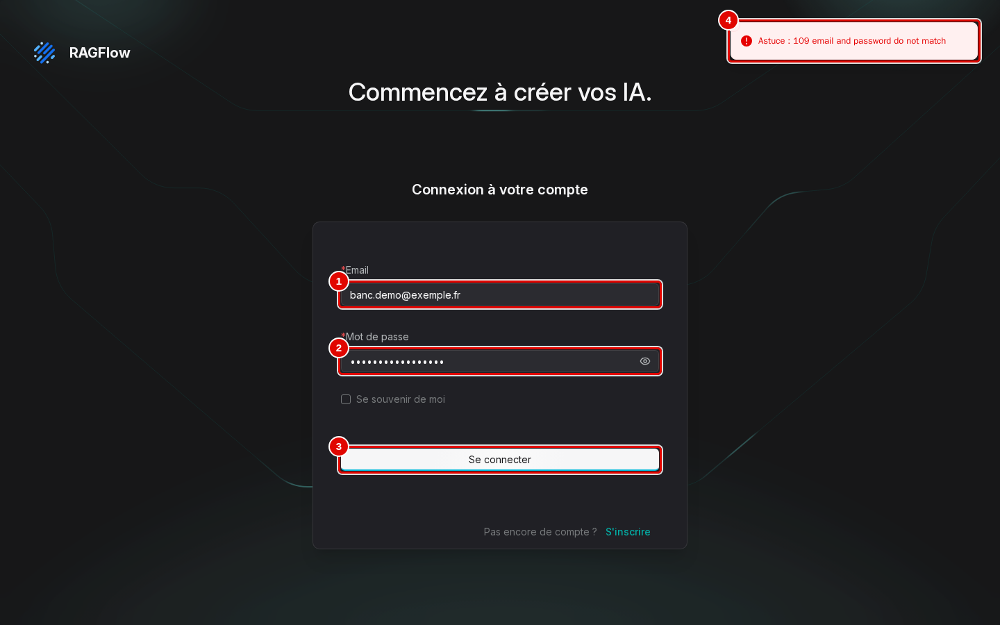
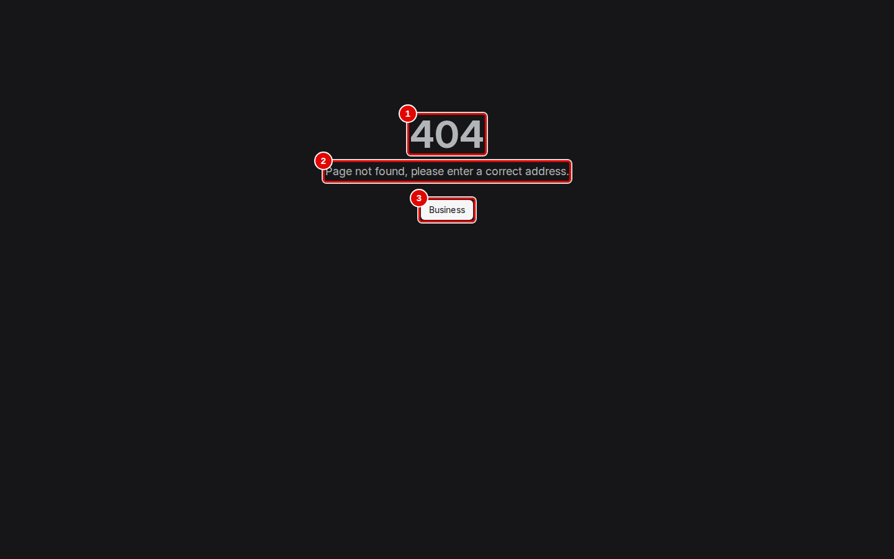
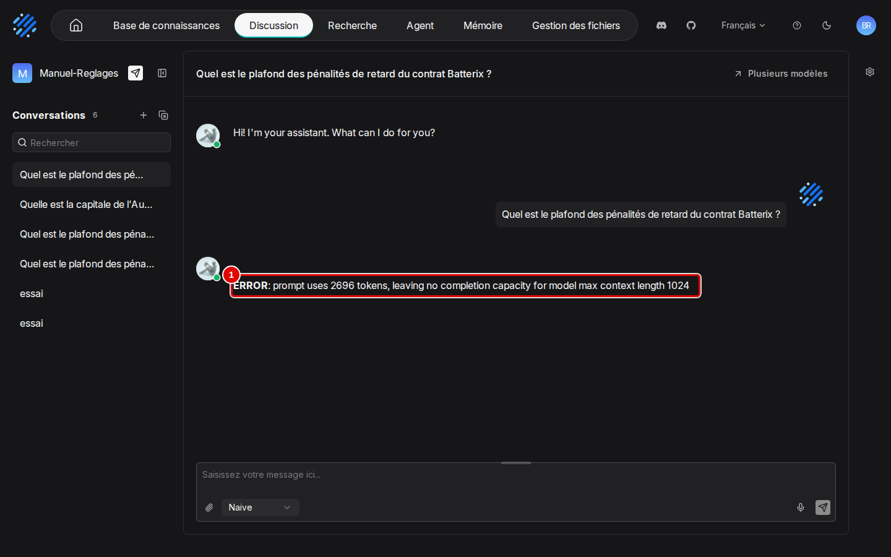
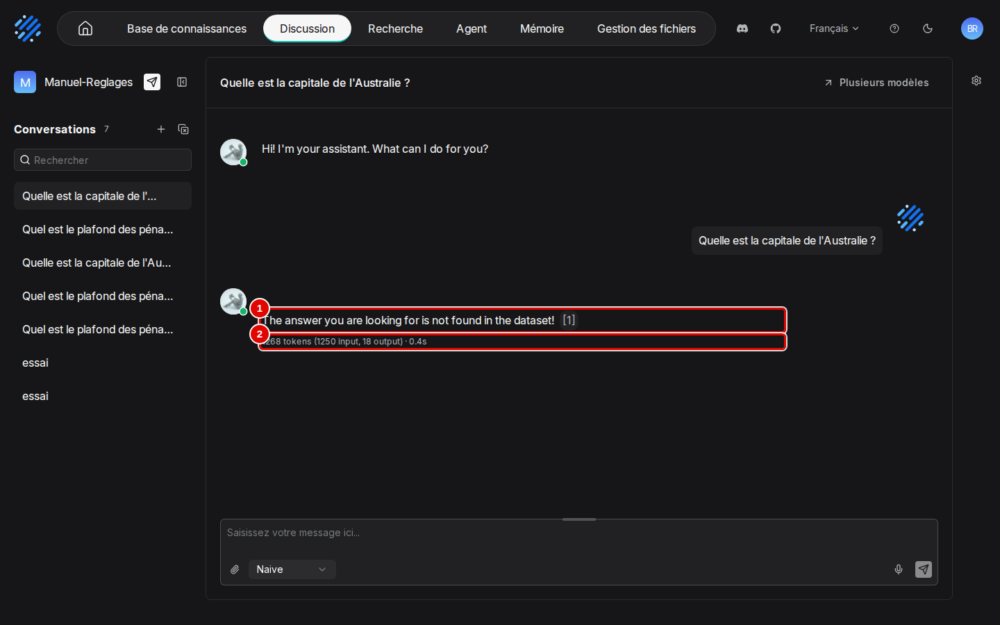

# 14. Dépannage et FAQ

> **Objet** : retrouver vite la cause et le remède d'un problème, à partir des échecs réellement rencontrés pendant les essais ; reconnaître à l'écran les messages d'erreur, provoqués exprès pour les captures.
> **Prérequis** : [installation](01-installation.md).
> **Version décrite** : RAGFlow v1.0.0 (image `infiniflow/ragflow:v1.0.0`), `ragflow-sdk` 1.0.0, Windows 11 + WSL2 (Ubuntu 24.04), LLM-Service branche `service-vllm` (vLLM 0.29.0 : `gemma4:e4b`, `bge-m3`), contexte déclaré de 16 384 jetons.
> **Statut des informations** : [Vérifié] observé ou mesuré les 9 et 11 novembre 2026 sur la machine d'essai (Ryzen 5 9600X, 32 Go, RTX 4060 Ti 16 Go) ; [Source] documentation officielle ou code source au tag v1.0.0 ; [Estimation] calcul non mesuré ; [À tester] non documenté et non essayé.
> **Précautions** : chaque ligne renvoie au journal d'essai qui montre l'échec ; aucune ligne n'est tirée de la documentation seule. Erreurs des captures provoquées exprès : mot de passe faux, contexte déclaré réduit à 1 024 jetons par `outils/ragflow/contexte.py` puis remis à 16 384 aussitôt (`outils/resultats/ragflow/captures/14-depannage/contexte.log`), question hors du corpus, adresse inexistante ; questions posées à l'assistant d'essai « Manuel-Reglages », supprimé ensuite.

Une capture par écran d'erreur nouveau ; une erreur déjà montrée dans un autre manuel y renvoie. Captures du scénario `depannage` de `outils/ragflow/captures/manuels_10_14.py` ; textes des pages et déroulé dans `outils/resultats/ragflow/captures/14-depannage/`. [Vérifié]

## Sommaire

1. [Installation et démarrage](#1-installation-et-démarrage)
2. [Interface](#2-interface)
3. [Analyse et réponses](#3-analyse-et-réponses)
4. [API et SDK](#4-api-et-sdk)
5. [FAQ](#5-faq)
6. [Dépannage](#dépannage)
7. [Sources](#sources)

## 1. Installation et démarrage

### Essentiel

| Symptôme | Cause | Action | Journal |
|---|---|---|---|
| `nettoyer.sh` sort avec le code 126, rien n'est supprimé | droits d'exécution perdus à l'extraction de l'archive du kit | `chmod +x outils/communs/*.sh` | `essai-2026-11-09-reinstallation-essai1.log` |
| Port 8080 déjà pris | autre programme sur `127.0.0.1:8080` | `SVR_WEB_HTTP_PORT` dans `donnees/ragflow/ragflow.env` (8088 ici) | `preuves-2026-11-09/port-8080.txt` |
| `du` ou `tar` refusent `donnees/ragflow/mysql` | dossiers propriété des conteneurs | passer par un conteneur jetable (`ressources.sh`, `sauvegarder.sh`) | `ressources-2026-11-09-*.txt` |
| 1 Go occupé par MySQL dès l'installation | journal de reprise préalloué (`#innodb_redo`) | normal ; se compresse très bien en sauvegarde | `ressources-2026-11-09-apres-bancs.txt` |

[Vérifié] (fichiers cités, dans `outils/resultats/ragflow/`)

### Pour aller plus loin

L'état de santé se lit sans compte : `curl http://127.0.0.1:9380/api/v1/system/healthz` doit renvoyer `"status":"ok"` et HTTP 200 [Testée].

## 2. Interface

### Essentiel

| Symptôme | Cause | Action | Journal |
|---|---|---|---|
| « email and password do not match » dans le navigateur, alors que l'API accepte le compte | compte créé par l'API avec le mot de passe en clair ; le serveur compare `base64(mot de passe)` | créer le compte en envoyant `base64(mot de passe)` (`configurer.py`) | `captures.py`, scénario `diag_connexion` |
| Interface en anglais | langue mémorisée par le navigateur, anglais par défaut | sélecteur de l'en-tête, « Français » | captures du manuel [02](02-prise-en-main.md) |
| Onglet « Artifacts » vide (« No wiki yet ») | sélecteur sur « Wiki » | choisir le type compilé (« Mind map »…) | captures du manuel [07](07-knowledge-compilation.md) |
| Page noire « 404 » | adresse inexistante (adresse tapée à la main, lien périmé) | « Business » ramène à l'accueil | `scenario.log` (phase `introuvable`) |

**Connexion refusée.** Pour la reproduire : « Déconnexion » (menu du compte), puis l'adresse du compte et un mot de passe faux, « Se connecter ».

| N° | Élément | Rôle |
|---|---|---|
| 1 | « Email » | adresse du compte, juste |
| 2 | « Mot de passe » | mot de passe faux ; l'œil à droite l'affiche en clair pour vérifier la saisie |
| 3 | « Se connecter » | envoie |
| 4 | message d'erreur | « Astuce : 109 email and password do not match » en haut à droite, quelques secondes ; la page reste sur la connexion |

Le code 109 est le code « Authentication error » de l'API (manuel [10](10-api-et-sdk.md), section 1). Le même message apparaît pour un compte créé par l'API avec le mot de passe en clair (première ligne du tableau). [Vérifié] (`scenario.log`, ligne « connexion refusée »)

**Adresse inexistante.** Une adresse inconnue de l'interface (ici `/page-inexistante`) affiche une page sans barre de navigation.

| N° | Élément | Rôle |
|---|---|---|
| 1 | « 404 » | code « page introuvable » |
| 2 | « Page not found, please enter a correct address. » | message, non traduit |
| 3 | « Business » | libellé non traduit du bouton de retour : ramène à l'accueil (`/`) |

[Vérifié] (`scenario.log`, ligne « après « Business » »)

**Onglet « Artifacts » vide.** L'écran « No wiki yet » est montré au manuel [07](07-knowledge-compilation.md), section 5 (capture « Vue vide ») : le sélecteur de vue n'est pas sur le type d'artefact que la base compile.

### Pour aller plus loin

Changer la langue du compte par l'API ne traduit pas l'interface au chargement ; seul le sélecteur le fait. [Vérifié]

## 3. Analyse et réponses

### Essentiel

| Symptôme | Cause | Action | Journal |
|---|---|---|---|
| Réponse « **ERROR**: prompt uses N tokens, leaving no completion capacity… » | contexte déclaré trop petit (3 072 ou moins) | « Tokens maximum » à 4 096 au minimum, 16 384 conseillé | `banc-2026-11-09-ctx3072.json`, `essai-2026-11-09-contexte-depassement.log`, `captures/14-depannage/scenario.log` |
| « The answer you are looking for is not found in the dataset! » à une question légitime | passages sous le seuil, souvent un scan mal lu | poids des vecteurs 0,7 et `top_n` 8 ; corriger le passage | `banc-2026-11-09-defaut.json` (Q30) |
| Chiffres faux dans un passage scanné (« 40 0oo ») | confusions de l'OCR | corriger le passage | `essai-2026-11-09-passages.log` |
| Réponse agentique « je n'ai pas accès à… » sans citation | le modèle n'a pas lancé de recherche | mode « Naive » | `banc-2026-11-09-agentic.json` |
| Agent qui répond en anglais | consignes du gabarit en anglais | traduire les consignes | `essai-2026-11-09-agent.log` |
| « URL resolves to a non-public address » pour un sitemap | garde contre les adresses privées | site public, ou `ALLOW_ANY_HOST=1` en connaissant le risque | `essai-2026-11-09-sitemap-refus.log` |

[Vérifié] (fichiers cités)

**Réponse « ERROR: prompt uses … ».** Pour la reproduire : « Tokens maximum » du modèle à 1024 (manuel [12](12-qualite-et-performances.md), section 4 ; ici par `outils/ragflow/contexte.py 1024`), puis une question ordinaire dans une nouvelle conversation.

| N° | Élément | Rôle |
|---|---|---|
| 1 | réponse d'erreur | « **ERROR**: prompt uses 2696 tokens, leaving no completion capacity for model max context length 1024 » : le prompt (consignes, passages retenus, question) dépasse à lui seul le contexte déclaré |

La réponse est arrivée en 3,4 s, sans ligne de jetons ni citation. Remède : « Tokens maximum » à 16384 (4096 au minimum), remis aussitôt après la capture. [Vérifié] (`scenario.log`, ligne « réponse d'erreur » ; `02-erreur-de-contexte.txt` ; `contexte.log`)

**Réponse « not found ».** Question hors du corpus (« Quelle est la capitale de l'Australie ? ») à un assistant créé par l'API, avec le « Prompt système » par défaut :

| N° | Élément | Rôle |
|---|---|---|
| 1 | réponse | « The answer you are looking for is not found in the dataset! [1] » : phrase de refus du prompt système par défaut d'un assistant créé par l'API, en anglais, suivie d'un renvoi « [1] » |
| 2 | jetons et durée | « 1268 tokens (1250 input, 18 output) · 0.4s » : des passages ont été envoyés au modèle, c'est lui qui conclut à l'absence de réponse |

C'est le bon comportement pour une question sans réponse dans les documents ; c'est un défaut quand la question est légitime (deuxième ligne du tableau). Un assistant créé à la souris refuse en français (manuel [05](05-assistants-et-citations.md), section 4). Le message d'accueil de cet assistant, « Hi! I'm your assistant. What can I do for you? », est lui aussi le défaut anglais d'un assistant créé par l'API. [Vérifié] (`scenario.log`, ligne « réponse » ; `outils/resultats/ragflow/captures/14-depannage/preparation.log`)

### Pour aller plus loin

Une erreur de contexte arrive dans le texte de la réponse avec un code d'API 0 : un programme doit chercher `**ERROR**` dans `answer`.

## 4. API et SDK

### Essentiel

| Symptôme | Cause | Action | Journal |
|---|---|---|---|
| `Not Found: /api/v1/chats/…/completions` | `Session.ask` du SDK 1.0.0 appelle une route retirée | `POST /api/v1/chat/completions` | `installation-2026-11-09-verif.log` |
| « the dataset … doesn't own parsed file » | assistant créé avant la fin de l'analyse ; `parse_documents` a rendu la main trop tôt | attendre `chunk_count` > 0 | `installation-2026-11-09-verif-essai1.log` |
| `'generator' object has no attribute 'content'` | `Session.ask` est un générateur | `next(iter(session.ask(…)))` | `essai-2026-11-09-sdk-defauts.log` |
| `'Base' object is not iterable` en lisant `chat.prompt_config` | objet du SDK, pas un dictionnaire | `chat.prompt_config.to_json()` | `essai-2026-11-09-sdk-defauts.log` |
| Poids des vecteurs lu à 0,3 malgré un réglage à 0,7 | valeur par défaut de l'objet `Chat` du SDK | lire `keywords_similarity_weight` | `essai-2026-11-09-sdk-defauts.log` |
| Suivi de compilation qui ne finit jamais | l'état revient à « idle » | lire `last_completed_at` | `essai-2026-11-09-compilation-mind_map-essai1.log` |

[Vérifié] (fichiers cités)

## 5. FAQ

### Essentiel

| Question | Réponse |
|---|---|
| Faut-il un GPU ? | Non pour RAGFlow (DeepDoc tourne sur CPU) ; le GPU sert à LLM-Service. Sans GPU, compter 30 à 50 s par question avec un contexte de 4 096 jetons [Estimation] (manuel [12](12-qualite-et-performances.md)). |
| Combien de RAM pour RAGFlow seul ? | 3,6 Gio au repos, 5,3 Gio en pointe [Vérifié]. |
| Les données quittent-elles la machine ? | Non d'après la configuration : modèles servis localement, ports sur `127.0.0.1`, aucun compte en ligne [Vérifié] ; aucune mention de téléchargement dans le journal du serveur [Vérifié] ; aucune capture du trafic réseau, donc absence d'envoi [Estimation]. |
| Un reranker est-il fourni ? | Non ; il faut un service externe [Source]. |
| Peut-on tout supprimer ? | `outils/communs/nettoyer.sh ragflow` (14 s) ; les images restent en cache [Vérifié]. |

### Pour aller plus loin

Les manuels de la série gardent la même structure d'une solution à l'autre : comparer avec l'[index de la série](../README.md).

## Dépannage

Ce manuel est lui-même le tableau de dépannage de la série RAGFlow ; chaque manuel garde aussi le sien.

| Symptôme | Cause probable | Action |
|---|---|---|
| Problème absent de ce manuel | cas non rencontré pendant les essais | `outils/ragflow/etat.sh`, puis `docker logs rag-ragflow-server` |

## Sources

- Captures : `outils/ragflow/captures/manuels_10_14.py` (scénario `depannage`), assistant d'essai créé par `outils/ragflow/manuels_10_14_preparer.py assistant` ; images `docs/ragflow/img/14-depannage/` ; textes, déroulé et changements de contexte `outils/resultats/ragflow/captures/14-depannage/`
- Journaux d'essai : `outils/resultats/ragflow/` (installation, vérification, bancs, essais)
- Scripts : `outils/ragflow/`, `outils/communs/`
