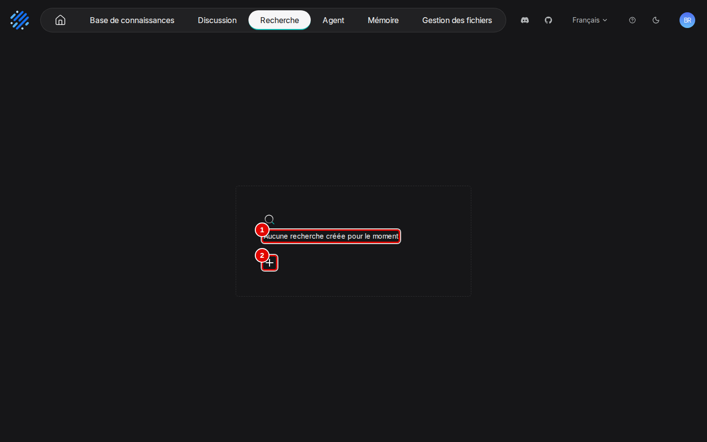
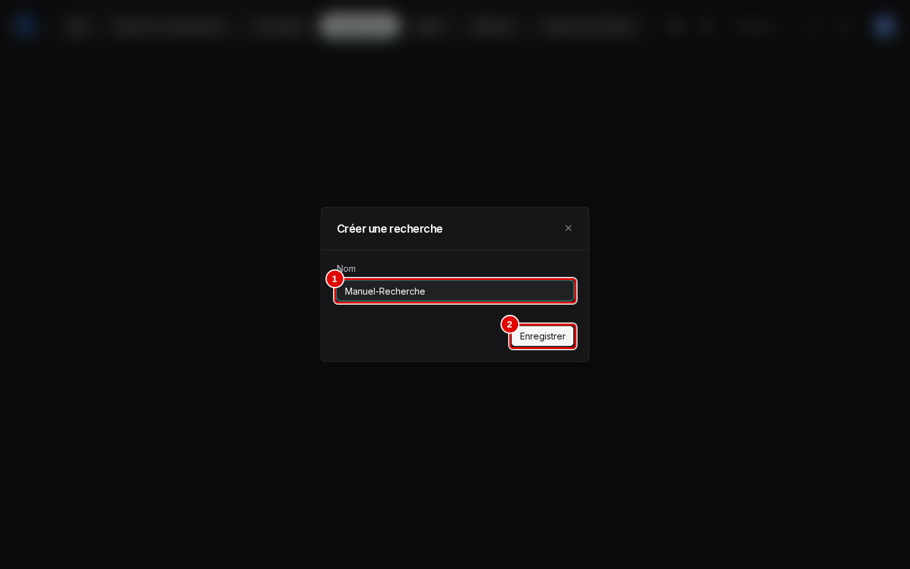
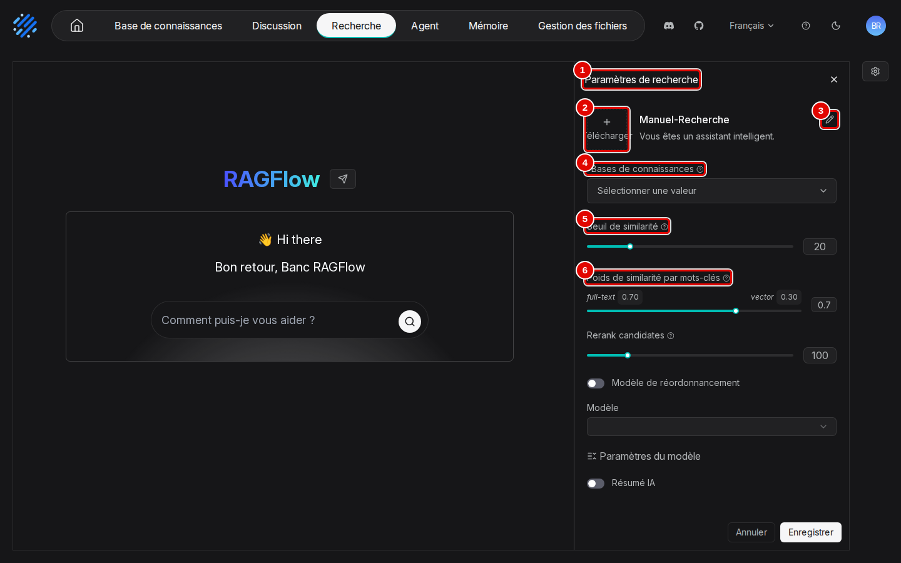
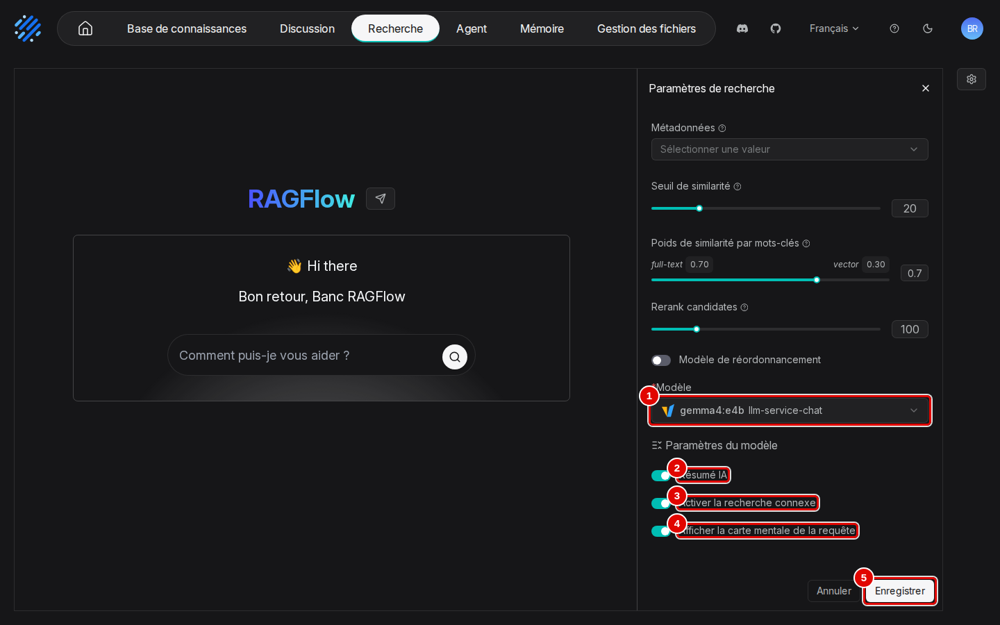
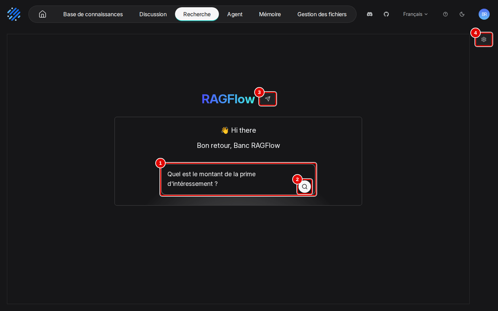
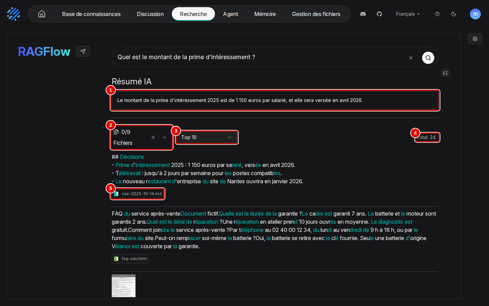
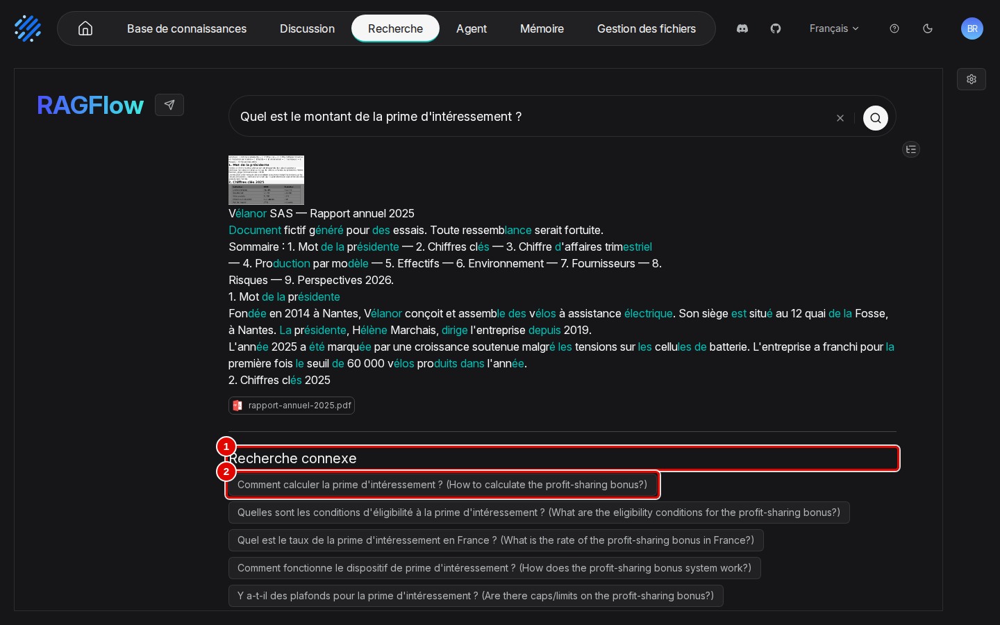
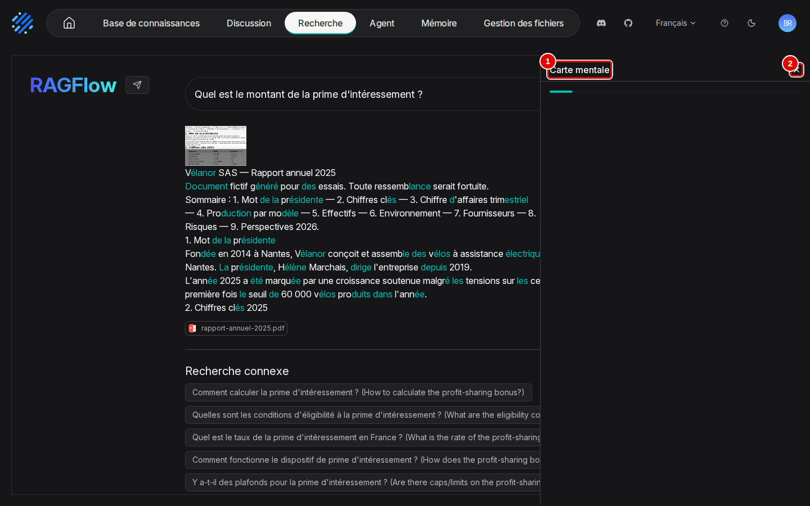
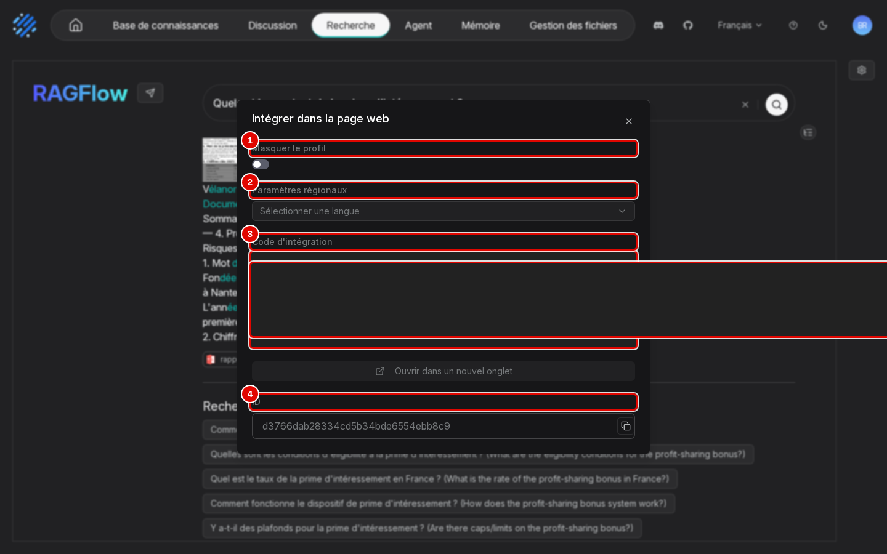
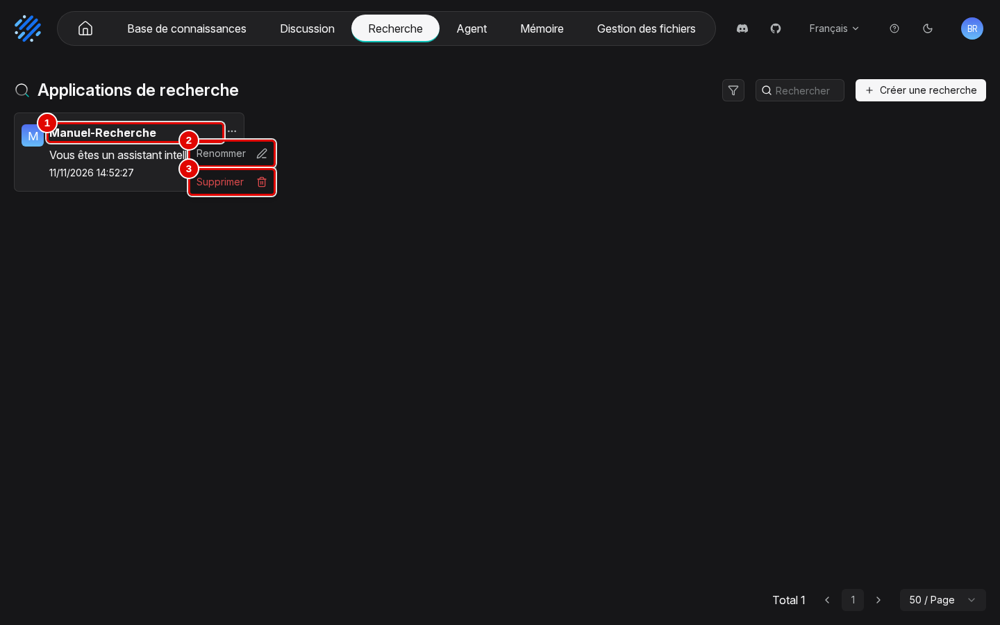

# 15. Applications de recherche

> **Objet** : créer à la souris une application de recherche (page « Recherche ») sur une base de connaissances, régler la recherche et le résumé par le modèle, lancer une vraie recherche et lire ses résultats (résumé, passages, recherches connexes, carte mentale), puis l'intégrer dans une page web.
> **Prérequis** : [prise en main](02-prise-en-main.md) (base de connaissances analysée) ; [assistants de chat et citations](05-assistants-et-citations.md) (réglages de recherche, mêmes notions).
> **Version décrite** : RAGFlow v1.0.0 (image `infiniflow/ragflow:v1.0.0`), Windows 11 + WSL2 (Ubuntu 24.04), LLM-Service branche `service-vllm` (vLLM 0.29.0 : `gemma4:e4b`, `bge-m3`), contexte déclaré de 16 384 jetons.
> **Statut des informations** : [Vérifié] observé ou mesuré le 11 novembre 2026 sur la machine d'essai (Ryzen 5 9600X, 32 Go, RTX 4060 Ti 16 Go) ; [Source] documentation officielle ou code source au tag v1.0.0 ; [Estimation] calcul non mesuré ; [À tester] non documenté et non essayé.
> **Précautions** : l'application « Manuel-Recherche » est créée par le scénario de captures puis supprimée (`outils/ragflow/nettoyer_manuel.py`) ; la base « Démo Vélanor » n'est que lue ; le jeton d'accès du code d'intégration est masqué sur la capture et remplacé par `<masqué>` dans les textes archivés.

Toutes les captures de ce manuel viennent du scénario `recherche` de `outils/ragflow/captures/manuels_07_15.py`, qui fait chaque geste à la souris, dans l'ordre des sections. Le texte de chaque page capturée et la liste de ses éléments visibles sont dans `outils/resultats/ragflow/captures/15-recherche/` (même nom que l'image), le déroulé et les durées dans `scenario.log`. [Vérifié]

## Sommaire

1. [À quoi sert une application de recherche](#1-à-quoi-sert-une-application-de-recherche)
2. [Créer l'application et la régler](#2-créer-lapplication-et-la-régler)
3. [Rechercher et lire les résultats](#3-rechercher-et-lire-les-résultats)
4. [Intégrer, renommer, supprimer](#4-intégrer-renommer-supprimer)
5. [Dépannage](#dépannage)
6. [Sources](#sources)

## 1. À quoi sert une application de recherche

### Essentiel

Une application de recherche est un moteur de recherche sur une ou plusieurs bases : une question donne la liste des passages trouvés, avec leur document, et, si un modèle est choisi, un court résumé, des questions voisines et une carte mentale. À la différence d'un assistant de « Discussion » (manuel [05](05-assistants-et-citations.md)), il n'y a pas de conversation : chaque recherche est indépendante, et les passages restent visibles en entier. Elle convient pour retrouver un document ou vérifier une source ; l'assistant convient pour obtenir une réponse rédigée et poser des questions de suite.

## 2. Créer l'application et la régler

### Essentiel

But : créer « Manuel-Recherche » sur la base « Démo Vélanor », avec résumé, recherches connexes et carte mentale.

1. Cliquer sur « Recherche » dans la barre du haut. La page est vide ; cliquer sur « + ».

| N° | Élément | Rôle |
|---|---|---|
| 1 | « Aucune recherche créée pour le moment » | liste des applications de recherche, vide |
| 2 | « + » | ouvre la fenêtre « Créer une recherche » |

2. Saisir le nom, puis cliquer sur « Enregistrer ».

| N° | Élément | Rôle |
|---|---|---|
| 1 | « Nom » | ici « Manuel-Recherche » |
| 2 | « Enregistrer » | crée l'application et l'ouvre, avec le panneau « Paramètres de recherche » |

3. Le panneau « Paramètres de recherche » s'ouvre à droite. Ouvrir la liste « Bases de connaissances » et choisir « Démo Vélanor » (même liste que pour un assistant).

| N° | Élément | Rôle |
|---|---|---|
| 1 | « Paramètres de recherche » | panneau de réglages ; la roue dentée en haut à droite de la page le rouvre |
| 2 | « Télécharger » | image de l'application |
| 3 | nom et description | crayon : nom et description (« Vous êtes un assistant intelligent. » par défaut) |
| 4 | « Bases de connaissances » | base(s) interrogée(s) ; obligatoire. Une fois la base choisie, « Métadonnées » apparaît dessous (filtre par métadonnées) |
| 5 | « Seuil de similarité » | score minimal d'un passage (20) |
| 6 | « Poids de similarité par mots-clés » | part des mots-clés (full-text 0,70) et des vecteurs (vector 0,30) |

4. Plus bas, « Rerank candidates » (100), « Modèle de réordonnancement » (aucun dans le banc), puis le modèle et les fonctions qui l'utilisent. Activer « Résumé IA », « Activer la recherche connexe » et « Afficher la carte mentale de la requête » : le message « Model is required when AI summary, related search, or query mindmap is enabled » demande alors un « Modèle ». Choisir `gemma4:e4b`, puis cliquer sur « Enregistrer ».

| N° | Élément | Rôle |
|---|---|---|
| 1 | « Modèle » | modèle de chat du résumé, des questions voisines et de la carte mentale ; « Paramètres du modèle » (température…) en dessous |
| 2 | « Résumé IA » | rédige une réponse courte à partir des passages trouvés |
| 3 | « Activer la recherche connexe » | propose des questions voisines |
| 4 | « Afficher la carte mentale de la requête » | ajoute un bouton de carte mentale des résultats |
| 5 | « Enregistrer » | enregistre les réglages |

### Pour aller plus loin

Sans modèle, l'application ne rend que les passages : c'est le réglage le plus rapide et le plus sûr (aucune reformulation). Les réglages de recherche ont le même effet que ceux d'un assistant ; leurs mesures sur le banc sont au manuel [05](05-assistants-et-citations.md).

## 3. Rechercher et lire les résultats

### Essentiel

But : chercher le montant de la prime d'intéressement dans les documents de Vélanor.

1. Fermer le panneau par sa croix. Saisir la question dans la zone centrale, puis appuyer sur Entrée ou cliquer sur la loupe.

| N° | Élément | Rôle |
|---|---|---|
| 1 | « Comment puis-je vous aider ? » | zone de recherche ; ici « Quel est le montant de la prime d'intéressement ? » |
| 2 | rechercher | loupe : lance la recherche |
| 3 | intégrer | avion en papier : code d'intégration (section 4) |
| 4 | paramètres | roue dentée : rouvre « Paramètres de recherche » |

2. Les passages arrivent en moins d'une seconde, le résumé juste après.

| N° | Élément | Rôle |
|---|---|---|
| 1 | « Résumé IA » | « Le montant de la prime d'intéressement 2025 est de 1 150 euros par salarié, et elle sera versée en avril 2026. » : juste |
| 2 | « Fichiers » | « 0/9 » : filtre les résultats par document (9 documents ont au moins un passage) |
| 3 | « Top 10 » | nombre de passages affichés par page |
| 4 | « Total » | passages trouvés au-dessus du seuil : 24 |
| 5 | document source | `cse-2025-10-14.md` : document du premier passage (« Prime d'intéressement 2025 : 1 150 euros par salarié, versée en avril 2026. ») ; les mots de la question sont surlignés |

3. Sous les passages, « Recherche connexe » propose des questions voisines ; un clic relance la recherche avec elle.

| N° | Élément | Rôle |
|---|---|---|
| 1 | « Recherche connexe » | questions proposées par le modèle, en français suivies de leur traduction anglaise entre parenthèses |
| 2 | question proposée | « Comment calculer la prime d'intéressement ? (How to calculate the profit-sharing bonus?) » |

4. Cliquer sur l'icône d'arbre à droite, sous la zone de recherche : la carte mentale s'ouvre dans un panneau.

| N° | Élément | Rôle |
|---|---|---|
| 1 | « Carte mentale » | carte des thèmes des passages trouvés (fournisseur, stocks, personnel…) |
| 2 | fermer | croix : referme le panneau |

Durées relevées : passages en 0,3 à 0,8 s, recherches connexes affichées après 5,6 à 6,1 s, carte mentale 3 s après le clic, sur trois passages du scénario. [Vérifié] (`scenario.log`)

### Pour aller plus loin

- La carte mentale résume tous les passages trouvés, pas la réponse : sur cette question, elle montre surtout le contrat Batterix et les stocks, sans rapport avec la prime. Le « Total » de 24 passages vient du seuil bas (20) : remonter le « Seuil de similarité » réduit ce bruit [À tester].
- Le surlignage coupe parfois les mots (« sa**larié** », « vers**ée** ») : défaut d'affichage observé, sans effet sur les résultats. [Vérifié] (capture 06)
- Le tableur et les tableaux des PDF apparaissent en balisage brut dans les passages (`d>`, `le>`), comme dans les citations d'un assistant. [Vérifié] (`06-resultats.txt`)

## 4. Intégrer, renommer, supprimer

### Essentiel

1. Cliquer sur l'avion en papier à côté du logo « RAGFlow » : la fenêtre « Intégrer dans la page web » donne le code à coller dans un site. Il contient un jeton d'accès (`auth=`), masqué ici.

| N° | Élément | Rôle |
|---|---|---|
| 1 | « Masquer le profil » | cache l'avatar et le nom du compte dans la page intégrée |
| 2 | « Paramètres régionaux » | langue de la page intégrée |
| 3 | « Code d'intégration » | `<iframe src="…/search/share?shared_id=…&from=search&auth=…">` (jeton masqué) ; « Ouvrir dans un nouvel onglet » en dessous |
| 4 | « ID » | identifiant de l'application, avec un bouton de copie |

2. Revenir à « Recherche » : la page « Applications de recherche » liste les applications. Le menu « … » d'une carte propose deux actions.

| N° | Élément | Rôle |
|---|---|---|
| 1 | « Manuel-Recherche » | carte de l'application : nom, description, date ; un clic l'ouvre |
| 2 | « Renommer » | change le nom |
| 3 | « Supprimer » | supprime l'application (les bases ne sont pas touchées) |

### Pour aller plus loin

Le jeton du code d'intégration donne accès à la recherche sans compte : ne le publier que sur un site de confiance ; dans ce banc, RAGFlow n'écoute que sur `127.0.0.1`. Par l'API, les applications de recherche se listent par `GET /api/v1/searches` et se suppriment par `DELETE /api/v1/searches/{id}` (utilisés par `outils/ragflow/nettoyer_manuel.py`). [Vérifié] (`outils/resultats/ragflow/captures/15-recherche/nettoyage.log`)

## Dépannage

| Symptôme | Cause probable | Action |
|---|---|---|
| « Model is required when AI summary, related search, or query mindmap is enabled » | une fonction qui demande un modèle est activée sans « Modèle » | choisir un modèle, ou désactiver « Résumé IA », la recherche connexe et la carte mentale |
| Aucun résultat | aucune base choisie, ou seuil trop haut | « Bases de connaissances », puis baisser le « Seuil de similarité » |
| Beaucoup de passages sans rapport, carte mentale hors sujet | seuil bas (20) | remonter le seuil ; réduire « Top 10 » |
| Recherches connexes moitié en anglais | consigne du modèle | sans conséquence ; [À tester] : langue des consignes |

## Sources

- Scénario : `outils/ragflow/captures/manuels_07_15.py` (scénario `recherche`, phases `creation`, `reglages`, `question`), lancé par `outils/communs/captures/lancer.sh` ; nettoyage : `outils/ragflow/nettoyer_manuel.py`
- Images : `docs/ragflow/img/15-recherche/` ; textes des pages et déroulé : `outils/resultats/ragflow/captures/15-recherche/`
- Libellés : `web/src/locales/fr.ts` au tag v1.0.0 ; https://ragflow.io/docs/
