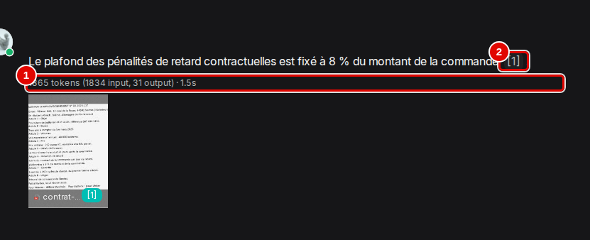

# A1. Évaluation : qualité et performances

> **Objet** : résultats du banc de 38 questions, effet mesuré du gabarit de découpage, des réglages de recherche et du mode « Agentic », citations et refus vus par l'API, lecture des jetons et de la durée d'une réponse, taille de contexte et budget de prompt, préconisations d'usage.
> **Prérequis** : partie 1 du [manuel](../README.md), en particulier les chapitres [06. Régler la lecture des documents](../manuel/06-regler-la-lecture-des-documents.md), [07. Poser des questions et lire les sources](../manuel/07-poser-des-questions-et-lire-les-sources.md) et [08. Régler un assistant](../manuel/08-regler-un-assistant.md).
> **Version décrite** : RAGFlow v1.0.0 (image `infiniflow/ragflow:v1.0.0`), Windows 11 + WSL2 (Ubuntu 24.04), LLM-Service branche `service-vllm` (vLLM 0.29.0 : `gemma4:e4b` quantifié w4a16, `bge-m3`), contexte déclaré de 16 384 jetons sauf mention contraire.
> **Statut des informations** : [Vérifié] observé ou mesuré les 9 et 11 novembre 2026 sur la machine d'essai (profil B : Ryzen 5 9600X, 32 Go, RTX 4060 Ti 16 Go) ; [Source] documentation officielle ou code source au tag v1.0.0 ; [Estimation] calcul non mesuré, avec son raisonnement ; [À tester] non documenté et non essayé.
> **Précautions** : corpus fictif de 9 documents (1 Mo), questions de `corpus/questions.json` ; un seul banc à la fois, `free -m` relevé avant chacun ; jugement par mots-clés, sans juge LLM (comme le banc GPU d'Open Notebook) ; captures faites avec l'assistant d'essai « Manuel-Reglages » (réglages conseillés), supprimé ensuite ; la fenêtre « Modifier le modèle » est refermée par « Non », sans rien changer. Le matériel nécessaire et les profils sans et avec carte graphique sont dans l'annexe [A2](A2-choisir-son-materiel-et-ses-modeles.md).

Captures de cette annexe : scénario `qualite` de `outils/ragflow/captures/manuels_10_14.py` ; textes des pages et déroulé dans `outils/resultats/ragflow/captures/12-qualite-et-performances/`. Les mesures faites à la souris sur le découpage, la recherche et le mode « Agentic » viennent des scénarios `decoupage`, `assistants` et `agentique` de `outils/ragflow/captures/manuels_03_06.py` (textes et déroulé dans `outils/resultats/ragflow/captures/03-datasets-et-decoupage/`, `05-assistants-et-citations/` et `06-agentic-rag/`). [Vérifié]

## Sommaire

1. [Le banc](#1-le-banc)
2. [Résultats](#2-résultats)
3. [Effet du gabarit de découpage](#3-effet-du-gabarit-de-découpage)
4. [Effet des réglages de recherche](#4-effet-des-réglages-de-recherche)
5. [Naive ou Agentic](#5-naive-ou-agentic)
6. [Citations et refus vus par l'API](#6-citations-et-refus-vus-par-lapi)
7. [Reranker](#7-reranker)
8. [Lire les jetons et la durée d'une réponse](#8-lire-les-jetons-et-la-durée-dune-réponse)
9. [Taille de contexte et budget de prompt](#9-taille-de-contexte-et-budget-de-prompt)
10. [Préconisations d'usage](#10-préconisations-dusage)
11. [Dépannage](#dépannage)
12. [Sources](#sources)

## 1. Le banc

- 38 questions : 34 avec réponse (13 faits simples, 10 tableaux, 4 sur le PDF scanné, 2 en anglais, 3 multi-documents, 2 sur le fichier audio) et 4 pièges sans réponse dans le corpus.
- Exactitude : la réponse contient les valeurs attendues ; pour un piège, la réponse doit signaler l'absence d'information.
- Citation : le bon document figure parmi les passages marqués `[ID:n]` dans la réponse ; page vérifiée quand RAGFlow l'expose.
- Une session neuve par question ; questions par `POST /api/v1/chat/completions`.

Commande [Testée] :

```bash
uv run python outils/ragflow/banc.py --etiquette defaut --reindexer
```

Variantes enchaînées par `outils/ragflow/serie_banc.sh`. Une première série notait comme citée toute source fournie au modèle ; elle a été rejouée avec la notation stricte, sans changement de résultat (journaux `essai-2026-11-09-serie-banc-notation-large.log` et `essai-2026-11-09-serie-banc.log` ; JSON de la première série dans l'historique git). Le banc n'utilise pas de juge LLM : le banc GPU d'Open Notebook non plus, ce qui garde la comparaison. [Vérifié]

## 2. Résultats

| Banc | Exactes (34) | Refus pièges (4) | Bon document cité | Bonne page | Médiane | p95 | Indexation | Pic RAM application |
|---|---|---|---|---|---|---|---|---|
| Défaut (General, `top_n` 6, vecteurs 0,3) | 33 | 4 | 34 | 24/24 | 1,28 s | 1,88 s | 53 s | 5 394 Mo |
| Vecteurs 0,7, `top_n` 8 | **34** | 4 | 34 | 24/24 | 1,36 s | 1,83 s | — | 5 041 Mo |
| Gabarit Paper | 33 | 4 | 34 | 24/24 | 1,19 s | 2,31 s | 56 s | 5 575 Mo |
| Gabarit Table | 33 | 4 | 34 | 24/24 | 1,26 s | 2,16 s | 53 s | 5 646 Mo |
| Gabarit Presentation | 32 | 4 | 33 | 23/23 | 1,18 s | 1,86 s | 53 s | 5 503 Mo |
| Mode Agentic | 30 | 4 | 29 | 21/21 | 4,52 s | 7,22 s | — | 5 331 Mo |
| Contexte 4 096 | 33 | 4 | 34 | 24/24 | 1,28 s | 1,83 s | — | 5 318 Mo |
| Contexte 3 072 | 21 | 4 | 22 | — | 1,09 s | 1,56 s | — | — |

[Vérifié] (`outils/resultats/ragflow/banc-2026-11-09-*.json`) « — » : base déjà indexée, ou mesure sans objet.

Résultats en cinq lignes :

1. 33 bonnes réponses sur 34 avec les réglages par défaut, 34 sur 34 avec la recherche orientée vecteurs.
2. Le PDF scanné est lu (4 sur 4) grâce à l'OCR de DeepDoc.
3. Les 4 questions pièges sont refusées dans toutes les variantes.
4. Réponse en 1,3 s en médiane, 1,9 s au 95e centile.
5. L'application seule demande 3,6 Gio de RAM au repos et 5,3 Gio en pointe (détail dans l'annexe [A2](A2-choisir-son-materiel-et-ses-modeles.md)).

- Comparaison avec Open Notebook 1.15.1 sur le même socle GPU (même modèle `gemma4:e4b`, même machine) : 27/34, médiane 1,86 s, 0,6 Go de RAM ; voir l'[index de la série](../../README.md).
- Second modèle : la fiche prévoit `ministral-3:3b` ; LLM-Service en branche `service-vllm` ne sert qu'un modèle de réponse par serveur et il est partagé : non essayé, [À tester].

## 3. Effet du gabarit de découpage

Le corpus a été indexé quatre fois, une base par gabarit. Nombre de passages (et de jetons) par document [Vérifié] :

| Document | General | Paper | Presentation | Table |
|---|---|---|---|---|
| `rapport-annuel-2025.pdf` (10 pages, tableaux) | 9 (871) | 13 (879) | 27 (907) | 9 (871) |
| `contrat-batterix-scan.pdf` (2 pages scannées) | 1 (258) | 1 (258) | 11 (278) | 1 (258) |
| `supplier-audit-batterix-en.pdf` | 1 (123) | 1 (123) | 6 (133) | 1 (123) |
| `stocks-octobre-2025.xlsx` | 2 (177) | 2 (177) | 2 (177) | 10 (345) |
| `strategie-2026.pptx` | 5 (149) | 5 (149) | 5 (149) | 5 (149) |
| `procedure-batteries.docx` | 2 (235) | 2 (235) | 2 (235) | 2 (235) |
| `cse-2025-10-14.md`, `faq-sav.html`, `message-vocal-production.mp3` | 4, 1, 1 | idem | idem | idem |
| **Total** | **26** | **30** | **59** | **34** |

Indexation du corpus complet : 53 à 56 s quel que soit le gabarit. [Vérifié] (`outils/resultats/ragflow/banc-2026-11-09-{defaut,gabarit-paper,gabarit-presentation,gabarit-table}.json`, champ `indexation`) Le passage du tableur de 2 à 10 passages avec « Table » se retrouve à la souris au chapitre [06](../manuel/06-regler-la-lecture-des-documents.md).

- Un gabarit n'agit que sur les formats qu'il sait traiter : Paper et Presentation redécoupent les PDF, Table redécoupe le tableur ; Markdown, HTML, DOCX, PPTX et audio gardent leur découpage. Dans une base « General », le diaporama est même traité d'office par le gabarit Presentation. [Vérifié] (même source ; `outils/resultats/ragflow/captures/carte/05-base-fichiers.txt`)
- Presentation coupe un PDF page par page, même un rapport : 27 passages plus courts pour le rapport annuel. [Vérifié]
- Table fait d'une ligne de tableur un passage : 10 passages et deux fois plus de jetons pour le classeur de stocks ; l'écart de jetons viendrait de la répétition des en-têtes de colonnes dans chaque passage [Estimation].

Effet sur le banc, mêmes 38 questions, même modèle, réglages d'assistant par défaut [Vérifié] :

| Gabarit | Exactes (34) | Refus corrects (4) | Bon document cité | Médiane | Résultat brut |
|---|---|---|---|---|---|
| General | 33 | 4 | 34 | 1,28 s | [banc défaut](../../../outils/resultats/ragflow/banc-2026-11-09-defaut.md) |
| Paper | 33 | 4 | 34 | 1,19 s | [banc Paper](../../../outils/resultats/ragflow/banc-2026-11-09-gabarit-paper.md) |
| Table | 33 | 4 | 34 | 1,26 s | [banc Table](../../../outils/resultats/ragflow/banc-2026-11-09-gabarit-table.md) |
| Presentation | 32 | 4 | 33 | 1,18 s | [banc Presentation](../../../outils/resultats/ragflow/banc-2026-11-09-gabarit-presentation.md) |

Sur ce corpus court, le gabarit change peu le résultat : General suffit. Presentation perd la question en anglais Q29 (taux de défaut des cellules) : l'assistant répond « not found » ; le découpage de l'audit en six morceaux en est la cause probable [Estimation].

La seule question manquée avec General, Paper et Table est Q30 (délai contractuel de Batterix croisé avec le délai constaté) : le modèle trouve le délai constaté mais déclare le délai contractuel absent, alors qu'il figure dans le contrat scanné. Ce n'est pas un problème de découpage : le réglage de la recherche le corrige (section 4).

Autres constats sur le découpage :

- Les anciens gabarits `tag` et `knowledge_graph` de la branche 0.x ne figurent plus dans la liste. Un pipeline personnalisé (`parse_type=2` par l'API) remplace le gabarit ; c'est le chemin de la Knowledge Compilation (chapitre [11](../manuel/11-syntheses-automatiques.md)). [Source] (`docs/references/http_api_reference.md`)
- La langue « English » par défaut de l'onglet « Configuration » a été gardée dans tous les essais du banc ; son effet sur la recherche par mots-clés d'un corpus français est [À tester].
- Par l'API, le gabarit se choisit à la création : `rag.create_dataset(name="…", parser_id="paper")` [Testée] (`outils/ragflow/banc.py`).
- Une relance d'analyse efface aussi les corrections faites à la main dans les passages : la fenêtre annonce l'effacement des passages existants. [Source] (`web/src/locales/fr.ts`, clé `redo`)
- Le téléversement local accepte jusqu'à 32 fichiers et 1 Go par envoi, d'après le texte de la fenêtre. [Vérifié] (`outils/resultats/ragflow/captures/03-datasets-et-decoupage/05-televersement-analyse.txt`)
- Le dossier `.knowledgebase` de « Gestion des fichiers » contient un sous-dossier par base, avec les fichiers téléversés depuis la page « Fichiers » de chaque base. [Vérifié] (`outils/resultats/ragflow/captures/carte/27-gestion-des-fichiers.txt` ; repérage du 11 novembre)

## 4. Effet des réglages de recherche

Valeurs par défaut relevées par l'API à la création d'un assistant par le banc [Vérifié] (`outils/resultats/ragflow/banc-2026-11-09-defaut.json`, champ `config`) :

| Réglage | Dans l'interface | API | Défaut (API) | Rôle |
|---|---|---|---|---|
| Nombre de passages donnés au modèle | « Top N » | `top_n` | 6 | plus de passages, plus de contexte et de jetons |
| Candidats examinés | (non affiché) | `top_k` | 1024 | passages évalués avant sélection |
| Seuil de similarité | « Seuil de similarité » | `similarity_threshold` | 0,1 | sous ce score, un passage est écarté |
| Poids des mots-clés | « Poids de similarité par mots-clés » | `keywords_similarity_weight` | 0,7 | part de la recherche plein texte |
| Poids des vecteurs | « vector » | `vector_similarity_weight` | 0,3 | part de la recherche sémantique (= 1 − poids des mots-clés) |
| Reranker | « Modèle de réordonnancement » | `rerank_id` | vide | aucun |

Un assistant créé à la souris affichait, lui, un seuil de 20 (0,2) et « Top N » 8 (chapitre [08](../manuel/08-regler-un-assistant.md)). [Vérifié]

Banc de 38 questions, gabarit General, même base [Vérifié] :

| Réglage | Exactes (34) | Refus corrects (4) | Bon document cité | Médiane | p95 |
|---|---|---|---|---|---|
| Défaut (`top_n` 6, vecteurs 0,3) | 33 | 4 | 34 | 1,28 s | 1,88 s |
| Vecteurs 0,7, `top_n` 8 | **34** | 4 | 34 | 1,36 s | 1,83 s |

(`outils/resultats/ragflow/banc-2026-11-09-defaut.json`, `outils/resultats/ragflow/banc-2026-11-09-hybride-vecteurs07-top8.json` ; [banc vecteurs 0,7 et `top_n` 8](../../../outils/resultats/ragflow/banc-2026-11-09-hybride-vecteurs07-top8.md))

Réglage conseillé sur ce type de corpus : poids des vecteurs 0,7 et 8 passages ; c'est celui de l'assistant de démonstration « Démo Vélanor » et de l'assistant d'essai « Manuel-Assistant-05 ».

- La question gagnée est Q30 (délai contractuel de Batterix et délai constaté, deux documents) : avec plus de poids aux vecteurs et deux passages de plus, le contrat scanné, dont le texte OCR colle les mots et gêne la recherche par mots-clés, entre dans le contexte. Le coût en latence est négligeable (+0,08 s en médiane). [Vérifié] (mêmes fichiers, question Q30) À la souris, « Manuel-Assistant-05 », réglé ainsi, répond juste à Q30. [Vérifié] (`outils/resultats/ragflow/captures/05-assistants-et-citations/22-reponse-citee.txt`)
- « Test de récupération » de la base « Démo Vélanor », question Q30, valeurs par défaut de l'onglet (« Seuil de similarité » 20, full-text 0,70 et vector 0,30, « Rerank candidates » 64, « Top N » 10) : 25 passages dépassent le seuil ; le premier est le tableau des fournisseurs du classeur de stocks (42,50 en similarité hybride, 25,87 en mots-clés, 81,31 en vecteurs). [Vérifié] (`outils/resultats/ragflow/captures/05-assistants-et-citations/20-test-resultats.txt`)
- Même test avec le poids des mots-clés à 0,3 (vector 0,70) : 26 passages, le premier monte à 64,68 en similarité hybride. Le score vectoriel pèse davantage, ce qui aide les textes mal lus par l'OCR, comme le contrat scanné. [Vérifié] (`outils/resultats/ragflow/captures/05-assistants-et-citations/21-test-vecteurs-07.txt`)
- Le même test par l'API : `POST /api/v1/retrieval` avec `question`, `dataset_ids`, `similarity_threshold` [Testée] (`outils/ragflow/essai_passages.py`, exemple `exemples/ragflow/05_recherche_seule.py`).
- Par l'API, seul `vector_similarity_weight` se règle ; le serveur renvoie `keywords_similarity_weight` = 1 − cette valeur (`internal/handler/chat.go`, ligne 339). Assistant créé avec `vector_similarity_weight=0.7` : l'objet `Chat` du SDK affiche 0,3 pour les vecteurs et 0,3 pour les mots-clés, le serveur renvoie `keywords_similarity_weight` 0,3. Se fier à `keywords_similarity_weight`. [Vérifié] (`outils/resultats/ragflow/essai-2026-11-09-sdk-defauts.log` ; voir aussi l'annexe [A3](A3-automatiser-par-l-api.md))

## 5. Naive ou Agentic

Le mode « Agentic » (« Self-directed corpus exploration ») laisse le modèle décider lui-même des recherches à lancer, en plusieurs tours, selon les consignes de « Agentic template » ; « Naive » fait une recherche puis une réponse. Procédure à la souris : chapitre [07](../manuel/07-poser-des-questions-et-lire-les-sources.md).

Par l'API, le mode agentique se demande en ajoutant `"reasoning": 5` au corps de `POST /api/v1/chat/completions` [Testée] (`outils/ragflow/banc.py`, option `--agentic`). Il remplace les « niveaux de réflexion » des versions 0.x ; son déroulé suit un gabarit d'agent, `smart-reasoning` par défaut (`conf/agentic_rag.yaml`), surchargeable par `prompt_config.agentic_rag`, c'est-à-dire le champ « Agentic template ». [Source] (`internal/service/chat_pipeline.go`, `docs/release_notes.md`)

### 5.1 À la souris, question Q30

Question Q30, qui croise deux documents (délai contractuel du contrat scanné, délai moyen constaté du classeur de stocks), posée à l'assistant « Manuel-Agentic » laissé à ses réglages par défaut ; réponse attendue : 21 jours et 24 jours. [Vérifié] (`outils/resultats/ragflow/captures/06-agentic-rag/scenario.log`, `03-reponse-agentic.txt`, `04-reponse-naive.txt` ; `outils/resultats/ragflow/captures/05-assistants-et-citations/22-reponse-citee.txt`)

| Essai à la souris, question Q30 | Délai contractuel (21 j) | Délai constaté (24 j) | Jetons d'entrée | Délai d'affichage |
|---|---|---|---|---|
| « Agentic », réglages par défaut, passage 1 | oui | oui | 31 988 | 5,4 s |
| « Agentic », réglages par défaut, passage 2 | oui | non | 32 205 | 5,4 s |
| « Naive », réglages par défaut, passages 1 et 2 | non | oui | 1 524 | 3,9 et 5,9 s |
| « Naive », vecteurs 0,7 et « Top N » 8 | oui | oui | 1 893 | 3,9 s |

- Passage 2 en « Agentic » : 32 396 jetons au total, dont 32 205 en entrée (« 32396 tokens (32205 input, 191 output) · 5.0s ») ; les passages lus pendant l'exploration s'ajoutent au contexte. Un bloc « Thought » repliable précède la réponse. Le passage 1, quelques minutes plus tôt, avait donné une réponse complète (21 jours [1], 24 jours [2]) avec 32 198 jetons dont 31 988 en entrée : le mode agentique n'est pas stable sur cette question avec ce modèle. [Vérifié]
- « Naive », réglages par défaut : « 1840 tokens (1524 input, 316 output) · 5.3s » au passage 2 (5,9 s jusqu'à l'affichage) ; au passage 1, même conclusion, 3,9 s, 1 710 jetons. Environ 20 fois moins de jetons d'entrée qu'en mode agentique. [Vérifié]
- Pour cette question, régler la recherche de l'assistant donne la bonne réponse à coup sûr pour un coût bien moindre que le mode agentique.
- À 32 000 jetons d'entrée, une seule question agentique dépasse le contexte de 16 384 jetons déclaré pour le modèle ; le serveur vLLM l'accepte ici, car il est lancé avec une longueur maximale de 32 768 jetons (`max_model_len`, relevé le 9 novembre dans `outils/resultats/ragflow/preuves-2026-11-09/vllm-extrait.log`) : la limite de 16 384 jetons déclarée dans RAGFlow ne s'applique pas à cette exploration. [Vérifié] Sur un service de modèles limité à 16 384 jetons, ce mode serait à essayer avant usage [À tester].

### 5.2 Banc

Même base, même assistant, mêmes 38 questions [Vérifié] :

| Mode | Exactes (34) | Refus corrects (4) | Bon document cité | Réponses sans citation | Médiane | p95 |
|---|---|---|---|---|---|---|
| Naive (défaut) | 33 | 4 | 34 | 0 | 1,28 s | 1,88 s |
| Agentic | 30 | 4 | 29 | 5 | 4,52 s | 7,22 s |

(`outils/resultats/ragflow/banc-2026-11-09-defaut.json`, `outils/resultats/ragflow/banc-2026-11-09-agentic.json` ; [banc Agentic](../../../outils/resultats/ragflow/banc-2026-11-09-agentic.md))

Sur ce corpus et avec ce petit modèle, le mode agentique est moins juste et 3,5 fois plus lent. La réponse directe reste le bon choix.

- Le mode agentique gagne pourtant sur les questions multi-documents (3 sur 3, contre 2 sur 3) : il trouve seul le délai contractuel de Batterix dans le contrat scanné (Q30). Il perd quatre questions pourtant directes : deux de tableau (Q06, Q07) et deux faits simples (Q26, Q27) ; il répond juste à Q24 mais sans citation. [Vérifié] (même fichier, `par_type`)
- Dans les échecs, le modèle ne lance pas de recherche et répond comme s'il n'avait accès à aucun document, par exemple pour Q26 : « Je suis désolé, mais je n'ai accès à aucun document ou base de données contenant des numéros de téléphone de service après-vente. » La réponse est alors donnée sans citation. [Vérifié] (`banc-2026-11-09-agentic.json`, Q06, Q07, Q26, Q27)
- Par l'API, toutes les réponses agentiques commencent par un bloc `<think>…</think>`, qui répète ou prépare la réponse (38 réponses sur 38) ; un programme qui affiche la réponse doit retirer ce bloc. L'interface l'affiche replié sous « Thought ». [Vérifié]
- Un modèle plus grand, plus habitué à l'appel d'outils, suivrait sans doute mieux le déroulé agentique [Estimation] ; non essayé, le socle ne servant qu'un modèle de réponse. « Decision model » permettrait de confier les décisions de recherche à un autre modèle [À tester].

## 6. Citations et refus vus par l'API

Par l'API, la réponse contient des marqueurs `[ID:n]`, et `reference.chunks` liste les passages : `[ID:n]` désigne le n-ième passage de cette liste. [Vérifié]

- `reference.chunks` contient **tous** les passages donnés au modèle, pas seulement ceux qu'il cite : pour une question sur le contrat Batterix, six documents y figurent alors que la réponse ne cite que le contrat. Pour savoir quel document justifie la réponse, garder les seuls passages dont l'indice apparaît dans `[ID:n]` ; c'est ce que fait le banc. Chaque passage porte aussi ses `positions` (`[page, x1, x2, y1, y2]`, pages numérotées à partir de 1) : la bonne page est citée pour les 24 questions dont la source est un PDF ou un document paginé. [Vérifié] (`outils/resultats/ragflow/demo-2026-11-09.log` ; `outils/ragflow/banc.py` ; `banc-2026-11-09-defaut.json`)
- Les quatre questions pièges du banc (Q35 à Q38) sont toutes correctement refusées, par la phrase anglaise du prompt système par défaut d'un assistant créé par l'API (« The answer you are looking for is not found in the dataset! »), suivie d'un renvoi. [Vérifié] (`banc-2026-11-09-defaut.json`) Le message se change par `prompt_config.empty_response` ; l'assistant de démonstration répond « Aucune information pertinente n'a été trouvée dans les documents. » [Vérifié] (`outils/ragflow/demo.py`)
- La « Réponse vide » ne sert que si aucun passage ne dépasse le seuil ; sinon le modèle répond selon le prompt système : modifier aussi la phrase de refus du « Prompt système » (constat tiré du dépannage des essais à la souris).

## 7. Reranker

RAGFlow 1.0 n'embarque aucun reranker ; « Modèle de réordonnancement » reste vide tant qu'aucun service de reranking n'est déclaré. Deux essais ont été faits le 11 novembre 2026 ; aucun n'a abouti à un reranker branché, le banc avec reranker n'a donc pas été joué. L'essai reprendra avec le nouveau service de modèles de la série (llama.cpp derrière une passerelle LiteLLM). [Vérifié] (`outils/resultats/ragflow/reranker-2026-11-11.log`)

### 7.1 Ce que fait le reranker dans RAGFlow

Quand un assistant a un « Modèle de réordonnancement », RAGFlow envoie au reranker la question et les « Rerank candidates » meilleurs passages (64 par défaut), puis classe chaque passage par `poids des mots-clés × score par mots-clés + poids des vecteurs × note du reranker` : la note du reranker remplace le score par le sens, l'embedding ne sert plus qu'à trouver les candidats. Avec le poids des mots-clés par défaut (0,7), le reranker ne pèse que 30 % du classement. [Source] (`internal/service/nlp/reranker.go`, `RerankByModel`)

- Un modèle nommé exactement `BAAI/bge-reranker-v2-m3` ou `maidalun1020/bce-reranker-base_v1` est pris pour un ancien reranker intégré : RAGFlow n'enregistre alors pas l'instance qui le sert (`tenant_rerank_id` vide). Garder un autre nom servi, par exemple `bge-reranker-v2-m3`. [Source] (`internal/service/chat.go`, `DefaultRerankModels`, `resolveCreateRerankID`)

### 7.2 Premier essai : Text Embeddings Inference sur processeur

Serveur : image TEI prévue par le compose officiel (`infiniflow/text-embeddings-inference:cpu-1.8`, TEI 1.8.2), modèle `BAAI/bge-reranker-v2-m3`, conteneur `rag-reranker` (`outils/ragflow/reranker_cpu.sh`). [Vérifié] (`outils/resultats/ragflow/reranker-2026-11-11.log`, `reranker-cpu-2026-11-11-tei.log`)

| Constat | Résultat |
|---|---|
| Réglage par défaut (`--max-batch-tokens` 16384) | échauffement à 13,6 Go de RAM, puis redémarrages en boucle (trois), sans arrêt pour manque de mémoire signalé ; relancé avec 2 048 et une limite de 6 Go |
| Démarrage et mémoire | sain en 22 s ; 4,6 Gio de RAM au repos |
| `POST /rerank` au format de TEI (`query`, `texts`) | 200 en 0,16 s : 0,343 pour le passage pertinent, 0,00002 pour l'autre |
| `POST /rerank` au format envoyé par RAGFlow (`model`, `query`, `documents`, `top_n`) | **422** « missing field `texts` » |
| `POST /v1/rerank` | **404** |

Les pilotes de RAGFlow 1.0 qui savent reclasser (« VLLM », « OpenAI-API-Compatible », « LocalAI », « Xinference », « GPUStack »…) envoient tous le format Jina/Cohere (`documents`, réponse `results[].relevance_score`) ; le pilote « HuggingFace », que `conf/llm_factories.json` marque pourtant `TEXT RE-RANK`, répond « no such method: Rerank ». TEI n'expose que son format natif, même dans sa dernière version (1.9.4). Aucun fournisseur de RAGFlow 1.0 ne peut donc appeler TEI pour reclasser sans adaptateur entre les deux formats ; essai arrêté. [Source] (`internal/entity/models/vllm.go`, `huggingface.go`, `openai_api_compatible.go` ; `router/src/http/server.rs` de TEI) ; [Vérifié] pour les codes 422 et 404

### 7.3 Second essai : vLLM sur la carte graphique, à côté des deux autres modèles

But : vérifier que modèle de réponse, embedding et reranker tiennent ensemble sur les 16 Go de la carte. Service `vllm-rerank` (même image que `vllm-embed`, `--runner pooling`, `--max-model-len 2048`, `--gpu-memory-utilization 0.05`, port `127.0.0.1:8003`) déclaré dans un fichier local non suivi de LLM-Service (`docker-compose.override.yml`, profil `rerank`), démarré seul par `outils/ragflow/reranker.sh`, qui refuse de démarrer sous 2 Go de VRAM libre. vLLM 0.29 sert `/v1/rerank` au format attendu par le fournisseur « VLLM » de RAGFlow. [Source] (`vllm/entrypoints/pooling/scoring/api_router.py` de l'image)

| Mesure | Valeur |
|---|---|
| VRAM libre, 66 relevés toutes les 30 s pendant 33 minutes | 211 à 461 Mio sur 16 380 |
| VRAM des deux modèles en place | `vllm-central` : 11,06 Gio de poids et 0,7 Go de cache (`--kv-cache-memory`) ; `vllm-embed` : 1,06 Gio de poids |
| Besoin estimé de `vllm-rerank` | environ 1,6 Go : 1,06 Gio de poids (même taille que `bge-m3`) et environ 0,5 Go de contexte CUDA [Estimation] |
| Autres occupants de la carte | une trentaine de programmes du bureau Windows (navigateur, lanceurs de jeux, LM Studio…), mémoire par programme illisible |

[Vérifié] (`outils/resultats/ragflow/reranker-2026-11-11.log`) Le trio `gemma4:e4b` + `bge-m3` + `bge-reranker-v2-m3` sur vLLM ne tient pas sur 16 Go avec le bureau Windows actif ; `vllm-rerank` n'a pas été démarré. Il faudrait libérer la carte côté Windows ou réduire la part de `vllm-central` (par exemple une longueur maximale de 16 384 jetons au lieu de 32 768) [À tester] ; détail matériel dans l'annexe [A2](A2-choisir-son-materiel-et-ses-modeles.md).

## 8. Lire les jetons et la durée d'une réponse

Chaque réponse d'un assistant affiche, sous son texte, les jetons consommés et la durée. C'est la mesure à surveiller pour juger d'un réglage : le nombre de jetons d'entrée dit ce que coûte la recherche (consignes et passages envoyés au modèle), la durée ce que l'utilisateur attend.

Question « Quel est le plafond des pénalités de retard du contrat Batterix ? » posée à « Manuel-Reglages » (« Top N » 8, poids des vecteurs 0,7), en gros plan (procédure de question au chapitre [07](../manuel/07-poser-des-questions-et-lire-les-sources.md)) :


*Écran : page de l'assistant, pied de la réponse en gros plan.*

| N° | Élément | Rôle |
|---|---|---|
| 1 | « 1865 tokens (1834 input, 31 output) · 1.5s » | jetons au total, dont 1 834 d'entrée (prompt : consignes, passages, question) et 31 de sortie (la réponse), puis durée de génération |
| 2 | renvoi « [1] » | passage cité ; plus il y a de passages retenus, plus le nombre de jetons d'entrée monte |

La réponse (8 % du montant de la commande) est juste. Le scénario a relevé 1,9 s entre le clic et l'affichage complet, contre 1,5 s indiquées : la durée affichée ne compte que la génération, pas la recherche ni l'affichage. [Vérifié] (`outils/resultats/ragflow/captures/12-qualite-et-performances/scenario.log`)

- Ordres de grandeur relevés : 1 834 à 1 893 jetons d'entrée en mode « Naive » sur ce corpus ; environ 32 000 en mode « Agentic » pour la même question (section 5). Si l'entrée approche la taille de contexte déclarée (section 9), la réponse échoue. [Vérifié]
- Les réglages qui font varier ces chiffres sont dans le panneau « Paramètres du chat » (« Top N », « Poids de similarité par mots-clés », « Seuil de similarité », mode « Naive » ou « Agentic ») : chapitre [08](../manuel/08-regler-un-assistant.md). Le « Test de récupération » d'une base montre l'effet de la recherche seule, sans le modèle (même chapitre).

## 9. Taille de contexte et budget de prompt

La taille de contexte déclarée est le nombre maximal de jetons (prompt et réponse) que RAGFlow suppose au modèle. Elle se règle dans l'interface, par modèle : menu du compte › « Fournisseurs de modèles » › « VLLM » › carte de l'instance `llm-service-chat` (chapitre [03](../manuel/03-premiers-pas.md)) ; survoler la ligne `gemma4:e4b` et cliquer sur le crayon « Modifier le modèle » qui apparaît à droite du badge « LLM ».

La fenêtre « Modifier le modèle » (« Type de modèle » « Chat », « Tokens maximum », « Appel d'outil », « Non », « Confirmer », qui prend effet à la question suivante) est montrée et annotée au chapitre [15](../manuel/15-en-cas-de-probleme.md), comme remède à l'erreur de contexte ; « Tokens maximum » vaut 16384 dans ce banc et doit rester inférieur ou égal à la taille réellement servie.

[Vérifié] (`outils/resultats/ragflow/captures/12-qualite-et-performances/02-tokens-maximum.txt`, `scenario.log` : « Tokens maximum = 16384 ») Le même réglage se change par l'API, ce que fait `outils/ragflow/contexte.py` [Testée].

RAGFlow ne fixe pas `num_ctx` : il borne la réponse à « contexte déclaré du modèle − jetons du prompt ». Le prompt d'une question (consignes et 6 passages) fait de 1 841 jetons (question type du chapitre [04](../manuel/04-premiere-question.md)) à 3 301 jetons (plus grand relevé dans les erreurs à 3 072) sur ce corpus.

| Contexte déclaré | Résultat |
|---|---|
| 16 384 (référence de la série) | 33/34 |
| 4 096 | 33/34, identique : suffit sur ce corpus |
| 3 072 | 21/34 : 12 réponses remplacées par « **ERROR**: prompt uses 3089 à 3301 tokens, leaving no completion capacity… » |
| 512 (essai de dépassement, `top_n` 12) | erreur immédiate : « prompt uses 2210 tokens » |

[Vérifié] (`banc-2026-11-09-ctx4096.json`, `banc-2026-11-09-ctx3072.json`, `essai-2026-11-09-contexte-depassement.log` ; [banc 4 096](../../../outils/resultats/ragflow/banc-2026-11-09-ctx4096.md), [banc 3 072](../../../outils/resultats/ragflow/banc-2026-11-09-ctx3072.md)). Entre 3 072 et 4 096, rien n'a été essayé : 4 096 suffit, 3 072 échoue. L'erreur à la souris, provoquée avec un contexte de 1 024 (« ERROR: prompt uses 2696 tokens… »), est montrée au chapitre [15](../manuel/15-en-cas-de-probleme.md).

Avant d'échouer, RAGFlow retire des passages pour faire tenir le prompt (journal du serveur : « Not all the retrieval into prompt », 3 passages gardés sur 12) ; il ne descend pas sous les consignes elles-mêmes. L'erreur arrive dans le texte de la réponse, avec un code d'API 0 : un programme doit la détecter dans `answer`. Pour le juge du banc, la question ne se pose pas (pas de juge LLM). Avec Ollama, la taille réelle est le `OLLAMA_CONTEXT_LENGTH` du serveur, puisque RAGFlow n'envoie pas `num_ctx`. [Source] (`internal/service/chat_pipeline.go`)

## 10. Préconisations d'usage

Ce qui suit résume les mesures des sections précédentes et de l'annexe [A2](A2-choisir-son-materiel-et-ses-modeles.md) en règles pratiques. Chaque règle renvoie à sa mesure.

**Réglages conseillés d'un assistant** (panneau « Paramètres du chat », chapitre [08](../manuel/08-regler-un-assistant.md)) :

| Réglage | Valeur conseillée | Pourquoi |
|---|---|---|
| Mode | « Naive » | 34/34 en 1,4 s ; « Agentic » donne 30/34 en 4,5 s et envoie une vingtaine de fois plus de jetons (sections 5 et 8) |
| « Top N » | 8 | une question à deux documents trouve ses deux sources (section 4) |
| « Poids de similarité par mots-clés » | 0,3 (soit 0,7 pour les vecteurs) | retrouve les passages mal lus d'un scan, que les mots-clés ratent |
| « Seuil de similarité » | 20 (défaut) | non modifié dans le banc ; le monter écarte des passages utiles et fait apparaître des refus à tort [Estimation] |
| « Réponse vide » et phrase de refus du « Prompt système » | en français | un assistant créé par l'API refuse en anglais (« The answer you are looking for is not found in the dataset! », chapitre [15](../manuel/15-en-cas-de-probleme.md)) ; créé à la souris, son prompt est en français (chapitre [07](../manuel/07-poser-des-questions-et-lire-les-sources.md)) |
| Gabarit de la base | « General » | aucun gabarit spécialisé n'a fait mieux sur ce corpus (32 à 33/34, section 3) |

**Taille de contexte** (section 9) : 16 384 jetons déclarés quand le matériel le permet ; jamais moins de 4 096 (le prompt monte à 3 301 jetons avec 6 passages, davantage avec « Top N » 8) ; à 3 072, une réponse sur trois est une erreur. Sur un profil sans GPU, 4 096 est le bon compromis : la lecture du prompt est deux fois plus rapide qu'à 16 384 (annexe [A2](A2-choisir-son-materiel-et-ses-modeles.md)).

**Matériel** (annexe [A2](A2-choisir-son-materiel-et-ses-modeles.md)) : avec un GPU de 12 à 16 Go, la réponse arrive en 1 à 2 s ; sans GPU, compter 30 à 50 s par question à 4 096 jetons [Estimation] : utilisable pour des questions ponctuelles, pas pour une conversation. Prévoir 6 Gio de RAM pour RAGFlow seul en pointe, plus le service de modèles.

**Ce qui rend l'outil lent ou inutilisable, et comment l'éviter** :

| Situation | Effet constaté ou calculé | Prévention |
|---|---|---|
| Contexte déclaré trop petit | réponses remplacées par « **ERROR**: prompt uses N tokens… » (section 9) | 4 096 au minimum dans « Tokens maximum » |
| Contexte déclaré plus grand que celui du serveur de modèles | erreur du serveur de modèles quand le prompt dépasse [Estimation] | « Tokens maximum » inférieur ou égal à la taille servie (ici 16 384 déclarés pour 32 768 servis) |
| Mode « Agentic » | 3 à 4 fois plus lent, environ 32 000 jetons d'entrée : sur CPU, plusieurs minutes par question [Estimation] | « Naive » par défaut ; « Agentic » seulement pour une question qui demande plusieurs recherches |
| Gros fonds scanné | OCR à 4,7 s par page : environ 80 minutes pour 1 000 pages [Estimation] | indexer hors des heures d'usage ; préférer les PDF texte |
| Moins de 16 Go de RAM dans WSL | Elasticsearch (2,7 Gio) et le modèle se disputent la mémoire | arrêter les autres solutions ; garder 4 096 jetons |
| Compilation de connaissances (« Graph », « Tree »…) | jusqu'à 142 s pour un seul document (chapitre [11](../manuel/11-syntheses-automatiques.md)) | la réserver aux bases où elle sert |

Le nombre de documents d'une base ne ralentit pas les réponses de façon visible sur ce corpus : seuls les « Top N » passages vont au modèle. Ce qui grandit avec le fonds, c'est le temps d'indexation et la mémoire d'Elasticsearch (annexe [A2](A2-choisir-son-materiel-et-ses-modeles.md)).

## Dépannage

| Symptôme | Cause probable | Action |
|---|---|---|
| Réponses « **ERROR**: prompt uses N tokens… » | contexte déclaré trop petit (3 072 ou moins) | 4 096 au minimum, 16 384 conseillé |
| Bonne réponse manquée sur une question à deux documents | un document peu lisible par mots-clés (scan) | poids des vecteurs 0,7 et `top_n` 8 |
| Refus (« …ne se trouve pas dans la base de connaissances ! ») à une question légitime | passage utile absent du contexte, souvent un texte OCR peu lisible | « Test de récupération » ; augmenter le poids des vecteurs ou « Top N », ou baisser le seuil |
| Une question sur un document court en anglais ne trouve plus rien après passage à Presentation | passages trop petits, page par page | revenir à General ou Paper pour ce type de document |
| Le gabarit choisi ne change rien pour un fichier | le gabarit ne traite pas ce format (Markdown, HTML, DOCX, PPTX, audio) | normal ; voir la section 3 |
| Réponses lentes en mode agentique, plus de 30 000 jetons d'entrée | plusieurs tours de recherche et de génération | mode « Naive » ; vérifier que le contexte du service de modèles le permet |
| Réponse agentique « je n'ai pas accès à… » sans citation | le modèle n'a pas lancé de recherche | repasser en « Naive », ou reposer la question |
| Deux réponses agentiques différentes à la même question | exploration non déterministe avec ce modèle | préférer « Naive » avec une recherche bien réglée |
| Bloc « Thought » ou `<think>…</think>` dans la réponse | sortie du mode agentique | le replier dans l'interface ; le retirer par programme avec l'API |
| Un document « cité » par l'API n'apparaît pas dans la réponse | lecture de tout `reference.chunks` au lieu des seuls `[ID:n]` | filtrer les passages par les indices `[ID:n]` |
| Poids des vecteurs lu à 0,3 par le SDK malgré un réglage à 0,7 | valeur par défaut de l'objet `Chat` du SDK | lire `keywords_similarity_weight` (vecteurs = 1 − mots-clés) |
| La « Réponse vide » réglée n'apparaît jamais | elle ne sert que si aucun passage ne dépasse le seuil | modifier aussi la phrase de refus du « Prompt système » |
| Reranker TEI déclaré, erreur 422 « missing field `texts` » | RAGFlow envoie le format Jina/Cohere, TEI attend le sien | servir le reranker par un serveur au format Jina/Cohere (vLLM, par exemple) |
| Reranker choisi sans effet sur un assistant | modèle servi sous le nom `BAAI/bge-reranker-v2-m3`, pris pour un ancien reranker intégré | le déclarer sous un autre nom servi (`bge-reranker-v2-m3`) |
| Durée affichée sous la réponse plus courte que l'attente réelle | la durée ne compte que la génération | mesurer de bout en bout (banc, `banc.py`) |

## Sources

- Bancs : `outils/resultats/ragflow/banc-2026-11-09-*.json` et `.md` ; [banc par défaut](../../../outils/resultats/ragflow/banc-2026-11-09-defaut.md)
- Captures de cette annexe : `outils/ragflow/captures/manuels_10_14.py` (scénario `qualite`), assistant d'essai créé par `outils/ragflow/manuels_10_14_preparer.py assistant` ; images `docs/ragflow/img/12-qualite-et-performances/` ; textes et déroulé `outils/resultats/ragflow/captures/12-qualite-et-performances/`
- Mesures à la souris : `outils/ragflow/captures/manuels_03_06.py` (scénarios `decoupage`, `assistants`, `agentique`) ; textes et déroulé `outils/resultats/ragflow/captures/03-datasets-et-decoupage/`, `05-assistants-et-citations/`, `06-agentic-rag/`
- Reranker : `outils/ragflow/reranker_cpu.sh`, `outils/ragflow/reranker.sh` ; journaux `outils/resultats/ragflow/reranker-2026-11-11.log`, `reranker-cpu-2026-11-11-tei.log`
- Scripts : `outils/ragflow/banc.py` (option `--agentic`), `outils/ragflow/serie_banc.sh`, `outils/ragflow/contexte.py`, `outils/ragflow/essai_contexte.py`, `outils/ragflow/essai_passages.py`, `outils/ragflow/demo.py`, `outils/communs/banc/commun.py`
- Journaux : `outils/resultats/ragflow/essai-2026-11-09-contexte-depassement.log`, `essai-2026-11-09-sdk-defauts.log`, `demo-2026-11-09.log`, `preuves-2026-11-09/vllm-extrait.log`
- Code au tag v1.0.0 : `internal/service/chat_pipeline.go`, `internal/handler/chat.go`, `internal/entity/models/builtin.go`, `internal/service/nlp/reranker.go`, `internal/entity/models/vllm.go`, `conf/agentic_rag.yaml`, `web/src/locales/fr.ts` ; référence de l'API `docs/references/http_api_reference.md` ; https://ragflow.io/docs/
- Socle : `outils/resultats/socle/` ; diagnostic : `outils/resultats/machine/diagnostic-2026-11-09.json`
