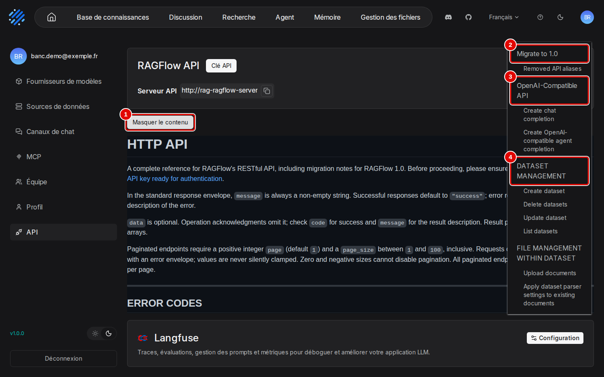

# A3. Automatiser par l'API

> **Objet** : piloter RAGFlow par son API HTTP et par le module Python `ragflow-sdk` (bases de connaissances, import, analyse, assistants, questions, agents), avec des exemples exécutés et les défauts du SDK 1.0.0 contournés.
> **Prérequis** : partie 1 du [manuel](../README.md), chapitres 01 à 04 ; une clé d'API créée dans la page « API » ([chapitre 13](../manuel/13-comptes-equipe-et-cles.md)) ou par le script `outils/ragflow/configurer.py`.
> **Version décrite** : RAGFlow v1.0.0 (image `infiniflow/ragflow:v1.0.0`), `ragflow-sdk` 1.0.0 sous Python 3.13 (uv), Windows 11 + WSL2 (Ubuntu 24.04), service LLM central depuis le 12 novembre 2026 (`chat`, `embed`, `rerank`, `transcribe`, instance `llm-central` du fournisseur `OpenAI-API-Compatible`) ; essais du 9 et 11 novembre avec LLM-Service branche `service-vllm` (vLLM 0.29.0 : `gemma4:e4b`, `bge-m3`) ; contexte déclaré de 16 384 jetons.
> **Statut des informations** : [Vérifié] observé ou mesuré les 9, 11 et 12 novembre 2026 sur la machine d'essai (Ryzen 5 9600X, 32 Go, RTX 4060 Ti 16 Go) ; [Source] documentation officielle ou code source au tag v1.0.0 ; [Estimation] calcul non mesuré ; [À tester] non documenté et non essayé.
> **Précautions** : la clé d'API donne tous les droits du compte : elle reste dans `donnees/` (ignoré par git) et n'est jamais affichée par les exemples ; la clé créée à la souris pour les captures est supprimée dans la foulée, la clé des scripts du banc est gardée ; les clés sont masquées sur les captures et remplacées par `ragflow-<masqué>` dans les textes archivés ; objets d'exemple supprimés par `06_nettoyer_exemples.py`.

**Risque — clé d'API en clair.** La fenêtre « Clé API » de la page « API » affiche chaque clé en entier, sans masque, et la clé donne tous les droits du compte (lire, modifier, supprimer les bases). Ne pas ouvrir cette fenêtre pendant un partage d'écran ; supprimer toute clé qui a pu être vue. [Vérifié] (`outils/resultats/ragflow/captures/10-api-et-sdk/02-cles-api.txt`, clés remplacées par `ragflow-<masqué>` à l'archivage)

**Risque — défauts du SDK 1.0.0.** Deux appels du SDK ne fonctionnent pas comme attendu avec le serveur 1.0.0 : `Session.ask` sur un assistant de chat répond 404, et `DataSet.parse_documents` a une fois rendu la main avant la fin réelle de l'analyse. Les contournements sont donnés en section 6. [Vérifié] (`outils/resultats/ragflow/installation-2026-11-09-verif.log`, `outils/resultats/ragflow/installation-2026-11-09-verif-essai1.log`)

## Sommaire

1. [Clé d'API : ce que l'essai à la souris a établi](#1-clé-dapi--ce-que-lessai-à-la-souris-a-établi)
2. [Documentation intégrée à l'interface](#2-documentation-intégrée-à-linterface)
3. [Clé d'API et environnement](#3-clé-dapi-et-environnement)
4. [Les appels utiles](#4-les-appels-utiles)
5. [Exemples exécutés](#5-exemples-exécutés)
6. [Défauts du SDK 1.0.0 et contournements](#6-défauts-du-sdk-100-et-contournements)
7. [Dépannage](#dépannage)
8. [Sources](#sources)

## 1. Clé d'API : ce que l'essai à la souris a établi

La procédure à la souris (menu du compte › « API » › « Clé API » › « Créer une nouvelle clé », copie, corbeille et confirmation « Supprimer ») est décrite au [chapitre 13](../manuel/13-comptes-equipe-et-cles.md). Les captures viennent du scénario `cles` de `outils/ragflow/captures/manuels_10_14.py` ; le texte de chaque page capturée et la liste de ses éléments visibles sont dans `outils/resultats/ragflow/captures/10-api-et-sdk/` (même nom que l'image), le déroulé dans `scenario.log`. [Vérifié]

Constats :

- Une clé s'écrit `ragflow-` suivi de 32 caractères ; la fenêtre la montre en clair, avec sa date de création, un bouton de copie et une corbeille. Aucun nom ni droit à choisir : toute clé a tous les droits du compte. [Vérifié] (`02-cles-api.txt`)
- Après création puis suppression d'une clé d'essai, le tableau ne contient plus que la clé des scripts du banc (créée le 9 novembre), qui fonctionne toujours ; un script qui utilise une clé supprimée reçoit ensuite un refus. [Vérifié] (`scenario.log`, lignes « clés avant », « clés après création », « clés après suppression »)
- « Serveur API » affiche `http://rag-ragflow-server` : l'adresse par laquelle le navigateur de capture (conteneur Playwright sur le réseau Docker) a ouvert l'interface. Depuis Windows ou WSL, les scripts du banc appellent l'API sur `http://127.0.0.1:9380` (section 3). Depuis le navigateur Windows, l'adresse affichée devrait être `http://127.0.0.1:8088`, que l'interface relaie vers l'API sous `/api/` [À tester].
- Sous la documentation, la carte « Langfuse » (« Configuration ») relie RAGFlow à un serveur Langfuse de suivi des appels aux modèles : non couverte, aucun serveur Langfuse dans le banc.
- Incident : une première passe du scénario `cles`, sans gestion de la confirmation de suppression, a laissé une clé d'essai, supprimée ensuite par l'API le 11 novembre. [Vérifié] (`outils/resultats/ragflow/captures/10-api-et-sdk/nettoyage.log`)

Pour séparer les usages (un script, un serveur), créer une clé par usage et supprimer celle qui n'a plus d'emploi : la clé n'a ni nom ni portée.

## 2. Documentation intégrée à l'interface

Dans la page « API », « Afficher le contenu » déplie à droite le sommaire de la documentation de l'API HTTP ; un clic sur une entrée y amène.



| N° | Élément | Rôle |
|---|---|---|
| 1 | « Masquer le contenu » | replie le sommaire |
| 2 | « Migrate to 1.0 » | changements de l'API entre les versions 0.x et 1.0 (section 4) |
| 3 | « OpenAI-Compatible API » | appels au format OpenAI (« Create chat completion », « Create OpenAI-compatible agent completion ») |
| 4 | « DATASET MANAGEMENT » | première des rubriques par objet : bases, documents (« FILE MANAGEMENT WITHIN DATASET »), passages (« CHUNK MANAGEMENT WITHIN DATASET »), assistants (« CHAT ASSISTANT MANAGEMENT »)… |

La documentation intégrée est en anglais ; elle reprend `docs/references/http_api_reference.md` du dépôt au tag v1.0.0 [Source]. Elle rappelle les codes d'erreur : un code HTTP et un code « métier » dans le corps de la réponse (`0` succès, `102` données invalides ou manquantes, `109` erreur d'authentification…), à contrôler séparément. [Vérifié] (`outils/resultats/ragflow/captures/10-api-et-sdk/01-page-api.txt`, `04-documentation.txt`)

## 3. Clé d'API et environnement

- Clé d'API : page « API » ([chapitre 13](../manuel/13-comptes-equipe-et-cles.md)), ou `POST /api/v1/system/keys` avec `{"name": "…"}` une fois connecté [Testée] (`outils/ragflow/configurer.py`). Elle s'envoie dans l'en-tête `Authorization: Bearer <clé>`. La liste se lit par `GET /api/v1/system/tokens` et une clé se supprime par `DELETE /api/v1/system/tokens/<clé>` [Testée] (`outils/resultats/ragflow/captures/10-api-et-sdk/nettoyage.log`).
- Adresse de l'API : `http://127.0.0.1:9380` depuis WSL (l'interface sur 8088 la relaie aussi sous `/api/`).
- SDK : `ragflow-sdk` 1.0.0, même version que le serveur ; il exige Python 3.13. Dans ce dépôt [Testée] :

```bash
uv sync
uv run python exemples/ragflow/03_importer_et_analyser.py
```

Le compte d'administration créé au premier démarrage (`admin@ragflow.io`) reçoit un refus sur `/api/v1` : utiliser un compte ordinaire. [Source] (`internal/handler/auth.go`) Les routes d'administration sont sur le port 9381 (annexe [A4](A4-exploitation.md)).

## 4. Les appels utiles

| Besoin | API HTTP | SDK |
|---|---|---|
| Santé (sans clé) | `GET /api/v1/system/healthz` | — |
| Créer une base | `POST /api/v1/datasets` (`name`, `parser_id`) | `rag.create_dataset(name=…, parser_id="general")` |
| Téléverser | `POST /api/v1/datasets/{base}/documents` (multipart) | `ds.upload_documents([{"display_name", "blob"}])` |
| Lancer l'analyse | `POST /api/v1/datasets/{base}/chunks` (`document_ids`) | `ds.async_parse_documents(ids)` |
| Suivre l'analyse | `GET /api/v1/datasets/{base}/documents` (`progress`, `chunk_count`) | `ds.list_documents(id=…)` |
| Recherche seule | `POST /api/v1/retrieval` | `rag.retrieve(question=…, dataset_ids=[…])` |
| Créer un assistant | `POST /api/v1/chats` | `rag.create_chat(name=…, dataset_ids=[…])` |
| Poser une question | `POST /api/v1/chat/completions` (`chat_id`, `session_id`, `question`, `stream: false`) | (défaut, voir section 6) |
| Agents | `POST /api/v1/agents/chat/completions` | `agent.create_session()`, `session.ask(…)` |
| Applications de recherche | `GET /api/v1/searches`, `DELETE /api/v1/searches/{id}` | — |

[Testée] (scripts de `outils/ragflow/` et `exemples/ragflow/` ; applications de recherche : `outils/ragflow/nettoyer_manuel.py`, `outils/resultats/ragflow/captures/15-recherche/nettoyage.log`)

Points d'attention :

- Réponse d'une question : `data.answer` (texte avec marqueurs `[ID:n]`) et `data.reference.chunks` (tous les passages fournis au modèle, avec `document_name`, `content`, `positions`, `similarity`). Garder les seuls passages dont l'indice figure dans `[ID:n]` pour connaître les sources réellement citées (lecture des citations : [chapitre 07](../manuel/07-poser-des-questions-et-lire-les-sources.md)).
- Ruptures par rapport aux versions 0.x : `chunk_method="naive"` devient `parser_id="general"` ; plusieurs anciennes routes sont retirées, dont `/api/v1/chats/{id}/completions`. [Source] (`docs/references/http_api_reference.md`)

## 5. Exemples exécutés

Six exemples courts dans `exemples/ragflow/`, lancés par `exemples/ragflow/lancer.sh` (dernière exécution le 12 novembre 2026, avec le service LLM central), qui écrit leur sortie réelle dans [`sorties_verifiees.txt`](../../../exemples/ragflow/sorties_verifiees.txt) [Testée] :

| Exemple | Ce qu'il fait | Sortie obtenue (extrait) |
|---|---|---|
| `01_sante.sh` | santé et interface | `{"db":"ok",…,"status":"ok"}`, `interface web : HTTP 200` |
| `02_modeles_par_defaut.sh` | modèles par défaut du compte | `chat -> chat @ llm-central ( OpenAI-API-Compatible )`, puis `embedding`, `rerank`, `asr` |
| `03_importer_et_analyser.py` | base, import de `faq-sav.html`, analyse | `1 passage(s), 153 jetons` |
| `04_question_assistant.py` | assistant et question par l'API HTTP | « … le cadre bénéficie d'une garantie de 7 ans [ID:0] » (réponse plus longue, en partie en anglais, avec `chat`) |
| `05_recherche_seule.py` | recherche sans génération | `similarité 0.407 \| faq-sav.html` |
| `06_nettoyer_exemples.py` | suppression des objets d'exemple | `supprimés : 1 assistant(s), 1 dataset(s)` |

[Vérifié] (`exemples/ragflow/sorties_verifiees.txt`)

Les exemples se lancent depuis la racine du dépôt (ils lisent la clé dans `donnees/ragflow/compte.json`). Ils n'utilisent que le SDK et `requests`, déjà installé avec lui.

## 6. Défauts du SDK 1.0.0 et contournements

| Défaut constaté | Effet | Contournement [Testée] |
|---|---|---|
| `Session.ask` d'un assistant de chat appelle `/api/v1/chats/{id}/completions`, route retirée du serveur 1.0 | `Exception: Not Found: /api/v1/chats/…/completions` | `POST /api/v1/chat/completions` avec `chat_id`, `session_id`, `question`, `stream: false` (`outils/ragflow/client.py`, `demander`) |
| `DataSet.parse_documents` a rendu « DONE » avec 0 passage (1 fois sur 3) | création d'un assistant refusée : « doesn't own parsed file » | attendre `progress` = 1 et `chunk_count` > 0 (`client.attendre_analyse`) |
| `Chat.vector_similarity_weight` garde la valeur par défaut 0,3 | réglage réel mal lu | lire `keywords_similarity_weight` (vecteurs = 1 − mots-clés) |

[Vérifié] (`outils/resultats/ragflow/installation-2026-11-09-verif.log`, `installation-2026-11-09-verif-essai1.log`, `essai-2026-11-09-sdk-defauts.log`)

Compléments :

- `Session.ask` est un générateur, même avec `stream=False` : il rend un seul message, à lire par `next(iter(session.ask(…)))` ; `.content` directement donne « 'generator' object has no attribute 'content' ». Pour un **agent**, il fonctionne. [Vérifié] (`outils/resultats/ragflow/essai-2026-11-09-sdk-defauts.log`, `essai-2026-11-09-agent.log`)
- `RAGFlow.create_agent` renvoie `None` : retrouver l'agent par `list_agents()`. [Source] (`sdk/python/ragflow_sdk/ragflow.py`)
- Le texte d'un passage HTML colle des éléments voisins (« après-venteDocument fictif.Quelle ») : sans effet sur la réponse observée. [Vérifié] (`sorties_verifiees.txt`, exemple 03)
- La vérification minimale de l'installation (`outils/ragflow/verif_minimale.py`) passe par l'API HTTP pour la question, le SDK répondant 404 : réponse citée en 4,0 s le 9 novembre, en 14,1 s le 12 novembre avec `chat` (`installation-2026-11-12-verif.log`) (annexe [A4](A4-exploitation.md#5-vérifier-linstallation)). [Vérifié] (`outils/resultats/ragflow/installation-2026-11-09-verif.log`)

## Dépannage

| Symptôme | Cause probable | Action |
|---|---|---|
| `Not Found: /api/v1/chats/…/completions` | défaut du SDK 1.0.0 | API HTTP `POST /api/v1/chat/completions` |
| `the dataset … doesn't own parsed file` | analyse pas terminée | attendre `chunk_count` > 0 |
| `'generator' object has no attribute 'content'` | `Session.ask` est un générateur | `next(iter(session.ask(…)))` |
| `ragflow-sdk` refuse de s'installer | Python autre que 3.13 | `uv python install 3.13`, `uv sync` |
| Réponse HTTP en flux au lieu d'un JSON | `stream` absent du corps | `"stream": false` |
| Un script reçoit soudain un refus d'authentification | clé supprimée dans la fenêtre « Clé API » | créer une clé ([chapitre 13](../manuel/13-comptes-equipe-et-cles.md)) et la reporter dans le script |
| Clé vue par un tiers (partage d'écran, capture) | la fenêtre « Clé API » affiche les clés en clair | supprimer la clé et en créer une autre |
| Refus sur `/api/v1` avec le compte `admin@ragflow.io` | compte réservé à l'administration | utiliser un compte ordinaire |

## Sources

- Scénario des captures : `outils/ragflow/captures/manuels_10_14.py` (scénario `cles`), lancé par `outils/communs/captures/lancer.sh` ; images : `docs/ragflow/img/10-api-et-sdk/` ; textes des pages et déroulé : `outils/resultats/ragflow/captures/10-api-et-sdk/`
- Exemples : `exemples/ragflow/`, [sorties vérifiées](../../../exemples/ragflow/sorties_verifiees.txt)
- Scripts : `outils/ragflow/client.py`, `outils/ragflow/configurer.py`, `outils/ragflow/verif_minimale.py`, `outils/ragflow/banc.py`, `outils/ragflow/nettoyer_manuel.py`
- Résultats : [vérification de l'installation](../../../outils/resultats/ragflow/installation-2026-11-09-verif.log), [défauts du SDK](../../../outils/resultats/ragflow/essai-2026-11-09-sdk-defauts.log), [agent](../../../outils/resultats/ragflow/essai-2026-11-09-agent.log)
- Référence de l'API au tag v1.0.0 : `docs/references/http_api_reference.md` ; SDK : `sdk/python/ragflow_sdk/` ; https://ragflow.io/docs/
