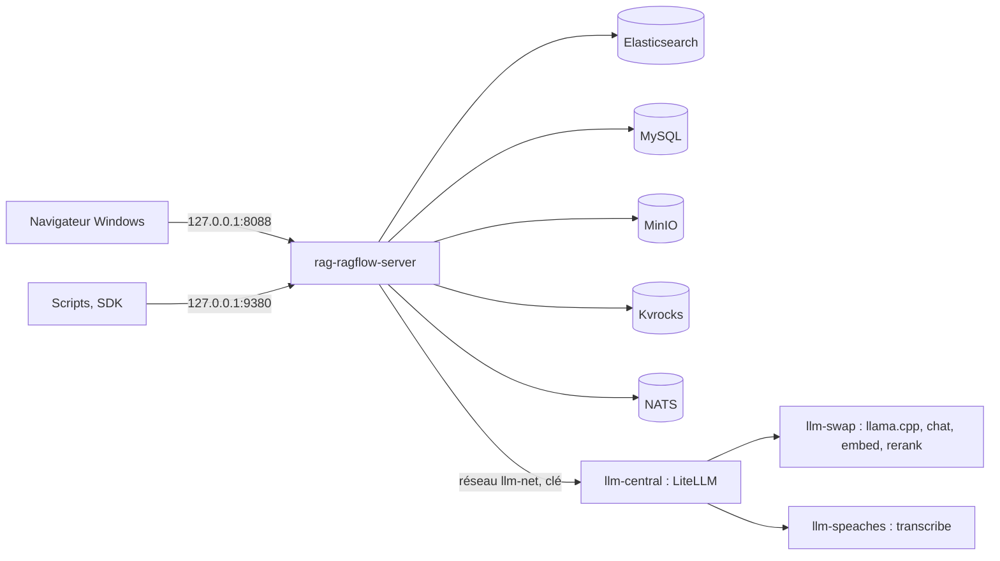

# A5. Fonctionnement interne

> **Objet** : comprendre ce qu'est un RAG et comment RAGFlow 1.0 l'organise : notions techniques (découpage, embeddings, recherche hybride, reranking, citations), architecture et services, ports, emplacement des modèles, et fonctionnement de DeepDoc, l'analyseur de documents (OCR, tableaux, correction des passages, analyseurs PDF).
> **Prérequis** : partie 1 du [manuel](../README.md), chapitres 01 à 04 ; le [glossaire de la série](../../glossaire.md) définit les termes techniques.
> **Version décrite** : RAGFlow v1.0.0 (image `infiniflow/ragflow:v1.0.0`), Windows 11 + WSL2 (Ubuntu 24.04), service LLM central (LLM-Service : LiteLLM v1.109.0, llama-swap v272, llama.cpp build 12282 ; `chat`, `embed`, `rerank`, `transcribe`) depuis le 12 novembre 2026, contexte déclaré de 16 384 jetons ; mesures du 9 au 11 novembre avec LLM-Service branche `service-vllm` (vLLM 0.29.0 : `gemma4:e4b`, `bge-m3`), gardées comme historique.
> **Statut des informations** : [Vérifié] observé ou mesuré les 9 et 11 novembre 2026 sur la machine d'essai (Ryzen 5 9600X, 32 Go, RTX 4060 Ti 16 Go) ; [Source] documentation officielle ou code source au tag v1.0.0 ; [Estimation] calcul non mesuré ; [À tester] non documenté et non essayé.
> **Précautions** : aucune commande à lancer dans cette annexe, hormis les appels d'API de la section 9, faits dans une base d'essai. Une nouvelle analyse d'un document efface ses passages, corrections et ajouts manuels compris. Le détail de l'installation (fichier d'override, ports, mémoire par service) est dans l'annexe [A4. Exploitation](A4-exploitation.md).

## Sommaire

1. [Le RAG en bref](#1-le-rag-en-bref)
2. [Découpage, embeddings et recherche hybride](#2-découpage-embeddings-et-recherche-hybride)
3. [Reranking et citations](#3-reranking-et-citations)
4. [Architecture de RAGFlow 1.0](#4-architecture-de-ragflow-10)
5. [Où vivent les modèles](#5-où-vivent-les-modèles)
6. [L'interface vue de l'intérieur](#6-linterface-vue-de-lintérieur)
7. [DeepDoc, l'analyseur de documents](#7-deepdoc-lanalyseur-de-documents)
8. [Lecture d'un scan : durées et erreurs](#8-lecture-dun-scan--durées-et-erreurs)
9. [Correction des passages : effet mesuré et API](#9-correction-des-passages--effet-mesuré-et-api)
10. [Les tableaux](#10-les-tableaux)
11. [Analyseurs PDF, images et modèle de vision](#11-analyseurs-pdf-images-et-modèle-de-vision)
12. [Dépannage](#dépannage)
13. [Sources](#sources)

## 1. Le RAG en bref

Un RAG (génération augmentée par la recherche) répond à une question en deux temps : il retrouve d'abord les passages utiles dans des documents, puis il les donne à un modèle de langage qui rédige la réponse en s'appuyant sur eux. Le modèle n'a pas besoin d'avoir appris les documents : il les lit au moment de répondre.

Dans RAGFlow, les documents sont rangés dans des **datasets** (« Base de connaissances » dans l'interface). Un **assistant de chat** (« Discussion ») est relié à un ou plusieurs datasets et répond avec des renvois numérotés vers les passages utilisés. [Vérifié] (chapitre [04](../manuel/04-premiere-question.md) ; `outils/resultats/ragflow/captures/02-prise-en-main/scenario.log`)

Le RAG limite les inventions du modèle sans les supprimer : la qualité dépend de ce que la recherche ramène. Le banc de ce dépôt mesure les deux à la fois (bonne réponse et bon document cité) sur 38 questions de référence ; voir l'annexe [A1](A1-evaluation-qualite-et-performances.md).

## 2. Découpage, embeddings et recherche hybride

- **Découpage (chunking)** : chaque document est coupé en passages (chunks). RAGFlow propose des **gabarits de découpage** adaptés au type de document (General, Q&A, Manual, Table, Paper, Book, Laws, Presentation, Picture, One, Audio, Email). [Source] (`docs/references/http_api_reference.md` au tag v1.0.0) Leur choix à la souris est décrit au chapitre [06](../manuel/06-regler-la-lecture-des-documents.md), leur effet mesuré dans l'annexe [A1](A1-evaluation-qualite-et-performances.md).
- **Embedding** : un modèle transforme chaque passage en vecteur de nombres ; deux textes de sens proche ont des vecteurs proches. Ici, `embed` (bge-m3 quantifié Q8_0, 1 024 dimensions), servi par le service LLM central.
- **Recherche hybride** : RAGFlow combine une recherche par mots-clés et une recherche par vecteurs. Par défaut, un assistant créé par l'API pondère les mots-clés à 0,7 et les vecteurs à 0,3, garde les 6 meilleurs passages (`top_n`) au-dessus d'un seuil de similarité de 0,1. [Vérifié] (réglages relevés à la création d'un assistant, `outils/resultats/ragflow/banc-2026-11-09-defaut.json`)

L'analyse des documents (OCR, tableaux, mise en page) est faite par **DeepDoc**, embarqué dans l'image et exécuté sur CPU (sections 7 à 11). Le corpus de test (9 documents, dont un PDF scanné, un fichier audio et un document en anglais) donne 26 passages et 2 236 jetons avec le gabarit General. [Vérifié] (`outils/resultats/ragflow/banc-2026-11-09-essai-adaptateur.json`)

## 3. Reranking et citations

- **Reranking** : un second modèle peut reclasser les passages retrouvés avant la réponse. RAGFlow 1.0 n'en embarque aucun : il faut un service externe qui expose une route `/rerank`. Le socle de ce banc n'en fournit pas ; le reranking est donc [À tester]. [Source] (`internal/entity/models/builtin.go`)
- **Citations** : la réponse contient des marqueurs `[ID:n]` ; l'interface les affiche comme renvois cliquables. Par l'API, chaque passage cité arrive avec le nom du document et ses positions (page et coordonnées). [Vérifié] (`outils/resultats/ragflow/installation-2026-11-09-verif.log`)

Pour une question sans réponse dans les documents, un assistant créé par l'API répond « The answer you are looking for is not found in the dataset! », suivi d'un renvoi `[ID:n]` [Vérifié] (`outils/resultats/ragflow/banc-2026-11-09-defaut.json`, questions Q35 à Q38). C'est la phrase du « message de réponse vide » de l'assistant, en anglais par défaut et réglable ; le renvoi montre que c'est le modèle qui la reproduit [Estimation]. La lecture des refus à la souris est au chapitre [07](../manuel/07-poser-des-questions-et-lire-les-sources.md).

## 4. Architecture de RAGFlow 1.0

RAGFlow 1.0 est une réécriture en Go de l'ancien serveur Python. [Source] (`docs/release_notes.md`) La pile installée par ce banc compte six conteneurs :

| Service | Conteneur | Rôle | Port publié |
|---|---|---|---|
| RAGFlow | `rag-ragflow-server` | interface web (nginx), API, administration, ingestion, synchronisation, DeepDoc | `127.0.0.1:8088` (web), `127.0.0.1:9380` (API), `127.0.0.1:9381` (administration) |
| Elasticsearch 8.11.3 | `rag-ragflow-es01` | moteur documentaire : index des passages, mots-clés et vecteurs | aucun |
| MySQL 8.0.40 | `rag-ragflow-mysql` | métadonnées : comptes, datasets, documents, assistants | aucun |
| MinIO (`pgsty/silo`) | `rag-ragflow-minio` | stockage des fichiers téléversés | aucun |
| Kvrocks 2.16.0 | `rag-ragflow-kvrocks` | cache | aucun |
| NATS 2.14.2 | `rag-ragflow-nats` | file des tâches d'analyse | aucun |

[Vérifié] (`outils/resultats/ragflow/ports-2026-11-09.txt`)

Le compose officiel publie tous ces ports sur toutes les interfaces réseau (`0.0.0.0`) et utilise des mots de passe par défaut connus. Le banc les ramène sur `127.0.0.1` ou les retire, et génère des secrets ; le fichier d'override et la mémoire par service sont détaillés dans l'annexe [A4](A4-exploitation.md). Au repos, la pile seule occupe 3,7 Gio de RAM, dont 2,5 Gio pour Elasticsearch. [Vérifié] (`outils/resultats/ragflow/ressources-2026-11-09-repos.txt`)

## 5. Où vivent les modèles

RAGFlow ne contient aucun modèle de langage. Les modèles sont déclarés dans « Fournisseurs de modèles » (menu du compte, chapitre [03](../manuel/03-premiers-pas.md)) et servis par LLM-Service, un service commun à toutes les applications de la série, géré à part. Une seule instance « llm-central » du fournisseur `OpenAI-API-Compatible` porte les quatre modèles, à l'adresse `http://llm-central:8080/v1` (clé obligatoire) :

| Usage | Nom dans RAGFlow | Modèle servi | Moteur |
|---|---|---|---|
| Réponses (chat) | `chat` | Qwen3.5-4B Q4_K_M (GGUF), réflexion activée par défaut | llama.cpp sur la carte graphique, via llama-swap |
| Embedding | `embed` | bge-m3 Q8_0, 1 024 dimensions | idem |
| Second tri (rerank) | `rerank` | bge-reranker-v2-m3 Q8_0 | idem |
| Transcription audio | `transcribe` | faster-whisper-small | Speaches 0.8.3 sur le processeur |

[Vérifié] (`outils/resultats/ragflow/configuration-2026-11-12.log`, `outils/resultats/ragflow/versions-llm-central-2026-11-12.txt`, `outils/communs/llm_central_sante.sh --essai`). Du 9 au 11 novembre, les mêmes usages passaient par `vllm-central` (`gemma4:e4b`), `vllm-embed` (`bge-m3`) et `rag-speaches` (`Systran/faster-whisper-small`) (`outils/resultats/ragflow/configuration-2026-11-09.log`).

RAGFlow borne la longueur de la réponse à « contexte déclaré du modèle − jetons du prompt ». Les consignes et les passages occupent 1 841 à 3 301 jetons selon la question ; un contexte déclaré trop petit produit une erreur visible dans la réponse. [Vérifié] (`outils/resultats/ragflow/essai-2026-11-09-contexte-depassement.log`, `outils/resultats/ragflow/banc-2026-11-09-ctx3072.json`, `outils/resultats/ragflow/preuves-2026-11-09/textes-captures/02-conversation.txt`) Les tailles de contexte essayées sont dans l'annexe [A1](A1-evaluation-qualite-et-performances.md), les profils matériels dans l'annexe [A2](A2-choisir-son-materiel-et-ses-modeles.md).

## 6. L'interface vue de l'intérieur

L'interface web s'ouvre dans le navigateur Windows à l'adresse `http://127.0.0.1:8088`. Après connexion, chaque page porte la même barre du haut : à gauche les grandes fonctions, à droite les liens, la langue, l'aide, le thème et le compte ; sa description annotée est au chapitre [03](../manuel/03-premiers-pas.md). [Vérifié] (`outils/ragflow/captures/captures.py`, scénario `visite` ; textes des pages dans `outils/resultats/ragflow/captures/00-notions-fondamentales/`)

- Les liens de l'en-tête ouvrent des sites externes : le serveur Discord public du projet, le dépôt `infiniflow/ragflow` sur GitHub et le guide officiel `ragflow.io/docs`. [Vérifié] (`web/src/layouts/components/header.tsx` au tag v1.0.0)
- La langue est mémorisée par le navigateur (stockage local, clé `lng`), pas par le compte. [Vérifié] (`web/src/locales/config.ts` au tag v1.0.0 ; essais des captures)
- Trois pages s'ouvrent en plein écran, sans barre du haut : l'onglet « Artifacts » d'une base, les passages d'un document et le canevas d'un agent ; le bouton « Retour » les referme. [Vérifié] (`outils/resultats/ragflow/captures/carte/`)
- La [carte de l'interface](carte-interface.md) recense chaque page, menu, onglet et réglage, avec le chapitre qui le couvre.

## 7. DeepDoc, l'analyseur de documents

DeepDoc est l'analyseur de documents de RAGFlow : OCR des pages image, reconnaissance de la mise en page (titres, paragraphes, colonnes), structure des tableaux. Ses modèles (format ONNX) sont dans l'image et tournent sur CPU, dans le conteneur `rag-ragflow-server` ; aucun téléchargement n'a lieu au premier usage. [Source] (`Dockerfile`, lignes 25 à 50) Il est choisi dans l'onglet « Configuration » de la base, bloc « PDF », « Analyseur PDF » : « DeepDOC » (section 11 ; procédure au chapitre [06](../manuel/06-regler-la-lecture-des-documents.md)).

Pendant l'analyse du corpus complet, la RAM du serveur monte de 0,6 à 2,0 Gio : c'est surtout DeepDoc. [Vérifié] (`outils/resultats/ragflow/banc-2026-11-09-defaut.json`, `pic_ram_mo`)

Chaque analyse suit un pipeline dont les étapes horodatées se lisent dans le journal de la tâche : lecture (Parser), découpage (GeneralChunker), enrichissement (Extractor), indexation (Tokenizer). [Vérifié] (`outils/resultats/ragflow/captures/04-deepdoc/03-journal-d-analyse.txt`)

## 8. Lecture d'un scan : durées et erreurs

Document d'essai : le contrat scanné `contrat-batterix-scan.pdf` (2 pages rendues en image, légère rotation et bruit), importé à la souris dans une base dédiée « Manuel-DeepDoc » par le scénario `deepdoc` de `outils/ragflow/captures/manuels_03_06.py`, puis par l'API le 9 novembre.

| Mesure | Valeur | Source |
|---|---|---|
| Durée d'analyse du scan, seul dans sa base, par l'API (9 novembre) | 9,3 s, soit 4,7 s par page | `outils/resultats/ragflow/essai-2026-11-09-passages.log` |
| Même scan importé à la souris (11 novembre) | 10,8 s, dont 10 s de lecture (« Parser Started » à 12:38:14, « Parser Done » à 12:38:24) | `outils/resultats/ragflow/captures/04-deepdoc/scenario.log` |
| Passages produits | 1 (258 jetons) | `outils/resultats/ragflow/banc-2026-11-09-defaut.json` |
| Questions du banc sur ce scan (Q15 à Q18) | 4 bonnes réponses sur 4, bonne page citée | même fichier |

[Vérifié] L'OCR tourne sur CPU : compter environ 5 s par page scannée sur cette machine, davantage si d'autres analyses tournent en même temps. Pour comparaison, Open Notebook 1.15.1 ne lisait pas ce scan (0 question sur 4) : voir le [comparatif de la série](../../README.md).

L'OCR est exploitable mais imparfait : espaces perdus (« CONTRATD'APPROVISIONNEMENTN° », « debatteries48V »), « l » lu à la place de « 1 » (« Articlel »), « o » à la place de « 0 » (« 40 0oo batteries », « 1 0o0 cycles »). Le modèle de réponse rétablit souvent le sens (« 40 000 unités » est bien répondu), mais une recherche qui dépend du nombre exact est pénalisée (section 9). [Vérifié] (`outils/resultats/ragflow/essai-2026-11-09-passages.log`, `outils/resultats/ragflow/captures/04-deepdoc/05-resultat-du-segment.txt`)

## 9. Correction des passages : effet mesuré et API

**Défaut observé.** Dans RAGFlow v1.0.0, modifier le texte d'un passage issu du PDF scanné puis cliquer sur « Confirmer » reste sans effet : la fenêtre « Modifier le segment » reste ouverte et aucune requête n'est envoyée au serveur (« requêtes après « Confirmer » (passage du PDF modifié) : [] ; fenêtre encore ouverte : True »). Le même geste sur un passage issu d'un fichier Markdown est enregistré : la fenêtre se ferme, une requête `PATCH …/chunks/…` part au serveur et le mot-clé ajouté est relu après rechargement. [Vérifié] (`outils/resultats/ragflow/captures/04-deepdoc/scenario.log`) Contournements : ajouter un passage corrigé à la souris (chapitre [06](../manuel/06-regler-la-lecture-des-documents.md)) ou corriger par l'API (ci-dessous).

La correction du texte même du passage OCR a été faite par l'API le 9 novembre (`outils/ragflow/essai_passages.py`) [Testée] :

| Action | Appel |
|---|---|
| Lister | `GET /api/v1/datasets/{base}/documents/{doc}/chunks` |
| Corriger le texte | `PATCH …/chunks/{passage}` avec `{"content": "…"}` |
| Désactiver, réactiver | `PATCH …/chunks` avec `{"chunk_ids": […], "available_int": 0}` (ou 1) |
| Ajouter un passage manuel | `POST …/chunks` avec `{"content": "…", "important_keywords": […]}` |

Effet mesuré sur la recherche « volume minimal annuel de 40 000 batteries » [Vérifié] :

| État du passage | Similarité du passage du contrat |
|---|---|
| texte OCR d'origine (« Volumeminimalannuel:40 0oo ») | 0,346 par l'API ; 34,55 affiché à la souris le 11 novembre (15,07 en mots-clés, 80,01 en vecteurs) |
| texte corrigé par l'API (« Volume minimal annuel : 40 000 ») | 0,607 |
| passage désactivé | absent des résultats |
| passage ajouté à la souris, avec mot-clé et question | 83,17 sur 100 pour le passage ajouté (82,28 en mots-clés, 85,24 en vecteurs), devant le passage OCR inchangé à 34,55 |

(`outils/resultats/ragflow/essai-2026-11-09-passages.log` ; `outils/resultats/ragflow/captures/04-deepdoc/scenario.log`)

- La correction est relue immédiatement par l'API et prise en compte par la recherche sans réanalyse. Un passage ajouté par l'API s'ajoute au document (2 passages ensuite). [Vérifié] (`outils/resultats/ragflow/essai-2026-11-09-passages.log`)
- Les mots collés par l'OCR ne correspondent pas aux mots de la question : c'est la recherche par mots-clés qui souffre (15,07), le score vectoriel restant élevé (80,01). Donner plus de poids aux vecteurs aide les scans (annexe [A1](A1-evaluation-qualite-et-performances.md)).
- Un passage ajouté à la main appartient au document : une nouvelle analyse du document l'efface, comme les corrections, d'après la confirmation de relance (« Are you sure to clear chunks to re-parse? »). [Source] (`web/src/locales/fr.ts`, clé `redo`)

## 10. Les tableaux

Les tableaux du rapport annuel sont restitués sous forme de tableau (lignes et colonnes) dans le passage, avec leur titre. Le test de récupération montre par exemple le tableau « 5. Effectifs par site » (Nantes 268, Cholet 97, Lyon 31, Bruxelles 16, total 412). Les dix questions de type tableau du banc obtiennent la bonne réponse. [Vérifié] (`outils/resultats/ragflow/banc-2026-11-09-defaut.json` ; texte de la page archivé dans `outils/resultats/ragflow/preuves-2026-11-09/textes-captures/`)

L'affichage du test de récupération laisse voir des restes de balises autour des titres de tableaux (« ption>7. Fournisseurs principaux », « r>d>Batterix GmbHd>d>Batteriesd>d>24d>r> ») : le passage contient du HTML, mal rendu à l'écran. Sans effet observé sur les réponses. [Vérifié] (même source ; `outils/resultats/ragflow/captures/05-assistants-et-citations/20-test-resultats.txt`)

## 11. Analyseurs PDF, images et modèle de vision

Dans l'onglet « Configuration » de la base, bloc « PDF », la liste « Analyseur PDF » propose six moteurs : « DeepDOC », « Naïf », « Docling », « OpenDataLoader », « TCADP Parser », « MonkeyOCRv2 ». [Vérifié] (`outils/resultats/ragflow/captures/04-deepdoc/18-analyseurs-pdf.txt`)

| Analyseur | Fonctionnement | Statut |
|---|---|---|
| « DeepDOC » | OCR, mise en page et tableaux en local (par défaut) | [Vérifié] seul essayé |
| « Naïf » | texte brut du PDF seulement, sans analyse de mise en page ; inutilisable sur un scan | [Source] (`web/src/locales/en.ts`, clé `layoutRecognizeTip`) |
| « Docling » | analyseur externe : serveur `docling-serve` désigné par `DOCLING_SERVER_URL` | [Vérifié] le 13 novembre 2026 avec un serveur partagé : 34/34, demande aussi `ALLOW_ANY_HOST=1` ([A1](A1-evaluation-qualite-et-performances.md), section 2.3) |
| « OpenDataLoader », « TCADP Parser » | analyseurs externes | [À tester] : service non installé sur le banc |
| « MonkeyOCRv2 » | OCR externe MonkeyOCR | [À tester] : service non installé |

- Pour les images, le bloc « Image » propose « DeepDoc » ou « External OCR model » (PaddleOCR, grisé faute de modèle déclaré). [Vérifié] (`outils/resultats/ragflow/captures/03-datasets-et-decoupage/31-parser-image.txt`)
- Le gabarit Picture et l'option « Enable vision enhancement » demandent un modèle de type `image2text` (« Modèle Img2txt »). Aucun n'est déclaré dans ce banc : [À tester]. Le modèle `chat` du service central (Qwen3.5-4B) est déclaré avec la vision par le service ; le déclarer aussi en type `image2text` dans l'instance « llm-central » serait donc possible sans nouveau modèle [À tester]. Historique : Gemma 4 E4B acceptait des images dans vLLM (jusqu'à 4 par requête selon son lancement), et RAGFlow envoie les images au fournisseur sous forme de blocs `image_url`. [Source] (journal de `vllm-central` ; `internal/entity/models/vllm.go`)

## Dépannage

| Symptôme | Cause probable | Action |
|---|---|---|
| Réponse « **ERROR**: prompt uses N tokens, leaving no completion capacity… » | contexte déclaré du modèle de chat plus petit que le prompt | remonter le contexte déclaré (16 384 ici), voir l'annexe [A1](A1-evaluation-qualite-et-performances.md) |
| Réponse « The answer you are looking for is not found in the dataset! » | rien de pertinent trouvé dans les passages retrouvés | normal pour une question hors corpus ; sinon régler la recherche (chapitre [08](../manuel/08-regler-un-assistant.md)) |
| « Confirmer » ne ferme pas « Modifier le segment » après modification d'un passage de PDF | défaut de l'interface v1.0.0 : aucune requête envoyée | « Annuler », puis ajouter un passage corrigé (« + ») ou corriger par l'API (`PATCH …/chunks/{passage}`) |
| Chiffres faux dans un passage issu d'un scan (« 0oo ») | confusions de l'OCR | passage corrigé ajouté, ou correction par l'API |
| Une recherche exacte ne remonte pas le bon passage | mots collés par l'OCR | passage ajouté avec mots-clés et question ; poids des vecteurs relevé |
| Passages corrigés ou ajoutés disparus | document réanalysé | refaire les corrections ; éviter de relancer l'analyse d'un document corrigé |
| Analyse d'un gros PDF scanné très longue | OCR sur CPU, environ 5 s par page mesuré | prévoir le temps ; une seule analyse à la fois |

## Sources

- Dépôt officiel : https://github.com/infiniflow/ragflow (tag `v1.0.0`, commit `db1cd5929a7885a3074547791f5ecc4d2f891739`) ; documentation : https://ragflow.io/docs/
- Code au tag v1.0.0 : `Dockerfile`, `internal/entity/models/builtin.go`, `internal/entity/models/vllm.go`, `internal/handler/chunk.go`, `web/src/pages/chunk/`, `web/src/layouts/components/header.tsx`, `web/src/locales/config.ts`, `web/src/locales/fr.ts`, `web/src/locales/en.ts`, `docs/release_notes.md`, `docs/references/http_api_reference.md`
- Relecture du compose et du code : [`relecture.md`](../../../outils/resultats/ragflow/relecture.md) ; versions : [`versions-2026-11-09.json`](../../../outils/resultats/ragflow/versions-2026-11-09.json)
- Scénarios de captures : `outils/ragflow/captures/captures.py` (scénario `visite`), `outils/ragflow/captures/manuels_03_06.py` (scénario `deepdoc`, phases `base`, `test`, `passages`, `test_apres`, `config`, `markdown`) ; textes et déroulé : `outils/resultats/ragflow/captures/00-notions-fondamentales/`, `outils/resultats/ragflow/captures/04-deepdoc/`
- Essai des passages par l'API : `outils/ragflow/essai_passages.py`, [journal](../../../outils/resultats/ragflow/essai-2026-11-09-passages.log)
- Banc : [banc par défaut](../../../outils/resultats/ragflow/banc-2026-11-09-defaut.md) ; ports : [`ports-2026-11-09.txt`](../../../outils/resultats/ragflow/ports-2026-11-09.txt) ; mémoire au repos : [`ressources-2026-11-09-repos.txt`](../../../outils/resultats/ragflow/ressources-2026-11-09-repos.txt) ; modèles déclarés : [`configuration-2026-11-09.log`](../../../outils/resultats/ragflow/configuration-2026-11-09.log)
