# Carte de l'interface RAGFlow

Liste de contrôle de la couverture du manuel : chaque page, menu, onglet et réglage visible de l'interface web de RAGFlow v1.0.0, avec le chapitre qui le décrit. Relevé le 11 novembre 2026, connecté avec le compte local et l'interface en français, par le scénario Playwright `outils/ragflow/captures/carte.py` (scénario `carte`). Le texte complet de chaque page, son adresse et l'inventaire de ses éléments visibles (boutons, onglets, champs, liens) sont dans `outils/resultats/ragflow/captures/carte/` (un fichier par capture, même nom).

Le parcours est en lecture seule : les fenêtres de création sont ouvertes puis fermées par « Échap » sans rien enregistrer ; le jeu de démonstration (« Démo Vélanor », « Agent démo Vélanor ») sert de page d'exemple sans être modifié.

## Sommaire

- [En-tête et accueil](#en-tête-et-accueil)
- [Base de connaissances](#base-de-connaissances)
- [Discussion](#discussion)
- [Recherche](#recherche)
- [Agent](#agent)
- [Mémoire](#mémoire)
- [Gestion des fichiers](#gestion-des-fichiers)
- [Menu du compte](#menu-du-compte)
- [Ce qui n'est pas couvert](#ce-qui-nest-pas-couvert)

Les numéros renvoient aux chapitres de la partie 1 du manuel ; le [sommaire du manuel](../README.md) décrit leur contenu.

## En-tête et accueil

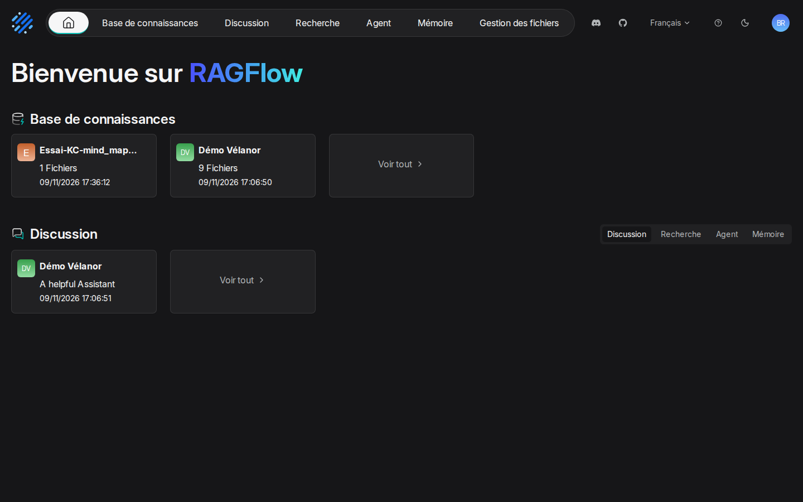

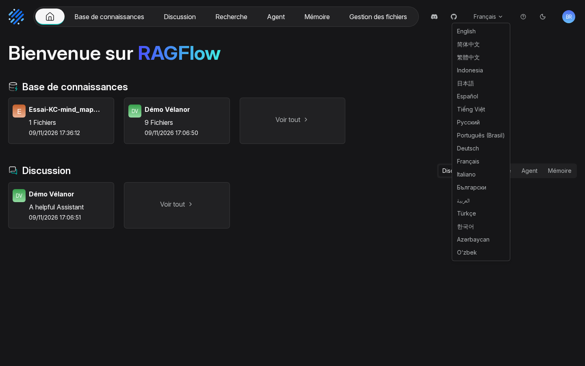

| Page ou menu | Chemin d'accès | Éléments (boutons, onglets, réglages) | Manuel qui le couvre |
|---|---|---|---|
| Barre du haut | toutes les pages, sauf la connexion et les pages plein écran (« Artifacts », passages, canevas d'agent) | logo, icône de maison (« Accueil »), « Base de connaissances », « Discussion », « Recherche », « Agent », « Mémoire », « Gestion des fichiers » | [03](../manuel/03-premiers-pas.md) (visite) |
| Liens externes de l'en-tête | barre du haut, à droite | icône Discord (serveur de discussion du projet), icône GitHub (dépôt `infiniflow/ragflow`), icône « ? » (guide officiel `ragflow.io/docs`) | [03](../manuel/03-premiers-pas.md) (visite) |
| Menu de langue | barre du haut, « English » ou « Français » | 18 langues (English, 简体中文, 繁體中文, Indonesia, 日本語, Español, Tiếng Việt, Русский, Português (Brasil), Deutsch, Français, Italiano, Български, العربية, Türkçe, 한국어, Azərbaycan, Oʻzbek) ; choix mémorisé par le navigateur | [03](../manuel/03-premiers-pas.md) |
| Thème | barre du haut, icône de lune ; aussi soleil et lune en bas du menu du compte | bascule thème sombre et clair | [03](../manuel/03-premiers-pas.md) (visite) |
| Avatar du compte | barre du haut, pastille aux initiales | ouvre le menu du compte (voir [Menu du compte](#menu-du-compte)) | [03](../manuel/03-premiers-pas.md) (visite), [13](../manuel/13-comptes-equipe-et-cles.md) |
| Accueil | icône de maison | « Bienvenue sur RAGFlow » ; section « Base de connaissances » (cartes des bases : nom, nombre de fichiers, date ; « Voir tout ») ; section à onglets « Discussion », « Recherche », « Agent », « Mémoire » (cartes des objets récents, « Voir tout ») | [03](../manuel/03-premiers-pas.md), [03](../manuel/03-premiers-pas.md) |
| Page de connexion | `http://127.0.0.1:8088/login`, avant connexion | en anglais : « Email », « Password », « Remember me », « Sign in », lien « Sign up » ; formulaire « Create an account » : « Email », « Nickname », « Password », « Continue », « Sign in » | [02](../manuel/02-installer-ragflow.md) (inscription), [03](../manuel/03-premiers-pas.md) (connexion) |

## Base de connaissances

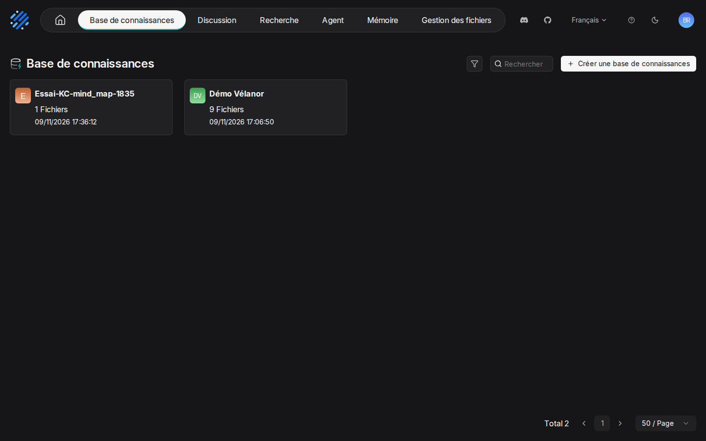

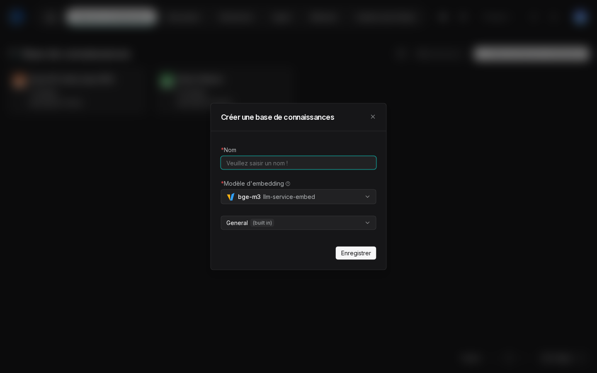

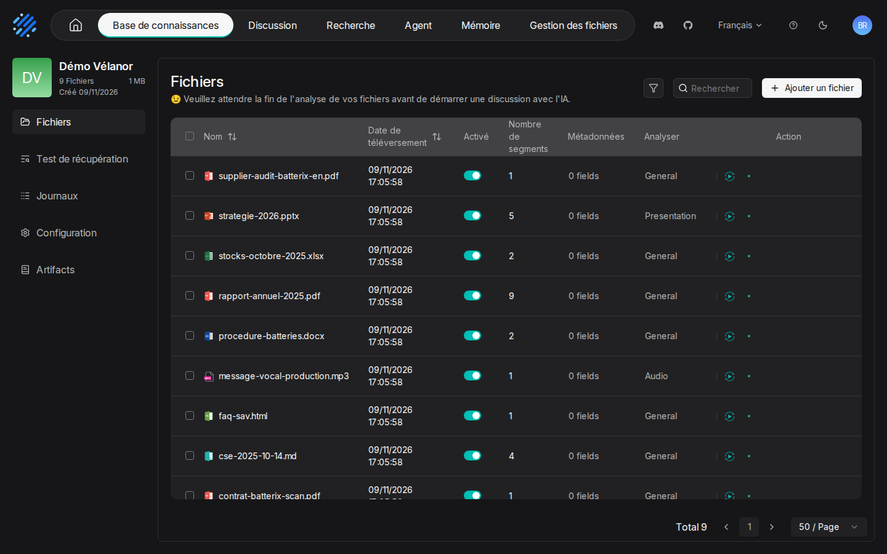

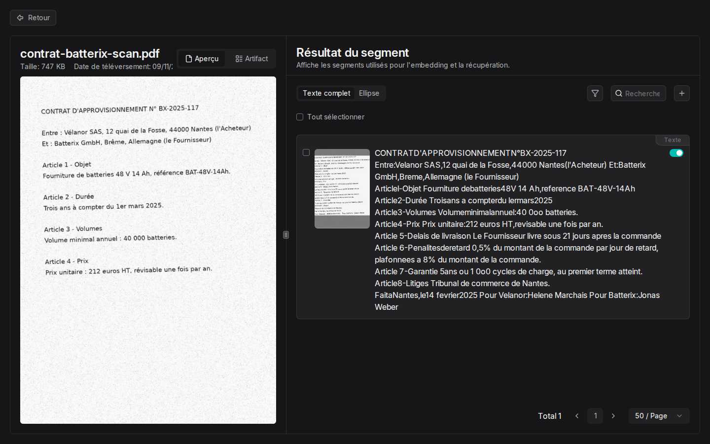

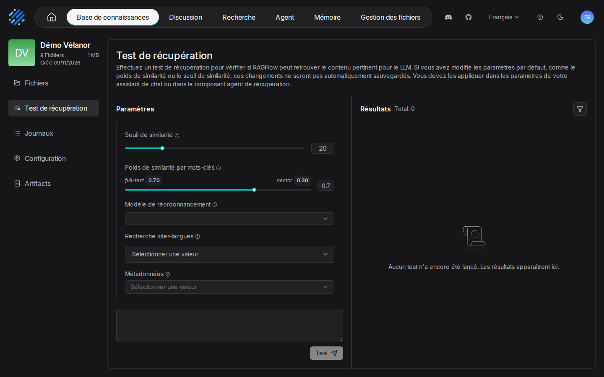

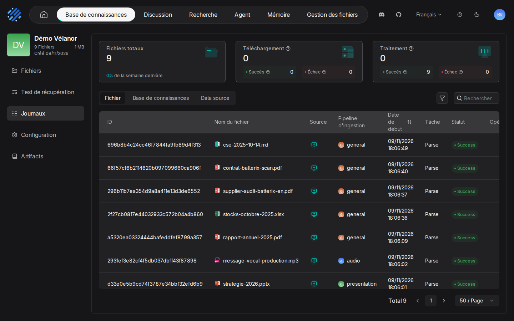

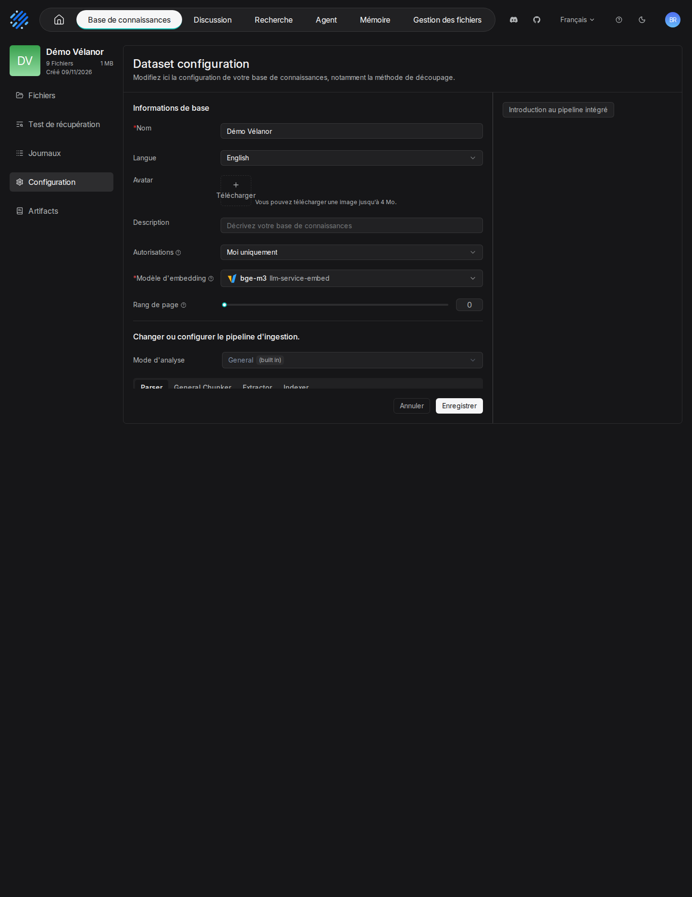

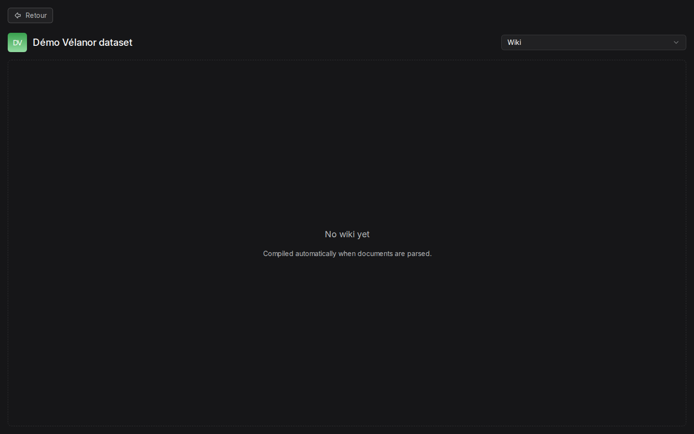

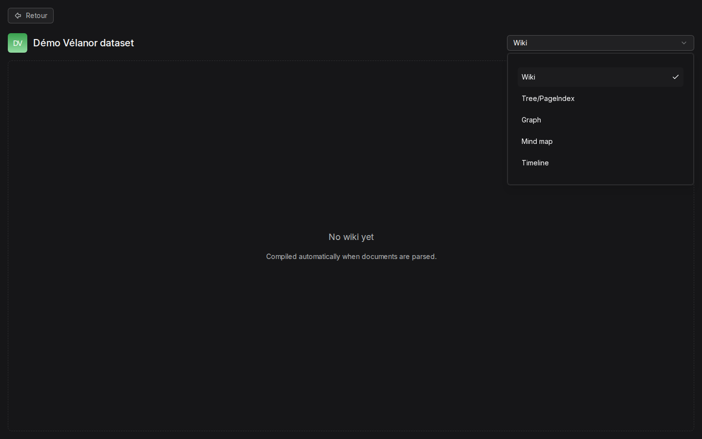

| Page ou menu | Chemin d'accès | Éléments (boutons, onglets, réglages) | Manuel qui le couvre |
|---|---|---|---|
| Liste des bases | « Base de connaissances » | filtre (entonnoir), « Rechercher », « Créer une base de connaissances », cartes des bases avec menu « … » (« Renommer », « Supprimer »), pagination « 50 / Page » | [04](../manuel/04-premiere-question.md), [05](../manuel/05-ajouter-et-organiser-ses-documents.md) |
| Fenêtre « Créer une base de connaissances » | liste des bases, « Créer une base de connaissances » | « Nom », « Modèle d'embedding » (`bge-m3`), gabarit de découpage (« General (built in) » ; liste avec « Rechercher », pipelines personnalisés et douze gabarits « (built in) »), « Enregistrer », « Close » | [04](../manuel/04-premiere-question.md), [06](../manuel/06-regler-la-lecture-des-documents.md) (liste des gabarits) |
| Onglet « Fichiers » | clic sur une base | en-tête de la base (nom, nombre de fichiers, taille, date) ; bandeau « Veuillez attendre la fin de l'analyse… » ; filtre, « Rechercher », « Ajouter un fichier » (« Téléverser un fichier », « Créer un fichier vide ») ; tableau « Nom », « Date de téléversement », « Activé », « Nombre de segments », « Métadonnées » (« 0 fields » : fenêtre « Modifier les métadonnées », « Ajouter »), « Analyser » (nom du gabarit : menu « Changer ou configurer le pipeline d'ingestion. » et fenêtre « Mode d'analyse » propre au fichier ; relance avec confirmation « Analyser le fichier » ; point d'état qui ouvre le journal), « Action » (renommer, propriétés au survol, télécharger, supprimer) ; cases à cocher et barre groupée (« Analyser », « Annuler », « Activé », « Désactivé », « Métadonnées », « Supprimer ») ; filtre (« Type de fichier », « Statut », « Champ de métadonnée », « Soumettre ») ; « Créer un fichier vide » (« Nom du fichier ») ; « Cancel parsing tasks » pendant l'analyse | [04](../manuel/04-premiere-question.md), [05](../manuel/05-ajouter-et-organiser-ses-documents.md) |
| Fenêtre « Téléverser un fichier » | « Ajouter un fichier », « Téléverser un fichier » | « Analyser à la création », onglets « Fichiers » et « Dossier », zone de dépôt, liste des fichiers choisis, « Enregistrer » | [04](../manuel/04-premiere-question.md) |
| Passages d'un document (« Résultat du segment ») | clic sur un nom de fichier | « Retour », « Aperçu », « Artifact », « Texte complet » et « Ellipse », filtre (« Tous », « Activé », « Désactivé »), « Recherche », « + » (fenêtre « Créer un segment » : « Segment », « Image », « Mot-clé », « Question », « Étiquettes »), « Tout sélectionner » (« Activer », « Désactiver », « Supprimer »), un bloc par passage avec case à cocher et interrupteur d'activation ; double-clic : « Modifier le segment » (« Segment », « Type », « Mot-clé », « Question », « Étiquettes », « Activé », « Annuler », « Confirmer ») | [04](../manuel/04-premiere-question.md) (lecture), [06](../manuel/06-regler-la-lecture-des-documents.md) (correction) |
| Onglet « Test de récupération » | base, menu de gauche | « Seuil de similarité », « Poids de similarité par mots-clés » (full-text 0,70, vector 0,30), « Modèle de réordonnancement », « Recherche inter-langues », « Métadonnées », « Rerank candidates », « Top N », zone de question, « Test », « Résultats » (« Total », « Similarité hybride », « Similarité de terme », « Similarité vectorielle », filtre) | [08](../manuel/08-regler-un-assistant.md), [06](../manuel/06-regler-la-lecture-des-documents.md) (avant et après correction) |
| Onglet « Journaux » | base, menu de gauche | compteurs « Fichiers totaux », « Téléchargement », « Succès », « Échec », « Traitement » ; boutons « Fichier », « Base de connaissances », « Data source » ; tableau « ID », « Nom du fichier », « Source », « Pipeline d'ingestion », « Date de début », « Tâche », « Statut », « Opérations » (œil : fenêtre « Fichier » avec « Durée » et « Détails » horodatés) | [05](../manuel/05-ajouter-et-organiser-ses-documents.md), [06](../manuel/06-regler-la-lecture-des-documents.md) |
| Onglet « Configuration » | base, menu de gauche | « Informations de base » : « Nom », « Langue », « Avatar », « Description », « Autorisations » (« Moi uniquement »), « Modèle d'embedding », « Rang de page » ; « Mode d'analyse » (gabarit intégré ou pipeline) avec onglets « Parser », « General Chunker » (« Taille de segment recommandée », « Pourcentage de chevauchement (%) », « Table context window », « Image context window », « Délimiteurs », « Ajouter », « Les blocs enfants sont utilisés pour la récupération »), « Extractor » (« Modèle », « Mots-clés », « Mots-clés automatiques », « Questions », « Questions automatiques », « Étiquettes », « Résumé », « Métadonnées », « Paramètres », « Invite système »), « Indexer » (« Méthode de recherche » : « Embedding », « Texte intégral » ; « Poids d'embedding du nom de fichier » ; « Champ ») ; « Langue » (liste de langues en anglais) ; « Autorisations » (« Moi uniquement », « Équipe ») ; « Enable vision enhancement » ; réglages par format (DOC, DOCX, Email, HTML, Image avec « OCR » DeepDoc ou « External OCR model », Markdown, PDF avec « Détecter la mise en page multi-colonnes », « Supprimer la table des matières d'origine », « Supprimer en-tête et pied de page », « Analyseur PDF » : « DeepDOC », « Naïf », « Docling », « OpenDataLoader », « TCADP Parser », « MonkeyOCRv2 » ; « Plages de pages », « Ajouter une page », Tableur, « Texte & Code ») ; « Source de données », « Lier une source de données » ; « Annuler », « Enregistrer », « Introduction au pipeline intégré » | [06](../manuel/06-regler-la-lecture-des-documents.md), [06](../manuel/06-regler-la-lecture-des-documents.md), [12](../manuel/12-sources-externes.md) (source liée) |
| Onglet « Artifacts » | base, menu de gauche (page plein écran) | « Retour », sélecteur « Wiki », « Tree/PageIndex », « Graph », « Mind map », « Timeline » ; « No wiki yet » (ou autre type) et « Compiled automatically when documents are parsed. » tant que rien n'est compilé ; vue « Graph » (« Search entity », « N / N entities ») ; vue « Tree/PageIndex » (« Navigation tree », « Rechercher », détail d'un nœud : « Description ») ; vue « Timeline » ; vue « Mind map » | [11](../manuel/11-syntheses-automatiques.md) |

## Discussion

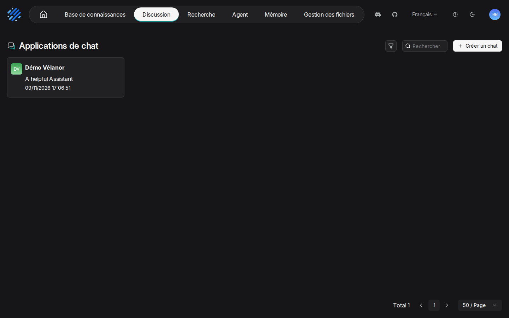

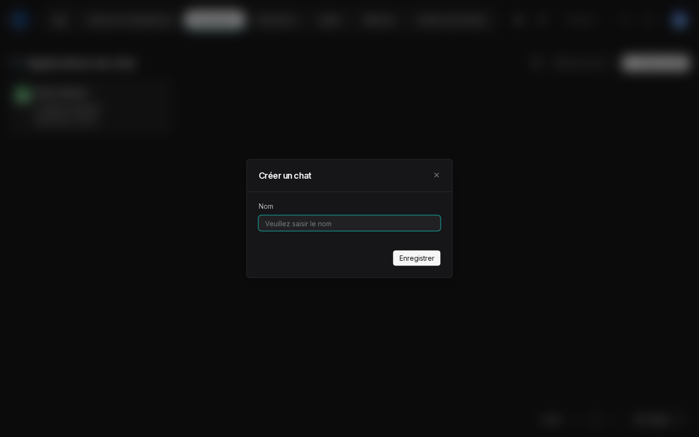

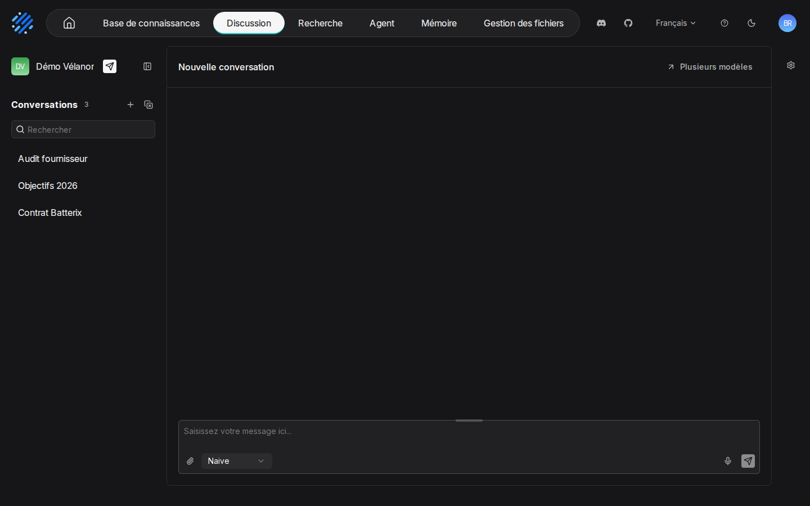

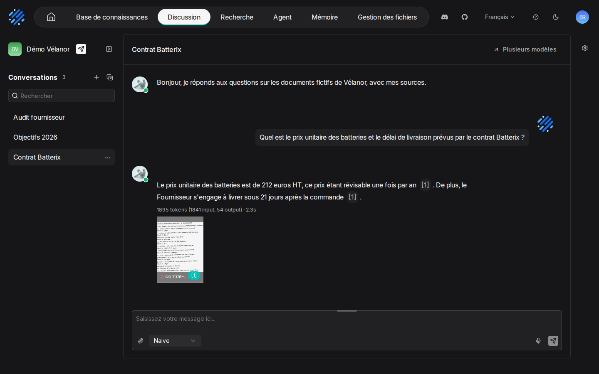

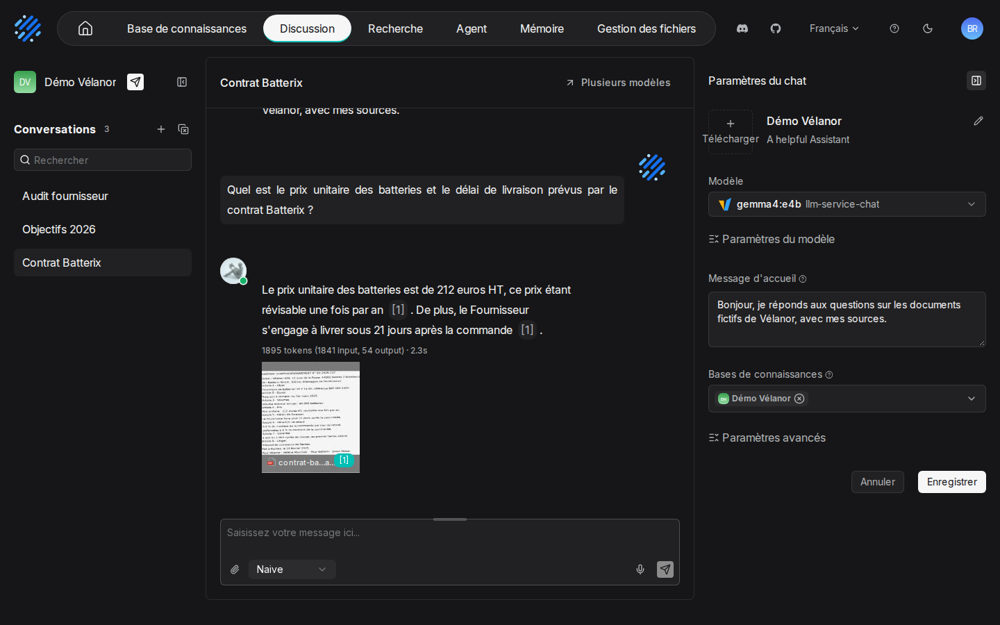

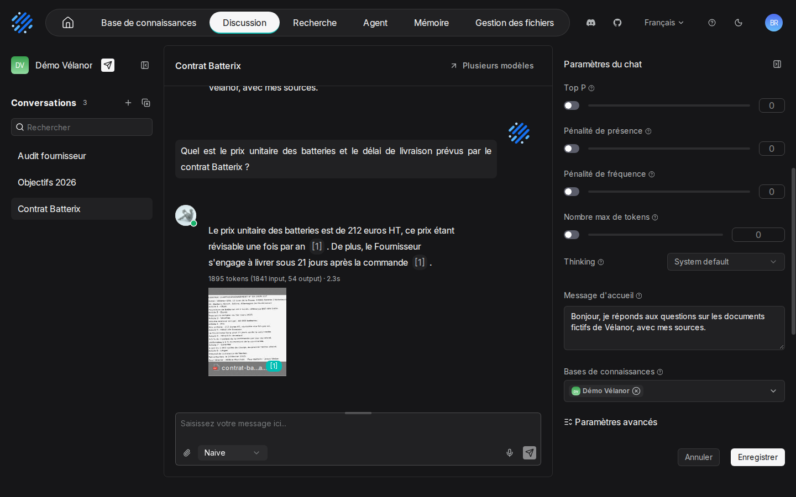

| Page ou menu | Chemin d'accès | Éléments (boutons, onglets, réglages) | Manuel qui le couvre |
|---|---|---|---|
| Liste des assistants (« Applications de chat ») | « Discussion » | filtre, « Rechercher », « Créer un chat », cartes avec menu « … » (« Renommer », « Supprimer »), pagination | [04](../manuel/04-premiere-question.md), [07](../manuel/07-poser-des-questions-et-lire-les-sources.md) |
| Fenêtre « Créer un chat » | « Créer un chat » | « Nom », « Enregistrer », « Close » | [04](../manuel/04-premiere-question.md) |
| Page d'un assistant | clic sur une carte | nom de l'assistant, icône d'avion en papier (« Intégrer dans la page web »), icône de repli du panneau ; « Conversations » avec compteur, « + » (nouvelle conversation), icône de suppression groupée, « Rechercher », liste des conversations (menu « … ») ; « Plusieurs modèles » ; zone « Saisissez votre message ici... », « Attach file », sélecteur « Naive » ou « Agentic », micro, « Send message » ; icône d'engrenage (paramètres) | [04](../manuel/04-premiere-question.md), [07](../manuel/07-poser-des-questions-et-lire-les-sources.md), [07](../manuel/07-poser-des-questions-et-lire-les-sources.md) ; micro : [07](../manuel/07-poser-des-questions-et-lire-les-sources.md) (décrit, essai non couvert, voir plus bas) |
| Réponse dans une conversation | conversation ouverte | renvois « [1] » (survol : extrait), ligne « N tokens (… input, … output) · durée », vignette du document cité ; actions copier, régénérer, supprimer, lire à voix haute, pouce haut et bas | [04](../manuel/04-premiere-question.md), [07](../manuel/07-poser-des-questions-et-lire-les-sources.md), [04](../manuel/04-premiere-question.md) (jetons et durée), [15](../manuel/15-en-cas-de-probleme.md) (réponses d'erreur et « not found ») |
| Panneau « Paramètres du chat » | icône d'engrenage | « Télécharger » (avatar), nom et description (crayon), « Modèle », « Paramètres du modèle », « Message d'accueil », « Bases de connaissances », « Paramètres avancés », « Annuler », « Enregistrer » | [04](../manuel/04-premiere-question.md), [08](../manuel/08-regler-un-assistant.md) |
| Menu d'une conversation | survol d'une conversation, « … » | « Supprimer » seulement (pas de renommage en v1.0.0) ; mode sélection : cases, flèche de retour, corbeille | [07](../manuel/07-poser-des-questions-et-lire-les-sources.md) |
| Page « Plusieurs modèles » | page d'un assistant, « Plusieurs modèles » | « Retour », « Plusieurs modèles (1/3) », choix du modèle par colonne, « Appliquer la configuration du modèle », « + » (jusqu'à 3 colonnes), zone de saisie commune | [07](../manuel/07-poser-des-questions-et-lire-les-sources.md) |
| Fenêtre « Intégrer dans la page web » | avion en papier | onglets « Embed Setup » (« Type d'intégration », « Thème », « Cacher l'avatar », « Paramètres régionaux », « Code d'intégration », « Ouvrir dans un nouvel onglet », « Discussion ID ») et « Widget Customization » (titre, sous-titre, pied de page, couleurs) | [07](../manuel/07-poser-des-questions-et-lire-les-sources.md) |
| Pièce jointe | « Attach file » | fichier joint à la question (5 fichiers, 5 Mo chacun) ; ouvre une conversation nommée d'après le fichier | [07](../manuel/07-poser-des-questions-et-lire-les-sources.md) |
| « Paramètres du modèle » | panneau, dépliant | « Liberté » (« Improviser », « Précis », « Équilibre », « Personnalisé »), « Température », « Top P », « Pénalité de présence », « Pénalité de fréquence », « Nombre max de tokens » (chacun avec interrupteur et curseur), « Thinking » (« System default », « Enabled », « Disabled ») | [08](../manuel/08-regler-un-assistant.md) |
| « Paramètres avancés » | panneau, dépliant | « Afficher la citation », « Texte en parole », « Web search provider » (douze services), « Métadonnées » (« Désactivé », « Automatique », « Semi-automatique », « Manuel ») ; sous-partie « Naive » : « Réponse vide », « Analyse de mots-clés », « Prompt système », « Seuil de similarité », « Poids de similarité par mots-clés », « Rerank candidates », « Top N », « Modèle de réordonnancement », « Recherche inter-langues », « Optimisation multi-tours », « Variable » ; sous-partie « Agentic » : « Decision model », « Agentic template », « Reset to default » | [08](../manuel/08-regler-un-assistant.md), [08](../manuel/08-regler-un-assistant.md) |

## Recherche

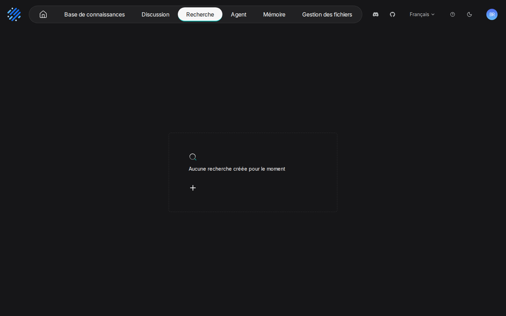

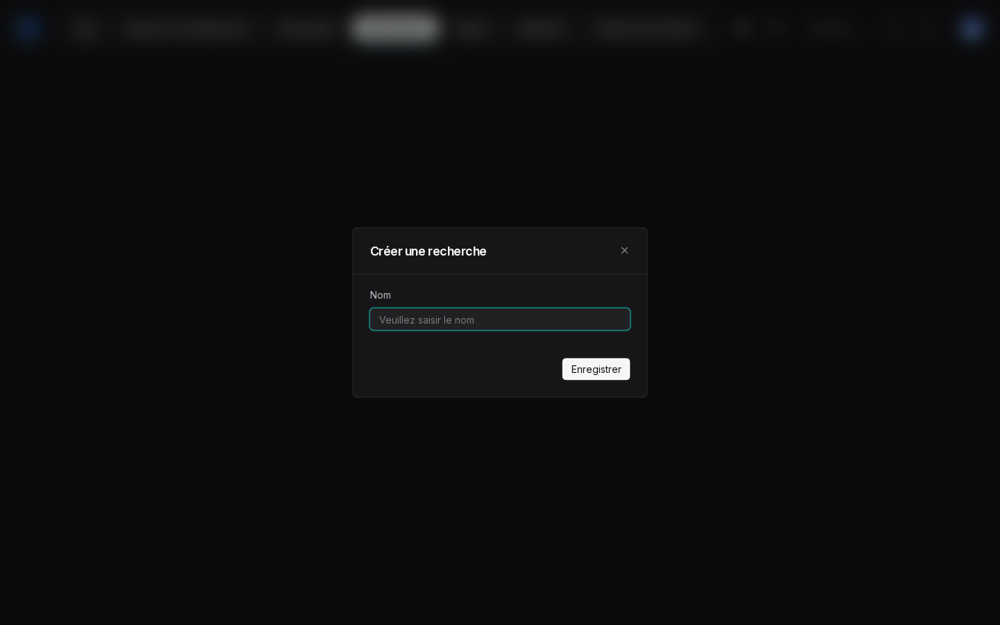

| Page ou menu | Chemin d'accès | Éléments (boutons, onglets, réglages) | Manuel qui le couvre |
|---|---|---|---|
| Liste des applications de recherche | « Recherche » | « Aucune recherche créée pour le moment », « + » (création) ; une fois remplie : « Applications de recherche », « Créer une recherche », cartes (menu « … » : « Renommer », « Supprimer ») | [09](../manuel/09-rechercher.md) |
| Fenêtre « Créer une recherche » | « + » | « Nom », « Enregistrer », « Close » | [09](../manuel/09-rechercher.md) |
| Page d'une application de recherche | clic sur une carte | logo « RAGFlow », avion en papier (« Intégrer dans la page web » : « Masquer le profil », « Paramètres régionaux », « Code d'intégration », « Ouvrir dans un nouvel onglet », « ID »), zone « Comment puis-je vous aider ? », loupe, roue dentée ; résultats : « Résumé IA », « Fichiers » (filtre par document), « Top 10 », « Total », passages et document source, « Recherche connexe », icône de carte mentale (panneau « Carte mentale ») | [09](../manuel/09-rechercher.md) |
| Panneau « Paramètres de recherche » | roue dentée | « Télécharger », nom et description (crayon), « Bases de connaissances », « Métadonnées », « Seuil de similarité », « Poids de similarité par mots-clés », « Rerank candidates », « Modèle de réordonnancement », « Modèle », « Paramètres du modèle », « Résumé IA », « Activer la recherche connexe », « Afficher la carte mentale de la requête », « Annuler », « Enregistrer » | [09](../manuel/09-rechercher.md) |

## Agent

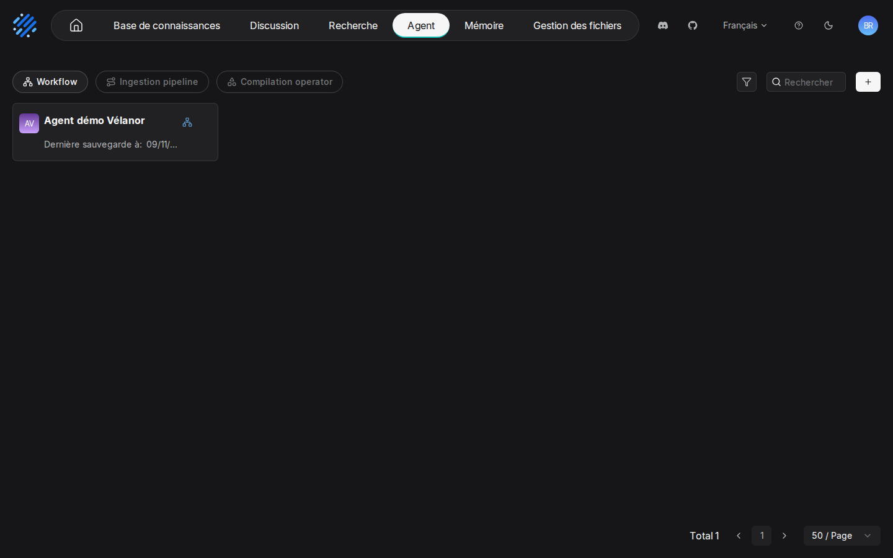

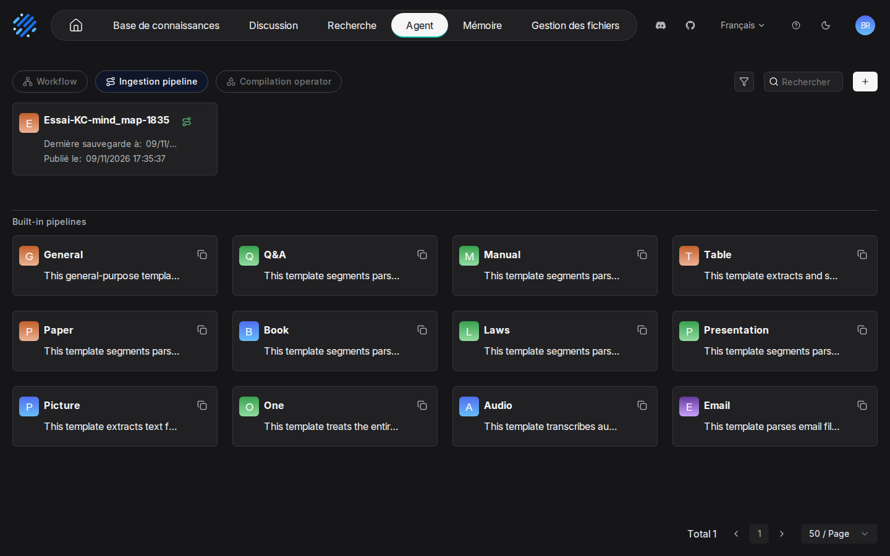

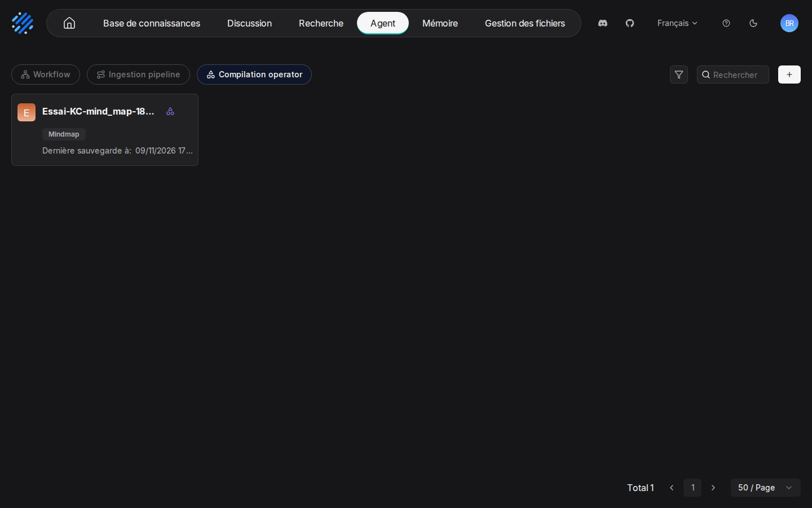

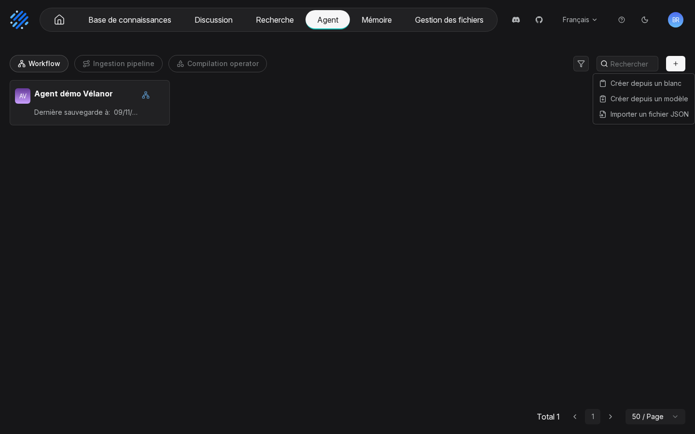

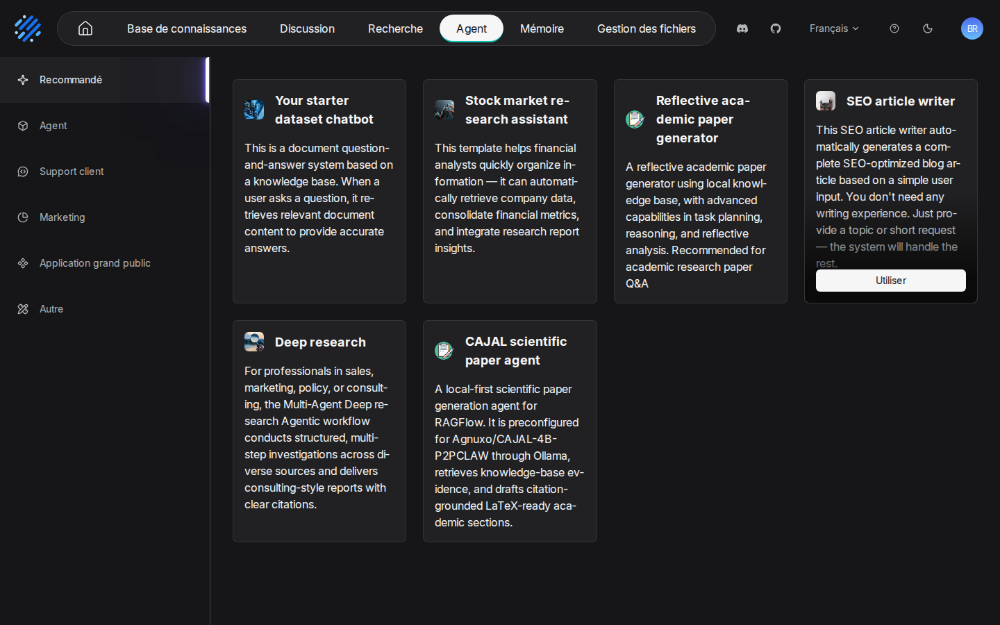

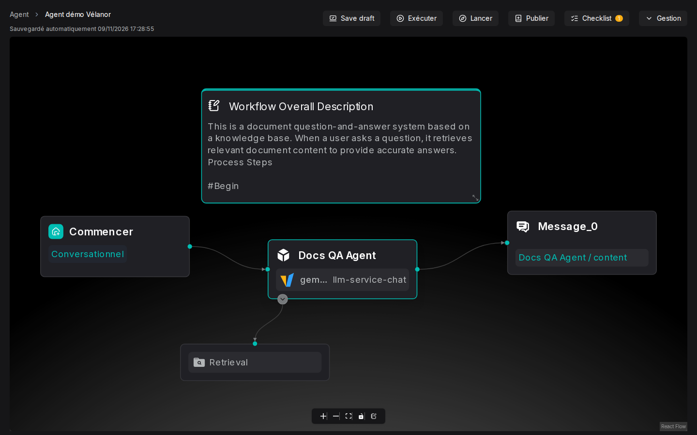

| Page ou menu | Chemin d'accès | Éléments (boutons, onglets, réglages) | Manuel qui le couvre |
|---|---|---|---|
| Onglet « Workflow » | « Agent » | filtre, « Rechercher », « + », icône de réseau, menu « … », cartes d'agents (« Dernière sauvegarde à ») | [10](../manuel/10-agents.md) |
| Onglet « Ingestion pipeline » | « Agent », « Ingestion pipeline » | pipelines créés (ici « Essai-KC-mind_map-0816 », « Publié le ») ; « Built-in pipelines » : General, Q&A, Manual, Table, Paper, Book, Laws, Presentation, Picture, One, Audio, Email, chacun avec une icône de copie | [06](../manuel/06-regler-la-lecture-des-documents.md), [11](../manuel/11-syntheses-automatiques.md) |
| Onglet « Compilation operator » | « Agent », « Compilation operator » | opérateurs de compilation (ici « Essai-KC-mind_map-0816 », type « Mindmap ») ; icône de formes (création) | [11](../manuel/11-syntheses-automatiques.md) |
| Page « Add template » (opérateur de compilation) | « Compilation operator », « + », ou clic sur un opérateur | « Retour », accolades (JSON), « Nom », « Description », « Template » (« Graph », « Mindmap », « PageIndex », « Timeline », « Tree », « Wiki »), « Global rules », « Re-chunk parser output » ; pour « Graph » : « Entity specification », « Relation specification », cartes de types (crayon, corbeille), « Add field » ; « Enregistrer » | [11](../manuel/11-syntheses-automatiques.md) |
| Canevas d'un pipeline d'ingestion | « Ingestion pipeline », « + », « Créer depuis un blanc » (fenêtre « Nom », « Confirmer »), ou clic sur un pipeline | « Save draft », « Publier » (fenêtre « Alias », « Confirmer »), « Checklist », « Gestion » ; blocs « Commencer », « Parser », « Chunker », « Compiler » (« Operator », « Create template », « Modèle », « Liberté », « Température », « Top P », pénalités, « Nombre max de tokens », « Thinking »), « Indexeur » ; « + » d'un bloc : menu « Étape suivante » (« Découpeur par tokens », « Découpeur par titres », « Indexeur », « Compiler », « Transformateur ») | [11](../manuel/11-syntheses-automatiques.md) |
| Menu de création | « + » | « Créer depuis un blanc », « Créer depuis un modèle », « Importer un fichier JSON » | [10](../manuel/10-agents.md) |
| Gabarits d'agents | « Créer depuis un modèle » | catégories « Recommandé », « Agent », « Support client », « Marketing », « Application grand public », « Autre » ; cartes (par exemple « Your starter dataset chatbot », « Deep research ») avec « Utiliser » | [10](../manuel/10-agents.md) |
| Canevas d'un agent | clic sur une carte d'agent | « Save draft », « Exécuter », « Lancer », « Publier », « Checklist », « Gestion » (« Variable de conversation », « Historique des versions », « Exporter », « Paramètres », « Intégrer dans la page web ») ; nœuds (« Commencer », agent, « Retrieval »), notes, « Zoom In », « Zoom Out », « Fit View », « Toggle Interactivity » ; panneaux « Commencer » (« Mode », « Activation de l'accueil », « Message de bienvenue », « Entrée »), agent (« Modèle », « Invite système », « Invite utilisateur », « Ajouter des outils » avec onglets « Intégré » et « MCP », « Ajouter un agent », « Paramètres avancés »), « Retrieval » (« Récupération depuis » « Ensemble de données » ou « Mémoire », « Bases de connaissances », réglages de recherche), « Message » (« Messages », « Ajouter un message », « Type de fichier à télécharger », « Lecture automatique audio », « Enregistrer en mémoire ») ; « Exécuter » (panneau « Discussion ») ; « Lancer » (page « Sessions ») ; « Gestion » (« Variable de conversation », « Historique des versions », « Exporter », « Paramètres », « Intégrer dans la page web ») ; menu « Étape suivante » d'un canevas vide (« Fondation », « Flux », « Manipulation des données », « Outils ») ; fenêtre « Create workflow » d'un gabarit (« Nom », « Modèle », « Bases de connaissances ») ; fenêtre « Importer un fichier JSON » (« Nom », « DSL ») | [10](../manuel/10-agents.md) |

## Mémoire

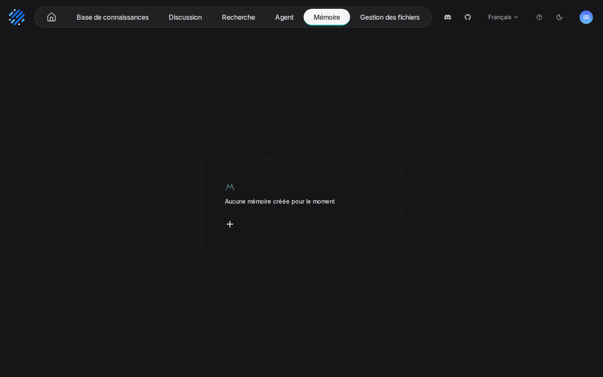

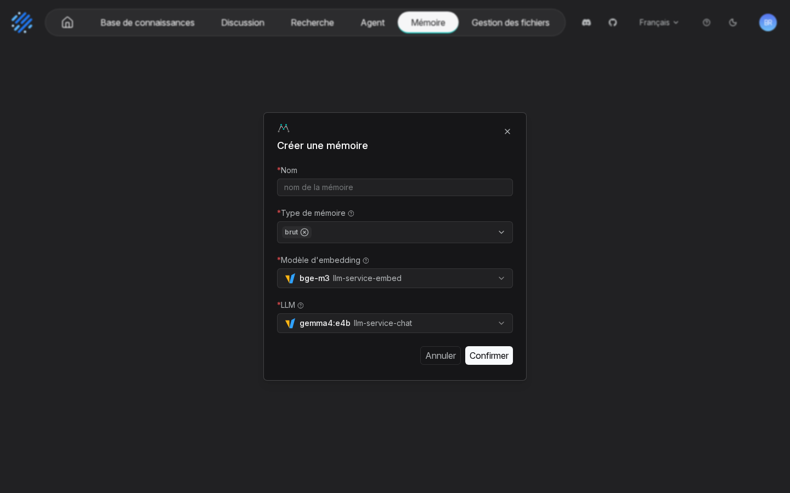

| Page ou menu | Chemin d'accès | Éléments (boutons, onglets, réglages) | Manuel qui le couvre |
|---|---|---|---|
| Liste des mémoires | « Mémoire » | « Aucune mémoire créée pour le moment », « + » (création) ; une fois remplie, cartes des mémoires | [10](../manuel/10-agents.md) |
| Fenêtre « Créer une mémoire » | « + » | « Nom », « Type de mémoire » (choix multiple : « brut », « sémantique », « épisodique », « procédural »), « Modèle d'embedding », « LLM », « Annuler », « Confirmer » | [10](../manuel/10-agents.md) |
| Page d'une mémoire | clic sur une mémoire | onglet « Messages » (« ID de session », « Agent », « Type », « Date de validité », « Oublier le », « Activer », « Action ») ; onglet « Configuration » (« Nom », « Avatar », « Description », « Modèle d'embedding », « LLM », « Type de mémoire », « Taille de la mémoire (Bytes) », « Paramètres avancés », « Annuler », « Confirmer ») | [10](../manuel/10-agents.md) |

## Gestion des fichiers

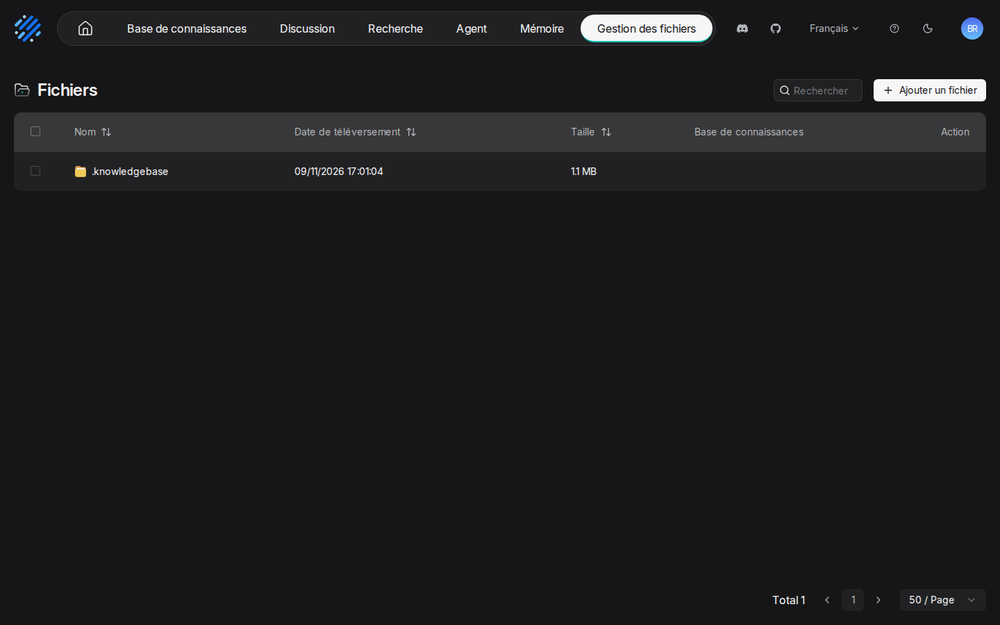

| Page ou menu | Chemin d'accès | Éléments (boutons, onglets, réglages) | Manuel qui le couvre |
|---|---|---|---|
| Gestion des fichiers | « Gestion des fichiers » | « Rechercher », « Ajouter un fichier » (« Téléverser un fichier », « Nouveau dossier »), tableau « Nom », « Date de téléversement », « Taille », « Base de connaissances », « Action » (« Lier à la base de connaissances », « Déplacer », « Renommer », télécharger, aperçu, supprimer) ; fil d'Ariane « root » ; dossier `.knowledgebase` (fichiers des bases) | [05](../manuel/05-ajouter-et-organiser-ses-documents.md) |

## Menu du compte

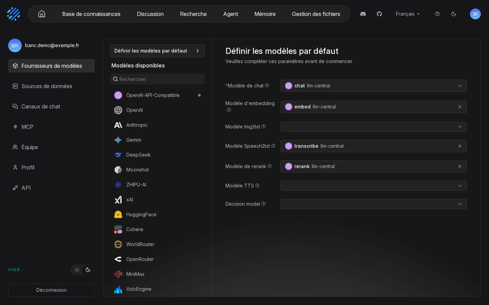

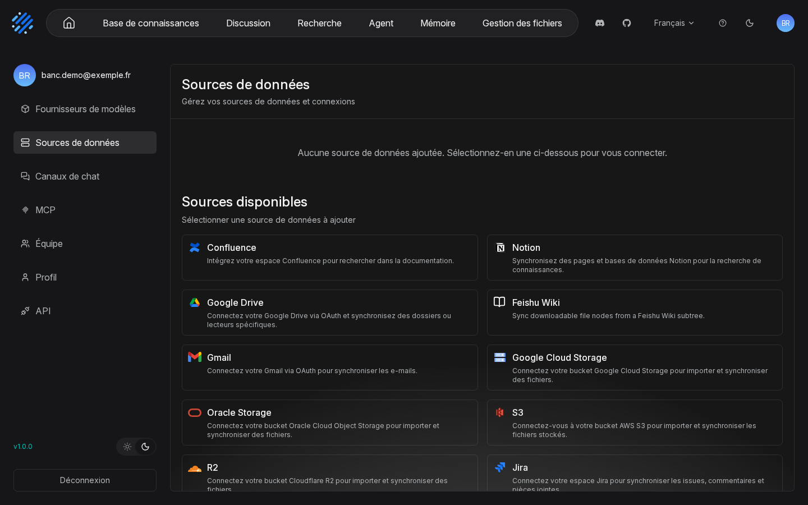

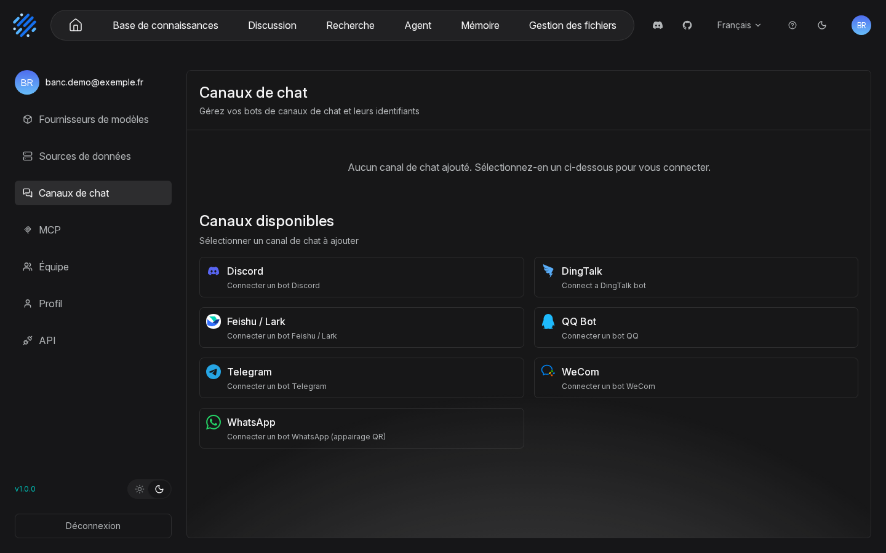

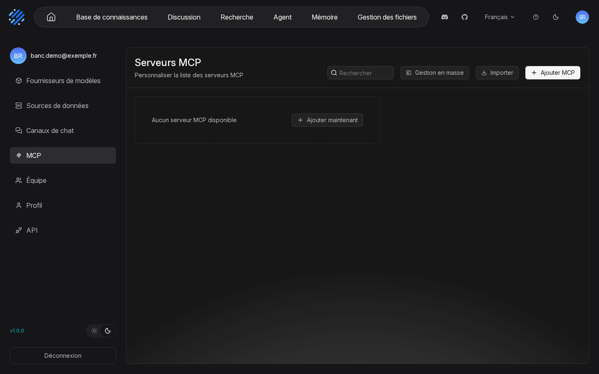

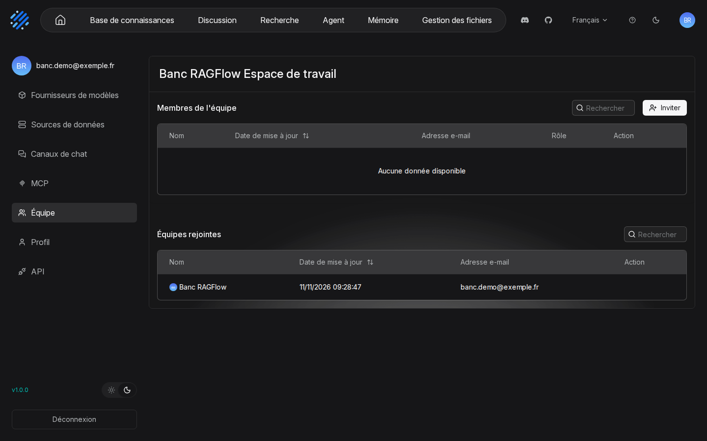

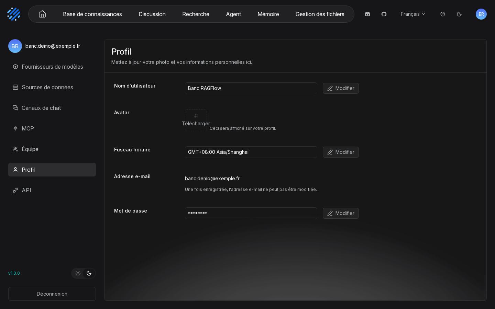

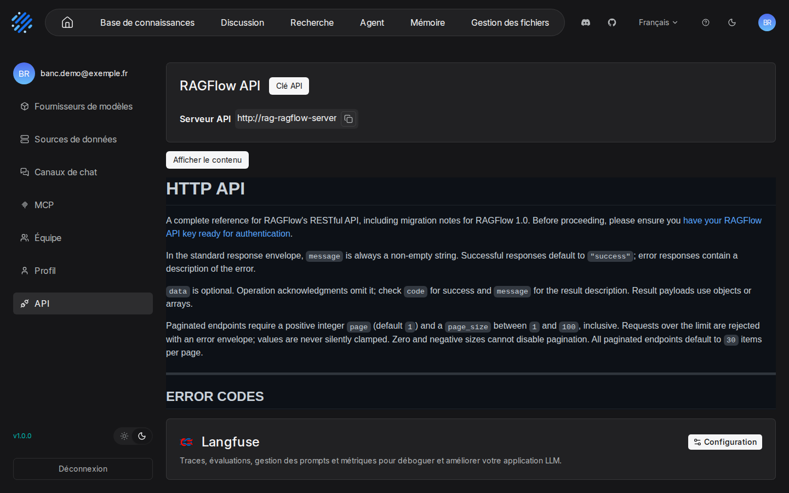

| Page ou menu | Chemin d'accès | Éléments (boutons, onglets, réglages) | Manuel qui le couvre |
|---|---|---|---|
| Menu du compte | avatar | adresse du compte, « Fournisseurs de modèles », « Sources de données », « Canaux de chat », « MCP », « Équipe », « Profil », « API », version « v1.0.0 », bascule soleil et lune, « Déconnexion » | [03](../manuel/03-premiers-pas.md) (repérage), [13](../manuel/13-comptes-equipe-et-cles.md) (page « Équipe » et « Déconnexion ») |
| « Fournisseurs de modèles » | avatar, « Fournisseurs de modèles » | « Définir les modèles par défaut » (« Modèle de chat », « Modèle d'embedding », « Modèle Img2txt », « Modèle Speech2txt », « Modèle de rerank », « Modèle TTS », « Decision model ») ; « Modèles disponibles » avec « Rechercher » et une centaine de fournisseurs (point vert : configuré) ; par fournisseur : cartes d'instance (« Clé API », « URL de base », « Models », « Lister les modèles », « … », retirer ou ajouter un modèle, « Enregistrer », corbeille), « Add instance » | [03](../manuel/03-premiers-pas.md) |
| « Sources de données » | avatar, « Sources de données » | « Sources disponibles » avec « Ajouter » : Confluence, Notion, Google Drive, Feishu Wiki, Gmail, Google Cloud Storage, Oracle Storage, S3, R2, Jira, Box, Dropbox, Bitbucket, Azure DevOps, GitLab, GitHub, Moodle, Discord, Xquik, Zendesk, Zotero, WebDAV, Airtable, Asana, IMAP, Dingtalk AI Table, SeaFile, MySQL, PostgreSQL, BigQuery, REST API, RSS, Sitemap, OneDrive, Outlook, Salesforce, Azure Blob Storage, Microsoft Teams, Slack, SharePoint | [12](../manuel/12-sources-externes.md) |
| Page d'une source de données | « Sources de données », roue dentée d'une source | champs de création (« Name », « URL du sitemap », « Filtre d'URL (regex) », « Suivre les liens PDF », « User-Agent », « Batch Size », « Synchroniser les fichiers supprimés »), « Refresh Freq », « Timeout Secs », « Test connection », « Enregistrer » (« Resume » après un échec), « Journal » (« Heure de démarrage », « Statut », « Ensemble de données », « Task Type », « Summary ») | [12](../manuel/12-sources-externes.md) |
| « Canaux de chat » | avatar, « Canaux de chat » | « Canaux disponibles » avec « Ajouter » : Discord, DingTalk, Feishu / Lark, QQ Bot, Telegram, WeCom, WhatsApp ; fenêtre « Ajouter un bot Telegram » (« Name », « Bot Token », « Annuler », « Confirmer ») | [12](../manuel/12-sources-externes.md) (page décrite) ; branchement d'un bot : Non couvert, compte en ligne chez un tiers exigé |
| « MCP » (« Serveurs MCP ») | avatar, « MCP » | « Rechercher », « Gestion en masse », « Importer », « Ajouter MCP » (fenêtre « Nom », « URL », « Type de serveur », « Authorization Token », « Enregistrer »), « Ajouter maintenant » | [10](../manuel/10-agents.md) ; serveur réel : Non couvert, aucun serveur MCP dans le banc |
| « Équipe » | avatar, « Équipe » | espace de travail, « Membres de l'équipe » (« Inviter », tableau « Nom », « Date de mise à jour », « Adresse e-mail », « Rôle », « Action »), « Équipes rejointes » (invitation reçue : « Accepter », « Refuser ») | [13](../manuel/13-comptes-equipe-et-cles.md) (page, invitation refusée puis acceptée et retirée) |
| « Profil » | avatar, « Profil » | « Nom d'utilisateur » (« Modifier »), « Avatar » (« Télécharger »), « Fuseau horaire » (« GMT+08:00 Asia/Shanghai » par défaut, « Modifier »), « Adresse e-mail » (non modifiable), « Mot de passe » (« Modifier » : fenêtre « Edit Password ») ; fenêtre « Edit Time Zone » | [13](../manuel/13-comptes-equipe-et-cles.md) |
| « API » | avatar, « API » | « RAGFlow API », « Clé API » (fenêtre des clés), « Serveur API » avec copie, « Afficher le contenu », documentation de l'API HTTP intégrée, carte « Langfuse » avec « Configuration » | [13](../manuel/13-comptes-equipe-et-cles.md) (page, fenêtre « Clé API » : « Token », « Créé », « Action », « Créer une nouvelle clé », confirmation de suppression ; sommaire de la documentation) ; Langfuse : Non couvert, demande un serveur Langfuse absent du banc |
| Fenêtre « Modifier le modèle » | « Fournisseurs de modèles », carte d'une instance, crayon au survol d'un modèle | « Nom du modèle », « Type de modèle », « Tokens maximum » (taille de contexte déclarée), « Fonctionnalités du modèle » (« Appel d'outil »), « Non », « Confirmer » | [03](../manuel/03-premiers-pas.md) (étapes 18 et 19), [15](../manuel/15-en-cas-de-probleme.md) |
| Menu « … » d'une carte d'instance et fenêtre « Ajouter un modèle personnalisé » | « Fournisseurs de modèles », carte d'une instance, « … » à droite de « Lister les modèles » | « Ajouter un modèle personnalisé », « Verify all models » ; fenêtre : « Nom du modèle », « Type de modèle » (« Chat », « Embedding », « Rerank », « TTS », « OCR », « ASR », « Decision »), « Tokens maximum », « Appel d'outil », « Non », « Confirmer » ; bouton « Add all models » à droite de « Rechercher » | [03](../manuel/03-premiers-pas.md) (étapes 13 et 14) |
| Console d'administration | adresse `/admin` de l'interface, compte `admin@ragflow.io` | page de connexion « Console d'administration » ; « Services » (« Nom », « Type de service », « Hôte », « Port », « Statut ») ; « Utilisateurs » (« Nouvel utilisateur », « Statut », « Type d'utilisateur », actions au survol) ; « Bac à sable » (« Sélection du fournisseur », « Tester la connexion », « Enregistrer ») ; « Déconnexion » | [13](../manuel/13-comptes-equipe-et-cles.md) (lecture seule ; création, suppression et promotion de comptes : Non couvert, actions irréversibles sur les comptes du banc) |
| Page « 404 » | toute adresse inconnue de l'interface | « Page not found, please enter a correct address. », « Business » (retour à l'accueil) | [15](../manuel/15-en-cas-de-probleme.md) |

## Ce qui n'est pas couvert

| Élément | Raison |
|---|---|
| Branchement d'un canal de chat (Discord, Telegram, WhatsApp…) | exige un compte en ligne chez un tiers, hors du périmètre de la mission |
| Serveur MCP réel dans un agent | aucun serveur MCP dans le banc ; page et fenêtre d'ajout décrites au chapitre [10](../manuel/10-agents.md) |
| Relecture d'une mémoire par l'outil « Retrieval » (« Récupération depuis » « Mémoire ») | non essayée ; écriture dans la mémoire montrée au chapitre [10](../manuel/10-agents.md) |
| Sources de données en ligne (Confluence, Notion, Google Drive, S3…) | même raison ; le connecteur « Sitemap » est essayé dans le chapitre [12](../manuel/12-sources-externes.md) |
| Carte « Langfuse » de la page « API » | demande un serveur Langfuse, absent du banc |
| Création, suppression, désactivation et promotion de comptes dans la console d'administration | actions irréversibles sur les comptes du banc ; pages décrites au chapitre [13](../manuel/13-comptes-equipe-et-cles.md) |
| « Web search provider » d'un assistant (Tavily, Brave Search, Exa…) | exige une clé chez un service de recherche en ligne |
| Micro, « Texte en parole » et lecture à voix haute d'une réponse | demandent un « Modèle Speech2txt » ou un « Modèle TTS », non déclarés dans le banc ; décrits au chapitre [07](../manuel/07-poser-des-questions-et-lire-les-sources.md) |
| Analyseurs PDF autres que « DeepDOC » et « External OCR model » des images | demandent un service ou un modèle externe absent du banc ; listés au chapitre [06](../manuel/06-regler-la-lecture-des-documents.md) |
| Modification du texte d'un passage de PDF par « Modifier le segment » | « Confirmer » sans effet en v1.0.0 (défaut observé, chapitre [06](../manuel/06-regler-la-lecture-des-documents.md)) ; contournement montré |

## Dépannage

| Symptôme | Cause probable | Action |
|---|---|---|
| La barre du haut disparaît | page plein écran (« Artifacts », passages, canevas d'agent) | bouton « Retour », ou icône de maison après retour |
| Interface en anglais | langue mémorisée par le navigateur | menu de langue, « Français » ([03](../manuel/03-premiers-pas.md)) |

## Sources

- Scénario : `outils/ragflow/captures/carte.py` (scénario `carte`), lancé par `outils/communs/captures/lancer.sh`
- Textes et inventaires des pages : `outils/resultats/ragflow/captures/carte/`
- Libellés français : `web/src/locales/fr.ts` au tag v1.0.0 ; liens de l'en-tête : `web/src/layouts/components/header.tsx`
