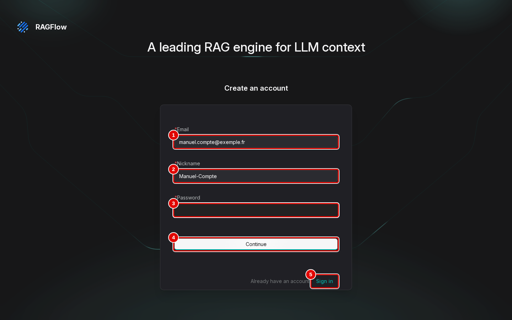

# 02. Installer RAGFlow

> Ce chapitre apprend à installer RAGFlow sous Windows 11 avec WSL2, à créer le premier compte, puis à démarrer, arrêter et désinstaller l'application.
> **Point de départ** : un terminal Ubuntu ouvert sous Windows (menu Démarrer › « Ubuntu »), machine préparée comme décrit dans « Ce qu'il faut savoir ».
> **Durée** : environ 15 minutes, dont une à deux minutes de téléchargement. **Avant** : chapitre 01.

**Attention** : l'installation officielle de RAGFlow ouvre sa base de données et ses fichiers à tout le réseau local avec des mots de passe connus de tous ; la méthode décrite ici les garde sur le poste (adresse `127.0.0.1`) et génère des mots de passe aléatoires. Ne pas lancer le fichier officiel tel quel sur un portable connecté à un réseau partagé.

## Ce qu'il faut savoir

RAGFlow ne s'installe pas comme un programme Windows : il tourne dans **Docker**, un outil qui fait fonctionner des applications prêtes à l'emploi, appelées conteneurs, à l'intérieur d'Ubuntu (WSL2). RAGFlow en utilise six : l'application elle-même, un moteur de recherche, une base de données, un stockage de fichiers, une mémoire tampon et une file d'attente des tâches. Les modèles d'IA qui rédigent les réponses et qui comparent le sens des textes ne sont pas fournis : RAGFlow les interroge sur un **serveur de modèles** déjà en place, sur ce poste ou ailleurs ; ce chapitre n'en installe aucun. Une fois installé, RAGFlow s'ouvre dans le navigateur de Windows, à l'adresse `http://127.0.0.1:8088`, comme un site web, mais visible de ce poste seulement.

Ce qu'il faut avant de commencer :

- Windows 11 avec WSL2 et une distribution Ubuntu ;
- **uv**, l'outil qui installe Python et les bibliothèques des scripts : la commande `uv --version` doit afficher un numéro de version (sinon, l'installer depuis son site officiel, docs.astral.sh/uv) ;
- Docker en marche dans Ubuntu (Docker Desktop avec l'intégration WSL2 activée, ou Docker installé dans Ubuntu) ;
- **un serveur de modèles existant** : RAGFlow a besoin de modèles servis par un serveur existant (Ollama, vLLM, LM Studio ou tout serveur compatible OpenAI, local ou distant) : un modèle de réponse (chat) et un modèle d'embedding au minimum ; reranker et transcription en option. Il faut connaître l'adresse du serveur (son « URL de base »), le nom exact de chaque modèle et, si le serveur en demande une, sa clé. Le chapitre 03 montre comment les brancher ;
- 16 Go de mémoire au moins pour RAGFlow et le système, plus celle du serveur de modèles s'il tourne sur le même poste ; 10 Go de disque libre ;
- les autres applications gourmandes arrêtées, pour libérer la mémoire.

Quelques mots utiles. **Ollama** et **vLLM** sont deux logiciels libres qui font tourner des modèles d'IA et les rendent accessibles à d'autres applications par une adresse web : Ollama fonctionne aussi sans carte graphique, sur le processeur ; vLLM demande une carte graphique NVIDIA et répond plus vite. Un serveur « compatible OpenAI » répond aux mêmes requêtes que le service en ligne d'OpenAI, ce que font Ollama, vLLM et LM Studio.

**Chemin vérifié** : les essais de ce manuel ont été faits avec une carte graphique NVIDIA et le **service de modèles central** de la machine d'essai, installé à part et partagé avec d'autres applications : une seule adresse, `http://llm-central:8080/v1`, protégée par une clé, sert quatre modèles sous des noms fixes, `chat` (réponses), `embed` (recherche par le sens), `rerank` (second tri des passages) et `transcribe` (fichiers audio). Un serveur Ollama ou distant se branche de la même façon dans l'interface (chapitre 03), mais n'a pas été essayé avec RAGFlow. La mise en place du serveur de la machine d'essai et les configurations minimales sans et avec carte graphique sont décrites dans l'annexe [A2. Choisir son matériel et ses modèles](../annexes/A2-choisir-son-materiel-et-ses-modeles.md).

## Préparer l'installation

**Étape 1. Récupérer les fichiers d'installation**
*Où* : terminal Ubuntu, dans le dossier de travail choisi.
Copier le dépôt qui contient les scripts d'installation, puis s'y placer :

```bash
git clone https://github.com/floSa/RAGFlow-Test-Bench.git
cd RAGFlow-Test-Bench
```

*Résultat* : le dossier `RAGFlow-Test-Bench` existe ; toutes les commandes suivantes se lancent depuis ce dossier.

**Étape 2. Préparer les scripts Python**
*Où* : terminal Ubuntu, dossier `RAGFlow-Test-Bench`.
Lancer la commande ci-dessous. uv télécharge si besoin la version de Python demandée par le dépôt, puis installe dans le dossier `.venv` la bibliothèque qui permet aux scripts de piloter RAGFlow.

```bash
uv sync
```

*Résultat* : la dernière ligne indique les paquets installés (par exemple « Installed … packages »). Les scripts Python se lancent ensuite par `uv run python …`.

**Étape 3. Vérifier la machine**
*Où* : terminal Ubuntu, dossier `RAGFlow-Test-Bench`.
Lancer le diagnostic. Il ne modifie rien : il relève la mémoire, le disque, la version de Docker, la présence d'une carte graphique et un réglage de mémoire du système (`vm.max_map_count`) dont le moteur de recherche de RAGFlow a besoin.

```bash
outils/communs/diagnostic.sh
```

*Résultat* : un résumé de la machine s'affiche. Le réglage `vm.max_map_count` doit valoir au moins 262 144 ; s'il est plus bas, le moteur de recherche ne démarrera pas. Pour le lire seul, tel que les conteneurs le voient :

```bash
docker run --rm --entrypoint cat nginx:alpine /proc/sys/vm/max_map_count
```

La commande affiche un nombre, par exemple `1048576` sur la machine d'essai : c'est suffisant dès qu'il atteint `262144`. Le moteur de recherche de RAGFlow est Elasticsearch ; sa documentation explique ce réglage : [Virtual memory](https://www.elastic.co/guide/en/elasticsearch/reference/current/vm-max-map-count.html). Le remède, s'il le faut, est décrit dans « En cas de problème ».

**Étape 4. Vérifier que le serveur de modèles répond**
*Où* : terminal Ubuntu, dossier `RAGFlow-Test-Bench`.
Demander au serveur la liste de ses modèles. Sur la machine d'essai, le service central demande une clé : la copier une fois dans le fichier `.env` du dossier, à partir du modèle fourni (`cp .env.example .env`, puis remplacer la valeur de `LLM_CENTRAL_KEY` par la clé donnée par le responsable du service). Le script suivant lit cette clé, sans l'afficher, et interroge le service :

```bash
outils/communs/llm_central_sante.sh
```

Avec un autre serveur compatible OpenAI (vLLM, LM Studio…), interroger son adresse suivie de `/v1/models`, par exemple `curl -s http://127.0.0.1:8000/v1/models` ; avec Ollama, l'adresse se termine par `/api/tags`, par exemple `http://127.0.0.1:11434/api/tags`.

*Résultat* : la liste des modèles servis. Sur la machine d'essai, elle commence par `chat`, `embed`, `rerank` et `transcribe`, suivis des mêmes modèles sous leur nom d'origine ; ces noms se recopient tels quels au chapitre 03. Si la commande affiche « service injoignable ou clé refusée », le serveur est arrêté, l'adresse est fausse ou la clé manque : RAGFlow s'installera, mais ne pourra ni analyser de documents ni répondre.

**Étape 5. Essayer chaque modèle (facultatif)**
*Où* : terminal Ubuntu, dossier `RAGFlow-Test-Bench`.
Le même script, avec l'option `--essai`, envoie une petite demande à chacun des quatre modèles : une salutation au modèle de réponse, un mot au modèle d'embedding, deux phrases à trier au reranker et le message vocal du jeu d'exemple au modèle de transcription.

```bash
outils/communs/llm_central_sante.sh --essai
```

*Résultat* : en moins d'une minute sur la machine d'essai, quatre réponses :

```text
== chat (réflexion coupée pour l'essai)
  Bonjour
== embed
  dimensions : 1024
== rerank
  doc 0 score 9.05
  doc 1 score -8.63
== transcribe (corpus/documents/message-vocal-production.mp3)
  Message vocale de Julien Moreau, directeur de production chez Vélanor, …
```

Le reranker donne une note élevée à la phrase qui répond (« Paris est la capitale de la France. ») et une note négative à l'autre : seul l'ordre compte. Sans modèle de transcription, le fichier `message-vocal-production.mp3` du jeu de démonstration ne peut pas être transcrit et n'apporte aucun passage, et la question « Qui est le directeur de production de Vélanor ? » du chapitre 10, dont la réponse ne figure que dans ce message vocal, reste sans réponse.

## Installer l'application

**Étape 6. Lancer l'installation**
*Où* : terminal Ubuntu, dossier `RAGFlow-Test-Bench`.
Lancer le script d'installation. Il télécharge RAGFlow version 1.0.0, génère les mots de passe, démarre les six conteneurs et attend que tout réponde. Il peut être relancé sans risque.

```bash
outils/ragflow/installer.sh
```

*Résultat* : après une à deux minutes, les dernières lignes indiquent que l'application répond et que chaque service est en ordre :

```text
healthz (9380) : HTTP 200 après 38 s
{"db":"ok","redis":"ok","doc_engine":"ok","storage":"ok","message_queue":"ok","status":"ok"}
interface : HTTP 200
```

Chaque `"ok"` correspond à un service : base de données, mémoire tampon, moteur de recherche, stockage des fichiers, file d'attente.

## Créer le premier compte

RAGFlow n'a aucun compte au départ, et aucun modèle d'IA n'y est déclaré. Deux chemins mènent au même résultat : le script, qui fait tout d'un coup, ou l'interface, à la souris.

**Étape 7. Créer le compte et déclarer les modèles par le script**
*Où* : terminal Ubuntu, dossier `RAGFlow-Test-Bench`.
Lancer le script de configuration. Il crée un compte local fictif avec un mot de passe aléatoire, une clé d'accès pour les programmes, déclare les modèles de la machine d'essai (réponse, embedding, reranker, transcription audio) et les choisit comme modèles par défaut.

```bash
uv run python outils/ragflow/configurer.py
```

*Résultat* : chaque ligne se termine par `"message": "success"`. Le courriel et le mot de passe du compte sont rangés dans le fichier `donnees/IDENTIFIANTS-LOCAUX.txt`, à lire pour se connecter (chapitre 03) ; le script range aussi le compte et sa clé d'accès dans `donnees/ragflow/compte.json`, que lisent les autres scripts du dépôt (chapitre 14).

Ce script déclare le service de modèles central : le fournisseur « OpenAI-API-Compatible », instance `llm-central`, adresse `http://llm-central:8080/v1`, clé lue dans `.env`, modèles `chat`, `embed`, `rerank`, `transcribe`, et les choisit tous les quatre comme modèles par défaut. La même déclaration se fait à la souris au chapitre 03. Avec un autre serveur, Ollama par exemple, il ne déclarerait que des adresses injoignables. Deux solutions : créer le compte à la souris (étape 8) et brancher les modèles au chapitre 03, chemin conseillé ; ou modifier, avant de lancer le script, le tableau `MODELES` en tête du fichier `outils/ragflow/configurer.py` (ouvert par exemple avec `nano`, l'éditeur de texte du terminal : Ctrl+O enregistre, Ctrl+X quitte) : pour Ollama, mettre `"Ollama"` comme fournisseur, `http://ollama-central:11434` comme adresse et les noms de modèles affichés à l'étape 4. Cette variante n'a pas été essayée.

En option, le script suivant crée ensuite le jeu de démonstration utilisé à partir du chapitre 07 : la base « Démo Vélanor » avec les neuf documents du dossier `corpus/documents/`, analysés, l'assistant « Démo Vélanor » réglé, et trois conversations d'exemple. Il remplace les objets de même nom déjà présents. Il utilise les modèles par défaut du compte, quels qu'ils soient : il fonctionne donc aussi avec un autre serveur, une fois les modèles branchés (non essayé hors de la machine d'essai). Il lit la clé d'accès dans `donnees/ragflow/compte.json` : après un compte créé à la souris, créer d'abord ce fichier comme indiqué au chapitre 14. Le chapitre 05, dernière partie, montre la même création à la souris.

```bash
uv run python outils/ragflow/demo.py
```

**Étape 8. Ou créer le compte à la souris**
*Où* : navigateur Windows › `http://127.0.0.1:8088` › lien « Sign up » sous le formulaire de connexion.
La page de connexion est en anglais au premier lancement. Cliquer sur « Sign up », remplir l'adresse (pastille 1), le nom affiché (pastille 2) et le mot de passe (pastille 3), puis cliquer sur « Continue » (pastille 4).


*Écran : page de connexion, formulaire « Create an account ».*

| N° | Élément | Rôle |
|---|---|---|
| 1 | « Email » | adresse du compte, qui sert d'identifiant ; une adresse fictive suffit pour un compte local |
| 2 | « Nickname » | nom affiché dans l'interface |
| 3 | « Password » | mot de passe du compte (masqué sur la capture) |
| 4 | « Continue » | crée le compte |
| 5 | « Sign in » | revient au formulaire de connexion |

*Résultat* : le compte est créé ; la connexion se fait ensuite comme au chapitre 03. Les modèles restent à brancher (chapitre 03, « Brancher les modèles d'un serveur existant »).

## Vérifier, arrêter et redémarrer

**Étape 9. Voir l'état de l'application**
*Où* : terminal Ubuntu, dossier `RAGFlow-Test-Bench`.
Lancer :

```bash
outils/ragflow/etat.sh
```

*Résultat* : la liste des six conteneurs, chacun « Up » et la plupart « (healthy) », puis l'état des services et, sur la machine d'essai, du serveur de modèles LLM-Service :

```text
santé : {"db":"ok","redis":"ok","doc_engine":"ok","storage":"ok","message_queue":"ok","status":"ok"}
interface : HTTP 200
LLM-Service : llm-central en marche
```

Seule l'application (`rag-ragflow-server`) est joignable, et seulement depuis ce poste : sa ligne montre `127.0.0.1:8088` pour l'interface et `127.0.0.1:9380` pour les programmes ; les cinq autres conteneurs n'ont aucune adresse ouverte.

**Étape 10. Arrêter RAGFlow**
*Où* : terminal Ubuntu, dossier `RAGFlow-Test-Bench`.
Lancer :

```bash
outils/ragflow/arreter.sh
```

*Résultat* : le message « RAGFlow arrêté. » s'affiche. Les bases, documents, assistants et comptes sont conservés ; le serveur de modèles, indépendant de RAGFlow, reste en marche.

**Étape 11. Redémarrer RAGFlow**
*Où* : terminal Ubuntu, dossier `RAGFlow-Test-Bench`.
Vérifier que le serveur de modèles répond (étape 4), puis lancer :

```bash
outils/ragflow/demarrer.sh
```

*Résultat* : après moins d'une minute, la ligne `"status":"ok"` puis l'adresse de l'interface s'affichent :

```text
RAGFlow : http://127.0.0.1:8088 (identifiants : donnees/IDENTIFIANTS-LOCAUX.txt)
```

## Désinstaller RAGFlow

**Étape 12. Tout supprimer**
*Où* : terminal Ubuntu, dossier `RAGFlow-Test-Bench`.
Lancer la commande ci-dessous. Elle annonce ce qu'elle va supprimer et demande une confirmation : taper `oui`. Toutes les bases, tous les documents et tous les comptes sont perdus : faire d'abord une sauvegarde si besoin (annexe [A4. Exploitation](../annexes/A4-exploitation.md)).

```bash
outils/communs/nettoyer.sh ragflow
```

*Résultat* : en une quinzaine de secondes, les conteneurs, leurs données et le dossier `donnees/ragflow/` sont supprimés, et le mot « Terminé. » s'affiche. Les images téléchargées restent sur le disque (environ 3 Go) pour une réinstallation rapide ; le serveur de modèles n'est pas touché.

## Bon à savoir

- Le cycle complet désinstaller, réinstaller, recréer le compte a été chronométré à moins d'une minute et demie, images déjà téléchargées.
- Aucun modèle n'est téléchargé à l'installation : les outils de lecture des documents (reconnaissance de caractères, mise en page, tableaux) sont livrés avec l'application.
- L'application occupe environ 3,7 Go de mémoire au repos et 5,4 Go pendant l'analyse de documents ; 3,1 Go d'images et 1,2 Go de données sur le disque juste après l'installation.
- Aucune version plus récente que la 1.0.0 n'existait au moment des essais. Avant toute mise à jour, faire une sauvegarde : le passage d'une ancienne version à la 1.0 transforme la base de données sans retour possible.
- Un serveur de modèles installé à part peut être joignable par toutes les machines du réseau, contrairement à RAGFlow : sur un réseau partagé, vérifier ses réglages (c'est le cas du serveur de la machine d'essai, annexe A2).
- RAGFlow joint le serveur de modèles depuis son conteneur : `127.0.0.1` y désigne le conteneur lui-même, pas le poste. Pour un serveur qui tourne sous Windows ou directement dans Ubuntu, utiliser l'adresse `http://host.docker.internal:<port>`, proposée en exemple par l'interface ; pour un serveur en conteneur sur le même réseau Docker, son nom de conteneur (ici `llm-central`, sur le réseau `llm-net`).
- Le détail technique de l'installation (fichiers de configuration, adresses, mémoire par conteneur) est dans l'annexe [A4. Exploitation](../annexes/A4-exploitation.md).

## En cas de problème

| Symptôme | Cause | Que faire |
|---|---|---|
| L'étape 4 affiche « service injoignable ou clé refusée » | serveur de modèles arrêté, adresse fausse ou clé absente de `.env` | démarrer le serveur (sur la machine d'essai, le service central se lance par le script `scripts/demarrer.sh` de son propre dossier, puis se vérifie par l'étape 4) ; vérifier l'adresse, le port et la clé |
| `.env absent` ou `LLM_CENTRAL_KEY vide dans .env` | fichier de clé pas encore préparé | `cp .env.example .env`, puis y mettre la clé du service (étape 4) |
| Le moteur de recherche ne démarre pas, l'installation attend sans fin | réglage `vm.max_map_count` inférieur à 262144 (étape 3) | sous Windows, ajouter au fichier `.wslconfig` du dossier personnel Windows la section `[wsl2]` avec la ligne `kernelCommandLine = "sysctl.vm.max_map_count=262144"`, puis lancer `wsl --shutdown` dans PowerShell et rouvrir Ubuntu ; vérifier ensuite avec la commande de l'étape 3. La machine d'essai n'en a pas eu besoin : ce remède n'a pas été essayé |
| Le script de désinstallation s'arrête aussitôt (code 126) | les scripts ont perdu leur droit d'exécution, par exemple après extraction d'une archive | lancer `chmod +x outils/communs/*.sh outils/ragflow/*.sh`, puis recommencer |
| Le port 8088 est déjà pris par un autre programme | conflit d'adresse | changer `SVR_WEB_HTTP_PORT` dans `donnees/ragflow/ragflow.env`, puis redémarrer |
| La connexion dans le navigateur est refusée (« email and password do not match ») alors que le compte existe | compte créé par un programme qui a envoyé le mot de passe sous une autre forme | recréer le compte avec le script de l'étape 7 ou à la souris (étape 8) |

Les autres problèmes sont traités au chapitre [15. En cas de problème](15-en-cas-de-probleme.md).

---
*Version décrite : RAGFlow v1.0.0, essais des 9, 11 et 12 novembre 2026. Détails et preuves : [rapport d'essais](../annexes/A6-rapport-d-essais.md).*
