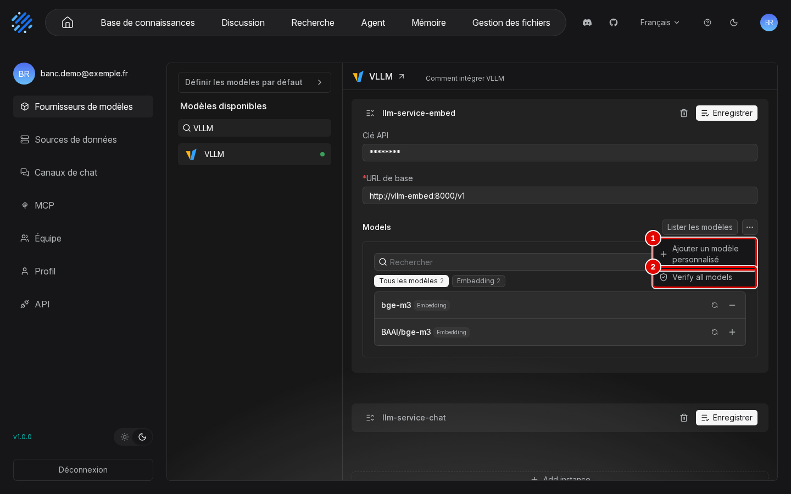
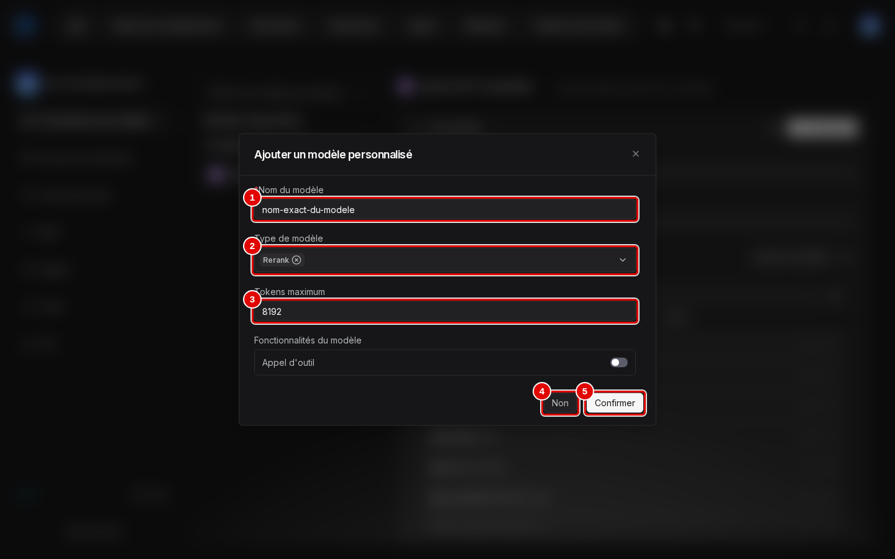
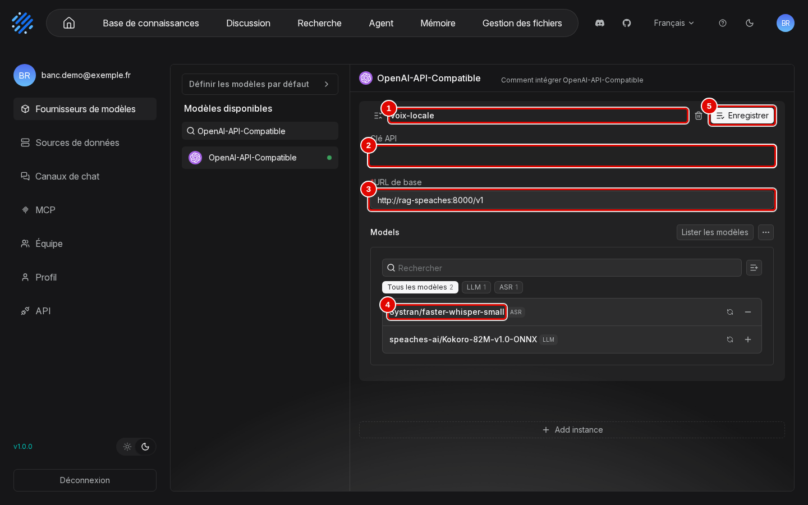
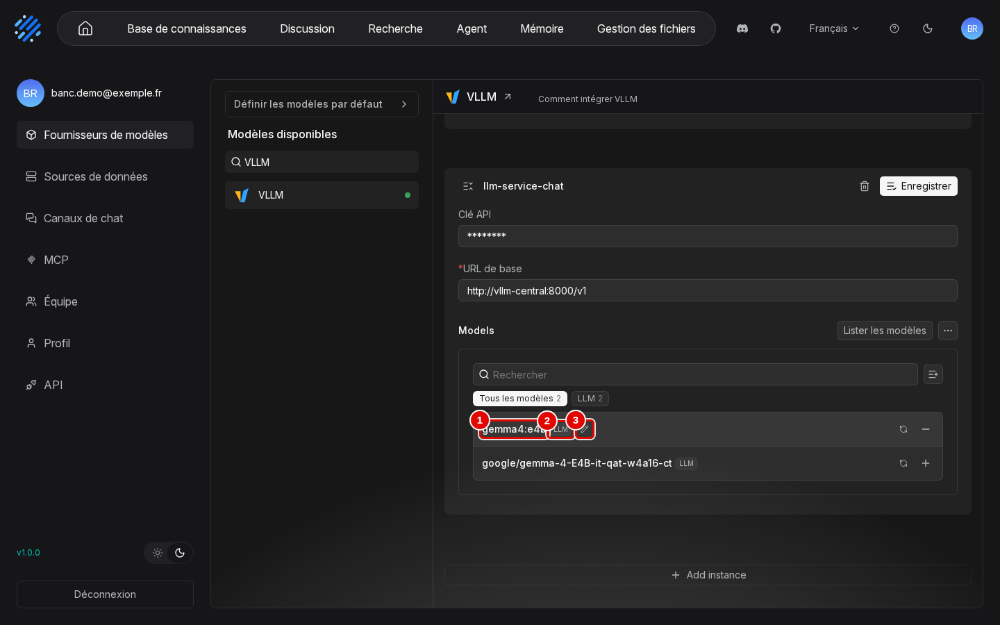

# 03. Premiers pas

> Ce chapitre apprend à se connecter, à passer l'interface en français, à se repérer dans l'écran, à distinguer les modèles d'IA à brancher de ceux intégrés à RAGFlow, à brancher les modèles d'un serveur existant et à régler la quantité de texte que le modèle lit d'un coup.
> **Point de départ** : page de connexion, à l'adresse `http://127.0.0.1:8088` ouverte dans le navigateur Windows, RAGFlow démarré (chapitre 02).
> **Durée** : environ 25 minutes. **Avant** : chapitre 02.

## Ce qu'il faut savoir

Après la connexion, chaque page de RAGFlow porte la même barre en haut de l'écran : à gauche les grandes fonctions (bases de connaissances, discussions, recherche, agents…), à droite la langue, l'aide et le compte. C'est le point de repère de tout le manuel : chaque étape indique son chemin depuis cette barre (« barre du haut › … ») ou depuis le menu du compte (la pastille ronde aux initiales, tout à droite). RAGFlow ne contient pas les modèles d'IA qui rédigent les réponses et comparent le sens des textes : il faut lui dire où les trouver, sur un serveur de modèles existant. Cela se fait une fois pour toutes dans « Fournisseurs de modèles », en déclarant l'adresse du serveur et ses modèles, puis en choisissant les modèles utilisés par défaut. D'autres traitements, comme la lecture des documents scannés, sont intégrés à RAGFlow et ne demandent rien. Si le script de configuration du chapitre 02 a été lancé, les modèles de la machine d'essai sont déjà déclarés : la partie « Brancher les modèles d'un serveur existant » sert alors à les vérifier ou à les modifier.

## Se connecter

**Étape 1. Ouvrir une session**
*Où* : navigateur Windows › `http://127.0.0.1:8088`.
Saisir le courriel (pastille 1) et le mot de passe (pastille 2) du compte créé au chapitre 02, puis cliquer sur « Sign in » (pastille 4). La page est en anglais au premier lancement ; si le français a déjà été choisi dans ce navigateur, elle est en français et les libellés deviennent « Mot de passe », « Se souvenir de moi » et « Se connecter ». Avec le script de configuration, ils se trouvent dans le fichier `donnees/IDENTIFIANTS-LOCAUX.txt`.

*Écran : page de connexion (en anglais au premier lancement).*

| N° | Élément | Rôle |
|---|---|---|
| 1 | « Email » | courriel du compte, ici `banc.demo@exemple.fr` |
| 2 | « Password » | mot de passe (masqué sur la capture) |
| 3 | « Remember me » | garde la session ouverte d'une visite à l'autre (laissé décoché) |
| 4 | « Sign in » | ouvre la session et affiche l'accueil |

*Résultat* : la page d'accueil s'affiche, en anglais (étape suivante).

## Passer l'interface en français

**Étape 2. Choisir la langue**
*Où* : barre du haut › « English » (à droite).
Cliquer sur « English » (pastille 1), puis sur « Français » (pastille 2) dans la liste.

*Écran : accueil, menu de langue ouvert.*

| N° | Élément | Rôle |
|---|---|---|
| 1 | « English » | menu de langue, à droite de la barre du haut |
| 2 | « Français » | passe toute l'interface en français |

*Résultat* : toute l'interface passe en français, sans rechargement.

**Étape 3. Vérifier le changement**
*Où* : accueil.
Les libellés de la barre du haut sont maintenant en français, et le menu de langue affiche « Français » (pastille 3). Les captures de ce manuel viennent d'un compte qui contient déjà des objets (les bases, l'assistant et l'agent de démonstration, créés aux chapitres 05 et 10) ; sur un compte neuf, l'accueil et les listes sont vides, avec des messages comme « Aucun chat créé pour le moment ».

*Écran : accueil, interface en français.*

| N° | Élément | Rôle |
|---|---|---|
| 1 | « Base de connaissances » | bases de documents (chapitres 04 à 06) |
| 2 | « Discussion » | assistants de discussion (chapitres 04, 07 et 08) |
| 3 | « Français » | langue choisie, modifiable à tout moment |

*Résultat* : l'interface est en français. Le choix est mémorisé par le navigateur, pas par le compte : un autre navigateur, ou la page de connexion lors d'une prochaine visite, peut revenir à l'anglais.

## Se repérer dans l'écran

**Étape 4. Lire la partie gauche de la barre du haut**
*Où* : barre du haut, à gauche (toutes les pages après connexion).
La barre compte sept entrées : les six annotées ici, qui mènent chacune à une fonction de RAGFlow, puis « Gestion des fichiers », la dernière, présentée à l'étape suivante.

*Écran : barre du haut, partie gauche.*

| N° | Élément | Rôle |
|---|---|---|
| 1 | icône de maison | revient à l'accueil |
| 2 | « Base de connaissances » | bases de documents : ajout, lecture, découpage, passages (chapitres 04 à 06) |
| 3 | « Discussion » | assistants qui répondent en citant leurs sources (chapitres 07 et 08) |
| 4 | « Recherche » | pages de recherche dans une ou plusieurs bases (chapitre 09) |
| 5 | « Agent » | agents, chaînes de lecture des documents et synthèses automatiques (chapitres 10 et 11) |
| 6 | « Mémoire » | mémoires où les agents gardent la trace des échanges (chapitre 10) |

*Résultat* : chaque fonction est à un clic, depuis n'importe quelle page.

**Étape 5. Lire la partie droite de la barre du haut**
*Où* : barre du haut, à droite.
Repérer « Gestion des fichiers », dernière entrée de la barre, puis, à sa droite, les accès aux sites du projet, à la langue, à l'aide et au thème.

*Écran : barre du haut, partie droite.*

| N° | Élément | Rôle |
|---|---|---|
| 1 | « Gestion des fichiers » | tous les fichiers ajoutés, rangés par base (chapitre 05) |
| 2 | icône Discord | ouvre le salon de discussion public du projet (site externe) |
| 3 | icône GitHub | ouvre la page du code source de RAGFlow (site externe) |
| 4 | « Français » | menu de langue de l'interface |
| 5 | icône « ? » | ouvre le guide officiel, en anglais (site externe) |
| 6 | icône de lune | bascule entre thème sombre et thème clair |

*Résultat* : les liens externes, la langue et le thème sont identifiés ; ils ne changent rien aux données.

**Étape 6. Lire la page d'accueil**
*Où* : barre du haut › icône de maison.
L'accueil résume le contenu du compte : les bases en haut, les objets récents des autres fonctions en dessous. La pastille du compte (pastille 5) ouvre les réglages du compte, utilisés juste après.

*Écran : accueil.*

| N° | Élément | Rôle |
|---|---|---|
| 1 | « Bienvenue sur RAGFlow » | page d'accueil, affichée après connexion |
| 2 | carte d'une base | nom, nombre de fichiers et date ; un clic ouvre la base |
| 3 | « Voir tout » | liste complète des bases de connaissances |
| 4 | onglets « Discussion », « Recherche », « Agent », « Mémoire » | objets récents de chaque fonction |
| 5 | pastille du compte | réglages du compte : fournisseurs de modèles, sources de données, canaux de chat, MCP, équipe, profil, API |

*Résultat* : l'écran est repéré. Trois pages s'ouvrent en plein écran, sans barre du haut : les passages d'un document, l'onglet « Artifacts » d'une base et le dessin d'un agent ; leur bouton « Retour » les referme.

## Les modèles : ceux qu'on branche, ceux qui sont intégrés

RAGFlow utilise deux sortes de modèles d'IA. Les premiers ne sont pas fournis : ils tournent sur un **serveur de modèles** déjà en place (Ollama, vLLM, LM Studio ou tout serveur compatible OpenAI, sur ce poste ou ailleurs), et RAGFlow les interroge par une adresse web ; il faut les **brancher**, ce que fait la suite de ce chapitre. Les seconds sont **intégrés** à RAGFlow : ils tournent dans son propre conteneur, sur le processeur, sans rien déclarer, et ne peuvent pas être confiés à un serveur extérieur.

### Les modèles à brancher

Chaque modèle branché a un **type**, qui dit à quoi il sert. Le tableau donne les types proposés par RAGFlow, dans l'ordre de la fenêtre « Définir les modèles par défaut » (étape 17).

| Type de modèle | À quoi il sert | Obligatoire ? | Exemple sur la machine d'essai |
|---|---|---|---|
| Chat (badge « LLM ») | rédige les réponses des assistants, fait tourner les agents et les synthèses automatiques | oui | `gemma4:e4b`, fournisseur « VLLM », instance « llm-service-chat » |
| Embedding | traduit le sens d'un passage ou d'une question en une suite de nombres, pour la recherche par le sens ; sert à chaque analyse de document et à chaque question | oui | `bge-m3`, fournisseur « VLLM », instance « llm-service-embed » |
| Img2txt (vision) | décrit les images : gabarit « Picture », option « Enable vision enhancement » des PDF (chapitre 06) | non | aucun |
| Speech2txt (badge « ASR ») | transcrit les fichiers audio en texte avant leur découpage ; dictée par le micro de la zone de saisie | non | `Systran/faster-whisper-small`, fournisseur « OpenAI-API-Compatible », instance « voix-locale » |
| Rerank | trie une seconde fois les passages trouvés, pour remonter les plus utiles | non | aucun : essai prévu avec le nouveau serveur de modèles |
| TTS | lit les réponses à voix haute | non | aucun |
| Decision | choisit les recherches à lancer en mode « Agentic » (chapitre 07) ; vide, le modèle de chat s'en charge | non | aucun |

Le modèle d'embedding d'une base se choisit à sa création (chapitre 04) : les nombres produits par deux modèles différents ne sont pas comparables, si bien qu'un changement de modèle demande d'analyser de nouveau tous les documents de la base.

**Le reranker** (modèle de type « Rerank ») relit chaque passage trouvé à côté de la question et lui donne une note plus fine que la recherche, avant que les meilleurs soient transmis au modèle de chat. Il améliore surtout les grandes bases, où beaucoup de passages se ressemblent, au prix d'un peu de temps à chaque question. RAGFlow n'en fournit aucun : il faut un serveur de modèles qui en sert un, par exemple vLLM. Le reranker se branche comme les autres modèles : instance du fournisseur, modèle de type « Rerank » (étapes 13 et 14), puis choix dans « Modèle de rerank » (étape 17) ou dans « Modèle de réordonnancement » d'un assistant (chapitre 08). Tous les serveurs ne conviennent pas : le serveur de reranking proposé par l'installation officielle de RAGFlow (Text Embeddings Inference) parle un autre langage que RAGFlow et ne peut pas être branché tel quel. Sur la machine d'essai, la carte graphique n'avait plus la place d'un troisième modèle : l'essai est prévu avec le nouveau serveur de modèles de la série. Le détail est dans l'annexe [A1. Évaluation : qualité et performances](../annexes/A1-evaluation-qualite-et-performances.md).

### Les traitements intégrés à RAGFlow

Ces traitements tournent dans le conteneur de RAGFlow ou à côté de lui, installés au chapitre 02. Rien n'est téléchargé à leur premier usage, et aucun serveur de modèles n'est sollicité.

- **DeepDoc, le lecteur de documents.** Il lit chaque fichier avant son découpage : reconnaissance des caractères d'une page scannée (OCR), repérage de la mise en page (titres, paragraphes, colonnes, en-têtes) et de la structure des tableaux. Ses modèles sont livrés dans l'image de RAGFlow (format ONNX) et tournent sur le processeur, sans carte graphique. Coût mesuré : environ 5 secondes par page scannée (10 secondes pour le contrat scanné de deux pages), moins d'une minute pour les neuf documents du jeu de démonstration ; pendant une analyse, la mémoire du serveur passe d'environ 0,6 à 2 Go. Il se règle base par base : « Configuration » › onglet « Parser » › « Analyseur PDF » (« DeepDOC » par défaut, ou « Naïf » pour un PDF qui contient déjà du texte, plus rapide). Sa lecture n'est pas parfaite : le chapitre 06 montre comment la contrôler et la corriger.
- **Le découpage en jetons (tokenizer).** RAGFlow compte le texte en **jetons** (des morceaux de mots) pour couper les passages à la bonne taille (512 jetons par défaut, réglage « General Chunker » du chapitre 06) et prépare chaque passage pour la recherche par mots-clés (étape « Tokenizer » visible dans les journaux d'analyse, chapitre 05). Ce traitement est intégré, sans modèle à déclarer ni réglage propre ; son coût est compris dans le temps d'analyse.
- **Elasticsearch, le moteur de recherche interne.** Il range les passages, leurs mots-clés et leurs nombres d'embedding, et fait la recherche hybride : par les mots et par le sens à la fois. Il tourne dans son propre conteneur, `rag-ragflow-es01`, et occupe environ 2,5 Go de mémoire au repos et 2,7 Go en pointe (limite fixée à 4 Go par l'installation). Il demande le réglage système `vm.max_map_count` vérifié au chapitre 02, étape 3. Dans l'interface, il se règle par la part des mots et du sens (« Poids de similarité par mots-clés »), le score minimal (« Seuil de similarité ») et le nombre de passages retenus (« Top N ») d'un assistant (chapitre 08), et par la « Méthode de recherche » de l'onglet « Indexer » d'une base (chapitre 06).
- **Les autres services**, sans réglage dans l'interface : une base de données (MySQL, environ 0,5 Go) pour les comptes, bases et réglages ; un stockage de fichiers (environ 0,1 Go) pour les documents envoyés ; une mémoire tampon et une file d'attente des tâches, quelques dizaines de mégaoctets chacune.

En tout, RAGFlow occupe environ 3,6 Go de mémoire au repos et 5,3 Go pendant une analyse, sans compter le serveur de modèles. Le détail est dans les annexes [A4. Exploitation](../annexes/A4-exploitation.md) et [A5. Fonctionnement interne](../annexes/A5-fonctionnement-interne.md).

## Brancher les modèles d'un serveur existant

Un **fournisseur** est un type de service de modèles (« VLLM », « Ollama », « OpenAI-API-Compatible »…) : choisir celui qui correspond au serveur, ou « OpenAI-API-Compatible » pour tout serveur compatible OpenAI (LM Studio, par exemple). Une **instance** est une adresse précise de ce service, déclarée sous un nom libre : par exemple « llm-service-chat » pour le serveur qui rédige les réponses. Pour chaque instance, il faut connaître :

- l'**URL de base**, l'adresse du serveur telle que RAGFlow la voit depuis son conteneur, terminée par `/v1` pour un serveur compatible OpenAI (pour Ollama, `http://<machine>:11434`) ; `127.0.0.1` y désigne le conteneur de RAGFlow lui-même : utiliser le nom du conteneur du serveur, ou `host.docker.internal` pour un serveur lancé sous Windows ou dans Ubuntu (chapitre 02, « Bon à savoir ») ;
- la **clé**, seulement si le serveur en demande une ; sinon, laisser le champ vide ;
- le **nom exact** de chaque modèle, tel que le serveur l'affiche (chapitre 02, étape 4) ; « Lister les modèles » le récupère en général tout seul ;
- son **type** (tableau ci-dessus), proposé par RAGFlow et modifiable ;
- ses **« Tokens maximum »**, la quantité de texte qu'il peut lire d'un coup (étape 20).

Les étapes 7 à 15 montrent l'ajout puis la suppression d'une instance d'exemple nommée « Manuel-instance » ; l'étape 16 déclare de la même façon les instances utiles. Si le script de configuration du chapitre 02 a été lancé, les instances de la machine d'essai existent déjà : ces étapes servent alors à les vérifier ou à les modifier.

| Instance | Fournisseur | URL de base | Modèle à garder | Type |
|---|---|---|---|---|
| llm-service-chat | VLLM | `http://vllm-central:8000/v1` | `gemma4:e4b` | chat (rédaction des réponses) |
| llm-service-embed | VLLM | `http://vllm-embed:8000/v1` | `bge-m3` | embedding (recherche par le sens) |
| voix-locale | OpenAI-API-Compatible | `http://rag-speaches:8000/v1` | `Systran/faster-whisper-small` | speech2text (transcription des fichiers audio) |

Ces trois instances sont celles de la machine d'essai. Les deux premières sont indispensables ; la troisième ne sert qu'aux fichiers audio (chapitre 02, étape 5). Avec un autre serveur, remplacer fournisseur, adresse et noms de modèles par les siens.

**Étape 7. Ouvrir « Fournisseurs de modèles »**
*Où* : pastille du compte (en haut à droite) › « Fournisseurs de modèles ».
Cliquer sur la pastille du compte, puis sur « Fournisseurs de modèles » (pastille 1) dans le menu de gauche.

*Écran : réglages du compte, page « Fournisseurs de modèles ».*

| N° | Élément | Rôle |
|---|---|---|
| 1 | « Fournisseurs de modèles » | entrée du menu du compte qui ouvre cette page |
| 2 | « Définir les modèles par défaut » | modèles utilisés d'office par les bases et les assistants (étape 17) |
| 3 | « Rechercher » | filtre la liste des fournisseurs, une centaine |
| 4 | « VLLM » | fournisseur du serveur de la machine d'essai ; le point vert signale un fournisseur déjà configuré |

*Résultat* : la liste des fournisseurs s'affiche. Taper « Ollama » ou « OpenAI-API-Compatible » dans « Rechercher » retrouve ces fournisseurs.

**Étape 8. Ouvrir le fournisseur**
*Où* : pastille du compte › « Fournisseurs de modèles » › « VLLM » (ou le fournisseur du serveur).
Cliquer sur le fournisseur. Chaque instance déjà déclarée a sa carte ; celle de la recherche par le sens, « llm-service-embed » (pastille 1), est dépliée ici. L'icône à gauche du nom (« Voir les modèles », « Masquer les modèles ») déplie ou replie une carte.

*Écran : « Fournisseurs de modèles », fournisseur « VLLM » ouvert.*

| N° | Élément | Rôle |
|---|---|---|
| 1 | « llm-service-embed » | nom de l'instance, choisi à sa création |
| 2 | « URL de base » | adresse du serveur de modèles, telle que RAGFlow la voit depuis son conteneur ; le champ « Clé API » au-dessus affiche des étoiles parce que le script de configuration du chapitre 02 y a mis une valeur sans usage (`sans-cle`) : le serveur de la machine d'essai n'en demande pas, et une instance créée à la souris peut laisser ce champ vide (étape 10) |
| 3 | « Lister les modèles » | interroge le serveur et affiche les modèles qu'il propose |
| 4 | signe « − » de `bge-m3` | retire ce modèle de l'instance ; le signe « + » d'un modèle non retenu l'ajoute |
| 5 | « Enregistrer » | enregistre les changements de la carte |

*Résultat* : les instances existantes sont visibles et modifiables.

**Étape 9. Ajouter une instance**
*Où* : « Fournisseurs de modèles » › « VLLM », bas de la liste des instances.
Descendre en bas de la liste et cliquer sur « Add instance » (pastille 1).

*Écran : « Fournisseurs de modèles », fournisseur « VLLM », bas de la liste.*

| N° | Élément | Rôle |
|---|---|---|
| 1 | « Add instance » | ajoute une carte d'instance vide en bas de la liste |

*Résultat* : une carte vide apparaît.

**Étape 10. Remplir la nouvelle instance**
*Où* : « Fournisseurs de modèles » › « VLLM », carte vide.
Saisir le nom (pastille 1), laisser la clé vide si le serveur n'en demande pas (pastille 2), saisir l'adresse du serveur (pastille 3), ici `http://vllm-embed:8000/v1`, puis cliquer sur « Lister les modèles » (pastille 4).

*Écran : « Fournisseurs de modèles », nouvelle carte d'instance remplie.*

| N° | Élément | Rôle |
|---|---|---|
| 1 | « Nom de l'instance » | nom libre, repris ensuite dans les listes de modèles |
| 2 | « Clé API » | mot de passe du serveur de modèles ; vide pour un serveur local qui n'en demande pas |
| 3 | « URL de base » | adresse du serveur, terminée par `/v1` pour un serveur compatible OpenAI |
| 4 | « Lister les modèles » | récupère les modèles proposés à cette adresse |

*Résultat* : les modèles proposés par le serveur s'affichent (étape suivante).

**Étape 11. Garder les bons modèles et enregistrer**
*Où* : même carte, après « Lister les modèles ».
Les modèles apparaissent tous retenus (signe « − » à droite de chacun), avec le type que RAGFlow leur attribue. Le serveur `vllm-embed` propose le même modèle sous deux noms : `bge-m3` (pastille 1), à garder, et `BAAI/bge-m3`, son nom complet, à retirer. Cliquer sur le signe « − » de `BAAI/bge-m3` (pastille 2), confirmer par « Retirer » dans la fenêtre « Are you sure to remove it ? », puis cliquer sur « Enregistrer » (pastille 3).

*Écran : « Fournisseurs de modèles », modèles listés pour la nouvelle instance.*

| N° | Élément | Rôle |
|---|---|---|
| 1 | `bge-m3` | modèle à garder, avec son type (« Embedding » : recherche par le sens) ; c'est le nom repris dans les listes de modèles |
| 2 | signe « − » de `BAAI/bge-m3` | retire le doublon ; le signe devient « + », qui permettrait de le reprendre |
| 3 | « Enregistrer » | crée l'instance avec le seul modèle `bge-m3` |

*Résultat* : l'instance est enregistrée avec un seul modèle (étape suivante). Pour l'instance « llm-service-chat », garder de même `gemma4:e4b` et retirer son nom complet `google/gemma-4-E4B-it-qat-w4a16-ct`.

**Étape 12. Vérifier l'instance enregistrée**
*Où* : « Fournisseurs de modèles » › « VLLM », haut de la liste.
L'instance apparaît en tête de la liste (pastille 1). Sa carte affiche toujours les deux noms que propose le serveur, mais seul `bge-m3` (pastille 2) garde le signe « − » : c'est le seul retenu, et le seul proposé partout où l'on choisit un modèle ; `BAAI/bge-m3`, retiré, porte le signe « + ».

*Écran : « Fournisseurs de modèles », nouvelle instance en tête de liste.*

| N° | Élément | Rôle |
|---|---|---|
| 1 | « Manuel-instance » | instance créée, désormais proposée dans les listes de modèles |
| 2 | `bge-m3` | seul modèle retenu (signe « − » à droite) |
| 3 | corbeille | supprime l'instance (étape 15) |

*Résultat* : l'instance est utilisable.

**Étape 13. Ajouter un modèle que le serveur ne liste pas**
*Où* : carte de l'instance › bouton « … » à droite de « Lister les modèles ».
Quand « Lister les modèles » ne trouve pas un modèle (un reranker, par exemple), ou lui donne un mauvais type, il s'ajoute à la main. Cliquer sur « … », puis sur « Ajouter un modèle personnalisé » (pastille 1). « Verify all models » (pastille 2) vérifie que chaque modèle retenu répond.

*Écran : « Fournisseurs de modèles », carte d'instance, menu « … » ouvert.*

| N° | Élément | Rôle |
|---|---|---|
| 1 | « Ajouter un modèle personnalisé » | ouvre la fenêtre de l'étape suivante |
| 2 | « Verify all models » | interroge le serveur pour chaque modèle retenu |

*Résultat* : la fenêtre « Ajouter un modèle personnalisé » s'ouvre.

**Étape 14. Décrire le modèle**
*Où* : fenêtre « Ajouter un modèle personnalisé ».
Saisir le nom exact du modèle sur le serveur (pastille 1), choisir son type dans la liste (pastille 2 : « Chat », « Embedding », « Rerank », « TTS », « OCR », « ASR » pour la transcription, « Decision »), indiquer ses « Tokens maximum » (pastille 3), puis cliquer sur « Confirmer » (pastille 5) et sur « Enregistrer » de la carte. La capture montre un exemple rempli pour un reranker, refermé par « Non » (pastille 4) sans rien ajouter.

*Écran : fenêtre « Ajouter un modèle personnalisé », type « Rerank » choisi.*

| N° | Élément | Rôle |
|---|---|---|
| 1 | « Nom du modèle » | nom exact du modèle, tel que le serveur l'affiche ; obligatoire |
| 2 | « Type de modèle » | usage du modèle ; ici « Rerank » ; plusieurs types possibles |
| 3 | « Tokens maximum » | quantité de texte que le modèle lit d'un coup |
| 4 | « Non » | referme sans rien ajouter |
| 5 | « Confirmer » | ajoute le modèle à la carte, à enregistrer ensuite |

*Résultat* : le modèle s'ajoute à la carte de l'instance ; après « Enregistrer », il est proposé dans la liste de son type.

**Étape 15. Supprimer une instance d'essai**
*Où* : carte de l'instance › corbeille.
Cliquer sur la corbeille de la carte (capture de l'étape 12, pastille 3), puis sur « Supprimer » (pastille 2) dans la confirmation.

*Écran : « Fournisseurs de modèles », confirmation de suppression.*

| N° | Élément | Rôle |
|---|---|---|
| 1 | « Êtes-vous sûr de vouloir supprimer cet élément ? » | confirmation ; « Non » annule |
| 2 | « Supprimer » | supprime l'instance |

*Résultat* : l'instance disparaît de la liste.

**Étape 16. Déclarer les trois instances du tableau**
*Où* : pastille du compte › « Fournisseurs de modèles » › fournisseur de chaque ligne du tableau.
Refaire les étapes 8 à 11 pour chaque ligne du tableau placé avant l'étape 7 : « llm-service-chat » et « llm-service-embed » dans « VLLM », puis « voix-locale » dans « OpenAI-API-Compatible » (taper ce nom dans « Rechercher » de l'étape 7 pour retrouver le fournisseur). Pour « voix-locale », le serveur propose deux modèles : garder `Systran/faster-whisper-small`, de type « ASR » (transcription), et laisser l'autre, `speaches-ai/Kokoro-82M-v1.0-ONNX`, avec son signe « + ». La capture montre cette instance une fois enregistrée.

*Écran : « Fournisseurs de modèles », fournisseur « OpenAI-API-Compatible », instance « voix-locale ».*

| N° | Élément | Rôle |
|---|---|---|
| 1 | « voix-locale » | nom de l'instance de transcription |
| 2 | « Clé API » | valeur sans usage enregistrée par le script de configuration (masquée) ; vide à la souris |
| 3 | « URL de base » | `http://rag-speaches:8000/v1`, serveur de transcription du chapitre 02, étape 5 |
| 4 | `Systran/faster-whisper-small` | modèle retenu (signe « − »), badge « ASR » : transcription |
| 5 | « Enregistrer » | enregistre la carte |

*Résultat* : les trois instances sont déclarées, chacune avec un seul modèle retenu.

## Choisir les modèles par défaut

**Étape 17. Ouvrir « Définir les modèles par défaut »**
*Où* : pastille du compte › « Fournisseurs de modèles » › « Définir les modèles par défaut ».
Cliquer sur le bouton, puis choisir un modèle pour chaque usage. « Modèle de chat » (pastille 1) et « Modèle d'embedding » (pastille 2) sont indispensables : sans le premier, aucune discussion n'est possible ; sans le second, aucune base ne peut analyser ses documents.

*Écran : « Fournisseurs de modèles », fenêtre des modèles par défaut.*

| N° | Élément | Rôle |
|---|---|---|
| 1 | « Modèle de chat » | rédige les réponses (`gemma4:e4b`, instance « llm-service-chat ») ; obligatoire |
| 2 | « Modèle d'embedding » | traduit le sens des passages et des questions en nombres pour la recherche (`bge-m3`) ; indispensable aux bases |
| 3 | « Modèle Img2txt » | décrit les images (vide ici) |
| 4 | « Modèle Speech2txt » | transcrit l'audio (`Systran/faster-whisper-small`, instance « voix-locale ») |
| 5 | « Modèle de rerank » | trie une seconde fois les passages trouvés (vide : aucun reranker n'est branché) |
| 6 | « Modèle TTS » | lit les réponses à voix haute (vide ici) ; la ligne suivante, « Decision model », reste vide aussi |

*Résultat* : la fenêtre montre les choix actuels.

**Étape 18. Choisir un modèle dans une liste**
*Où* : même fenêtre › liste d'un usage (ici « Modèle de chat »).
Ouvrir la liste : les modèles sont groupés par fournisseur puis par instance. Cliquer sur le modèle voulu (pastille 1). Il n'y a pas de bouton « Enregistrer » : le choix est enregistré dès le clic. La croix à droite d'un choix le vide.

*Écran : fenêtre des modèles par défaut, liste « Modèle de chat » ouverte.*

| N° | Élément | Rôle |
|---|---|---|
| 1 | liste « VLLM », « llm-service-chat », `gemma4:e4b` | modèles de chat disponibles, avec un champ « Rechercher » |

*Résultat* : les modèles par défaut sont fixés ; après un rechargement de la page, la fenêtre affiche toujours le modèle choisi. Toute nouvelle base et tout nouvel assistant les reprendront.

## Régler la taille de contexte

La « taille de contexte » d'un modèle est la quantité de texte qu'il peut lire d'un coup : consignes, passages trouvés et question. RAGFlow ne la lit pas sur le serveur de modèles : elle se déclare avec le modèle, dans « Tokens maximum ». Une valeur trop petite empêche toute réponse (chapitre 15, étape 3). Les essais de ce manuel utilisent 16 384 jetons, largement assez : une question ordinaire en consomme de 600 à 3 300.

**Étape 19. Ouvrir « Modifier le modèle »**
*Où* : pastille du compte › « Fournisseurs de modèles » › « VLLM » › carte de l'instance « llm-service-chat » › ligne `gemma4:e4b`.
Passer la souris sur la ligne du modèle (pastille 1) : un crayon apparaît à droite de son badge de type (pastille 2). Cliquer sur ce crayon, « Modifier le modèle » (pastille 3).

*Écran : « Fournisseurs de modèles », carte « llm-service-chat », crayon visible au survol.*

| N° | Élément | Rôle |
|---|---|---|
| 1 | `gemma4:e4b` | modèle retenu de l'instance ; la ligne du dessous, `google/gemma-4-E4B-it-qat-w4a16-ct`, porte le signe « + » : non retenue |
| 2 | « LLM » | type du modèle (chat) |
| 3 | crayon « Modifier le modèle » | visible seulement au survol ; ouvre la fenêtre de l'étape suivante |

*Résultat* : la fenêtre « Modifier le modèle » s'ouvre.

**Étape 20. Déclarer 16 384 jetons pour le modèle de chat**
*Où* : fenêtre « Modifier le modèle ».
Saisir 16384 dans « Tokens maximum » (pastille 2), puis cliquer sur « Confirmer » (pastille 5).

*Écran : « Fournisseurs de modèles », fenêtre « Modifier le modèle ».*

| N° | Élément | Rôle |
|---|---|---|
| 1 | « Type de modèle » | « Chat » : modèle qui rédige les réponses |
| 2 | « Tokens maximum » | taille de contexte déclarée : 16384 conseillé, 4096 au minimum ; jamais plus que ce que le serveur de modèles sert réellement (32 768 sur la machine d'essai) |
| 3 | « Appel d'outil » | indique que le modèle sait appeler des outils (agents) ; désactivé ici |
| 4 | « Non » | referme sans rien changer |
| 5 | « Confirmer » | enregistre ; prend effet à la question suivante |

*Résultat* : la taille de contexte est déclarée. Le script de configuration du chapitre 02 enregistre déjà cette valeur ; l'étape sert alors à la vérifier. RAGFlow est prêt pour la première question (chapitre 04).

## Bon à savoir

- Avec un serveur Ollama, choisir le fournisseur « Ollama » au lieu de « VLLM », avec l'adresse du serveur sans `/v1`, par exemple `http://ollama-central:11434` pour un conteneur nommé `ollama-central` sur le même réseau Docker. Ce chemin n'a pas été essayé pendant les essais de ce manuel.
- Un serveur distant sur Internet (service payant compatible OpenAI) se branche de la même façon, avec sa clé ; les documents et les questions quittent alors le poste.
- Le compte d'administration créé automatiquement par RAGFlow (`admin@ragflow.io`) ne sert qu'à la console d'administration : le travail courant se fait avec un compte ordinaire.
- L'icône de lune et le menu de langue ne changent que l'affichage ; ils n'ont aucun effet sur les données.

## En cas de problème

| Symptôme | Cause | Que faire |
|---|---|---|
| « email and password do not match » à la connexion | mot de passe faux, ou compte créé par un programme mal réglé | vérifier le mot de passe dans `donnees/IDENTIFIANTS-LOCAUX.txt` ; sinon voir le chapitre 02 |
| L'interface revient en anglais | langue mémorisée par le navigateur seulement | barre du haut › « English » › « Français » |
| « Lister les modèles » n'affiche rien | adresse fausse ou serveur de modèles arrêté | vérifier l'adresse (terminée par `/v1` pour un serveur compatible OpenAI, `127.0.0.1` remplacé par le nom du conteneur ou `host.docker.internal`) et que le serveur répond (chapitre 02, étape 4) |
| Un modèle attendu n'apparaît pas dans la liste | le serveur ne le liste pas, ou sous un autre type | l'ajouter à la main (étapes 13 et 14) |
| Impossible de créer une discussion | aucun « Modèle de chat » par défaut | étapes 17 et 18 |

Les autres problèmes sont traités au chapitre [15. En cas de problème](15-en-cas-de-probleme.md).

---
*Version décrite : RAGFlow v1.0.0, essais des 9 et 11 novembre 2026. Détails et preuves : [rapport d'essais](../annexes/A6-rapport-d-essais.md).*
