# 03. Premiers pas

> Ce chapitre apprend à se connecter, à passer l'interface en français, à se repérer dans l'écran, à déclarer les modèles d'IA que RAGFlow utilisera et à régler la quantité de texte que le modèle lit d'un coup.
> **Point de départ** : page de connexion, à l'adresse `http://127.0.0.1:8088` ouverte dans le navigateur Windows, RAGFlow démarré (chapitre 02).
> **Durée** : environ 15 minutes. **Avant** : chapitre 02.

## Ce qu'il faut savoir

Après la connexion, chaque page de RAGFlow porte la même barre en haut de l'écran : à gauche les grandes fonctions (bases de connaissances, discussions, recherche, agents…), à droite la langue, l'aide et le compte. C'est le point de repère de tout le manuel : chaque étape indique son chemin depuis cette barre (« barre du haut › … ») ou depuis le menu du compte (la pastille ronde aux initiales, tout à droite). RAGFlow ne contient aucun modèle d'IA : il faut lui dire où les trouver. Cela se fait une fois pour toutes dans « Fournisseurs de modèles », en déclarant l'adresse du service de modèles, puis en choisissant les modèles utilisés par défaut. Si le script de configuration du chapitre 02 a été lancé, cette déclaration est déjà faite : la partie « Déclarer les modèles d'IA » sert alors à la vérifier ou à la modifier.

## Se connecter

**Étape 1. Ouvrir une session**
*Où* : navigateur Windows › `http://127.0.0.1:8088`.
Saisir le courriel (pastille 1) et le mot de passe (pastille 2) du compte créé au chapitre 02, puis cliquer sur « Sign in » (pastille 4). Avec le script de configuration, ils se trouvent dans le fichier `donnees/IDENTIFIANTS-LOCAUX.txt`.

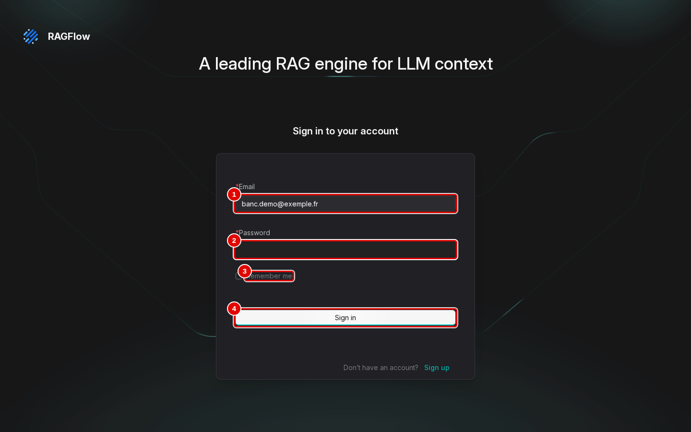
*Écran : page de connexion (en anglais au premier lancement).*

| N° | Élément | Rôle |
|---|---|---|
| 1 | « Email » | courriel du compte, ici `banc.demo@exemple.fr` |
| 2 | « Password » | mot de passe (masqué sur la capture) |
| 3 | « Remember me » | garde la session ouverte d'une visite à l'autre (laissé décoché) |
| 4 | « Sign in » | ouvre la session et affiche l'accueil |

*Résultat* : la page d'accueil s'affiche, en anglais (étape suivante).

## Passer l'interface en français

**Étape 2. Choisir la langue**
*Où* : barre du haut › « English » (à droite).
Cliquer sur « English » (pastille 1), puis sur « Français » (pastille 2) dans la liste.

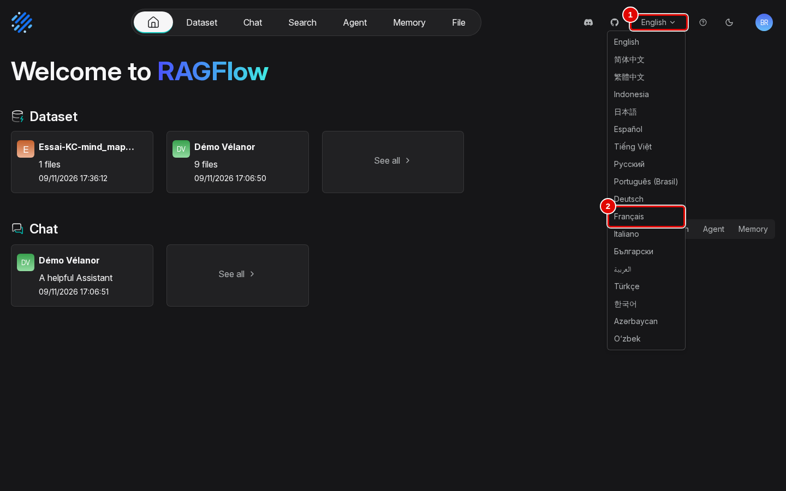
*Écran : accueil, menu de langue ouvert.*

| N° | Élément | Rôle |
|---|---|---|
| 1 | « English » | menu de langue, à droite de la barre du haut |
| 2 | « Français » | passe toute l'interface en français |

*Résultat* : toute l'interface passe en français, sans rechargement.

**Étape 3. Vérifier le changement**
*Où* : accueil.
Les libellés de la barre du haut sont maintenant en français, et le menu de langue affiche « Français » (pastille 3). Les captures de ce manuel viennent d'un compte qui contient déjà des objets (les bases, l'assistant et l'agent de démonstration, créés aux chapitres 05 et 10) ; sur un compte neuf, l'accueil et les listes sont vides, avec des messages comme « Aucun chat créé pour le moment ».

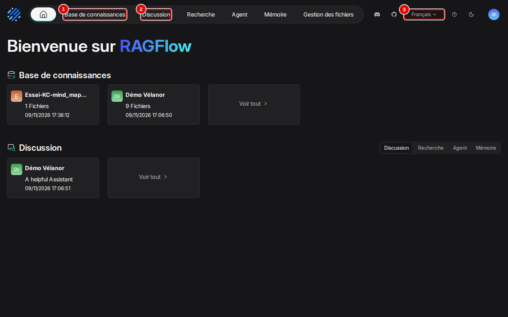
*Écran : accueil, interface en français.*

| N° | Élément | Rôle |
|---|---|---|
| 1 | « Base de connaissances » | bases de documents (chapitres 04 à 06) |
| 2 | « Discussion » | assistants de discussion (chapitres 04, 07 et 08) |
| 3 | « Français » | langue choisie, modifiable à tout moment |

*Résultat* : l'interface est en français. Le choix est mémorisé par le navigateur, pas par le compte : un autre navigateur, ou la page de connexion lors d'une prochaine visite, peut revenir à l'anglais.

## Se repérer dans l'écran

**Étape 4. Lire la partie gauche de la barre du haut**
*Où* : barre du haut, à gauche (toutes les pages après connexion).
Repérer les six entrées principales : elles mènent chacune à une fonction de RAGFlow.

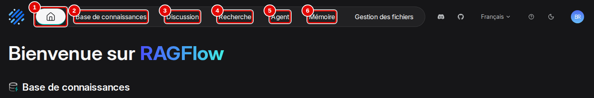
*Écran : barre du haut, partie gauche.*

| N° | Élément | Rôle |
|---|---|---|
| 1 | icône de maison | revient à l'accueil |
| 2 | « Base de connaissances » | bases de documents : ajout, lecture, découpage, passages (chapitres 04 à 06) |
| 3 | « Discussion » | assistants qui répondent en citant leurs sources (chapitres 07 et 08) |
| 4 | « Recherche » | pages de recherche dans une ou plusieurs bases (chapitre 09) |
| 5 | « Agent » | agents, chaînes de lecture des documents et synthèses automatiques (chapitres 10 et 11) |
| 6 | « Mémoire » | mémoires où les agents gardent la trace des échanges (chapitre 10) |

*Résultat* : chaque fonction est à un clic, depuis n'importe quelle page.

**Étape 5. Lire la partie droite de la barre du haut**
*Où* : barre du haut, à droite.
Repérer les accès aux fichiers, à la langue, à l'aide et au thème.

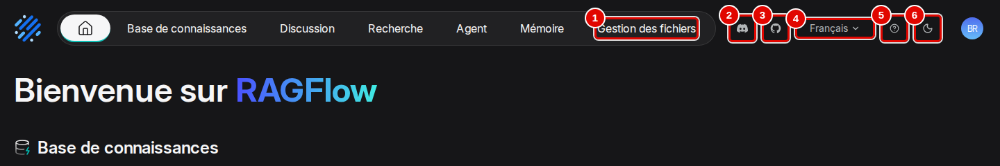
*Écran : barre du haut, partie droite.*

| N° | Élément | Rôle |
|---|---|---|
| 1 | « Gestion des fichiers » | tous les fichiers ajoutés, rangés par base (chapitre 05) |
| 2 | icône Discord | ouvre le salon de discussion public du projet (site externe) |
| 3 | icône GitHub | ouvre la page du code source de RAGFlow (site externe) |
| 4 | « Français » | menu de langue de l'interface |
| 5 | icône « ? » | ouvre le guide officiel, en anglais (site externe) |
| 6 | icône de lune | bascule entre thème sombre et thème clair |

*Résultat* : les liens externes, la langue et le thème sont identifiés ; ils ne changent rien aux données.

**Étape 6. Lire la page d'accueil**
*Où* : barre du haut › icône de maison.
L'accueil résume le contenu du compte : les bases en haut, les objets récents des autres fonctions en dessous. La pastille du compte (pastille 5) ouvre les réglages du compte, utilisés juste après.

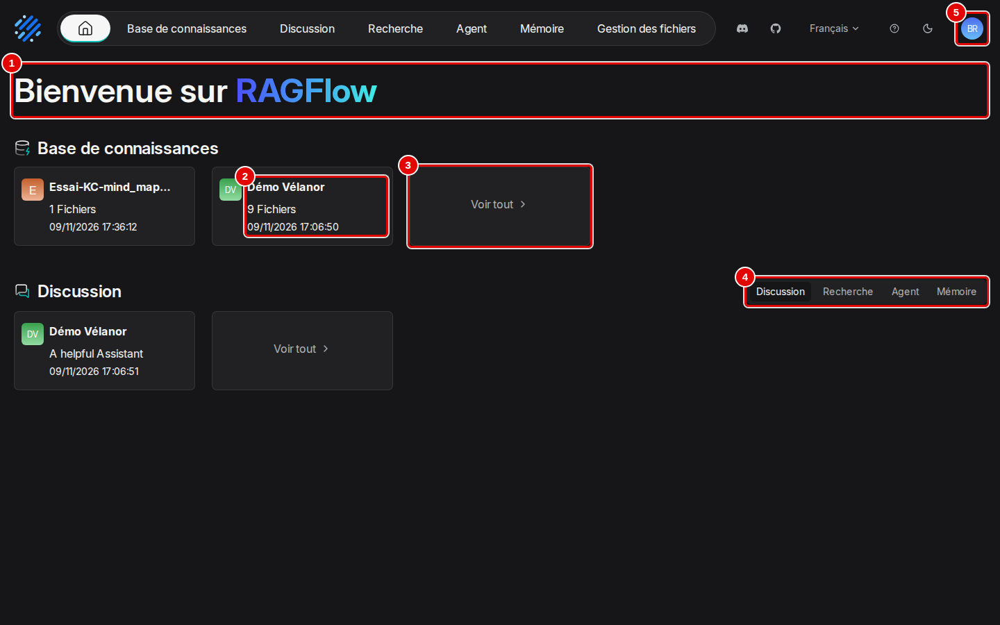
*Écran : accueil.*

| N° | Élément | Rôle |
|---|---|---|
| 1 | « Bienvenue sur RAGFlow » | page d'accueil, affichée après connexion |
| 2 | carte d'une base | nom, nombre de fichiers et date ; un clic ouvre la base |
| 3 | « Voir tout » | liste complète des bases de connaissances |
| 4 | onglets « Discussion », « Recherche », « Agent », « Mémoire » | objets récents de chaque fonction |
| 5 | pastille du compte | réglages du compte : fournisseurs de modèles, sources de données, canaux de chat, MCP, équipe, profil, API |

*Résultat* : l'écran est repéré. Trois pages s'ouvrent en plein écran, sans barre du haut : les passages d'un document, l'onglet « Artifacts » d'une base et le dessin d'un agent ; leur bouton « Retour » les referme.

## Déclarer les modèles d'IA

Un **fournisseur** est un type de service de modèles (« VLLM », « Ollama », OpenAI…). Une **instance** est une adresse précise de ce service, déclarée sous un nom libre : par exemple « llm-service-chat » pour le serveur qui rédige les réponses. Les étapes 7 à 13 montrent l'ajout puis la suppression d'une instance d'exemple nommée « Manuel-instance » ; les instances utiles se déclarent de la même façon, avec les valeurs du tableau ci-dessous (celles que le script de configuration du chapitre 02 enregistre).

| Instance | Fournisseur | URL de base | Modèle à garder | Type |
|---|---|---|---|---|
| llm-service-chat | VLLM | `http://vllm-central:8000/v1` | `gemma4:e4b` | chat (rédaction des réponses) |
| llm-service-embed | VLLM | `http://vllm-embed:8000/v1` | `bge-m3` | embedding (recherche par le sens) |
| voix-locale | OpenAI-API-Compatible | `http://rag-speaches:8000/v1` | `Systran/faster-whisper-small` | speech2text (transcription des fichiers audio) |

Les deux premières sont indispensables. La troisième ne sert qu'aux fichiers audio ; son serveur, `rag-speaches`, se démarre par `outils/communs/voix.sh`, et elle se déclare dans le fournisseur « OpenAI-API-Compatible » au lieu de « VLLM ».

**Étape 7. Ouvrir « Fournisseurs de modèles »**
*Où* : pastille du compte (en haut à droite) › « Fournisseurs de modèles ».
Cliquer sur la pastille du compte, puis sur « Fournisseurs de modèles » (pastille 1) dans le menu de gauche.

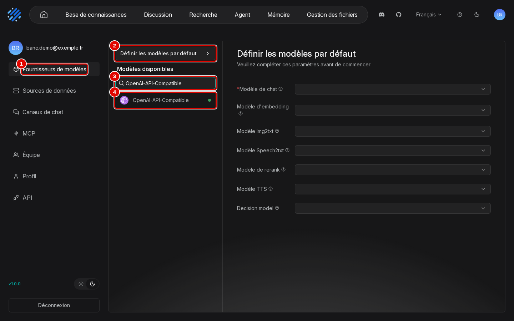
*Écran : réglages du compte, page « Fournisseurs de modèles ».*

| N° | Élément | Rôle |
|---|---|---|
| 1 | « Fournisseurs de modèles » | entrée du menu du compte qui ouvre cette page |
| 2 | « Définir les modèles par défaut » | modèles utilisés d'office par les bases et les assistants (étape 14) |
| 3 | « Rechercher » | filtre la liste des fournisseurs, une centaine |
| 4 | « VLLM » | fournisseur qui correspond à LLM-Service avec carte graphique ; le point vert signale un fournisseur déjà configuré |

*Résultat* : la liste des fournisseurs s'affiche.

**Étape 8. Ouvrir le fournisseur « VLLM »**
*Où* : pastille du compte › « Fournisseurs de modèles » › « VLLM ».
Cliquer sur « VLLM ». Chaque instance déjà déclarée a sa carte ; celle de la recherche par le sens, « llm-service-embed » (pastille 1), est dépliée ici.

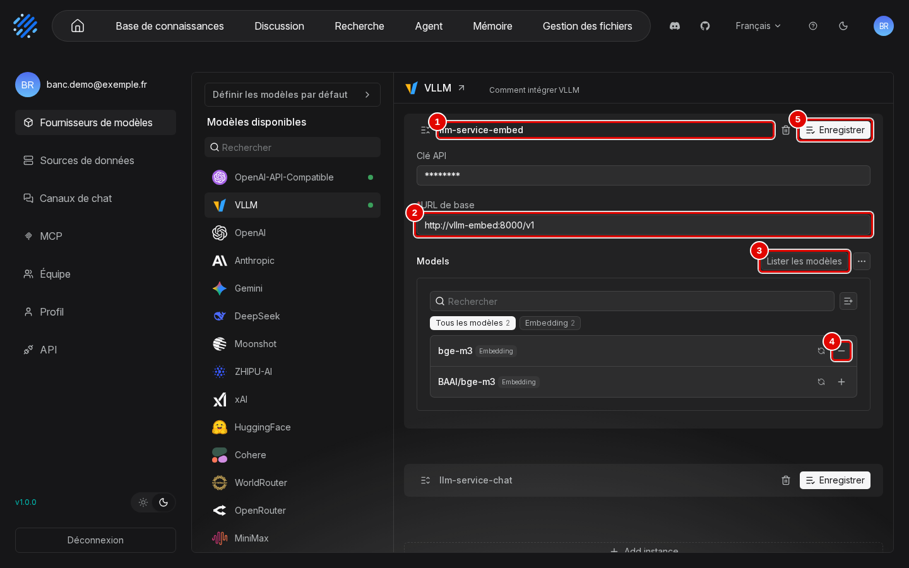
*Écran : « Fournisseurs de modèles », fournisseur « VLLM » ouvert.*

| N° | Élément | Rôle |
|---|---|---|
| 1 | « llm-service-embed » | nom de l'instance, choisi à sa création |
| 2 | « URL de base » | adresse du serveur de modèles, telle que RAGFlow la voit depuis son conteneur |
| 3 | « Lister les modèles » | interroge le serveur et affiche les modèles qu'il propose |
| 4 | signe « − » de `bge-m3` | retire ce modèle de l'instance ; le signe « + » d'un modèle non retenu l'ajoute |
| 5 | « Enregistrer » | enregistre les changements de la carte |

*Résultat* : les instances existantes sont visibles et modifiables.

**Étape 9. Ajouter une instance**
*Où* : « Fournisseurs de modèles » › « VLLM », bas de la liste des instances.
Descendre en bas de la liste et cliquer sur « Add instance » (pastille 1).

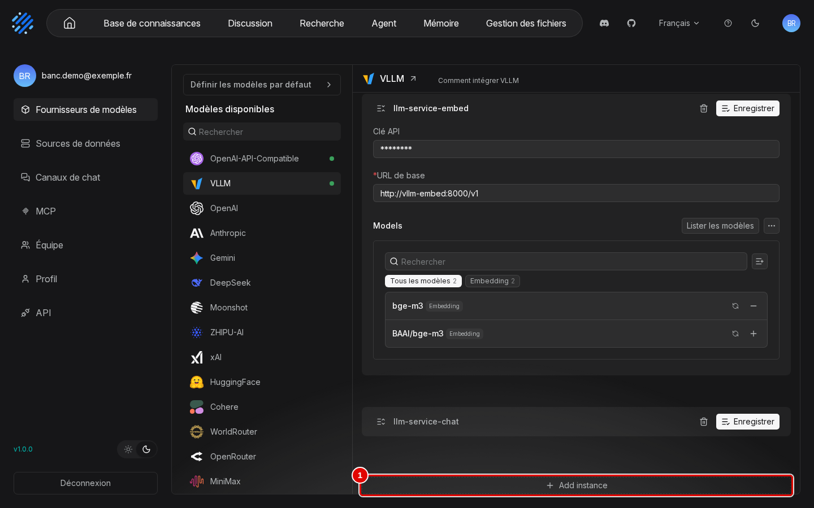
*Écran : « Fournisseurs de modèles », fournisseur « VLLM », bas de la liste.*

| N° | Élément | Rôle |
|---|---|---|
| 1 | « Add instance » | ajoute une carte d'instance vide en bas de la liste |

*Résultat* : une carte vide apparaît.

**Étape 10. Remplir la nouvelle instance**
*Où* : « Fournisseurs de modèles » › « VLLM », carte vide.
Saisir le nom (pastille 1), laisser la clé vide (pastille 2), saisir l'adresse du serveur (pastille 3), ici `http://vllm-embed:8000/v1`, puis cliquer sur « Lister les modèles » (pastille 4).

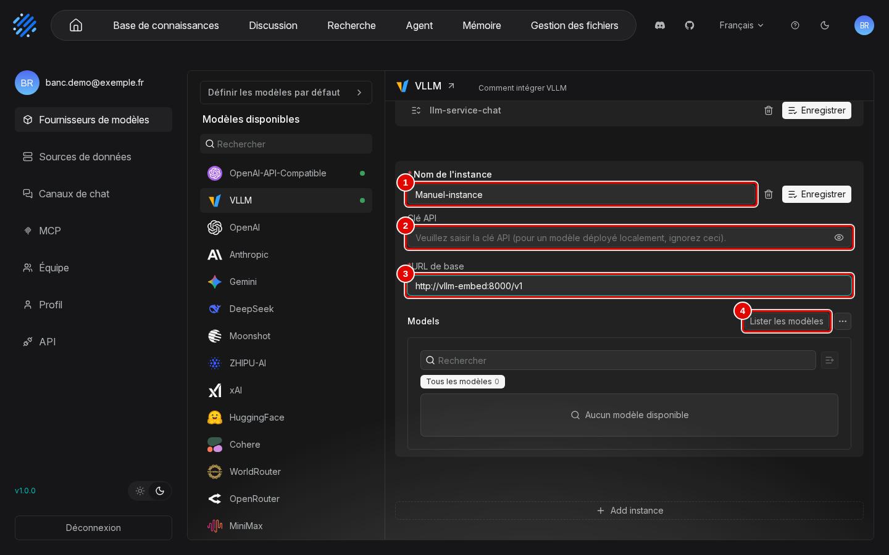
*Écran : « Fournisseurs de modèles », nouvelle carte d'instance remplie.*

| N° | Élément | Rôle |
|---|---|---|
| 1 | « Nom de l'instance » | nom libre, repris ensuite dans les listes de modèles |
| 2 | « Clé API » | mot de passe du serveur de modèles ; vide pour LLM-Service, qui n'en demande pas |
| 3 | « URL de base » | adresse du serveur, terminée par `/v1` |
| 4 | « Lister les modèles » | récupère les modèles proposés à cette adresse |

*Résultat* : les modèles proposés par le serveur s'affichent (étape suivante).

**Étape 11. Garder les bons modèles et enregistrer**
*Où* : même carte, après « Lister les modèles ».
Les modèles apparaissent tous retenus (signe « − » à droite de chacun). Le serveur `vllm-embed` propose le même modèle sous deux noms : `bge-m3` (pastille 1), à garder, et `BAAI/bge-m3`, son nom complet, à retirer. Cliquer sur le signe « − » de `BAAI/bge-m3` (pastille 2), confirmer par « Retirer » dans la fenêtre « Are you sure to remove it ? », puis cliquer sur « Enregistrer » (pastille 3).

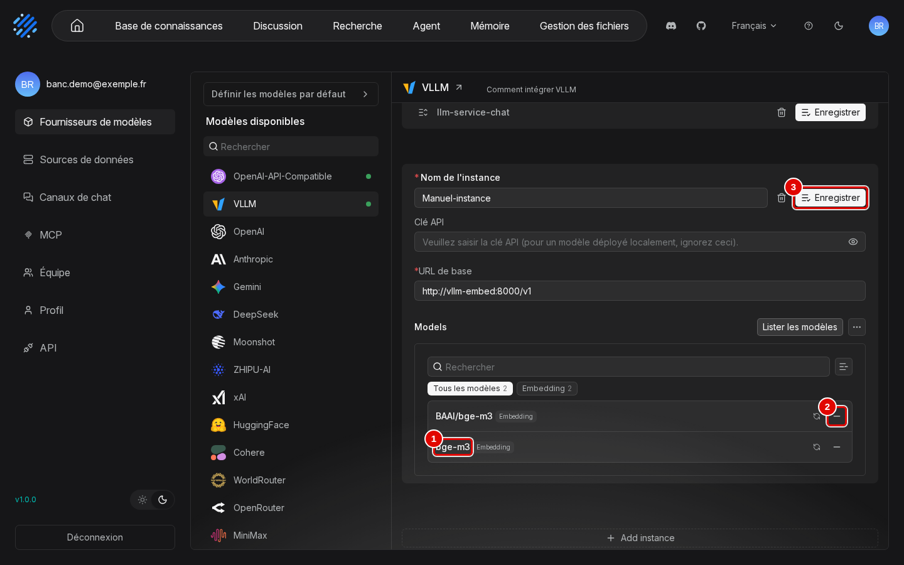
*Écran : « Fournisseurs de modèles », modèles listés pour la nouvelle instance.*

| N° | Élément | Rôle |
|---|---|---|
| 1 | `bge-m3` | modèle à garder, avec son type (« Embedding » : recherche par le sens) ; c'est le nom repris dans les listes de modèles |
| 2 | signe « − » de `BAAI/bge-m3` | retire le doublon ; le signe devient « + », qui permettrait de le reprendre |
| 3 | « Enregistrer » | crée l'instance avec le seul modèle `bge-m3` |

*Résultat* : l'instance est enregistrée avec un seul modèle (étape suivante). Pour l'instance « llm-service-chat », garder de même `gemma4:e4b` et retirer son nom complet `google/gemma-4-E4B-it-qat-w4a16-ct`.

**Étape 12. Vérifier l'instance enregistrée**
*Où* : « Fournisseurs de modèles » › « VLLM », haut de la liste.
L'instance apparaît en tête de la liste (pastille 1) ; ses modèles sont désormais proposés partout où l'on choisit un modèle.

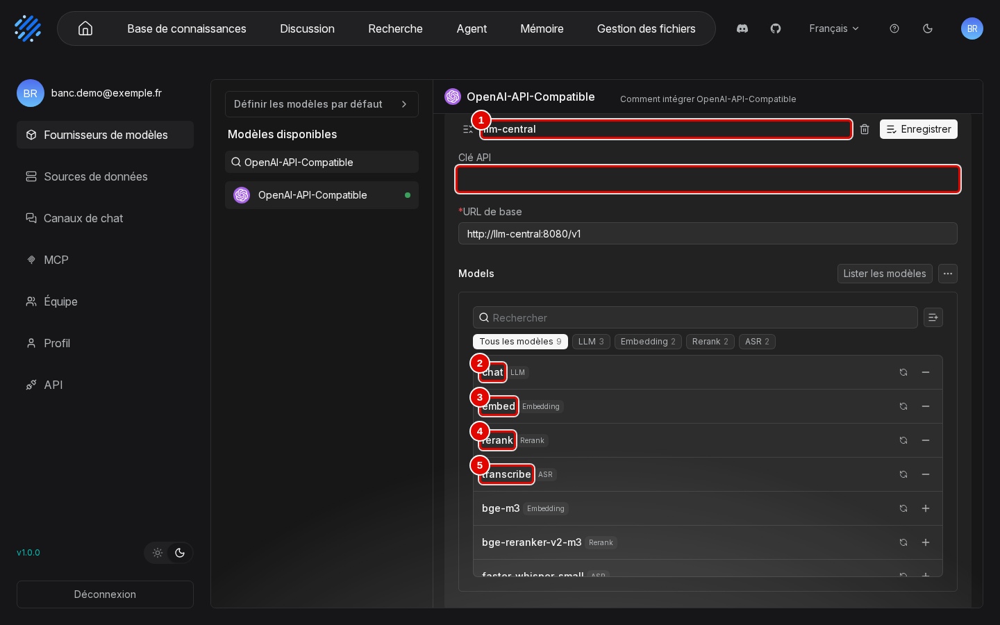
*Écran : « Fournisseurs de modèles », nouvelle instance en tête de liste.*

| N° | Élément | Rôle |
|---|---|---|
| 1 | « Manuel-instance » | instance créée, désormais proposée dans les listes de modèles |
| 2 | corbeille | supprime l'instance (étape suivante) |

*Résultat* : l'instance est utilisable.

**Étape 13. Supprimer une instance d'essai**
*Où* : carte de l'instance › corbeille.
Cliquer sur la corbeille de la carte, puis sur « Supprimer » (pastille 2) dans la confirmation.

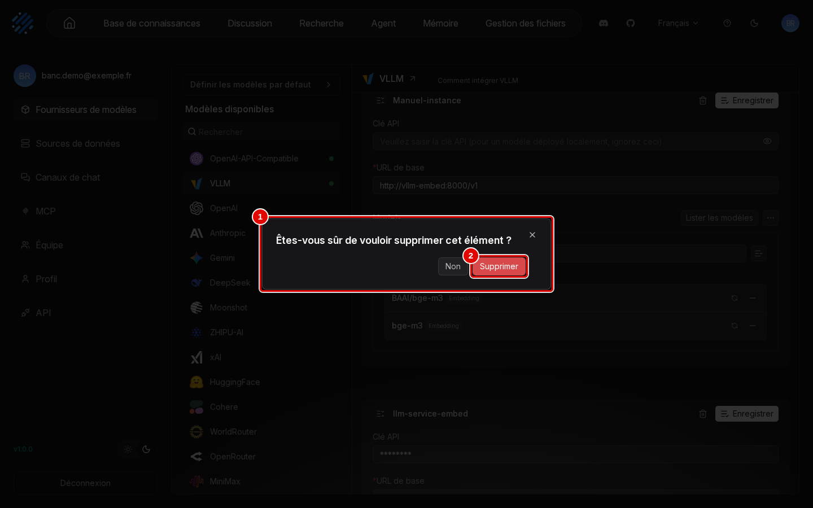
*Écran : « Fournisseurs de modèles », confirmation de suppression.*

| N° | Élément | Rôle |
|---|---|---|
| 1 | « Êtes-vous sûr de vouloir supprimer cet élément ? » | confirmation ; « Non » annule |
| 2 | « Supprimer » | supprime l'instance |

*Résultat* : l'instance disparaît de la liste.

## Choisir les modèles par défaut

**Étape 14. Ouvrir « Définir les modèles par défaut »**
*Où* : pastille du compte › « Fournisseurs de modèles » › « Définir les modèles par défaut ».
Cliquer sur le bouton, puis choisir un modèle pour chaque usage. Seul le « Modèle de chat » (pastille 1) est obligatoire ; sans lui, aucune discussion n'est possible.

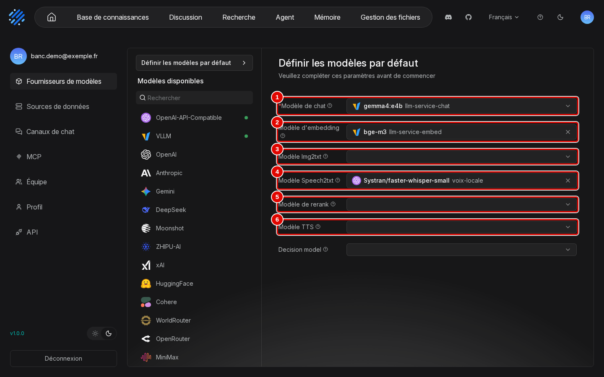
*Écran : « Fournisseurs de modèles », fenêtre des modèles par défaut.*

| N° | Élément | Rôle |
|---|---|---|
| 1 | « Modèle de chat » | rédige les réponses (`gemma4:e4b`, instance « llm-service-chat ») ; obligatoire |
| 2 | « Modèle d'embedding » | traduit le sens des passages et des questions en nombres pour la recherche (`bge-m3`) |
| 3 | « Modèle Img2txt » | décrit les images (vide ici) |
| 4 | « Modèle Speech2txt » | transcrit l'audio (`Systran/faster-whisper-small`, instance « voix-locale ») |
| 5 | « Modèle de rerank » | trie une seconde fois les passages trouvés (vide : aucun modèle de ce type n'est installé) |
| 6 | « Modèle TTS » | lit les réponses à voix haute (vide ici) ; la ligne suivante, « Decision model », reste vide aussi |

*Résultat* : la fenêtre montre les choix actuels.

**Étape 15. Choisir un modèle dans une liste**
*Où* : même fenêtre › liste d'un usage (ici « Modèle de chat »).
Ouvrir la liste : les modèles sont groupés par fournisseur puis par instance. Cliquer sur le modèle voulu (pastille 1). Il n'y a pas de bouton « Enregistrer » : le choix est enregistré dès le clic. La croix à droite d'un choix le vide.

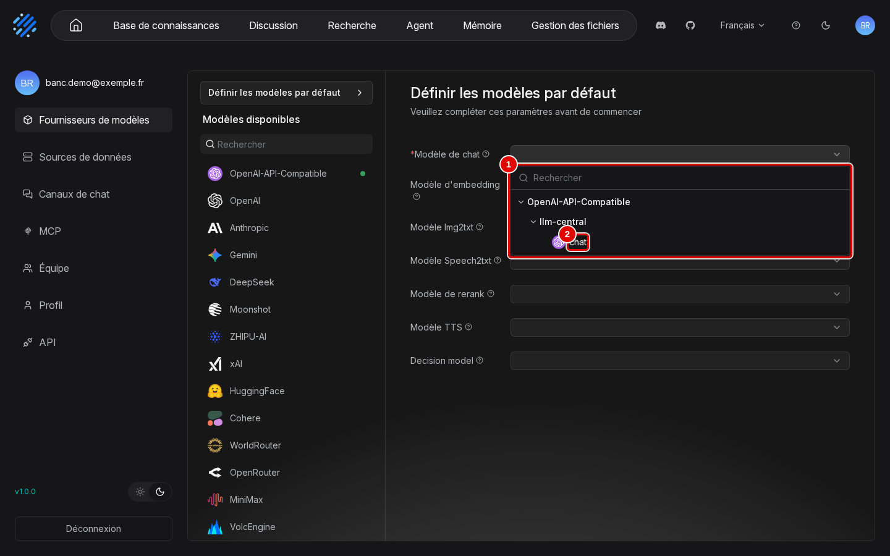
*Écran : fenêtre des modèles par défaut, liste « Modèle de chat » ouverte.*

| N° | Élément | Rôle |
|---|---|---|
| 1 | liste « VLLM », « llm-service-chat », `gemma4:e4b` | modèles de chat disponibles, avec un champ « Rechercher » |

*Résultat* : les modèles par défaut sont fixés ; après un rechargement de la page, la fenêtre affiche toujours le modèle choisi. Toute nouvelle base et tout nouvel assistant les reprendront.

## Régler la taille de contexte

La « taille de contexte » d'un modèle est la quantité de texte qu'il peut lire d'un coup : consignes, passages trouvés et question. RAGFlow ne la lit pas sur le service de modèles : elle se déclare avec le modèle. Une valeur trop petite empêche toute réponse (chapitre 15, étape 3). Les essais de ce manuel utilisent 16 384 jetons, largement assez : une question ordinaire en consomme de 600 à 3 300.

**Étape 16. Déclarer 16 384 jetons pour le modèle de chat**
*Où* : pastille du compte › « Fournisseurs de modèles » › « VLLM » › carte de l'instance « llm-service-chat » › ligne `gemma4:e4b` › crayon « Modifier le modèle » (au survol, à droite du badge « LLM »).
Saisir 16384 dans « Tokens maximum » (pastille 2), puis cliquer sur « Confirmer » (pastille 5).

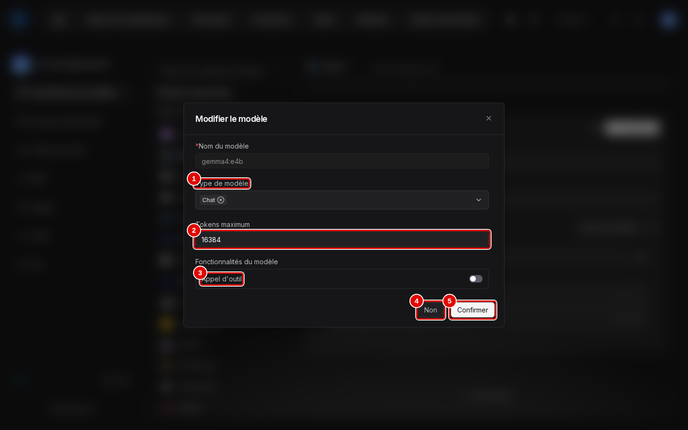
*Écran : « Fournisseurs de modèles », fenêtre « Modifier le modèle ».*

| N° | Élément | Rôle |
|---|---|---|
| 1 | « Type de modèle » | « Chat » : modèle qui rédige les réponses |
| 2 | « Tokens maximum » | taille de contexte déclarée : 16384 conseillé, 4096 au minimum ; jamais plus que ce que le service de modèles sert réellement (32 768 pour LLM-Service) |
| 3 | « Appel d'outil » | indique que le modèle sait appeler des outils (agents) ; désactivé ici |
| 4 | « Non » | referme sans rien changer |
| 5 | « Confirmer » | enregistre ; prend effet à la question suivante |

*Résultat* : la taille de contexte est déclarée. Le script de configuration du chapitre 02 enregistre déjà cette valeur ; l'étape sert alors à la vérifier. RAGFlow est prêt pour la première question (chapitre 04).

## Bon à savoir

- Sans carte graphique, LLM-Service sert les modèles par Ollama : choisir le fournisseur « Ollama » au lieu de « VLLM », avec l'adresse `http://ollama-central:11434`. Ce chemin n'a pas été essayé pendant les essais de ce manuel.
- Le compte d'administration créé automatiquement par RAGFlow (`admin@ragflow.io`) ne sert qu'à la console d'administration : le travail courant se fait avec un compte ordinaire.
- L'icône de lune et le menu de langue ne changent que l'affichage ; ils n'ont aucun effet sur les données.

## En cas de problème

| Symptôme | Cause | Que faire |
|---|---|---|
| « email and password do not match » à la connexion | mot de passe faux, ou compte créé par un programme mal réglé | vérifier le mot de passe dans `donnees/IDENTIFIANTS-LOCAUX.txt` ; sinon voir le chapitre 02 |
| L'interface revient en anglais | langue mémorisée par le navigateur seulement | barre du haut › « English » › « Français » |
| « Lister les modèles » n'affiche rien | adresse fausse ou service de modèles arrêté | vérifier l'adresse (terminée par `/v1`) et relancer LLM-Service (chapitre 02, étape 5) |
| Impossible de créer une discussion | aucun « Modèle de chat » par défaut | étapes 14 et 15 |

Les autres problèmes sont traités au chapitre [15. En cas de problème](15-en-cas-de-probleme.md).

---
*Version décrite : RAGFlow v1.0.0, essais des 9 et 11 novembre 2026. Détails et preuves : [rapport d'essais](../annexes/A6-rapport-d-essais.md).*
