# 04. Première question en dix minutes

> Ce chapitre apprend le parcours le plus court : créer une base, y mettre deux documents, les faire analyser, créer un assistant, lui poser une question et vérifier la source de sa réponse.
> **Point de départ** : accueil, après connexion, interface en français et modèles par défaut déclarés (chapitre 03).
> **Durée** : environ 10 minutes. **Avant** : chapitre 03.

## Ce qu'il faut savoir

Pour qu'un assistant réponde, trois choses doivent exister : une **base de connaissances** qui contient des documents, l'**analyse** de ces documents (RAGFlow les découpe en passages et les range pour la recherche), et un **assistant** relié à la base. À chaque question, l'assistant cherche les passages les plus proches, les donne au modèle d'IA, et le modèle rédige une réponse qui cite ses sources par des numéros entre crochets. L'exemple utilise deux documents courts du jeu d'exemple, rangés dans le dossier `corpus/documents/` du dépôt : le compte rendu d'une réunion du comité social et économique (`cse-2025-10-14.md`) et la foire aux questions du service après-vente (`faq-sav.html`) d'une entreprise fictive, Vélanor. Tout autre document court fait l'affaire.

## Créer une base de connaissances

**Étape 1. Ouvrir la liste des bases**
*Où* : barre du haut › « Base de connaissances ».
Cliquer sur « Base de connaissances », puis sur « Créer une base de connaissances » (pastille 1).

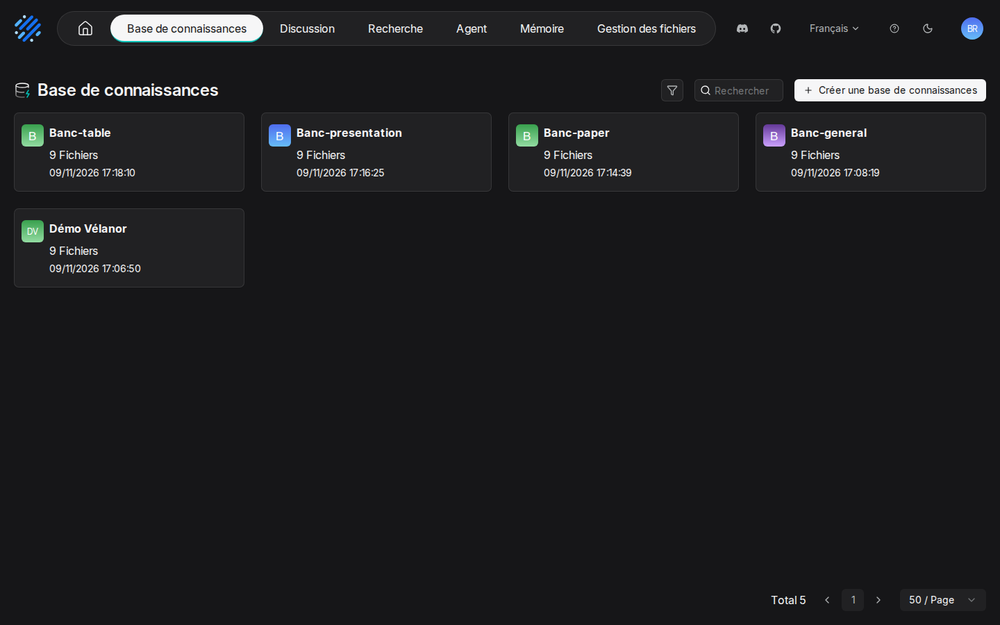
*Écran : Base de connaissances (liste des bases).*

| N° | Élément | Rôle |
|---|---|---|
| 1 | « Créer une base de connaissances » | ouvre la fenêtre de création |
| 2 | « Rechercher » | filtre les bases par nom |
| 3 | carte d'une base | nom, nombre de fichiers, date ; un clic ouvre la base |

*Résultat* : la fenêtre de création s'ouvre.

**Étape 2. Nommer la base**
*Où* : Base de connaissances › fenêtre « Créer une base de connaissances ».
Saisir un nom (pastille 1), garder le modèle de recherche (pastille 2) et le gabarit proposés (pastille 3), puis cliquer sur « Enregistrer » (pastille 4).

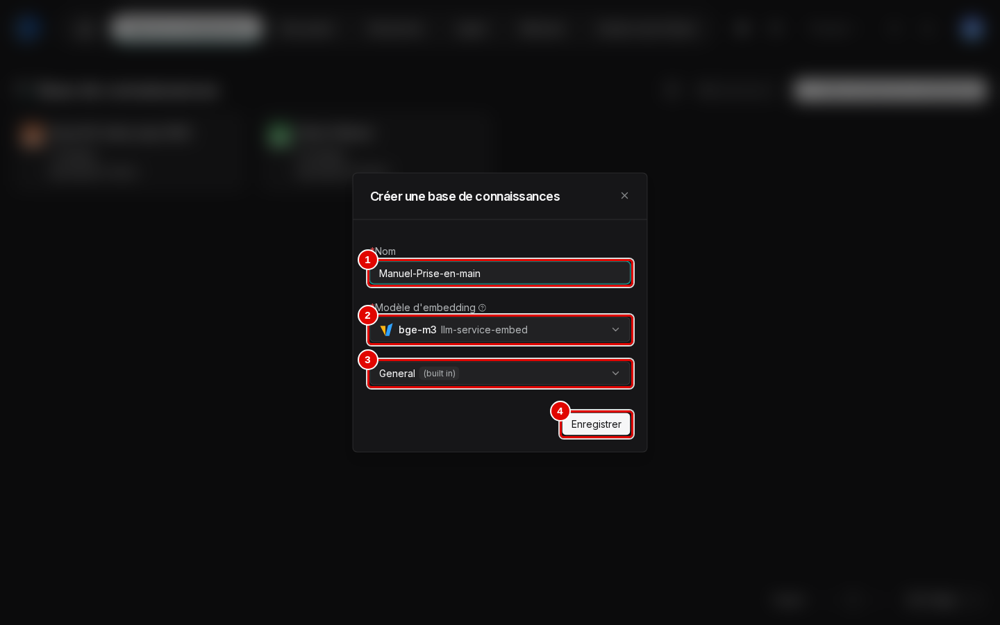
*Écran : fenêtre « Créer une base de connaissances ».*

| N° | Élément | Rôle |
|---|---|---|
| 1 | « Nom » | nom de la base, ici « Manuel-Prise-en-main » |
| 2 | « Modèle d'embedding » | modèle qui traduit le sens des passages en nombres pour la recherche, ici `bge-m3` (modèle par défaut du chapitre 03) |
| 3 | « General (built in) » | gabarit, c'est-à-dire la façon de découper les documents ; « General » convient à la plupart des cas (les autres sont au chapitre 06) |
| 4 | « Enregistrer » | crée la base et l'ouvre |

*Résultat* : la base est créée et s'ouvre (étape suivante).

**Étape 3. Repérer la base vide**
*Où* : Base de connaissances › « Manuel-Prise-en-main », onglet « Fichiers ».
La base s'ouvre sur son onglet « Fichiers » (pastille 2), encore vide. Le bouton « Ajouter un fichier » (pastille 3) sert à l'étape suivante.

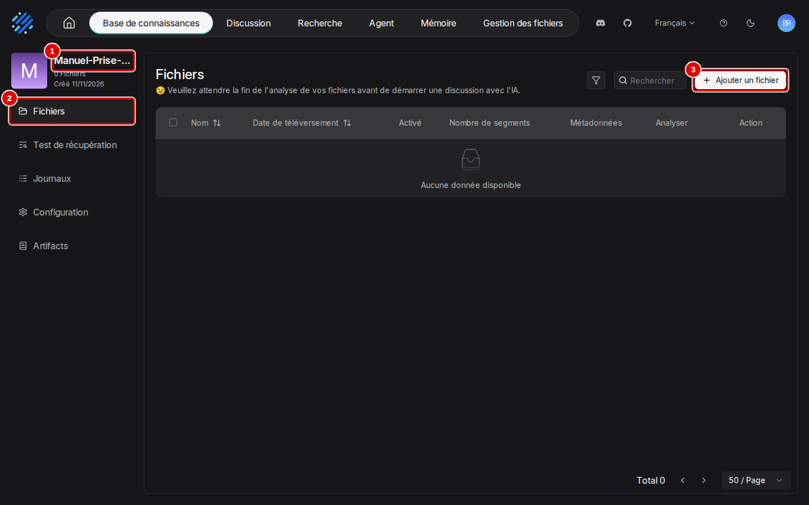
*Écran : base « Manuel-Prise-en-main », onglet « Fichiers », vide.*

| N° | Élément | Rôle |
|---|---|---|
| 1 | « Manuel-Prise-en-main » | nom de la base ouverte, avec son nombre de fichiers et sa date |
| 2 | « Fichiers » | onglet des documents de la base ; les onglets suivants (« Test de récupération », « Journaux », « Configuration », « Artifacts ») sont décrits aux chapitres 05, 06, 08 et 11 |
| 3 | « Ajouter un fichier » | ouvre le menu d'ajout |

*Résultat* : la base existe, sans document.

## Importer deux documents

**Étape 4. Ouvrir le menu d'ajout**
*Où* : base ouverte › onglet « Fichiers » › « Ajouter un fichier ».
Cliquer sur « Ajouter un fichier », puis sur « Téléverser un fichier » (pastille 1). Téléverser signifie envoyer un fichier du poste vers RAGFlow.

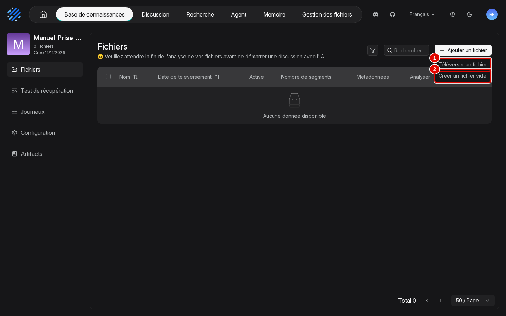
*Écran : onglet « Fichiers », menu « Ajouter un fichier » ouvert.*

| N° | Élément | Rôle |
|---|---|---|
| 1 | « Téléverser un fichier » | envoie des fichiers ou un dossier depuis le poste |
| 2 | « Créer un fichier vide » | crée un document vide, à remplir à la main (chapitre 05) |

*Résultat* : la fenêtre « Téléverser un fichier » s'ouvre.

**Étape 5. Choisir les fichiers**
*Où* : fenêtre « Téléverser un fichier ».
Glisser les deux fichiers dans la zone de dépôt (pastille 3), ou cliquer dessus pour les choisir ; ils s'affichent en liste (pastille 4). Les fichiers du dépôt sont rangés dans Ubuntu, pas dans un dossier Windows : pour les atteindre depuis la fenêtre de choix de Windows, saisir dans sa barre d'adresse le chemin `\\wsl$\Ubuntu-24.04\home\<utilisateur>\` suivi du chemin du dépôt, puis `corpus\documents` (le nom `Ubuntu-24.04` est celui de la distribution installée) ; ou, dans le terminal Ubuntu, depuis le dossier du dépôt, lancer `cd corpus/documents && explorer.exe .`, qui ouvre ce dossier dans l'Explorateur Windows, d'où les fichiers se glissent dans la zone de dépôt. Laisser « Analyser à la création » désactivé (pastille 1) pour lancer l'analyse à la main et la voir se faire, puis cliquer sur « Enregistrer » (pastille 5).

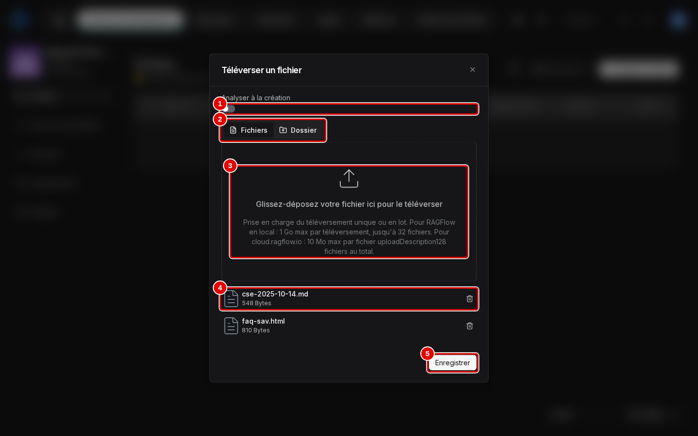
*Écran : fenêtre « Téléverser un fichier », deux fichiers choisis.*

| N° | Élément | Rôle |
|---|---|---|
| 1 | « Analyser à la création » | activé, l'analyse démarre dès l'envoi ; désactivé ici |
| 2 | « Fichiers », « Dossier » | choisir des fichiers un par un, ou un dossier entier |
| 3 | zone de dépôt | glisser-déposer ou clic pour parcourir ; jusqu'à 32 fichiers et 1 Go par envoi |
| 4 | fichier choisi | nom et taille ; la corbeille le retire de l'envoi |
| 5 | « Enregistrer » | envoie les fichiers dans la base |

*Résultat* : les fichiers arrivent dans la base (étape suivante).

**Étape 6. Constater l'import**
*Où* : base ouverte › onglet « Fichiers ».
Les deux fichiers apparaissent dans le tableau avec 0 segment (pastille 2) : ils sont présents mais pas encore analysés. Le triangle (pastille 1) lance l'analyse.

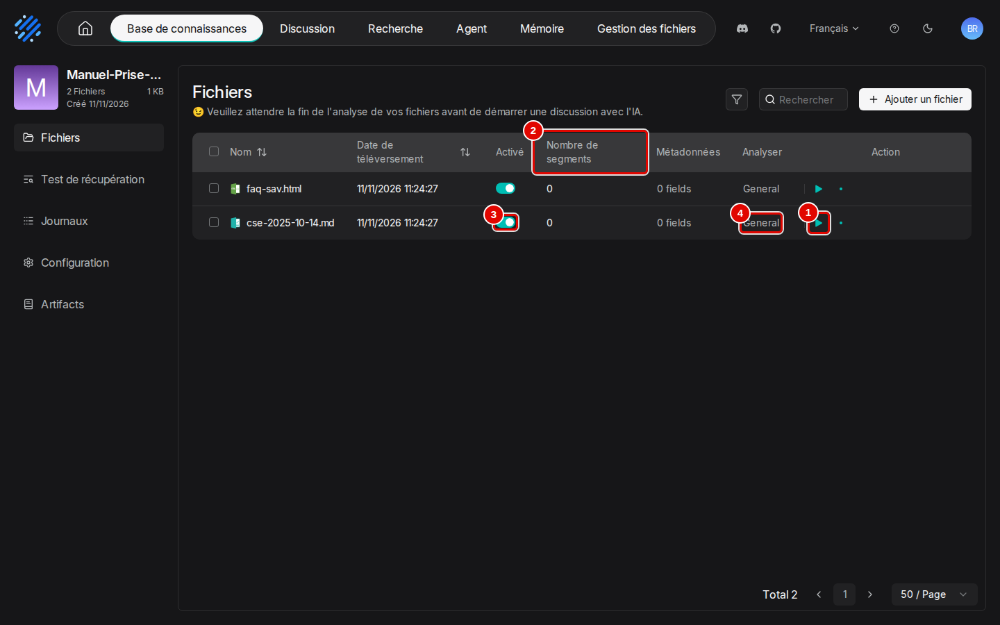
*Écran : onglet « Fichiers », deux fichiers importés.*

| N° | Élément | Rôle |
|---|---|---|
| 1 | triangle de lancement | lance l'analyse de ce fichier |
| 2 | « Nombre de segments » | nombre de passages produits ; 0 tant que l'analyse n'a pas eu lieu |
| 3 | « Activé » | interrupteur qui active ou désactive le fichier |
| 4 | « General » | gabarit de découpage appliqué à ce fichier |

*Résultat* : les documents sont dans la base, prêts à être analysés.

## Faire analyser les documents

**Étape 7. Lancer l'analyse**
*Où* : onglet « Fichiers », colonne « Analyser ».
Cliquer sur le triangle de chaque fichier. Pendant l'analyse, l'état s'affiche à côté du gabarit (pastille 1).

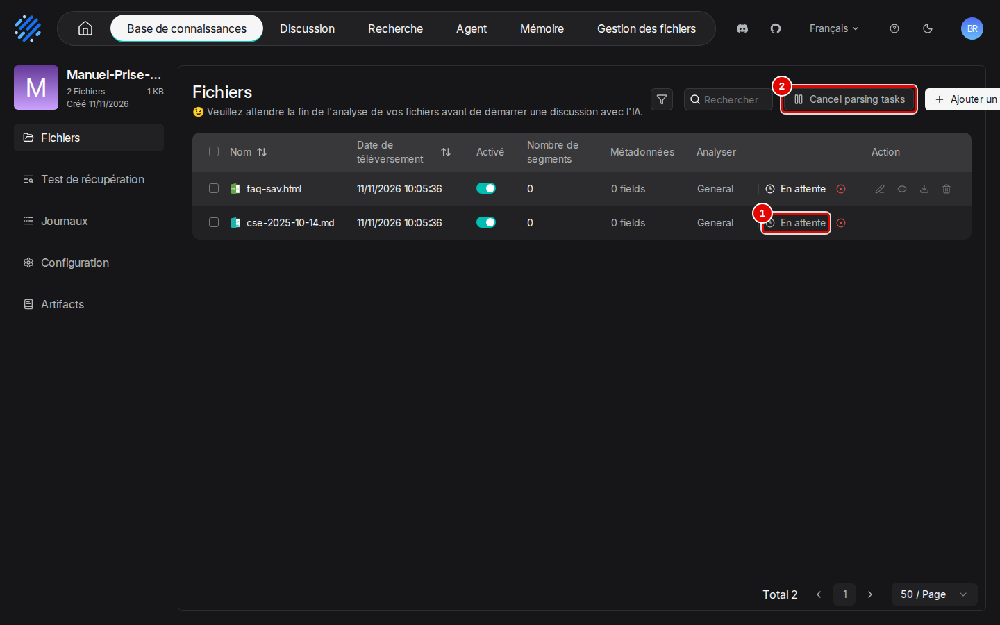
*Écran : onglet « Fichiers », analyses en attente.*

| N° | Élément | Rôle |
|---|---|---|
| 1 | « En attente » | analyse en file d'attente ; devient une barre de progression |
| 2 | « Cancel parsing tasks » | annule les analyses en cours |

*Résultat* : l'analyse démarre ; quelques secondes suffisent pour des documents courts.

**Étape 8. Attendre la fin de l'analyse**
*Où* : onglet « Fichiers ».
Attendre que « Nombre de segments » se remplisse : ici 4 passages pour le compte rendu (pastille 1) et 1 pour la foire aux questions (pastille 2), en moins de 7 secondes.

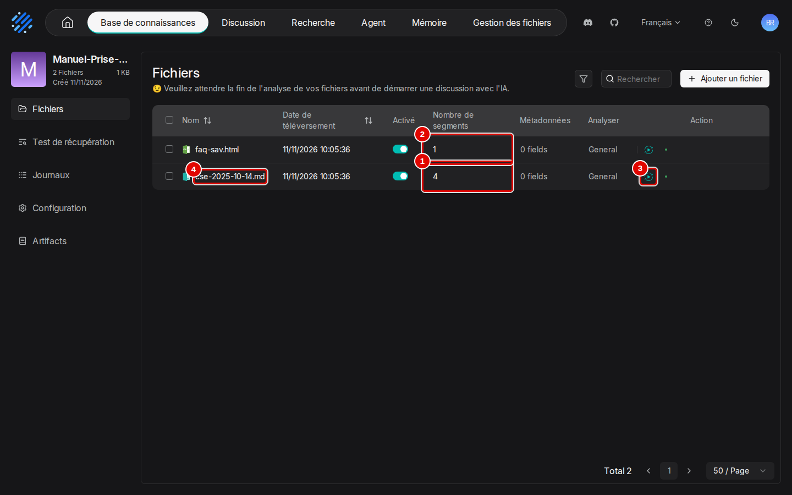
*Écran : onglet « Fichiers », analyses terminées.*

| N° | Élément | Rôle |
|---|---|---|
| 1 | « Nombre de segments » de `cse-2025-10-14.md` | 4 passages produits |
| 2 | « Nombre de segments » de `faq-sav.html` | 1 passage produit |
| 3 | icône d'état | analyse terminée ; un clic la relance, après une confirmation qui annonce l'effacement des passages existants |
| 4 | « cse-2025-10-14.md » | nom du fichier ; un clic ouvre ses passages |

*Résultat* : les documents sont analysés et peuvent être retrouvés.

**Étape 9. Regarder les passages d'un document**
*Où* : onglet « Fichiers » › nom du fichier (`cse-2025-10-14.md`).
Cliquer sur le nom du fichier : la page « Résultat du segment » montre le document à gauche et ses passages à droite (pastille 2), tels qu'ils seront retrouvés. Cliquer sur « Retour » (pastille 6) pour revenir.

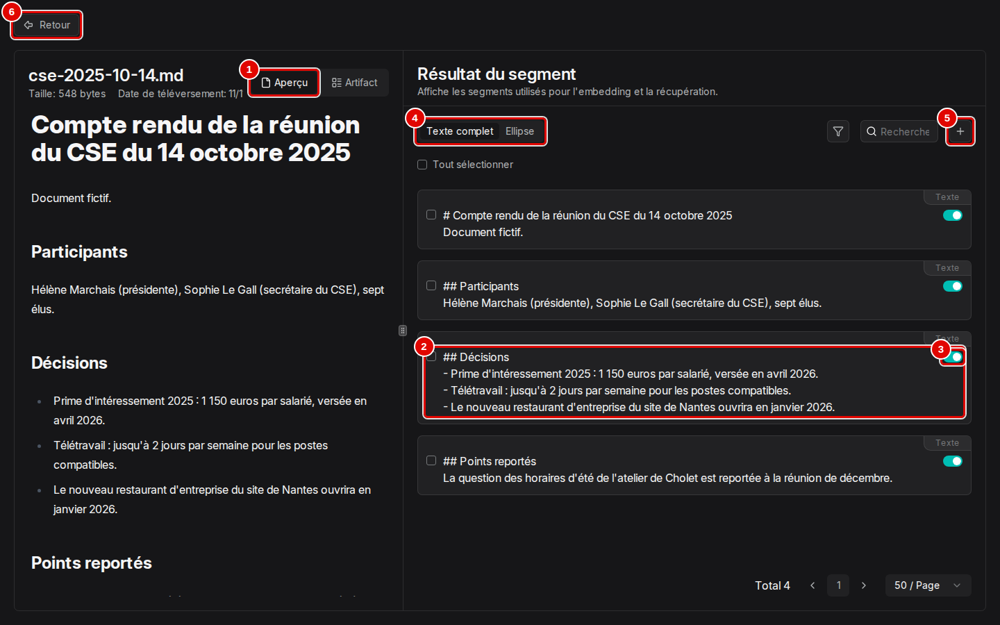
*Écran : « Résultat du segment » (plein écran, sans barre du haut).*

| N° | Élément | Rôle |
|---|---|---|
| 1 | « Aperçu » | aperçu du document d'origine ; « Artifact », à côté, est décrit au chapitre 11 |
| 2 | passage | texte d'un passage ; ici le découpage suit les titres du document |
| 3 | interrupteur du passage | active ou désactive ce passage |
| 4 | « Texte complet », « Ellipse » | affiche les passages en entier ou abrégés |
| 5 | « + » | ajoute un passage écrit à la main (chapitre 06) |
| 6 | « Retour » | revient à la liste des fichiers |

*Résultat* : le découpage est vérifié ; de retour dans l'onglet « Fichiers ».

## Créer un assistant relié à la base

**Étape 10. Ouvrir la liste des assistants**
*Où* : barre du haut › « Discussion ».
Cliquer sur « Discussion », puis sur « Créer un chat » (pastille 1).

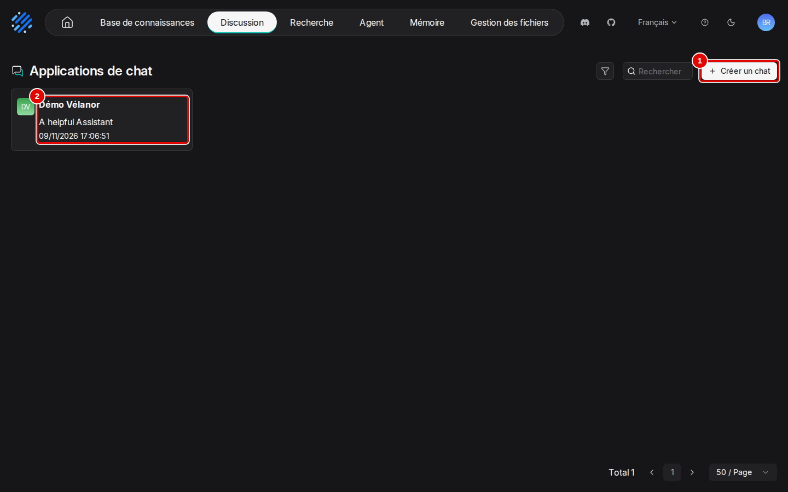
*Écran : Discussion (liste des assistants).*

| N° | Élément | Rôle |
|---|---|---|
| 1 | « Créer un chat » | ouvre la fenêtre de création d'un assistant |
| 2 | carte d'un assistant | assistant existant (ici celui du jeu de démonstration) ; un clic l'ouvre |

*Résultat* : la fenêtre « Créer un chat » s'ouvre.

**Étape 11. Nommer l'assistant**
*Où* : Discussion › fenêtre « Créer un chat ».
Saisir un nom (pastille 1), puis cliquer sur « Enregistrer » (pastille 2).

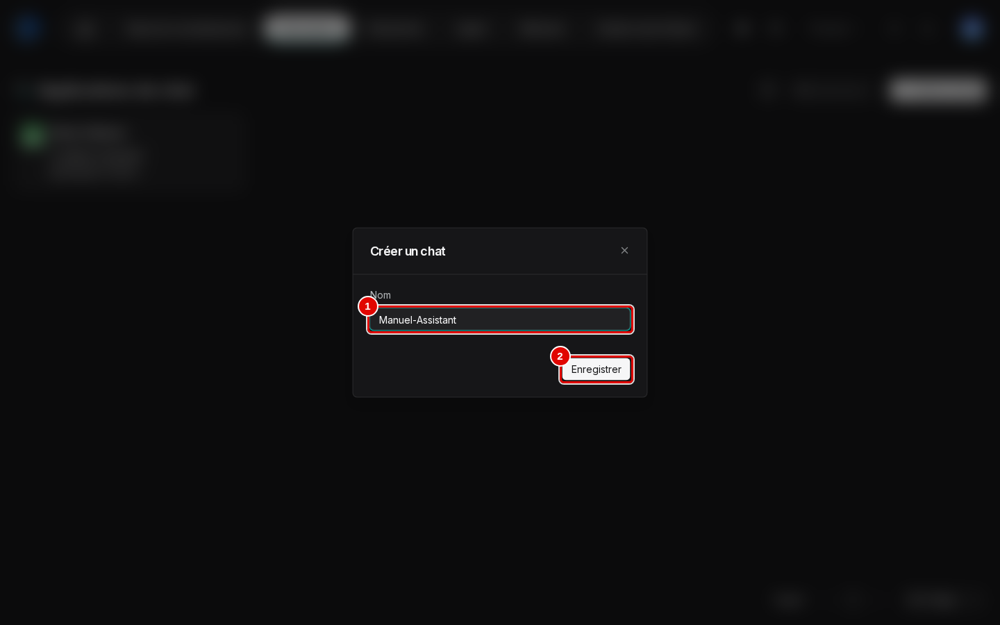
*Écran : fenêtre « Créer un chat ».*

| N° | Élément | Rôle |
|---|---|---|
| 1 | « Nom » | nom de l'assistant, ici « Manuel-Assistant » |
| 2 | « Enregistrer » | crée l'assistant |

*Résultat* : l'assistant apparaît dans la liste (étape suivante).

**Étape 12. Ouvrir l'assistant**
*Où* : Discussion › carte « Manuel-Assistant ».
Cliquer sur la carte du nouvel assistant (pastille 1).

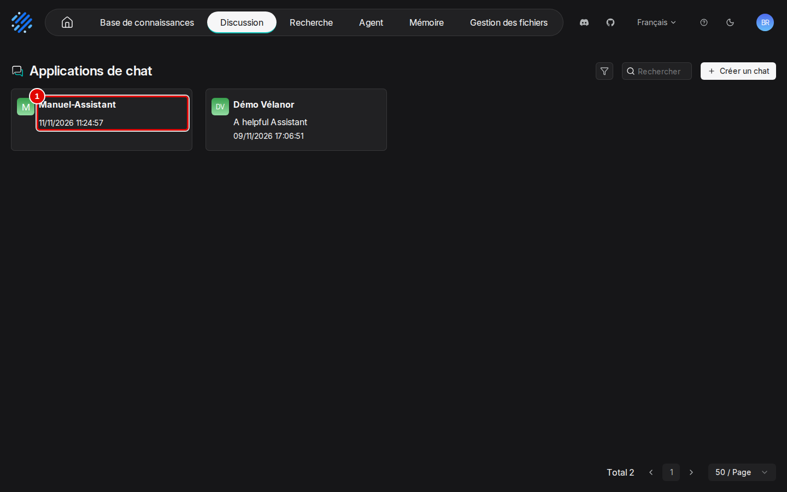
*Écran : Discussion, nouvel assistant dans la liste.*

| N° | Élément | Rôle |
|---|---|---|
| 1 | « Manuel-Assistant » | nouvel assistant, encore relié à aucune base |

*Résultat* : la page de l'assistant s'ouvre sur une « Nouvelle conversation ».

**Étape 13. Ouvrir les réglages de l'assistant**
*Où* : Discussion › « Manuel-Assistant » › engrenage (en haut à droite).
Cliquer sur l'engrenage (pastille 1).

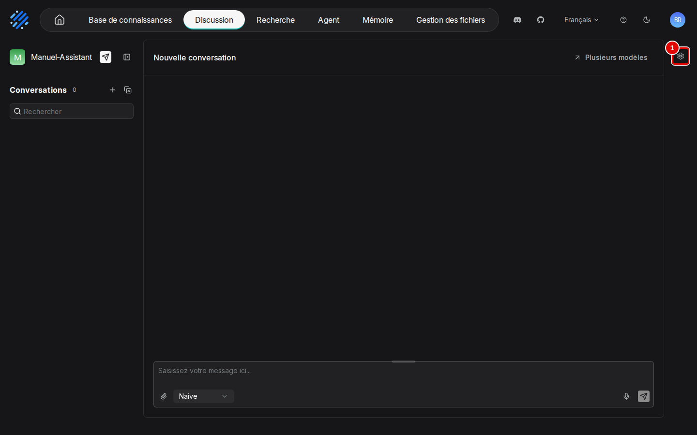
*Écran : page de l'assistant « Manuel-Assistant ».*

| N° | Élément | Rôle |
|---|---|---|
| 1 | engrenage | ouvre le panneau « Paramètres du chat » |

*Résultat* : le panneau « Paramètres du chat » s'ouvre à droite.

**Étape 14. Ouvrir la liste des bases**
*Où* : page de l'assistant › panneau « Paramètres du chat ».
Cliquer sur la liste « Bases de connaissances » (pastille 4).

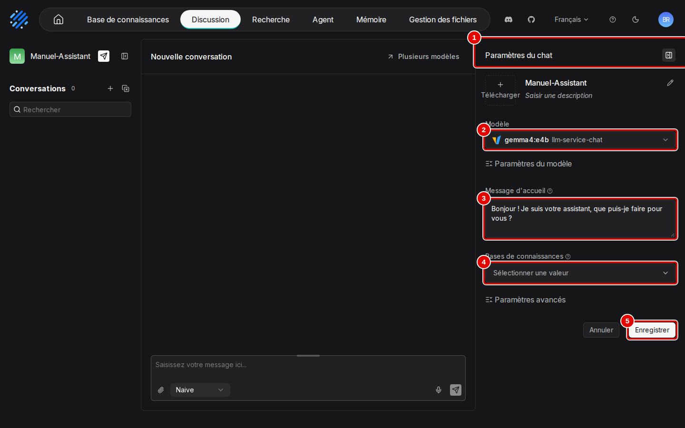
*Écran : page de l'assistant, panneau « Paramètres du chat » ouvert.*

| N° | Élément | Rôle |
|---|---|---|
| 1 | « Paramètres du chat » | panneau de réglage de l'assistant ; l'icône à droite le referme |
| 2 | « Modèle » | modèle qui rédige les réponses, par défaut le modèle de chat déclaré (`gemma4:e4b`) |
| 3 | « Message d'accueil » | premier message affiché dans chaque conversation |
| 4 | « Bases de connaissances » | bases interrogées par l'assistant ; vide à la création |
| 5 | « Enregistrer » | enregistre les réglages |

*Résultat* : la liste des bases s'ouvre (étape suivante). Les autres réglages sont expliqués au chapitre 08.

**Étape 15. Cocher la base**
*Où* : panneau « Paramètres du chat » › liste « Bases de connaissances ».
Cocher « Manuel-Prise-en-main » (pastille 2). Seules les bases qui contiennent au moins un document analysé figurent dans la liste.

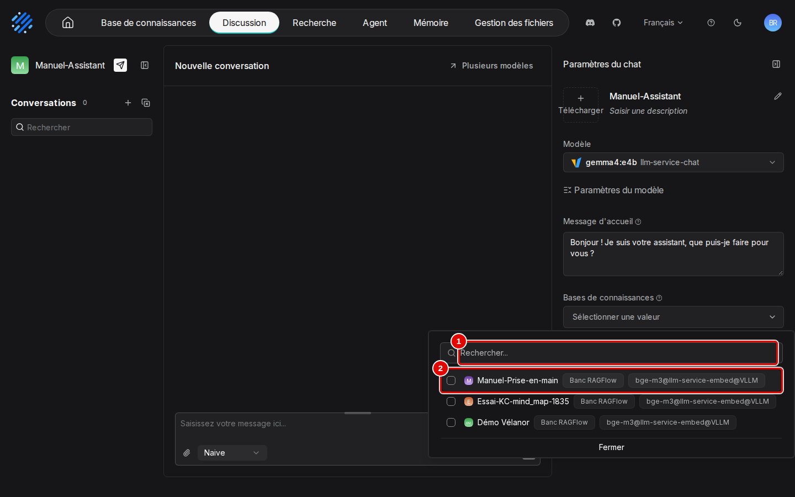
*Écran : panneau « Paramètres du chat », liste des bases ouverte.*

| N° | Élément | Rôle |
|---|---|---|
| 1 | « Rechercher... » | filtre les bases par nom |
| 2 | « Manuel-Prise-en-main » | base à relier ; la ligne rappelle son propriétaire et son modèle de recherche |

*Résultat* : la base apparaît dans le champ (étape suivante).

**Étape 16. Enregistrer**
*Où* : panneau « Paramètres du chat », bas du panneau.
Vérifier la base choisie (pastille 1), puis cliquer sur « Enregistrer » (pastille 2).

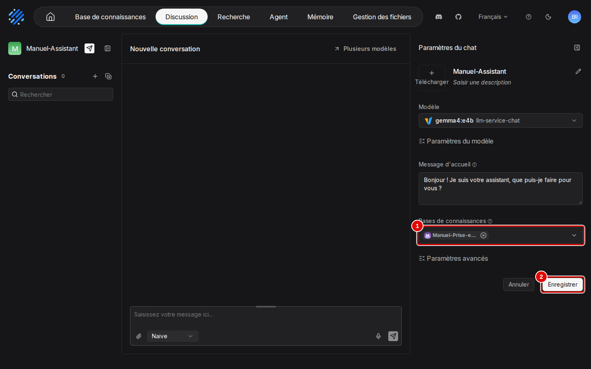
*Écran : panneau « Paramètres du chat », base choisie.*

| N° | Élément | Rôle |
|---|---|---|
| 1 | « Manuel-Prise-en-main » | base reliée ; la croix la retire |
| 2 | « Enregistrer » | enregistre l'assistant avec sa base |

*Résultat* : le message « Modifié » confirme ; l'assistant est prêt.

## Poser une question et vérifier la réponse

**Étape 17. Poser la question**
*Où* : page de l'assistant › zone « Saisissez votre message ici... » (en bas).
Taper la question (pastille 2), ici « Quel est le montant de la prime d'intéressement 2025 ? », puis cliquer sur l'avion en papier (pastille 4).

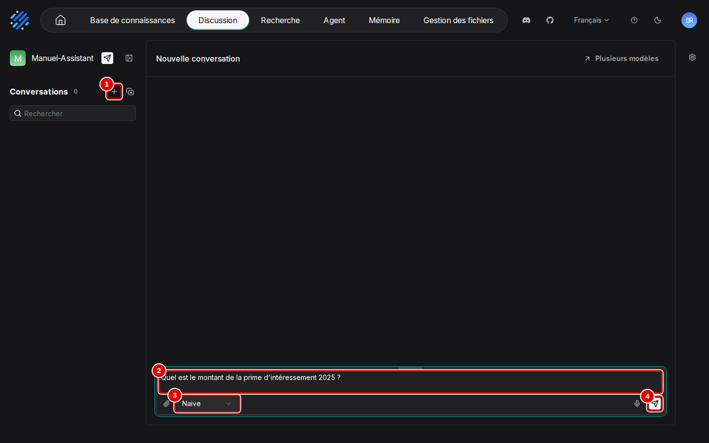
*Écran : page de l'assistant, question saisie.*

| N° | Élément | Rôle |
|---|---|---|
| 1 | « + » à côté de « Conversations » | ouvre une nouvelle conversation |
| 2 | zone « Saisissez votre message ici... » | question à poser |
| 3 | « Naive » | mode de réponse directe, conseillé ; l'autre mode, « Agentic », est présenté au chapitre 07 |
| 4 | « Send message » | envoie la question |

*Résultat* : la réponse s'écrit sous la question en quelques secondes.

**Étape 18. Lire la réponse**
*Où* : page de l'assistant, conversation ouverte.
Lire la réponse et repérer le numéro entre crochets (pastille 2) : il renvoie au passage qui justifie la phrase. Ici : « Le montant de la prime d'intéressement 2025 est de 1 150 euros par salarié, et elle sera versée en avril 2026 [1]. », ce que dit bien le compte rendu.

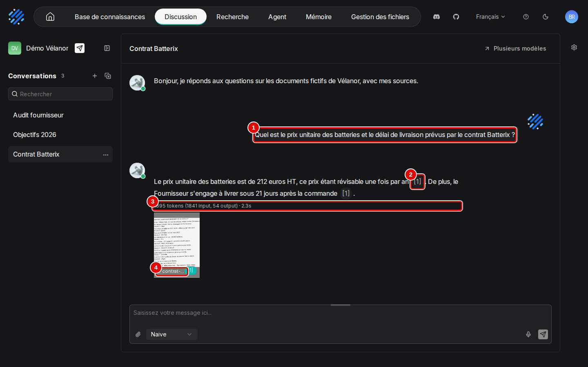
*Écran : page de l'assistant, réponse citée.*

| N° | Élément | Rôle |
|---|---|---|
| 1 | question | question posée, à droite ; elle devient aussi le titre de la conversation |
| 2 | renvoi « [1] » | numéro du passage qui justifie la phrase |
| 3 | « 652 tokens (611 input, 41 output) · 1.3s » | quantité de texte lue et écrite par le modèle (en jetons) et durée de rédaction |
| 4 | conversation | nouvelle conversation dans la liste de gauche, nommée d'après la première question |

*Résultat* : la réponse est apparue un peu plus de trois secondes après le clic.

**Étape 19. Vérifier la source**
*Où* : réponse › renvoi « [1] ».
Passer la souris sur le renvoi : une bulle affiche le passage cité et le nom du document (pastille 1).

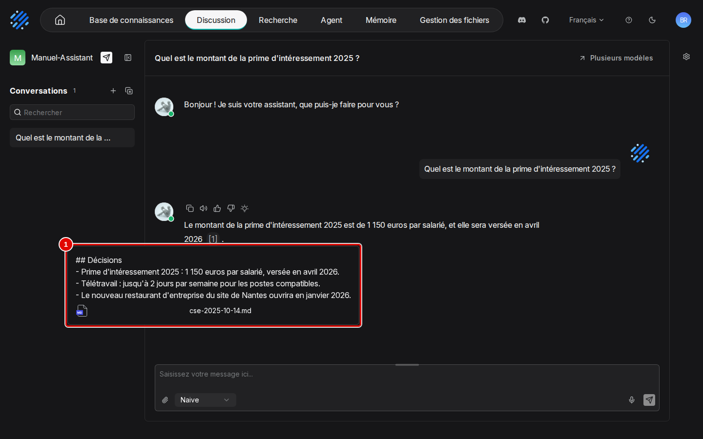
*Écran : page de l'assistant, bulle de citation affichée.*

| N° | Élément | Rôle |
|---|---|---|
| 1 | bulle de citation | texte du passage cité (section « Décisions » du compte rendu) et nom du fichier `cse-2025-10-14.md` ; permet de vérifier la réponse |

*Résultat* : la réponse est vérifiée sur le document d'origine. Le parcours complet est terminé : une base, deux documents, un assistant, une réponse citée.

## Bon à savoir

- Le bandeau « Veuillez attendre la fin de l'analyse de vos fichiers avant de démarrer une discussion avec l'IA. » est à prendre au pied de la lettre : une base dont aucun document n'est analysé ne peut pas être reliée à un assistant.
- Neuf documents (environ 1 Mo, dont un scan de deux pages) s'analysent en moins d'une minute avec une carte graphique.
- Même dans une base réglée sur « General », RAGFlow choisit seul un gabarit adapté pour certains formats : « Presentation » pour un diaporama, « Audio » pour un fichier son.
- Pour un PDF, et en particulier un scan, la réponse affiche aussi une vignette de la page citée.
- Les objets d'exemple (« Manuel-Prise-en-main », « Manuel-Assistant ») peuvent être supprimés ensuite par le menu « … » de leur carte (chapitres 05 et 07).

## En cas de problème

| Symptôme | Cause | Que faire |
|---|---|---|
| La base n'apparaît pas dans « Bases de connaissances » de l'assistant | aucun document analysé | attendre que « Nombre de segments » soit rempli (étape 8) |
| La barre du haut a disparu | la page des passages s'ouvre en plein écran | bouton « Retour » |
| Réponse « La réponse que vous cherchez ne se trouve pas dans la base de connaissances ! » ou « The answer you are looking for is not found in the dataset! » | aucun passage assez proche de la question | reformuler ; vérifier que la bonne base est reliée ; voir le chapitre 08 |
| L'analyse reste « En attente » | une autre analyse longue est en cours, ou le service de modèles est arrêté | patienter ; vérifier l'état (chapitre 02, étape 9) |

Les autres problèmes sont traités au chapitre [15. En cas de problème](15-en-cas-de-probleme.md).

---
*Version décrite : RAGFlow v1.0.0, essais des 9 et 11 novembre 2026. Détails et preuves : [rapport d'essais](../annexes/A6-rapport-d-essais.md).*
