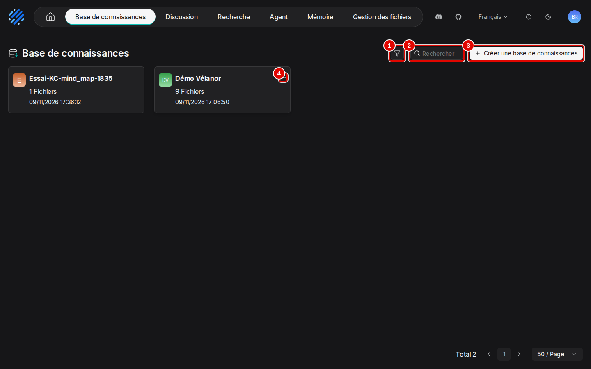
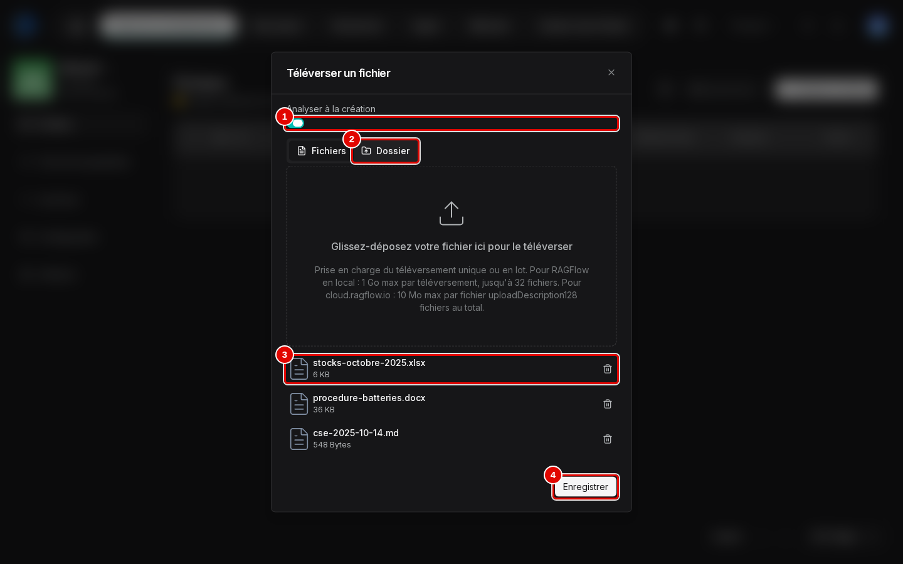
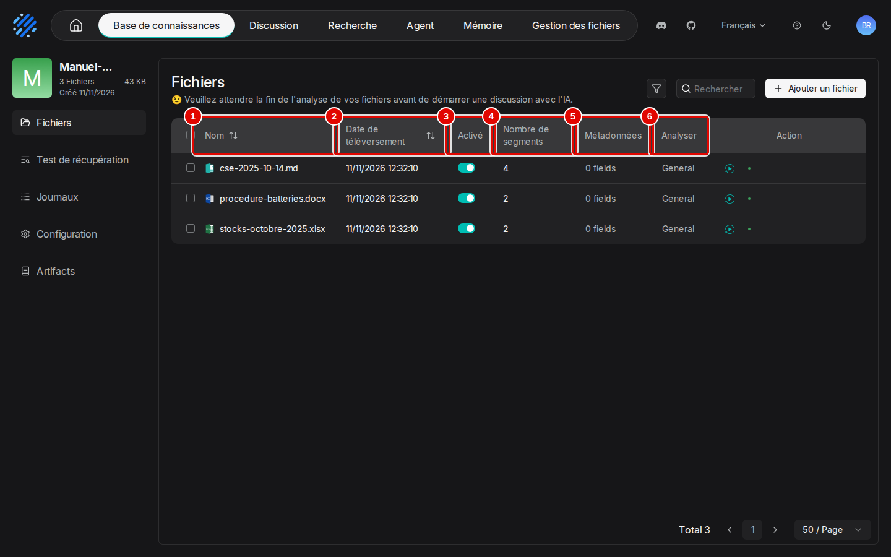
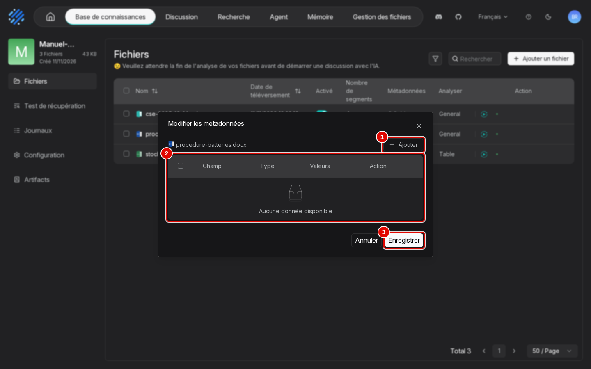
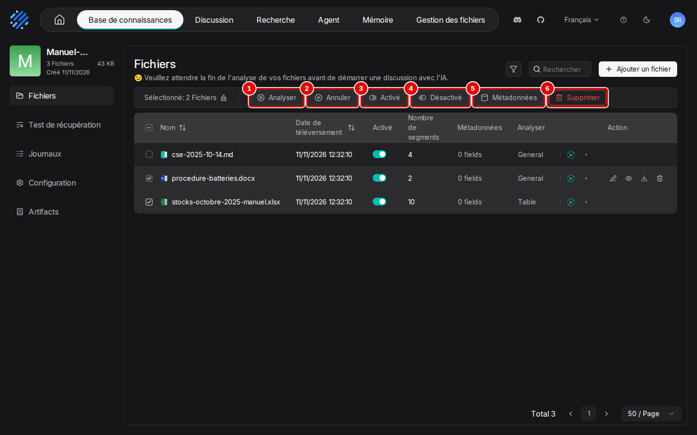
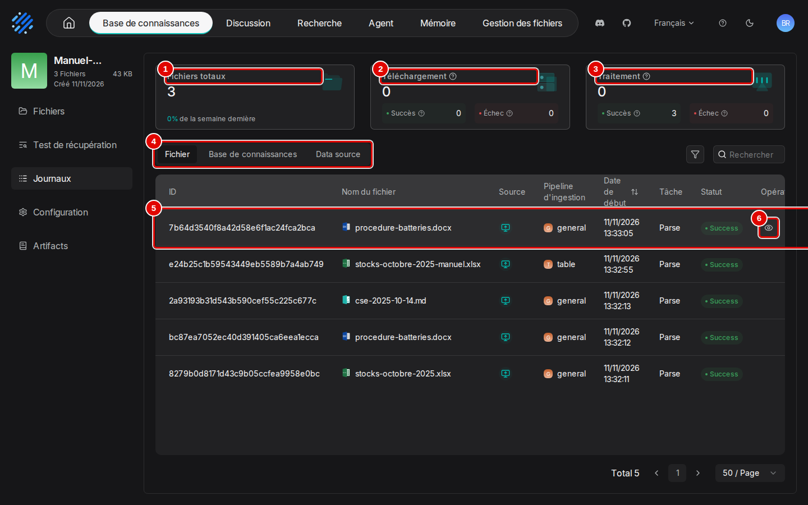
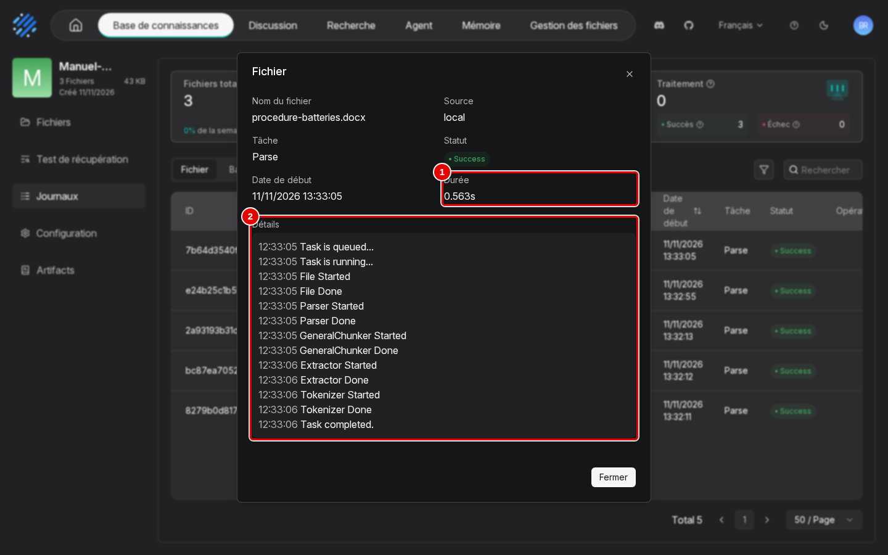
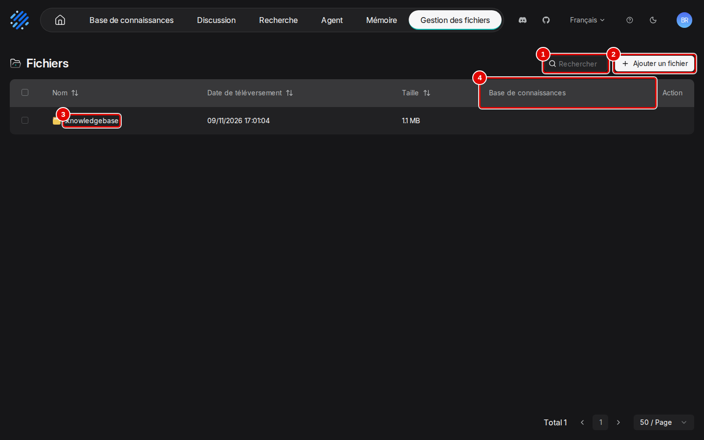
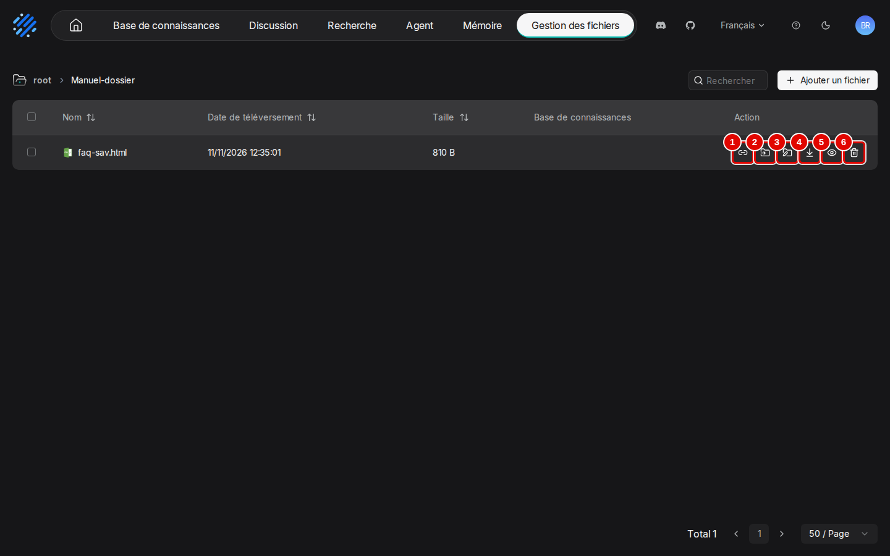
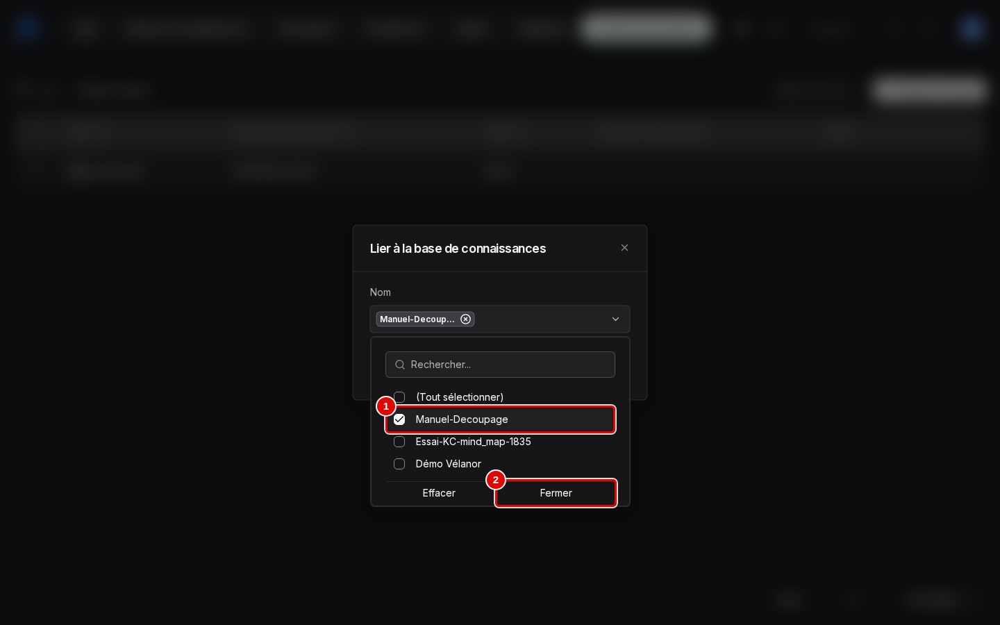

# 05. Ajouter et organiser ses documents

> Ce chapitre apprend à gérer les bases et leurs documents au quotidien : ajouter des fichiers, les renommer, les écarter, les supprimer, relancer leur analyse, leur donner des métadonnées, suivre les analyses dans « Journaux » et partager un fichier entre plusieurs bases avec « Gestion des fichiers ».
> **Point de départ** : barre du haut › « Base de connaissances » (liste des bases).
> **Durée** : environ 20 minutes. **Avant** : chapitre 04.

**Attention** : supprimer une base, un fichier ou un dossier est définitif ; les passages qui en sont tirés disparaissent avec lui. Relancer l'analyse d'un fichier efface aussi ses passages corrigés à la main.

## Ce qu'il faut savoir

Une base vit dans le temps : des documents arrivent, d'autres deviennent périmés. RAGFlow offre trois niveaux d'action. Sur la **base** : la renommer ou la supprimer. Sur chaque **fichier** de la base (onglet « Fichiers ») : le renommer, le télécharger, l'**écarter** des réponses sans le supprimer (interrupteur « Activé »), relancer son analyse, lui ajouter des **métadonnées**, c'est-à-dire des étiquettes du type « service : achats » ou « valable jusqu'au : 2026 » qui servent ensuite à filtrer les recherches. Enfin, la page **« Gestion des fichiers »** rassemble tous les fichiers du compte, rangés en dossiers ; un même fichier peut y être relié à plusieurs bases sans être envoyé plusieurs fois. Exemple : une procédure commune aux bases « Atelier » et « Qualité » est déposée une fois et reliée aux deux.

## Retrouver, renommer ou supprimer une base

**Étape 1. Ouvrir la liste des bases**
*Où* : barre du haut › « Base de connaissances ».
La liste montre une carte par base. Le filtre (pastille 1) et la zone « Rechercher » (pastille 2) retrouvent une base dans une longue liste ; le menu « … » (pastille 4) apparaît au survol d'une carte.

*Écran : Base de connaissances (liste des bases).*

| N° | Élément | Rôle |
|---|---|---|
| 1 | filtre (entonnoir) | restreint la liste des bases, par propriétaire |
| 2 | « Rechercher » | filtre les bases par nom |
| 3 | « Créer une base de connaissances » | ouvre la fenêtre de création (chapitre 04, et chapitre 06 pour le choix du gabarit) |
| 4 | menu « … » de la carte | menu de la base, visible au survol de la carte |

*Résultat* : la base cherchée est repérée.

**Étape 2. Renommer ou supprimer la base**
*Où* : liste des bases › carte de la base › menu « … ».
Cliquer sur « Renommer » pour changer le nom sans ouvrir la base, ou sur « Supprimer » pour supprimer la base avec tous ses fichiers et passages, après confirmation. Échap referme le menu sans rien faire.

*Résultat* : la carte affiche le nouveau nom, ou disparaît de la liste.

## Ajouter des fichiers avec analyse immédiate

**Étape 3. Envoyer les fichiers**
*Où* : base ouverte › onglet « Fichiers » › « Ajouter un fichier » › « Téléverser un fichier ».
Choisir les fichiers (pastille 3), activer « Analyser à la création » (pastille 1) pour que chaque fichier soit analysé dès son arrivée, puis cliquer sur « Enregistrer » (pastille 4). L'onglet « Dossier » (pastille 2) envoie tout le contenu d'un dossier du poste.

*Écran : fenêtre « Téléverser un fichier », « Analyser à la création » activé.*

| N° | Élément | Rôle |
|---|---|---|
| 1 | « Analyser à la création » | activé, chaque fichier est analysé dès son arrivée, sans autre clic |
| 2 | « Dossier » | envoie tout le contenu d'un dossier du poste au lieu de fichiers choisis un par un |
| 3 | fichier choisi | nom et taille ; la corbeille le retire de l'envoi |
| 4 | « Enregistrer » | envoie les fichiers |

*Résultat* : les fichiers apparaissent dans le tableau et s'analysent seuls ; ici, un tableur, un document Word et un compte rendu ont leurs passages en moins de six secondes.

**Étape 4. Lire le tableau des fichiers**
*Où* : base ouverte › onglet « Fichiers ».
Chaque ligne résume un fichier : nom, date d'arrivée, activation, nombre de passages, métadonnées et état de l'analyse.

*Écran : onglet « Fichiers », trois fichiers analysés.*

| N° | Élément | Rôle |
|---|---|---|
| 1 | « Nom » | nom du fichier ; un clic ouvre ses passages (chapitre 06) ; les flèches de l'en-tête trient la colonne |
| 2 | « Date de téléversement » | date d'arrivée dans la base ; triable |
| 3 | « Activé » | un fichier désactivé reste dans la base mais n'est plus interrogé |
| 4 | « Nombre de segments » | nombre de passages produits par l'analyse |
| 5 | « Métadonnées » | nombre d'étiquettes du fichier (« 0 fields »), modifiables (étape 10) |
| 6 | « Analyser » | gabarit du fichier, bouton de lancement ou de relance, et état de l'analyse |

*Résultat* : l'état de chaque fichier se lit d'un coup d'œil.

## Renommer, télécharger ou supprimer un fichier

**Étape 5. Afficher les actions d'un fichier**
*Où* : onglet « Fichiers » › survol d'une ligne › colonne « Action ».
Passer la souris sur la ligne : quatre icônes apparaissent. Le crayon renomme le fichier ; l'œil affiche ses propriétés (date de création, nom, taille, type, date de mise à jour) ; la flèche vers le bas télécharge le fichier d'origine ; la corbeille le supprime avec ses passages. Ce sont les mêmes icônes que dans « Gestion des fichiers » (étape 18).

*Résultat* : les actions de la ligne sont accessibles.

**Étape 6. Renommer le fichier**
*Où* : ligne du fichier › crayon.
La fenêtre « Renommer » ne contient qu'un champ « Nom » et le bouton « Enregistrer ». Garder l'extension (`.xlsx`, `.pdf`…) : elle indique le format du fichier.

*Résultat* : le nouveau nom s'affiche ; les passages ne sont pas recalculés.

**Étape 7. Supprimer le fichier**
*Où* : ligne du fichier › corbeille.
Cliquer sur la corbeille, puis sur « Supprimer » dans la fenêtre de confirmation.

*Résultat* : le fichier et ses passages disparaissent, définitivement.

## Écarter un fichier sans le supprimer

**Étape 8. Désactiver le fichier**
*Où* : onglet « Fichiers » › colonne « Activé » (capture de l'étape 4, pastille 3).
Cliquer sur l'interrupteur « Activé » du fichier, par exemple un document périmé en attente de sa nouvelle version. Un second clic le réactive.

*Résultat* : l'interrupteur passe au gris et le message « Modifié » confirme. Le fichier n'est plus interrogé par les assistants, mais ses passages restent stockés.

## Relancer l'analyse d'un fichier

**Étape 9. Relancer l'analyse**
*Où* : onglet « Fichiers » › colonne « Analyser » › icône de relance.
Utile après un changement de réglage de la base (chapitre 06). Cliquer sur l'icône de relance du fichier. La fenêtre « Analyser le fichier » demande « Are you sure to clear chunks to re-parse? » : cliquer sur « Confirmer ». Le point d'état voisin, vert quand l'analyse a réussi, ouvre au clic le détail de l'analyse (étape 15).

*Résultat* : les passages existants sont effacés puis recalculés ; pour un document court, en moins de trois secondes.

## Ajouter des métadonnées

**Étape 10. Ouvrir les métadonnées d'un fichier**
*Où* : onglet « Fichiers » › colonne « Métadonnées » › « 0 fields ».
Cliquer sur « Ajouter » (pastille 1) pour créer un champ (nom, type, valeurs), puis sur « Enregistrer » (pastille 3). « Annuler » referme sans rien changer.

*Écran : fenêtre « Modifier les métadonnées ».*

| N° | Élément | Rôle |
|---|---|---|
| 1 | « Ajouter » | ajoute un champ |
| 2 | tableau des champs | « Champ », « Type », « Valeurs », « Action » ; vide ici (« Aucune donnée disponible ») |
| 3 | « Enregistrer » | enregistre les métadonnées du fichier |

*Résultat* : le nombre de champs s'affiche dans la colonne « Métadonnées ». Un assistant peut ensuite filtrer ses recherches sur ces champs (chapitre 08, réglage « Métadonnées »).

## Traiter plusieurs fichiers d'un coup

**Étape 11. Cocher les fichiers**
*Où* : onglet « Fichiers » › cases à cocher en début de ligne.
Cocher plusieurs fichiers : une barre d'actions groupées apparaît.

*Écran : onglet « Fichiers », barre d'actions groupées.*

| N° | Élément | Rôle |
|---|---|---|
| 1 | « Analyser » | lance l'analyse des fichiers cochés |
| 2 | « Annuler » | annule leurs analyses en cours |
| 3 | « Activé » | active les fichiers cochés |
| 4 | « Désactivé » | les désactive |
| 5 | « Métadonnées » | modifie leurs métadonnées en une fois |
| 6 | « Supprimer » | les supprime, après confirmation |

*Résultat* : l'action choisie s'applique à tout le lot.

## Filtrer la liste des fichiers

**Étape 12. Filtrer la liste des fichiers**
*Où* : onglet « Fichiers » › filtre (entonnoir).
Le filtre propose « Type de fichier » (un seul format), « Statut » (un seul état d'analyse : réussi, en échec…) et « Champ de métadonnée » (les fichiers qui portent ce champ). « Soumettre » applique le filtre, « Effacer » le retire, Échap referme. Utile dans une grande base pour retrouver les fichiers en échec.

*Résultat* : seul le sous-ensemble choisi reste affiché.

## Créer un fichier vide

**Étape 13. Créer un fichier vide**
*Où* : onglet « Fichiers » › « Ajouter un fichier » › « Créer un fichier vide ».
La fenêtre « Nom du fichier » ne demande qu'un « Nom », par exemple « Manuel-note.txt », puis « Enregistrer ». Le document sert à recevoir des passages écrits à la main (chapitre 06, « Ajouter un passage »).

*Résultat* : le document apparaît avec 0 segment et sans bouton d'analyse, puisqu'il n'y a rien à lire.

## Suivre les analyses dans « Journaux »

**Étape 14. Ouvrir les journaux de la base**
*Où* : base ouverte › menu de gauche › « Journaux ».
Le haut de la page compte les fichiers et les analyses ; le tableau liste chaque tâche d'analyse. L'œil (pastille 6), au survol d'une ligne, ouvre son détail.

*Écran : base ouverte, page « Journaux ».*

| N° | Élément | Rôle |
|---|---|---|
| 1 | « Fichiers totaux » | nombre de fichiers de la base |
| 2 | « Téléchargement » | fichiers en cours de récupération depuis une source externe (chapitre 12), avec réussites et échecs |
| 3 | « Traitement » | fichiers analysés : réussites et échecs |
| 4 | « Fichier », « Base de connaissances », « Data source » | journaux par fichier, des traitements portant sur toute la base (vide ici), ou des sources externes |
| 5 | ligne d'une tâche | identifiant, fichier, source, gabarit (« general », « table »), date, tâche « Parse », statut « Success » |
| 6 | œil | ouvre le détail de la tâche |

*Résultat* : l'historique des analyses est affiché.

**Étape 15. Lire le détail d'une tâche**
*Où* : « Journaux » › ligne d'une tâche › œil.
La fenêtre donne la durée totale (pastille 1) et chaque étape de l'analyse avec son heure (pastille 2) : lecture, découpage, enrichissement, rangement pour la recherche.

*Écran : « Journaux », détail d'une tâche.*

| N° | Élément | Rôle |
|---|---|---|
| 1 | « Durée » | durée totale de l'analyse du fichier |
| 2 | « Détails » | étapes horodatées ; en cas d'échec, le message d'erreur y figure |

*Résultat* : la cause d'un échec, ou la durée d'une analyse, est connue. Les heures sont affichées en temps universel, une heure de moins que l'heure de Paris en hiver.

## Partager un fichier entre plusieurs bases

**Étape 16. Ouvrir « Gestion des fichiers »**
*Où* : barre du haut › « Gestion des fichiers ».
La page montre tous les fichiers du compte. Le dossier « .knowledgebase » (pastille 3) contient un sous-dossier par base, avec les fichiers envoyés depuis l'onglet « Fichiers » de chaque base.

*Écran : Gestion des fichiers (racine).*

| N° | Élément | Rôle |
|---|---|---|
| 1 | « Rechercher » | filtre par nom |
| 2 | « Ajouter un fichier » | envoie un fichier ou crée un dossier |
| 3 | « .knowledgebase » | dossier créé par RAGFlow, qui contient les fichiers envoyés dans les bases |
| 4 | « Base de connaissances » | colonne des bases auxquelles chaque fichier est relié |

*Résultat* : l'espace de fichiers commun est affiché.

**Étape 17. Créer un dossier et y déposer un fichier**
*Où* : Gestion des fichiers › « Ajouter un fichier » › « Nouveau dossier ».
Saisir le nom du dossier (ici « Manuel-dossier ») dans le champ « Nom », puis « Enregistrer ». Ouvrir le dossier, puis « Ajouter un fichier » › « Téléverser un fichier » ; choisir le fichier (ici `faq-sav.html`) et cliquer sur « Enregistrer ». La fenêtre est celle de l'étape 3, sans l'option « Analyser à la création ».

*Résultat* : le fichier est rangé dans le dossier, relié à aucune base.

**Étape 18. Afficher les actions du fichier**
*Où* : Gestion des fichiers › dossier › survol de la ligne du fichier.
Six icônes apparaissent ; le maillon (pastille 1) relie le fichier à une base.

*Écran : Gestion des fichiers, actions d'un fichier au survol.*

| N° | Élément | Rôle |
|---|---|---|
| 1 | maillon | « Lier à la base de connaissances » |
| 2 | dossier à flèche | « Déplacer » vers un autre dossier |
| 3 | dossier à crayon | « Renommer » |
| 4 | flèche vers le bas | télécharger |
| 5 | œil | aperçu du fichier |
| 6 | corbeille | supprimer |

*Résultat* : les actions du fichier sont accessibles.

**Étape 19. Relier le fichier à une base**
*Où* : ligne du fichier › maillon › liste « Nom ».
Ouvrir la liste « Nom », cocher la base voulue (pastille 1), puis cliquer sur « Fermer » (pastille 2). La base choisie s'affiche dans le champ « Nom » (la croix la retire) : cliquer sur « Save » pour relier le fichier.

*Écran : Gestion des fichiers, fenêtre de liaison à une base.*

| N° | Élément | Rôle |
|---|---|---|
| 1 | « Manuel-Decoupage » | base à relier ; plusieurs bases peuvent être cochées |
| 2 | « Fermer » | referme la liste |

*Résultat* : la colonne « Base de connaissances » affiche la base reliée, et le fichier figure aussi dans l'onglet « Fichiers » de cette base, à analyser comme les autres.

**Étape 20. Supprimer un dossier**
*Où* : Gestion des fichiers (racine) › survol du dossier › corbeille.
Cliquer sur la corbeille du dossier, puis sur « Supprimer » dans la fenêtre « Supprimer le fichier », qui rappelle le dossier visé.

*Résultat* : le dossier et son contenu sont supprimés.

## Bon à savoir

- Laisser « Analyser à la création » désactivé permet de choisir le gabarit d'un fichier avant sa première analyse (chapitre 06).
- Un envoi accepte jusqu'à 32 fichiers et 1 Go.
- Désactiver plutôt que supprimer : un fichier désactivé se réactive d'un clic, sans nouvelle analyse.
- Le bouton « Cancel parsing tasks », en haut de l'onglet « Fichiers », annule toutes les analyses en cours.

## En cas de problème

| Symptôme | Cause | Que faire |
|---|---|---|
| Un fichier reste en échec | format illisible ou erreur pendant l'analyse | lire le message dans « Journaux » (étapes 14 et 15) |
| Un réglage de la base ne change rien aux passages existants | les réglages ne s'appliquent qu'aux analyses suivantes | relancer l'analyse des fichiers (étape 9) |
| Les corrections faites à la main dans les passages ont disparu | l'analyse du fichier a été relancée | refaire les corrections ; éviter de relancer un fichier corrigé |
| La fenêtre de liaison affiche « Save » au lieu d'« Enregistrer » | libellé non traduit dans cette version | sans conséquence |

Les autres problèmes sont traités au chapitre [15. En cas de problème](15-en-cas-de-probleme.md).

---
*Version décrite : RAGFlow v1.0.0, essais des 9 et 11 novembre 2026. Détails et preuves : [rapport d'essais](../annexes/A6-rapport-d-essais.md).*
