# 06. Régler la lecture des documents

> Ce chapitre apprend à choisir la façon dont RAGFlow découpe chaque document (le gabarit), à régler une base dans son onglet « Configuration », puis à contrôler ce qui a été lu dans un scan et à corriger, écarter ou ajouter un passage à la main.
> **Point de départ** : barre du haut › « Base de connaissances » › une base ouverte sur son onglet « Fichiers ».
> **Durée** : environ 30 minutes. **Avant** : chapitre 05.

**Attention** : changer le gabarit d'un fichier déjà analysé, ou relancer son analyse, efface ses passages, y compris ceux corrigés ou ajoutés à la main.

## Ce qu'il faut savoir

Avant de pouvoir répondre, RAGFlow lit chaque document et le coupe en **passages**. La façon de couper dépend du **gabarit** choisi (l'interface dit « Mode d'analyse ») : un texte suivi se coupe par paragraphes et par titres, un tableur ligne par ligne, une présentation diapositive par diapositive. Le gabarit se choisit pour toute la base, et peut être changé pour un seul fichier. La lecture elle-même est confiée à **DeepDoc**, le lecteur de documents intégré à RAGFlow : il reconnaît les caractères d'une page scannée (on parle d'OCR, reconnaissance optique de caractères), repère titres, colonnes et tableaux, et tourne sur la machine, sans service extérieur. Cette lecture n'est pas parfaite : sur un contrat scanné, « 40 000 » peut devenir « 40 0oo ». D'où l'intérêt de regarder les passages d'un scan avant de s'y fier, et de corriger ce qui doit l'être.

## Choisir le gabarit d'une base à sa création

Rappel : la base « Manuel-Decoupage » utilisée dans ce chapitre a été créée au début du chapitre 05, avec le gabarit « General » ; il n'y a pas à la recréer. Les étapes 1 et 2 montrent en détail le choix du gabarit fait à cette création, et servent pour toute nouvelle base.

**Étape 1. Ouvrir la liste des gabarits**
*Où* : barre du haut › « Base de connaissances » › « Créer une base de connaissances ».
Saisir le nom (pastille 1), puis cliquer sur la liste du gabarit (pastille 3).

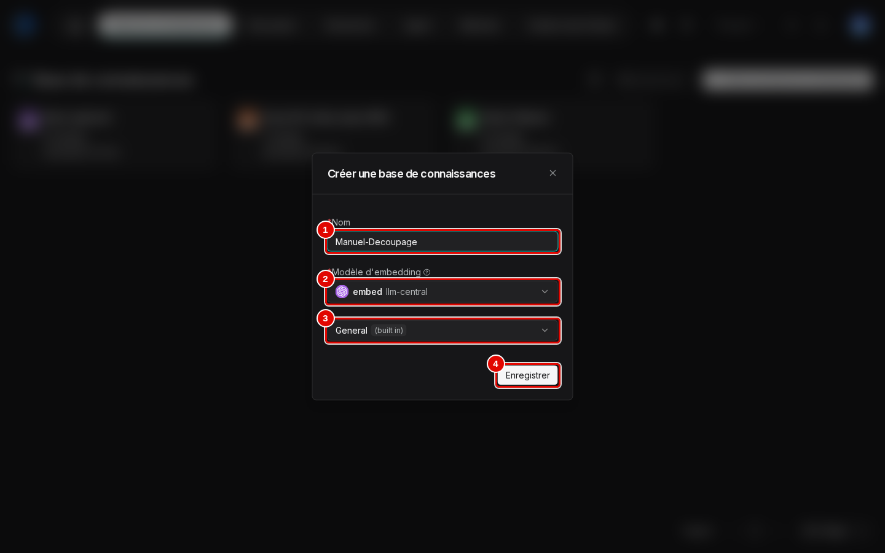
*Écran : fenêtre « Créer une base de connaissances ».*

| N° | Élément | Rôle |
|---|---|---|
| 1 | « Nom » | nom de la base ; la capture montre la création de « Manuel-Decoupage », faite au chapitre 05 avant l'envoi de ses trois fichiers |
| 2 | « Modèle d'embedding » | modèle de la recherche par le sens, `embed`, de l'instance « llm-central » (modèle par défaut du chapitre 03) |
| 3 | gabarit | gabarit de la base, « General (built in) » par défaut |
| 4 | « Enregistrer » | crée la base et l'ouvre |

*Résultat* : la liste des gabarits s'ouvre (étape suivante).

**Étape 2. Choisir le gabarit**
*Où* : fenêtre de création › liste du gabarit.
La liste montre d'abord les chaînes de lecture personnalisées créées dans « Agent » (pastille 2, chapitre 11), puis les douze gabarits intégrés, marqués « (built in) ». Choisir « General » (pastille 3), puis cliquer sur « Enregistrer ».

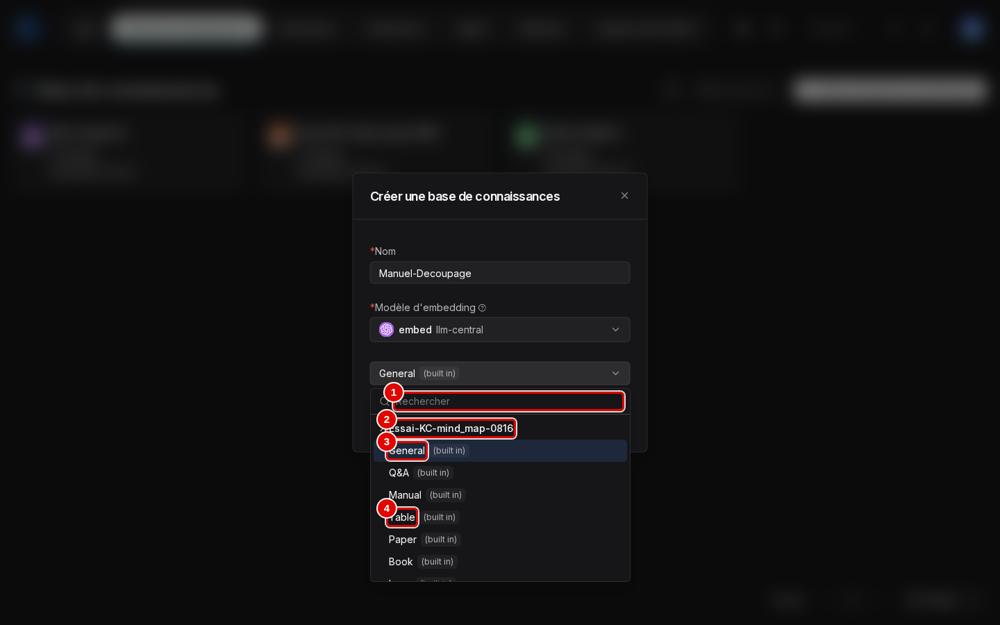
*Écran : fenêtre de création, liste des gabarits ouverte.*

| N° | Élément | Rôle |
|---|---|---|
| 1 | « Rechercher » | filtre la liste par nom |
| 2 | « Essai-KC-mind_map-0816 » | chaîne de lecture personnalisée ; la flèche la déplie pour choisir sa version |
| 3 | « General » | gabarit généraliste, choisi ici |
| 4 | « Table » | gabarit des tableurs, une ligne par passage (étape 3) |

*Résultat* : la base est créée avec le gabarit choisi ; la même liste revient pour un seul fichier (étape 3) et dans « Configuration » (étape 6).

## Choisir le gabarit d'un seul fichier

**Étape 3. Changer le gabarit du fichier**
*Où* : onglet « Fichiers » › colonne « Analyser » › nom du gabarit du fichier (« General ») › « Changer ou configurer le pipeline d'ingestion. ».
Cliquer sur le nom du gabarit dans la ligne du tableur (« General », colonne « Analyser ») : un petit menu d'une seule ligne s'ouvre juste en dessous, « Changer ou configurer le pipeline d'ingestion. » ; c'est une entrée de menu, pas une infobulle : cliquer dessus. La fenêtre « Mode d'analyse » propre au fichier s'ouvre. Ouvrir la liste du gabarit (la même qu'à l'étape 2), choisir « Table » pour un tableur (pastille 1), puis cliquer sur « Enregistrer » (pastille 2). Les onglets de la fenêtre s'adaptent au gabarit choisi.

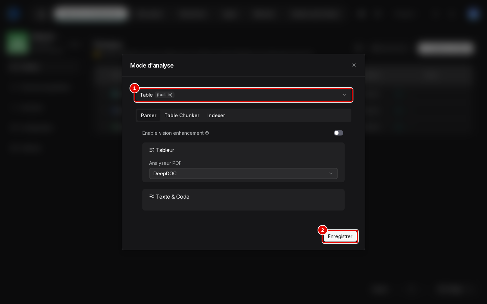
*Écran : fenêtre « Mode d'analyse » d'un fichier, gabarit « Table » choisi.*

| N° | Élément | Rôle |
|---|---|---|
| 1 | « Table (built in) » | gabarit retenu pour ce fichier |
| 2 | « Enregistrer » | enregistre le gabarit du fichier |

*Résultat* : une confirmation s'affiche si le fichier a déjà des passages (étape suivante).

**Étape 4. Confirmer la nouvelle analyse**
*Où* : fenêtre « Analyser le fichier ».
Le message, en anglais, prévient que les passages existants seront effacés. Cliquer sur « Oui » (pastille 2). « Non » garde le gabarit enregistré sans réanalyser : les anciens passages restent jusqu'à la prochaine analyse.

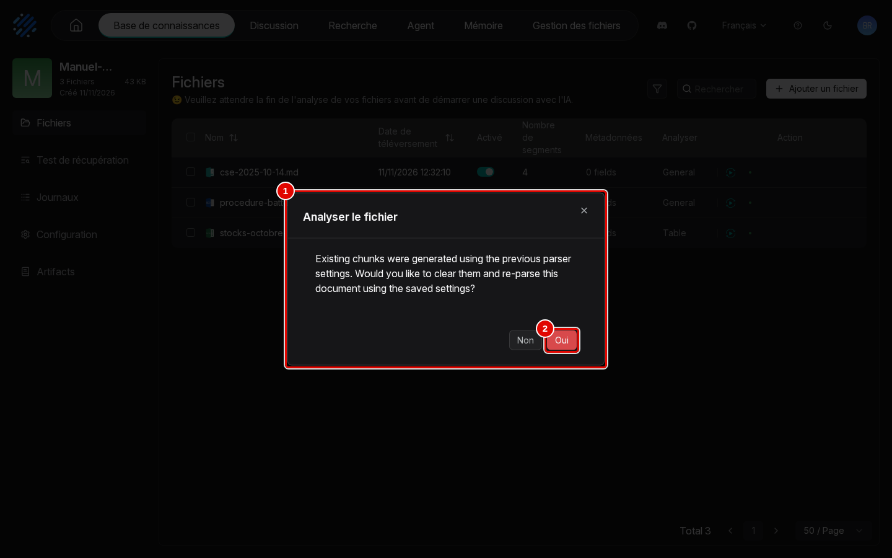
*Écran : fenêtre « Analyser le fichier ».*

| N° | Élément | Rôle |
|---|---|---|
| 1 | « Analyser le fichier » | fenêtre de confirmation |
| 2 | « Oui » | efface les passages et relance l'analyse avec le nouveau gabarit |

*Résultat* : quelques secondes plus tard, le tableur passe de 2 passages à 10, un par ligne ; sa colonne « Analyser » affiche « Table », les autres fichiers restent en « General ».

## Comparer les gabarits

Les douze gabarits intégrés :

| Gabarit | Pour quels documents | Ce qu'il fait |
|---|---|---|
| « General » | tout document | coupe selon la structure (titres, paragraphes) et une taille cible |
| « Q&A » | listes de questions-réponses (tableur, texte) | une question et sa réponse par passage |
| « Manual » | manuels techniques à sections numérotées | suit les sections |
| « Table » | tableurs | une ligne par passage, avec les titres de colonnes |
| « Paper » | articles et rapports structurés | suit les parties de l'article |
| « Book » | livres, chapitres longs | suit les chapitres |
| « Laws » | textes juridiques | un article par passage |
| « Presentation » | diaporamas et PDF page par page | une diapositive ou une page par passage |
| « Picture » | images | lit le texte de l'image ; la description demande un modèle capable de lire les images |
| « One » | documents courts à garder entiers | le document entier en un seul passage |
| « Audio » | fichiers son | transcrit le son en texte |
| « Email » | courriels | garde les champs du courriel (expéditeur, destinataires…) |

Ce qu'ont montré les essais sur neuf documents d'entreprise :

- **« General » suffit** dans la plupart des cas : 33 bonnes réponses sur 34, comme « Paper » et « Table ».
- Un gabarit n'agit que sur les formats qu'il sait traiter : « Paper » et « Presentation » redécoupent les PDF, « Table » le tableur ; les fichiers Markdown, HTML, Word, PowerPoint et audio gardent leur découpage.
- « Table » fait de chaque ligne d'un tableur un passage : 10 passages au lieu de 2, plus précis pour une question sur une ligne.
- « Presentation » coupe un PDF page par page, même un rapport : 27 passages courts au lieu de 9, et une question sur un document anglais court est alors perdue. À réserver aux diaporamas.
- Le temps d'analyse ne change pas d'un gabarit à l'autre (moins d'une minute pour les neuf documents).

Conseil : garder « General » pour la base, et changer le gabarit fichier par fichier (étape 3) pour un tableur, une liste de questions-réponses ou un diaporama.

**Étape 5. Consulter la description des gabarits**
*Où* : barre du haut › « Agent » › onglet « Ingestion pipeline » › « Built-in pipelines ».
Les douze gabarits y sont présentés en cartes, avec le début de leur description. L'icône de copie d'une carte (pastille 2) en fait une chaîne de lecture modifiable (chapitre 11).

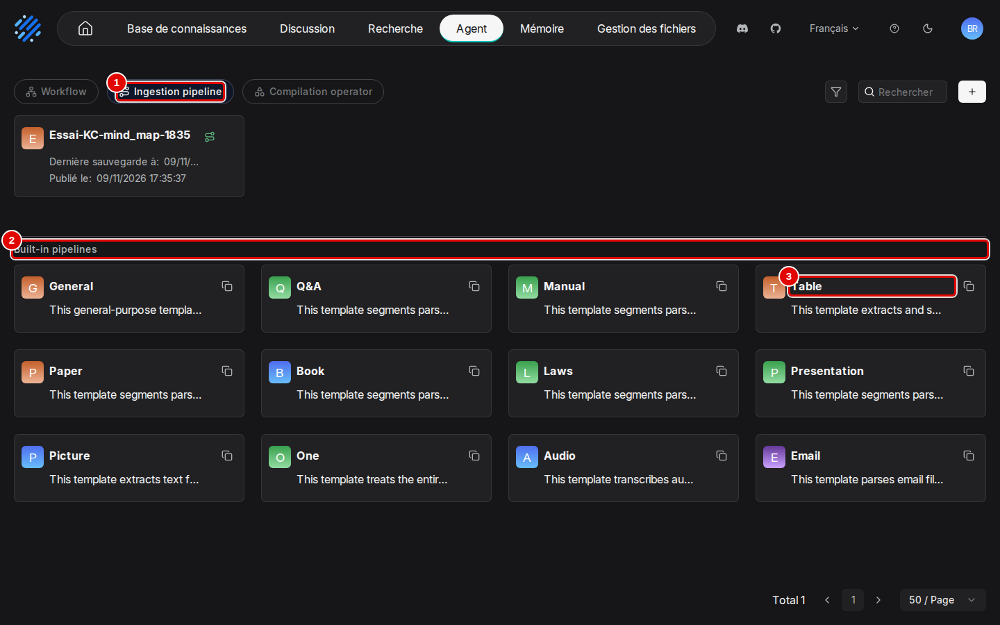
*Écran : Agent, onglet « Ingestion pipeline ».*

| N° | Élément | Rôle |
|---|---|---|
| 1 | « Ingestion pipeline » | onglet des chaînes de lecture de la page « Agent » |
| 2 | « Built-in pipelines » | les douze gabarits intégrés ; l'icône de copie en fait une chaîne modifiable |
| 3 | « Table » | carte d'un gabarit, avec le début de sa description |

*Résultat* : la description de chaque gabarit est consultable sans rien modifier.

## Régler la base dans « Configuration »

Les réglages de cet onglet ne s'appliquent qu'aux analyses suivantes : relancer ensuite l'analyse des fichiers déjà traités (chapitre 05, étape 9).

**Étape 6. Ouvrir les informations de base**
*Où* : base ouverte › menu de gauche › « Configuration ».
La partie « Informations de base » s'affiche en premier. Pour un corpus en français, choisir « French » dans « Langue » (pastille 2). « Autorisations » (pastille 5) propose « Moi uniquement » (seul le propriétaire gère la base) et « Équipe » (tous les membres de l'équipe la gèrent, chapitre 13).

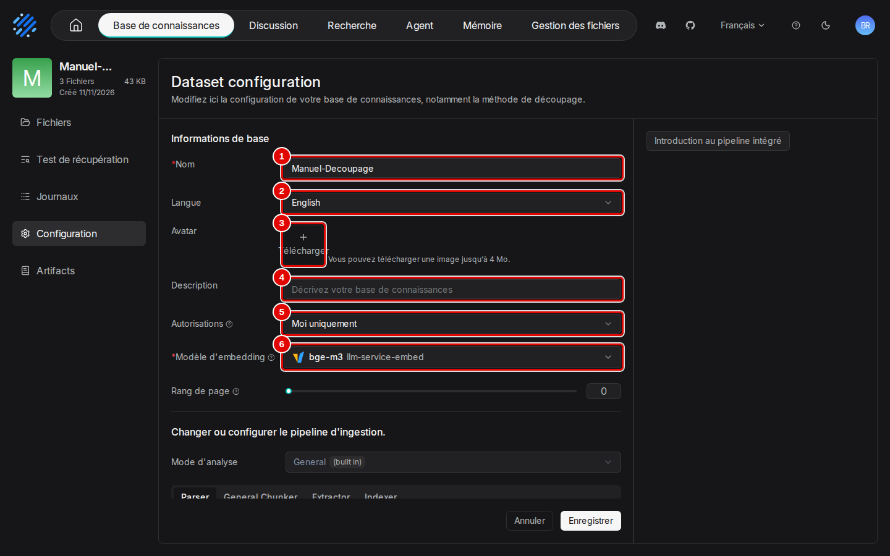
*Écran : base ouverte, « Configuration », informations de base.*

| N° | Élément | Rôle |
|---|---|---|
| 1 | « Nom » | nom de la base |
| 2 | « Langue » | langue des documents, « English » par défaut ; sert à la recherche par les mots |
| 3 | « Télécharger » (« Avatar ») | image de la base, 4 Mo au plus |
| 4 | « Description » | texte libre affiché avec la base |
| 5 | « Autorisations » | qui peut gérer la base |
| 6 | « Modèle d'embedding » | modèle de la recherche par le sens ; changeable tant que la base n'a pas de passages, ou vers un modèle très proche |

*Résultat* : les informations générales de la base sont réglées.

**Étape 7. Repérer le mode d'analyse et ses onglets**
*Où* : « Configuration », plus bas dans la page.
Le « Mode d'analyse » (pastille 2) est le gabarit de la base ; ses quatre onglets détaillent les étapes de la lecture. Le bouton « Introduction au pipeline intégré », en haut à droite, affiche la description du gabarit choisi (formats acceptés, façon de couper).

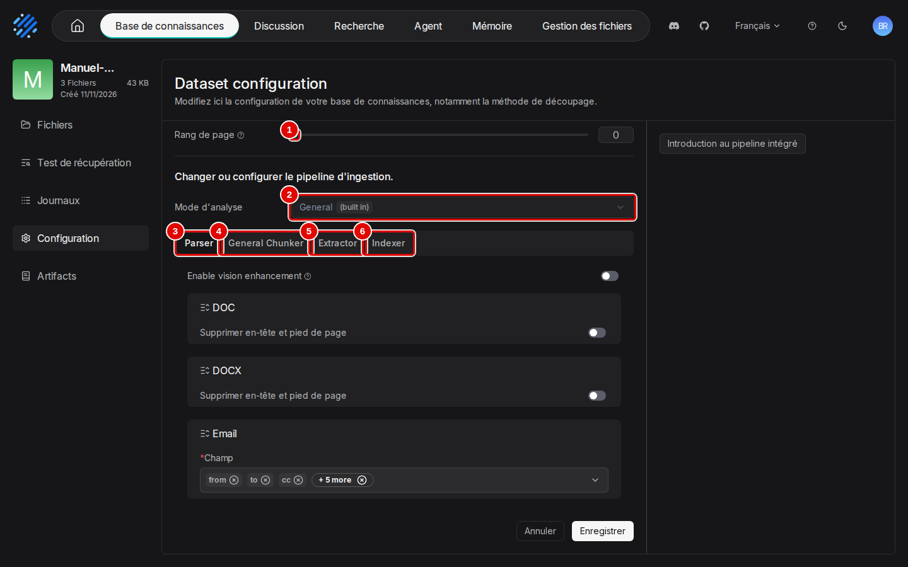
*Écran : « Configuration », rang de page et mode d'analyse.*

| N° | Élément | Rôle |
|---|---|---|
| 1 | « Rang de page » | bonus ajouté aux passages de cette base quand un assistant interroge plusieurs bases ; 0 par défaut |
| 2 | « Mode d'analyse » | gabarit de la base, même liste qu'à l'étape 2 |
| 3 | « Parser » | lecture des documents, format par format (étape 8) |
| 4 | « General Chunker » | découpage en passages (étape 9) |
| 5 | « Extractor » | enrichissement des passages par le modèle d'IA (étape 10) |
| 6 | « Indexer » | ce qui est rangé pour la recherche (étape 11) |

*Résultat* : l'onglet « Parser » est ouvert par défaut.

**Étape 8. Régler la lecture format par format**
*Où* : « Configuration » › onglet « Parser ».
Un bloc par format, avec ses options :

- « PDF » : « Détecter la mise en page multi-colonnes » rétablit l'ordre de lecture d'une page en colonnes ; « Supprimer la table des matières d'origine » écarte le sommaire ; « Supprimer en-tête et pied de page » écarte les lignes répétées en haut et en bas de page ; « Analyseur PDF » choisit le lecteur, « DeepDOC » par défaut (étape 30) ; « Plages de pages » limite les pages lues.
- « DOC », « DOCX » (Word) et « HTML » : « Supprimer en-tête et pied de page ».
- « Email » : « Champ » choisit les champs du courriel gardés (« from », « to », « cc »…).
- « Image » : « OCR », lecture du texte des images, activée par défaut, par « DeepDoc » ou par un modèle externe (grisé tant qu'aucun n'est déclaré).
- « Enable vision enhancement » confie images et tableaux à un modèle capable de lire les images ; il en faut un dans « Modèle Img2txt » (chapitre 03).

*Résultat* : la lecture est adaptée aux documents de la base.

**Étape 9. Régler la taille des passages**
*Où* : « Configuration » › onglet « General Chunker ».
Garder les valeurs par défaut sauf besoin précis. « Splits at: », sous les délimiteurs, récapitule les caractères où couper ; « Ajouter » en ajoute un.

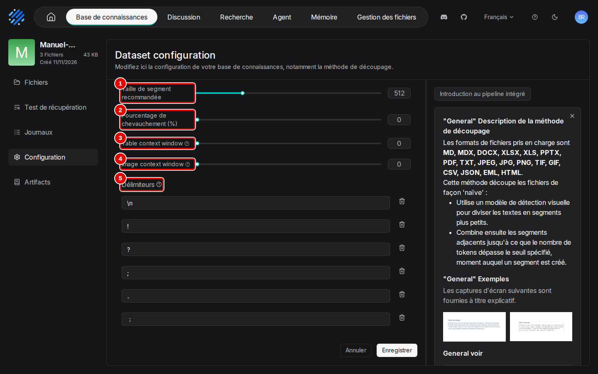
*Écran : « Configuration », onglet « General Chunker ».*

| N° | Élément | Rôle |
|---|---|---|
| 1 | « Taille de segment recommandée » | taille cible d'un passage en jetons (512 par défaut, environ une page) ; les textes courts sont regroupés jusqu'à l'atteindre |
| 2 | « Pourcentage de chevauchement (%) » | part de texte répétée entre deux passages voisins, 0 par défaut |
| 3 | « Table context window » | quantité de texte voisin ajoutée au passage d'un tableau, 0 par défaut |
| 4 | « Image context window » | même chose pour une image |
| 5 | « Délimiteurs » | caractères où couper le texte (retour à la ligne, « ! », « ? », « ; »…) |

*Résultat* : la taille des passages est réglée. L'option « Les blocs enfants sont utilisés pour la récupération » découpe en plus chaque passage en petits morceaux pour la recherche, le passage entier étant donné au modèle.

**Étape 10. Choisir les enrichissements**
*Où* : « Configuration » › onglet « Extractor ».
Ces enrichissements sont produits par le modèle d'IA pendant l'analyse ; chacun allonge l'analyse. Tous sont désactivés par défaut. Pour les mots-clés : activer l'interrupteur (pastille 2) et choisir leur nombre (pastille 3).

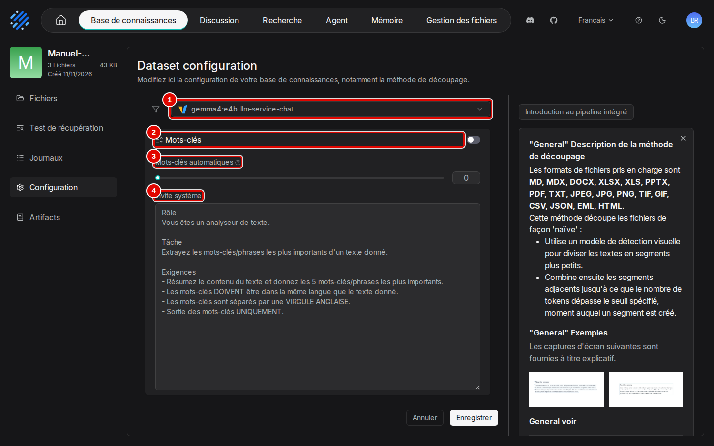
*Écran : « Configuration », onglet « Extractor ».*

| N° | Élément | Rôle |
|---|---|---|
| 1 | « Modèle » | modèle qui fait les extractions, ici `chat` (la capture, prise avec l'ancien serveur de modèles, affiche `gemma4:e4b`) |
| 2 | « Mots-clés » | interrupteur de l'extraction de mots-clés |
| 3 | « Mots-clés automatiques » | nombre de mots-clés par passage (0 : aucun) ; ils font remonter le passage pour les questions qui les contiennent |
| 4 | « Invite système » | consigne donnée au modèle pour cette extraction, modifiable |

*Résultat* : les enrichissements choisis seront calculés à la prochaine analyse. La suite de l'onglet suit la même présentation : « Questions » (questions générées par passage, rapprochées des questions posées), « Étiquettes » (étiquetage automatique), « Résumé » (résumé de chaque passage) et « Métadonnées » (métadonnées générées pour les nouveaux fichiers).

**Étape 11. Vérifier ce qui est rangé pour la recherche**
*Où* : « Configuration » › onglet « Indexer ».
Garder les deux méthodes de recherche cochées (pastille 1) : c'est leur combinaison qui donne les meilleurs résultats.

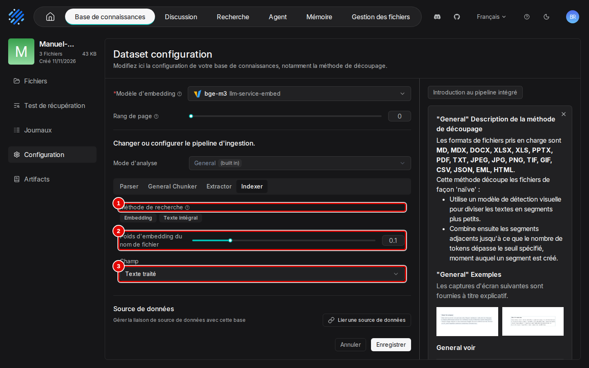
*Écran : « Configuration », onglet « Indexer ».*

| N° | Élément | Rôle |
|---|---|---|
| 1 | « Méthode de recherche » | « Embedding » (recherche par le sens) et « Texte intégral » (recherche par les mots), les deux par défaut |
| 2 | « Poids d'embedding du nom de fichier » | part du nom de fichier dans la recherche par le sens, 0,1 par défaut |
| 3 | « Champ » | texte rangé pour la recherche, « Texte traité » par défaut |

*Résultat* : les réglages sont prêts. Au bas de la page, « Lier une source de données » relie la base à une source externe (chapitre 12).

**Étape 12. Enregistrer la configuration**
*Où* : « Configuration », bas de la page › « Enregistrer ».
Cliquer sur « Enregistrer » ; « Annuler » abandonne les modifications.

*Résultat* : le message « Mis à jour » confirme ; après rechargement, les réglages sont conservés.

## Faire lire un document scanné

**Étape 13. Envoyer le scan**
*Où* : base « Manuel-DeepDoc » › onglet « Fichiers » › « Ajouter un fichier » › « Téléverser un fichier ».
Créer d'abord une nouvelle base nommée « Manuel-DeepDoc », avec le gabarit « General » (chapitre 04, étapes 1 et 2). Y envoyer, avec « Analyser à la création » activé (chapitre 05, étape 3), deux fichiers du dossier `corpus/documents/` : le contrat scanné de deux pages, légèrement de travers, `contrat-batterix-scan.pdf`, et le compte rendu au format texte `cse-2025-10-14.md`. La suite du chapitre travaille dans cette base.

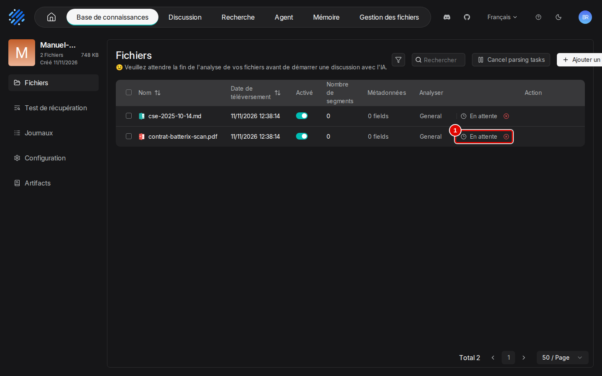
*Écran : onglet « Fichiers », analyses en file d'attente.*

| N° | Élément | Rôle |
|---|---|---|
| 1 | « En attente » | analyse en file ; devient une barre de progression pendant la lecture ; la croix rouge l'annule |

*Résultat* : l'analyse démarre.

**Étape 14. Constater la fin de l'analyse**
*Où* : onglet « Fichiers ».
Le scan donne ici un seul passage pour ses deux pages (pastille 1). Le point d'état vert (pastille 2) signale la réussite et ouvre le journal de l'analyse.

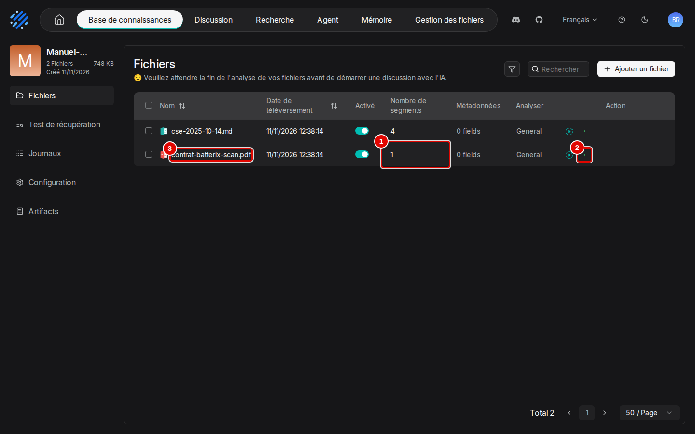
*Écran : onglet « Fichiers », scan analysé.*

| N° | Élément | Rôle |
|---|---|---|
| 1 | « Nombre de segments » | 1 passage pour les 2 pages du contrat |
| 2 | point d'état | vert : réussite ; ouvre le journal de l'analyse |
| 3 | « contrat-batterix-scan.pdf » | nom du fichier ; un clic ouvre ses passages (étape 16) |

*Résultat* : le scan est analysé.

**Étape 15. Lire le journal de l'analyse**
*Où* : onglet « Fichiers » › point d'état du fichier.
La fenêtre donne la durée totale et les étapes horodatées : ici un peu moins de 11 secondes, dont 10 pour la lecture des deux pages.

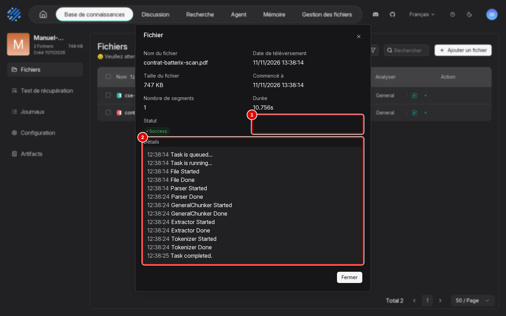
*Écran : fenêtre du journal d'analyse d'un fichier.*

| N° | Élément | Rôle |
|---|---|---|
| 1 | « Durée » | durée totale de l'analyse |
| 2 | « Détails » | étapes horodatées : lecture, découpage, enrichissement, rangement pour la recherche |

*Résultat* : le coût de la lecture est connu : environ cinq secondes par page scannée sur la machine d'essai.

## Lire les passages d'un document

**Étape 16. Ouvrir les passages**
*Où* : onglet « Fichiers » › nom du fichier (`contrat-batterix-scan.pdf`).
La vue « Résultat du segment » s'ouvre en plein écran : la page du document à gauche (pastille 2), les passages lus à droite (pastille 3). Un clic sur un passage surligne sa zone dans la page.

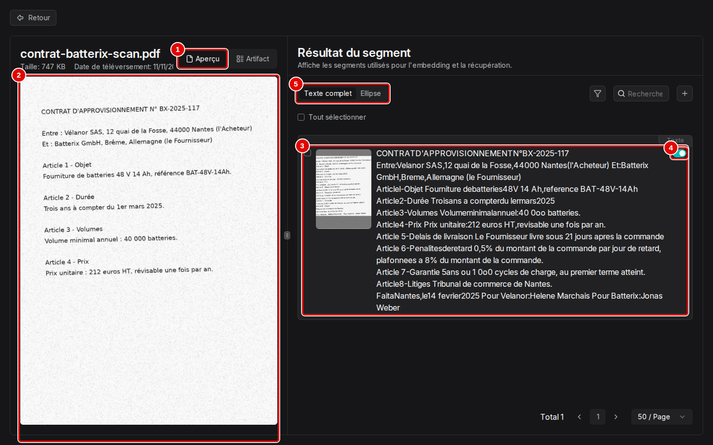
*Écran : « Résultat du segment » du contrat scanné (plein écran).*

| N° | Élément | Rôle |
|---|---|---|
| 1 | « Aperçu » | affiche le document d'origine ; « Artifact », à côté, est décrit au chapitre 11 |
| 2 | page du document | image de la page |
| 3 | passage | texte lu, avec la vignette de sa page ; son type (« Texte ») en haut à droite |
| 4 | interrupteur du passage | active ou désactive ce seul passage (étape 22) |
| 5 | « Texte complet », « Ellipse » | affiche les passages en entier ou abrégés |

*Résultat* : la lecture du scan est visible. Ici elle est exploitable mais imparfaite : espaces perdus (« CONTRATD'APPROVISIONNEMENTN° »), « l » lu au lieu de « 1 » (« Articlel »), « o » lu au lieu de « 0 » (« 40 0oo batteries »).

**Étape 17. Repérer les outils des passages**
*Où* : « Résultat du segment », au-dessus des passages.

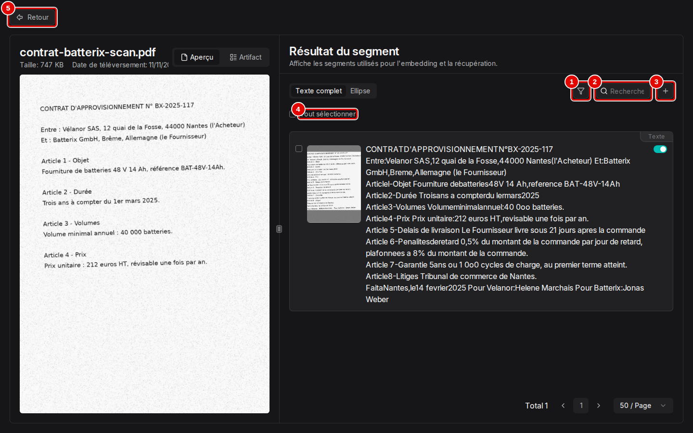
*Écran : « Résultat du segment », barre d'outils des passages.*

| N° | Élément | Rôle |
|---|---|---|
| 1 | filtre (entonnoir) | « Tous », « Activé », « Désactivé » (étape 22) |
| 2 | « Recherche » | cherche un texte dans les passages du document (étape 27) |
| 3 | « + » | ajoute un passage écrit à la main (étape 23) |
| 4 | « Tout sélectionner » | coche tous les passages pour une action groupée (étape 26) |
| 5 | « Retour » | revient à la liste des fichiers |

*Résultat* : les outils de correction sont repérés.

## Corriger un passage mal lu

**Étape 18. Mesurer le problème avant de corriger**
*Où* : base « Manuel-DeepDoc » › menu de gauche › « Test de récupération ».
Saisir une question qui vise l'information mal lue (pastille 1), ici « volume minimal annuel de 40 000 batteries », puis cliquer sur « Test » (pastille 2). Le test cherche les passages sans faire rédiger de réponse (détail au chapitre 08).

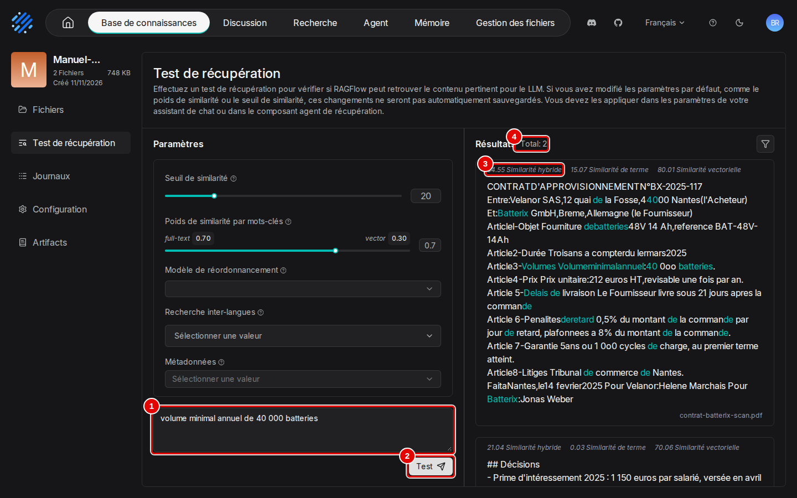
*Écran : base ouverte, « Test de récupération », avant correction.*

| N° | Élément | Rôle |
|---|---|---|
| 1 | question | texte cherché |
| 2 | « Test » | lance la recherche, sans le modèle de réponse |
| 3 | « Similarité hybride » | score du passage du contrat (sur 100), suivi du score par les mots et du score par le sens |
| 4 | « Total » | nombre de passages retenus |

*Résultat* : le passage du contrat n'obtient que 34,55 sur 100 : les mots collés par la lecture ne correspondent pas aux mots de la question.

**Étape 19. Ouvrir le passage en modification**
*Où* : « Résultat du segment » du contrat › double-clic sur le texte du passage.
La fenêtre « Modifier le segment » s'ouvre.

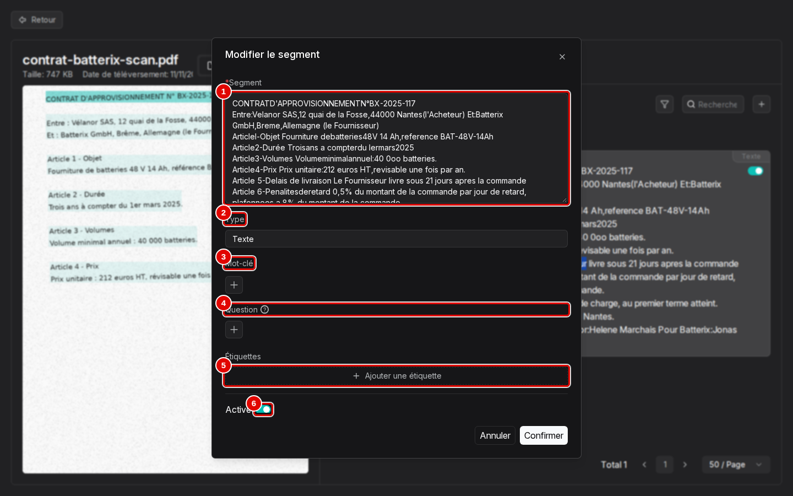
*Écran : fenêtre « Modifier le segment ».*

| N° | Élément | Rôle |
|---|---|---|
| 1 | « Segment » | texte du passage, modifiable |
| 2 | « Type » | type du passage (« Texte », « Tableau », « Image »), non modifiable |
| 3 | « Mot-clé » | mots-clés ajoutés à la main ; le « + » en ajoute un ; ils font remonter le passage pour les questions qui les contiennent |
| 4 | « Question » | questions associées ; si elles existent, la recherche par le sens s'appuie sur elles |
| 5 | « Étiquettes » | étiquettes du passage (« Ajouter une étiquette ») |
| 6 | « Activé » | active ou désactive le passage |

*Résultat* : le passage est modifiable.

**Étape 20. Corriger le texte**
*Où* : fenêtre « Modifier le segment » › champ « Segment ».
Sélectionner « Volumeminimalannuel:40 0oo » et taper « Volume minimal annuel : 40 000 » (pastille 1), puis cliquer sur « Confirmer » (pastille 2).

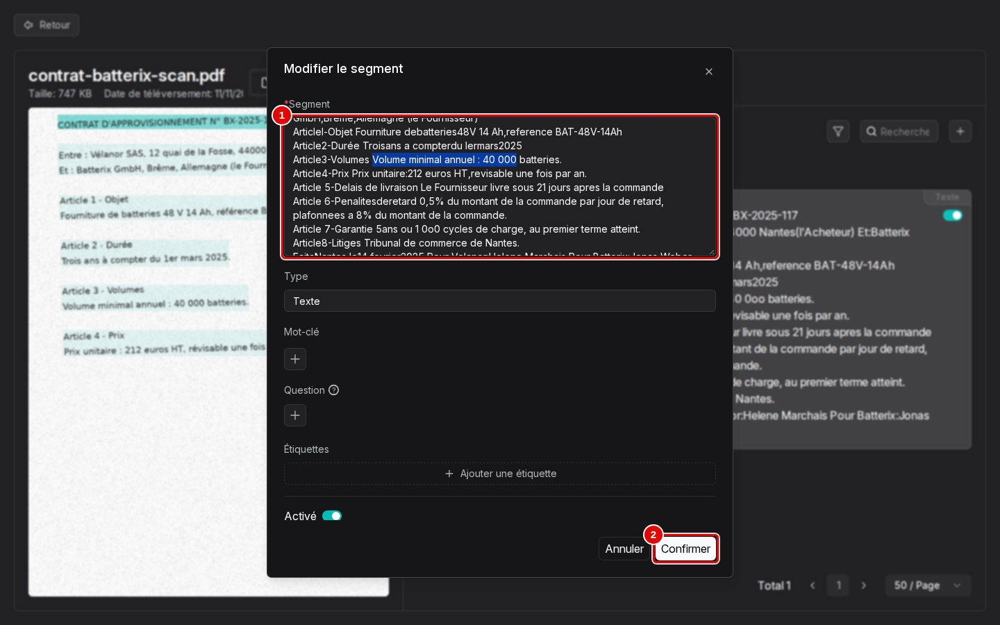
*Écran : fenêtre « Modifier le segment », texte corrigé.*

| N° | Élément | Rôle |
|---|---|---|
| 1 | « Segment » | texte corrigé, sélectionné |
| 2 | « Confirmer » | doit enregistrer la modification |

*Résultat* : pour un passage tiré d'un PDF, voir l'étape suivante.

**Étape 21. Constater le défaut et refermer**
*Où* : fenêtre « Modifier le segment », toujours ouverte.
Dans cette version de RAGFlow, pour un passage tiré d'un PDF, « Confirmer » ne fait rien : la fenêtre reste ouverte et la correction n'est pas enregistrée. Cliquer sur « Annuler » (pastille 2), puis passer par le contournement : ajouter un passage corrigé (étape 23).

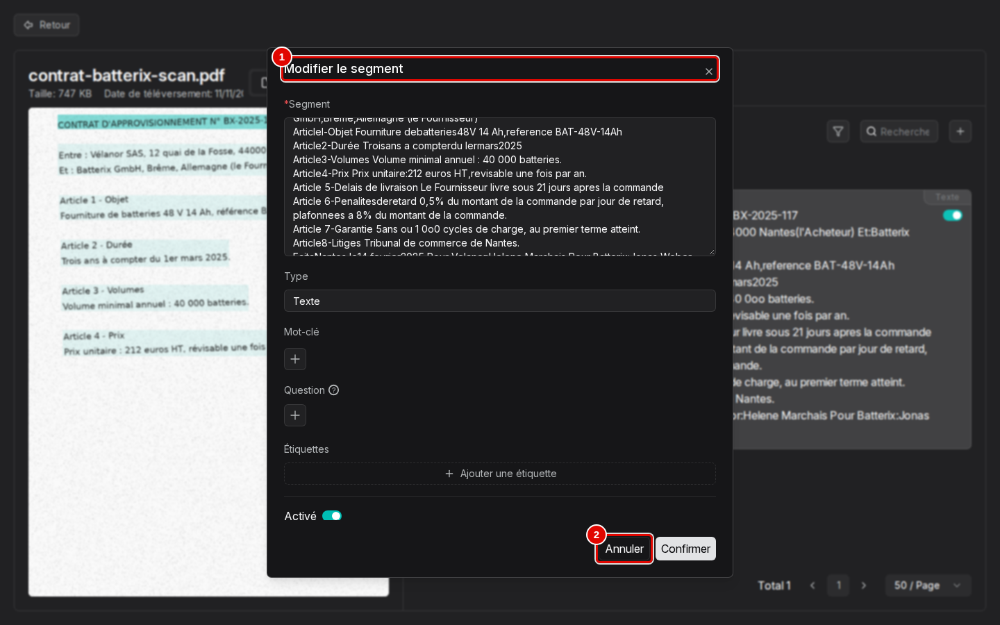
*Écran : fenêtre « Modifier le segment » restée ouverte après « Confirmer ».*

| N° | Élément | Rôle |
|---|---|---|
| 1 | « Modifier le segment » | fenêtre restée ouverte après « Confirmer » |
| 2 | « Annuler » | referme la fenêtre sans rien changer |

*Résultat* : rien n'a changé. Le même geste fonctionne sur un passage tiré d'un document texte (étape 29) ; la correction d'un passage de PDF reste possible par programme (annexe [A3. Automatiser par l'API](../annexes/A3-automatiser-par-l-api.md)).

## Écarter un passage faux

**Étape 22. Désactiver le passage et retrouver les passages écartés**
*Où* : « Résultat du segment » › interrupteur en haut à droite du passage, puis filtre (entonnoir) au-dessus des passages.
Cliquer sur l'interrupteur du passage : il devient gris, et le passage est écarté des réponses sans être supprimé. Pour retrouver plus tard les passages écartés, ouvrir le filtre et choisir « Désactivé » (pastille 3). La capture montre le filtre ouvert, avec l'interrupteur du passage déjà gris à droite du texte.

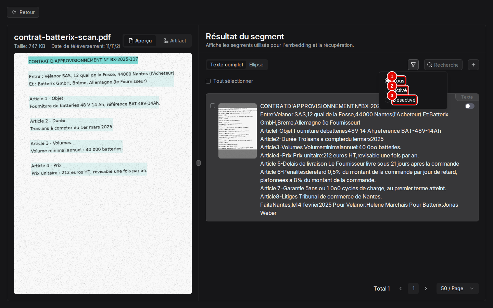
*Écran : « Résultat du segment », passage désactivé, filtre des passages ouvert.*

| N° | Élément | Rôle |
|---|---|---|
| 1 | « Tous » | tous les passages |
| 2 | « Activé » | seulement les passages actifs |
| 3 | « Désactivé » | seulement les passages écartés, pour les retrouver et les réactiver |

*Résultat* : le passage n'est plus utilisé ; un nouveau clic sur l'interrupteur le réactive.

## Ajouter un passage écrit à la main

**Étape 23. Écrire le passage**
*Où* : « Résultat du segment » › « + ».
Saisir le texte juste (pastille 1), ajouter un mot-clé avec le « + » de « Mot-clé » puis Entrée (pastille 2), ajouter la question qu'il doit servir (pastille 3), puis cliquer sur « Confirmer » (pastille 4).

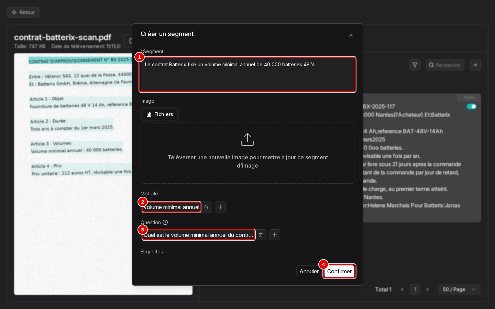
*Écran : fenêtre de création d'un passage.*

| N° | Élément | Rôle |
|---|---|---|
| 1 | « Segment » | texte du passage : « Le contrat Batterix fixe un volume minimal annuel de 40 000 batteries 48 V. » |
| 2 | « volume minimal annuel » | mot-clé ajouté |
| 3 | « Quel est le volume minimal annuel du contrat Batterix ? » | question associée |
| 4 | « Confirmer » | crée le passage ; la zone « Image », au-dessus, permet d'y joindre une image |

*Résultat* : le passage est créé (étape suivante).

**Étape 24. Vérifier l'ajout**
*Où* : « Résultat du segment » du contrat.
Le nouveau passage (pastille 1) est rattaché au même document.

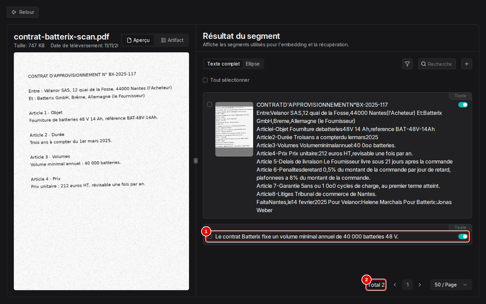
*Écran : « Résultat du segment », passage ajouté.*

| N° | Élément | Rôle |
|---|---|---|
| 1 | passage ajouté | texte saisi, rattaché au même document |
| 2 | « Total 2 » | nombre de passages du document |

*Résultat* : le document compte deux passages.

**Étape 25. Mesurer l'effet**
*Où* : base « Manuel-DeepDoc » › menu de gauche › « Test de récupération ».
Relancer la même question qu'à l'étape 18.

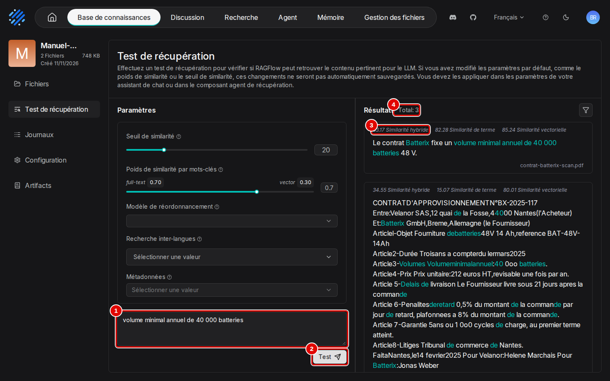
*Écran : « Test de récupération », après ajout du passage.*

| N° | Élément | Rôle |
|---|---|---|
| 1 | question | même question qu'à l'étape 18 |
| 2 | « Test » | relance la recherche |
| 3 | « Similarité hybride » | 83,17 pour le passage ajouté, rattaché à `contrat-batterix-scan.pdf` |
| 4 | « Total: 3 » | passages retenus |

*Résultat* : le passage ajouté arrive en tête avec 83,17 sur 100, contre 34,55 pour le passage lu par l'OCR. L'information juste sera désormais donnée au modèle.

## Utiliser les autres outils des passages

**Étape 26. Agir sur plusieurs passages**
*Où* : « Résultat du segment » › « Tout sélectionner ».
Les actions groupées apparaissent pour les passages cochés.

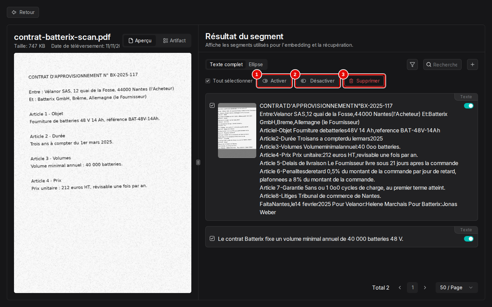
*Écran : « Résultat du segment », actions groupées.*

| N° | Élément | Rôle |
|---|---|---|
| 1 | « Activer » | active les passages cochés |
| 2 | « Désactiver » | les désactive |
| 3 | « Supprimer » | les supprime |

*Résultat* : l'action s'applique à tous les passages cochés.

**Étape 27. Chercher un texte dans les passages**
*Où* : « Résultat du segment » › zone « Recherche ».
Saisir le texte cherché, ici « 40 000 ».

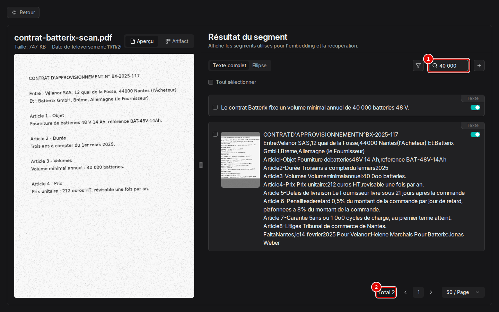
*Écran : « Résultat du segment », recherche dans les passages.*

| N° | Élément | Rôle |
|---|---|---|
| 1 | « Recherche » | texte cherché |
| 2 | « Total 2 » | passages trouvés |

*Résultat* : seuls les passages qui contiennent le texte restent affichés.

**Étape 28. Abréger l'affichage**
*Où* : « Résultat du segment » › « Ellipse ».
Cliquer sur « Ellipse » pour parcourir rapidement un document long ; « Texte complet » rétablit l'affichage entier.

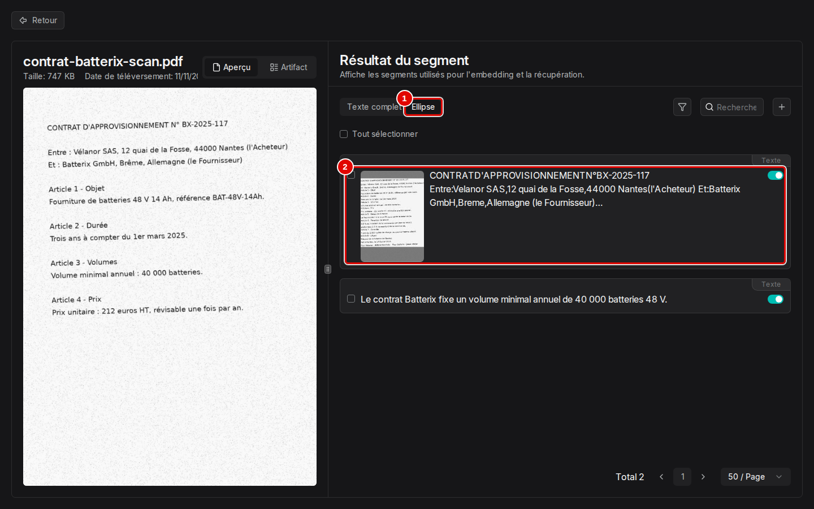
*Écran : « Résultat du segment », affichage abrégé.*

| N° | Élément | Rôle |
|---|---|---|
| 1 | « Ellipse » | affichage abrégé |
| 2 | passage abrégé | passage réduit à ses premières lignes |

*Résultat* : chaque passage tient en quelques lignes.

## Corriger un passage d'un document texte

**Étape 29. Modifier et enregistrer**
*Où* : base › « Fichiers » › `cse-2025-10-14.md` › double-clic sur le passage « Décisions ».
Ajouter un mot-clé (pastille 2), ici « prime d'intéressement », puis cliquer sur « Confirmer » (pastille 3).

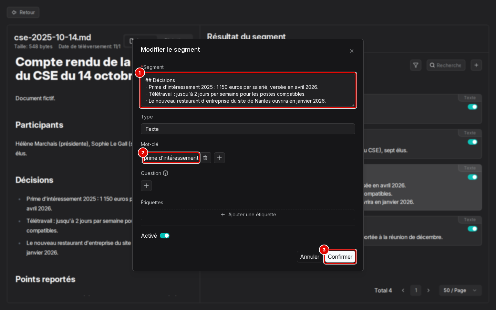
*Écran : fenêtre « Modifier le segment » d'un passage de document texte.*

| N° | Élément | Rôle |
|---|---|---|
| 1 | « Segment » | texte du passage |
| 2 | « prime d'intéressement » | mot-clé ajouté |
| 3 | « Confirmer » | enregistre la modification |

*Résultat* : la fenêtre se ferme et la modification est enregistrée ; elle est toujours là après rechargement de la page.

## Choisir le lecteur des PDF

**Étape 30. Ouvrir la liste des lecteurs**
*Où* : base ouverte › « Configuration » › onglet « Parser » › bloc « PDF » › « Analyseur PDF ».
La liste propose six lecteurs. Garder « DeepDOC » (pastille 1) : c'est le seul qui lit les scans et les tableaux sans service extérieur.

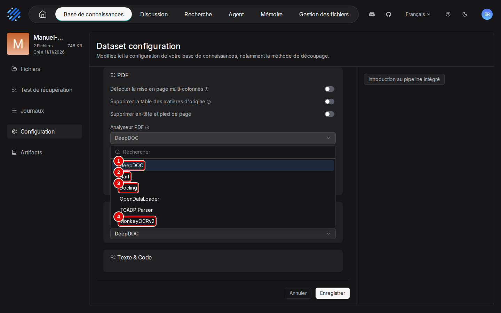
*Écran : « Configuration », liste « Analyseur PDF » ouverte.*

| N° | Élément | Rôle |
|---|---|---|
| 1 | « DeepDOC » | lecture des caractères, de la mise en page et des tableaux sur la machine (par défaut) |
| 2 | « Naïf » | texte brut du PDF seulement, inutilisable sur un scan |
| 3 | « Docling » | lecteur externe Docling ; « OpenDataLoader » et « TCADP Parser » suivent |
| 4 | « MonkeyOCRv2 » | lecteur externe MonkeyOCR |

*Résultat* : Échap referme la liste sans rien changer. Les lecteurs externes demandent un service à installer à part ; ils n'ont pas été essayés.

## Bon à savoir

- Les tableaux d'un PDF sont rendus en lignes et colonnes dans le passage, avec leur titre ; les dix questions sur des tableaux posées pendant les essais ont toutes eu la bonne réponse.
- La lecture d'un scan se fait sur le processeur : compter environ cinq secondes par page, davantage si d'autres analyses tournent en même temps.
- Un passage ajouté à la main appartient au document : une nouvelle analyse de ce document l'efface, comme les corrections.
- Les questions sur le contrat scanné ont toutes reçu la bonne réponse, avec la bonne page citée : le modèle de réponse rétablit souvent le sens d'un chiffre mal lu. La correction sert surtout quand la recherche dépend d'un mot ou d'un nombre exact.
- Le test de récupération affiche parfois des restes de balises autour des titres de tableaux (« ption>7. Fournisseurs principaux ») : c'est un défaut d'affichage, sans effet sur les réponses.

## En cas de problème

| Symptôme | Cause | Que faire |
|---|---|---|
| « Confirmer » ne ferme pas « Modifier le segment » pour un passage de PDF | défaut de cette version : la correction n'est pas envoyée | « Annuler », puis ajouter un passage corrigé (étape 23) |
| Chiffres faux dans un passage de scan (« 0oo ») | confusions de la lecture des caractères | ajouter un passage corrigé, avec mot-clé et question |
| Une question précise ne retrouve pas le bon passage | mots collés par la lecture des caractères | ajouter un passage corrigé ; ou donner plus de poids à la recherche par le sens (chapitre 08) |
| Passages corrigés ou ajoutés disparus | document réanalysé ou gabarit changé | refaire les corrections ; ne pas relancer un document corrigé |
| Le gabarit choisi ne change rien pour un fichier | ce gabarit ne traite pas ce format | normal ; voir « Comparer les gabarits » |
| Analyse d'un gros scan très longue | lecture sur le processeur, cinq secondes par page | patienter ; une seule grosse analyse à la fois |

Les autres problèmes sont traités au chapitre [15. En cas de problème](15-en-cas-de-probleme.md).

---
*Version décrite : RAGFlow v1.0.0, essais des 9 et 11 novembre 2026. Détails et preuves : [rapport d'essais](../annexes/A6-rapport-d-essais.md).*
