# 07. Poser des questions et lire les sources

> Ce chapitre apprend à converser avec un assistant au quotidien : poser une question, vérifier chaque source, reconnaître un refus, gérer les conversations, joindre un fichier, choisir entre les modes « Naive » et « Agentic », comparer plusieurs modèles et publier l'assistant dans une page web.
> **Point de départ** : barre du haut › « Discussion » (liste des assistants), un assistant relié à une base, de préférence l'assistant « Démo Vélanor » créé à la fin du chapitre 05.
> **Durée** : environ 20 minutes. **Avant** : chapitre 05 (base et assistant « Démo Vélanor », créés dans sa dernière partie).

**Attention** : le code d'intégration d'un assistant dans une page web contient une clé d'accès ; toute personne qui possède ce code peut interroger l'assistant. Ne pas le publier ni le transmettre hors du poste.

## Ce qu'il faut savoir

Une **conversation** est une suite de questions et de réponses avec un même assistant ; l'assistant en garde le fil. Chaque réponse s'appuie sur les passages retrouvés dans les bases reliées, et chaque phrase importante porte un **renvoi**, un numéro entre crochets, vers le passage qui la justifie. Lire une réponse, c'est donc aussi vérifier ses renvois : le survol d'un numéro affiche le passage, un clic sur la vignette ouvre le document. Quand l'information n'est pas dans les documents, l'assistant le dit au lieu d'inventer. Exemple : à la question « Quel est le délai de livraison contractuel de Batterix et quel délai moyen est réellement constaté ? », l'assistant répond « 21 jours selon le contrat, 24 jours constatés », avec un renvoi vers le contrat scanné et un autre vers le tableau des stocks.

## Retrouver un assistant

**Étape 1. Ouvrir la liste des assistants**
*Où* : barre du haut › « Discussion ».
La liste montre une carte par assistant. Le menu « … » (pastille 5), au survol d'une carte, propose « Renommer » et « Supprimer » ; la suppression emporte les conversations de l'assistant, après confirmation.

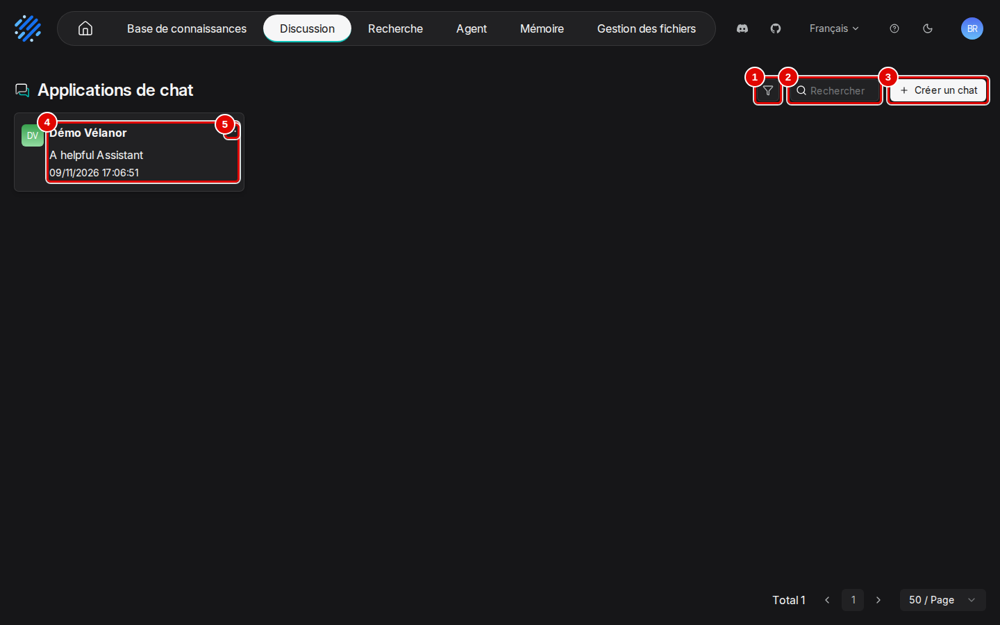
*Écran : Discussion (liste des assistants).*

| N° | Élément | Rôle |
|---|---|---|
| 1 | filtre (entonnoir) | restreint la liste des assistants |
| 2 | « Rechercher » | filtre par nom |
| 3 | « Créer un chat » | crée un assistant (chapitre 04) |
| 4 | carte d'un assistant | nom et date ; un clic ouvre l'assistant |
| 5 | menu « … » de la carte | « Renommer », « Supprimer » |

*Résultat* : un clic sur la carte ouvre l'assistant.

**Étape 2. Se repérer dans la page de l'assistant**
*Où* : Discussion › carte de l'assistant.
La colonne de gauche liste les conversations ; le « + » (pastille 3) en ouvre une nouvelle ; l'engrenage (pastille 6) ouvre les réglages (chapitre 08).

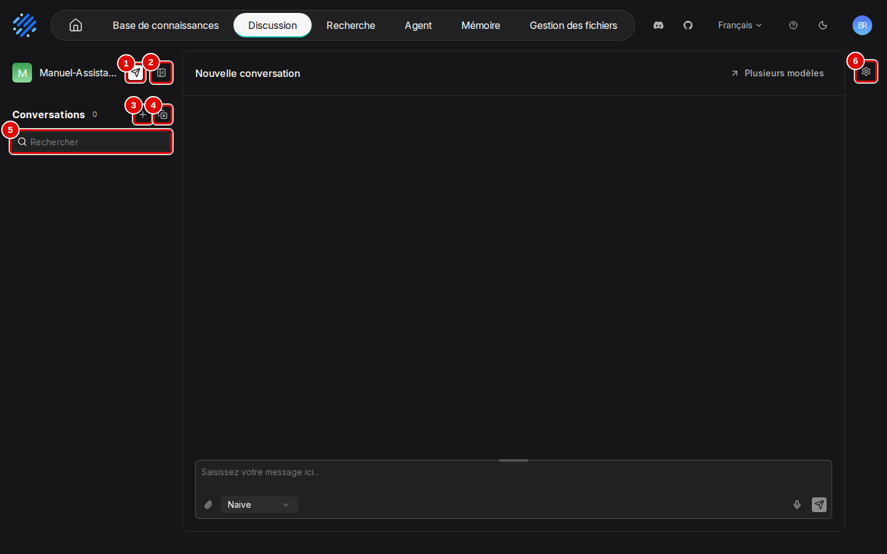
*Écran : page d'un assistant.*

| N° | Élément | Rôle |
|---|---|---|
| 1 | avion en papier | « Intégrer dans la page web » (étape 17) |
| 2 | icône de repli | replie la colonne des conversations |
| 3 | « + » | ouvre une nouvelle conversation |
| 4 | icône de suppression groupée | passe la liste en mode sélection (étape 9) |
| 5 | « Rechercher » | filtre les conversations par titre |
| 6 | engrenage | ouvre le panneau « Paramètres du chat » (chapitre 08) |

*Résultat* : la page est repérée. En bas, la zone de saisie contient la question (la poignée au-dessus l'agrandit), le trombone « Attach file » (étape 10), le sélecteur de mode « Naive » ou « Agentic » (étape 12), le micro et l'avion en papier « Send message ». « Plusieurs modèles », en haut à droite, sert à comparer des modèles (étape 16).

## Poser une question et lire la réponse

**Étape 3. Poser la question**
*Où* : page de l'assistant › « + » à côté de « Conversations », puis zone de saisie.
Ouvrir une nouvelle conversation, taper la question, puis cliquer sur « Send message ». L'exemple pose la question du délai de livraison de Batterix à « Manuel-Assistant-05 » (nom tronqué en « Manuel-Assista… » sur la capture), un assistant d'essai relié à la base « Démo Vélanor » et réglé exactement comme l'assistant « Démo Vélanor » (chapitre 05, étape 24) : interroger ce dernier donne le même résultat. Avec un assistant laissé aux réglages d'origine, la réponse peut ne donner que le délai constaté (étape 15). Le chapitre 08 explique ces réglages ; il n'est pas nécessaire de l'avoir lu pour suivre celui-ci.

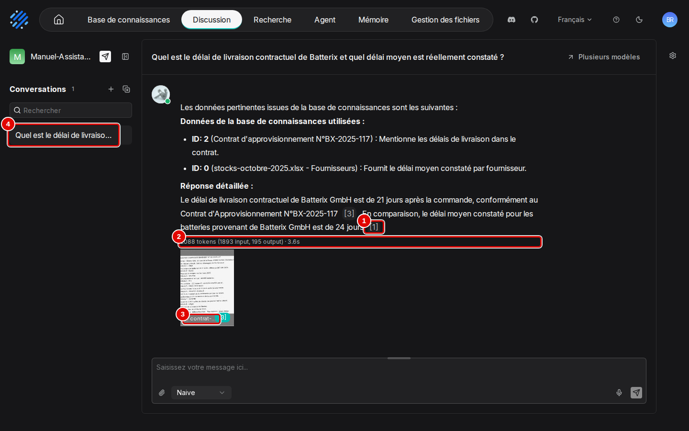
*Écran : page de l'assistant, réponse citée.*

| N° | Élément | Rôle |
|---|---|---|
| 1 | renvoi « [1] » | numéro du passage qui justifie la phrase ; le survol affiche le passage (étape 5) |
| 2 | « 2088 tokens (1893 input, 195 output) · 3.6s » | texte lu et écrit par le modèle (en jetons) et durée de rédaction |
| 3 | document cité | vignette du document ; un clic l'ouvre (étape 6) |
| 4 | conversation | nommée d'après la première question |

*Résultat* : en moins de quatre secondes, la réponse donne les deux délais, 21 jours (contrat) et 24 jours (constaté), chacun avec son renvoi. Le début de la réponse, « Données de la base de connaissances utilisées : ID: 2 (…), ID: 0 (…) », vient du modèle, pas de RAGFlow : RAGFlow lui transmet chaque passage trouvé précédé d'un numéro (« ID: 0 », « ID: 1 »…), et le modèle recopie parfois cette liste avant de répondre. Ces numéros ne désignent ni une base ni un assistant, seulement les passages trouvés pour cette question ; ce préambule varie d'une question à l'autre et peut être ignoré.

**Étape 4. Utiliser les actions d'un message**
*Où* : conversation › survol d'une question ou d'une réponse.
De petites icônes apparaissent au-dessus du message. Au-dessus d'une question : copier, régénérer (repose la question) et supprimer (retire la question et sa réponse). Au-dessus d'une réponse, celles de la capture, prise sur la conversation « Contrat Batterix » de l'assistant « Démo Vélanor ».

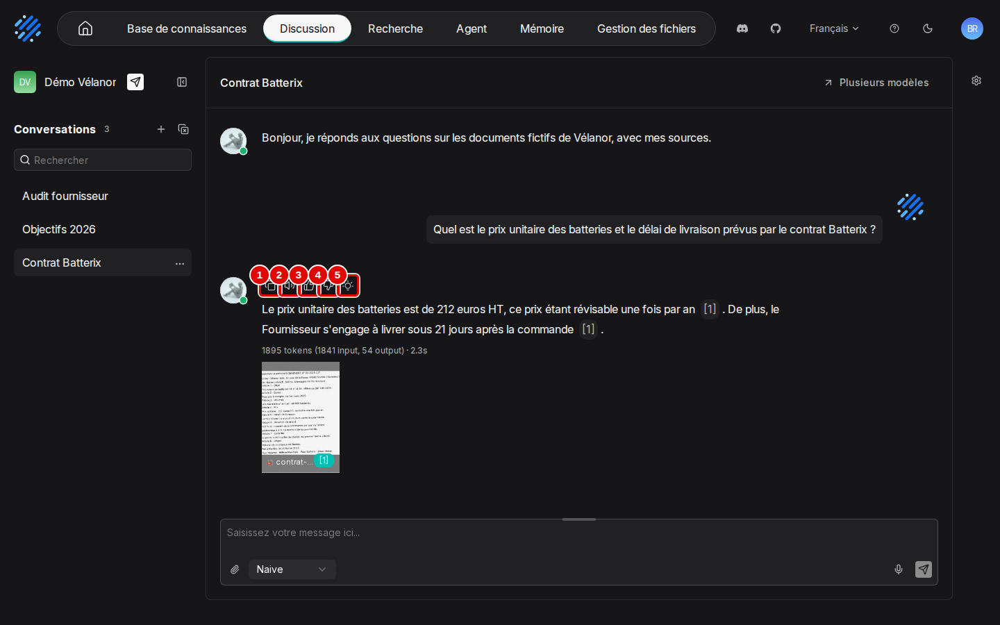
*Écran : conversation, icônes d'une réponse au survol.*

| N° | Élément | Rôle |
|---|---|---|
| 1 | copier | copie le texte de la réponse |
| 2 | lire à voix haute | demande un modèle de synthèse vocale (« Modèle TTS »), absent des essais |
| 3 | pouce levé | note la réponse comme bonne |
| 4 | pouce baissé | note la réponse comme mauvaise ; une fenêtre permet d'expliquer pourquoi |
| 5 | prompt | affiche le texte complet envoyé au modèle : consignes, passages trouvés et question |

*Résultat* : l'action choisie s'applique au message survolé.

## Vérifier une source

**Étape 5. Lire le passage cité**
*Où* : réponse › survol d'un renvoi (« [1] »).
Passer la souris sur le numéro : la bulle affiche le passage cité, la vignette de sa page et le nom du document (pastille 1).

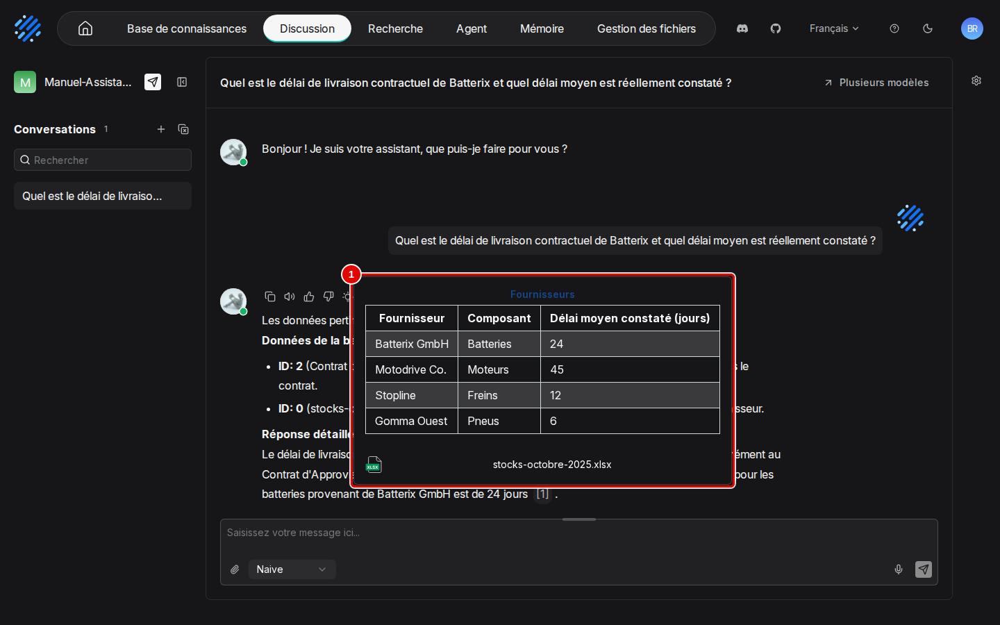
*Écran : page de l'assistant, bulle de citation.*

| N° | Élément | Rôle |
|---|---|---|
| 1 | extrait cité | texte du passage (ici le contrat scanné, tel que lu par la reconnaissance de caractères) et nom du fichier |

*Résultat* : la phrase de la réponse est comparée à sa source.

**Étape 6. Ouvrir le document cité**
*Où* : sous la réponse › vignette du document.
Cliquer sur la vignette : le document s'affiche en entier (pastille 1) ; la croix (pastille 2) le referme.

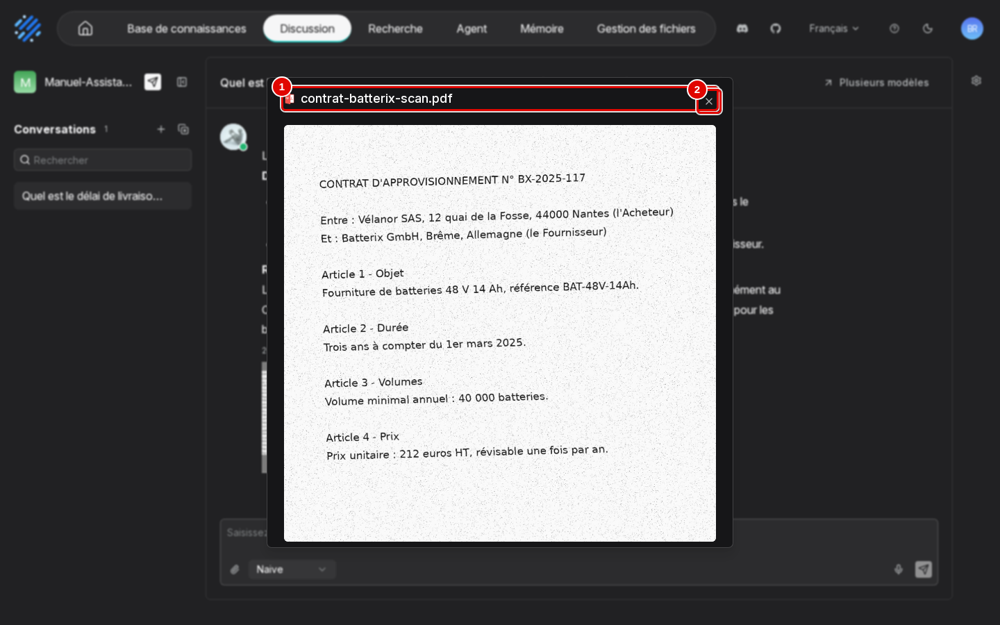
*Écran : aperçu du document cité.*

| N° | Élément | Rôle |
|---|---|---|
| 1 | « contrat-batterix-scan.pdf » | document cité, affiché en entier |
| 2 | croix | referme l'aperçu |

*Résultat* : la source est lue dans son contexte.

## Reconnaître un refus

**Étape 7. Poser une question hors des documents**
*Où* : conversation › zone de saisie.
Poser une question dont la réponse n'est dans aucun document, ici « Quel était le chiffre d'affaires de Vélanor en 2022 ? ». La réponse s'affiche comme une réponse ordinaire, avec la phrase de refus (pastille 1).

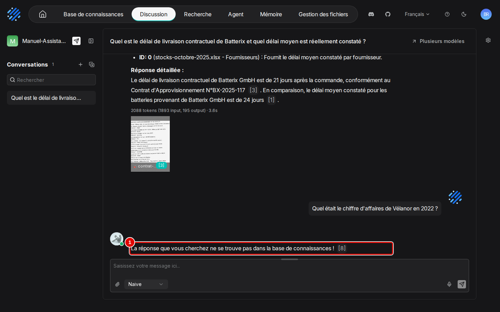
*Écran : conversation, réponse de refus.*

| N° | Élément | Rôle |
|---|---|---|
| 1 | réponse de refus | « La réponse que vous cherchez ne se trouve pas dans la base de connaissances ! », suivie ici du renvoi « [8] » |

*Résultat* : l'assistant refuse au lieu d'inventer. La phrase est parfois suivie d'un renvoi vers les passages consultés : un renvoi ne prouve donc pas qu'une réponse a été trouvée ; c'est le texte qui compte. Le message de refus se règle au chapitre 08.

## Gérer les conversations

**Étape 8. Supprimer une conversation**
*Où* : colonne « Conversations » › survol d'une conversation › menu « … ».
Survoler la conversation dans la colonne de gauche, cliquer sur son menu « … », puis sur « Supprimer » (pastille 1). Le menu ne propose que cette entrée : une conversation ne se renomme pas, elle garde le titre de sa première question.

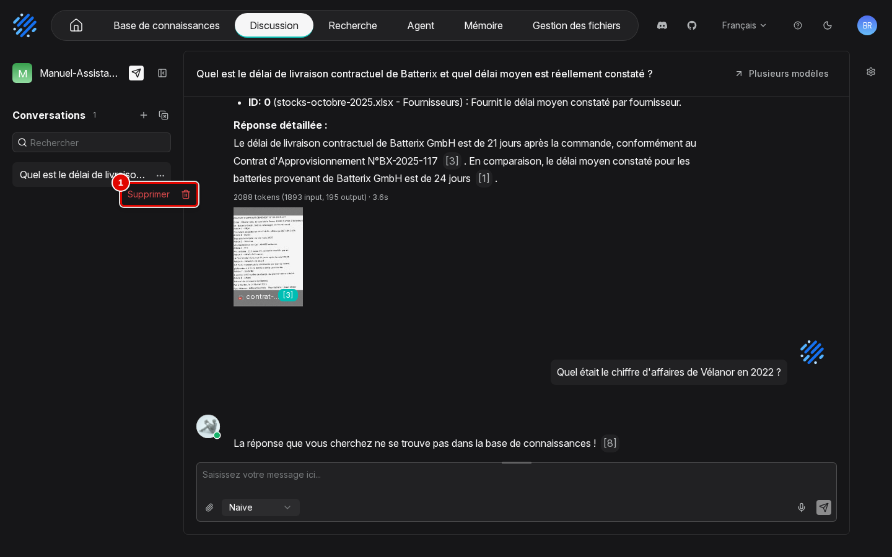
*Écran : colonne « Conversations », menu « … » d'une conversation ouvert.*

| N° | Élément | Rôle |
|---|---|---|
| 1 | « Supprimer » | supprime la conversation, après confirmation |

*Résultat* : la conversation disparaît de la liste.

**Étape 9. Supprimer plusieurs conversations**
*Où* : colonne « Conversations » › icône de suppression groupée (capture de l'étape 2, pastille 4).
Une case apparaît devant chaque conversation (pastille 1). Cocher celles à supprimer, cliquer sur la corbeille (pastille 3), puis sur « Supprimer » dans la fenêtre « Suppression en masse ». La flèche de retour (pastille 2) quitte le mode sélection sans rien supprimer.

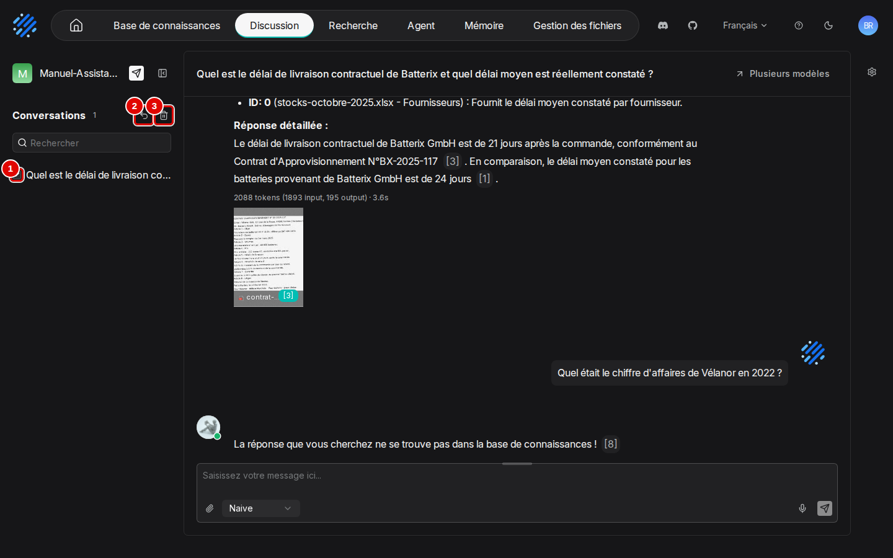
*Écran : colonne « Conversations » en mode sélection.*

| N° | Élément | Rôle |
|---|---|---|
| 1 | case d'une conversation | coche la conversation à supprimer |
| 2 | flèche de retour | quitte le mode sélection |
| 3 | corbeille | supprime les conversations cochées, après confirmation |

*Résultat* : les conversations cochées sont supprimées, définitivement.

## Joindre un fichier à une question

**Étape 10. Joindre le fichier**
*Où* : zone de saisie › trombone « Attach file ».
Cliquer sur le trombone (pastille 2) et choisir le fichier (5 fichiers au plus, 5 Mo chacun), ici `faq-sav.html` : il s'affiche au-dessus de la zone de saisie, avec son nom et sa taille (pastille 1), et part avec la prochaine question.

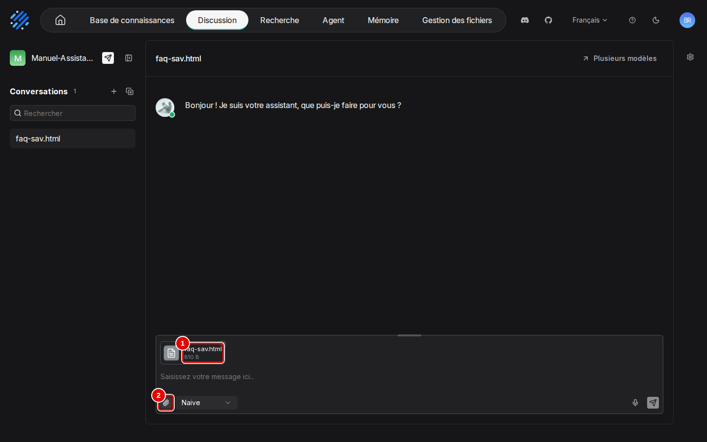
*Écran : zone de saisie, fichier joint.*

| N° | Élément | Rôle |
|---|---|---|
| 1 | fichier joint | nom et taille du fichier qui partira avec la question |
| 2 | « Attach file » | trombone qui ouvre le choix des fichiers |

*Résultat* : le modèle lit le fichier avec la question, sans l'ajouter à une base. Une conversation ouverte ainsi prend le nom du fichier. Pour qu'un document serve durablement, l'ajouter plutôt à une base (chapitre 05).

## Choisir entre « Naive » et « Agentic »

« Naive » fait une recherche puis une réponse, en une seule passe : c'est le mode par défaut. « Agentic » laisse le modèle décider lui-même de plusieurs recherches successives avant de répondre, comme un enquêteur qui reformule ses questions. Avec un petit modèle comme celui des essais, « Agentic » est plus lent, plus coûteux et moins fiable ; « Naive » avec un assistant bien réglé (chapitre 08) donne de meilleurs résultats.

**Étape 11. Créer l'assistant d'essai « Manuel-Agentic »**
*Où* : barre du haut › « Discussion » › « Créer un chat ».
Les étapes 12 à 15 comparent les deux modes avec un assistant laissé à ses réglages d'origine, pour ne pas mêler l'effet du mode et celui des réglages. Créer l'assistant « Manuel-Agentic », puis le relier à la base « Démo Vélanor » sans changer aucun autre réglage : mêmes gestes et mêmes écrans qu'au chapitre 04, étapes 10 à 16 (fenêtre de création, panneau « Paramètres du chat », liste des bases, « Enregistrer »), avec « Démo Vélanor » cochée au lieu de « Manuel-Prise-en-main ».

*Résultat* : l'assistant « Manuel-Agentic » est relié à « Démo Vélanor », avec « Top N » 8 et un poids des mots-clés de 0,7, les valeurs de création à la souris. Ouvrir une nouvelle conversation (« + » à côté de « Conversations »).

**Étape 12. Ouvrir le sélecteur de mode**
*Où* : nouvelle conversation › zone de saisie › « Naive ».
Cliquer sur le sélecteur : il propose les deux modes. Le mode se choisit question par question.

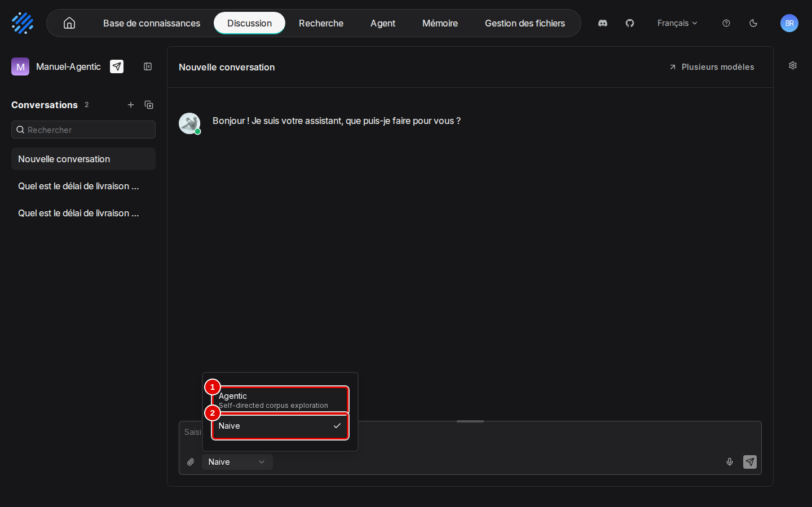
*Écran : zone de saisie, sélecteur de mode ouvert.*

| N° | Élément | Rôle |
|---|---|---|
| 1 | « Agentic » | le modèle mène lui-même plusieurs recherches (« Self-directed corpus exploration ») |
| 2 | « Naive » | recherche unique puis réponse ; coché par défaut |

*Résultat* : le mode choisi s'affiche dans la zone de saisie.

**Étape 13. Poser la question en mode « Agentic »**
*Où* : zone de saisie, mode « Agentic » choisi.
Taper la question (pastille 1), vérifier le mode (pastille 2), puis cliquer sur « Send message » (pastille 3). L'exemple reprend la question du délai de livraison de Batterix, posée à l'assistant « Manuel-Agentic » de l'étape 11.

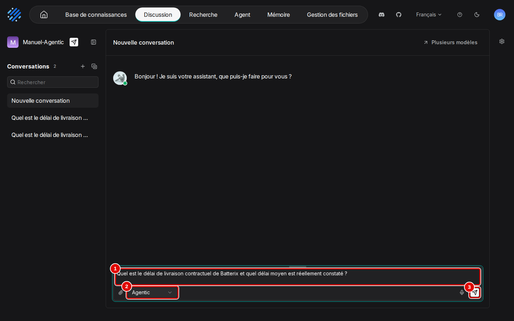
*Écran : zone de saisie, question en mode « Agentic ».*

| N° | Élément | Rôle |
|---|---|---|
| 1 | zone de saisie | « Quel est le délai de livraison contractuel de Batterix et quel délai moyen est réellement constaté ? » |
| 2 | « Agentic » | mode choisi pour cette question |
| 3 | « Send message » | envoie la question |

*Résultat* : la réponse arrive après cinq secondes environ (étape suivante).

**Étape 14. Lire la réponse agentique**
*Où* : conversation.
Un bloc « Thought » repliable précède la réponse : c'est le raisonnement du modèle. Le compteur (pastille 3) montre le coût : environ 32 000 jetons lus, vingt fois plus qu'en mode « Naive ».

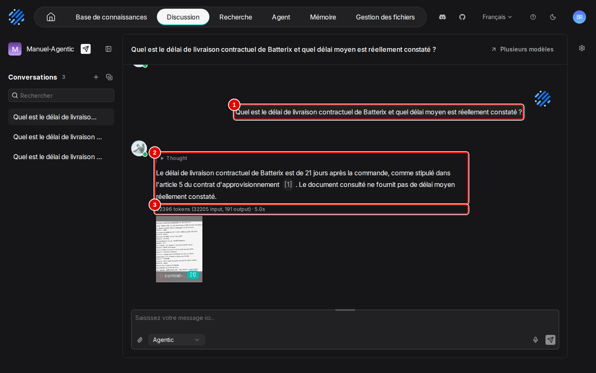
*Écran : conversation, réponse en mode « Agentic ».*

| N° | Élément | Rôle |
|---|---|---|
| 1 | question | question posée |
| 2 | réponse | bloc « Thought » repliable, puis réponse citée (« [1] » renvoie au contrat) |
| 3 | « 32396 tokens (32205 input, 191 output) · 5.0s » | texte lu et écrit, durée de rédaction |

*Résultat* : ici la réponse trouve le délai du contrat mais déclare absent le délai constaté. Posée deux fois, la même question a donné une fois la réponse complète, une fois la réponse partielle : ce mode n'est pas stable avec ce modèle.

**Étape 15. Comparer avec « Naive »**
*Où* : « + » (nouvelle conversation) › sélecteur › « Naive ».
Poser la même question en mode « Naive », au même assistant « Manuel-Agentic », laissé à ses réglages d'origine.

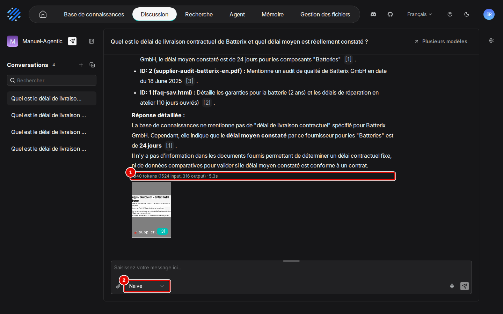
*Écran : conversation, réponse en mode « Naive ».*

| N° | Élément | Rôle |
|---|---|---|
| 1 | « 1840 tokens (1524 input, 316 output) · 5.3s » | texte lu et écrit : environ vingt fois moins qu'en mode « Agentic » |
| 2 | « Naive » | mode utilisé pour cette question |

*Résultat* : avec les réglages d'origine, la réponse ne donne que le délai constaté. Avec les réglages de l'assistant « Démo Vélanor » (poids des mots-clés 0,3, chapitre 05, étape 24), le même mode « Naive » donne les deux délais à coup sûr (étape 3), pour une fraction du coût.

Quand utiliser lequel :

- **« Naive »** pour l'usage courant : réponses rapides (environ une seconde et demie), stables et toujours citées. Sur les 38 questions des essais, il donne 33 bonnes réponses sur 34 avec les réglages d'origine, et 34 sur 34 avec les réglages conseillés.
- **« Agentic »** seulement pour une question qui croise plusieurs documents et que « Naive » rate malgré un bon réglage, avec un modèle plus puissant que celui des essais. Sur les mêmes questions, il donne 30 bonnes réponses sur 34, 5 réponses sans citation, et prend trois à quatre fois plus de temps. Quand il échoue, il répond parfois qu'il n'a accès à aucun document : reposer alors la question en « Naive ».

## Comparer plusieurs modèles

**Étape 16. Ouvrir la comparaison**
*Où* : page de l'assistant › « Plusieurs modèles » (en haut à droite).
Chaque colonne a son propre modèle (pastille 2) et ses propres réglages ; le « + » (pastille 4) ajoute une colonne, jusqu'à trois. Une seule zone de saisie envoie la même question à toutes les colonnes.

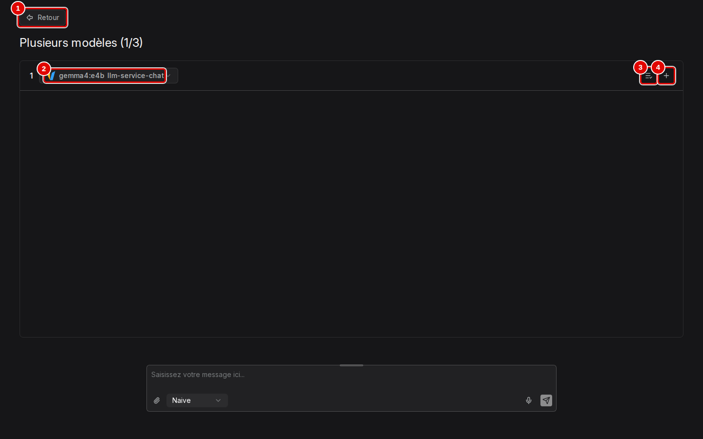
*Écran : page « Plusieurs modèles ».*

| N° | Élément | Rôle |
|---|---|---|
| 1 | « Retour » | revient à la discussion |
| 2 | modèle de la colonne 1 | modèle de cette colonne |
| 3 | « Appliquer la configuration du modèle » | reporte les réglages de la colonne dans l'assistant |
| 4 | « + » | ajoute une colonne, jusqu'à 3 ; le titre devient « Plusieurs modèles (2/3) » |

*Résultat* : les réponses s'affichent côte à côte. Utile pour choisir un modèle ou un réglage sur les mêmes questions. Les essais ne disposaient que d'un modèle de réponse : la comparaison n'a pas été lancée.

## Publier l'assistant dans une page web

**Étape 17. Ouvrir la fenêtre d'intégration**
*Où* : page de l'assistant › avion en papier, à côté du nom de l'assistant.
Choisir le type d'intégration (pastille 1), le thème (pastille 2) et la langue (pastille 4), puis copier le code (pastille 5) pour le coller dans la page d'un site. Le code est masqué sur la capture, car il contient la clé d'accès.

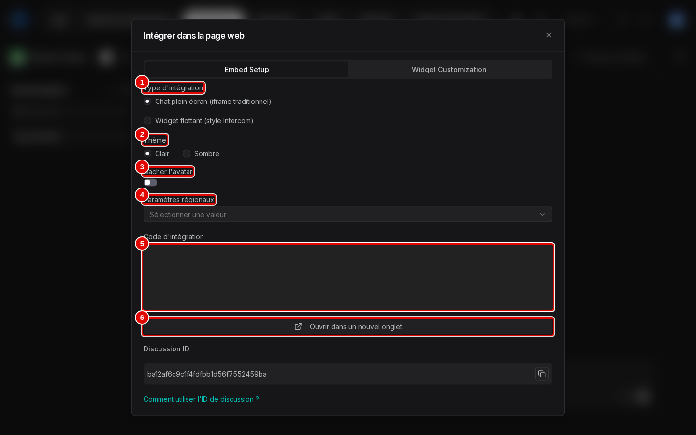
*Écran : fenêtre « Intégrer dans la page web ».*

| N° | Élément | Rôle |
|---|---|---|
| 1 | « Type d'intégration » | « Chat plein écran (iframe traditionnel) » ou « Widget flottant (style Intercom) », bulle de discussion en bas de page |
| 2 | « Thème » | « Clair » ou « Sombre » |
| 3 | « Cacher l'avatar » | masque l'avatar dans la page intégrée |
| 4 | « Paramètres régionaux » | langue de la page intégrée |
| 5 | « Code d'intégration » | code à copier ; contient l'adresse du serveur et la clé d'accès (masquées) |
| 6 | « Ouvrir dans un nouvel onglet » | ouvre la page de discussion publique ; « Discussion ID », en dessous, sert aux programmes |

*Résultat* : le code est prêt. L'onglet « Widget Customization » de la même fenêtre règle l'apparence de la bulle flottante (titre, sous-titre, pied de page, couleurs). La page intégrée est servie par RAGFlow lui-même : avec l'installation du chapitre 02, elle n'est visible que depuis ce poste.

## Bon à savoir

- Une réponse prend environ une seconde et demie de rédaction avec une carte graphique ; l'affichage complet, trois à quatre secondes.
- Les nombres affichés sous la réponse (« 652 tokens… ») mesurent la quantité de texte lue par le modèle : consignes, passages trouvés et question. C'est elle qui allonge le temps de réponse sur une machine sans carte graphique.
- Pour un PDF, la réponse affiche une vignette de la page citée ; pour un document texte, non.
- Le micro de la zone de saisie dicte la question ; il demande un modèle de transcription déclaré comme « Modèle Speech2txt » (chapitre 03). Il n'a pas été essayé.

## En cas de problème

| Symptôme | Cause | Que faire |
|---|---|---|
| Refus à une question pourtant couverte par les documents | le passage utile n'a pas été retrouvé, souvent un scan mal lu | régler la recherche (chapitre 08) ou ajouter un passage corrigé (chapitre 06) |
| Réponse « Agentic » « je n'ai accès à aucun document… », sans citation | le modèle n'a pas lancé de recherche | reposer la question en « Naive » |
| Deux réponses différentes à la même question en « Agentic » | exploration variable d'une fois à l'autre | préférer « Naive » avec un assistant bien réglé |
| Pas de « Renommer » dans le menu d'une conversation | absent de cette version | le titre reprend la première question |
| La page intégrée ne s'ouvre pas depuis un autre poste | RAGFlow n'écoute que sur ce poste | normal avec l'installation du chapitre 02 |

Les autres problèmes sont traités au chapitre [15. En cas de problème](15-en-cas-de-probleme.md).

---
*Version décrite : RAGFlow v1.0.0, essais des 9 et 11 novembre 2026. Détails et preuves : [rapport d'essais](../annexes/A6-rapport-d-essais.md).*
