# 08. Régler un assistant

> Ce chapitre apprend à régler un assistant réglage par réglage dans le panneau « Paramètres du chat », à appliquer les deux réglages qui améliorent les réponses, et à vérifier l'effet d'un réglage avec le « Test de récupération » d'une base.
> **Point de départ** : barre du haut › « Discussion » › un assistant ouvert (chapitre 07, étape 2).
> **Durée** : environ 20 minutes. **Avant** : chapitre 07.

## Ce qu'il faut savoir

Un assistant fait deux choses : il **cherche** les passages proches de la question, puis il les donne au **modèle** qui rédige. Les réglages agissent sur l'une ou l'autre. Les plus importants sont ceux de la recherche : combien de passages transmettre au modèle (« Top N »), et quelle part donner à la recherche par les mots et à la recherche par le sens (« Poids de similarité par mots-clés »). Par défaut, RAGFlow donne 70 % du poids aux mots. Or un document scanné contient souvent des mots mal lus (« Volumeminimalannuel ») que la recherche par les mots ne reconnaît pas ; la recherche par le sens, elle, s'en accommode mieux.

**Réglages conseillés** : donner 70 % du poids à la recherche par le sens, c'est-à-dire régler « Poids de similarité par mots-clés » sur 0,3, et transmettre 8 passages au modèle (« Top N » sur 8). Un assistant créé à la souris a déjà « Top N » à 8 : **seul le poids des mots-clés est à changer** (0,7 à la création). Un assistant créé par un programme part de « Top N » 6, à porter à 8. Pendant les essais, ce réglage a fait passer l'assistant de 33 à 34 bonnes réponses sur 34, sans ralentissement sensible, avec l'ancien comme avec le nouveau modèle de réponse ; la question gagnée croisait un contrat scanné et un tableur.

## Ouvrir le panneau et régler l'identité de l'assistant

**Étape 1. Ouvrir « Paramètres du chat »**
*Où* : page de l'assistant › engrenage (en haut à droite).
Le haut du panneau règle l'apparence de l'assistant : image (pastille 1), nom (pastille 2), description (pastille 3) et message d'accueil (pastille 6).

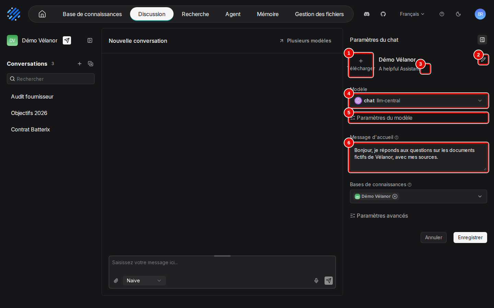
*Écran : page de l'assistant, haut du panneau « Paramètres du chat ».*

| N° | Élément | Rôle |
|---|---|---|
| 1 | « Télécharger » | image de l'assistant |
| 2 | crayon du nom | renomme l'assistant |
| 3 | crayon de la description | description (« Saisir une description ») |
| 4 | « Modèle » | modèle qui rédige les réponses (étape 2) |
| 5 | « Paramètres du modèle » | réglages de rédaction, repliés (étape 3) |
| 6 | « Message d'accueil » | premier message affiché dans chaque conversation |

*Résultat* : le panneau est ouvert ; il défile vers le bas jusqu'au bouton « Enregistrer ».

**Étape 2. Choisir le modèle**
*Où* : panneau « Paramètres du chat » › liste « Modèle ».
Cliquer sur la liste « Modèle » (capture de l'étape 1, pastille 4). Elle propose les modèles de chat déclarés au chapitre 03, groupés par fournisseur et instance ; sur la machine d'essai, un seul : `chat` (pastille 1).

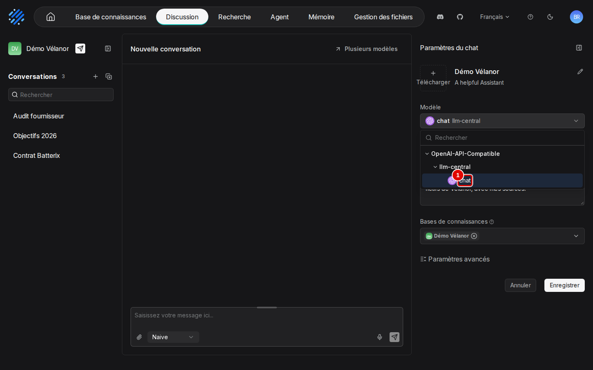
*Écran : panneau « Paramètres du chat », liste « Modèle » ouverte.*

| N° | Élément | Rôle |
|---|---|---|
| 1 | `chat` | modèle de chat de l'instance « llm-central », fournisseur « OpenAI-API-Compatible » |

*Résultat* : le modèle choisi rédigera les réponses de cet assistant.

## Régler la rédaction des réponses

**Étape 3. Déplier « Paramètres du modèle »**
*Où* : panneau « Paramètres du chat » › « Paramètres du modèle ».
Chaque réglage a un interrupteur ; désactivé, c'est la valeur du service de modèles qui s'applique. Tous sont désactivés à la création, ce qui convient dans la plupart des cas.

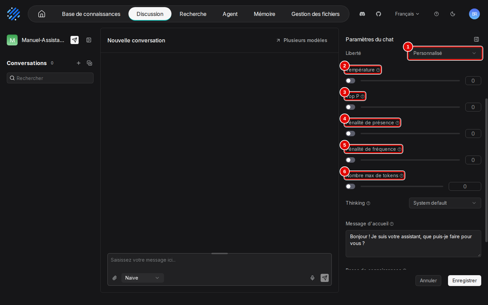
*Écran : panneau « Paramètres du chat », « Paramètres du modèle » dépliés.*

| N° | Élément | Rôle |
|---|---|---|
| 1 | « Liberté » | raccourci qui règle les quatre réglages suivants d'un coup (étape 4) |
| 2 | « Température » | part de hasard dans la rédaction : basse, réponses stables ; haute, réponses variées |
| 3 | « Top P » | autre façon de limiter le hasard : le modèle ne choisit que parmi les mots les plus probables |
| 4 | « Pénalité de présence » | décourage la reprise de mots déjà employés |
| 5 | « Pénalité de fréquence » | décourage la répétition fréquente des mêmes mots |
| 6 | « Nombre max de tokens » | longueur maximale de la réponse ; trop bas, la réponse est coupée |

*Résultat* : les réglages de rédaction sont visibles.

**Étape 4. Choisir un préréglage « Liberté »**
*Où* : « Paramètres du modèle » › « Liberté ».
Cliquer sur la liste « Liberté » (capture de l'étape 3, pastille 1) : quatre choix. « Précis » convient à un assistant documentaire.

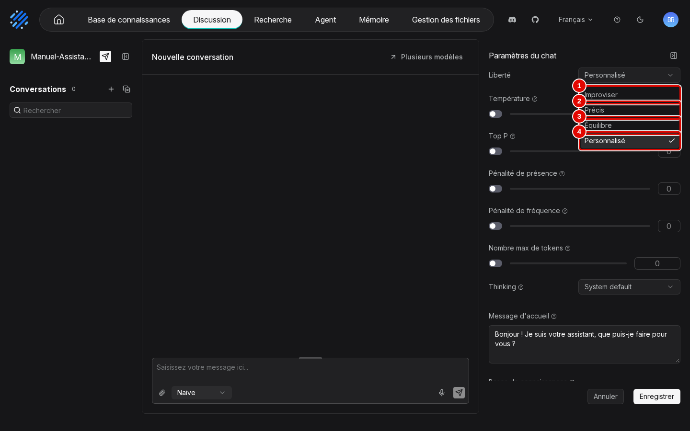
*Écran : « Paramètres du modèle », liste « Liberté » ouverte.*

| N° | Élément | Rôle |
|---|---|---|
| 1 | « Improviser » | réponses plus créatives |
| 2 | « Précis » | réponses plus prudentes |
| 3 | « Équilibre » | entre les deux |
| 4 | « Personnalisé » | valeurs réglées à la main ; affiché à la création |

*Résultat* : les quatre curseurs prennent les valeurs du préréglage.

**Étape 5. Régler la réflexion préalable**
*Où* : « Paramètres du modèle » › « Thinking ».
Pour les modèles qui savent « réfléchir » avant de répondre. Ouvrir la liste « Thinking », sous les curseurs des « Paramètres du modèle ».

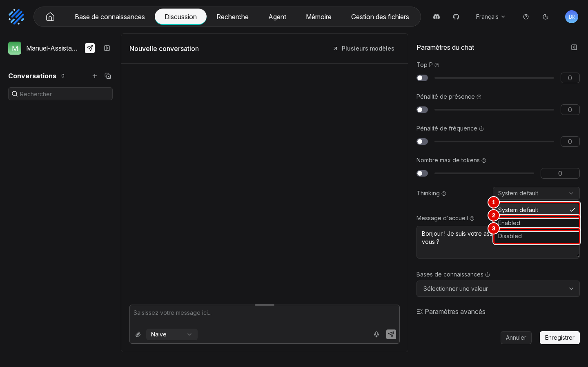
*Écran : « Paramètres du modèle », liste « Thinking » ouverte.*

| N° | Élément | Rôle |
|---|---|---|
| 1 | « System default » | comportement du modèle ; valeur à la création |
| 2 | « Enabled » | force la réflexion : réponses plus lentes |
| 3 | « Disabled » | supprime la réflexion |

*Résultat* : le comportement est fixé ; garder « System default » sauf besoin.

## Choisir les bases et les options avancées

**Étape 6. Relier les bases**
*Où* : panneau « Paramètres du chat » › « Bases de connaissances ».
Ouvrir la liste « Bases de connaissances » et cocher une ou plusieurs bases (pastille 2), puis cliquer sur « Fermer » en bas de la liste, comme au chapitre 04 (étapes 14 à 16) ; « Rechercher... » (pastille 1) filtre la liste. Une base sans document analysé n'apparaît pas.

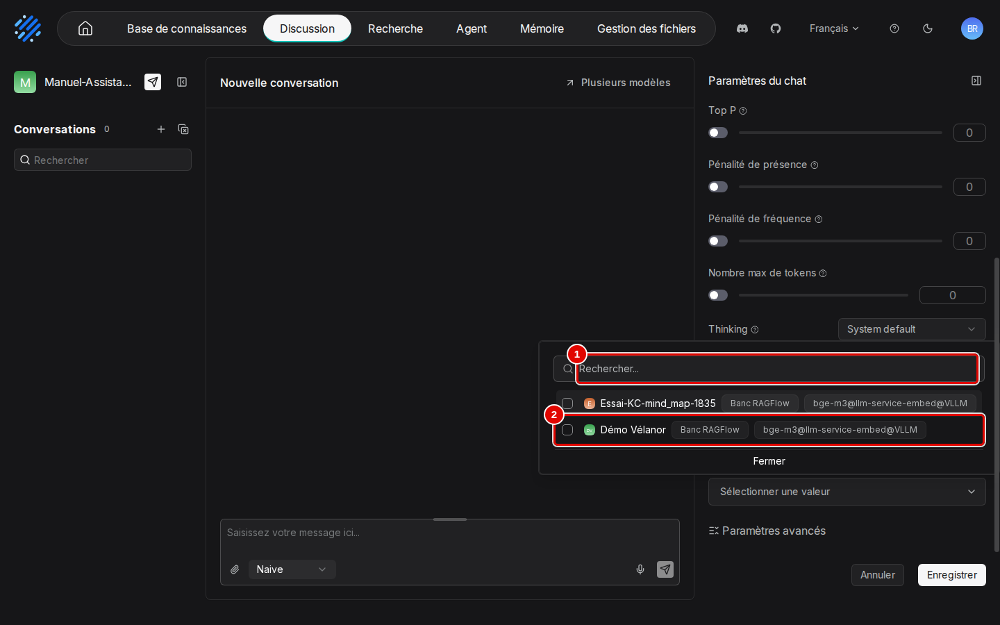
*Écran : panneau « Paramètres du chat », liste « Bases de connaissances » ouverte.*

| N° | Élément | Rôle |
|---|---|---|
| 1 | « Rechercher... » | filtre les bases par nom |
| 2 | « Démo Vélanor » | base à relier ; la ligne rappelle son propriétaire et son modèle d'embedding |

*Résultat* : l'assistant cherchera dans toutes les bases cochées.

**Étape 7. Déplier « Paramètres avancés »**
*Où* : panneau « Paramètres du chat » › « Paramètres avancés ».
Garder « Afficher la citation » activé (pastille 1) : c'est ce qui affiche les renvois sous les réponses.

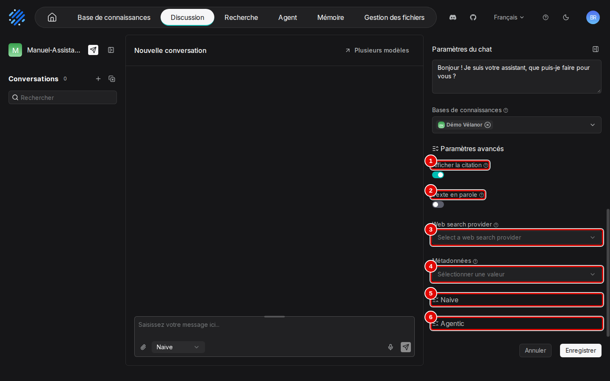
*Écran : panneau « Paramètres du chat », « Paramètres avancés » dépliés.*

| N° | Élément | Rôle |
|---|---|---|
| 1 | « Afficher la citation » | affiche les renvois et les documents cités sous la réponse ; activé par défaut |
| 2 | « Texte en parole » | lecture audio des réponses ; demande un « Modèle TTS », absent des essais |
| 3 | « Web search provider » | ajoute une recherche sur Internet (étape 8) |
| 4 | « Métadonnées » | filtre les documents interrogés selon leurs métadonnées (étape 9) |
| 5 | « Naive » | réglages du mode de réponse directe (étapes 10 à 12) |
| 6 | « Agentic » | réglages du mode agentique (étape 14) |

*Résultat* : les options avancées sont visibles.

**Étape 8. Laisser la recherche sur Internet désactivée**
*Où* : « Paramètres avancés » › « Web search provider ».
Ouvrir la liste « Web search provider » (capture de l'étape 7, pastille 3) : elle propose douze services de recherche sur Internet (AnySearch, Brave Search, Exa, Tavily…). Chacun demande un compte et une clé chez le service, et ferait sortir les questions du poste. Échap referme la liste sans rien choisir.

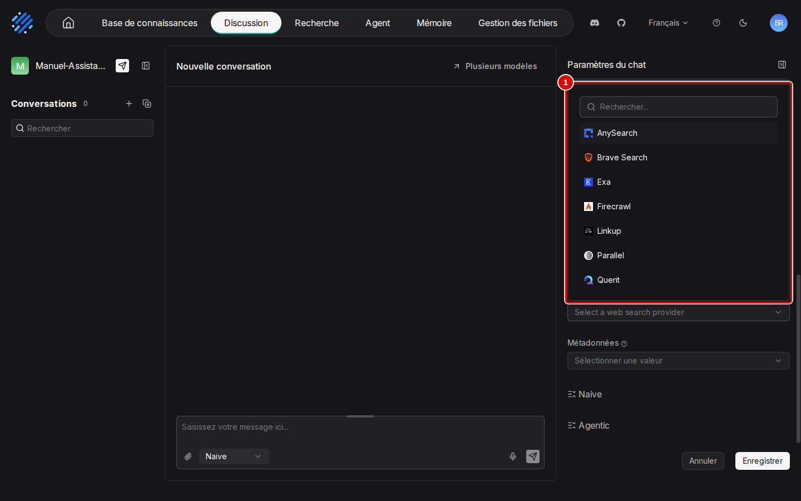
*Écran : « Paramètres avancés », liste « Web search provider » ouverte.*

| N° | Élément | Rôle |
|---|---|---|
| 1 | services proposés | douze services ; la liste défile, « Rechercher... » la filtre |

*Résultat* : l'assistant ne cherche que dans les bases.

**Étape 9. Filtrer par métadonnées**
*Où* : « Paramètres avancés » › « Métadonnées ».
Ouvrir la liste « Métadonnées » (capture de l'étape 7, pastille 4) : quatre choix. Utile seulement si les fichiers ont des métadonnées (chapitre 05, étape 10).

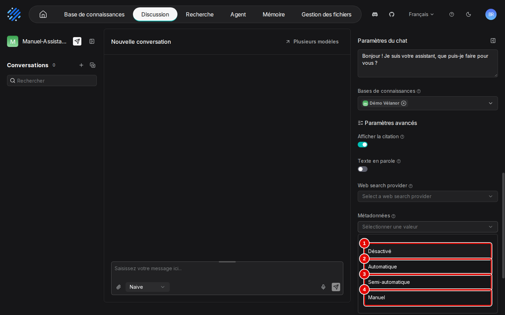
*Écran : « Paramètres avancés », liste « Métadonnées » ouverte.*

| N° | Élément | Rôle |
|---|---|---|
| 1 | « Désactivé » | aucun filtre ; par défaut |
| 2 | « Automatique » | le modèle déduit le filtre de la question |
| 3 | « Semi-automatique » | le modèle choisit parmi des champs désignés |
| 4 | « Manuel » | conditions fixées à la main |

*Résultat* : l'assistant ne consulte que les documents qui répondent au filtre.

## Régler la recherche (mode « Naive »)

**Étape 10. Régler le message de refus et les consignes**
*Où* : « Paramètres avancés » › « Naive ».
Saisir dans « Réponse vide » (pastille 1) un message en français, par exemple « Aucune information pertinente n'a été trouvée dans les documents. ». Le « Prompt système » (pastille 3) contient les consignes données au modèle ; il contient aussi la phrase de refus que le modèle emploie.

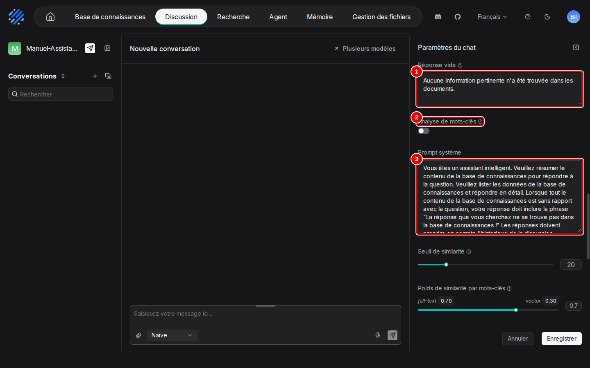
*Écran : « Paramètres avancés », partie « Naive », haut.*

| N° | Élément | Rôle |
|---|---|---|
| 1 | « Réponse vide » | texte affiché quand aucun passage n'est retrouvé ; vide, le modèle répond à sa façon |
| 2 | « Analyse de mots-clés » | fait extraire par le modèle les mots importants de la question ; utile pour les longues questions, plus lent |
| 3 | « Prompt système » | consignes données au modèle ; le mot `{knowledge}` y marque l'endroit où sont insérés les passages retrouvés |

*Résultat* : les messages sont réglés. La « Réponse vide » ne sert que si aucun passage ne dépasse le seuil ; sinon c'est le modèle qui conclut, avec la phrase de refus du « Prompt système » (« La réponse que vous cherchez ne se trouve pas dans la base de connaissances ! »). Pour changer le refus dans tous les cas, modifier les deux.

**Étape 11. Appliquer les réglages conseillés**
*Où* : « Paramètres avancés » › « Naive », plus bas.
Régler « Poids de similarité par mots-clés » (pastille 2) sur 0,3, ce qui donne 0,7 à la recherche par le sens. Vérifier que « Top N » (pastille 4) vaut 8 : c'est sa valeur à la création à la souris, il n'y a alors rien à changer.

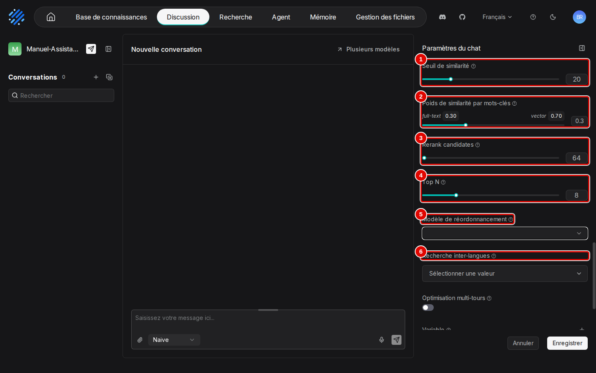
*Écran : « Paramètres avancés », partie « Naive », réglages de recherche.*

| N° | Élément | Rôle |
|---|---|---|
| 1 | « Seuil de similarité » | score minimal (sur 100) pour qu'un passage soit retenu ; 20 à la création |
| 2 | « Poids de similarité par mots-clés » | part de la recherche par les mots (« full-text ») ; le reste va à la recherche par le sens (« vector ») ; 0,7 à la création |
| 3 | « Rerank candidates » | nombre de passages soumis au second tri, s'il existe ; 64 à la création |
| 4 | « Top N » | nombre de passages donnés au modèle ; plus de passages, plus de contexte, mais plus de texte à lire ; 8 à la création |
| 5 | « Modèle de réordonnancement » | modèle de second tri des passages (étape suivante) ; vide sur la capture |
| 6 | « Recherche inter-langues » | traduit la question dans les langues choisies avant de chercher, pour des documents en plusieurs langues |

*Résultat* : la recherche est réglée comme conseillé. Baisser le seuil fait entrer plus de passages, au risque de passages hors sujet ; le monter rend l'assistant plus prompt à refuser.

**Étape 12. Choisir un reranker (facultatif)**
*Où* : « Paramètres avancés » › « Naive » › « Modèle de réordonnancement ».
Un **reranker** relit chaque passage trouvé à côté de la question et lui donne une note plus fine, avant que les « Top N » meilleurs soient transmis au modèle. Ouvrir la liste sous « Modèle de réordonnancement » (pastille 1) : elle ne propose que les modèles de type « Rerank » déclarés au chapitre 03 (pastille 2). Cliquer sur `rerank` (pastille 3). « Rerank candidates » (pastille 4) fixe le nombre de passages soumis au reranker ; 64 convient. Pour revenir en arrière, la croix à droite du choix le vide. Le choix ne vaut qu'après « Enregistrer » (étape 15). La capture montre la liste ouverte sur l'assistant « Démo Vélanor », refermée sans rien changer.

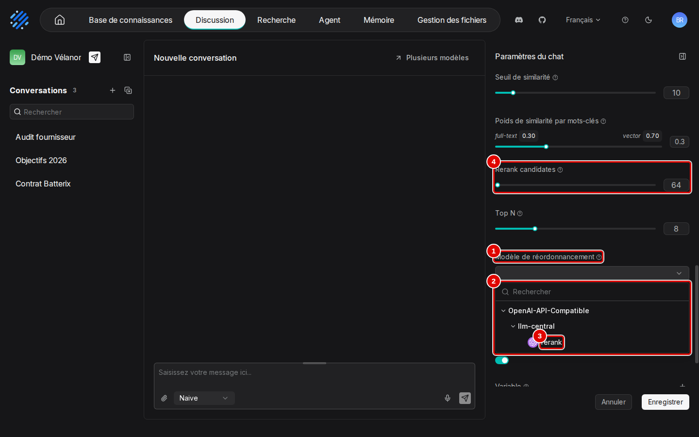
*Écran : « Paramètres avancés », partie « Naive », liste « Modèle de réordonnancement » ouverte.*

| N° | Élément | Rôle |
|---|---|---|
| 1 | « Modèle de réordonnancement » | modèle de second tri des passages ; vide, aucun second tri |
| 2 | liste « OpenAI-API-Compatible », « llm-central » | rerankers disponibles, avec un champ « Rechercher » |
| 3 | `rerank` | reranker du service de modèles central |
| 4 | « Rerank candidates » | nombre de passages, parmi les mieux classés par la recherche, que le reranker relit |

*Résultat* : l'assistant reclasse les passages avec le reranker à chaque question. Sur la machine d'essai, avec les réglages d'origine, le reranker a fait passer l'assistant de 33 à 34 bonnes réponses sur 34, comme le réglage conseillé de l'étape 11 ; ajouté à ce réglage, il n'a rien changé et a allongé chaque réponse d'une demi-seconde à une seconde.

**Étape 13. Régler la fin de la partie « Naive »**
*Où* : « Paramètres avancés » › « Naive », bas de la partie.
Descendre sous « Recherche inter-langues ».

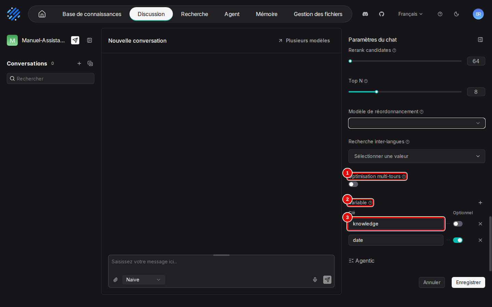
*Écran : « Paramètres avancés », partie « Naive », bas.*

| N° | Élément | Rôle |
|---|---|---|
| 1 | « Optimisation multi-tours » | reformule chaque question à l'aide des précédentes de la conversation (utile pour « et pour l'année suivante ? », mais plus coûteux) |
| 2 | « Variable » | variables du prompt système, remplies par les programmes qui utilisent l'assistant |
| 3 | « knowledge » | variable réservée aux passages retrouvés |

*Résultat* : garder ces réglages tels quels pour un usage courant.

**Étape 14. Régler le mode « Agentic »**
*Où* : « Paramètres avancés » › « Agentic ».
Déplier « Agentic » (capture de l'étape 7, pastille 6).

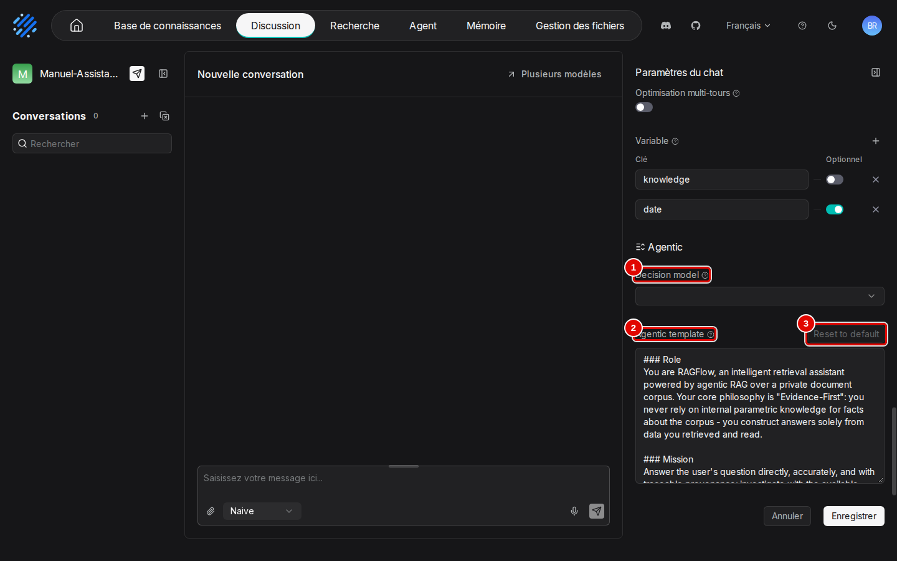
*Écran : « Paramètres avancés », partie « Agentic ».*

| N° | Élément | Rôle |
|---|---|---|
| 1 | « Decision model » | modèle qui décide des recherches ; vide, le modèle de chat s'en charge |
| 2 | « Agentic template » | consignes du mode agentique, modifiables |
| 3 | « Reset to default » | rétablit les consignes d'origine |

*Résultat* : ces réglages ne servent que pour les questions posées en mode « Agentic » (chapitre 07).

**Étape 15. Enregistrer**
*Où* : panneau « Paramètres du chat », bas du panneau › « Enregistrer ».
Cliquer sur « Enregistrer » (pastille 2) ; « Annuler » (pastille 1) abandonne les modifications.

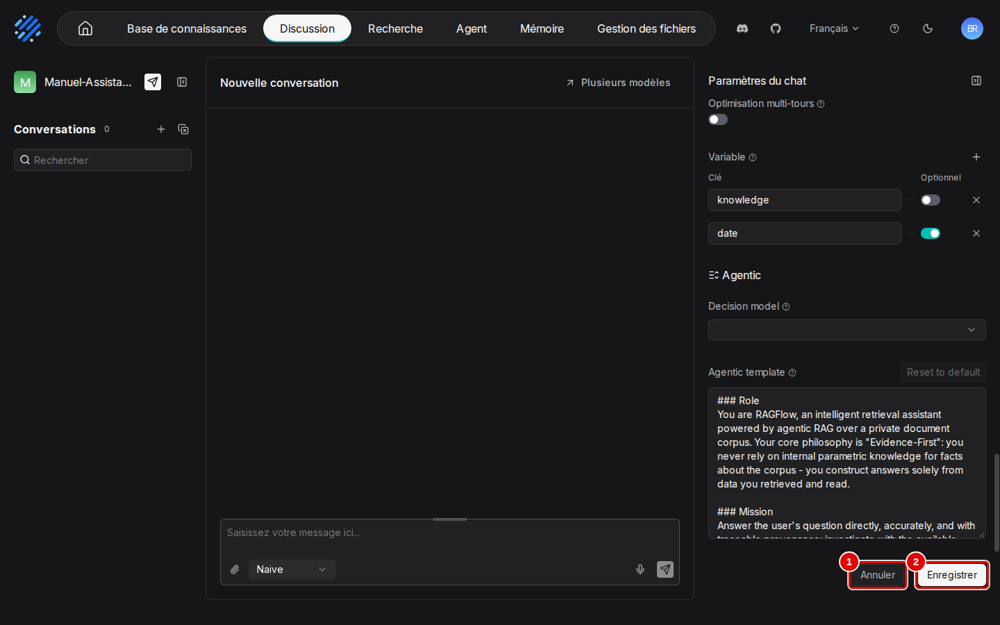
*Écran : panneau « Paramètres du chat », bas du panneau.*

| N° | Élément | Rôle |
|---|---|---|
| 1 | « Annuler » | abandonne les modifications |
| 2 | « Enregistrer » | enregistre les réglages de l'assistant |

*Résultat* : le message « Modifié » confirme. Après rechargement de la page, « Top N » vaut 8, le poids des mots-clés 0,3 et la réponse vide est conservée.

## Tester la recherche sans le modèle

Le « Test de récupération » d'une base montre quels passages une question retrouve, avec quels scores, sans faire rédiger de réponse. Il sert à comprendre un refus ou à essayer un réglage avant de le reporter dans l'assistant. Ses réglages ne sont pas enregistrés.

**Étape 16. Lancer un test**
*Où* : barre du haut › « Base de connaissances » › base ouverte › menu de gauche › « Test de récupération ».
Les réglages, à gauche, sont ceux de l'étape 11, plus un filtre par métadonnées ; « Top N » y vaut 10 par défaut. Saisir la question (pastille 1), puis cliquer sur « Test » (pastille 2).

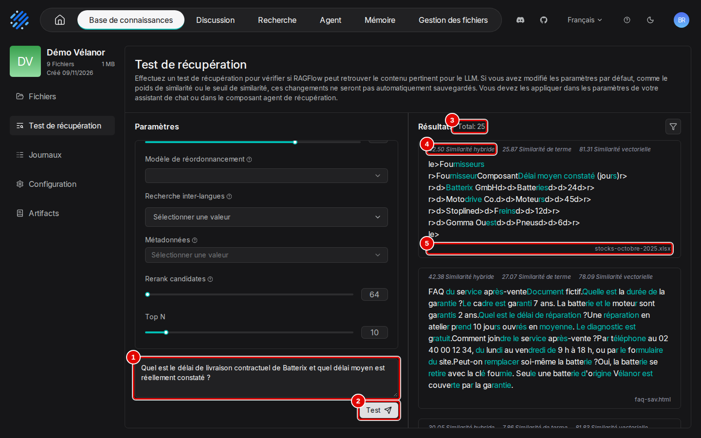
*Écran : base ouverte, « Test de récupération », résultats.*

| N° | Élément | Rôle |
|---|---|---|
| 1 | question | texte cherché |
| 2 | « Test » | lance la recherche |
| 3 | « Total: 25 » | nombre de passages au-dessus du seuil |
| 4 | « Similarité hybride » | score combiné du premier passage, suivi du score par les mots (« de terme ») et du score par le sens (« vectorielle ») |
| 5 | document | fichier d'origine du passage |

*Résultat* : avec les réglages d'origine, la question du délai de livraison de Batterix retrouve 25 passages ; le premier, le tableau des fournisseurs, obtient 42,50 sur 100.

**Étape 17. Comparer avec les réglages conseillés**
*Où* : même page › « Poids de similarité par mots-clés ».
Porter le poids des mots-clés à 0,3 (pastille 1 : full-text 0,30, vector 0,70), puis cliquer de nouveau sur « Test ».

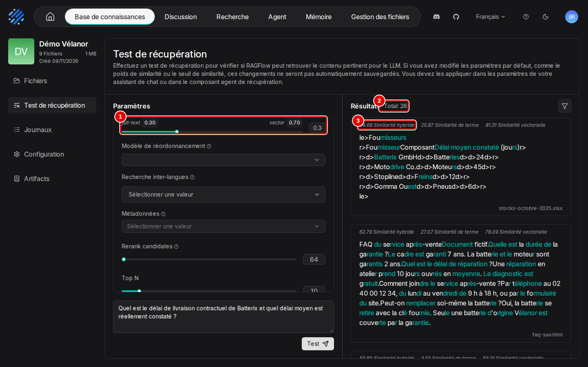
*Écran : base « Démo Vélanor », « Test de récupération », poids des mots-clés à 0,3.*

| N° | Élément | Rôle |
|---|---|---|
| 1 | « Poids de similarité par mots-clés » | « full-text » 0.30, « vector » 0.70 |
| 2 | « Total: 26 » | nombre de passages au-dessus du seuil |
| 3 | « Similarité hybride » | score du premier passage, 64,68 (en partie caché par la pastille) |

*Résultat* : le premier passage monte à 64,68 et 26 passages sont retenus. Le score par le sens pèse davantage, ce qui aide les textes mal lus comme le contrat scanné. Reporter ensuite le réglage dans l'assistant (étape 11).

## Bon à savoir

- Valeurs à la création d'un assistant à la souris : seuil 20, poids des mots-clés 0,7, « Top N » 8. Un assistant créé par programme reçoit d'autres valeurs (« Top N » 6, seuil 10).
- Transmettre 8 passages au lieu de 6 allonge à peine la réponse : moins d'un dixième de seconde avec une carte graphique.
- RAGFlow ne fournit pas de modèle de second tri (« rerank ») : il en faut un sur le serveur de modèles, déclaré au chapitre 03 ; le service central de la machine d'essai en sert un, `rerank`. Sur une petite base comme celle des essais, les réglages conseillés (étape 11) suffisent et le reranker n'apporte rien ; il vaut d'être essayé sur une grande base, où beaucoup de passages se ressemblent, ou quand les réglages d'origine doivent être gardés.
- Avec le modèle `chat` du service central, une réponse prend environ 8 secondes en médiane, et jusqu'à une minute pour les questions les plus longues : le modèle réfléchit avant de répondre. Le réglage « Thinking » (étape 5) est prévu pour la couper ; son effet avec ce service n'a pas été essayé.
- Après un changement de réglage, rejouer quelques questions connues : c'est le moyen le plus sûr de vérifier l'effet. L'annexe [A1. Évaluation : qualité et performances](../annexes/A1-evaluation-qualite-et-performances.md) détaille la méthode et les résultats des essais.

## En cas de problème

| Symptôme | Cause | Que faire |
|---|---|---|
| Refus à une question pourtant couverte | le passage utile n'est pas transmis au modèle, souvent un texte de scan mal lu | « Test de récupération » ; poids des mots-clés 0,3 et « Top N » 8 ; sinon baisser le seuil |
| La « Réponse vide » réglée n'apparaît jamais | des passages ont été retrouvés : le modèle refuse avec la phrase du « Prompt système » | modifier aussi la phrase de refus dans le « Prompt système » |
| Les réglages du « Test de récupération » sont perdus | cet onglet ne les enregistre pas | les reporter dans « Paramètres du chat », puis « Enregistrer » |
| Une base n'apparaît pas dans « Bases de connaissances » | base sans document analysé | analyser au moins un fichier (chapitre 04) |
| Réponse coupée en plein milieu | « Nombre max de tokens » trop bas | désactiver ce réglage ou l'augmenter |

Les autres problèmes sont traités au chapitre [15. En cas de problème](15-en-cas-de-probleme.md).

---
*Version décrite : RAGFlow v1.0.0, essais des 9, 11 et 12 novembre 2026. Détails et preuves : [rapport d'essais](../annexes/A6-rapport-d-essais.md).*
