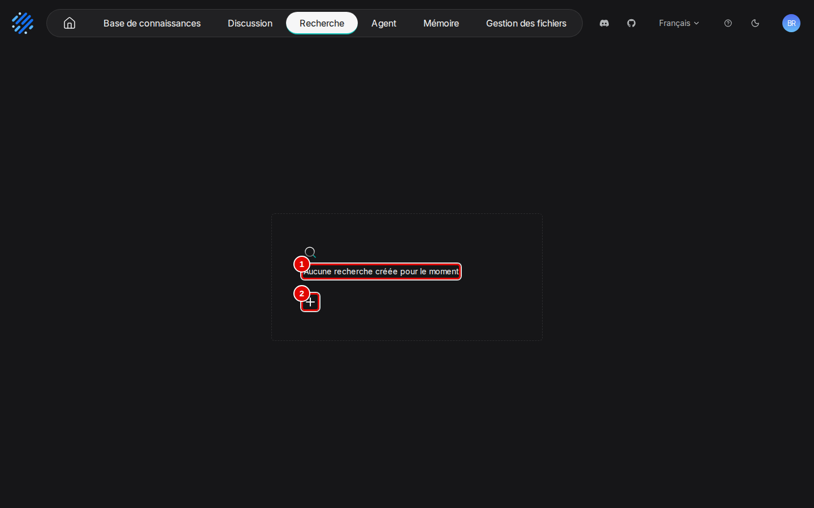
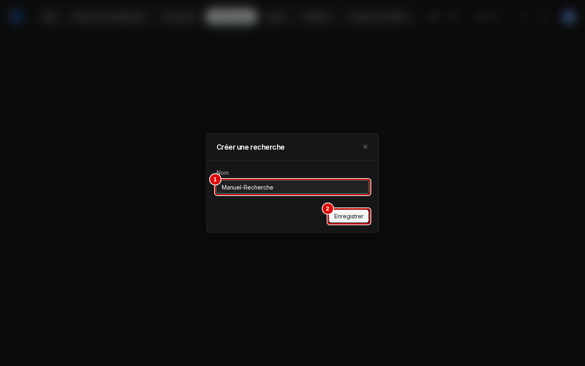
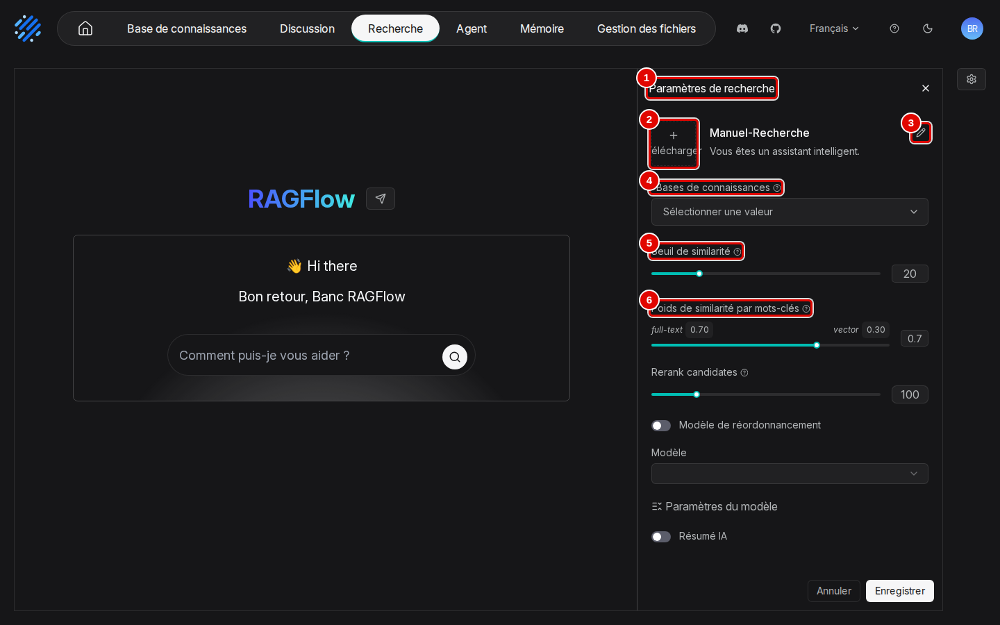
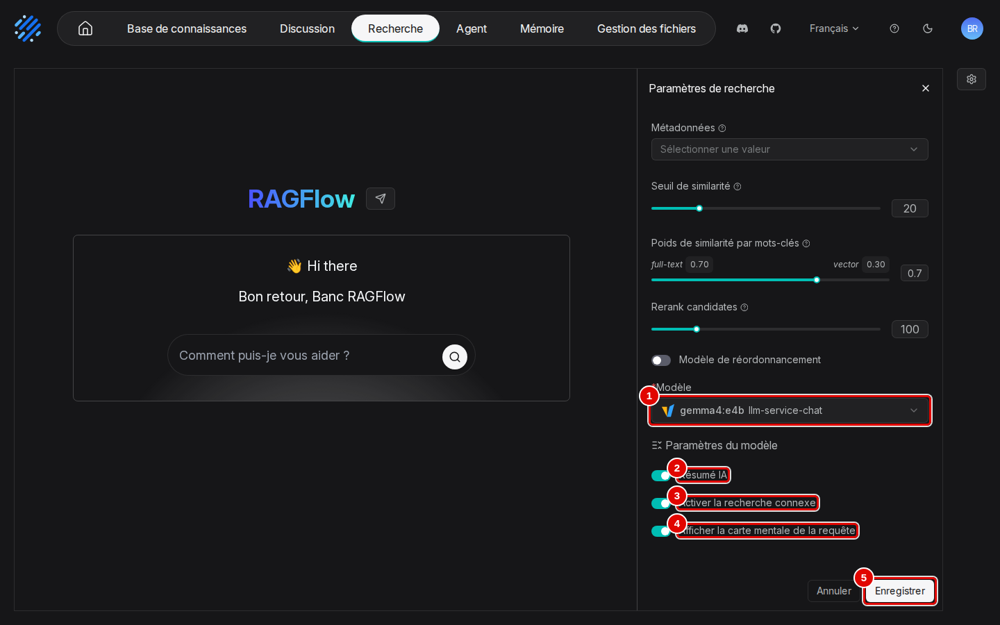
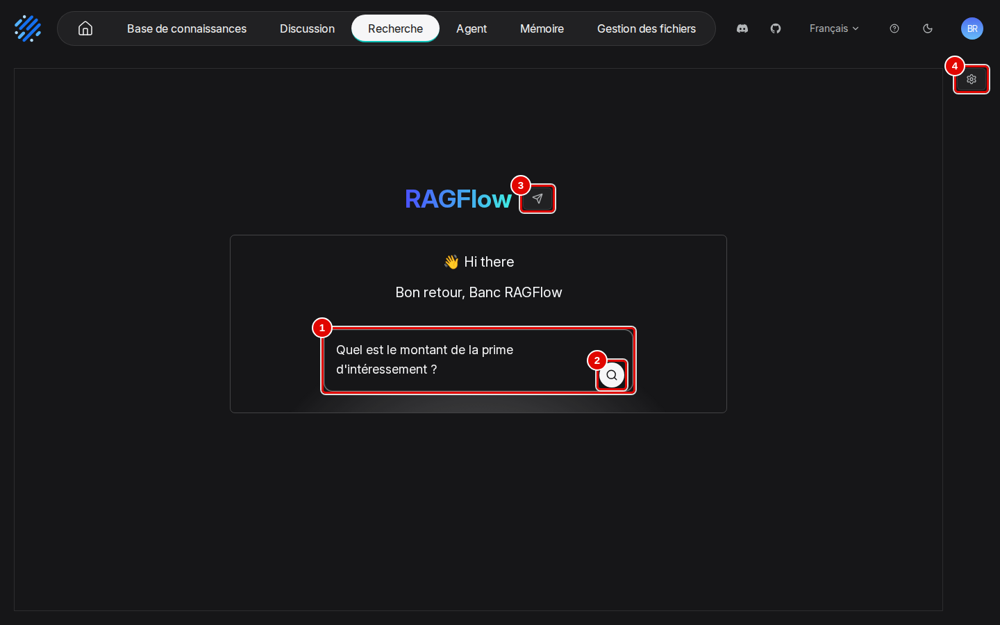
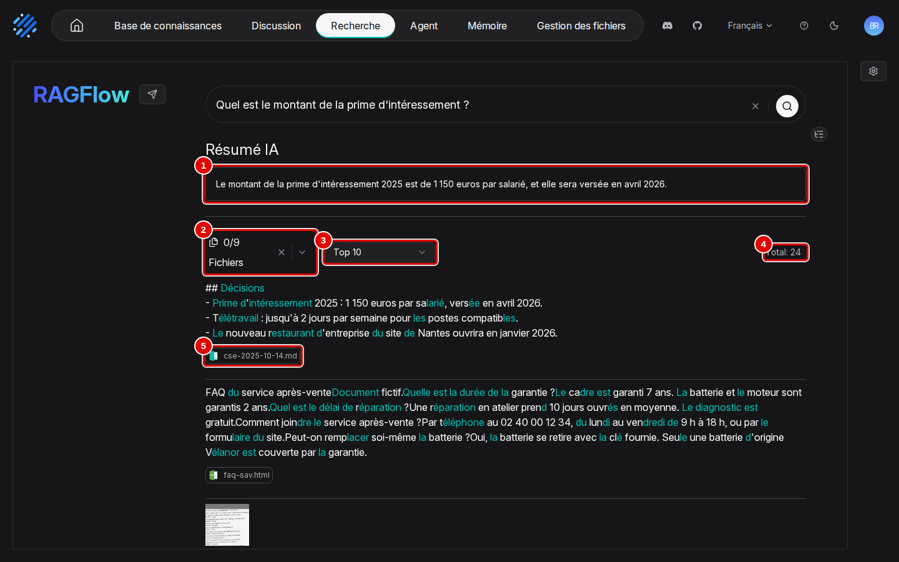
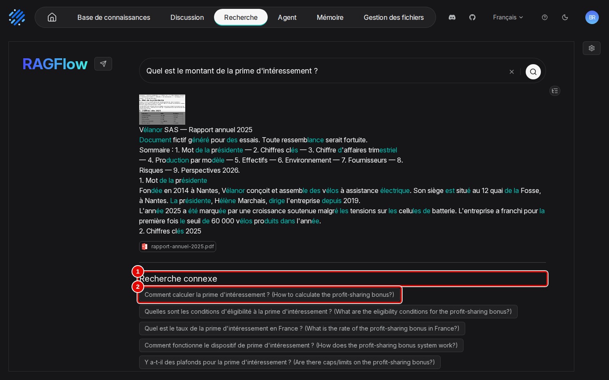
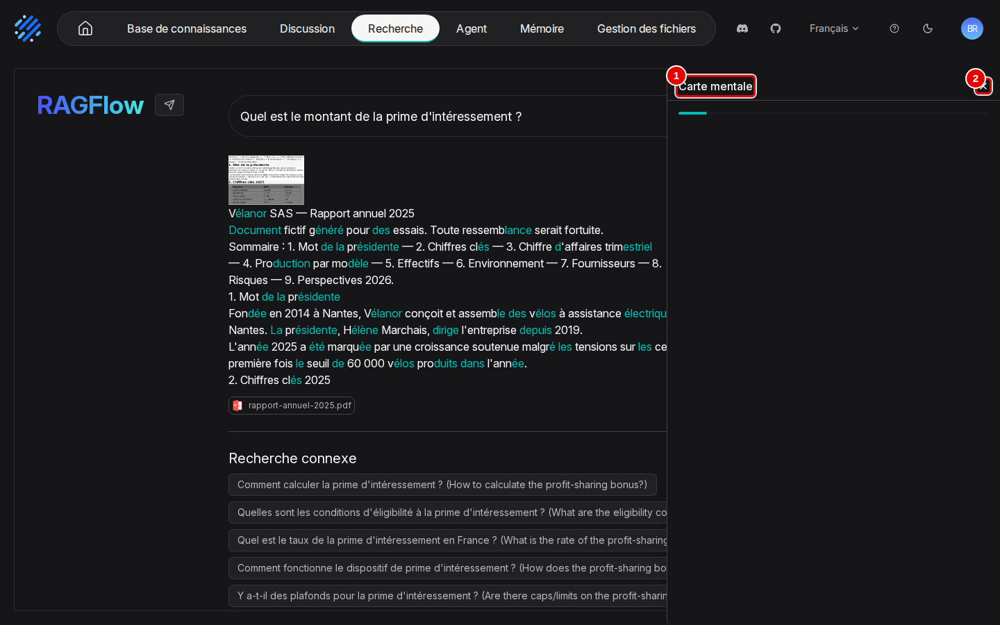
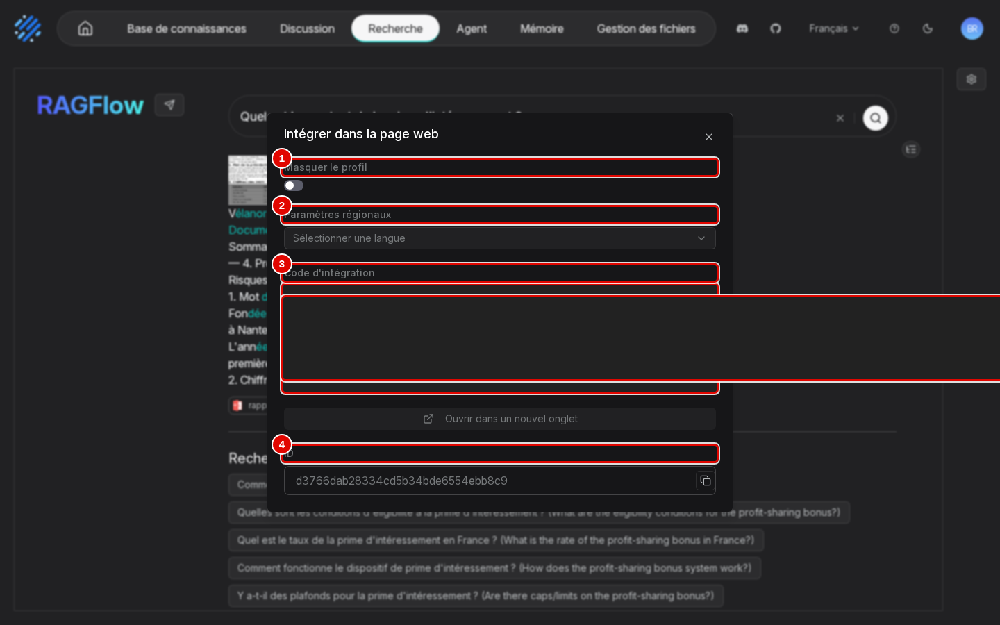
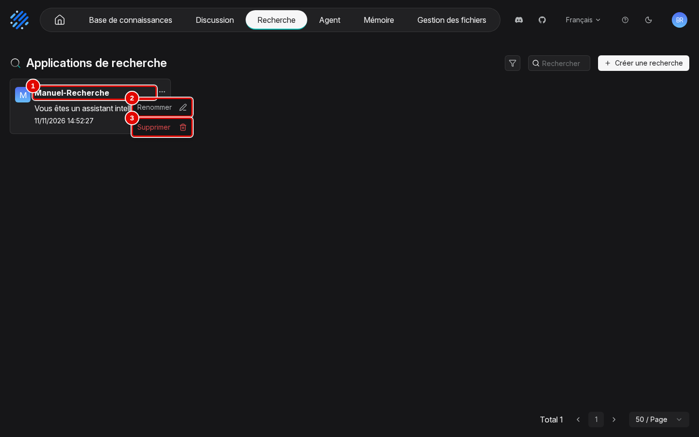

# 09. Rechercher dans ses documents

> Ce chapitre apprend à créer une page de recherche sur une base de connaissances, à la régler, à lire ses résultats (résumé, passages, recherches connexes, carte mentale), puis à l'intégrer dans un site, la renommer ou la supprimer.
> **Point de départ** : barre du haut › « Recherche » (page vide tant qu'aucune recherche n'existe).
> **Durée** : environ 15 minutes. **Avant** : chapitre 04 (une base dont les documents sont analysés).

**Attention** : le code d'intégration d'une recherche dans une page web contient une clé d'accès ; toute personne qui possède ce code peut interroger les bases de la recherche sans compte. Ne pas le publier ni le transmettre hors du poste.

## Ce qu'il faut savoir

Une **recherche** (appelée aussi application de recherche) est un petit moteur de recherche sur une ou plusieurs bases. Une question donne la liste des passages trouvés, avec leur document ; si un modèle d'IA est choisi, elle donne en plus un court résumé, des questions voisines et une carte mentale. À la différence d'un assistant de « Discussion » (chapitre 07), il n'y a pas de conversation : chaque recherche est indépendante, et les passages restent visibles en entier. La recherche convient pour retrouver un document ou vérifier une source ; l'assistant convient pour obtenir une réponse rédigée et poser des questions de suite. L'exemple crée « Manuel-Recherche » sur la base « Démo Vélanor » et y cherche le montant de la prime d'intéressement.

## Créer une recherche

**Étape 1. Ouvrir la page « Recherche »**
*Où* : barre du haut › « Recherche ».
Cliquer sur « Recherche ». Tant qu'aucune recherche n'existe, la page est vide ; cliquer sur « + » (pastille 2).

*Écran : Recherche (liste des recherches, vide).*

| N° | Élément | Rôle |
|---|---|---|
| 1 | « Aucune recherche créée pour le moment » | liste des recherches, vide |
| 2 | « + » | ouvre la fenêtre « Créer une recherche » |

*Résultat* : la fenêtre « Créer une recherche » s'ouvre.

**Étape 2. Nommer la recherche**
*Où* : Recherche › fenêtre « Créer une recherche ».
Saisir le nom (pastille 1), ici « Manuel-Recherche », puis cliquer sur « Enregistrer » (pastille 2).

*Écran : fenêtre « Créer une recherche ».*

| N° | Élément | Rôle |
|---|---|---|
| 1 | « Nom » | nom libre de la recherche |
| 2 | « Enregistrer » | crée la recherche et l'ouvre, avec le panneau « Paramètres de recherche » |

*Résultat* : la page de la recherche s'ouvre, panneau de réglages déplié à droite.

## Régler la recherche

**Étape 3. Choisir la base et le tri des passages**
*Où* : page de la recherche › panneau « Paramètres de recherche » (à droite).
Ouvrir la liste « Bases de connaissances » (pastille 4) et cocher « Démo Vélanor », comme pour un assistant (chapitre 04, étape 15). Laisser les deux réglages suivants à leur valeur.

*Écran : page de la recherche, panneau « Paramètres de recherche ».*

| N° | Élément | Rôle |
|---|---|---|
| 1 | « Paramètres de recherche » | panneau de réglages ; la roue dentée en haut à droite de la page le rouvre |
| 2 | « Télécharger » | image de la recherche |
| 3 | nom et description | le crayon modifie le nom et la description (« Vous êtes un assistant intelligent. » par défaut) |
| 4 | « Bases de connaissances » | base ou bases interrogées ; obligatoire. Une fois la base choisie, « Métadonnées » apparaît dessous pour filtrer par métadonnées (chapitre 05) |
| 5 | « Seuil de similarité » | score minimal d'un passage pour être affiché (20) |
| 6 | « Poids de similarité par mots-clés » | part donnée aux mots exacts (0,70) et au sens (0,30) ; mêmes réglages qu'un assistant (chapitre 08) |

*Résultat* : la base est choisie (étape suivante).

**Étape 4. Activer le résumé et choisir le modèle**
*Où* : même panneau, plus bas.
Activer « Résumé IA » (pastille 2), « Activer la recherche connexe » (pastille 3) et « Afficher la carte mentale de la requête » (pastille 4). Ces trois fonctions demandent un modèle : choisir `gemma4:e4b` dans « Modèle » (pastille 1), puis cliquer sur « Enregistrer » (pastille 5). Plus haut, « Rerank candidates » (100) et « Modèle de réordonnancement » (vide) restent tels quels.

*Écran : panneau « Paramètres de recherche », bas du panneau.*

| N° | Élément | Rôle |
|---|---|---|
| 1 | « Modèle » | modèle d'IA qui rédige le résumé, les questions voisines et la carte mentale ; « Paramètres du modèle » (température…) en dessous |
| 2 | « Résumé IA » | rédige une réponse courte à partir des passages trouvés |
| 3 | « Activer la recherche connexe » | propose des questions voisines |
| 4 | « Afficher la carte mentale de la requête » | ajoute un bouton de carte mentale des résultats |
| 5 | « Enregistrer » | enregistre les réglages |

*Résultat* : la recherche est prête. Sans modèle, elle ne rend que les passages : c'est le réglage le plus rapide, et rien n'est reformulé.

## Chercher et lire les résultats

**Étape 5. Saisir la question**
*Où* : page de la recherche, zone centrale (panneau fermé par sa croix).
Saisir la question dans la zone (pastille 1), ici « Quel est le montant de la prime d'intéressement ? », puis appuyer sur Entrée ou cliquer sur la loupe (pastille 2).

*Écran : page de la recherche, question saisie.*

| N° | Élément | Rôle |
|---|---|---|
| 1 | « Comment puis-je vous aider ? » | zone de recherche |
| 2 | loupe | lance la recherche |
| 3 | avion en papier | code d'intégration dans un site (étape 9) |
| 4 | roue dentée | rouvre « Paramètres de recherche » |

*Résultat* : les passages arrivent en moins d'une seconde, le résumé quelques secondes après.

**Étape 6. Lire le résumé et les passages**
*Où* : page de la recherche, résultats.
Lire le résumé en tête (pastille 1), puis les passages, chacun sous le nom de son document (pastille 5). Les mots de la question sont surlignés.

*Écran : page de la recherche, résultats.*

| N° | Élément | Rôle |
|---|---|---|
| 1 | « Résumé IA » | « Le montant de la prime d'intéressement 2025 est de 1 150 euros par salarié, et elle sera versée en avril 2026. » : réponse juste |
| 2 | « Fichiers » | « 0/9 » : filtre les résultats par document (neuf documents ont au moins un passage trouvé) |
| 3 | « Top 10 » | nombre de passages affichés par page |
| 4 | « Total » | nombre de passages trouvés au-dessus du seuil : 24 |
| 5 | document source | `cse-2025-10-14.md`, document du premier passage (« Prime d'intéressement 2025 : 1 150 euros par salarié, versée en avril 2026. ») |

*Résultat* : la réponse et sa source sont lisibles sur la même page.

**Étape 7. Relancer avec une question voisine**
*Où* : page de la recherche, sous les passages.
La rubrique « Recherche connexe » (pastille 1) propose des questions voisines ; un clic sur l'une d'elles (pastille 2) relance la recherche avec elle.

*Écran : page de la recherche, bas des résultats.*

| N° | Élément | Rôle |
|---|---|---|
| 1 | « Recherche connexe » | questions proposées par le modèle, en français suivies de leur traduction anglaise entre parenthèses |
| 2 | question proposée | « Comment calculer la prime d'intéressement ? (How to calculate the profit-sharing bonus?) » |

*Résultat* : les questions voisines s'affichent environ six secondes après la recherche.

**Étape 8. Ouvrir la carte mentale**
*Où* : page de la recherche › icône d'arbre, à droite sous la zone de recherche.
Cliquer sur l'icône : la carte mentale (pastille 1) s'ouvre dans un panneau ; la croix (pastille 2) la referme.

*Écran : page de la recherche, panneau « Carte mentale ».*

| N° | Élément | Rôle |
|---|---|---|
| 1 | « Carte mentale » | carte des thèmes des passages trouvés (fournisseur, stocks, personnel…) |
| 2 | croix | referme le panneau |

*Résultat* : la carte s'affiche environ trois secondes après le clic. Elle résume tous les passages trouvés, pas la réponse : ici, elle montre surtout le contrat du fournisseur et les stocks.

## Intégrer, renommer ou supprimer une recherche

**Étape 9. Obtenir le code d'intégration**
*Où* : page de la recherche › avion en papier (à côté du logo « RAGFlow »).
Régler l'affichage (pastilles 1 et 2), puis copier le code (pastille 3) pour le coller dans la page d'un site. Le code est masqué sur la capture, car il contient la clé d'accès.

*Écran : fenêtre « Intégrer dans la page web » d'une recherche.*

| N° | Élément | Rôle |
|---|---|---|
| 1 | « Masquer le profil » | cache l'avatar et le nom du compte dans la page intégrée |
| 2 | « Paramètres régionaux » | langue de la page intégrée |
| 3 | « Code d'intégration » | code à copier (masqué) ; « Ouvrir dans un nouvel onglet » en dessous ouvre la page partagée |
| 4 | « ID » | identifiant de la recherche, avec un bouton de copie |

*Résultat* : le code est copié ; la page intégrée offre la même recherche, sans compte.

**Étape 10. Renommer ou supprimer une recherche**
*Où* : barre du haut › « Recherche » › menu « … » d'une carte.
La page liste les recherches. Le menu « … » d'une carte (pastille 1) propose « Renommer » (pastille 2) et « Supprimer » (pastille 3).

*Écran : Recherche (liste des recherches), menu d'une carte ouvert.*

| N° | Élément | Rôle |
|---|---|---|
| 1 | carte « Manuel-Recherche » | nom, description et date ; un clic ouvre la recherche |
| 2 | « Renommer » | change le nom |
| 3 | « Supprimer » | supprime la recherche ; les bases ne sont pas touchées |

*Résultat* : la recherche est renommée ou supprimée.

## Bon à savoir

- Le « Total » de 24 passages vient du seuil bas (20) : remonter le « Seuil de similarité » réduit le bruit, au risque d'écarter un passage utile.
- Le surlignage coupe parfois les mots (« sa**larié** ») : simple défaut d'affichage, sans effet sur les résultats.
- Les tableaux des PDF et des classeurs apparaissent en balisage brut dans les passages (morceaux comme `d>` ou `le>`), comme dans les citations d'un assistant.
- Les questions voisines sont à moitié en anglais : c'est la consigne interne du modèle, sans conséquence.
- Les réglages de la recherche ont le même effet que ceux d'un assistant ; les plus utiles sont décrits au chapitre 08.

## En cas de problème

| Symptôme | Cause | Que faire |
|---|---|---|
| « Model is required when AI summary, related search, or query mindmap is enabled » | une fonction qui demande un modèle est activée sans « Modèle » | choisir un modèle (étape 4), ou désactiver le résumé, la recherche connexe et la carte mentale |
| Aucun résultat | aucune base choisie, ou seuil trop haut | choisir la base (étape 3), puis baisser le « Seuil de similarité » |
| Beaucoup de passages sans rapport, carte mentale hors sujet | seuil bas | remonter le seuil ; réduire « Top 10 » |

Les autres problèmes sont traités au chapitre [15. En cas de problème](15-en-cas-de-probleme.md).

---
*Version décrite : RAGFlow v1.0.0, essais des 9 et 11 novembre 2026. Détails et preuves : [rapport d'essais](../annexes/A6-rapport-d-essais.md).*
