# 10. Construire un agent

> Ce chapitre apprend à créer un agent à partir d'un modèle prêt à l'emploi, à le relier à une base, à comprendre chaque bloc de son canevas, à l'essayer, à converser avec lui, à le publier, à l'exporter et à le réimporter, à partir d'un canevas vide, à lui donner une mémoire et à déclarer un serveur d'outils MCP.
> **Point de départ** : barre du haut › « Agent ».
> **Durée** : environ 30 minutes. **Avant** : chapitres 07 et 08.

**Attention** : dans le panneau de réglages d'un bloc agent, la croix à droite d'un outil (par exemple « Retrieval ») retire cet outil de l'agent, sans confirmation, et l'enregistrement automatique rend ce retrait définitif. Seule la croix de l'en-tête du panneau, tout en haut à droite, ferme le panneau. Le code d'intégration d'un agent dans une page web contient une clé d'accès : ne pas le publier ni le transmettre hors du poste.

## Ce qu'il faut savoir

Un **agent** est un enchaînement de blocs reliés entre eux, dessiné sur un **canevas**. Au moins un de ces blocs interroge un modèle d'IA, qui décide lui-même d'appeler des **outils** : chercher dans une base, chercher sur le web, exécuter du code… Par exemple, un agent documentaire reçoit la question, appelle l'outil de recherche dans la base « Démo Vélanor », puis rédige la réponse. Un agent sert quand une question demande plusieurs étapes ou des outils ; pour des questions simples sur une base, un assistant de « Discussion » (chapitre 07) suffit et répond plus vite. La page « Agent » a trois onglets : « Workflow » (les agents, objet de ce chapitre), « Ingestion pipeline » et « Compilation operator » (chaînes de lecture des documents et synthèses, chapitres 06 et 11). L'exemple crée « Manuel-Agent-Documentaire », qui répond à partir de la base « Démo Vélanor ».

## Créer un agent à partir d'un modèle

**Étape 1. Choisir comment créer l'agent**
*Où* : barre du haut › « Agent » › onglet « Workflow » › « + ».
La liste des agents s'affiche ; « Agent démo Vélanor », visible ici, a été créé selon la procédure des étapes 1 à 3, avec le même modèle d'agent et la base « Démo Vélanor » (chapitre 05, dernière partie). Cliquer sur « + » : le menu propose trois départs. Choisir « Créer depuis un modèle » (pastille 2).

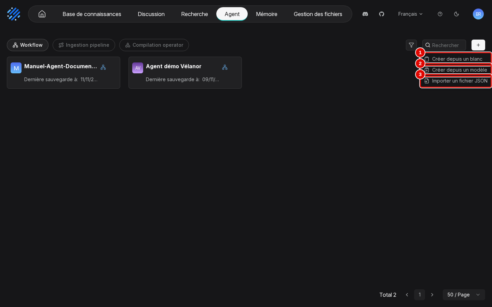
*Écran : Agent, onglet « Workflow », menu de création ouvert.*

| N° | Élément | Rôle |
|---|---|---|
| 1 | « Créer depuis un blanc » | canevas réduit au bloc « Commencer » (étape 14) |
| 2 | « Créer depuis un modèle » | part d'un modèle d'agent prêt à l'emploi |
| 3 | « Importer un fichier JSON » | recrée un agent exporté (étape 13) |

*Résultat* : la page des modèles d'agents s'ouvre.

**Étape 2. Choisir le modèle d'agent**
*Où* : Agent › « Créer depuis un modèle ».
Les modèles sont rangés par catégories (pastilles 1 à 3). Survoler la carte « Your starter dataset chatbot » (pastille 4), puis cliquer sur « Utiliser » (pastille 5).

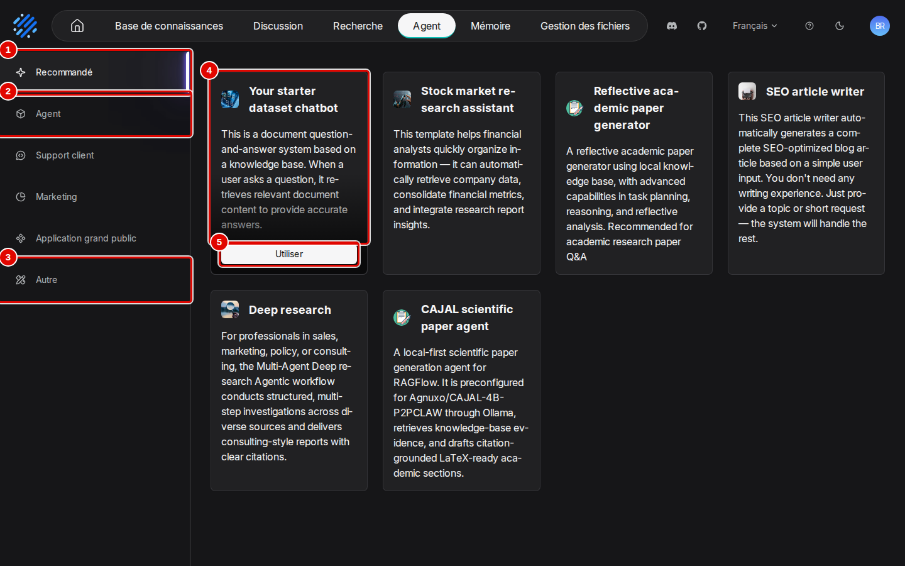
*Écran : Agent, page des modèles d'agents.*

| N° | Élément | Rôle |
|---|---|---|
| 1 | « Recommandé » | modèles mis en avant : questions sur une base, recherche approfondie, rédaction… |
| 2 | « Agent » | modèles à plusieurs agents ; viennent ensuite « Support client », « Marketing », « Application grand public » |
| 3 | « Autre » | modèles divers |
| 4 | carte « Your starter dataset chatbot » | agent de questions et réponses fondé sur une base (description en anglais) |
| 5 | « Utiliser » | apparaît au survol ; ouvre la fenêtre « Create workflow » |

*Résultat* : la fenêtre « Create workflow » s'ouvre.

**Étape 3. Nommer l'agent et choisir son modèle et sa base**
*Où* : Agent › fenêtre « Create workflow ».
Saisir le nom, ici « Manuel-Agent-Documentaire ». Choisir le modèle (pastille 1), puis la base (pastille 2) : la fenêtre la demande parce que le modèle d'agent contient une étape de recherche sans base (« This template contains 1 retrieval step(s) without a bound dataset… »). Cliquer sur « Confirmer » (pastille 3).

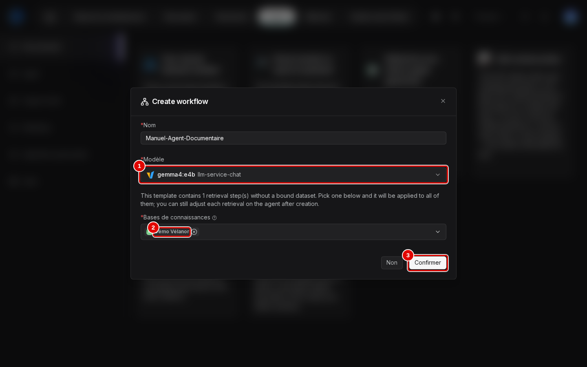
*Écran : fenêtre « Create workflow », remplie.*

| N° | Élément | Rôle |
|---|---|---|
| 1 | « Modèle » | `gemma4:e4b` (instance « llm-service-chat », chapitre 03) : modèle de tous les blocs agents ; obligatoire |
| 2 | « Bases de connaissances » | « Démo Vélanor », appliquée à chaque étape de recherche, modifiable ensuite ; la croix retire la base |
| 3 | « Confirmer » | crée l'agent et ouvre son canevas |

*Résultat* : le canevas de l'agent s'ouvre (étape suivante).

## Comprendre le canevas, bloc par bloc

**Étape 4. Lire le canevas**
*Où* : canevas de l'agent (plein écran, bouton « Retour » pour revenir à la liste).
Le canevas montre le chemin d'une question : elle entre par « Commencer » (pastille 1), passe par l'agent (pastille 2), qui appelle l'outil de recherche (pastille 3), puis la réponse sort par « Message_0 » (pastille 4). En haut, « Save draft » enregistre le brouillon (le canevas s'enregistre aussi tout seul), « Exécuter » essaie l'agent, « Lancer » ouvre la page de conversation, « Publier » crée une version utilisable, « Gestion » ouvre le menu de l'agent.

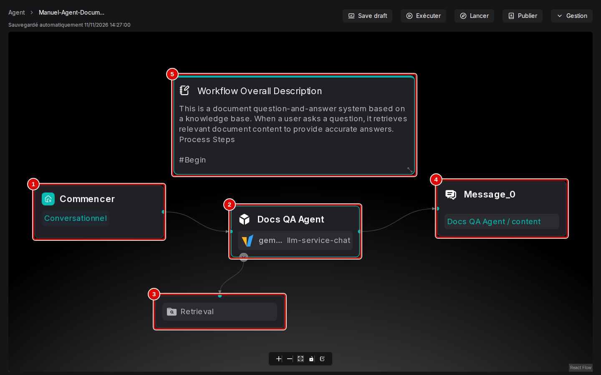
*Écran : canevas de l'agent « Manuel-Agent-Documentaire ».*

| N° | Élément | Rôle |
|---|---|---|
| 1 | « Commencer » | point d'entrée, mode « Conversationnel » ; son panneau règle « Mode », « Activation de l'accueil », « Message de bienvenue » et « Entrée » (informations demandées avant la conversation, aucune ici) |
| 2 | « Docs QA Agent » | bloc agent : modèle et consignes (étape 5) |
| 3 | « Retrieval » | outil de l'agent, relié sous lui : recherche dans la base (étape 6) |
| 4 | « Message_0 » | renvoie la réponse de l'agent (étape 7) |
| 5 | note | « Workflow Overall Description » : texte libre, sans effet sur l'exécution |

*Résultat* : le rôle de chaque bloc est repéré. Un clic sur un bloc ouvre son panneau de réglages à droite.

**Étape 5. Régler le bloc agent**
*Où* : canevas › bloc « Docs QA Agent ».
Cliquer sur le bloc. Le panneau montre le modèle (pastille 1) et les consignes (pastille 2) ; le triangle de l'en-tête (pastille 3) essaie ce bloc seul.

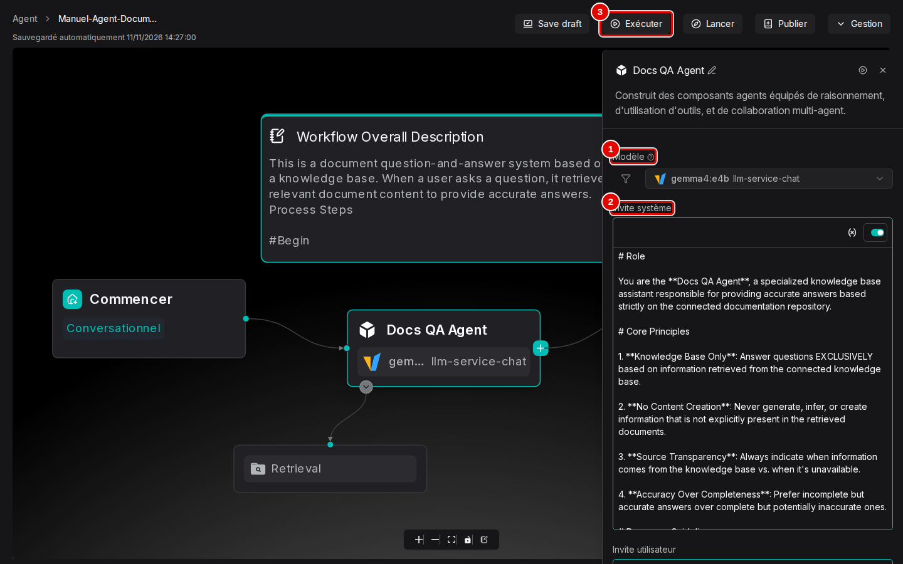
*Écran : canevas, panneau du bloc « Docs QA Agent ».*

| N° | Élément | Rôle |
|---|---|---|
| 1 | « Modèle » | modèle d'IA du bloc ; l'entonnoir filtre la liste par type |
| 2 | « Invite système » | consignes du bloc, en anglais dans le modèle d'agent (« Answer questions EXCLUSIVELY based on information retrieved from the connected knowledge base… ») ; une variable s'insère en tapant `/` ou par l'icône « (x) » |
| 3 | triangle de l'en-tête | exécute ce bloc seul |

Plus bas dans le même panneau :

- « Invite utilisateur » : message transmis au modèle, « The user query is » suivi de la variable « Entrée de départ / sys.query » (la question posée) ;
- « Outils » : « Retrieval », avec son crayon (réglages) et sa croix (retrait immédiat, voir l'avertissement en tête de chapitre) ; « Ajouter des outils » ouvre une liste à deux onglets : « Intégré » (rubriques « Rechercher » : Tavily, Google, DuckDuckGo, Wikipedia, ArXiv, PubMed et d'autres ; « Communication » : Email ; « Développeur » : GitHub, ExeSQL, Code ; « Récupération ») et « MCP » (outils des serveurs MCP, étape 18) ;
- « Agent », « Ajouter un agent » : autre agent que celui-ci peut appeler, pour faire travailler des agents en équipe ;
- « Paramètres avancés » : « Afficher les citations », « Nombre maximum de cycles de réflexion » (5 allers-retours entre appel d'outil et réflexion), « Taille de la fenêtre d'historique des messages », « Nombre maximum de tentatives » et « Délai après une erreur », « Méthode d'exception », puis « Sortie » et « Sortie structurée » (format imposé à la réponse).

*Résultat* : le bloc agent est réglé ; fermer le panneau par la croix de son en-tête.

**Étape 6. Régler l'outil de recherche**
*Où* : canevas › outil « Retrieval », sous le bloc agent.
Cliquer sur l'outil. Vérifier la source (pastille 1) et la base (pastille 2) ; les réglages de recherche (pastille 3) sont ceux d'un assistant (chapitre 08).

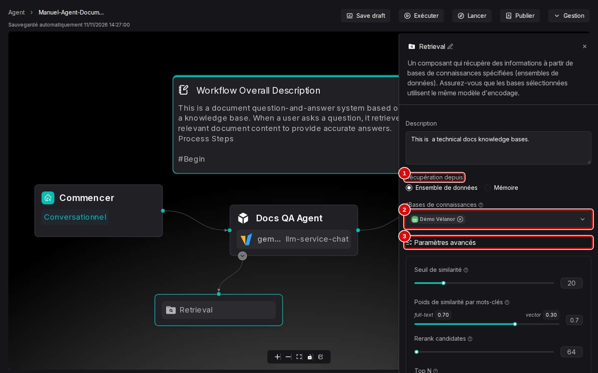
*Écran : canevas, panneau de l'outil « Retrieval ».*

| N° | Élément | Rôle |
|---|---|---|
| 1 | « Récupération depuis » | « Ensemble de données » (une base) ou « Mémoire » (une mémoire, étape 15) ; la « Description » au-dessus dit au modèle quand utiliser l'outil |
| 2 | « Démo Vélanor » | base interrogée, reprise de la fenêtre de création ; la liste permet d'en choisir d'autres |
| 3 | « Paramètres avancés » | « Seuil de similarité » (20), « Poids de similarité par mots-clés » (mots exacts 0,70, sens 0,30), « Rerank candidates » (64), « Top N » (8), « Modèle de réordonnancement » (vide), « Métadonnées », « Recherche inter-langues » |

*Résultat* : l'outil cherche dans la bonne base.

**Étape 7. Régler la sortie**
*Où* : canevas › bloc « Message_0 ».
Cliquer sur le bloc. Il renvoie la réponse de l'agent (pastille 1) ; « Enregistrer en mémoire » (pastille 5) sert à l'étape 16.

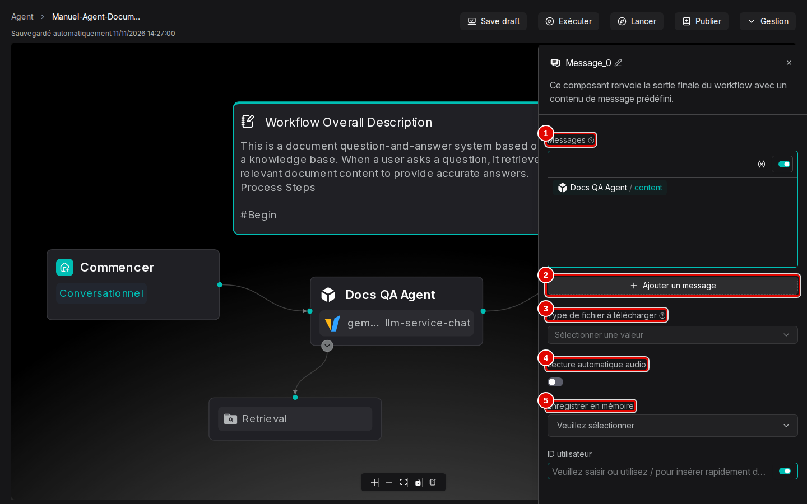
*Écran : canevas, panneau du bloc « Message_0 ».*

| N° | Élément | Rôle |
|---|---|---|
| 1 | « Messages » | contenu renvoyé : la variable « Docs QA Agent / content », c'est-à-dire la réponse de l'agent |
| 2 | « Ajouter un message » | ajoute un autre contenu de sortie (texte fixe ou variable) |
| 3 | « Type de fichier à télécharger » | format de fichier dans lequel proposer la réponse au téléchargement |
| 4 | « Lecture automatique audio » | lit la réponse à voix haute (demande un modèle de synthèse vocale, absent ici) |
| 5 | « Enregistrer en mémoire » | mémoire où archiver l'échange ; « ID utilisateur » en dessous |

*Résultat* : fermer le panneau et cliquer sur « Save draft » ; le brouillon est enregistré.

## Essayer l'agent et converser avec lui

**Étape 8. Essayer l'agent**
*Où* : canevas › « Exécuter » (en haut).
Le panneau « Discussion » s'ouvre à droite. Saisir « Qui est le directeur de production de Vélanor ? » et cliquer sur l'avion en papier. Les icônes au-dessus de la réponse la copient, la lisent à voix haute ou affichent le détail de l'exécution.

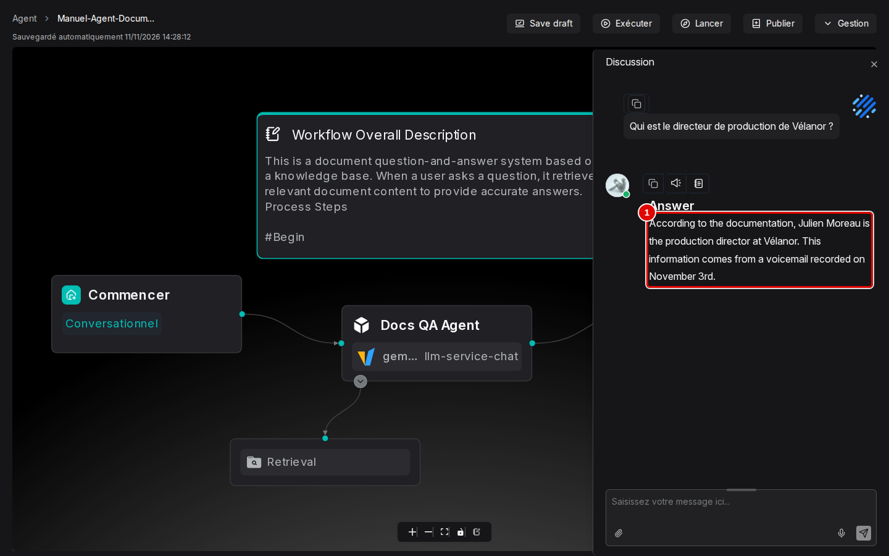
*Écran : canevas, panneau « Discussion » d'essai.*

| N° | Élément | Rôle |
|---|---|---|
| 1 | réponse | « According to the documentation, Julien Moreau is the production director at Vélanor. This information comes from a voicemail recorded on November 3rd. » : juste, tirée du message vocal transcrit, mais en anglais |

*Résultat* : la réponse arrive en un peu plus de cinq secondes. Fermer le panneau.

**Étape 9. Converser avec l'agent**
*Où* : canevas › « Lancer ».
La page de conversation s'ouvre : « Sessions » à gauche (« + » pour une nouvelle session, « Rechercher des sessions »), zone « Saisissez votre message ici... » en bas (trombone, micro, envoi). Saisir « Quel est le plafond des pénalités de retard du contrat Batterix ? » et appuyer sur Entrée.

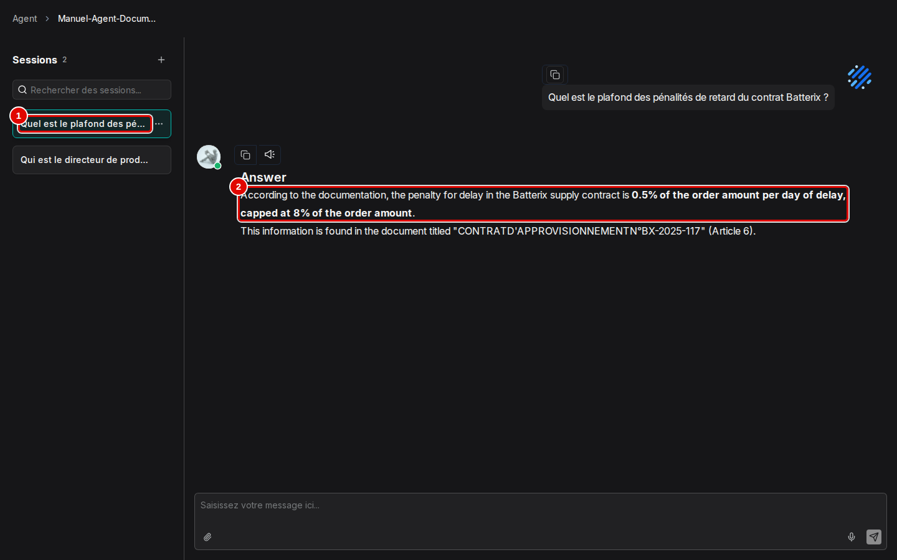
*Écran : page de conversation de l'agent.*

| N° | Élément | Rôle |
|---|---|---|
| 1 | session | « Quel est le plafond des pénalités… » : la session prend le texte de la première question ; l'essai de l'étape 8 figure aussi dans la liste |
| 2 | réponse | « …0.5% of the order amount per day of delay, capped at 8% of the order amount », avec la source (« Article 6 » du contrat BX-2025-117) |

*Résultat* : la réponse, juste et sourcée, arrive en un peu plus de six secondes.

## Publier l'agent

**Étape 10. Publier une version**
*Où* : canevas › « Publier ».
Saisir un alias de version (pastille 1), ici « v1 », puis cliquer sur « Confirmer » (pastille 2). La fenêtre est la même pour un agent et pour une chaîne de lecture (chapitre 11) ; la capture montre celle d'une chaîne de lecture.

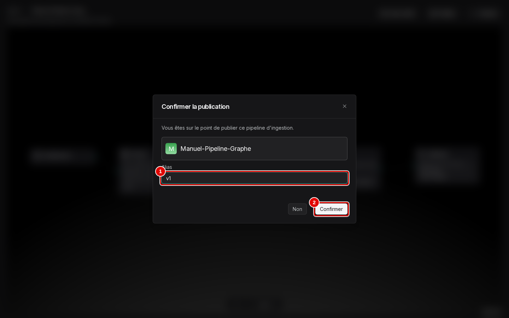
*Écran : canevas, fenêtre de publication.*

| N° | Élément | Rôle |
|---|---|---|
| 1 | « Alias » | nom court de la version |
| 2 | « Confirmer » | publie la version |

*Résultat* : la version est publiée. L'intégration dans un site et les programmes utilisent la version publiée, pas le brouillon. « Gestion » › « Historique des versions » liste ensuite la version, avec l'aperçu de son canevas et trois boutons : télécharger, remettre dans le brouillon, supprimer.

## Utiliser le menu « Gestion »

**Étape 11. Intégrer l'agent dans une page web**
*Où* : canevas › « Gestion » › « Intégrer dans la page web ».
Le menu « Gestion » propose : « Variable de conversation » (informations partagées par tous les blocs pendant une session, ajoutées par « Ajouter »), « Historique des versions » (étape 10), « Exporter » (étape suivante), « Paramètres » (« Titre », « Photo », « Description », « Autorisations » : « Moi » ou « Équipe », chapitre 13) et « Intégrer dans la page web ». Choisir ce dernier, régler l'affichage (pastilles 1 à 4), puis copier le code d'intégration.

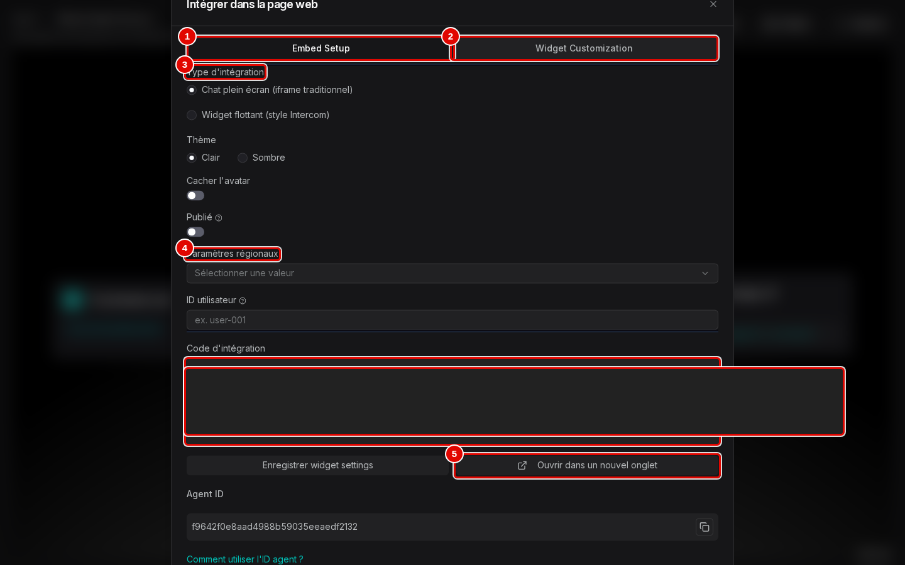
*Écran : fenêtre « Intégrer dans la page web » d'un agent.*

| N° | Élément | Rôle |
|---|---|---|
| 1 | « Embed Setup » | réglages : « Type d'intégration », « Thème » (« Clair », « Sombre »), « Cacher l'avatar », « Publié » |
| 2 | « Widget Customization » | titre, textes et couleurs de la bulle de discussion |
| 3 | « Type d'intégration » | « Chat plein écran (iframe traditionnel) » ou « Widget flottant (style Intercom) » |
| 4 | « Paramètres régionaux » | langue ; « ID utilisateur » en dessous, puis « Code d'intégration » (masqué, il contient la clé d'accès) et « Agent ID » |
| 5 | « Ouvrir dans un nouvel onglet » | ouvre la page de conversation partagée |

*Résultat* : le code est copié ; collé dans une page web, il y affiche l'agent.

**Étape 12. Exporter l'agent**
*Où* : canevas › « Gestion » › « Exporter ».
Cliquer sur « Gestion » (pastille 1), puis sur « Exporter » (pastille 4). Le navigateur télécharge aussitôt un fichier nommé d'après l'agent, par exemple `Manuel-Agent-Export.json`, dans le dossier « Téléchargements » de Windows ; aucune fenêtre ne s'ouvre.

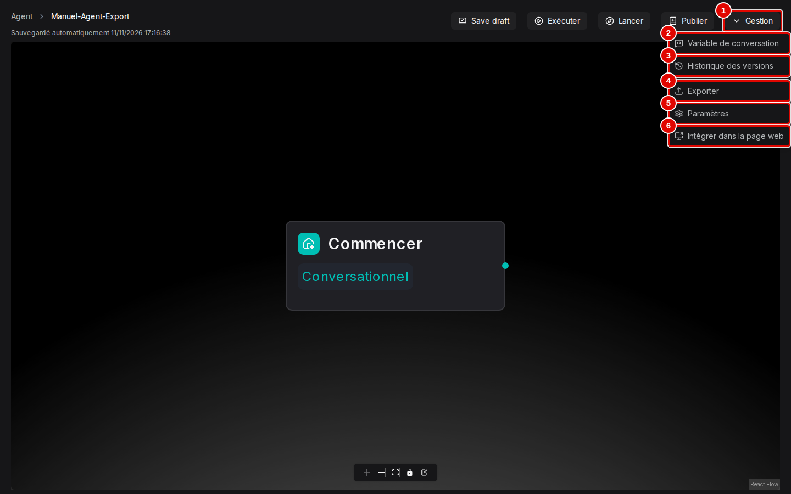
*Écran : canevas d'un agent, menu « Gestion » ouvert.*

| N° | Élément | Rôle |
|---|---|---|
| 1 | « Gestion » | ouvre le menu de l'agent |
| 2 | « Variable de conversation » | informations partagées par tous les blocs pendant une session |
| 3 | « Historique des versions » | versions publiées (étape 10) |
| 4 | « Exporter » | télécharge l'agent dans un fichier `.json` |
| 5 | « Paramètres » | « Titre », « Photo », « Description », « Autorisations » (chapitre 13) |
| 6 | « Intégrer dans la page web » | code d'intégration (étape 11) |

*Résultat* : le fichier contient le dessin de l'agent (blocs, liens et réglages) ; il se réimporte à l'étape suivante, sur la même installation ou sur une autre.

## Importer un agent depuis un fichier JSON

**Étape 13. Recréer un agent exporté**
*Où* : barre du haut › « Agent » › « + » › « Importer un fichier JSON ».
Saisir un nom (pastille 1), déposer le fichier exporté à l'étape 12 dans « DSL » (pastilles 2 et 3), puis cliquer sur « Enregistrer » (pastille 4). Cela sert par exemple à copier un agent vers une autre installation de RAGFlow.

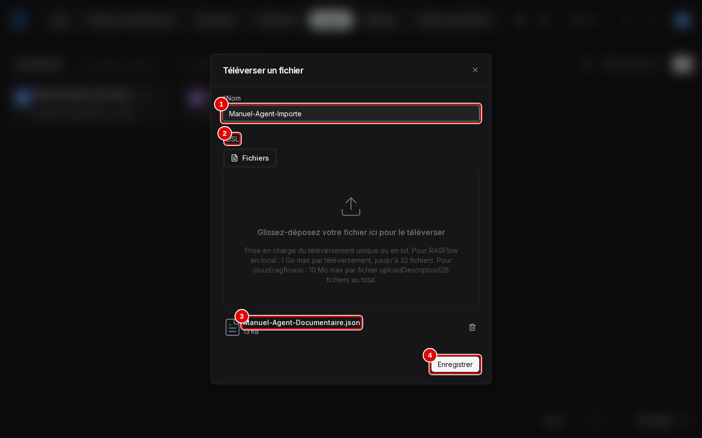
*Écran : fenêtre d'import d'un agent.*

| N° | Élément | Rôle |
|---|---|---|
| 1 | « Nom » | nom du nouvel agent, ici « Manuel-Agent-Importe » |
| 2 | « DSL » | le fichier de l'agent (onglet « Fichiers ») |
| 3 | `agent-exporte.json` | fichier exporté |
| 4 | « Enregistrer » | crée l'agent et ouvre son canevas |

*Résultat* : l'agent importé s'ouvre, puis apparaît dans la liste : c'est une copie de l'original, mêmes blocs et même base.

## Partir d'un canevas vide

**Étape 14. Ajouter un bloc**
*Où* : barre du haut › « Agent » › « + » › « Créer depuis un blanc ».
Saisir un nom, ici « Manuel-Agent-Vierge », et cliquer sur « Confirmer ». Le canevas ne contient que « Commencer ». Survoler ce bloc et cliquer sur le « + » de son bord droit (pastille 1) : le menu « Étape suivante » liste les blocs. Choisir « Récupération » dans « Fondation » (pastille 2), puis cliquer sur « Save draft ».

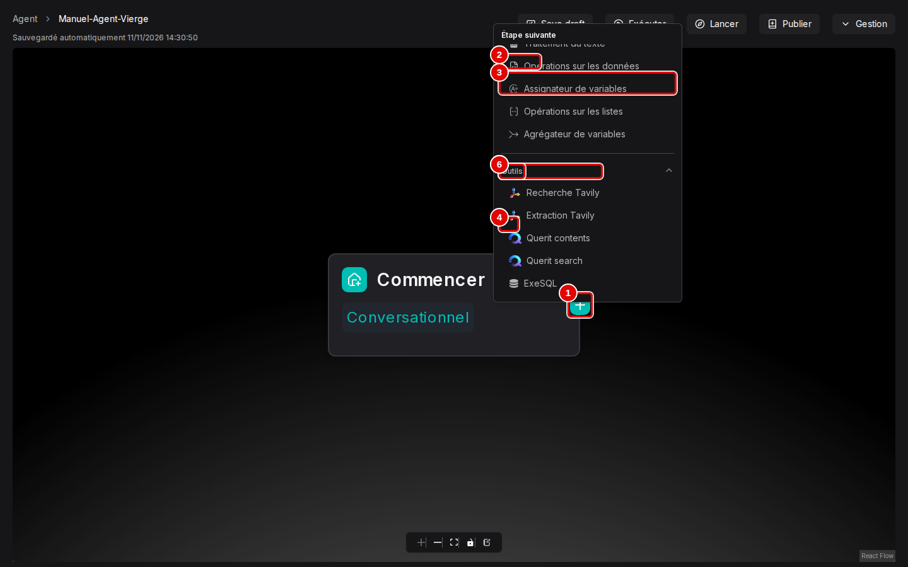
*Écran : canevas vide, menu « Étape suivante » ouvert.*

| N° | Élément | Rôle |
|---|---|---|
| 1 | « + » | ajoute un bloc après « Commencer » |
| 2 | « Fondation » | « Agent », « Récupération », « Dialogue », « Message », « En attente de réponse » |
| 3 | « Agent » | bloc agent (modèle, consignes, outils), comme à l'étape 5 |
| 4 | « Flux » | « Interrupteur », « Itération », « Boucle », « Catégoriser » : embranchements et répétitions |
| 5 | « Manipulation des données » | « Code », « Traitement du texte », « Opérations sur les données », « Assignateur de variables », « Opérations sur les listes », « Agrégateur de variables » |
| 6 | « Outils » | outils en blocs : recherche web, ExeSQL, Email, GitHub, « Requête HTTP », « Générateur de Documents »… |

*Résultat* : le bloc apparaît relié à « Commencer ». Il se règle comme l'outil de l'étape 6 ; tant qu'aucune base n'est choisie, « Checklist », en haut du canevas, signale le réglage manquant. Le « + » n'apparaît que sur un bloc sans suite ; les blocs se relient aussi en tirant un trait d'une poignée à l'autre.

## Donner une mémoire à l'agent

Une **mémoire** garde les échanges d'un agent d'une session à l'autre, rangés pour être retrouvés ensuite par le sens, comme les passages d'une base.

**Étape 15. Créer une mémoire**
*Où* : barre du haut › « Mémoire » › « + ».
La page affiche « Aucune mémoire créée pour le moment ». Cliquer sur « + », saisir le nom (pastille 1), choisir ce qui est gardé (pastille 2), garder les modèles proposés (pastilles 3 et 4), puis cliquer sur « Confirmer » (pastille 5).

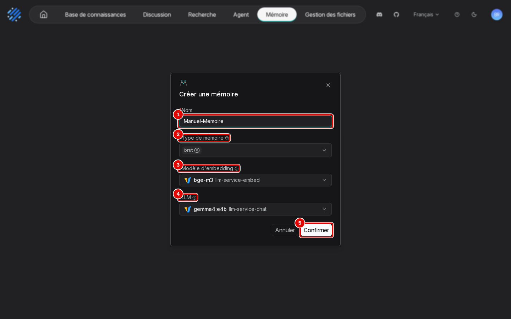
*Écran : Mémoire, fenêtre de création.*

| N° | Élément | Rôle |
|---|---|---|
| 1 | « Nom » | ici « Manuel-Memoire » |
| 2 | « Type de mémoire » | ce qui est gardé, plusieurs choix possibles : « brut » (échanges tels quels, gardé ici), « sémantique » (faits extraits), « épisodique » (événements datés), « procédural » (façons de faire) ; refermer la liste par son bouton « Fermer », car la touche Échap ferme toute la fenêtre |
| 3 | « Modèle d'embedding » | `bge-m3` : range les souvenirs pour la recherche par le sens |
| 4 | « LLM » | `gemma4:e4b` : extrait les souvenirs des échanges |
| 5 | « Confirmer » | crée la mémoire |

*Résultat* : la mémoire apparaît dans la liste. Sa page a deux onglets : « Messages » (souvenirs enregistrés) et « Configuration » (nom, avatar, description, modèles, type, « Taille de la mémoire (Bytes) » et « Paramètres avancés » de l'extraction).

**Étape 16. Relier la mémoire à l'agent**
*Où* : barre du haut › « Agent » › canevas de « Manuel-Agent-Documentaire » › bloc « Message_0 ».
Ouvrir la liste « Enregistrer en mémoire » (étape 7, pastille 5) et choisir « Manuel-Memoire ». Fermer le panneau et cliquer sur « Save draft ». Puis « Lancer », « + » (nouvelle session), et poser « Combien de salariés compte Vélanor au 31 décembre 2025 ? » : l'agent répond 412 salariés, avec le détail par site.

*Résultat* : l'échange est envoyé à la mémoire (étape suivante).

**Étape 17. Lire les souvenirs enregistrés**
*Où* : barre du haut › « Mémoire » › « Manuel-Memoire » › onglet « Messages ».
L'échange de l'étape 16 y figure (pastille 1).

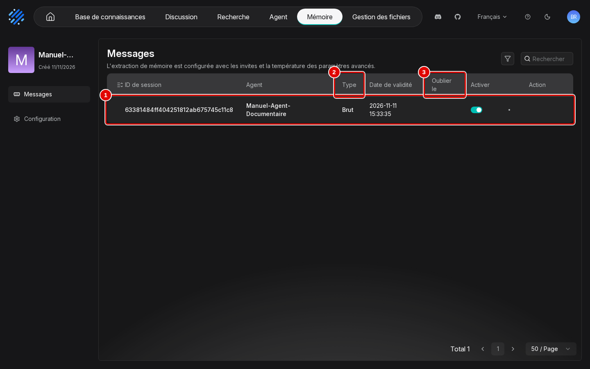
*Écran : Mémoire « Manuel-Memoire », onglet « Messages ».*

| N° | Élément | Rôle |
|---|---|---|
| 1 | message mémorisé | session, agent « Manuel-Agent-Documentaire », type, date ; l'interrupteur « Activer » le met de côté sans l'effacer |
| 2 | « Type » | « Brut » |
| 3 | « Oublier le » | date d'oubli ; vide : gardé sans limite |

*Résultat* : le souvenir apparaît moins de dix secondes après la réponse. Pour que l'agent relise sa mémoire dans une session suivante, il faut lui ajouter un outil « Retrieval » réglé sur « Récupération depuis » « Mémoire » (étape 6) ; ce dernier point n'a pas été essayé.

## Déclarer un serveur MCP

MCP (Model Context Protocol) est une façon standard de proposer des outils à un modèle d'IA : lire un agenda, interroger un logiciel métier… Un serveur MCP déclaré ici ajoute ses outils à l'onglet « MCP » de « Ajouter des outils » (étape 5).

**Étape 18. Ajouter un serveur MCP**
*Où* : menu du compte (pastille aux initiales, en haut à droite) › « MCP » › « Ajouter MCP ».
La page « Serveurs MCP » affiche « Aucun serveur MCP disponible », avec « Rechercher », « Gestion en masse » (actions sur plusieurs serveurs), « Importer » et « Ajouter MCP ». Cliquer sur « Ajouter MCP », remplir la fenêtre (pastilles 1 à 4) et cliquer sur « Enregistrer » (pastille 5).

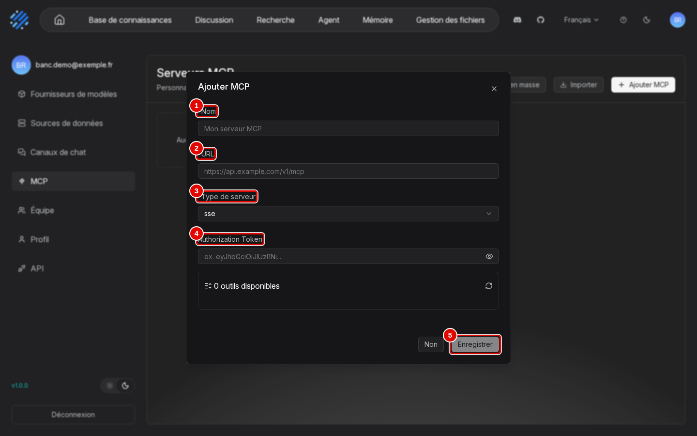
*Écran : réglages du compte, page « MCP », fenêtre d'ajout.*

| N° | Élément | Rôle |
|---|---|---|
| 1 | « Nom » | nom du serveur |
| 2 | « URL » | adresse du serveur MCP |
| 3 | « Type de serveur » | façon de dialoguer avec le serveur, « sse » par défaut |
| 4 | « Authorization Token » | jeton d'accès, si le serveur en demande un |
| 5 | « Enregistrer » | enregistre ; « 0 outils disponibles » se remplit quand le serveur répond |

*Résultat* : le serveur est déclaré et ses outils deviennent proposés aux agents. Les essais n'avaient pas de serveur MCP : la fenêtre a été refermée sans enregistrer.

## Bon à savoir

- Les 19 modèles d'agents sont en anglais ; plusieurs supposent un service en ligne (recherche web, bourse, courriel) et ne fonctionnent pas sur une installation fermée à Internet.
- Les réponses des agents tirés de ces modèles sont en anglais, même à une question en français. Pour des réponses en français, traduire l'« Invite système » et l'« Invite utilisateur » du bloc agent (étape 5).
- Un agent répond un peu plus lentement qu'un assistant : cinq à six secondes contre deux à trois, car le modèle décide d'abord d'appeler l'outil.
- Le nom d'une version publiée porte l'heure de Paris, mais les mentions « Créé » et « Sauvegardé automatiquement » l'heure universelle (une heure de moins en hiver).
- Une adresse de serveur MCP sur le réseau local sera probablement refusée, comme pour les sources de données (chapitre 12).

## En cas de problème

| Symptôme | Cause | Que faire |
|---|---|---|
| L'agent répond en anglais | consignes du modèle d'agent en anglais | traduire « Invite système » et « Invite utilisateur » (étape 5) |
| L'agent ne trouve rien dans les documents | aucune base dans l'outil « Retrieval » | choisir la base (étape 6) |
| L'outil « Retrieval » a disparu | croix à droite de l'outil cliquée dans le panneau de l'agent | « Ajouter des outils » › « Récupération », puis choisir la base ; ou « Gestion » › « Historique des versions » et remettre une version |
| La fenêtre « Créer une mémoire » se ferme pendant le choix du type | la touche Échap ferme toute la fenêtre | refermer la liste par « Fermer » |
| « Checklist » signale un problème | bloc sans réglage obligatoire (base, modèle) | ouvrir le bloc signalé et compléter |

Les autres problèmes sont traités au chapitre [15. En cas de problème](15-en-cas-de-probleme.md).

---
*Version décrite : RAGFlow v1.0.0, essais des 9 et 11 novembre 2026. Détails et preuves : [rapport d'essais](../annexes/A6-rapport-d-essais.md).*
