# 11. Produire des synthèses automatiques

> Ce chapitre apprend à faire produire par RAGFlow des synthèses de ses documents (graphe de connaissances, arbre de résumés, frise, carte mentale) : créer la recette de synthèse, construire la chaîne de lecture qui l'applique, la relier à une base, puis lire le résultat dans l'onglet « Artifacts » de la base.
> **Point de départ** : barre du haut › « Agent » › onglet « Compilation operator ».
> **Durée** : environ 30 minutes. **Avant** : chapitres 06 et 10.

## Ce qu'il faut savoir

RAGFlow sait tirer de ses documents des **synthèses** (l'interface dit « artefacts ») : un graphe des personnes, lieux et organisations cités, un arbre de résumés, une frise des dates, une carte mentale, une table des matières ou des pages de wiki. Ce n'est pas un bouton : la synthèse se fait pendant l'analyse d'un document, et demande trois objets. Un **opérateur** (onglet « Compilation operator ») dit quoi produire, par exemple un graphe. Une **chaîne de lecture** (l'interface dit « pipeline d'ingestion », onglet « Ingestion pipeline ») enchaîne la lecture du fichier, son découpage, la synthèse par l'opérateur et le rangement pour la recherche. Une **base** utilise cette chaîne à la place d'un gabarit : chaque document qu'elle reçoit passe alors par la chaîne. Une base ne produit qu'un seul type de synthèse. L'exemple fait extraire un graphe du compte rendu de la réunion du CSE de Vélanor (`cse-2025-10-14.md`).

## Créer un opérateur de synthèse

**Étape 1. Ouvrir la liste des opérateurs**
*Où* : barre du haut › « Agent » › onglet « Compilation operator ».
Cliquer sur l'onglet (pastille 1), puis sur « + » (pastille 3).

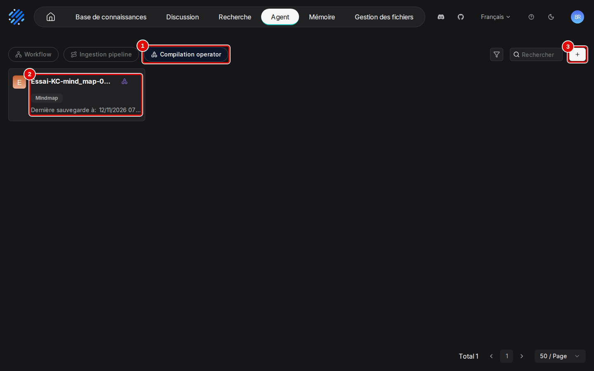
*Écran : Agent, onglet « Compilation operator ».*

| N° | Élément | Rôle |
|---|---|---|
| 1 | « Compilation operator » | liste des opérateurs de synthèse |
| 2 | carte « Essai-KC-mind_map-0816 » | opérateur du jeu de démonstration : nom, type « Mindmap », date ; un clic l'ouvre en modification |
| 3 | « + » | ouvre la page « Add template » de création d'un opérateur |

*Résultat* : la page « Add template » s'ouvre.

**Étape 2. Nommer l'opérateur et choisir le type de synthèse**
*Où* : Agent › « Compilation operator » › page « Add template ».
Saisir le nom (pastille 1), ici « Manuel-Operateur-Graphe », et une description (pastille 2). Ouvrir la liste « Template » (pastille 3) et choisir « Graph ».

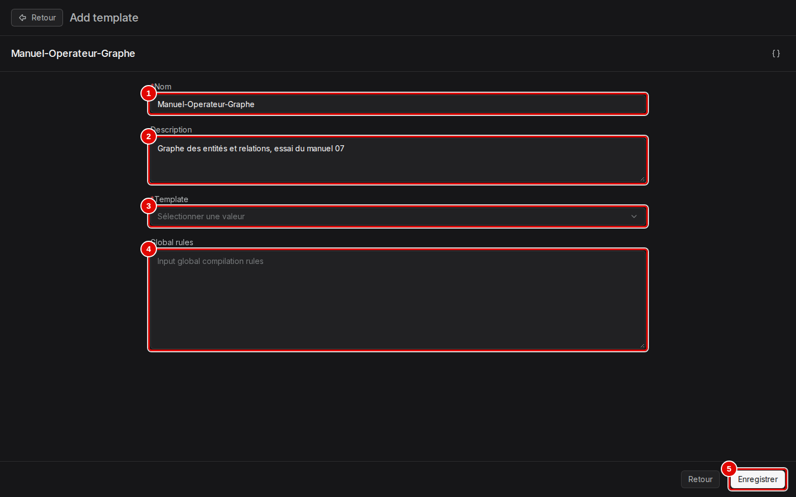
*Écran : page « Add template ».*

| N° | Élément | Rôle |
|---|---|---|
| 1 | « Nom » | nom de l'opérateur ; obligatoire |
| 2 | « Description » | texte libre, affiché sur la carte |
| 3 | « Template » | type de synthèse ; obligatoire. « Graph » : graphe de connaissances (entités et relations) ; « Mindmap » : carte mentale ; « PageIndex » : table des matières ; « Timeline » : frise des événements datés ; « Tree » : arbre de résumés, des passages vers un résumé général ; « Wiki » : pages de wiki reliées entre elles |
| 4 | « Global rules » | consignes ajoutées à toutes les demandes faites au modèle (langue, style, ce qu'il faut ignorer) ; laissé vide ici |
| 5 | « Enregistrer » | crée l'opérateur |

*Résultat* : les réglages propres à « Graph » apparaissent sous « Global rules ». Le premier, « Re-chunk parser output », redécoupe le texte lu avant la synthèse au lieu de reprendre les passages ; le laisser désactivé.

**Étape 3. Relire ce que le modèle doit chercher**
*Où* : page « Add template », plus bas.
Les types d'entités (pastille 1) et de relations (pastille 2) sont proposés d'office. Chaque carte se modifie (crayon) ou se supprime (corbeille) au survol. Cliquer sur « Enregistrer » (pastille 5).

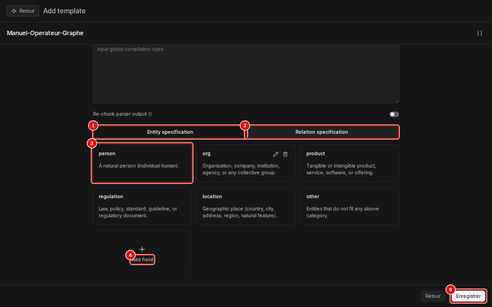
*Écran : page « Add template », types d'entités et de relations.*

| N° | Élément | Rôle |
|---|---|---|
| 1 | « Entity specification » | types d'entités : `person`, `org`, `product`, `regulation`, `location`, `other`, chacun avec sa définition en anglais |
| 2 | « Relation specification » | types de relations : `owns`, `part_of`, `caused_by`, `regulates`, `located_in`, `other` |
| 3 | carte « person » | un type d'entité : nom et définition donnée au modèle |
| 4 | « Add field » | ajoute un type, par exemple `contrat` pour des documents juridiques |
| 5 | « Enregistrer » | crée l'opérateur et revient à la liste |

*Résultat* : la carte « Manuel-Operateur-Graphe » apparaît dans la liste de l'étape 1. Les définitions sont en anglais, mais les noms extraits restent dans la langue du document.

## Construire la chaîne de lecture

**Étape 4. Créer une chaîne de lecture vide**
*Où* : barre du haut › « Agent » › onglet « Ingestion pipeline » › « + ».
Le menu propose trois départs. Choisir « Créer depuis un blanc » (pastille 2), saisir le nom « Manuel-Pipeline-Graphe » dans la fenêtre « Create ingestion pipeline », puis cliquer sur « Confirmer ».

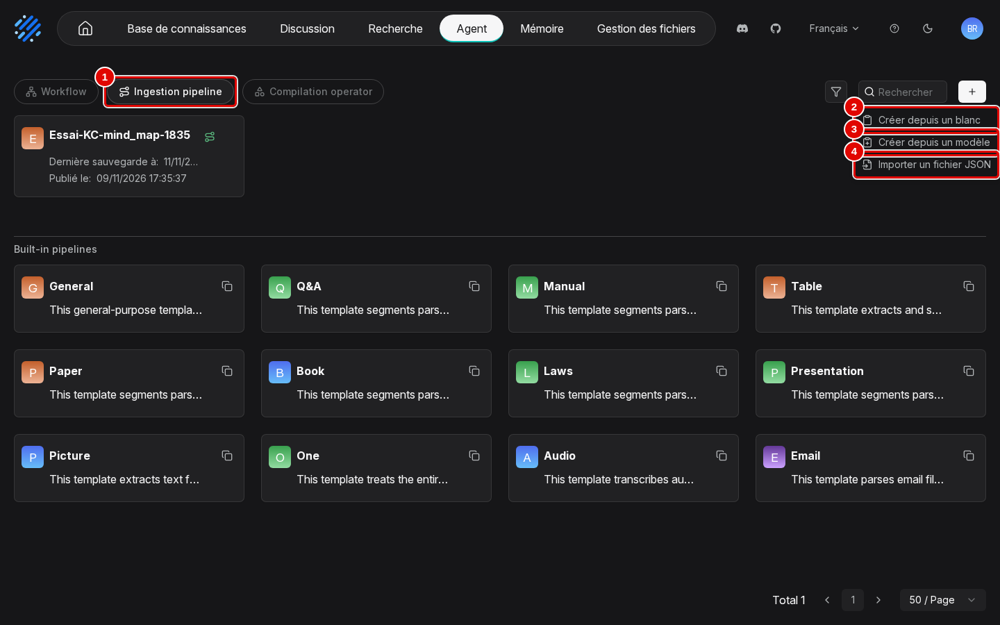
*Écran : Agent, onglet « Ingestion pipeline », menu de création ouvert.*

| N° | Élément | Rôle |
|---|---|---|
| 1 | « Ingestion pipeline » | chaînes créées, puis les douze chaînes intégrées (« Built-in pipelines », chapitre 06) |
| 2 | « Créer depuis un blanc » | canevas réduit à « Commencer » et « Parser » |
| 3 | « Créer depuis un modèle » | part d'un modèle (par exemple « Title Chunker », « Chunk Summary ») |
| 4 | « Importer un fichier JSON » | recrée une chaîne exportée, comme pour un agent (chapitre 10, étape 13) |

*Résultat* : le canevas de la chaîne s'ouvre (étape suivante).

**Étape 5. Lire le canevas de départ**
*Où* : canevas de la chaîne (plein écran, bouton « Retour » pour revenir).
Le canevas contient deux blocs reliés (pastilles 1 et 2). Un clic sur un bloc ouvre son panneau de réglages à droite ; celui du « Parser » règle la lecture de chaque format, avec les mêmes réglages que l'onglet « Parser » de la configuration d'une base (chapitre 06, étape 8).

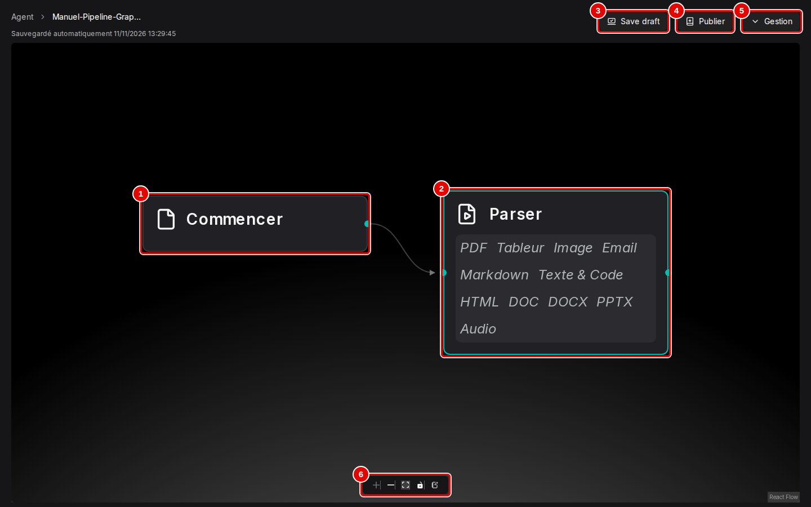
*Écran : canevas d'une chaîne de lecture neuve.*

| N° | Élément | Rôle |
|---|---|---|
| 1 | « Commencer » | point d'entrée : le fichier reçu par la base |
| 2 | « Parser » | lit le fichier selon son format (PDF, tableur, image, courriel, Markdown, texte, HTML, DOC, DOCX, PPTX, audio) |
| 3 | « Save draft » | enregistre le brouillon (le canevas s'enregistre aussi tout seul) |
| 4 | « Publier » | crée une version utilisable par une base (étape 9) |
| 5 | « Gestion » | menu de la chaîne : exporter, réglages (comme pour un agent, chapitre 10, étapes 11 et 12) |
| 6 | commandes du canevas | zoom avant, zoom arrière, « Fit View » (tout afficher), verrouillage des blocs |

*Résultat* : le canevas est repéré.

**Étape 6. Ajouter le découpage**
*Où* : canevas › bloc « Parser » › « + » (bord droit, au survol).
Cliquer sur le « + » (pastille 1) : le menu « Étape suivante » propose les découpeurs. Choisir « Découpeur par tokens » (pastille 2), puis cliquer sur « Save draft ».

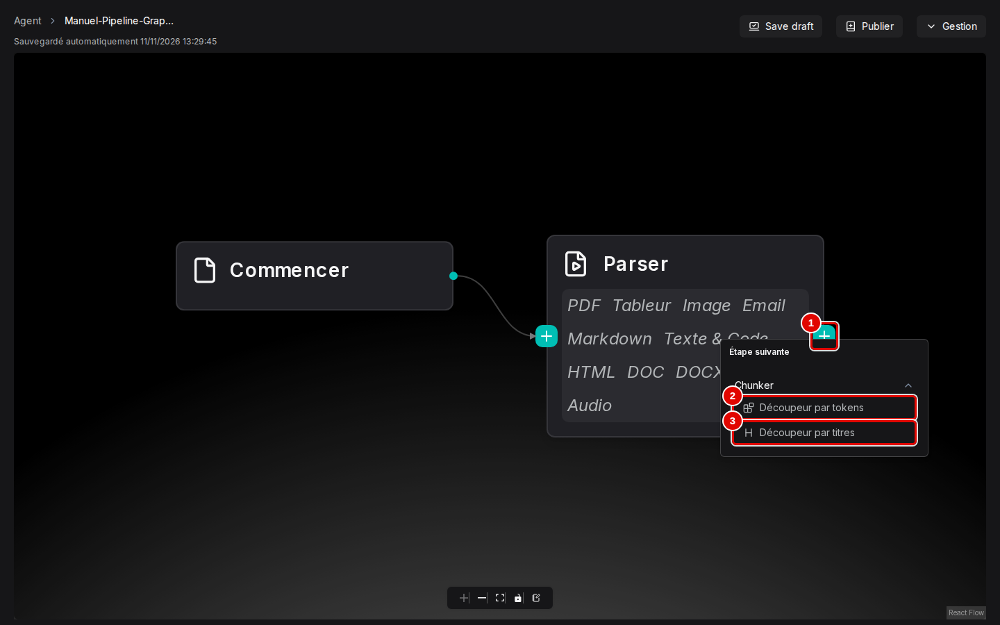
*Écran : canevas, menu « Étape suivante » du « Parser ».*

| N° | Élément | Rôle |
|---|---|---|
| 1 | « + » | ajoute une étape après ce bloc |
| 2 | « Découpeur par tokens » | coupe le texte en passages d'une taille donnée (512 jetons par défaut) |
| 3 | « Découpeur par titres » | coupe aux titres du document |

*Résultat* : un bloc « Chunker » suit le « Parser ».

**Étape 7. Ajouter la synthèse et choisir l'opérateur**
*Où* : canevas › bloc « Chunker » › « + », puis bloc « Compiler ».
Le menu « Étape suivante » propose « Indexeur » (range les passages pour la recherche), « Compiler » (produit une synthèse) et « Transformateur » (fait réécrire ou enrichir les passages par un modèle). Choisir « Compiler », cliquer sur « Save draft », puis sur le bloc « Compiler ». Dans son panneau, ouvrir « Operator » (pastille 1) et choisir « Manuel-Operateur-Graphe ».

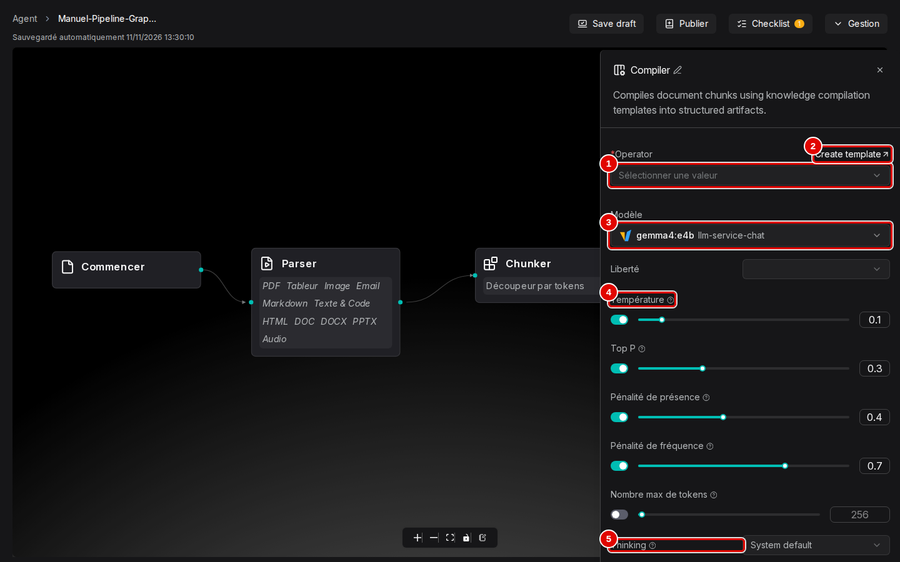
*Écran : canevas, panneau du bloc « Compiler ».*

| N° | Élément | Rôle |
|---|---|---|
| 1 | « Operator » | opérateur à appliquer ; obligatoire (tant qu'il est vide, « Checklist » signale un problème) |
| 2 | « Create template » | ouvre la page « Add template » (étape 2) dans un nouvel onglet |
| 3 | « Modèle » | modèle d'IA qui fait la synthèse, ici `chat` (la capture, prise avec l'ancien serveur de modèles, affiche `gemma4:e4b`) |
| 4 | « Température » | réglages du modèle (« Liberté », « Température » à 0,1, « Top P »…), comme pour un assistant (chapitre 08) |
| 5 | « Thinking » | réflexion préalable du modèle : « System default », « Enabled », « Disabled » |

*Résultat* : le bloc « Compiler » est réglé.

**Étape 8. Terminer par l'indexation**
*Où* : canevas › bloc « Compiler » › « + ».
Choisir « Indexeur » : c'est la dernière étape, sans laquelle aucun passage n'est cherchable. Cliquer sur « Save draft » (pastille 5).

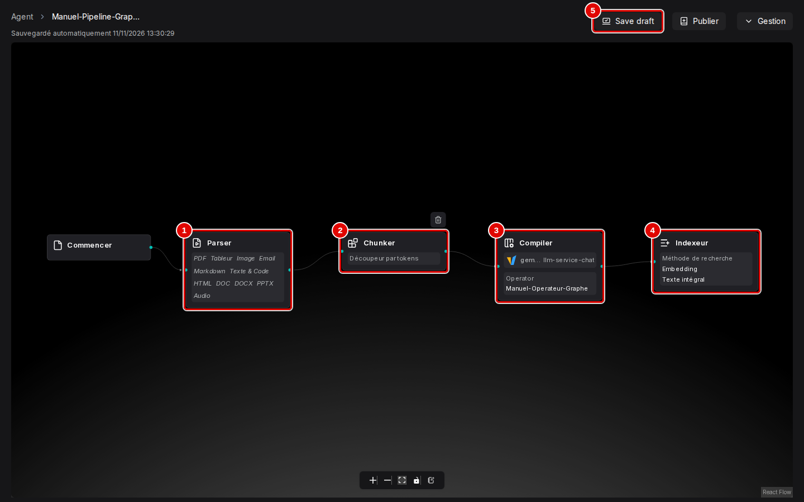
*Écran : canevas, chaîne de lecture complète.*

| N° | Élément | Rôle |
|---|---|---|
| 1 | « Parser » | lecture du fichier |
| 2 | « Chunker » | « Découpeur par tokens » |
| 3 | « Compiler » | synthèse par « Manuel-Operateur-Graphe » |
| 4 | « Indexeur » | rangement pour la recherche (réglages de l'onglet « Indexer » d'une base, chapitre 06) |
| 5 | « Save draft » | enregistre le brouillon |

*Résultat* : la chaîne est complète. Après un « Compiler », le menu ne propose plus de second « Compiler » : une chaîne ne produit qu'un type de synthèse.

**Étape 9. Publier la chaîne**
*Où* : canevas › « Publier ».
Saisir l'alias « v1 » et cliquer sur « Confirmer », dans la fenêtre montrée au chapitre 10, étape 10. Revenir ensuite à barre du haut › « Agent » › onglet « Ingestion pipeline ».

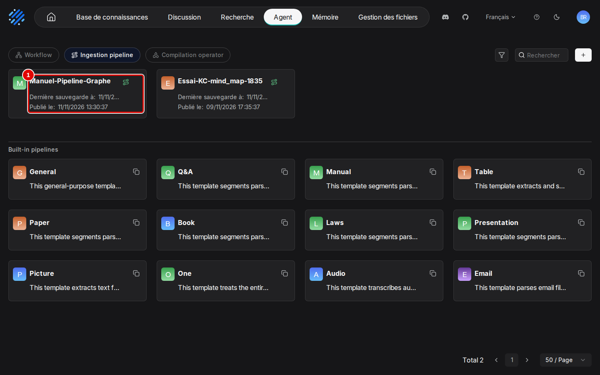
*Écran : Agent, onglet « Ingestion pipeline », chaîne publiée.*

| N° | Élément | Rôle |
|---|---|---|
| 1 | carte « Manuel-Pipeline-Graphe » | « Dernière sauvegarde à » (brouillon) et « Publié le » (dernière version publiée) ; sous « Built-in pipelines », les gabarits intégrés, copiables |

*Résultat* : la carte « Manuel-Pipeline-Graphe » porte une date « Publié le ». Seule une version publiée peut être choisie par une base ; une modification ultérieure du canevas ne change rien à la base tant qu'une nouvelle version n'est pas publiée et choisie.

## Relier une base à la chaîne de lecture

**Étape 10. Choisir la chaîne dans la configuration de la base**
*Où* : barre du haut › « Base de connaissances » › nouvelle base « Manuel-KC-Graphe » › menu de gauche › « Configuration » › « Mode d'analyse ».
Créer la base comme au chapitre 04 (étapes 1 et 2). Ouvrir « Configuration », puis la liste « Mode d'analyse » : les chaînes créées sont en tête, avant les gabarits « (built in) ». Cliquer sur « Manuel-Pipeline-Graphe » (pastille 1) pour déplier ses versions, puis choisir la version publiée (pastille 2).

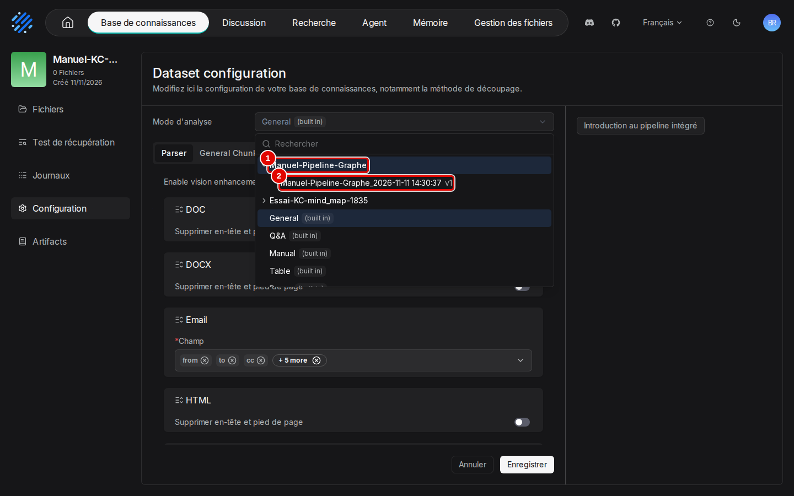
*Écran : base, « Configuration », liste « Mode d'analyse » ouverte.*

| N° | Élément | Rôle |
|---|---|---|
| 1 | « Manuel-Pipeline-Graphe » | chaîne de lecture dépliée |
| 2 | « Manuel-Pipeline-Graphe_2026-11-11 14:30:37 v1 » | version publiée : nom, date de publication, alias |

*Résultat* : les onglets sous « Mode d'analyse » deviennent les étapes de la chaîne (« Parser », « Découpeur par tokens », « Compiler », « Indexeur ») ; l'onglet « Compiler » reprend les réglages du canevas, modifiables pour cette base. Cliquer sur « Enregistrer ».

**Étape 11. Envoyer un document**
*Où* : base « Manuel-KC-Graphe » › « Fichiers » › « Ajouter un fichier » › « Téléverser un fichier ».
Envoyer `cse-2025-10-14.md` avec « Analyser à la création » activé, dans la fenêtre montrée au chapitre 05, étape 3. La chaîne se lance dès l'envoi.

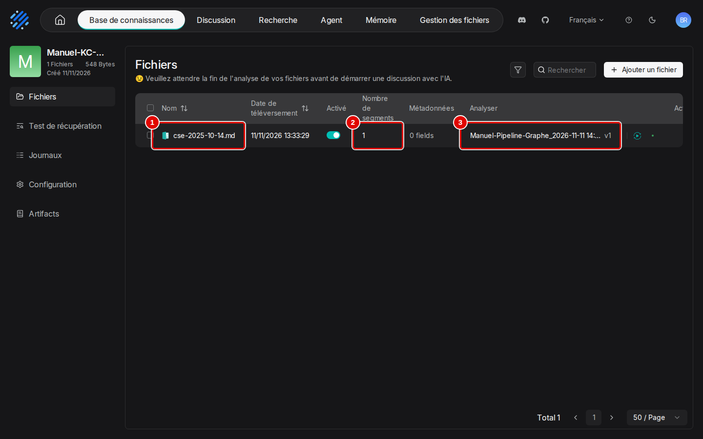
*Écran : base « Manuel-KC-Graphe », onglet « Fichiers », analyse terminée.*

| N° | Élément | Rôle |
|---|---|---|
| 1 | `cse-2025-10-14.md` | fichier envoyé |
| 2 | « Nombre de segments » | 1 passage |
| 3 | « Analyser » | nom, date de publication et version (« v1 ») de la chaîne, au lieu d'un gabarit |

*Résultat* : en quelques secondes, le fichier est lu et synthétisé ; lecture et synthèse ont pris 8 secondes en tout.

## Lire les synthèses

**Étape 12. Ouvrir l'onglet « Artifacts » et choisir la vue**
*Où* : base ouverte › menu de gauche › « Artifacts ».
La page des synthèses s'ouvre en plein écran (bouton « Retour » pour revenir). Ouvrir le sélecteur en haut à droite et choisir « Graph » (pastille 3).

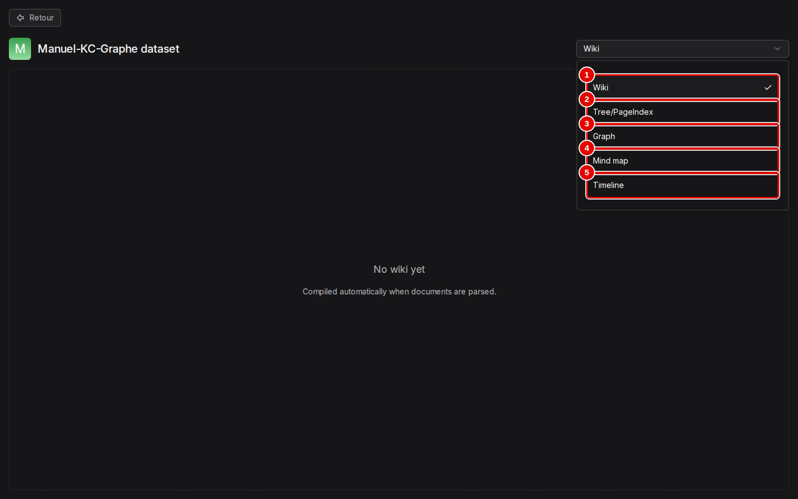
*Écran : base, onglet « Artifacts », sélecteur ouvert.*

| N° | Élément | Rôle |
|---|---|---|
| 1 | « Wiki » | pages de wiki (type « Wiki ») |
| 2 | « Tree/PageIndex » | arbre de navigation (types « Tree » et « PageIndex ») |
| 3 | « Graph » | graphe de connaissances (type « Graph ») |
| 4 | « Mind map » | carte mentale (type « Mindmap ») |
| 5 | « Timeline » | frise chronologique (type « Timeline ») |

*Résultat* : la vue choisie s'affiche. Une vue d'un type que la base ne produit pas reste vide, avec par exemple « No wiki yet » et « Compiled automatically when documents are parsed. ».

**Étape 13. Lire le graphe**
*Où* : « Artifacts » › vue « Graph ».
Chaque pastille est une entité, colorée par type, et les traits sont les relations. La molette zoome, le glisser déplace ; la liste « Search entity » (pastille 2) centre le graphe sur une entité.

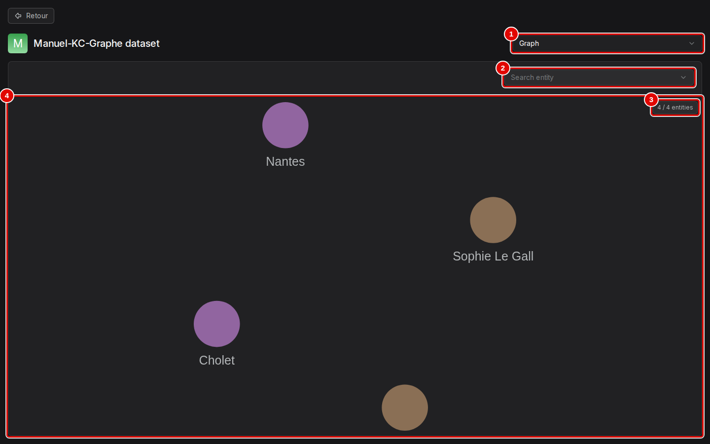
*Écran : onglet « Artifacts », vue « Graph ».*

| N° | Élément | Rôle |
|---|---|---|
| 1 | « Graph » | vue choisie |
| 2 | « Search entity » | liste des entités par nom |
| 3 | « 4 / 4 entities » | entités affichées sur le total |
| 4 | graphe | « Nantes », « Cholet » (lieux), « Sophie Le Gall », « Hélène Marchais » (personnes) |

*Résultat* : le graphe est exact (présidente, secrétaire, deux sites) mais pauvre : quatre entités, aucune relation ; les élus, la prime et le restaurant d'entreprise n'y figurent pas.

**Étape 14. Lire un arbre de résumés**
*Où* : base « Manuel-KC-Tree » › « Artifacts » › vue « Tree/PageIndex ».
La base se prépare par la même procédure que « Manuel-KC-Graphe », avec un autre type : opérateur « Manuel-Operateur-Tree » de Template « Tree » (étapes 1 à 3), chaîne « Manuel-Pipeline-Tree » qui l'utilise dans son bloc « Compiler » (étapes 4 à 9), puis base « Manuel-KC-Tree » reliée à cette chaîne et `cse-2025-10-14.md` envoyé (étapes 10 et 11).
L'arbre de navigation est à gauche (pastille 2) ; un clic sur un nœud affiche son résumé à droite, sa flèche déplie les nœuds enfants.

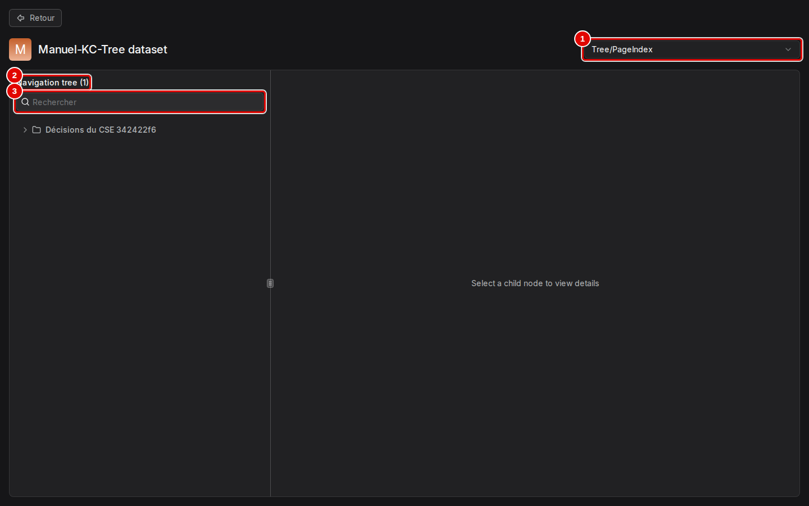
*Écran : onglet « Artifacts », vue « Tree/PageIndex ».*

| N° | Élément | Rôle |
|---|---|---|
| 1 | « Tree/PageIndex » | vue choisie |
| 2 | « Navigation tree (1) » | arbre des résumés ; le nombre donne les nœuds de premier niveau |
| 3 | « Rechercher » | filtre les nœuds par leur titre |

*Résultat* : le nœud « Décisions du CSE » donne un résumé exact : « Ce compte-rendu détaille les décisions prises lors de la réunion du CSE, incluant l'attribution d'une prime d'intéressement, l'autorisation du télétravail, l'ouverture d'un restaurant d'entreprise et le report d'une discussion sur les horaires d'été. » Cette synthèse a pris un peu plus de deux minutes.

**Étape 15. Lire une frise**
*Où* : base « Manuel-KC-Timeline » › « Artifacts » › vue « Timeline ».
Même préparation qu'à l'étape 14, avec le Template « Timeline » : opérateur « Manuel-Operateur-Timeline », chaîne « Manuel-Pipeline-Timeline », base « Manuel-KC-Timeline ».
Les événements sont reliés à leur date (pastille 2).

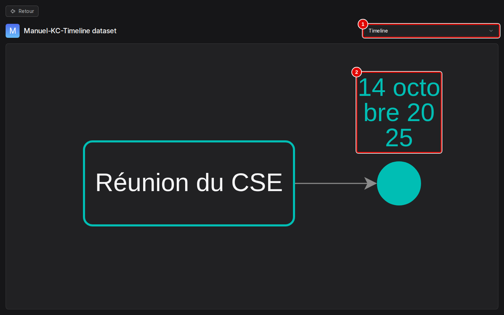
*Écran : onglet « Artifacts », vue « Timeline ».*

| N° | Élément | Rôle |
|---|---|---|
| 1 | « Timeline » | vue choisie |
| 2 | « 14 octobre 2025 » | date reliée à l'événement « Réunion du CSE » par une flèche |

*Résultat* : la frise ne garde que la date de la réunion et oublie les autres dates du compte rendu (avril 2026, janvier 2026, décembre).

**Étape 16. Lire une carte mentale**
*Où* : base « Essai-KC-mind_map-0816 » › « Artifacts » › vue « Mind map ».
La capture vient de la base « Essai-KC-mind_map-0816 » du jeu de démonstration, préparée pendant les essais par un programme, avec le même document `cse-2025-10-14.md`. Pour obtenir la même carte à la souris, suivre la même procédure qu'à l'étape 14 avec le Template « Mindmap » : opérateur « Manuel-Operateur-Mindmap », chaîne « Manuel-Pipeline-Mindmap », base « Manuel-KC-Mindmap ».
Le sujet central est au milieu, les branches partent de part et d'autre (pastille 2).

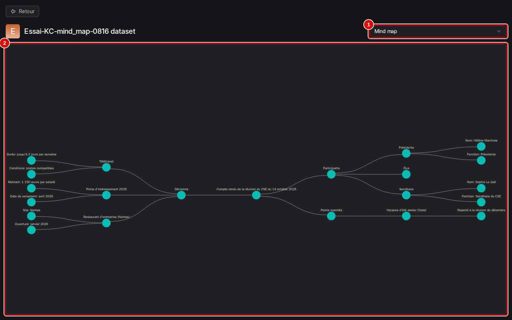
*Écran : onglet « Artifacts », vue « Mind map ».*

| N° | Élément | Rôle |
|---|---|---|
| 1 | « Mind map » | vue choisie |
| 2 | carte mentale | « Compte rendu de la réunion du CSE du 14 octobre 2025 » au centre ; à gauche « Décisions » (« Télétravail », « Prime d'intéressement 2025 », « Restaurant d'entreprise (Nantes) ») ; à droite « Participants » et « Points reportés », avec leurs détails |

*Résultat* : la carte mentale est exacte : présidente Hélène Marchais, secrétaire Sophie Le Gall et les élus (sans leur nombre, sept) ; prime d'intéressement de 1 150 euros versée en avril 2026 ; télétravail jusqu'à deux jours par semaine sur les postes compatibles ; restaurant d'entreprise de Nantes ouvert en janvier 2026 ; horaires d'été de l'atelier de Cholet reportés à la réunion de décembre. La synthèse a pris moins de deux minutes avec le modèle `chat`.

## Bon à savoir

- **Les types « Wiki » et « PageIndex » ont échoué** pendant les essais du 11 novembre, avec le petit modèle utilisé alors (Gemma 4 E4B, ancien serveur de modèles) ; ils n'ont pas été refaits avec `chat`. Le modèle doit rendre sa synthèse dans un format structuré précis, et il ne l'a pas fait. Le signe : le fichier reste à 0 passage avec un point rouge dans « Analyser », la tâche est « Failed » dans « Journaux », et son détail (chapitre 05, étapes 14 et 15) affiche « LLM response is not parseable JSON », répété six fois avant « Task failed ». Un échec de la synthèse arrête toute la chaîne : le document n'est même pas cherchable. Relancer (triangle de la colonne « Analyser ») n'a pas suffi. Un modèle plus grand serait à essayer ; sinon, choisir un autre type.
- Le résultat varie d'une fois à l'autre avec un petit modèle : le même document a donné une autre fois cinq entités et quatre relations. Des consignes dans « Global rules » (par exemple « relier chaque personne à sa fonction ») peuvent enrichir le graphe.
- Sur un document court et avec une carte graphique, une synthèse prend de quelques secondes (graphe, frise) à deux ou trois minutes (arbre, échecs). Sur beaucoup de documents, ou sans carte graphique, elle peut prendre de plusieurs minutes à plusieurs dizaines de minutes.
- Le « + » d'un bloc n'ouvre le menu « Étape suivante » que si ce bloc n'a pas encore de suite ; pour insérer un bloc au milieu, supprimer d'abord le bloc suivant (corbeille au survol).
- Le choix d'une chaîne peut aussi se faire fichier par fichier, en cliquant sur le nom du gabarit dans la colonne « Analyser » (chapitre 06, étape 3).
- Les heures du détail des tâches sont en temps universel (une heure de moins que l'heure de Paris en hiver).

## En cas de problème

| Symptôme | Cause | Que faire |
|---|---|---|
| Onglet « Artifacts » vide (« No wiki yet ») | le sélecteur montre un autre type que celui que la base produit | choisir le type de l'opérateur de la chaîne (étape 12) |
| « Checklist » signale un problème dans le canevas | « Operator » du bloc « Compiler » vide | choisir un opérateur (étape 7) |
| Le « + » d'un bloc n'ouvre pas « Étape suivante » | le bloc a déjà une suite | partir du dernier bloc, ou supprimer le bloc suivant |
| La chaîne n'apparaît pas dans « Mode d'analyse » | chaîne jamais publiée | « Publier » dans le canevas (étape 9) |
| Fichier à 0 passage, « LLM response is not parseable JSON » dans « Journaux » | le modèle n'a pas rendu sa synthèse dans le format attendu | relancer une fois ; sinon un autre type de synthèse ou un modèle plus grand |

Les autres problèmes sont traités au chapitre [15. En cas de problème](15-en-cas-de-probleme.md).

---
*Version décrite : RAGFlow v1.0.0, essais des 9 et 11 novembre 2026. Détails et preuves : [rapport d'essais](../annexes/A6-rapport-d-essais.md).*
