# 12. Alimenter une base depuis une source externe

> Ce chapitre apprend à déclarer une source de données (ici le plan d'un site web), à la relier à une base pour qu'elle se remplisse seule, à lire le journal de synchronisation, et à comprendre pourquoi un site interne est refusé ; il présente aussi la page « Canaux de chat ».
> **Point de départ** : menu du compte (pastille aux initiales, en haut à droite) › « Sources de données ».
> **Durée** : environ 20 minutes. **Avant** : chapitres 05 et 06.

**Attention** : autoriser RAGFlow à lire un site interne (réglage `ALLOW_ANY_HOST`, fin du chapitre) vaut pour tout le serveur : les agents et leurs outils web peuvent alors, eux aussi, joindre toutes les machines du réseau local. Ne l'activer que le temps nécessaire, sur un poste de confiance.

## Ce qu'il faut savoir

Une **source de données** (l'interface dit aussi « connecteur ») est un système extérieur que RAGFlow relit à intervalle régulier pour garder une base à jour : un wiki, un espace de stockage, une messagerie, un site web. Elle se déclare une fois dans le menu du compte, puis se relie à une ou plusieurs bases ; chaque relecture s'appelle une **synchronisation**. Par exemple, un site web décrit par son **plan de site** (fichier `sitemap.xml`, la liste de ses pages) devient une base dont chaque page est un document, mis à jour toutes les cinq minutes. Pour des raisons de sécurité, RAGFlow refuse par défaut toute adresse qui n'est pas publique sur Internet, y compris un site de l'intranet de l'entreprise ou un site sur la même machine. L'exemple déclare le site de test des essais, servi sur la machine elle-même : il est refusé, ce qui permet de montrer le journal d'un échec.

## Déclarer une source de données

**Étape 1. Choisir le type de source**
*Où* : menu du compte › « Sources de données ».
La page affiche en haut les sources déjà déclarées (« Aucune source de données ajoutée. Sélectionnez-en une ci-dessous pour vous connecter. »), puis « Sources disponibles » : une carte par type de source. Faire défiler jusqu'à « Sitemap » (pastille 1), la survoler et cliquer sur « Ajouter » (pastille 2).

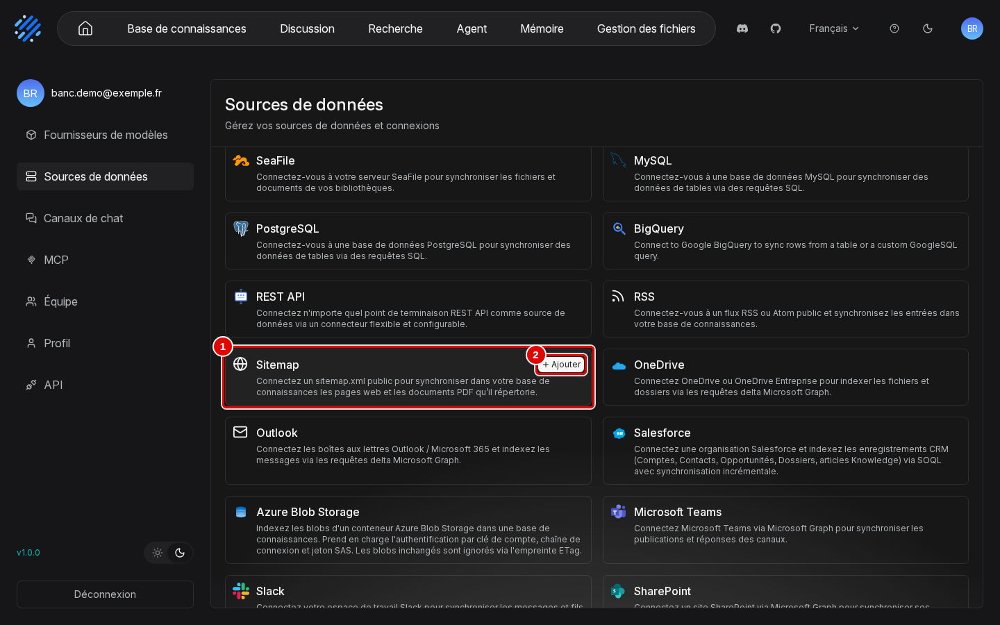
*Écran : Sources de données (liste des types de sources).*

| N° | Élément | Rôle |
|---|---|---|
| 1 | « Sitemap » | « Connectez un sitemap.xml public pour synchroniser dans votre base de connaissances les pages web et les documents PDF qu'il répertorie. » |
| 2 | « Ajouter » | ouvre « Créer votre connecteur Sitemap » |

*Résultat* : la fenêtre « Créer votre connecteur Sitemap » s'ouvre. Les autres types proposés sont : Confluence, Notion, Google Drive, Feishu Wiki, Gmail, Google Cloud Storage, Oracle Storage, S3, R2, Jira, Box, Dropbox, Bitbucket, Azure DevOps, GitLab, GitHub, Moodle, Discord, Xquik, Zendesk, Zotero, WebDAV, Airtable, Asana, IMAP, Dingtalk AI Table, SeaFile, MySQL, PostgreSQL, BigQuery, REST API, RSS, OneDrive, Outlook, Salesforce, Azure Blob Storage, Microsoft Teams, Slack, SharePoint. La plupart demandent un compte chez l'éditeur concerné.

**Étape 2. Remplir la source et la tester**
*Où* : Sources de données › fenêtre « Créer votre connecteur Sitemap ».
Saisir le nom (pastille 1) et l'adresse du plan de site (pastille 2), puis cliquer sur « Test connection » (pastille 5).

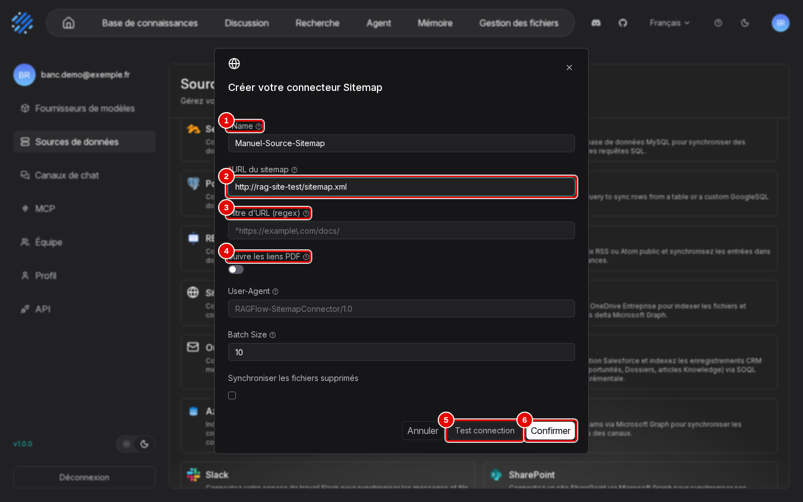
*Écran : fenêtre « Créer votre connecteur Sitemap ».*

| N° | Élément | Rôle |
|---|---|---|
| 1 | « Name » | nom libre, ici « Manuel-Source-Sitemap » |
| 2 | « URL du sitemap » | adresse du plan de site, ici `http://rag-site-test/sitemap.xml` (site de test sur la machine) |
| 3 | « Filtre d'URL (regex) » | ne garde que les pages dont l'adresse correspond au motif (par exemple `^https://example\.com/docs/`) |
| 4 | « Suivre les liens PDF » | ajoute aussi les PDF liés depuis les pages ; plus bas, « User-Agent », « Batch Size » (pages par lot, 10) et « Synchroniser les fichiers supprimés » |
| 5 | « Test connection » | vérifie que le plan de site est joignable, sans rien enregistrer |
| 6 | « Confirmer » | enregistre la source |

*Résultat* : le résultat du test s'affiche quelques secondes en haut à droite (étape suivante).

**Étape 3. Lire le résultat du test**
*Où* : même fenêtre, message en haut à droite.
Ici, le test est refusé (pastille 1) : l'adresse du site de test est privée.

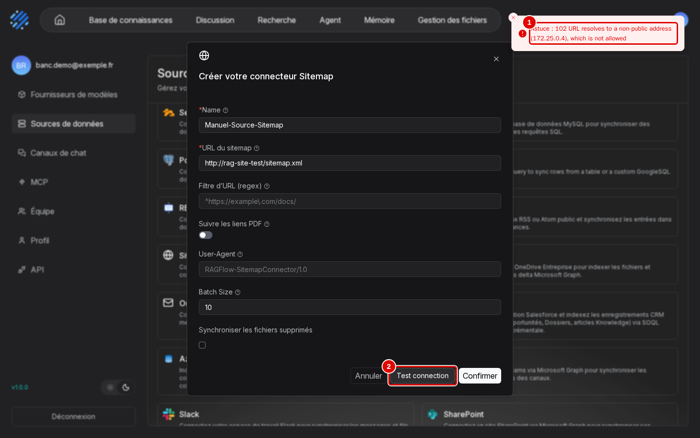
*Écran : fenêtre « Créer votre connecteur Sitemap », message de refus.*

| N° | Élément | Rôle |
|---|---|---|
| 1 | message de refus | « Astuce : 102 URL resolves to a non-public address (172.25.0.4), which is not allowed » : l'adresse n'est pas publique (explication en fin de chapitre) |
| 2 | « Test connection » | bouton du test, à relancer si le message a disparu trop vite |

*Résultat* : pour un site public, le test réussit. Le test n'est pas obligatoire : cliquer quand même sur « Confirmer » enregistre la source.

**Étape 4. Retrouver la source déclarée**
*Où* : menu du compte › « Sources de données », haut de la page.
La source apparaît sous son type (pastilles 1 et 2).

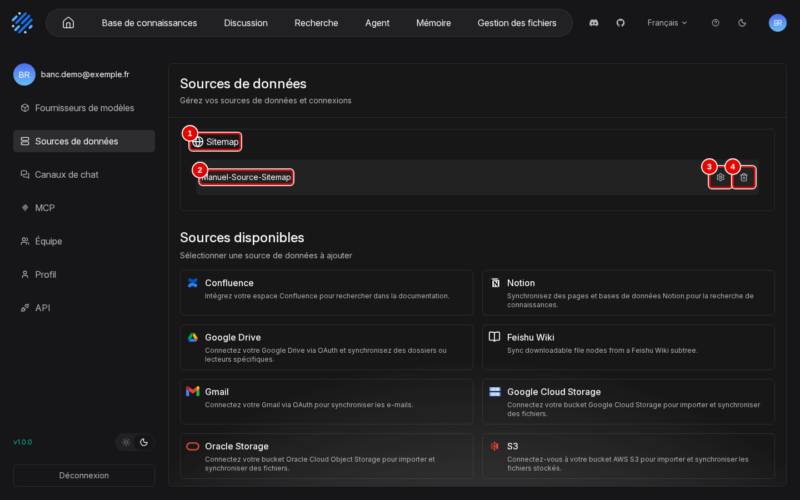
*Écran : Sources de données, source déclarée.*

| N° | Élément | Rôle |
|---|---|---|
| 1 | « Sitemap » | type de source |
| 2 | « Manuel-Source-Sitemap » | source déclarée |
| 3 | roue dentée | ouvre la page de la source (étape suivante) |
| 4 | corbeille | supprime la source |

*Résultat* : la source existe, mais n'alimente encore aucune base.

**Étape 5. Régler la fréquence de relecture**
*Où* : Sources de données › roue dentée de la source.
La page reprend les champs de la création (dont « User-Agent », le nom sous lequel RAGFlow se présente au site : `RAGFlow-SitemapConnector/1.0`), puis, plus bas, la fréquence (pastille 1), la durée maximale (pastille 2) et le journal (pastille 5).

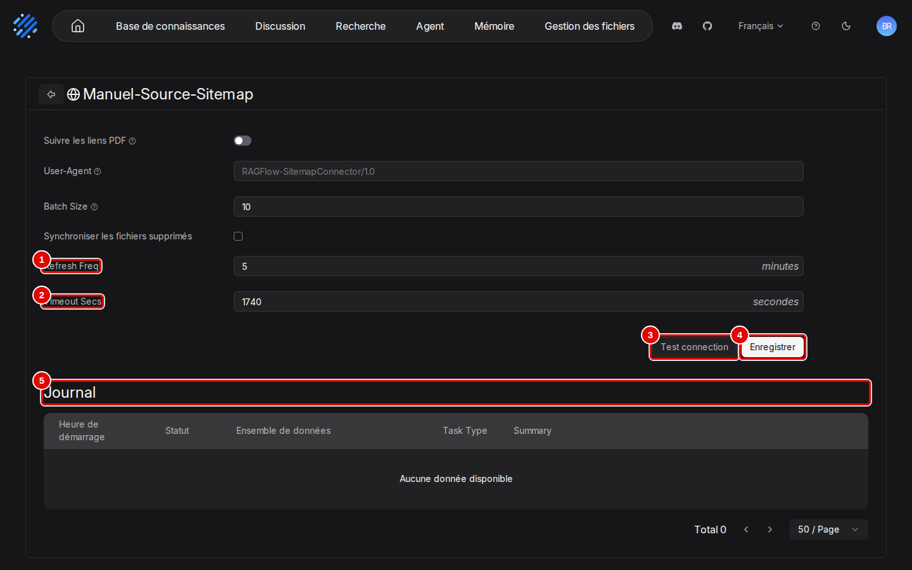
*Écran : page de la source, bas de la page.*

| N° | Élément | Rôle |
|---|---|---|
| 1 | « Refresh Freq » | relecture toutes les N minutes (5 par défaut) |
| 2 | « Timeout Secs » | durée maximale d'une synchronisation (1 740 secondes par défaut) |
| 3 | « Test connection » | même test qu'à la création |
| 4 | « Enregistrer » | enregistre les modifications ; après un échec de synchronisation, il devient « Resume » (reprise) |
| 5 | « Journal » | une ligne par synchronisation (étape 9) |

*Résultat* : la fréquence est réglée.

## Relier la source à une base

**Étape 6. Ouvrir la liaison dans la configuration de la base**
*Où* : barre du haut › « Base de connaissances » › base « Manuel-Sources » › menu de gauche › « Configuration », bas de la page › « Lier une source de données ».
Créer d'abord une base vide comme au chapitre 04 (étapes 1 et 2). Dans sa « Configuration » (chapitre 06, étape 6), descendre à « Source de données » (« Gérer la liaison de source de données avec cette base ») et cliquer sur « Lier une source de données ». Dans la fenêtre, choisir la source (pastille 1), puis cliquer sur « Confirmer » (pastille 2).

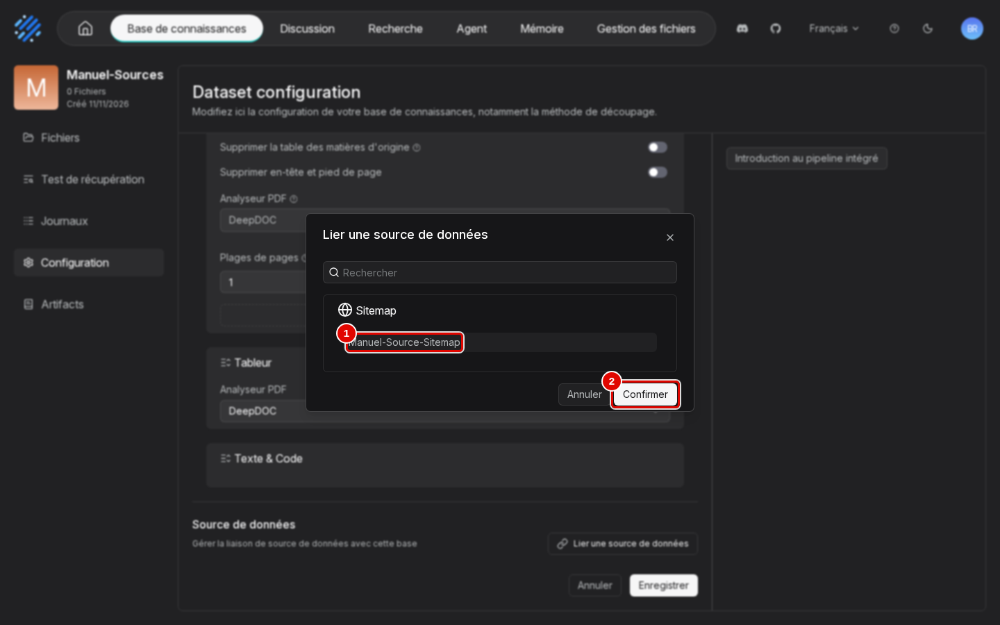
*Écran : base, « Configuration », fenêtre « Lier une source de données ».*

| N° | Élément | Rôle |
|---|---|---|
| 1 | « Manuel-Source-Sitemap » | source à relier, rangée sous son type « Sitemap » |
| 2 | « Confirmer » | ajoute la liaison, pas encore enregistrée |

*Résultat* : la source apparaît sous « Source de données » (étape suivante).

**Étape 7. Enregistrer la liaison**
*Où* : base › « Configuration », bas de la page.
Vérifier la source (pastille 1) et cliquer sur « Enregistrer » (pastille 2).

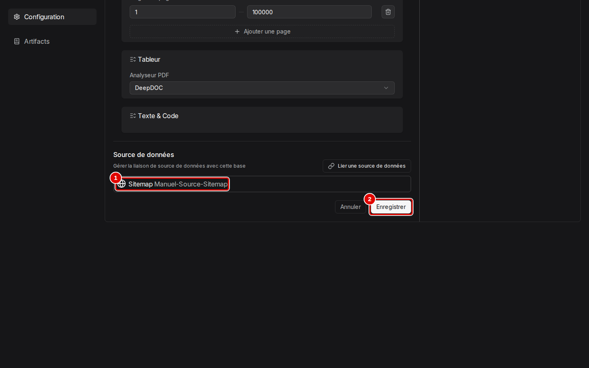
*Écran : base, « Configuration », source reliée.*

| N° | Élément | Rôle |
|---|---|---|
| 1 | « Manuel-Source-Sitemap » | source reliée à la base |
| 2 | « Enregistrer » | enregistre et lance aussitôt une première synchronisation |

*Résultat* : la synchronisation démarre ; son résultat se lit dans le journal quelques secondes plus tard.

## Suivre les synchronisations

**Étape 8. Lire le journal de la base**
*Où* : base › menu de gauche › « Journaux » › onglet « Data source ».
L'onglet « Data source » (pastille 1), à côté de « Fichier » et « Base de connaissances » (chapitre 05, étape 14), liste les synchronisations des sources reliées (pastille 2).

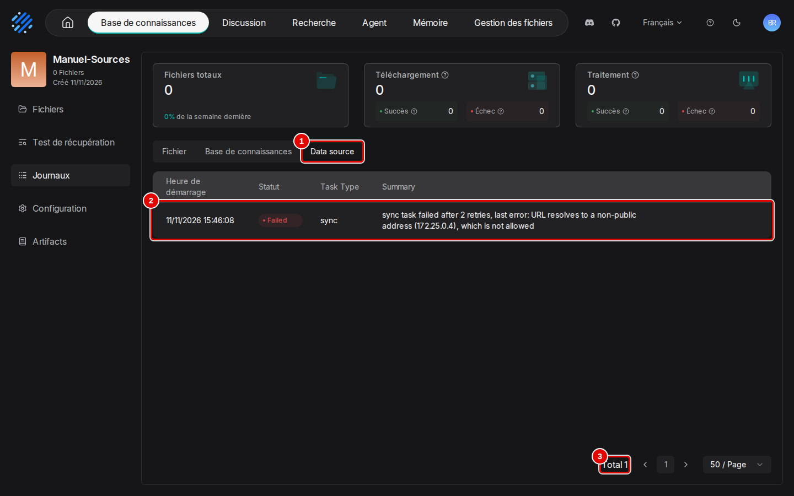
*Écran : base, « Journaux », onglet « Data source ».*

| N° | Élément | Rôle |
|---|---|---|
| 1 | « Data source » | synchronisations des sources reliées à cette base |
| 2 | tâches | date, statut (« Failed »), type (« sync ») et message : « sync task failed after 2 retries, last error: URL resolves to a non-public address (172.25.0.4), which is not allowed » |
| 3 | « Total » | nombre de synchronisations |

*Résultat* : l'échec est visible ; la base reste vide (« 0 Fichiers » dans l'onglet « Fichiers »). Une synchronisation en échec est retentée deux fois, puis la suivante a lieu à l'heure prévue par « Refresh Freq ».

**Étape 9. Lire le journal de la source**
*Où* : menu du compte › « Sources de données » › roue dentée de la source › « Journal ».
Le même échec y figure (pastille 2), avec sa cause (pastille 3).

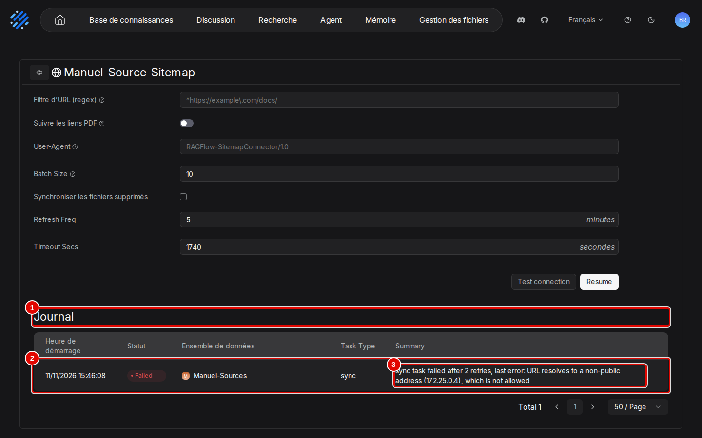
*Écran : page de la source, « Journal ».*

| N° | Élément | Rôle |
|---|---|---|
| 1 | « Journal » | synchronisations de la source, toutes bases confondues |
| 2 | synchronisation | « Heure de démarrage », « Statut » (« Failed »), « Ensemble de données » (« Manuel-Sources »), « Task Type » (« sync ») |
| 3 | « Summary » | cause de l'échec |

*Résultat* : la cause de l'échec est lue ; pour un site public, ce journal montre le nombre de pages ajoutées.

## Comprendre le refus d'un site interne

RAGFlow cherche l'adresse réelle du site avant de le lire, et refuse toute adresse non publique : la machine elle-même (`127.0.0.1`), les réseaux privés d'entreprise ou de maison, les réseaux internes de Docker. Un site de l'intranet est donc refusé comme un site sur la même machine, même s'il répond normalement dans un navigateur. Cette garde est volontaire : sans elle, n'importe quel utilisateur de RAGFlow pourrait lui faire lire les services internes du réseau, auxquels il n'a pas accès lui-même.

Pour lire malgré tout un site interne, un réglage du serveur l'autorise :

1. ajouter la ligne `ALLOW_ANY_HOST=1` au fichier `donnees/ragflow/ragflow.env` du dépôt ;
2. redémarrer le serveur de RAGFlow : `outils/ragflow/compose.sh up -d ragflow-cpu` ;
3. une fois la synchronisation faite, retirer la ligne et redémarrer de la même façon.

Avec ce réglage, le test répond « success » et les deux pages du site de test sont devenues deux documents de deux passages chacun, convertis en texte avant l'analyse (noms en `.html.md`). Le risque est celui signalé en tête de chapitre : le réglage vaut pour tout le serveur, agents compris. Pour un usage durable, préférer un site joignable par une adresse publique, ou déposer les pages dans la base par « Ajouter un fichier » (chapitre 05).

## Connaître les canaux de chat

Un **canal de chat** publie un assistant ou un agent dans une messagerie : les utilisateurs lui écrivent depuis Telegram, Discord… sans ouvrir RAGFlow. Chaque canal demande un robot de conversation (« bot ») créé chez l'éditeur de la messagerie, donc un compte en ligne : aucun n'a été branché pendant les essais.

**Étape 10. Ouvrir la page « Canaux de chat »**
*Où* : menu du compte › « Canaux de chat ».
Une carte par messagerie : Discord, DingTalk, Feishu / Lark, QQ Bot, Telegram, WeCom, WhatsApp.

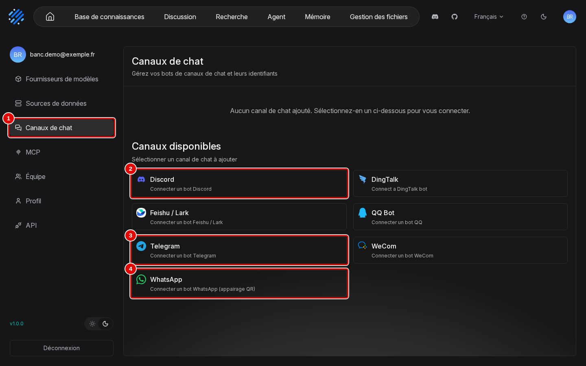
*Écran : réglages du compte, page « Canaux de chat ».*

| N° | Élément | Rôle |
|---|---|---|
| 1 | « Canaux de chat » | page des canaux |
| 2 | « Discord » | « Connecter un bot Discord » |
| 3 | « Telegram » | « Connecter un bot Telegram » |
| 4 | « WhatsApp » | « Connecter un bot WhatsApp (appairage QR) » |

*Résultat* : les messageries proposées sont repérées.

**Étape 11. Ouvrir l'ajout d'un canal**
*Où* : « Canaux de chat » › carte « Telegram » › « Ajouter » (au survol).
La fenêtre « Ajouter un bot Telegram » demande un nom (pastille 1) et le jeton du robot (pastille 2). Elle a été refermée par « Annuler ».

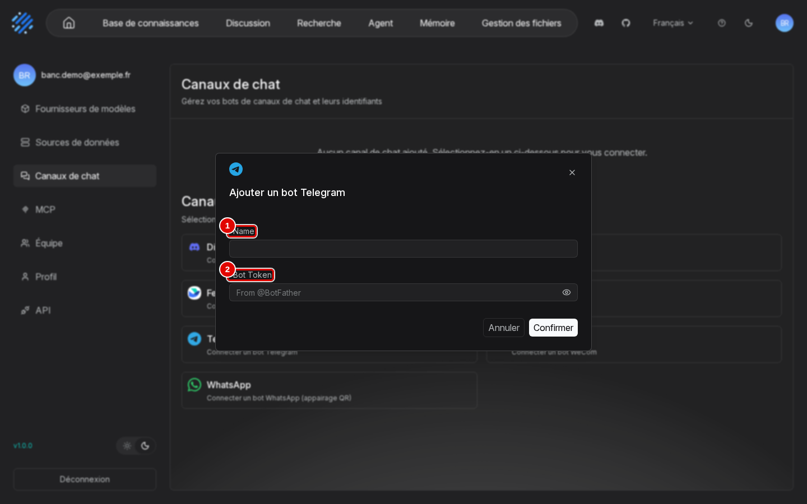
*Écran : fenêtre « Ajouter un bot Telegram ».*

| N° | Élément | Rôle |
|---|---|---|
| 1 | « Name » | nom du canal |
| 2 | « Bot Token » | jeton délivré par Telegram à la création du robot (compte Telegram nécessaire) |

*Résultat* : avec un vrai jeton, le canal serait créé. Le robot doit aussi pouvoir joindre RAGFlow depuis Internet, ce qui n'est pas le cas d'une installation limitée à la machine locale comme celle du chapitre 02.

## Bon à savoir

- Le message du test ne reste que quelques secondes ; en cas de doute, lire le « Journal » de la source (étape 9).
- Une même source peut alimenter plusieurs bases : son « Journal » les montre toutes (colonne « Ensemble de données »).
- Les pages d'un site sont converties en texte avant l'analyse ; elles se règlent ensuite comme tout document de la base (chapitre 06).

## En cas de problème

| Symptôme | Cause | Que faire |
|---|---|---|
| « URL resolves to a non-public address (…), which is not allowed » | l'adresse du site n'est pas publique | site public ; sinon le réglage `ALLOW_ANY_HOST`, en connaissant le risque |
| Base vide après la liaison | synchronisation en échec | « Journaux » › « Data source » de la base (étape 8), ou « Journal » de la source (étape 9) |
| « Resume » à la place d'« Enregistrer » sur la page de la source | source suspendue après un échec | corriger l'adresse, puis « Resume » |

Les autres problèmes sont traités au chapitre [15. En cas de problème](15-en-cas-de-probleme.md).

---
*Version décrite : RAGFlow v1.0.0, essais des 9 et 11 novembre 2026. Détails et preuves : [rapport d'essais](../annexes/A6-rapport-d-essais.md).*
