# 13. Gérer son compte, son équipe et ses clés

> Ce chapitre apprend à se repérer dans les réglages du compte, à inviter un collègue dans son équipe, à accepter une invitation, à partager une base avec l'équipe, à régler son profil (nom, avatar, fuseau horaire, mot de passe), à créer et supprimer une clé d'accès pour les programmes, et à ouvrir la console d'administration de l'installation.
> **Point de départ** : menu du compte (pastille aux initiales, en haut à droite) › « Équipe ».
> **Durée** : environ 20 minutes. **Avant** : chapitre 03.

**Attention** : une clé d'accès donne à un programme tous les droits du compte (lire, modifier, supprimer les bases), et la fenêtre « Clé API » affiche chaque clé en entier : ne pas l'ouvrir pendant un partage d'écran, et supprimer toute clé qui a pu être vue. La console d'administration permet de supprimer n'importe quel compte ; elle n'est protégée que par le mot de passe du compte d'administration : ne jamais rendre l'interface accessible à d'autres machines sans l'avoir changé.

## Ce qu'il faut savoir

Chaque **compte** a son propre espace de travail : ses bases, ses assistants, ses agents et ses clés. Une **équipe** permet de partager une partie de cet espace : un objet dont les « Autorisations » valent « Équipe » (une base dans sa « Configuration », un agent dans « Gestion » › « Paramètres ») devient visible des membres invités. Une **clé d'accès** (l'interface dit « Clé API ») permet à un programme d'agir au nom du compte sans mot de passe, par exemple un script qui ajoute chaque soir des documents à une base. Enfin, RAGFlow crée à l'installation un compte d'administration, `admin@ragflow.io`, qui ne sert qu'à la **console d'administration** : la liste des comptes et l'état des services de l'installation. Le travail courant se fait avec un compte ordinaire.

## Se repérer dans les réglages du compte

**Étape 1. Ouvrir la page « Équipe »**
*Où* : menu du compte › « Équipe ».
Cliquer sur la pastille du compte (pastille 1) : la page des réglages s'ouvre, avec son menu à gauche. Cliquer sur « Équipe » (pastille 2).

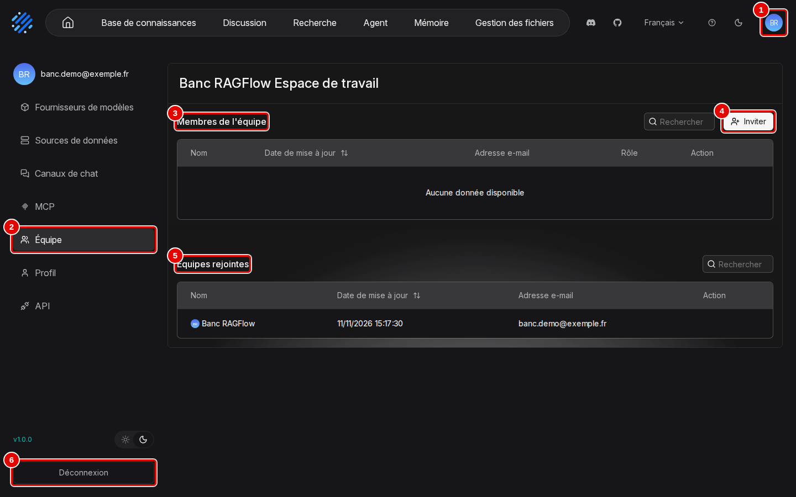
*Écran : réglages du compte, page « Équipe ».*

| N° | Élément | Rôle |
|---|---|---|
| 1 | pastille du compte | ouvre les réglages du compte ; le menu de gauche donne « Fournisseurs de modèles » (chapitre 03), « Sources de données » et « Canaux de chat » (chapitre 12), « MCP » (chapitre 10), « Équipe », « Profil », « API » ; en bas, la version « v1.0.0 » et la bascule entre thème clair et sombre |
| 2 | « Équipe » | page de l'espace de travail, ici « Banc RAGFlow Espace de travail » |
| 3 | « Membres de l'équipe » | comptes invités : « Nom », « Date de mise à jour », « Adresse e-mail », « Rôle », « Action » ; vide au départ |
| 4 | « Inviter » | ouvre la fenêtre d'invitation (étape suivante) |
| 5 | « Équipes rejointes » | espaces d'autres comptes dont ce compte est membre ; ici son propre espace |
| 6 | « Déconnexion » | ferme la session et revient à la page de connexion |

*Résultat* : la page « Équipe » est affichée.

## Inviter un collègue

**Étape 2. Saisir l'adresse du collègue**
*Où* : « Équipe » › « Inviter ».
Saisir l'adresse du compte à inviter (pastille 1), puis cliquer sur « Oui » (pastille 3). Le collègue doit déjà avoir un compte RAGFlow (lien « Sign up » de la page de connexion, chapitre 02, étape 8) : l'invitation ne crée pas de compte, comme le rappelle la consigne (pastille 2).

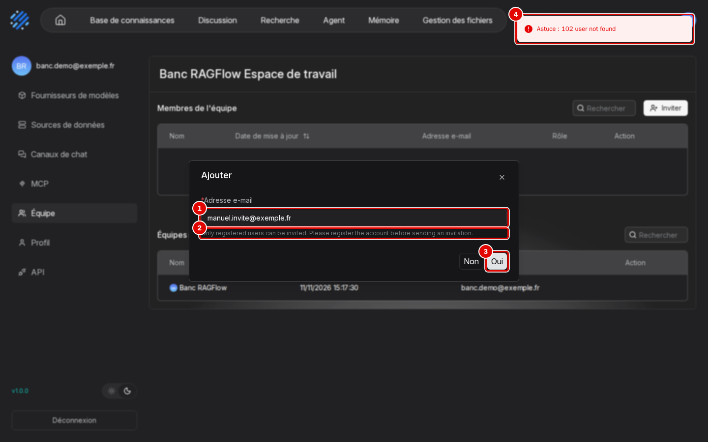
*Écran : fenêtre d'invitation, adresse sans compte refusée.*

| N° | Élément | Rôle |
|---|---|---|
| 1 | « Adresse e-mail » | adresse du compte à inviter ; ici `manuel.invite@exemple.fr`, adresse sans compte |
| 2 | consigne | « Only registered users can be invited. Please register the account before sending an invitation. » |
| 3 | « Oui » | envoie l'invitation ; « Non » annule |
| 4 | message | « Astuce : 102 user not found » : l'adresse n'a pas de compte ; la fenêtre reste ouverte |

*Résultat* : avec l'adresse d'un compte existant, la fenêtre se ferme et le membre apparaît (étape suivante).

**Étape 3. Vérifier ou retirer le membre**
*Où* : « Équipe » › « Membres de l'équipe ».
Le compte invité apparaît dans la liste (pastille 1), avec son rôle (pastille 2). Pour le retirer, cliquer sur la corbeille (pastille 3), puis sur « Supprimer » dans la confirmation « Supprimer le membre ».

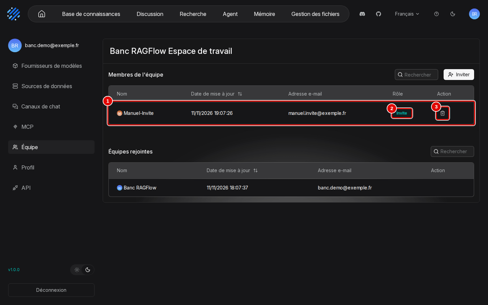
*Écran : « Équipe », membre invité.*

| N° | Élément | Rôle |
|---|---|---|
| 1 | membre invité | « admin », `admin@ragflow.io` (compte d'administration, invité pour l'exemple) |
| 2 | « Rôle » | « Invite » : invitation en attente d'acceptation par le compte invité (étape 4) |
| 3 | corbeille | retire le membre, après confirmation |

*Résultat* : le membre est ajouté ; retiré, il disparaît aussitôt de la liste.

## Accepter une invitation et partager une base

**Étape 4. Accepter l'invitation, côté invité**
*Où* : compte invité › menu du compte › « Équipe » › « Équipes rejointes ».
Le collègue invité se connecte à son propre compte et ouvre « Équipe » : l'équipe qui l'invite apparaît dans « Équipes rejointes » (pastille 2), avec deux boutons. Cliquer sur « Accepter » (pastille 3).

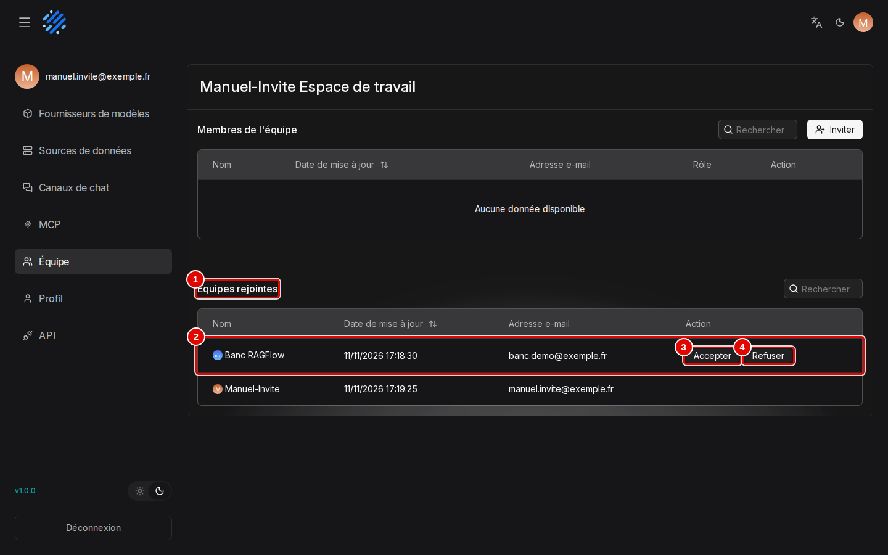
*Écran : réglages du compte invité, page « Équipe », invitation reçue.*

| N° | Élément | Rôle |
|---|---|---|
| 1 | « Équipes rejointes » | équipes dont ce compte est membre ; la dernière ligne est son propre espace |
| 2 | équipe qui invite | nom du compte qui invite (ici « Banc RAGFlow »), date de l'invitation et adresse |
| 3 | « Accepter » | rejoint l'équipe |
| 4 | « Refuser » | décline l'invitation |

*Résultat* : le message « Opéré » confirme ; les deux boutons disparaissent de la ligne, qui reste dans « Équipes rejointes ».

**Étape 5. Partager une base avec l'équipe**
*Où* : compte propriétaire › barre du haut › « Base de connaissances » › base ouverte › menu de gauche › « Configuration » › « Autorisations ».
Ouvrir la liste « Autorisations » (montrée au chapitre 06, étape 6, pastille 5), choisir « Équipe » au lieu de « Moi uniquement », puis cliquer sur « Enregistrer » en bas de la page. Un message « No PaddleOCR models added… » peut s'afficher en même temps : il ne concerne que le choix du lecteur des PDF et n'empêche pas l'enregistrement.

*Résultat* : le message « Mis à jour » confirme, et « Équipe » reste affiché après rechargement. Le membre voit la base dans sa propre liste « Base de connaissances », avec le nom du propriétaire sur la carte, et peut l'ouvrir avec tous ses onglets. Un agent se partage par le même réglage, dans « Gestion » › « Paramètres » (chapitre 10, étape 12) ; ce dernier cas n'a pas été essayé.

## Régler son profil

**Étape 6. Ouvrir la page « Profil »**
*Où* : menu du compte › « Profil ».
Chaque réglage a son bouton « Modifier » à droite.

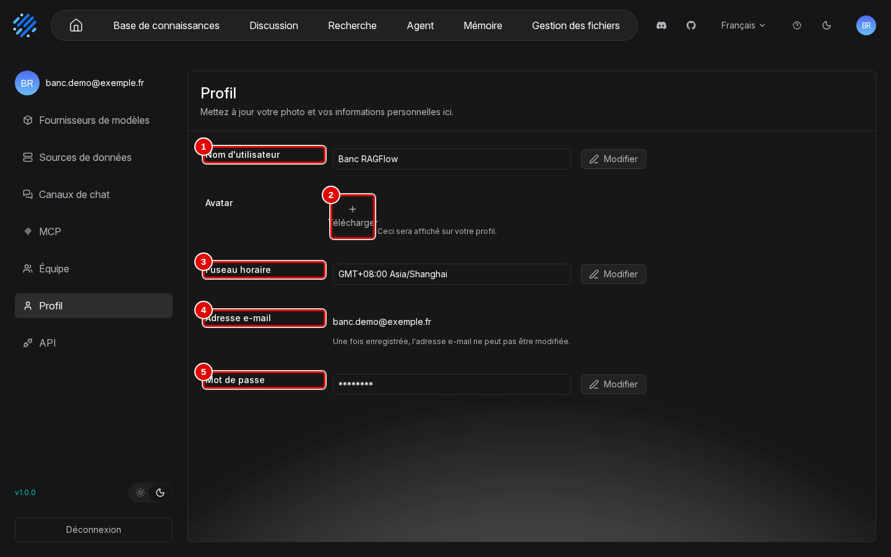
*Écran : réglages du compte, page « Profil ».*

| N° | Élément | Rôle |
|---|---|---|
| 1 | « Nom d'utilisateur » | nom affiché (« Banc RAGFlow ») |
| 2 | « Télécharger » | change l'« Avatar » (image) |
| 3 | « Fuseau horaire » | « GMT+08:00 Asia/Shanghai » par défaut ; « Modifier » ouvre l'étape suivante |
| 4 | « Adresse e-mail » | identifiant de connexion, non modifiable (« Une fois enregistrée, l'adresse e-mail ne peut pas être modifiée. ») |
| 5 | « Mot de passe » | « Modifier » ouvre « Edit Password » : « Mot de passe actuel », « Nouveau mot de passe », « Confirmer le nouveau mot de passe », puis « Annuler » ou « Enregistrer » |

*Résultat* : le profil est affiché et modifiable.

**Étape 7. Changer le fuseau horaire**
*Où* : « Profil » › « Modifier » en face de « Fuseau horaire ».
Choisir le fuseau dans la liste (pastille 1), par exemple celui de Paris, puis cliquer sur « Enregistrer » (pastille 3).

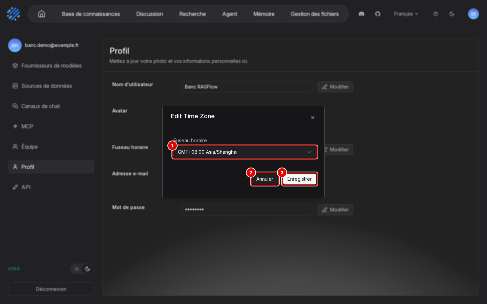
*Écran : fenêtre « Edit Time Zone ».*

| N° | Élément | Rôle |
|---|---|---|
| 1 | « Fuseau horaire » | liste des fuseaux, de « GMT-11:00 Pacific/Midway » vers l'est |
| 2 | « Annuler » | referme sans rien changer |
| 3 | « Enregistrer » | enregistre le fuseau du compte |

*Résultat* : le fuseau du compte est changé. Attention : plusieurs pages affichent leurs heures en temps universel quel que soit ce réglage (date de téléversement, détail des tâches, historique des versions d'un agent) ; pour Paris, ajouter une heure en hiver, deux en été.

## Créer et supprimer une clé d'accès

**Étape 8. Ouvrir la page « API »**
*Où* : menu du compte › « API ».
La page « RAGFlow API » donne l'adresse du serveur (pastille 3) et l'accès aux clés (pastille 2).

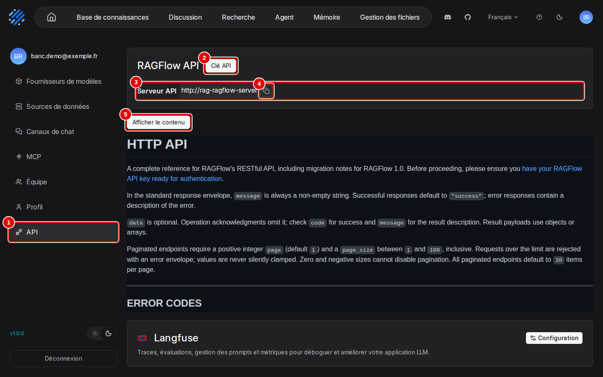
*Écran : réglages du compte, page « API ».*

| N° | Élément | Rôle |
|---|---|---|
| 1 | « API » | entrée du menu du compte qui ouvre cette page |
| 2 | « Clé API » | ouvre la fenêtre des clés (étape suivante) |
| 3 | « Serveur API » | adresse de base des appels, vue depuis l'interface ; depuis Windows ou WSL, les programmes utilisent `http://127.0.0.1:9380` |
| 4 | copier | copie l'adresse du serveur |
| 5 | « Afficher le contenu » | déplie le sommaire de la documentation des appels, en anglais (détail dans l'annexe A3) |

*Résultat* : la page est ouverte. Sous la documentation, la carte « Langfuse » relie RAGFlow à un service de suivi des appels aux modèles ; elle n'a pas été utilisée.

**Étape 9. Créer une clé**
*Où* : page « API » › « Clé API » › « Créer une nouvelle clé ».
Cliquer sur « Créer une nouvelle clé » (pastille 5) : la clé s'ajoute au tableau (pastille 1). La copier (pastille 3) et la coller dans le programme qui en a besoin. Les clés sont masquées sur la capture.

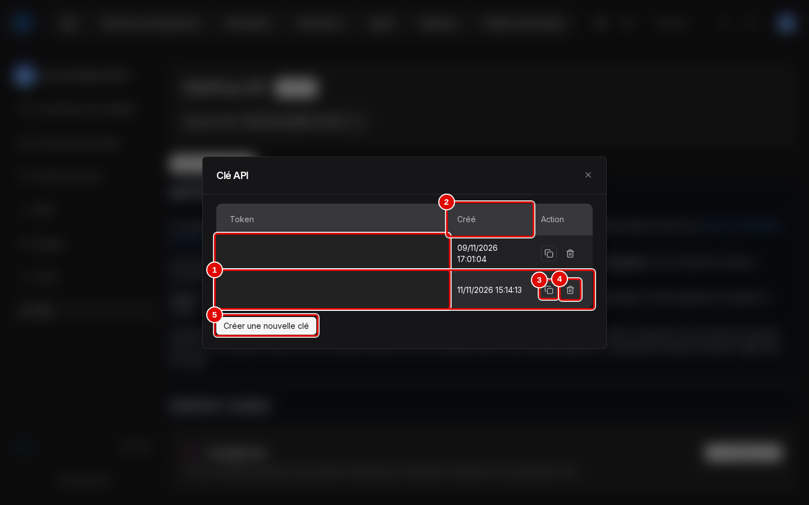
*Écran : fenêtre « Clé API ».*

| N° | Élément | Rôle |
|---|---|---|
| 1 | nouvelle clé | colonne « Token » : la clé entière, en clair (`ragflow-` suivi de 32 caractères), masquée ici |
| 2 | « Créé » | date et heure de création ; la première ligne est la clé utilisée par les scripts de l'installation |
| 3 | copier | copie la clé |
| 4 | corbeille | supprime la clé (étape suivante) |
| 5 | « Créer une nouvelle clé » | ajoute une clé ; aucun nom ni droit à choisir : toute clé a tous les droits du compte |

*Résultat* : la clé est créée et copiée.

**Étape 10. Supprimer une clé**
*Où* : fenêtre « Clé API » › corbeille de la ligne.
Cliquer sur la corbeille de la clé, puis sur « Supprimer » (pastille 2) dans la confirmation.

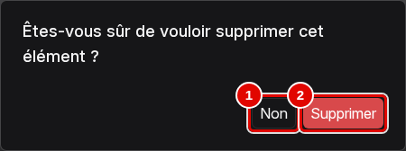
*Écran : fenêtre « Clé API », confirmation de suppression.*

| N° | Élément | Rôle |
|---|---|---|
| 1 | « Non » | annule |
| 2 | « Supprimer » | supprime la clé : tout programme qui l'utilise est ensuite refusé |

*Résultat* : la clé disparaît du tableau ; les autres clés continuent de fonctionner. L'usage des clés dans un programme est décrit dans l'annexe [A3. Automatiser par l'API](../annexes/A3-automatiser-par-l-api.md).

## Ouvrir la console d'administration

La console d'administration n'a aucun lien dans l'interface ordinaire : elle s'ouvre par son adresse, `http://127.0.0.1:8088/admin`, et seul le compte `admin@ragflow.io` y entre. Son mot de passe a été tiré au hasard à l'installation ; il se trouve à la ligne `ADMIN_DEFAULT_PASSWORD` du fichier `donnees/ragflow/ragflow.env`.

**Étape 11. Se connecter à la console**
*Où* : navigateur Windows › `http://127.0.0.1:8088/admin`.
Saisir le courriel (pastille 2) et le mot de passe (pastille 3), puis cliquer sur « Se connecter » (pastille 4).

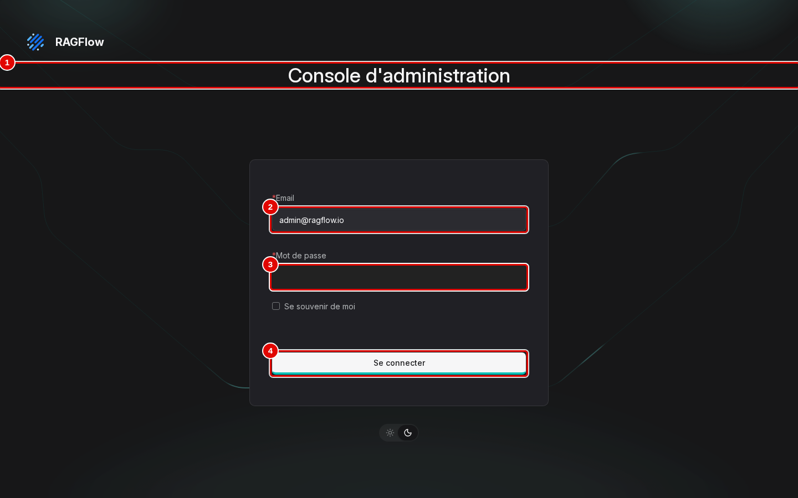
*Écran : page de connexion de la console d'administration.*

| N° | Élément | Rôle |
|---|---|---|
| 1 | « Console d'administration » | titre de la page |
| 2 | « Email » | `admin@ragflow.io` |
| 3 | « Mot de passe » | mot de passe d'administration, masqué sur la capture |
| 4 | « Se connecter » | ouvre la page « Services » |

*Résultat* : la page « Services » s'affiche (étape suivante).

**Étape 12. Lire l'état des services**
*Où* : console › « Services ».
Chaque ligne est un service de l'installation (pastille 2), avec son état (pastille 3).

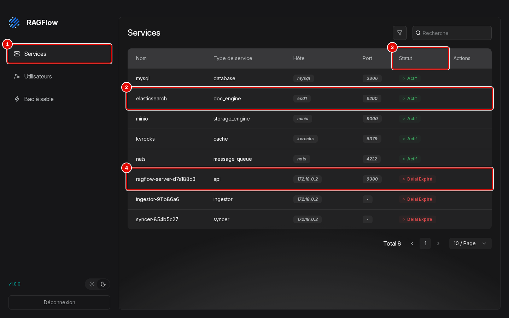
*Écran : console d'administration, page « Services ».*

| N° | Élément | Rôle |
|---|---|---|
| 1 | « Services » | page des services ; « Utilisateurs » et « Bac à sable » en dessous |
| 2 | service | par exemple « elasticsearch » (moteur de recherche), port 9200 ; de même « mysql », « minio », « kvrocks », « nats » |
| 3 | « Statut » | « Actif » pour ces cinq services de stockage et de messages |
| 4 | serveur RAGFlow | « ragflow-server-… », port 9380 : affiché « Délai Expiré », comme « ingestor-… » et « syncer-… » |

*Résultat* : l'état est lu. Les trois processus de RAGFlow sont marqués « Délai Expiré » alors que l'interface fonctionnait normalement : cet affichage n'est pas fiable ; l'état réel se vérifie comme au chapitre 02, étape 9.

**Étape 13. Gérer les comptes**
*Où* : console › « Utilisateurs ».
La page liste les comptes (pastille 1) ; les icônes d'action d'une ligne apparaissent au survol.

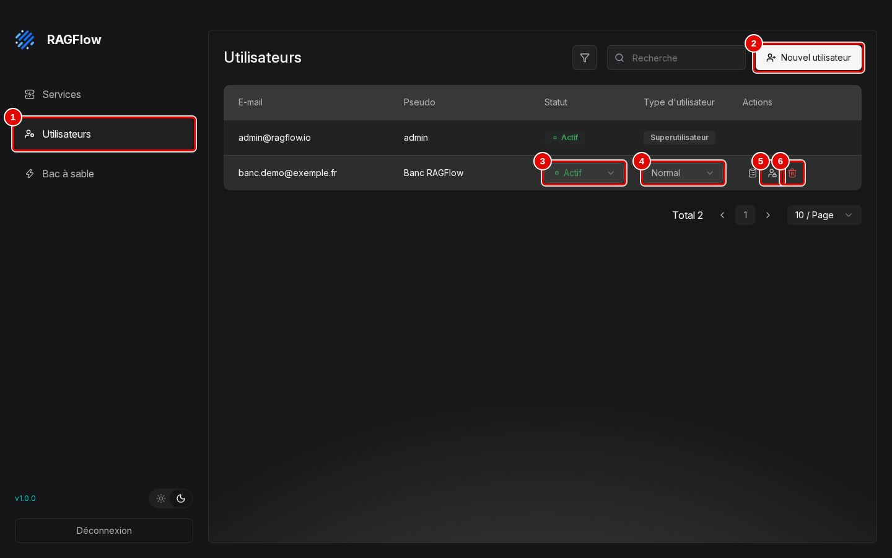
*Écran : console d'administration, page « Utilisateurs ».*

| N° | Élément | Rôle |
|---|---|---|
| 1 | « Utilisateurs » | comptes de l'installation : `admin@ragflow.io` (« Superutilisateur ») et `banc.demo@exemple.fr` (« Normal ») |
| 2 | « Nouvel utilisateur » | crée un compte sans passer par l'inscription |
| 3 | « Statut » | « Actif » ; un compte désactivé ne peut plus se connecter |
| 4 | « Type d'utilisateur » | « Normal » ou super-utilisateur |
| 5 | icône de compte à cadenas | change le mot de passe du compte |
| 6 | corbeille | supprime le compte et ses données |

*Résultat* : les comptes sont listés. Ces actions n'ont pas été essayées, pour ne pas toucher au compte de démonstration.

**Étape 14. Lire le réglage du bac à sable**
*Où* : console › « Bac à sable ».
Cette page règle où s'exécute le code lancé par le bloc « Code » des agents (chapitre 10, étape 15).

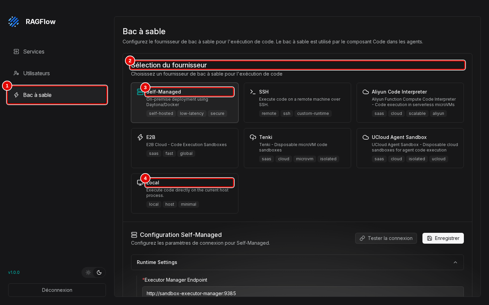
*Écran : console d'administration, page « Bac à sable ».*

| N° | Élément | Rôle |
|---|---|---|
| 1 | « Bac à sable » | page de réglage de l'exécution de code |
| 2 | « Sélection du fournisseur » | sept choix : « Self-Managed », « SSH », « Aliyun Code Interpreter », « E2B », « Tenki », « UCloud Agent Sandbox », « Local » |
| 3 | « Self-Managed » | choisi par défaut : un service d'exécution séparé, non installé ici ; « Tester la connexion », « Enregistrer » |
| 4 | « Local » | exécute le code directement dans le serveur, sans aucune isolation : à éviter |

*Résultat* : le réglage est lu, sans modification. « Déconnexion », en bas de la colonne de gauche, ferme la session d'administration.

## Bon à savoir

- Le compte d'administration ne sert qu'à la console ; il ne peut pas être utilisé par les programmes.
- La clé d'accès se crée sans nom : noter à part à quel programme sert chaque clé, pour savoir laquelle supprimer.
- L'inscription libre reste ouverte (lien « Sign up ») : sans risque tant que l'interface n'est joignable que depuis la machine elle-même, comme dans l'installation du chapitre 02.
- Les réglages de sauvegarde, de mise à jour et de sécurité de l'installation sont décrits dans l'annexe [A4. Exploitation](../annexes/A4-exploitation.md).

## En cas de problème

| Symptôme | Cause | Que faire |
|---|---|---|
| « Astuce : 102 user not found » à l'invitation | l'adresse n'a pas de compte | faire créer le compte (« Sign up »), puis inviter |
| Heures décalées dans certaines pages | heures affichées en temps universel | ajouter une heure (deux en été) pour Paris ; régler aussi « Fuseau horaire » (étape 7) |
| Un programme est refusé après la suppression d'une clé | la clé supprimée était la sienne | créer une nouvelle clé (étape 9) et la donner au programme |
| « Délai Expiré » sur le serveur dans la console | affichage peu fiable de la console | vérifier l'état comme au chapitre 02, étape 9 |

Les autres problèmes sont traités au chapitre [15. En cas de problème](15-en-cas-de-probleme.md).

---
*Version décrite : RAGFlow v1.0.0, essais des 9 et 11 novembre 2026. Détails et preuves : [rapport d'essais](../annexes/A6-rapport-d-essais.md).*
