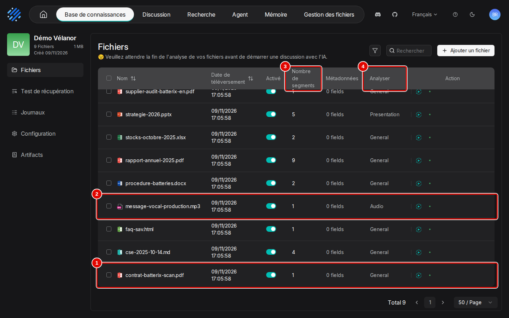
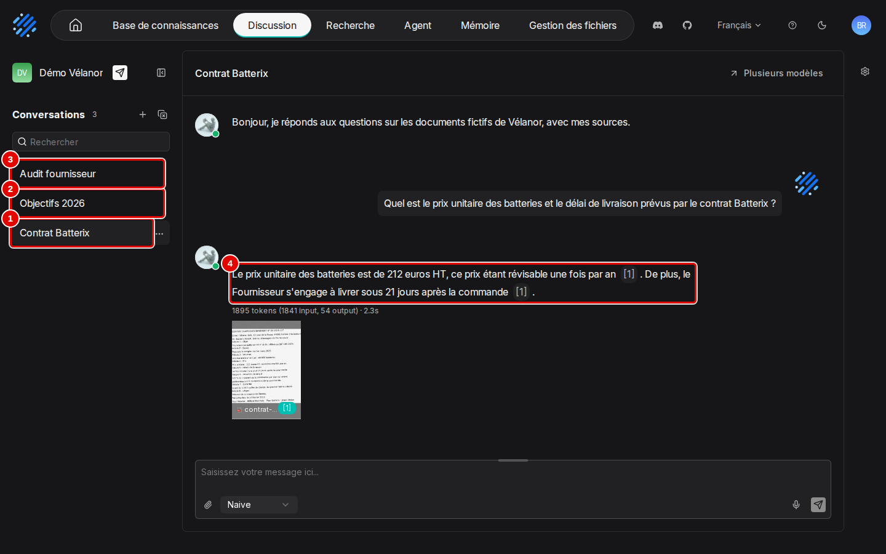
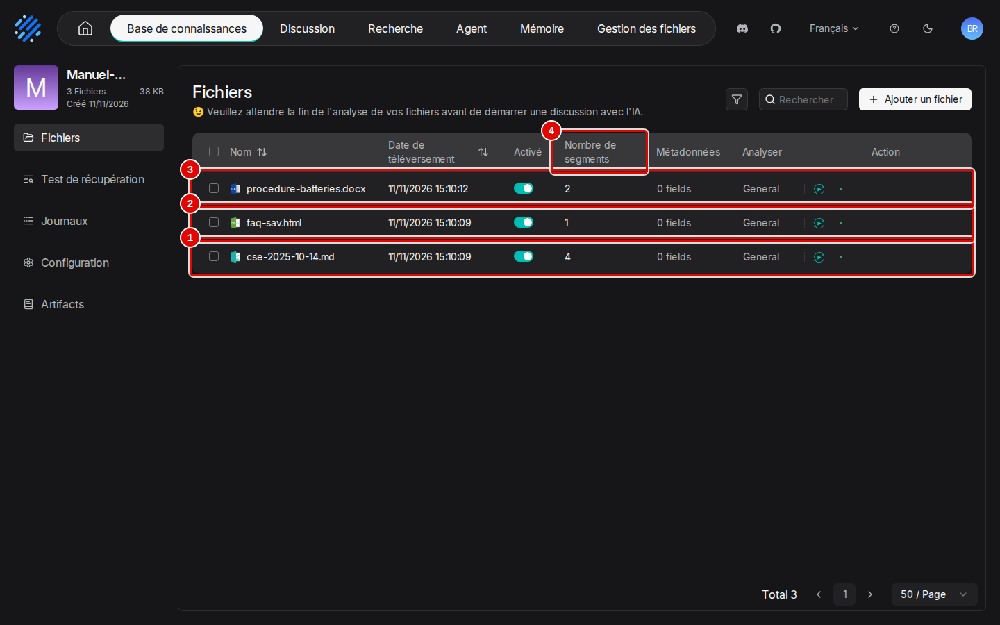

# 14. Cas pratiques

> Ce chapitre déroule deux usages complets, du besoin au résultat, en s'appuyant sur les chapitres déjà lus : mettre en place un assistant documentaire d'entreprise, et alimenter chaque jour une base depuis un dossier partagé.
> **Point de départ** : accueil, après connexion, modèles déclarés (chapitre 03).
> **Durée** : environ 45 minutes pour les deux cas. **Avant** : chapitres 04 à 08 ; chapitre 12 pour la variante du second cas.

## Ce qu'il faut savoir

Un cas pratique enchaîne des tâches déjà décrites une à une dans les chapitres précédents : chaque étape renvoie au chapitre qui la montre en détail, et ce chapitre montre surtout le résultat obtenu. Les deux cas utilisent les documents fictifs de l'entreprise Vélanor, fabricant de vélos électriques : un contrat fournisseur scanné, un rapport annuel, une procédure, une présentation, un tableur, une page de foire aux questions, une note, un audit en anglais et un message vocal. Le premier cas correspond au jeu de démonstration (base et assistant « Démo Vélanor ») créé à la fin du chapitre 05, ou par le script du chapitre 02 : il peut être simplement ouvert pour voir le résultat.

## Mettre en place un assistant documentaire d'entreprise

**Le besoin.** Les salariés posent sans cesse les mêmes questions (conditions d'un contrat, objectifs de l'année, règles de stockage) et ne savent pas dans quel document chercher. Il faut un assistant qui réponde en français, en quelques secondes, et qui montre pour chaque réponse le passage du document d'où elle vient.

**Ce qu'on obtient.** Une base de neuf documents de formats variés, un assistant réglé pour les documents scannés, et trois conversations types avec leurs sources. Les réponses arrivent en deux secondes environ :

| Question | Réponse obtenue |
|---|---|
| contrat du fournisseur de batteries | « Le prix unitaire des batteries est de 212 euros HT, ce prix étant révisable une fois par an. De plus, le Fournisseur s'engage à livrer sous 21 jours après la commande. » |
| objectifs 2026 | « Vélanor vise un chiffre d'affaires de 55 M€ en 2026 […] ce qui prévoit 70 embauches. » |
| audit du fournisseur, posée en anglais | « Batterix received an overall score of 87 out of 100 during the Supplier Quality Audit. The measured cell defect rate was 0.3%. » |

**Les étapes**

1. Créer la base « Démo Vélanor » avec le gabarit « General » (chapitre 04, étapes 1 et 2 ; choix du gabarit au chapitre 06, étapes 1 et 2).
2. Y ajouter les neuf documents avec « Analyser à la création » (chapitre 05, étape 3). L'analyse des neuf documents prend moins d'une minute avec une carte graphique.
3. Contrôler le document scanné : lire ses passages et corriger ce qui a été mal lu (chapitre 06, étapes 16 à 25).
4. Créer l'assistant et le relier à la base (chapitre 04, étapes 10 à 16).
5. Appliquer les réglages conseillés : « Top N » 8 et 0,7 pour la recherche par le sens (chapitre 08, étape 11) ; écrire le message d'accueil et la « Réponse vide » en français (chapitre 08, étapes 1 et 10).
6. Vérifier la recherche sans le modèle avec le « Test de récupération » (chapitre 08, étapes 15 et 16).
7. Poser une question par sujet, chacune dans sa conversation, et vérifier chaque source (chapitre 07, étapes 3 à 6).
8. Si besoin, publier l'assistant dans une page de l'intranet (chapitre 07, étape 16).

**Le résultat**

*Où* : barre du haut › « Base de connaissances » › carte « Démo Vélanor ».
Les neuf fichiers sont analysés ; chacun a ses passages (pastille 3).


*Écran : base « Démo Vélanor », page « Fichiers ».*

| N° | Élément | Rôle |
|---|---|---|
| 1 | « contrat-batterix-scan.pdf » | contrat scanné, lu par la reconnaissance de caractères : 1 passage |
| 2 | « message-vocal-production.mp3 » | message vocal, transcrit automatiquement : 1 passage, gabarit « Audio » |
| 3 | « Nombre de segments » | passages de chaque fichier : de 1 à 9, 26 au total |
| 4 | « Analyser » | gabarit appliqué : « General » demandé, mais RAGFlow a choisi seul « Presentation » pour le diaporama et « Audio » pour le fichier son |

*Où* : barre du haut › « Discussion » › assistant « Démo Vélanor » › conversation « Contrat Batterix ».
Les trois conversations types sont dans la colonne « Conversations » (pastilles 1 à 3) ; chaque phrase de réponse porte son renvoi vers le document (pastille 4).


*Écran : assistant « Démo Vélanor », conversation « Contrat Batterix ».*

| N° | Élément | Rôle |
|---|---|---|
| 1 | « Contrat Batterix » | conversation ouverte : message d'accueil en français, question, réponse citée |
| 2 | « Objectifs 2026 » | deuxième conversation |
| 3 | « Audit fournisseur » | troisième conversation, question et réponse en anglais |
| 4 | réponse citée | 212 euros HT et 21 jours, chaque phrase suivie de son renvoi « [1] » vers le contrat scanné ; dessous, « 1895 tokens (1841 input, 54 output) · 2.3s » |

L'assistant répond dans la langue de la question. Ses réglages se relisent dans le panneau « Paramètres du chat » (chapitre 08).

## Alimenter chaque jour une base depuis un dossier

**Le besoin.** Un service dépose chaque jour de nouveaux documents dans un dossier partagé (comptes rendus, procédures). La base doit les recevoir automatiquement chaque matin, sans créer de doublon, pour que l'assistant connaisse toujours les derniers documents.

**Ce qu'on obtient.** Une tâche planifiée qui, chaque matin, compare le contenu du dossier à celui de la base, envoie uniquement les nouveaux fichiers, les fait analyser et attend la fin. Essai sur trois jours : le premier, deux fichiers ajoutés en 3 secondes ; le deuxième, aucun fichier nouveau, rien d'ajouté ; le troisième, un fichier ajouté en 3 secondes. La base compte trois documents, sans doublon, et la question « Comment stocker les batteries ? » trouve aussitôt la réponse dans le document du troisième jour (« entre 10 °C et 25 °C, dans le local B2 qui est équipé d'une détection incendie »).

**Les étapes**

1. Vérifier la clé d'accès du programme : le script du dépôt utilise celle créée à l'installation, rangée dans le fichier `donnees/ragflow/compte.json` (chapitre 02, étape 7). Si elle a été supprimée, en créer une (chapitre 13, étape 7) et la recopier dans ce fichier, à la ligne `api_key`.
2. Lancer une première fois l'envoi, dans le terminal WSL, depuis le dossier du dépôt ; la base est créée si elle n'existe pas :

   ```bash
   uv run python outils/ragflow/recette_ingestion.py /chemin/du/dossier "Nom de la base"
   ```

3. Planifier ce lancement chaque matin, par exemple à 7 h : `crontab -e` dans WSL, puis ajouter la ligne

   ```text
   0 7 * * * cd ~/mes_projets/Tutoriels/RAGFlow-Test-Bench && ~/.local/bin/uv run python outils/ragflow/recette_ingestion.py /chemin/du/dossier "Nom de la base" >> donnees/ingestion.log 2>&1
   ```

   La tâche ne tourne que si WSL est ouvert à cette heure. Le script a été essayé sur trois jours simulés ; la planification elle-même ne l'a pas été.
4. Relier la base à l'assistant (chapitre 04, étapes 14 à 16), ou à un assistant existant (chapitre 08, étape 6).
5. Contrôler chaque jour les analyses dans « Journaux » (chapitre 05, étapes 14 et 15) ou le fichier `donnees/ingestion.log`.

**Le résultat**

*Où* : barre du haut › « Base de connaissances » › base remplie par la tâche (ici « Manuel-Ingestion »).
Les fichiers des différents jours sont présents une seule fois chacun.


*Écran : base remplie par la tâche quotidienne, page « Fichiers ».*

| N° | Élément | Rôle |
|---|---|---|
| 1 | « cse-2025-10-14.md » | versé le premier jour : 4 passages |
| 2 | « faq-sav.html » | versé le premier jour : 1 passage |
| 3 | « procedure-batteries.docx » | versé le troisième jour ; le deuxième jour n'a rien ajouté, aucun doublon |
| 4 | « Nombre de segments » | passages créés : une valeur supérieure à 0 indique une analyse terminée |

**Variante sans programme.** Si les documents sont publiés sur un site web public, une source « Sitemap » reliée à la base fait le même travail, à la souris, avec une relecture toutes les cinq minutes (chapitre 12). Pour quelques fichiers de temps en temps, l'ajout à la main suffit (chapitre 05, étape 3).

## Bon à savoir

- La tâche quotidienne compare les fichiers par leur nom : un fichier modifié mais gardant le même nom n'est pas renvoyé. Pour le mettre à jour, supprimer l'ancien document de la base (chapitre 05, étape 7) ou renommer le fichier.
- Les heures de « Date de téléversement » sont en temps universel : une heure de moins que l'heure de Paris en hiver.
- Pour un fonds de documents plus grand, ou pour des scans nombreux, compter plus de temps d'analyse et contrôler quelques scans à la main.
- Pour une page de recherche sans conversation sur la même base, voir le chapitre 09.

## En cas de problème

| Symptôme | Cause | Que faire |
|---|---|---|
| Un fichier modifié n'est pas repris | comparaison par nom | renommer le fichier, ou supprimer l'ancien document |
| La base n'apparaît pas dans la liste de l'assistant | analyse pas encore terminée | attendre que « Nombre de segments » soit rempli |
| Un diaporama ou un fichier son n'a pas le gabarit demandé | RAGFlow choisit seul « Presentation » ou « Audio » selon le type de fichier | normal ; changer le gabarit du fichier si besoin (chapitre 06, étape 3) |
| La tâche du matin n'a rien fait | WSL fermé à l'heure prévue | lancer la commande de l'étape 2 à la main |

Les autres problèmes sont traités au chapitre [15. En cas de problème](15-en-cas-de-probleme.md).

---
*Version décrite : RAGFlow v1.0.0, essais des 9 et 11 novembre 2026. Détails et preuves : [rapport d'essais](../annexes/A6-rapport-d-essais.md).*
