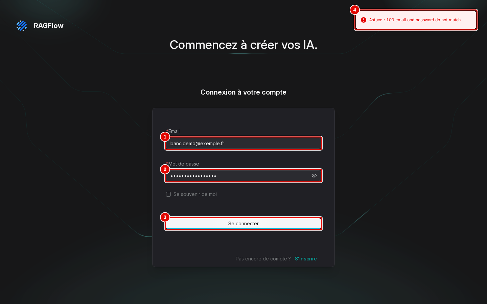

# 15. En cas de problème

> Ce chapitre aide à reconnaître un message d'erreur, à en comprendre la cause et à appliquer le remède, à partir des erreurs réellement rencontrées pendant les essais.
> **Point de départ** : l'écran où l'erreur apparaît (ici la page de connexion).
> **Durée** : selon le problème. **Avant** : chapitre 03.

Chapitre en cours de réécriture. En attendant, le contenu détaillé se trouve dans l'ancien manuel [Dépannage et FAQ](../14-depannage.md).

## Reconnaître un refus de connexion

**Étape 1. Lire le message**
*Où* : page de connexion, `http://127.0.0.1:8088`.
Après un clic sur « Se connecter » (pastille 3) avec un mot de passe faux, un message apparaît quelques secondes en haut à droite (pastille 4).

*Écran : page de connexion, message d'erreur affiché.*

| N° | Élément | Rôle |
|---|---|---|
| 1 | « Email » | adresse du compte, juste |
| 2 | « Mot de passe » | mot de passe faux ; l'œil à droite l'affiche en clair pour vérifier la saisie |
| 3 | « Se connecter » | envoie |
| 4 | message d'erreur | « Astuce : 109 email and password do not match » ; la page reste sur la connexion |

*Résultat* : la session n'est pas ouverte ; ressaisir le mot de passe.

---
*Version décrite : RAGFlow v1.0.0, essais des 9 et 11 novembre 2026. Détails et preuves : [rapport d'essais](../annexes/A6-rapport-d-essais.md).*
