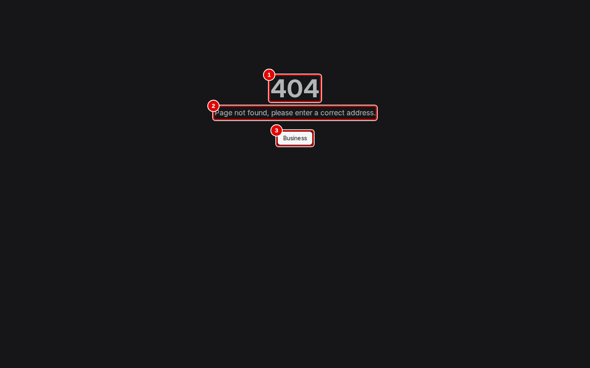
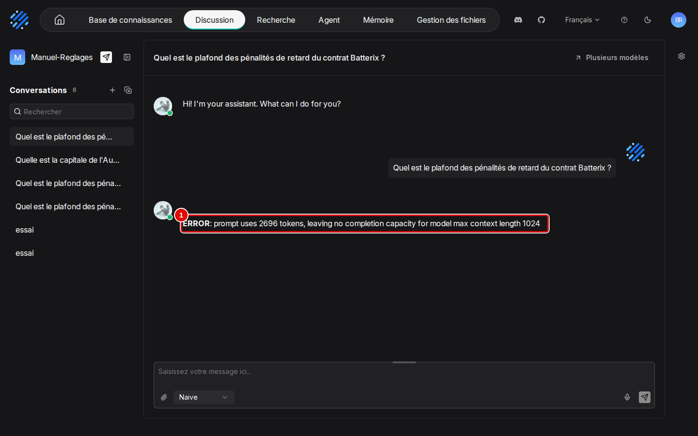
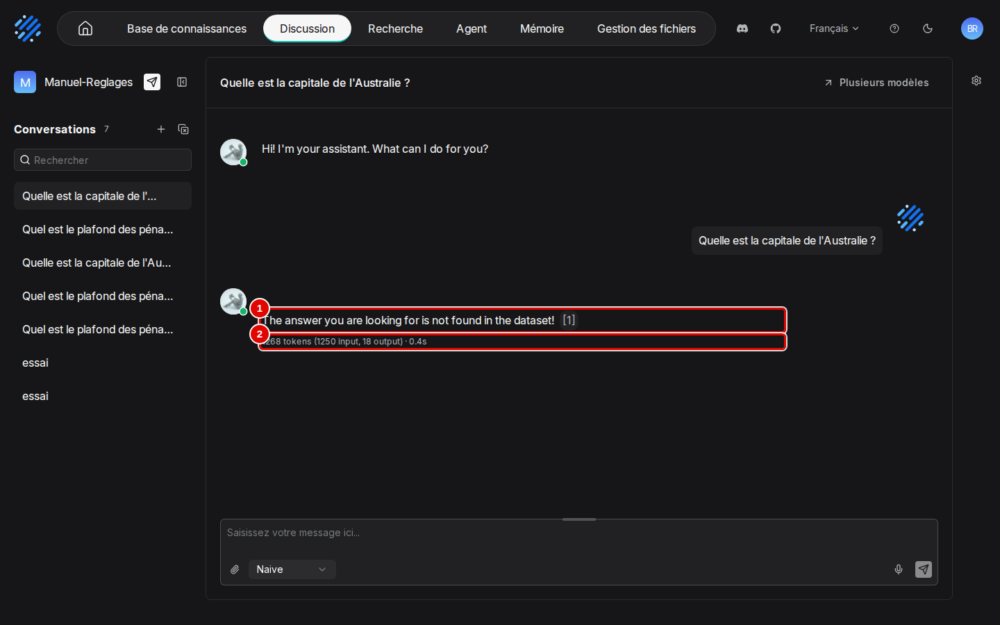

# 15. En cas de problème

> Ce chapitre aide à reconnaître un message d'erreur, à en comprendre la cause et à appliquer le remède. Tous les problèmes décrits ont été réellement rencontrés pendant les essais ; les erreurs montrées en capture ont été provoquées exprès.
> **Point de départ** : l'écran où le problème apparaît ; pour les quatre erreurs montrées en capture, la page de connexion, une adresse tapée à la main et la page d'un assistant.
> **Durée** : selon le problème. **Avant** : chapitre 03.

## Ce qu'il faut savoir

RAGFlow signale ses erreurs de trois façons. Un **message temporaire** apparaît quelques secondes en haut à droite, commençant par « Astuce : » et un numéro (102 pour une donnée refusée, 109 pour un refus d'identité) : il faut le lire vite, ou refaire le geste. Une **réponse d'erreur** s'affiche à la place de la réponse d'un assistant, comme un message ordinaire. Un **état d'échec** se lit dans une liste : point rouge dans la colonne « Analyser » d'un fichier, « Failed » dans « Journaux ». Ce chapitre montre d'abord les quatre erreurs les plus parlantes, puis renvoie, pour les autres, au chapitre qui montre l'écran concerné. Un problème qui ne figure nulle part ici se diagnostique par l'état de l'application (chapitre 02, étape 9).

## Reconnaître un refus de connexion

**Étape 1. Lire le message**
*Où* : page de connexion, `http://127.0.0.1:8088`.
Après un clic sur « Se connecter » (pastille 3) avec un mot de passe faux, un message apparaît quelques secondes en haut à droite (pastille 4).

*Écran : page de connexion, message d'erreur affiché.*

| N° | Élément | Rôle |
|---|---|---|
| 1 | « Email » | adresse du compte, juste |
| 2 | « Mot de passe » | mot de passe faux ; l'œil à droite l'affiche en clair pour vérifier la saisie |
| 3 | « Se connecter » | envoie |
| 4 | message d'erreur | « Astuce : 109 email and password do not match » ; la page reste sur la connexion |

*Résultat* : la session n'est pas ouverte. **Cause** : mot de passe faux, ou compte créé par un programme qui a enregistré le mot de passe sous une autre forme que celle attendue par l'interface. **Que faire** : vérifier la saisie avec l'œil, puis le mot de passe dans `donnees/IDENTIFIANTS-LOCAUX.txt` ; si le compte a été créé par un programme, le recréer comme au chapitre 02, étapes 7 ou 8.

## Revenir d'une page introuvable

**Étape 2. Lire la page « 404 »**
*Où* : navigateur, adresse inconnue de RAGFlow (adresse tapée à la main, lien périmé), ici `http://127.0.0.1:8088/page-inexistante`.
La page s'affiche sans barre du haut. Cliquer sur le bouton (pastille 3) pour revenir à l'accueil.

*Écran : page « 404 ».*

| N° | Élément | Rôle |
|---|---|---|
| 1 | « 404 » | code « page introuvable » |
| 2 | « Page not found, please enter a correct address. » | message, non traduit |
| 3 | « Business » | bouton de retour, au libellé non traduit : ramène à l'accueil |

*Résultat* : l'accueil s'affiche. **Cause** : l'adresse n'existe pas. **Que faire** : revenir par ce bouton, puis naviguer par la barre du haut.

## Corriger une réponse « ERROR: prompt uses … »

**Étape 3. Reconnaître l'erreur de contexte**
*Où* : page d'un assistant, conversation ouverte (chapitre 07).
La réponse est remplacée par un message d'erreur (pastille 1), sans citation ni ligne de jetons.

*Écran : page de l'assistant, réponse d'erreur.*

| N° | Élément | Rôle |
|---|---|---|
| 1 | réponse d'erreur | « **ERROR**: prompt uses 2696 tokens, leaving no completion capacity for model max context length 1024 » |

*Résultat* : aucune réponse n'est rédigée. **Cause** : la quantité de texte que le modèle peut lire d'un coup (sa taille de contexte, déclarée dans RAGFlow) est trop petite : les consignes, les passages trouvés et la question la dépassent à eux seuls, ici 2 696 jetons pour 1 024 déclarés. **Que faire** : agrandir la taille de contexte déclarée (étape suivante).

**Étape 4. Agrandir la taille de contexte déclarée**
*Où* : menu du compte › « Fournisseurs de modèles » › « VLLM » › carte de l'instance « llm-service-chat » › ligne `gemma4:e4b` › crayon « Modifier le modèle » (au survol, à droite du badge « LLM »).
Saisir 16384 dans « Tokens maximum », puis cliquer sur « Confirmer », dans la fenêtre « Modifier le modèle » montrée au chapitre 03, étape 20 (crayon « Modifier le modèle » à l'étape 19).

*Résultat* : la question suivante reçoit une réponse normale. Une question ordinaire consomme de 600 à 3 300 jetons sur les documents d'exemple ; le mode « Agentic » peut en consommer dix fois plus.

## Comprendre une réponse « not found »

**Étape 5. Lire la réponse de refus**
*Où* : page d'un assistant créé par un programme, conversation ouverte.
À une question sans rapport avec les documents (ici « Quelle est la capitale de l'Australie ? »), l'assistant répond par une phrase de refus en anglais (pastille 1).

*Écran : page de l'assistant, réponse de refus.*

| N° | Élément | Rôle |
|---|---|---|
| 1 | réponse | « The answer you are looking for is not found in the dataset! [1] » : phrase de refus, suivie d'un renvoi vers les passages consultés |
| 2 | jetons et durée | « 1268 tokens (1250 input, 18 output) · 0.4s » : des passages ont bien été donnés au modèle, c'est lui qui conclut que la réponse n'y est pas |

*Résultat* : l'assistant refuse au lieu d'inventer. **Cause** : c'est le bon comportement pour une question hors des documents. Un assistant créé à la souris refuse en français (chapitre 07, étape 7) ; un assistant créé par un programme garde les textes par défaut en anglais, y compris son message d'accueil « Hi! I'm your assistant. What can I do for you? ». **Que faire** : si la question est légitime, c'est que le bon passage n'a pas été retrouvé : appliquer les réglages conseillés (chapitre 08, étape 11) et vérifier la lecture du document (chapitre 06) ; pour un refus en français, modifier « Réponse vide » et « Prompt système » (chapitre 08, étape 10).

## Retrouver un problème déjà montré

Ces problèmes sont montrés, avec leur écran, dans le chapitre de la fonction concernée.

| Symptôme | Cause | Que faire | Écran au chapitre |
|---|---|---|---|
| Réponse fausse ou refus sur un document scanné ; chiffres étranges dans un passage (« 40 0oo ») | la reconnaissance de caractères a mal lu le scan | corriger ou ajouter le passage, puis appliquer les réglages conseillés | 06, étapes 18 à 25 ; 08, étape 11 |
| L'analyse d'un fichier reste en échec (point rouge) | format illisible ou erreur pendant l'analyse | lire le détail de la tâche dans « Journaux » | 05, étapes 14 et 15 |
| Réponse « Agentic » « je n'ai accès à aucun document… », sans citation | le modèle n'a pas lancé de recherche | reposer la question en « Naive » | 07, étapes 12 à 15 |
| La base n'apparaît pas dans la liste de l'assistant | aucun document de la base n'est analysé | attendre la fin de l'analyse | 04, étape 8 |
| « Model is required when AI summary, related search, or query mindmap is enabled » | une fonction de la recherche demande un modèle | choisir un « Modèle » | 09, étape 4 |
| L'agent répond en anglais | consignes du modèle d'agent en anglais | traduire « Invite système » et « Invite utilisateur » | 10, étape 5 |
| L'outil « Retrieval » a disparu d'un agent | croix de l'outil cliquée dans le panneau | rajouter l'outil, ou remettre une version | 10, étapes 5 et 10 |
| Onglet « Artifacts » vide (« No wiki yet ») | la vue choisie n'est pas le type que la base produit | choisir le bon type dans le sélecteur | 11, étape 12 |
| Fichier à 0 passage, « LLM response is not parseable JSON » | le modèle n'a pas rendu la synthèse dans le format attendu (types « Wiki » et « PageIndex ») | choisir un autre type de synthèse ou un modèle plus grand | 11, « Bon à savoir » |
| « URL resolves to a non-public address (…), which is not allowed » | l'adresse de la source n'est pas publique | site public, ou réglage `ALLOW_ANY_HOST` en connaissant le risque | 12, étape 3 |
| « Astuce : 102 user not found » à l'invitation | l'adresse n'a pas de compte | faire créer le compte, puis inviter | 13, étape 2 |
| « Délai Expiré » sur le serveur dans la console d'administration | affichage peu fiable de la console | vérifier l'état de l'application | 13, étape 10 |
| L'interface revient en anglais | langue mémorisée par le navigateur seulement | menu de langue › « Français » | 03, étape 2 |
| Heures décalées dans certaines pages | heures affichées en temps universel | ajouter une heure (deux en été) pour Paris | 13, étape 5 |

## Régler un problème d'installation ou de démarrage

| Symptôme | Cause | Que faire |
|---|---|---|
| Le script de désinstallation s'arrête aussitôt (code 126) | les scripts ont perdu leur droit d'exécution, par exemple après extraction d'une archive | `chmod +x outils/communs/*.sh outils/ragflow/*.sh`, puis recommencer (chapitre 02) |
| Le port de l'interface est déjà pris par un autre programme | conflit d'adresse ; c'est pourquoi l'installation utilise 8088 au lieu de 8080 | changer `SVR_WEB_HTTP_PORT` dans `donnees/ragflow/ragflow.env`, puis redémarrer (chapitre 02, étape 11) |
| Le moteur de recherche ne démarre pas | réglage `vm.max_map_count` trop bas dans la machine virtuelle de Docker | voir le chapitre 02, étape 3 |
| Impossible de lire ou de copier le dossier `donnees/ragflow/mysql` | dossiers appartenant aux conteneurs | passer par les scripts de sauvegarde (annexe [A4](../annexes/A4-exploitation.md)) |
| Un gigaoctet occupé par la base de données dès l'installation | espace réservé d'avance par MySQL | normal ; il se compresse presque entièrement dans une sauvegarde |

## Bon à savoir

- L'état de santé de l'application se lit aussi sans compte, dans le terminal : `curl http://127.0.0.1:9380/api/v1/system/healthz` doit répondre `"status":"ok"`.
- Une carte graphique n'est pas nécessaire à RAGFlow lui-même : elle sert au service de modèles. Sans elle, une réponse prend plutôt 30 à 50 secondes au lieu de 2 à 3 (estimation, détail dans l'annexe [A2](../annexes/A2-choisir-son-materiel-et-ses-modeles.md)).
- RAGFlow seul occupe environ 3,6 Go de mémoire au repos et 5,3 Go au plus fort d'une analyse, sans compter le service de modèles.
- Les documents ne quittent pas la machine : les modèles sont servis sur place, l'application n'est joignable que depuis ce poste et aucun compte en ligne n'est utilisé ; le trafic réseau n'a toutefois pas été enregistré pour le prouver.
- RAGFlow n'est pas livré avec un modèle de second tri des passages (« Modèle de rerank ») : il faudrait un service séparé.
- Les erreurs rencontrées par les programmes (API, module Python) sont traitées dans l'annexe [A3. Automatiser par l'API](../annexes/A3-automatiser-par-l-api.md).

## En cas de problème

| Symptôme | Cause | Que faire |
|---|---|---|
| Problème absent de ce chapitre | cas non rencontré pendant les essais | lancer `outils/ragflow/etat.sh` (chapitre 02, étape 9), puis lire le journal du serveur : `docker logs --tail 100 rag-ragflow-server` ; journaux détaillés dans l'annexe [A4](../annexes/A4-exploitation.md) |

---
*Version décrite : RAGFlow v1.0.0, essais des 9 et 11 novembre 2026. Détails et preuves : [rapport d'essais](../annexes/A6-rapport-d-essais.md).*
